<!-- source: DeepWiki mcp.deepwiki.com · repo open-compass/opencompass · page 5.3 Subjective Evaluation Datasets · fetched 2026-10-21 -->

# Subjective Evaluation Datasets

<details>
<summary>Relevant source files</summary>

The following files were used as context for generating this wiki page:

- [.gitignore](.gitignore)
- [opencompass/configs/datasets/subjective/writingbench/writingbench_judge.py](opencompass/configs/datasets/subjective/writingbench/writingbench_judge.py)
- [opencompass/configs/models/mistral/lmdeploy_mixtral_8x22b_instruct_v0_1.py](opencompass/configs/models/mistral/lmdeploy_mixtral_8x22b_instruct_v0_1.py)
- [opencompass/datasets/subjective/__init__.py](opencompass/datasets/subjective/__init__.py)
- [opencompass/datasets/subjective/compassbench_checklist.py](opencompass/datasets/subjective/compassbench_checklist.py)
- [opencompass/datasets/subjective/writingbench.py](opencompass/datasets/subjective/writingbench.py)
- [opencompass/openicl/icl_evaluator/lm_evaluator.py](opencompass/openicl/icl_evaluator/lm_evaluator.py)
- [opencompass/partitioners/sub_naive.py](opencompass/partitioners/sub_naive.py)
- [opencompass/partitioners/sub_size.py](opencompass/partitioners/sub_size.py)
- [opencompass/summarizers/__init__.py](opencompass/summarizers/__init__.py)
- [opencompass/summarizers/subjective/__init__.py](opencompass/summarizers/subjective/__init__.py)
- [opencompass/summarizers/subjective/common_summarizer.py](opencompass/summarizers/subjective/common_summarizer.py)
- [opencompass/summarizers/subjective/qacompassbench.py](opencompass/summarizers/subjective/qacompassbench.py)
- [opencompass/tasks/subjective_eval.py](opencompass/tasks/subjective_eval.py)
- [opencompass/utils/prompt.py](opencompass/utils/prompt.py)
- [tools/convert_alignmentbench.py](tools/convert_alignmentbench.py)

</details>


This document covers the subjective evaluation datasets available in OpenCompass, which require judge-based evaluation rather than rule-based metrics. These datasets assess model outputs on tasks where there is no single correct answer, requiring qualitative judgment of response quality, helpfulness, instruction following, and creative capabilities.

For objective evaluation datasets with deterministic scoring, see page 5.2. For the overall subjective evaluation framework and LLM-as-judge evaluation, see page 6.3 and page 6.4. For creating custom subjective datasets, see page 5.4.

## Overview

Subjective evaluation datasets differ fundamentally from objective datasets in their structure and evaluation requirements:

- **No Deterministic Answers**: Responses are evaluated based on quality criteria rather than exact matching
- **Judge-Based Scoring**: Evaluation requires either human judges or LLM judges to assess responses
- **Multiple Evaluation Modes**: Support for single-score, pairwise comparison, and multi-model comparison
- **Rich Metadata**: Datasets include evaluation criteria, rubrics, and domain-specific requirements

Sources: [opencompass/tasks/subjective_eval.py:23-98]()
</old_str>

<old_str>
## Dataset Structure and Format

Subjective evaluation datasets follow a specific structure that differs from objective datasets. Each dataset must provide evaluation metadata in addition to the question content.

### Core Dataset Components

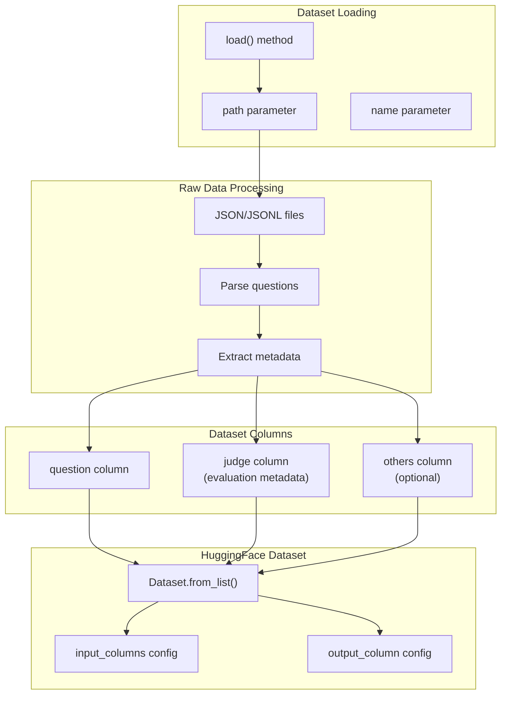

Sources: [opencompass/datasets/subjective/writingbench.py:46-78](), [opencompass/datasets/subjective/compassbench_checklist.py:13-39]()

### Required Dataset Columns

Subjective datasets typically include these columns:

| Column | Type | Purpose | Example |
|--------|------|---------|---------|
| `question` | str | The prompt/query for the model | `"Write an essay about..."` |
| `judge` | dict | Metadata for evaluation | `{"category": "writing", "criteria": [...]}` |
| `checklist` | str (optional) | Evaluation checklist items | `"- Clear structure\n- Good grammar"` |
| `reference` | str (optional) | Reference answer (rarely used) | `"Example answer..."` |

### Judge Metadata Structure

The `judge` column contains evaluation metadata in dictionary format:

```python
judge = {
    'category': str,              # Capability category
    'domain': str,                # Domain area (optional)
    'difficulty': str,            # Difficulty level (optional)
    'criteria': list,             # Evaluation criteria (optional)
    'judge_prompt_list': list,    # Multiple judge prompts (optional)
    'id': str,                    # Unique identifier
    'question': str,              # Copy of original question
}
```

Sources: [opencompass/datasets/subjective/writingbench.py:67-76](), [opencompass/datasets/subjective/compassbench_checklist.py:31-36]()

## Evaluation Modes

Subjective datasets support different evaluation modes that determine how model responses are compared and scored.

### Mode Types

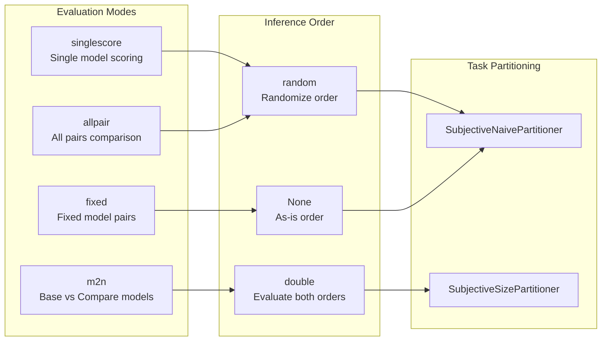

Sources: [opencompass/partitioners/sub_naive.py:107-124](), [opencompass/tasks/subjective_eval.py:58-60]()

### Mode Descriptions

| Mode | Use Case | Model Selection | Example |
|------|----------|-----------------|---------|
| `singlescore` | Absolute quality scoring | Evaluate each model independently | Rate response quality 1-10 |
| `allpair` | Round-robin comparison | All possible model pairs | Which is better: A or B? |
| `m2n` | Base model comparison | Base models vs compare models | Compare baseline vs new models |
| `fixed` | Predefined pairs | Use pre-specified model pairs | Compare specific model combinations |

### Inference Order Options

| Order | Behavior | Purpose |
|-------|----------|---------|
| `random` | Randomize model order for each comparison | Mitigate position bias |
| `double` | Evaluate both (A,B) and (B,A) orderings | Detect and measure position bias |
| `None` | Maintain original order | For single-score evaluation |

Sources: [opencompass/partitioners/sub_naive.py:193-196](), [opencompass/openicl/icl_evaluator/lm_evaluator.py:67-88]()

## Dataset Loading Pattern

All subjective datasets follow a common pattern for registration and loading.

### Registration and Loading Flow

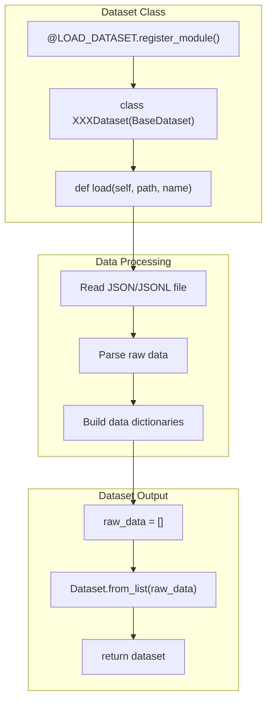

Sources: [opencompass/datasets/subjective/writingbench.py:46-78](), [opencompass/datasets/subjective/compassbench_checklist.py:13-39]()

### Example: WritingBenchDataset Implementation

The `WritingBenchDataset` demonstrates the typical loading pattern:

```python
@LOAD_DATASET.register_module()
class WritingBenchDataset(BaseDataset):
    
    def load(self, path: str, name: str, *args, **kwargs):
        path = get_data_path(path, local_mode=True)
        filename = osp.join(path, f'{name}.jsonl')
        raw_data = []
        
        with open(filename, 'r', encoding='utf-8') as f:
            for line in f:
                data = json.loads(line)
                # Extract multi-criteria evaluation
                judge_prompt_list = []
                for criteria_item in data['criteria']:
                    temp_prompt = base_prompt.format(
                        question=data['query'],
                        criteria=criteria_item,
                        prediction='{prediction}'
                    )
                    judge_prompt_list.append(temp_prompt)
                
                raw_data.append({
                    'question': data['query'],
                    'judge': {
                        'index': data['index'],
                        'domain1': data['domain1'],
                        'domain2': data['domain2'],
                        'query': data['query'],
                        'judge_prompt_list': judge_prompt_list
                    }
                })
        
        dataset = Dataset.from_list(raw_data)
        return dataset
```

Sources: [opencompass/datasets/subjective/writingbench.py:46-78]()

### Example: CompassBenchChecklistDataset Implementation

The `CompassBenchCheklistDataset` shows how to handle checklist-based evaluation:

```python
@LOAD_DATASET.register_module()
class CompassBenchCheklistDataset(BaseDataset):
    
    def load(self, path: str, name: str, *args, **kwargs):
        path = get_data_path(path, local_mode=True)
        filename = osp.join(path, f'{name}.json')
        raw_data = []
        
        with open(filename, 'r', encoding='utf-8') as f:
            json_data = json.load(f)
            for problem in json_data:
                question = problem['instruction']
                # Format checklist as markdown
                checklist_markdown = ''
                if problem.get('checklist', None):
                    for checklist_item in problem['checklist']:
                        checklist_markdown += f'- {checklist_item}\n'
                
                raw_data.append({
                    'question': question,
                    'checklist': checklist_markdown,
                    'judge': {
                        'category': problem.get('category', None),
                        'lan': problem.get('lan', None),
                        'id': problem.get('id', None),
                        'question': question
                    }
                })
        
        dataset = Dataset.from_list(raw_data)
        return dataset
```

Sources: [opencompass/datasets/subjective/compassbench_checklist.py:13-39]()
</old_str>
<new_str>
## Available Subjective Benchmarks

OpenCompass provides a comprehensive collection of subjective evaluation benchmarks covering various capabilities:

### Benchmark Catalog

| Benchmark | Purpose | Evaluation Type | File Location |
|-----------|---------|-----------------|---------------|
| `AlignmentBenchDataset` | Chinese LLM alignment evaluation | Single-score | [opencompass/datasets/subjective/alignbench.py]() |
| `MTBenchDataset` | Multi-turn conversation quality | Single-score | [opencompass/datasets/subjective/mtbench.py]() |
| `MTBench101Dataset` | Extended multi-turn evaluation | Single-score | [opencompass/datasets/subjective/mtbench101.py]() |
| `ArenaHardDataset` | Challenging question answering | Pairwise comparison | [opencompass/datasets/subjective/arena_hard.py]() |
| `WildBenchDataset` | Real-world user queries | Pairwise comparison | [opencompass/datasets/subjective/wildbench.py]() |
| `AlpacaEvalDataset` | Instruction following | Pairwise comparison | [opencompass/datasets/subjective/alpacaeval.py]() |
| `WritingBenchDataset` | Writing quality assessment | Multi-criteria scoring | [opencompass/datasets/subjective/writingbench.py]() |
| `CompassBenchDataset` | Comprehensive capability evaluation | Multiple modes | [opencompass/datasets/subjective/compassbench.py]() |
| `CompassArenaDataset` | Arena-style model comparison | Pairwise comparison | [opencompass/datasets/subjective/compass_arena.py]() |
| `FollowBenchDataset` | Instruction following evaluation | Single-score | [opencompass/datasets/subjective/followbench.py]() |
| `CreationBenchDataset` | Creative content generation | Single-score | [opencompass/datasets/subjective/creationbench.py]() |
| `Corev2Dataset` | Core capabilities evaluation | Single-score | [opencompass/datasets/subjective/corev2.py]() |
| `MultiroundDataset` | Multi-round dialogue evaluation | Single-score | [opencompass/datasets/subjective/multiround.py]() |
| `FofoDataset` | Format following evaluation | Single-score | [opencompass/datasets/subjective/fofo.py]() |
| `FlamesDataset` | Safety and harmlessness | Single-score | [opencompass/datasets/subjective/flames.py]() |

Sources: [opencompass/datasets/subjective/__init__.py:1-38]()

### Benchmark Categories

#### Alignment and Safety
- **AlignmentBench**: Evaluates Chinese LLM alignment across dimensions like helpfulness, honesty, and harmlessness
- **Flames**: Focuses on safety and harmlessness evaluation

#### Conversation Quality
- **MTBench**: Multi-turn conversation quality across writing, roleplay, reasoning, math, coding, extraction, STEM, and humanities
- **MTBench101**: Extended version with more diverse conversation scenarios
- **Multiround**: Evaluates multi-round dialogue capabilities

#### Instruction Following
- **FollowBench**: Measures how well models follow complex instructions
- **Fofo**: Evaluates format following capabilities
- **AlpacaEval**: Tests instruction following with diverse user queries

#### Comparative Evaluation
- **ArenaHard**: Challenging questions requiring expert-level responses
- **WildBench**: Real-world user queries with pairwise model comparison
- **CompassArena**: Arena-style evaluation across multiple dimensions

#### Creative and Writing Tasks
- **WritingBench**: Multi-criteria evaluation of writing quality
- **CreationBench**: Evaluates creative content generation

#### Comprehensive Benchmarks
- **CompassBench**: Comprehensive evaluation framework covering language, reasoning, knowledge, math, code, and more
- **Corev2**: Core capability evaluation across multiple dimensions

Sources: [opencompass/datasets/subjective/__init__.py:1-38]()

## Architecture Overview

The subjective evaluation system consists of several key components that work together to process datasets, generate model responses, and evaluate them using judge models.

### Core Component Flow

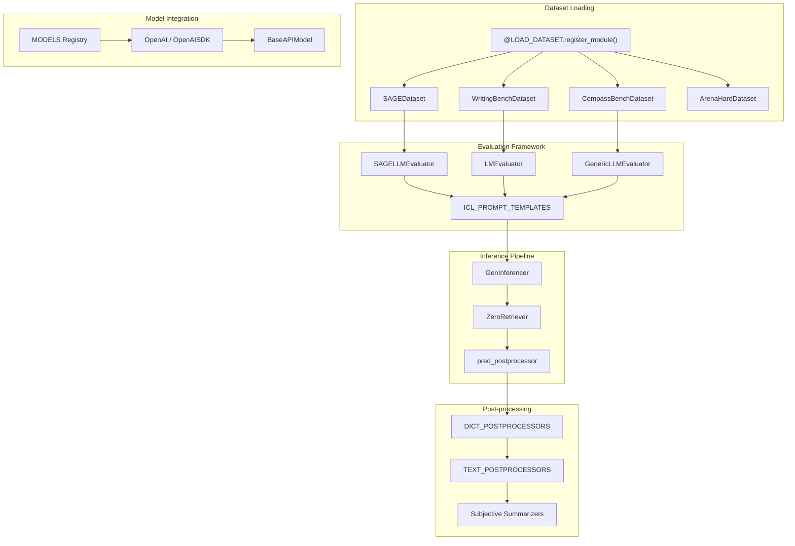

Sources: [opencompass/datasets/subjective/__init__.py:1-38](), [opencompass/openicl/icl_evaluator/lm_evaluator.py:102-368](), [opencompass/evaluator/generic_llm_evaluator.py:21-221]()

## Dataset Loading and Registration

Subjective evaluation datasets are registered using the `@LOAD_DATASET.register_module()` decorator and inherit from `BaseDataset`. Each dataset implements a `load()` method that processes raw data and returns a HuggingFace `Dataset` object.

### Dataset Registration Pattern

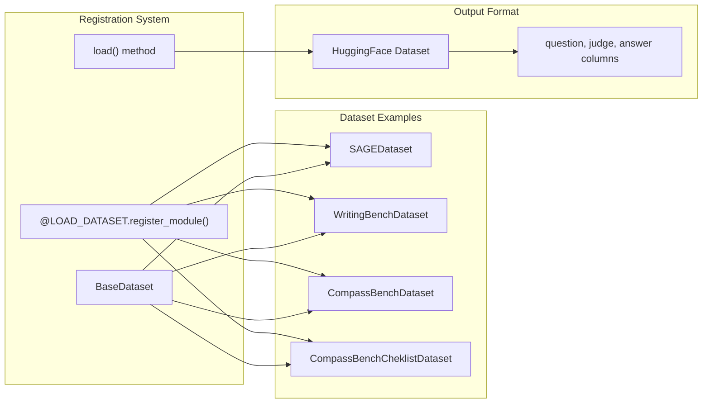

### Key Dataset Implementations

| Dataset | Purpose | Judge Type | File Location |
|---------|---------|------------|---------------|
| `SAGEDataset` | Scientific reasoning evaluation | Multi-judge LLM | [opencompass/datasets/sage/dataset_loader.py:7-19]() |
| `WritingBenchDataset` | Writing quality assessment | Single-score LLM | [opencompass/datasets/subjective/writingbench.py:46-78]() |
| `CompassBenchDataset` | General capability comparison | Pairwise comparison | [opencompass/datasets/subjective/compassbench.py:77-102]() |
| `CompassBenchCheklistDataset` | Checklist-based evaluation | Single-score LLM | [opencompass/datasets/subjective/compassbench_checklist.py:13-39]() |

Sources: [opencompass/datasets/subjective/__init__.py:1-38](), [opencompass/datasets/sage/dataset_loader.py:7-19](), [opencompass/datasets/subjective/writingbench.py:46-78]()

## LLM-as-Judge Evaluation System

The core of subjective evaluation relies on language models acting as judges. OpenCompass provides several evaluator classes that coordinate model inference for evaluation purposes.

### Evaluator Architecture

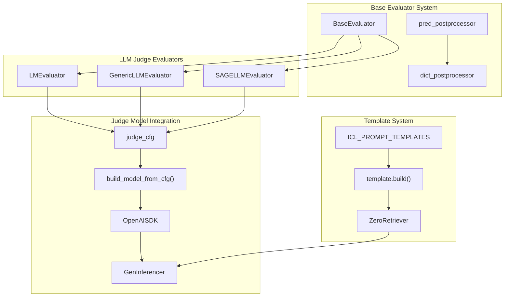

### Multi-Judge Consensus System

The `SAGELLMEvaluator` implements a sophisticated multi-judge system where multiple LLM judges evaluate the same response and their judgments are aggregated through majority voting.

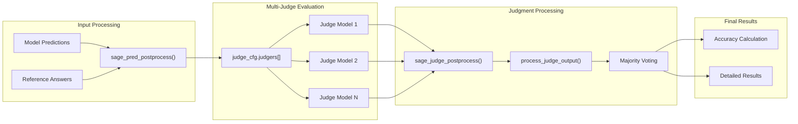

Sources: [opencompass/datasets/sage/evaluation.py:187-408](), [opencompass/openicl/icl_evaluator/lm_evaluator.py:102-368]()

## Prompt Templates and Evaluation Protocols

Subjective evaluation relies heavily on carefully crafted prompt templates that instruct judge models on how to evaluate responses. Different datasets use different evaluation protocols.

### SAGE Evaluation Protocol

The SAGE dataset uses a structured evaluation protocol with specific grading criteria:

| Grade | Label | Description |
|-------|--------|-------------|
| A | CORRECT | Exact or semantically equivalent match |
| B | INCORRECT | Any deviation from standard answer |
| C | INVALID | Incomplete, repetitive, or refusal |

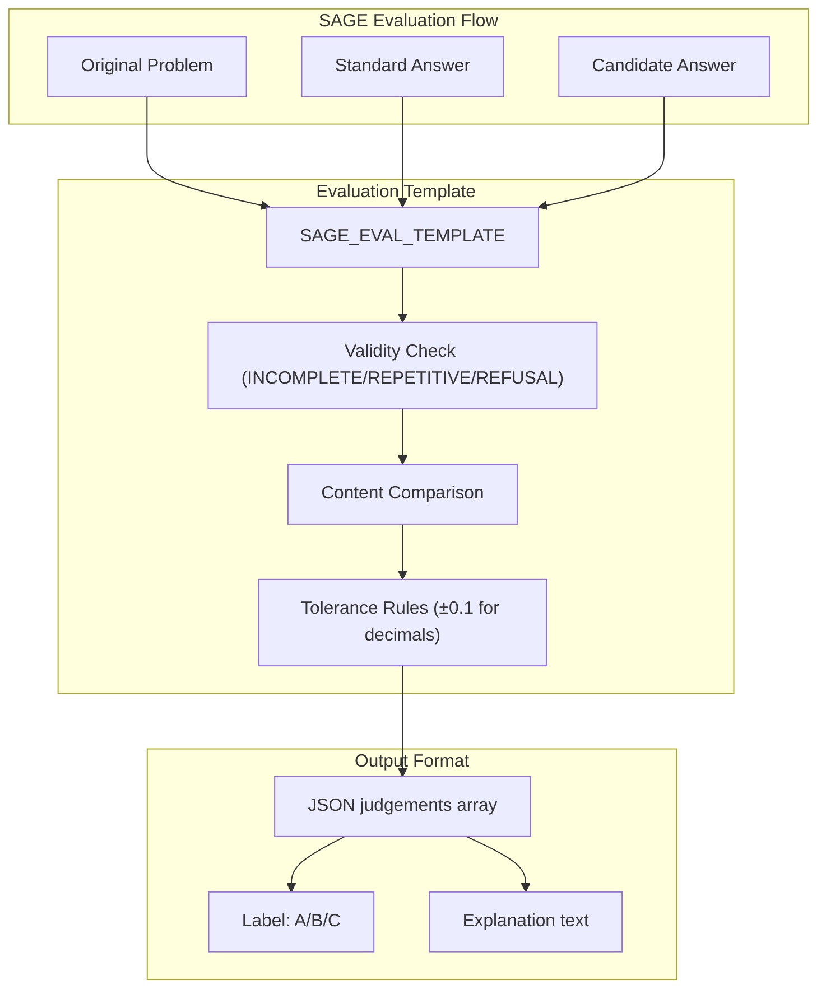

Sources: [opencompass/datasets/sage/prompt.py:30-154](), [opencompass/configs/datasets/sage/sage_val_gen_906a48.py:39-163]()

### WritingBench Multi-Criteria Evaluation

WritingBench evaluates writing quality across multiple criteria, with each criterion generating a separate judge prompt:

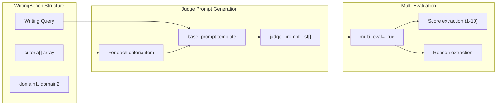

Sources: [opencompass/datasets/subjective/writingbench.py:15-93](), [opencompass/configs/datasets/subjective/writingbench/writingbench_judge.py:1-70]()

## Post-processing and Result Aggregation

Subjective evaluation results require specialized post-processing to extract scores, handle judge model outputs, and compute final metrics.

### Post-processing Pipeline

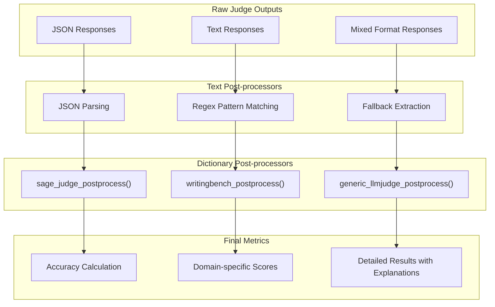

### Score Extraction Patterns

Different datasets use different patterns for extracting scores from judge model outputs:

| Dataset | Pattern | Example |
|---------|---------|---------|
| SAGE | JSON with judgements array | `{"judgements": [{"label": "A", "explanation": "..."}]}` |
| WritingBench | JSON with score field | `{"score": 8, "reason": "..."}` |
| Generic LLM Judge | Letter grade in text | `xxx[[A]]xxx` or `Choice: [[B]]` |

Sources: [opencompass/datasets/sage/evaluation.py:88-184](), [opencompass/datasets/subjective/writingbench.py:81-116](), [opencompass/datasets/generic.py:60-111]()

## Judge Model Configuration

Judge models are typically API-based language models configured with specific parameters for evaluation tasks. The system supports various judge model configurations through the `judge_cfg` parameter.

### Default Judge Configuration

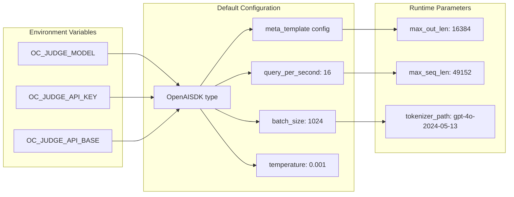

Sources: [opencompass/evaluator/generic_llm_evaluator.py:194-221](), [opencompass/datasets/sage/evaluation.py:381-407]()

## Summarization and Reporting

Subjective evaluation results are summarized using specialized summarizer classes that aggregate scores across different dimensions and generate reports.

### Summarizer Architecture

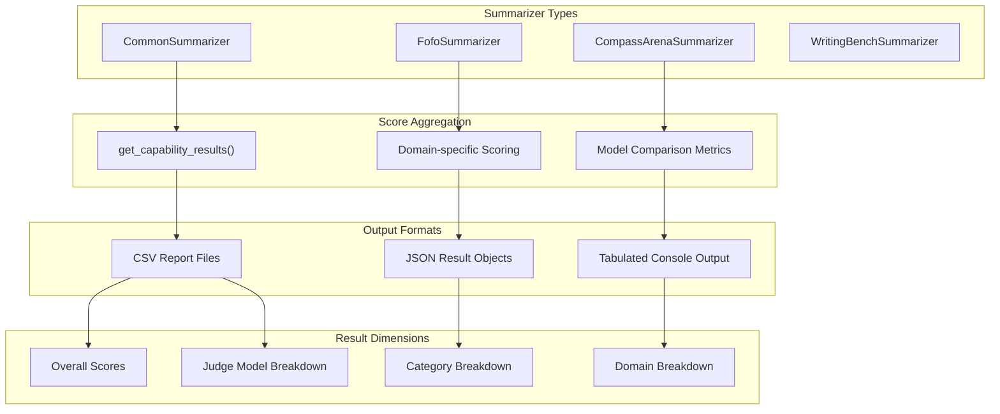

Sources: [opencompass/summarizers/subjective/common_summarizer.py:79-151](), [opencompass/summarizers/subjective/fofo.py:40-164](), [opencompass/summarizers/subjective/__init__.py:1-22]()

---

