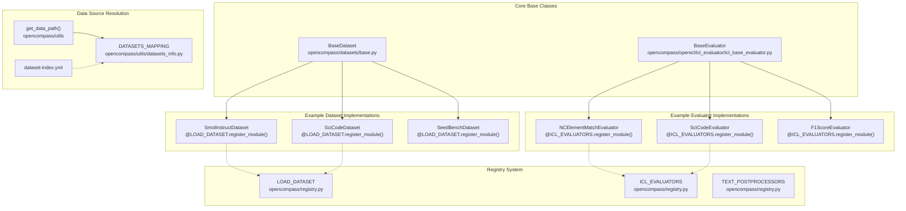
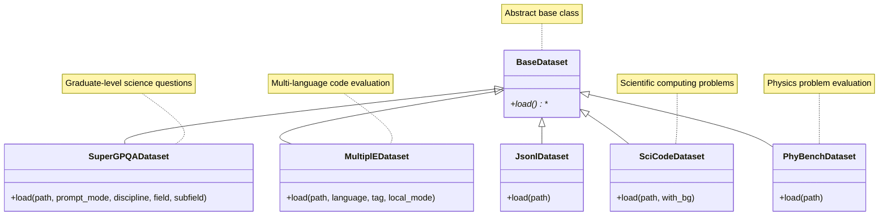
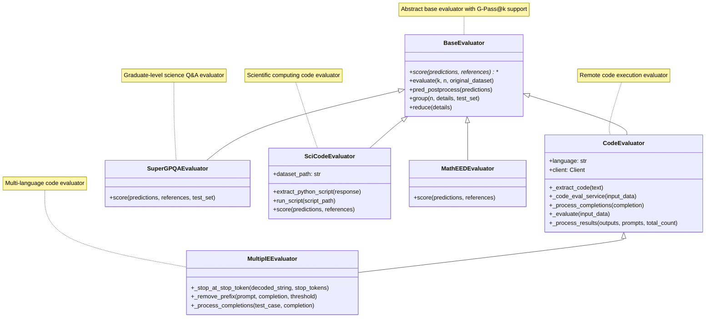
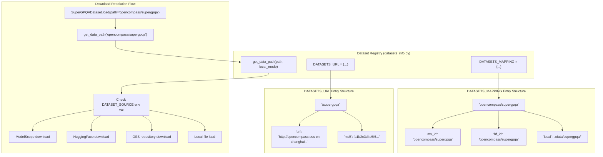
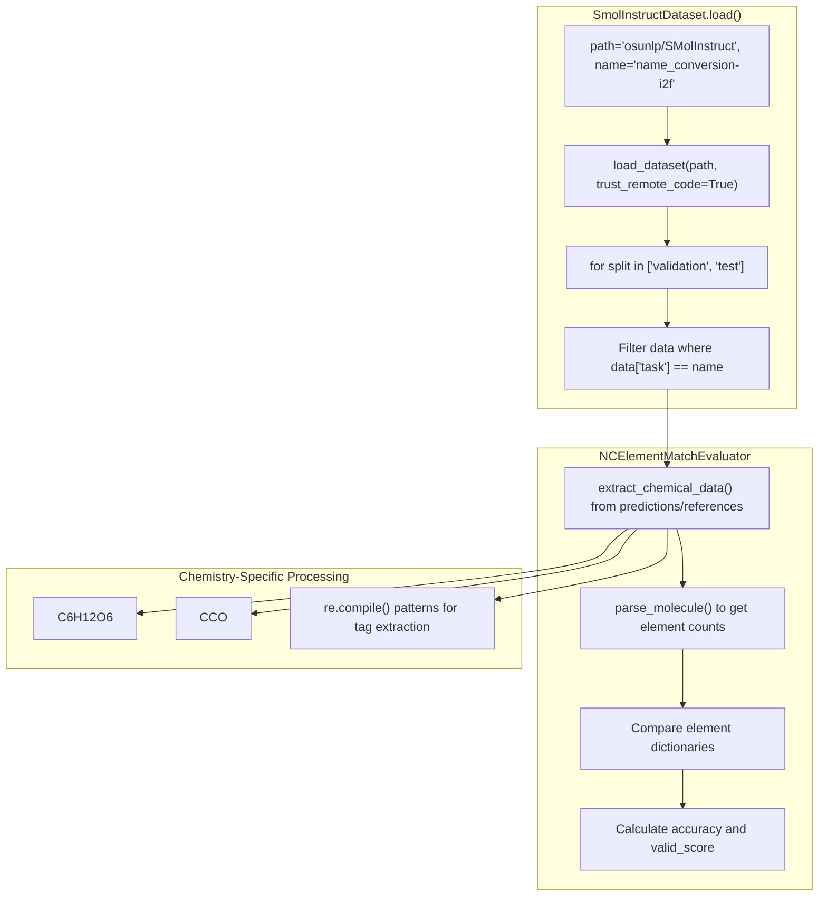
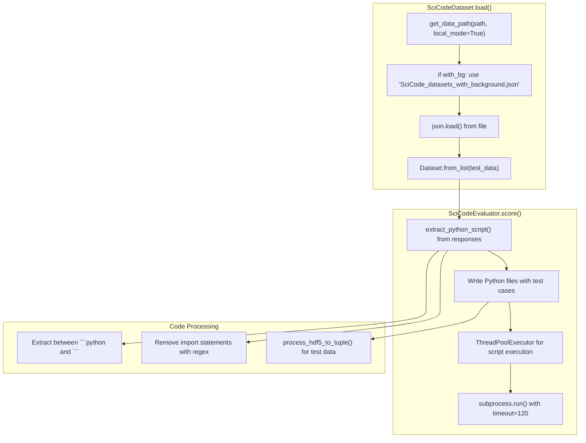

<!-- source: DeepWiki mcp.deepwiki.com · repo open-compass/opencompass · page 5.4 Creating Custom Datasets · fetched 2026-10-21 -->

# Creating Custom Datasets

<details>
<summary>Relevant source files</summary>

The following files were used as context for generating this wiki page:

- [dataset-index.yml](dataset-index.yml)
- [docs/en/get_started/faq.md](docs/en/get_started/faq.md)
- [docs/en/get_started/quick_start.md](docs/en/get_started/quick_start.md)
- [docs/en/notes/contribution_guide.md](docs/en/notes/contribution_guide.md)
- [docs/en/user_guides/experimentation.md](docs/en/user_guides/experimentation.md)
- [docs/zh_cn/get_started/faq.md](docs/zh_cn/get_started/faq.md)
- [docs/zh_cn/get_started/quick_start.md](docs/zh_cn/get_started/quick_start.md)
- [docs/zh_cn/notes/contribution_guide.md](docs/zh_cn/notes/contribution_guide.md)
- [docs/zh_cn/user_guides/experimentation.md](docs/zh_cn/user_guides/experimentation.md)
- [opencompass/cli/main.py](opencompass/cli/main.py)
- [opencompass/configs/datasets/IFBench/IFBench_gen.py](opencompass/configs/datasets/IFBench/IFBench_gen.py)
- [opencompass/configs/datasets/MedCalc_Bench/MedCalcBench_official_gen_a5155f.py](opencompass/configs/datasets/MedCalc_Bench/MedCalcBench_official_gen_a5155f.py)
- [opencompass/configs/datasets/srbench/srbench_gen.py](opencompass/configs/datasets/srbench/srbench_gen.py)
- [opencompass/configs/summarizers/groups/biodata.py](opencompass/configs/summarizers/groups/biodata.py)
- [opencompass/datasets/IFBench/evaluation_lib.py](opencompass/datasets/IFBench/evaluation_lib.py)
- [opencompass/datasets/IFBench/ifbench.py](opencompass/datasets/IFBench/ifbench.py)
- [opencompass/datasets/IFBench/instructions.py](opencompass/datasets/IFBench/instructions.py)
- [opencompass/datasets/IFBench/instructions_registry.py](opencompass/datasets/IFBench/instructions_registry.py)
- [opencompass/datasets/IFBench/instructions_util.py](opencompass/datasets/IFBench/instructions_util.py)
- [opencompass/datasets/MedCalc_Bench.py](opencompass/datasets/MedCalc_Bench.py)
- [opencompass/datasets/__init__.py](opencompass/datasets/__init__.py)
- [opencompass/datasets/scicode.py](opencompass/datasets/scicode.py)
- [opencompass/datasets/srbench.py](opencompass/datasets/srbench.py)
- [opencompass/openicl/icl_retriever/icl_votek_retriever.py](opencompass/openicl/icl_retriever/icl_votek_retriever.py)
- [opencompass/partitioners/base.py](opencompass/partitioners/base.py)
- [opencompass/utils/datasets_info.py](opencompass/utils/datasets_info.py)
- [opencompass/utils/result_station.py](opencompass/utils/result_station.py)
- [opencompass/utils/run.py](opencompass/utils/run.py)
- [requirements/extra.txt](requirements/extra.txt)
- [run.py](run.py)

</details>


This guide explains how to create and integrate custom datasets into OpenCompass. It covers all aspects from basic dataset loading to custom evaluation metrics, enabling you to evaluate language models on specialized datasets not included in the standard benchmarks.

For information on using existing datasets, see [Objective Evaluation Datasets](#5.1) and [Subjective Evaluation Datasets](#5.2).

## Overview of the Dataset System

OpenCompass provides a flexible framework for creating custom datasets that can be seamlessly integrated into the evaluation pipeline. The dataset system consists of several key components:

1. **Dataset Classes**: Classes inheriting from `BaseDataset` that implement the `load` method for data loading
2. **Evaluators**: Classes inheriting from `BaseEvaluator` that implement the `score` method for evaluation logic
3. **Registry System**: `@LOAD_DATASET.register_module()` and `@ICL_EVALUATORS.register_module()` decorators for component discovery
4. **Dataset Mapping**: `DATASETS_MAPPING` dictionary in `opencompass/utils/datasets_info.py` for data source configuration
5. **Dataset Index**: `dataset-index.yml` for metadata and documentation
6. **Configuration**: Dataset configuration files specifying `reader_cfg`, `infer_cfg`, and `eval_cfg`

Dataset System Architecture with Code Entities


Sources:
- [opencompass/datasets/__init__.py:1-182]()
- [opencompass/datasets/smolinstruct.py:17-31]()
- [opencompass/datasets/scicode.py:23-42]()
- [opencompass/datasets/SeedBench.py:19-48]()
- [opencompass/utils/datasets_info.py:1-507]()
- [dataset-index.yml:1-810]()

## Creating a Custom Dataset Class

To create a custom dataset, you need to define a dataset class that inherits from `BaseDataset` and implements the `load` method.

### Dataset Class Inheritance Hierarchy

Dataset Class Inheritance


Sources:
- [opencompass/datasets/supergpqa/supergpqa.py:28-67]()
- [opencompass/datasets/multipl_e.py:26-60]()
- [opencompass/datasets/scicode.py:22-42]()
- [opencompass/datasets/phybench/phybench.py:14-29]()

### Implementation Steps

1. **Create a new dataset file**: Add a new Python file in the `opencompass/datasets/` directory (e.g., `mydataset.py`).

2. **Define your dataset class**: Create a class that inherits from `BaseDataset` and implements the `load` method.

3. **Register your dataset**: Use the `@LOAD_DATASET.register_module()` decorator to register your dataset.

4. **Add to `__init__.py`**: Import your dataset in [opencompass/datasets/__init__.py:1-182]() to make it available.

Here's a practical example following the `SmolInstructDataset` pattern for HuggingFace datasets:

```python
from datasets import Dataset, DatasetDict, load_dataset
from opencompass.registry import LOAD_DATASET
from .base import BaseDataset

@LOAD_DATASET.register_module()
class MySimpleDataset(BaseDataset):
    @staticmethod
    def load(path: str, name: str):
        dataset = DatasetDict()
        raw_dataset = load_dataset(path, trust_remote_code=True)
        for split in ['validation', 'test']:
            raw_data = []
            for data in raw_dataset[split]:
                if data['task'] == name:
                    raw_data.append(data)
            dataset[split] = Dataset.from_list(raw_data)
        return dataset
```

For datasets with custom data processing, follow the `SciCodeDataset` pattern:

```python
import json
import os.path as osp
from datasets import Dataset
from opencompass.registry import LOAD_DATASET
from opencompass.utils import get_data_path
from .base import BaseDataset

@LOAD_DATASET.register_module()
class MyComplexDataset(BaseDataset):
    @staticmethod
    def load(path, with_bg, **kwargs):
        test_data = []
        path = get_data_path(path, local_mode=True)
        if with_bg:  # test with background
            file_path = osp.join(path, 'dataset_with_background.json')
        else:  # test w/o background
            file_path = osp.join(path, 'dataset.json')

        with open(file_path, 'r', encoding='utf-8') as file:
            test_data = json.load(file)

        dataset = Dataset.from_list(test_data)
        return dataset
```

For datasets requiring environment-based loading, follow the `SeedBenchDataset` pattern:

```python
import datasets
from os import environ
from opencompass.registry import LOAD_DATASET
from opencompass.utils import get_data_path
from .base import BaseDataset

@LOAD_DATASET.register_module()
class MyEnvironmentDataset(BaseDataset):
    @staticmethod
    def load(data_files: str, path: str, split: str = None, **kwargs) -> datasets.Dataset:
        path = get_data_path(path)
        if environ.get('DATASET_SOURCE') == 'ModelScope':
            from modelscope import MsDataset
            dataset = MsDataset.load(path,
                                   subset_name='default',
                                   split=split,
                                   data_files=data_files,
                                   **kwargs)
        else:
            dataset = datasets.load_dataset(path,
                                          data_files=data_files,
                                          **kwargs)

        if split is None:
            split = list(dataset.keys())[0]
        return dataset[split]
```

Key requirements for the `load` method:
- Accept a `path` parameter and optional keyword arguments
- Use `get_data_path()` for path resolution when working with local files
- Return a Hugging Face `datasets.Dataset` object
- Handle data format conversion and preprocessing
- Support both local files and HuggingFace datasets

Sources:
- [opencompass/datasets/dingo.py:18-32]()
- [opencompass/datasets/livemathbench/livemathbench.py:27-107]()
- [opencompass/datasets/base.py:11-61]()
- [opencompass/utils/datasets_info.py:1-479]()

## Creating a Custom Evaluator

If your dataset requires custom evaluation logic, you'll need to create an evaluator class.

### Evaluator Class Hierarchy

Evaluator Class Structure


Sources:
- [opencompass/openicl/icl_evaluator/icl_base_evaluator.py:45-244]()
- [opencompass/openicl/icl_evaluator/code_evaluator.py:17-238]()
- [opencompass/datasets/supergpqa/supergpqa.py:69-197]()
- [opencompass/datasets/scicode.py:218-362]()
- [opencompass/datasets/phybench/phybench.py:31-40]()
- [opencompass/datasets/multipl_e.py:63-139]()

### Implementation Steps

1. **Create an evaluator class**: Define a class that inherits from `BaseEvaluator`.

2. **Implement the `score` method**: This method should take model predictions and reference answers and return a score.

3. **Register your evaluator**: Use the `@ICL_EVALUATORS.register_module()` decorator.

4. **Handle details for G-Pass@k**: Return detailed results to support multi-run evaluations.

Example following the `DingoEvaluator` pattern for external tool evaluation:

```python
import time
import os
import json
from typing import List, Dict
from opencompass.openicl.icl_evaluator import BaseEvaluator
from opencompass.registry import ICL_EVALUATORS

@ICL_EVALUATORS.register_module()
class MyExternalToolEvaluator(BaseEvaluator):
    def score(self, origin_prompt: List, predictions: List) -> dict:
        try:
            from external_tool import Executor, InputArgs
        except Exception:
            raise ModuleNotFoundError(
                'External tool not found. Please install: pip install external-tool')

        # Create temporary file for evaluation
        current_time = time.strftime('%Y%m%d_%H%M%S', time.localtime())
        file_data = [{'prompt': pmt, 'prediction': prd}
                     for pmt, prd in zip(origin_prompt, predictions)]
        os.makedirs('tmp', exist_ok=True)
        file_name = os.path.join('tmp', f'eval_file_{current_time}.jsonl')

        with open(file_name, 'a', encoding='utf-8') as f:
            for d in file_data:
                json.dump(d, f, ensure_ascii=False)
                f.write('\n')
                
        # Configure external tool
        input_data = {
            'eval_group': 'llm_base',
            'input_path': file_name,
            'output_path': './outputs/evaluation/',
            'save_data': True,
            'dataset': 'local',
            'data_format': 'jsonl',
            'column_prompt': 'prompt',
            'column_content': 'prediction',
        }
        
        try:
            input_args = InputArgs(**input_data)
            executor = Executor.exec_map['local'](input_args)
            result = executor.execute()
            summary = result[0].to_dict()
        except Exception:
            raise
        finally:
            os.remove(file_name)
        return summary
```

For complex LLM-as-judge evaluation, follow the `LiveMathBenchEvaluator` pattern:

```python
import warnings
from concurrent.futures import ThreadPoolExecutor, as_completed
from functools import partial
from typing import List, Dict
from opencompass.openicl.icl_evaluator import BaseEvaluator
from opencompass.registry import ICL_EVALUATORS, MODELS
from opencompass.models import OpenAISDK

@ICL_EVALUATORS.register_module()
class MyLLMJudgeEvaluator(BaseEvaluator):
    def __init__(self, model_name, url, **kwargs):
        super().__init__()
        
        if isinstance(url, str):
            url = [url]
            
        if model_name == '' or len(url) == 0:
            warnings.warn('LLM-as-judge parameters incomplete, '
                         'falling back to rule-based evaluation')
            self.judge_models = []
        else:
            self.judge_models = [
                MODELS.build(dict(
                    type=OpenAISDK,
                    path=model_name,
                    openai_api_base=_url,
                    key='EMPTY',
                    query_per_second=2,
                    retry=5,
                    temperature=0.0,
                    max_seq_len=16384,
                )) for _url in url
            ]

    def batch_infer(self, models: List[OpenAISDK], inputs: List[str],
                    completed_indexes: set, postprocess) -> List[str]:
        batch_size = 16
        batch_num = (len(inputs) + batch_size - 1) // batch_size
        
        def thread_worker(inputs, model):
            return model.generate(inputs, 8192, 0.0), inputs
            
        with ThreadPoolExecutor(max_workers=len(models)) as pool:
            tasks = [
                pool.submit(partial(thread_worker, model=models[i % len(models)]),
                           inputs[i * batch_size:(i + 1) * batch_size])
                for i in range(batch_num)
            ]
            results = []
            for completed_task in as_completed(tasks):
                responses, current_inputs = completed_task.result()
                for response in responses:
                    results.append(postprocess(response))
        return results

    def score(self, predictions, references, test_set) -> Dict:
        if len(self.judge_models) > 0:
            # Use LLM-as-judge
            judge_prompts = [
                f"Judge if the prediction matches the reference.\n"
                f"Prediction: {pred}\nReference: {ref}\n"
                f"Answer: Yes/No"
                for pred, ref in zip(predictions, references)
            ]
            labels = self.batch_infer(
                self.judge_models, judge_prompts, set(),
                lambda x: 1 if 'yes' in x.lower() else 0
            )
        else:
            # Rule-based fallback
            labels = [1 if pred.strip() == ref.strip() else 0 
                     for pred, ref in zip(predictions, references)]
        
        return {
            'accuracy': 100 * sum(labels) / len(labels),
            'details': [{'pred': p, 'ref': r, 'correct': l} 
                       for p, r, l in zip(predictions, references, labels)]
        }
```

Key evaluator patterns:
- `score()` method signature: `(predictions, references, test_set=None)`
- Return dictionary with metrics and `details` list for G-Pass@k support
- Handle external dependencies with proper error messages
- Support both rule-based and LLM-as-judge evaluation modes
- Use concurrent execution for batch processing

Sources:
- [opencompass/datasets/dingo.py:47-90]()
- [opencompass/datasets/livemathbench/livemathbench.py:109-327]()
- [opencompass/openicl/icl_evaluator/icl_base_evaluator.py:45-244]()
- [requirements/extra.txt:1-26]()

## Post-Processing Predictions

Sometimes you need to post-process model predictions before evaluation. OpenCompass provides a registry for post-processing functions.

### Implementing a Custom Post-Processor

Create a post-processing function and register it with the `TEXT_POSTPROCESSORS` registry. Here are examples from the codebase:

```python
from opencompass.registry import TEXT_POSTPROCESSORS
import re

@TEXT_POSTPROCESSORS.register_module('smolinstruct-acc-0shot')
def smolinstruct_acc_0shot_postprocess(text: str) -> str:
    # Remove ' in text:
        text = text.split('</think>')[-1].strip()

    # Check for exact "yes" or "no" responses
    if text.strip().lower() == 'yes':
        return '<BOOLEAN> Yes </BOOLEAN>'
    elif text.strip().lower() == 'no':
        return '<BOOLEAN> No </BOOLEAN>'

    # Define regex patterns to match various formats
    patterns = [
        r'\\boxed\{\s*(yes|no)\s*\}',
        r'[Th]he\s+answer\s+is\s*[\.:\'""''\-]*\s*(yes|no)[\s\.,!?:;\'""'\-]*',
        r'[Aa]nswer:\s*(yes|no)\b',
        r'^\s*(yes|no)[\.\?!]?\s*$'
    ]
    for pattern in patterns:
        match = re.search(pattern, text, flags=re.IGNORECASE)
        if match:
            answer = match.group(1)
            if answer.lower() == 'yes':
                return '<BOOLEAN> Yes </BOOLEAN>'
            elif answer.lower() == 'no':
                return '<BOOLEAN> No </BOOLEAN>'

    return ''

@TEXT_POSTPROCESSORS.register_module('my_multiple_select_postprocess')
def my_multiple_select_postprocess(text: str) -> str:
    # Extract multiple choice options (e.g., ABC -> A,B,C)
    selected_options = [t for t in text if t.isupper()]
    selected_options = sorted(set(selected_options))
    res = ', '.join(selected_options)
    return res
```

Sources:
- [opencompass/utils/text_postprocessors.py:1-285]()
- [docs/en/advanced_guides/new_dataset.md:31-36]()

## Dataset Configuration

After creating your dataset class and evaluator, you need to configure them for use in OpenCompass.

### Configuration Structure

A complete dataset configuration includes:

1. **Dataset type**: The registered class name (e.g., `SuperGPQADataset`)
2. **Dataset path**: Path handled by `DATASETS_MAPPING` 
3. **Reader configuration**: Input/output column mapping
4. **Inference configuration**: `PromptTemplate`, `ZeroRetriever`, `GenInferencer`
5. **Evaluation configuration**: Evaluator class and postprocessors

Configuration Component Structure

```mermaid
flowchart TD
    subgraph "Dataset Configuration Dict"
        abbr["abbr: 'dataset_name'"]
        type_field["type: SuperGPQADataset"]
        path_field["path: 'opencompass/dataset_path'"]
        reader_cfg_field["reader_cfg"]
        infer_cfg_field["infer_cfg"]
        eval_cfg_field["eval_cfg"]
    end
    
    subgraph "reader_cfg Components"
        input_columns["input_columns: ['question', 'A', 'B', 'C', 'D']"]
        output_column["output_column: 'answer_letter'"]
        train_split["train_split: 'train'"]
        test_split["test_split: 'test'"]
    end
    
    subgraph "infer_cfg Components"
        prompt_template["prompt_template: PromptTemplate"]
        retriever["retriever: ZeroRetriever"]
        inferencer["inferencer: GenInferencer"]
        template_dict["template: dict(round=[...])"]
    end
    
    subgraph "eval_cfg Components"
        evaluator_dict["evaluator: SuperGPQAEvaluator"]
        pred_postprocessor["pred_postprocessor: dict(type='postprocessor')"]
        GenericLLMEvaluator_option["evaluator: GenericLLMEvaluator"]
        dict_postprocessor["dict_postprocessor: generic_llmjudge_postprocess"]
    end
    
    reader_cfg_field --> input_columns
    reader_cfg_field --> output_column
    reader_cfg_field --> train_split
    reader_cfg_field --> test_split
    
    infer_cfg_field --> prompt_template
    infer_cfg_field --> retriever
    infer_cfg_field --> inferencer
    prompt_template --> template_dict
    
    eval_cfg_field --> evaluator_dict
    eval_cfg_field --> pred_postprocessor
    eval_cfg_field --> GenericLLMEvaluator_option
    eval_cfg_field --> dict_postprocessor
```


Sources:
- [opencompass/configs/datasets/supergpqa/supergpqa_llmjudge_gen_12b8bc.py:32-103]()
- [opencompass/configs/datasets/aime2024/aime2024_llmjudge_gen_5e9f4f.py:8-90]()
- [opencompass/configs/datasets/PHYBench/phybench_gen.py:6-41]()
- [opencompass/configs/datasets/musr/musr_llmjudge_gen_b47fd3.py:30-131]()

### Configuration Examples

Configuration structures show how datasets integrate with OpenCompass evaluation pipeline components:

**LiveMathBench Configuration with G-Pass@k Support**:

**SmolInstruct Configuration for Chemistry Tasks**:

Configuration from [opencompass/configs/datasets/SmolInstruct/smolinstruct_nc_0shot_instruct.py:31-64]():

```python
from opencompass.datasets.smolinstruct import NCExactMatchEvaluator, NCElementMatchEvaluator
from opencompass.datasets import SmolInstructDataset

nc_hint_dict = {
    'I2F': """You are an expert chemist. Given the IUPAC representation of compounds, your task is to predict the molecular formula of the compound.
    The input contains the IUPAC representation of the compound. Your reply should contain only the molecular formula of the compound wrapped in <MOLFORMULA> and </MOLFORMULA> tags and no other text.""",
    'S2F': """You are an expert chemist. Given the SMILES representation of compounds, your task is to predict the molecular formula of the compound.""",
}

name_dict = {
    'I2F': 'name_conversion-i2f',
    'S2F': 'name_conversion-s2f',
}

nc_0shot_instruct_datasets = []
for _name in name_dict:
    _hint = nc_hint_dict[_name]
    nc_0shot_infer_cfg = dict(
        prompt_template=dict(
            type=PromptTemplate,
            template=dict(round=[
                dict(role='HUMAN', prompt=f'{_hint}\nQuestion: {{input}}\nAnswer: '),
                dict(role='BOT', prompt='{output}\n')
            ]),
        ),
        retriever=dict(type=ZeroRetriever),
        inferencer=dict(type=GenInferencer),
    )
    
    if _name in ['I2F', 'S2F']:
        nc_0shot_eval_cfg = dict(evaluator=dict(type=NCElementMatchEvaluator))
    else:
        nc_0shot_eval_cfg = dict(evaluator=dict(type=NCExactMatchEvaluator))

    nc_0shot_instruct_datasets.append(dict(
        abbr=f'NC-{_name}-0shot-instruct',
        type=SmolInstructDataset,
        path='osunlp/SMolInstruct',
        name=name_dict[_name],
        reader_cfg=dict(input_columns=['input'], output_column='output', train_split='validation'),
        infer_cfg=nc_0shot_infer_cfg,
        eval_cfg=nc_0shot_eval_cfg,
    ))
```

**SeedBench Configuration with Multiple Task Types**:

Configuration from [opencompass/configs/datasets/SeedBench/seedbench_gen_5d5ea1.py:31-74]():

```python
from opencompass.datasets import SeedBenchDataset, F1ScoreEvaluator, AverageRougeScoreEvaluator
from opencompass.utils.text_postprocessors import first_option_postprocess

dataset_configs = [
    {'abbr': 'seedbench_1-1', 'data_file': '1-1.json', 'evaluator': 'AccEvaluator', 
     'pred_postprocessor': dict(type=first_option_postprocess, options='ABCD')},
    {'abbr': 'seedbench_1-2', 'data_file': '1-2.json', 'evaluator': 'F1ScoreEvaluator',
     'pred_postprocessor': dict(type='my_multiple_select_postprocess')},
    {'abbr': 'seedbench_1-3', 'data_file': '1-3.json', 'evaluator': 'AverageRougeScoreEvaluator'},
    {'abbr': 'seedbench_3-5', 'data_file': '3-5.json', 'evaluator': 'AccScoreStr_Evaluator'},
]

seedbench_datasets = []
for stage in ['zero-shot','one-shot']:
    for config in dataset_configs:
        eval_cfg = dict(evaluator=dict(type=config['evaluator']))
        if 'pred_postprocessor' in config:
            eval_cfg['pred_postprocessor'] = config['pred_postprocessor']
        
        data_file = f"{stage}/{config['data_file']}"
        abbr_name = f"{config['abbr']}_{stage}"
        
        seedbench_datasets.append(dict(
            type=SeedBenchDataset,
            abbr=abbr_name,
            data_files=data_file,
            path='opencompass/seedbench',
            reader_cfg=dict(input_columns=['instruction', 'question'], output_column='answer'),
            infer_cfg=dict(
                prompt_template=dict(type=PromptTemplate, template='{instruction}\n{question}\n'),
                retriever=dict(type=ZeroRetriever),
                inferencer=dict(type=GenInferencer)
            ),
            eval_cfg=eval_cfg
        ))
```

**ChemBench Configuration with LLM Judge**:

Configuration from [opencompass/configs/datasets/ChemBench/ChemBench_llmjudge_gen_c584cf.py:42-108]():

```python
from opencompass.evaluator import GenericLLMEvaluator
from opencompass.datasets import ChemBenchDataset, generic_llmjudge_postprocess

GRADER_TEMPLATE = """
Please as a grading expert, judge whether the final answers given by the candidates below are consistent with the standard answers.
<Original Question Begin>: \n {{input}}\nA. {{A}}\nB. {{B}}\nC. {{C}}\nD. {{D}}\n<Original Question End>\n\n
<Gold Target Begin>: \n{target}\n<Gold Target End>\n\n
<Predicted Answer Begin>: \n{prediction}\n<Predicted End>\n\n
Please judge whether the following answers are consistent with the standard answer. Grade as:
A: CORRECT 
B: INCORRECT
Just return the letters "A" or "B", with no text around it.
""".strip()

chembench_all_sets = ['Name_Conversion', 'Property_Prediction', 'Mol2caption']

chembench_datasets = []
for _name in chembench_all_sets:
    chembench_eval_cfg = dict(
        evaluator=dict(
            type=GenericLLMEvaluator,
            prompt_template=dict(
                type=PromptTemplate,
                template=dict(round=[dict(role='HUMAN', prompt=GRADER_TEMPLATE)])
            ),
            dataset_cfg=dict(
                type=ChemBenchDataset,
                path='opencompass/ChemBench4K',
                name=_name,
                reader_cfg=dict(input_columns=['input', 'A', 'B', 'C', 'D'], output_column='target', train_split='dev'),
            ),
            judge_cfg=dict(),
            dict_postprocessor=dict(type=generic_llmjudge_postprocess),
        ),
        pred_role='BOT',
    )

    chembench_datasets.append(dict(
        abbr=f'ChemBench_{_name}',
        type=ChemBenchDataset,
        path='opencompass/ChemBench4K',
        name=_name,
        reader_cfg=dict(input_columns=['input', 'A', 'B', 'C', 'D'], output_column='target', train_split='dev'),
        infer_cfg=dict(
            prompt_template=dict(type=PromptTemplate, template=dict(round=[
                dict(role='HUMAN', prompt='Question: {{input}}\nA. {{A}}\nB. {{B}}\nC. {{C}}\nD. {{D}}\nAnswer: ')
            ])),
            retriever=dict(type=ZeroRetriever),
            inferencer=dict(type=GenInferencer)
        ),
        eval_cfg=chembench_eval_cfg,
    ))
```

**Configuration Component Mapping**:

| Configuration Section | Purpose | Key Classes |
|----------------------|---------|-------------|
| `reader_cfg` | Maps dataset fields to inference inputs | `DatasetReader` |
| `infer_cfg.prompt_template` | Formats prompts for model input | `PromptTemplate` |
| `infer_cfg.retriever` | Handles few-shot example selection | `ZeroRetriever` |
| `infer_cfg.inferencer` | Controls generation parameters | `GenInferencer` |
| `eval_cfg.evaluator` | Scores predictions vs references | Custom evaluator classes |

Sources:
- [opencompass/configs/datasets/livemathbench/livemathbench_gen_9befbf.py:1-45]()
- [opencompass/configs/datasets/dingo/dingo_gen.py:1-35]()
- [opencompass/datasets/base.py:13-49]()
- [opencompass/openicl/icl_prompt_template.py:1-50]()

## Registering Your Dataset for Download

To make your dataset accessible to other users, you need to register it in the `DATASETS_MAPPING` dictionary in [opencompass/utils/datasets_info.py:1-479]().

### Dataset Mapping System

Dataset Registration System


Sources:
- [opencompass/utils/datasets_info.py:1-479]()
- [opencompass/utils/datasets_info.py:481-857]()

### Implementation Steps

1. **Add an entry to `DATASETS_MAPPING`** in [opencompass/utils/datasets_info.py:1-507]():

```python
# Example following existing patterns from the codebase
"opencompass/my_dataset": {
    "ms_id": "opencompass/my_dataset",        # ModelScope ID (optional)
    "hf_id": "opencompass/my_dataset",        # Hugging Face ID (optional)  
    "local": "./data/my_dataset/",            # Default local path
},
```

Examples from the codebase:
```python
# From opencompass/utils/datasets_info.py
"opencompass/simpleqa": {
    "ms_id": "",
    "hf_id": "",
    "local": "./data/simpleqa/simple_qa_test_set.csv",
},
"opencompass/LiveMathBench": {
    "ms_id": "",
    "hf_id": "opencompass/LiveMathBench",
    "local": "./data/LiveMathBench/",
},
"opencompass/bigcodebench": {
    "ms_id": "",
    "hf_id": "",
    "local": "./data/bigcodebench/",
},
```

2. **Update your dataset's `load` method** to use `get_data_path()`:

```python
@staticmethod
def load(path: str, **kwargs):
    # get_data_path handles DATASET_SOURCE environment variable
    # and resolves to ModelScope, HuggingFace, OSS, or local paths
    path = get_data_path(path, local_mode=True)
    
    # Load the dataset from resolved path
    if os.path.isfile(path):
        dataset = Dataset.from_json(path)
    else:
        # Handle directory with multiple files
        dataset = load_dataset(path)
        
    return dataset
```

3. **For OSS Repository Hosting**: Add an entry to `DATASETS_URL` in [opencompass/utils/datasets_info.py:509-886]():

```python
# Examples from the codebase
"/simpleqa": {
    "url": "http://opencompass.oss-cn-shanghai.aliyuncs.com/datasets/data/simpleqa.zip",
    "md5": "1d83fc2e15798d39cb265c9a3cb5195a",
},
"/bigcodebench": {
    "url": "http://opencompass.oss-cn-shanghai.aliyuncs.com/datasets/data/bigcodebench.zip",
    "md5": "270f399f4142b74f47ecff116cc3b21d"
},
"/phybench": {
    "url": "http://opencompass.oss-cn-shanghai.aliyuncs.com/datasets/data/phybench.zip",
    "md5": "a4209b820f6384f69ec88fa816db9e4b",
},
```

The `get_data_path()` function automatically handles:
- `DATASET_SOURCE=ModelScope`: Downloads from ModelScope using `ms_id`
- `DATASET_SOURCE=HuggingFace`: Downloads from HuggingFace using `hf_id`  
- Default: Downloads from OSS repository or uses local path

Sources:
- [opencompass/utils/datasets_info.py:1-479]()
- [opencompass/utils/datasets_info.py:481-857]()

## Registering Your Dataset in the Index

To add your dataset to the OpenCompass documentation and website, you need to register it in [dataset-index.yml:1-810]().

Example entries following existing patterns:

```yaml
- ifeval:
    name: IFEval
    category: Instruction Following
    paper: https://arxiv.org/pdf/2311.07911
    configpath: opencompass/configs/datasets/IFEval/IFEval_gen.py
    configpath_llmjudge: ''

- bigcodebench:
    name: BigCodeBench
    category: Code
    paper: https://arxiv.org/pdf/2406.15877
    configpath: opencompass/configs/datasets/bigcodebench/bigcodebench_gen.py
    configpath_llmjudge: ''

- scicode:
    name: SciCode
    category: Code
    paper: https://arxiv.org/pdf/2407.13168
    configpath: opencompass/configs/datasets/scicode/scicode_gen.py
    configpath_llmjudge: ''

- livemathbench:
    name: LiveMathBench
    category: Math
    paper: https://arxiv.org/pdf/2412.13147
    configpath: opencompass/configs/datasets/livemathbench/livemathbench_gen.py
    configpath_llmjudge: ''

- seedbench:
    name: SeedBench
    category: Knowledge
    paper: https://github.com/open-sciencelab/SeedBench
    configpath: opencompass/configs/datasets/SeedBench/seedbench_gen.py
    configpath_llmjudge: ''
```

Required fields:
- `name`: Human-readable dataset display name
- `category`: Classification (e.g., `Knowledge`, `Code`, `Reasoning`, `Science / Physics`)  
- `paper`: URL to associated research paper or project page
- `configpath`: Path to main dataset configuration file
- `configpath_llmjudge`: Path to LLM-as-judge configuration (empty string if not available)

Available categories from existing datasets:
- `Code`, `Knowledge`, `Reasoning`, `Math`, `Science / Physics`, `Science / Material`, `Science / Chemistry`
- `Long Context`, `Subjective / Alignment`, `Subjective / Instruction Following`, `Subjective / Chatbot`
- `Tool Utilization`, `Language`, `Understanding`, `Examination`, `Safety`, `Instruction Following`
- `Knowledge / Medicine`, `Knowledge / Finance`, `Knowledge / Law`, `ARC-AGI`

Sources:
- [dataset-index.yml:1-810]()

## Examples of Custom Datasets

Here are practical examples from OpenCompass showing different patterns for custom dataset implementation:

### SmolInstruct Chemistry Dataset

The `SmolInstructDataset` demonstrates loading HuggingFace datasets with task filtering and specialized chemistry evaluation:

SmolInstruct Dataset Flow


Key implementation details from [opencompass/datasets/smolinstruct.py:17-31]():

```python
@LOAD_DATASET.register_module()
class SmolInstructDataset(BaseDataset):
    @staticmethod
    def load(path: str, name: str):
        dataset = DatasetDict()
        raw_dataset = load_dataset(path, trust_remote_code=True)
        for split in ['validation', 'test']:
            raw_data = []
            for data in raw_dataset[split]:
                if data['task'] == name:  # Filter by task name
                    raw_data.append(data)
            dataset[split] = Dataset.from_list(raw_data)
        return dataset
```

The evaluator handles chemistry-specific validation from [opencompass/datasets/smolinstruct.py:209-260]():

```python
@ICL_EVALUATORS.register_module()
class NCElementMatchEvaluator(BaseEvaluator):
    def score(self, predictions, references):
        # Extract chemical formulas from tagged predictions
        predictions = [extract_chemical_data(prediction) for prediction in predictions]
        references = [extract_chemical_data(reference) for reference in references]
        
        for pred_formula, gold_formula in zip(predictions, references):
            try:
                pred_ele = parse_molecule(pred_formula[-1])
                gold_ele = parse_molecule(gold_formula[-1])
                if pred_ele == gold_ele:  # Compare element dictionaries
                    ele_match = True
            except Exception:
                ele_match = False
```

Sources:
- [opencompass/datasets/smolinstruct.py:17-31]()
- [opencompass/datasets/smolinstruct.py:209-260]()
- [opencompass/configs/datasets/SmolInstruct/smolinstruct_nc_0shot_instruct.py:31-64]()

### SciCode Scientific Computing Dataset

The `SciCodeDataset` demonstrates code execution evaluation with concurrent script running:

SciCode Evaluation Pipeline


Key implementation from [opencompass/datasets/scicode.py:23-42]():

```python
@LOAD_DATASET.register_module()
class SciCodeDataset(BaseDataset):
    @staticmethod
    def load(path, with_bg, **kwargs):
        test_data = []
        path = get_data_path(path, local_mode=True)
        if with_bg:  # test with background
            file_path = osp.join(path, 'SciCode_datasets_with_background.json')
        else:  # test w/o background
            file_path = osp.join(path, 'SciCode_datasets.json')

        with open(file_path, 'r', encoding='utf-8') as file:
            test_data = json.load(file)

        dataset = Dataset.from_list(test_data)
        return dataset
```

The evaluator runs code with concurrent execution from [opencompass/datasets/scicode.py:219-362]():

```python
@ICL_EVALUATORS.register_module()
class SciCodeEvaluator(BaseEvaluator):
    def extract_python_script(self, response: str):
        start_marker = '```python'
        end_marker = '```'
        # Extract code and remove imports
        python_script = response.split(start_marker)[1].split(end_marker)[0]
        python_script = re.sub(r'^\s*(import .*|from .*\s+import\s+.*)',
                               '', python_script, flags=re.MULTILINE)
        return python_script

    def score(self, predictions, references):
        # Use ThreadPoolExecutor to concurrently execute scripts
        with concurrent.futures.ThreadPoolExecutor() as executor:
            futures = [executor.submit(self.run_script, script) 
                      for script in python_scripts]
        results = [future.result() for future in futures]
```

Sources:
- [opencompass/datasets/scicode.py:23-42]()
- [opencompass/datasets/scicode.py:219-362]()
- [opencompass/configs/datasets/scicode/scicode_gen.py:1-38]()

### SeedBench Multi-Task Agricultural Dataset

The `SeedBenchDataset` shows handling multiple evaluation types with environment-based loading:

```python
@LOAD_DATASET.register_module()
class SeedBenchDataset(BaseDataset):
    @staticmethod
    def load(data_files: str, path: str, split: str = None, **kwargs) -> datasets.Dataset:
        path = get_data_path(path)
        if environ.get('DATASET_SOURCE') == 'ModelScope':
            from modelscope import MsDataset
            dataset = MsDataset.load(path, subset_name='default',
                                   split=split, data_files=data_files, **kwargs)
        else:
            dataset = datasets.load_dataset(path, data_files=data_files, **kwargs)

        if split is None:
            split = list(dataset.keys())[0]
        return dataset[split]
```

Multiple specialized evaluators handle different task types from [opencompass/datasets/SeedBench.py:135-309]():

```python
@ICL_EVALUATORS.register_module()
class F1ScoreEvaluator(BaseEvaluator):
    def score(self, predictions: List, references: List) -> dict:
        # Multi-label classification with macro F1
        for hyp, ref in zip(predictions, references):
            hyp = re.sub(r'[^A-Da-d,]+', '', hyp.lower())
            ref = re.sub(r'[^A-Da-d,]+', '', ref.lower())
            ref_set = {r.strip() for r in ref.split(',')}
            hyp_set = {h.strip() for h in hyp.split(',')}
            # Calculate precision, recall, F1 for each sample

@ICL_EVALUATORS.register_module()
class AverageRougeScoreEvaluator(BaseEvaluator):  
    def score(self, predictions: List, references: List) -> dict:
        # Rouge score evaluation with jieba tokenization
        hyps = [' '.join(jieba.cut(h)) for h in hyps]
        refs = [' '.join(jieba.cut(r)) for r in refs]
        rouge_scores = Rouge().get_scores(hyps, refs)
```

Sources:
- [opencompass/datasets/SeedBench.py:19-48]()
- [opencompass/datasets/SeedBench.py:135-309]()
- [opencompass/configs/datasets/SeedBench/seedbench_gen_5d5ea1.py:31-74]()

## Conclusion

Creating custom datasets in OpenCompass allows you to evaluate language models on specialized tasks and domains. By following the steps in this guide, you can create, configure, and integrate your own datasets into the OpenCompass evaluation framework.

Key takeaways:
1. Implement a dataset class that inherits from `BaseDataset` and implements the `load` method
2. If needed, create a custom evaluator that inherits from `BaseEvaluator`
3. Configure your dataset with appropriate reader, inference, and evaluation configurations
4. Register your dataset in the `DATASETS_MAPPING` dictionary for distribution
5. Add your dataset to the `dataset-index.yml` file for documentation

For examples of dataset implementations, refer to the existing datasets in the `opencompass/datasets/` directory.

Sources:
- [opencompass/datasets/custom.py:1-477]()
- [opencompass/utils/datasets_info.py:1-793]()
- [docs/en/advanced_guides/new_dataset.md:1-105]()

---

