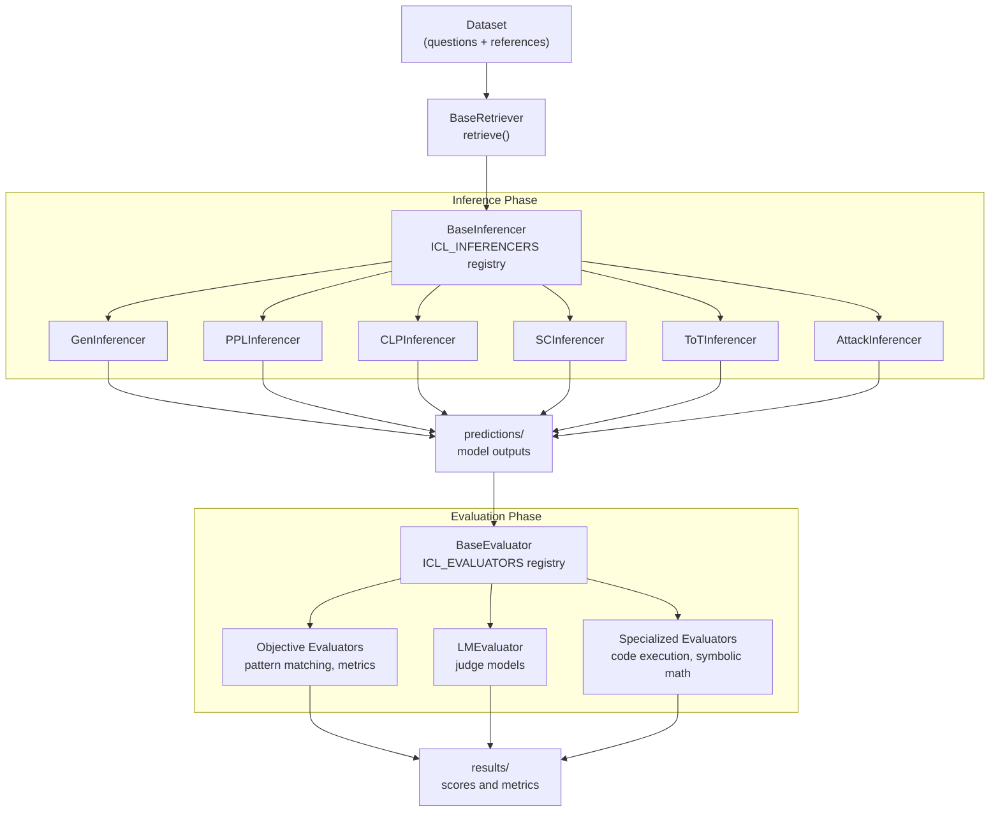
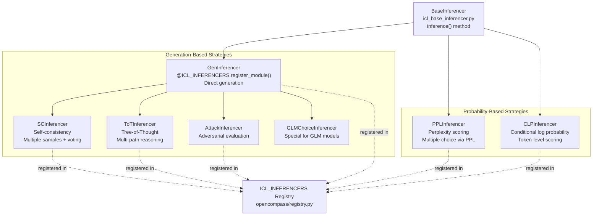
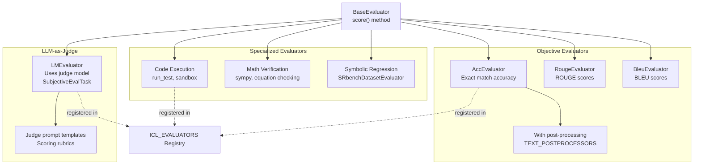
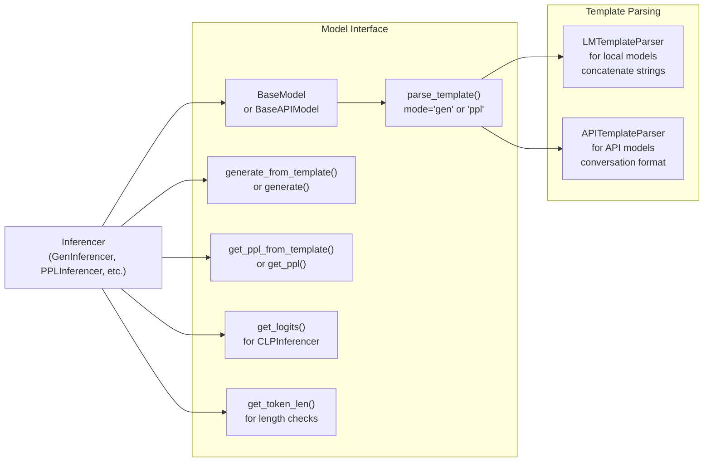
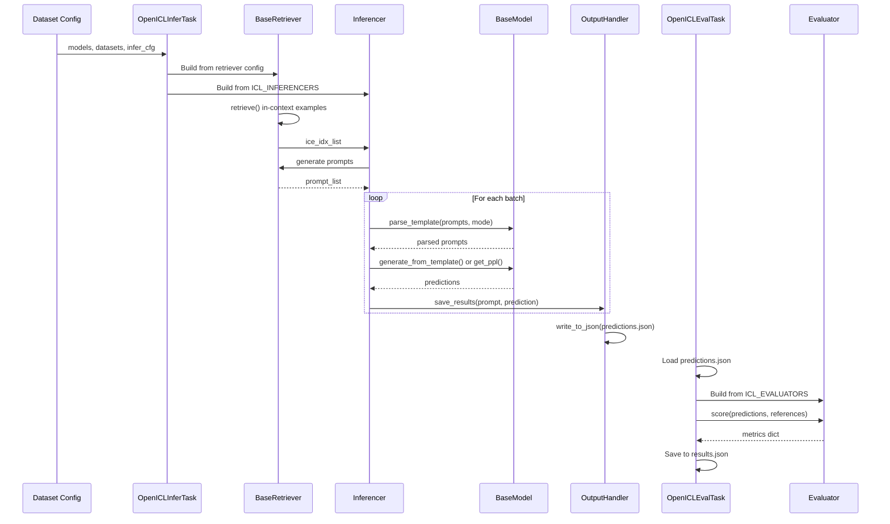

<!-- source: DeepWiki mcp.deepwiki.com · repo open-compass/opencompass · page 6 Evaluation Methods · fetched 2026-10-21 -->

# Evaluation Methods

<details>
<summary>Relevant source files</summary>

The following files were used as context for generating this wiki page:

- [docs/en/prompt/chain_of_thought.md](docs/en/prompt/chain_of_thought.md)
- [docs/zh_cn/prompt/chain_of_thought.md](docs/zh_cn/prompt/chain_of_thought.md)
- [opencompass/datasets/game24.py](opencompass/datasets/game24.py)
- [opencompass/models/base.py](opencompass/models/base.py)
- [opencompass/models/base_api.py](opencompass/models/base_api.py)
- [opencompass/openicl/icl_inferencer/icl_attack_inferencer.py](opencompass/openicl/icl_inferencer/icl_attack_inferencer.py)
- [opencompass/openicl/icl_inferencer/icl_base_inferencer.py](opencompass/openicl/icl_inferencer/icl_base_inferencer.py)
- [opencompass/openicl/icl_inferencer/icl_clp_inferencer.py](opencompass/openicl/icl_inferencer/icl_clp_inferencer.py)
- [opencompass/openicl/icl_inferencer/icl_gen_inferencer.py](opencompass/openicl/icl_inferencer/icl_gen_inferencer.py)
- [opencompass/openicl/icl_inferencer/icl_ppl_inferencer.py](opencompass/openicl/icl_inferencer/icl_ppl_inferencer.py)
- [opencompass/openicl/icl_inferencer/icl_sc_inferencer.py](opencompass/openicl/icl_inferencer/icl_sc_inferencer.py)
- [opencompass/openicl/icl_inferencer/icl_tot_inferencer.py](opencompass/openicl/icl_inferencer/icl_tot_inferencer.py)
- [opencompass/registry.py](opencompass/registry.py)
- [opencompass/utils/lark.py](opencompass/utils/lark.py)
- [requirements.txt](requirements.txt)
- [tests/openicl/test_prompt_template.py](tests/openicl/test_prompt_template.py)

</details>


## Purpose and Scope

This document provides an overview of the evaluation methodologies implemented in OpenCompass. It covers the two-phase evaluation process: **inference strategies** (how models generate outputs) and **evaluation strategies** (how outputs are scored). For detailed information about specific inference methods, see [Inference Strategies](#6.1). For information about evaluation scoring, see [Objective Evaluators](#6.2), [Subjective Evaluation Framework](#6.3), and [Specialized Evaluators](#6.5).

## Overview of the Evaluation Process

OpenCompass separates evaluation into two distinct phases:

1. **Inference Phase**: Models generate predictions using various inference strategies (generation, perplexity scoring, chain-of-thought reasoning, etc.)
2. **Evaluation Phase**: Predictions are scored against references using objective rules, LLM judges, or specialized evaluators

This separation allows:
- Reuse of inference results across different evaluators
- Flexible combination of inference methods with evaluation metrics
- Support for both objective (rule-based) and subjective (judge-based) evaluation



**Evaluation Methods Architecture**

Sources: [opencompass/openicl/icl_inferencer/icl_base_inferencer.py:15-94](), [opencompass/registry.py:34-50]()

## Inference vs Evaluation Distinction

OpenCompass maintains a clear separation between **inference** (producing outputs) and **evaluation** (scoring outputs):

| Aspect | Inference | Evaluation |
|--------|-----------|------------|
| **Purpose** | Generate model predictions | Score predictions against references |
| **Registry** | `ICL_INFERENCERS` | `ICL_EVALUATORS` |
| **Base Class** | `BaseInferencer` | `BaseEvaluator` |
| **Input** | Dataset + Model + PromptTemplate | Predictions + References |
| **Output** | JSON files in `predictions/` | JSON files in `results/` |
| **Examples** | `GenInferencer`, `PPLInferencer` | `AccEvaluator`, `LMEvaluator` |

This design enables:
- **Result Reuse**: Predictions can be cached and evaluated with multiple metrics without re-running inference
- **Mix and Match**: Any inference strategy can be combined with any compatible evaluator
- **Distributed Execution**: Inference and evaluation can run on different machines or at different times

Sources: [opencompass/openicl/icl_inferencer/icl_base_inferencer.py:15-94](), [opencompass/registry.py:34-50]()

## Inference Strategy Architecture

### Class Hierarchy and Registry

All inference strategies inherit from `BaseInferencer` and register themselves in the `ICL_INFERENCERS` registry for automatic discovery.



**Inference Strategy Class Hierarchy**

Sources: [opencompass/openicl/icl_inferencer/icl_base_inferencer.py:15-94](), [opencompass/openicl/icl_inferencer/icl_gen_inferencer.py:26-27](), [opencompass/openicl/icl_inferencer/icl_ppl_inferencer.py:22-23](), [opencompass/registry.py:34-35]()

### Core Inferencer Interface

The `BaseInferencer` class defines the interface all inference strategies must implement:

| Method | Description | Returns |
|--------|-------------|---------|
| `inference()` | Main entry point for inference | `List[str]` of predictions |
| `get_dataloader()` | Creates DataLoader for batching | `DataLoader` |

Key attributes:
- `model`: Instance of `BaseModel` or `BaseAPIModel` 
- `max_seq_len`: Maximum context length for prompts
- `batch_size`: Batch size for inference
- `output_json_filepath`: Directory for output files
- `output_json_filename`: Name of output JSON file

Sources: [opencompass/openicl/icl_inferencer/icl_base_inferencer.py:15-94]()

### Generation-Based Inference

#### GenInferencer

The most common inference strategy, `GenInferencer` directly generates text from the model:

**Key Workflow** ([opencompass/openicl/icl_inferencer/icl_gen_inferencer.py:83-233]()):
1. Retrieve in-context examples via `retriever.retrieve()`
2. Generate prompts using `get_generation_prompt_list_from_retriever_indices()`
3. Parse prompts with `model.parse_template(entry, mode='gen')`
4. Generate outputs with `model.generate_from_template()`
5. Save predictions to `output_json_filepath/output_json_filename`

**Configuration Example**:
```python
inferencer=dict(
    type='GenInferencer',
    max_out_len=512,
    batch_size=8,
    stopping_criteria=['</s>']
)
```

Sources: [opencompass/openicl/icl_inferencer/icl_gen_inferencer.py:26-234]()

#### Self-Consistency (SCInferencer)

`SCInferencer` extends `GenInferencer` to implement the self-consistency method, which samples multiple reasoning paths and uses majority voting:

**Key Parameters** ([opencompass/openicl/icl_inferencer/icl_sc_inferencer.py:45-76]()):
- `sc_size`: Number of samples to generate per input
- `generation_kwargs`: Must include `do_sample=True` and temperature settings

**Implementation Details**:
- Generates `sc_size` predictions for each input ([opencompass/openicl/icl_inferencer/icl_sc_inferencer.py:136-143]())
- Returns list of lists: each input gets `[pred1, pred2, ..., pred_sc_size]`
- Evaluator performs majority voting during scoring phase

Sources: [opencompass/openicl/icl_inferencer/icl_sc_inferencer.py:21-207](), [docs/en/prompt/chain_of_thought.md:53-77]()

#### Tree-of-Thought (ToTInferencer)

`ToTInferencer` implements the Tree-of-Thought algorithm for multi-step reasoning with backtracking:

**Key Components** ([opencompass/openicl/icl_inferencer/icl_tot_inferencer.py:68-111]()):
- `method_generate`: How to generate thoughts (`'sample'` or `'propose'`)
- `method_evaluate`: How to evaluate thoughts (`'vote'` or `'value'`)
- `method_select`: How to select thoughts (`'greedy'` or `'sample'`)
- `n_generate_sample`: Number of thoughts to generate per step
- `n_evaluate_sample`: Number of evaluations per thought
- `n_select_sample`: Number of thoughts to keep (beam width)
- `prompt_wrapper`: Task-specific wrapper implementing prompt templates

**Search Algorithm** ([opencompass/openicl/icl_inferencer/icl_tot_inferencer.py:242-302]()):
1. Start with empty thought `ys = ['']`
2. For each step:
   - Generate new thoughts via `get_samples()` or `get_proposals()`
   - Evaluate thoughts via `get_votes()` or `get_values()`
   - Select top thoughts via greedy or sampling
3. Return final thoughts

Sources: [opencompass/openicl/icl_inferencer/icl_tot_inferencer.py:24-390](), [docs/en/prompt/chain_of_thought.md:79-128]()

### Probability-Based Inference

#### PPLInferencer

`PPLInferencer` evaluates multiple choice questions by calculating perplexity for each choice:

**Workflow** ([opencompass/openicl/icl_inferencer/icl_ppl_inferencer.py:58-187]()):
1. Get labels (choices) from dataset
2. For each label, generate prompts concatenating context + label
3. Calculate perplexity using `model.get_ppl_from_template()`
4. Select label with lowest perplexity as prediction

**Masking Support**: Can mask context tokens to only compute perplexity on answer portion using `mask_length` parameter.

Sources: [opencompass/openicl/icl_inferencer/icl_ppl_inferencer.py:22-188]()

#### CLPInferencer

`CLPInferencer` (Conditional Log Probability) evaluates choices by computing the log probability of choice tokens conditioned on the context:

**Implementation** ([opencompass/openicl/icl_inferencer/icl_clp_inferencer.py:72-241]()):
1. Tokenize all choices into token IDs
2. For each input, generate prompt with placeholder for choice
3. Get logits at target position using `model.get_logits()`
4. Apply softmax over choice token IDs
5. Return probability distribution over choices

**Current Limitation**: Only supports single-token choices ([opencompass/openicl/icl_inferencer/icl_clp_inferencer.py:69]())

Sources: [opencompass/openicl/icl_inferencer/icl_clp_inferencer.py:21-269]()

### Output Handling

All inferencers use output handlers to manage predictions:

| Handler Class | Used By | Output Format |
|--------------|---------|---------------|
| `GenInferencerOutputHandler` | GenInferencer, SCInferencer, ToTInferencer | `{"0": {"origin_prompt": ..., "prediction": ...}}` |
| `PPLInferencerOutputHandler` | PPLInferencer | Includes per-label PPL scores |
| `CLPInferencerOutputHandler` | CLPInferencer | Includes probability distribution |

**Key Methods**:
- `save_results()`: Store individual prediction
- `write_to_json()`: Dump results to file
- Resume support: Can continue from `tmp_*.json` files

Sources: [opencompass/openicl/icl_inferencer/icl_base_inferencer.py:101-210]()

## Evaluation Strategy Architecture

Evaluation strategies are implemented as `BaseEvaluator` subclasses registered in the `ICL_EVALUATORS` registry. The evaluation phase takes predictions from the inference phase and computes metrics by comparing them to reference answers.

### Evaluator Types



**Evaluator Architecture**

Sources: [opencompass/registry.py:44-46]()

### Post-Processing Pipeline

Before evaluation, predictions and references often require post-processing:

| Processor | Purpose | Registry |
|-----------|---------|----------|
| `pred_postprocessor` | Clean model outputs | `TEXT_POSTPROCESSORS` |
| `dataset_postprocessor` | Normalize references | `TEXT_POSTPROCESSORS` |
| `dict_postprocessor` | Extract scores from dicts | `DICT_POSTPROCESSORS` |

**Common Post-Processors**:
- Extract answers from text (e.g., "The answer is 42" → "42")
- Normalize whitespace and capitalization
- Convert formats (e.g., markdown to plain text)
- Parse structured outputs

Sources: [opencompass/registry.py:24-30]()

## Integration with Model Interface

Inference strategies interact with models through a unified interface regardless of whether the model is local or API-based:



**Model Interface for Inference**

**Key Methods Used by Inferencers**:

| Method | Purpose | Used By |
|--------|---------|---------|
| `parse_template(prompt, mode)` | Convert PromptTemplate to string/conversation | All inferencers |
| `generate_from_template(templates, max_out_len)` | Generate text | GenInferencer, SCInferencer, ToTInferencer |
| `get_ppl_from_template(templates, mask_length)` | Get perplexity | PPLInferencer |
| `get_logits(inputs)` | Get raw logits | CLPInferencer |
| `get_token_len(prompt)` | Check prompt length | All inferencers |

**Mode Parameter**:
- `mode='gen'`: For generation tasks, may stop before final role in conversation
- `mode='ppl'`: For perplexity, includes complete prompt with answer

Sources: [opencompass/models/base.py:149-227](), [opencompass/models/base_api.py:164-424]()

## Configuration and Usage

### Configuring Inference Strategies

Inference strategies are configured in dataset configs:

```python
# Direct generation
dataset_infer_cfg = dict(
    inferencer=dict(
        type='GenInferencer',
        max_out_len=512,
        batch_size=8
    )
)

# Self-consistency with sampling
dataset_infer_cfg = dict(
    inferencer=dict(
        type='SCInferencer',
        max_out_len=512,
        sc_size=5,  # 5 samples per input
        generation_kwargs=dict(
            do_sample=True,
            temperature=0.7,
            top_k=40
        )
    )
)

# Tree-of-Thought
dataset_infer_cfg = dict(
    inferencer=dict(
        type='ToTInferencer',
        max_out_len=100,
        method_generate='propose',
        method_evaluate='value',
        method_select='greedy',
        n_generate_sample=3,
        n_select_sample=5,
        prompt_wrapper=dict(type='Game24PromptWrapper')
    )
)

# Perplexity-based
dataset_infer_cfg = dict(
    inferencer=dict(
        type='PPLInferencer',
        labels=['A', 'B', 'C', 'D']  # Multiple choice options
    )
)
```

### Configuring Evaluators

Evaluators are configured separately from inferencers:

```python
# Objective evaluation with post-processing
dataset_eval_cfg = dict(
    evaluator=dict(type='AccEvaluator'),
    pred_postprocessor=dict(type='first_capital_postprocess'),
    dataset_postprocessor=dict(type='last_capital_postprocess')
)

# LLM-as-Judge evaluation
dataset_eval_cfg = dict(
    evaluator=dict(
        type='LMEvaluator',
        judge_cfg='gpt-4-judge-config'
    )
)

# Self-consistency evaluation (matches sc_size in inferencer)
dataset_eval_cfg = dict(
    evaluator=dict(type='SCAccEvaluator'),
    sc_size=5
)
```

Sources: [opencompass/openicl/icl_inferencer/icl_gen_inferencer.py:50-82](), [docs/en/prompt/chain_of_thought.md]()

## Execution Flow

The complete evaluation flow from configuration to results:



**Evaluation Execution Flow**

Sources: [opencompass/openicl/icl_inferencer/icl_gen_inferencer.py:83-233](), [opencompass/openicl/icl_inferencer/icl_base_inferencer.py:56-85]()

## Summary of Key Concepts

| Concept | Key Classes | Registry | Purpose |
|---------|-------------|----------|---------|
| **Inference Strategies** | `BaseInferencer`, `GenInferencer`, `PPLInferencer`, `SCInferencer`, `ToTInferencer` | `ICL_INFERENCERS` | Generate model outputs using different reasoning approaches |
| **Evaluation Strategies** | `BaseEvaluator`, `AccEvaluator`, `LMEvaluator` | `ICL_EVALUATORS` | Score predictions against references |
| **Output Handlers** | `GenInferencerOutputHandler`, `PPLInferencerOutputHandler` | N/A | Manage prediction storage and resumption |
| **Post-Processors** | Various text processors | `TEXT_POSTPROCESSORS`, `DICT_POSTPROCESSORS` | Clean and normalize predictions/references |
| **Model Interface** | `BaseModel`, `BaseAPIModel` | `MODELS` | Unified interface for local and API models |
| **Template Parsing** | `LMTemplateParser`, `APITemplateParser` | N/A | Convert prompts to model-specific format |

**Evaluation Method Components**

The design emphasizes:
- **Modularity**: Mix and match inference strategies with evaluators
- **Extensibility**: Easy to add new strategies via registry pattern
- **Efficiency**: Cache and reuse predictions across evaluations
- **Flexibility**: Support diverse evaluation paradigms (objective, subjective, specialized)

Sources: [opencompass/registry.py:1-56](), [opencompass/openicl/icl_inferencer/icl_base_inferencer.py:15-94]()

---

