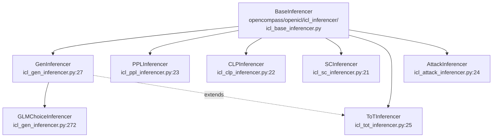
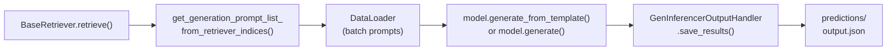
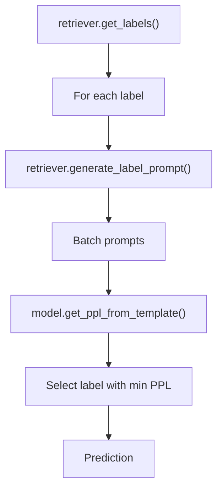
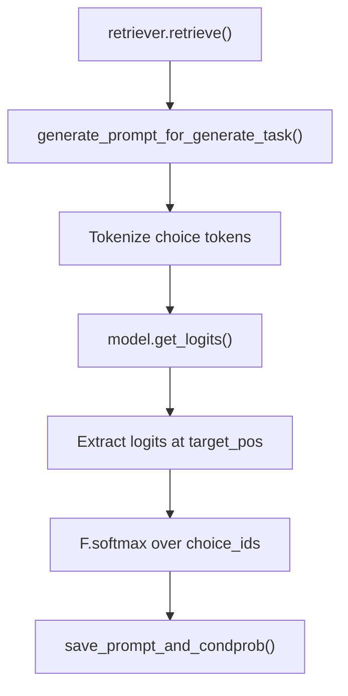
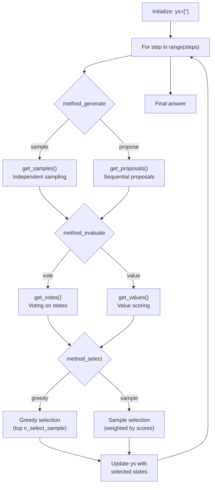
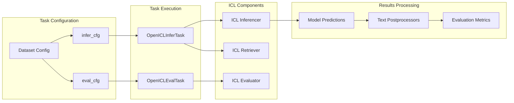

<!-- source: DeepWiki mcp.deepwiki.com · repo open-compass/opencompass · page 6.1 Inference Strategies · fetched 2026-10-21 -->

# Inference Strategies

<details>
<summary>Relevant source files</summary>

The following files were used as context for generating this wiki page:

- [README.md](README.md)
- [README_zh-CN.md](README_zh-CN.md)
- [docs/en/index.rst](docs/en/index.rst)
- [docs/en/notes/news.md](docs/en/notes/news.md)
- [docs/en/prompt/chain_of_thought.md](docs/en/prompt/chain_of_thought.md)
- [docs/zh_cn/advanced_guides/evaluation_lmdeploy.md](docs/zh_cn/advanced_guides/evaluation_lmdeploy.md)
- [docs/zh_cn/index.rst](docs/zh_cn/index.rst)
- [docs/zh_cn/notes/news.md](docs/zh_cn/notes/news.md)
- [docs/zh_cn/prompt/chain_of_thought.md](docs/zh_cn/prompt/chain_of_thought.md)
- [opencompass/datasets/game24.py](opencompass/datasets/game24.py)
- [opencompass/models/base.py](opencompass/models/base.py)
- [opencompass/models/base_api.py](opencompass/models/base_api.py)
- [opencompass/openicl/icl_inferencer/icl_attack_inferencer.py](opencompass/openicl/icl_inferencer/icl_attack_inferencer.py)
- [opencompass/openicl/icl_inferencer/icl_base_inferencer.py](opencompass/openicl/icl_inferencer/icl_base_inferencer.py)
- [opencompass/openicl/icl_inferencer/icl_clp_inferencer.py](opencompass/openicl/icl_inferencer/icl_clp_inferencer.py)
- [opencompass/openicl/icl_inferencer/icl_gen_inferencer.py](opencompass/openicl/icl_inferencer/icl_gen_inferencer.py)
- [opencompass/openicl/icl_inferencer/icl_ppl_inferencer.py](opencompass/openicl/icl_inferencer/icl_ppl_inferencer.py)
- [opencompass/openicl/icl_inferencer/icl_sc_inferencer.py](opencompass/openicl/icl_inferencer/icl_sc_inferencer.py)
- [opencompass/openicl/icl_inferencer/icl_tot_inferencer.py](opencompass/openicl/icl_inferencer/icl_tot_inferencer.py)
- [opencompass/registry.py](opencompass/registry.py)
- [opencompass/utils/lark.py](opencompass/utils/lark.py)
- [requirements.txt](requirements.txt)
- [tests/openicl/test_prompt_template.py](tests/openicl/test_prompt_template.py)

</details>


This document covers OpenCompass's inference strategies, which define how models are queried to generate predictions during evaluation. OpenCompass implements multiple inference methods through the `ICL_INFERENCERS` registry, each optimized for different evaluation scenarios and model capabilities.

The framework provides six main inferencer implementations:
- **GenInferencer**: Direct text generation for open-ended tasks
- **PPLInferencer**: Perplexity-based selection for multiple-choice questions
- **CLPInferencer**: Conditional log probability scoring for classification
- **SCInferencer**: Self-consistency with multiple sampling paths
- **ToTInferencer**: Tree-of-thought reasoning with search algorithms
- **AttackInferencer**: Adversarial prompt evaluation

All inferencers inherit from `BaseInferencer` and integrate with OpenCompass's model abstraction layer to support both local and API-based models.

Sources: [opencompass/openicl/icl_inferencer/icl_gen_inferencer.py:26-27](), [opencompass/openicl/icl_inferencer/icl_ppl_inferencer.py:22-23](), [opencompass/openicl/icl_inferencer/icl_clp_inferencer.py:21-22](), [opencompass/openicl/icl_inferencer/icl_sc_inferencer.py:21](), [opencompass/openicl/icl_inferencer/icl_tot_inferencer.py:24-25](), [opencompass/openicl/icl_inferencer/icl_attack_inferencer.py:23-24]()

## Inferencer Architecture

### Base Inferencer Class

All inference strategies inherit from `BaseInferencer`, which provides common functionality for prompt processing, batching, and result management.

**Inferencer Class Hierarchy**



The `BaseInferencer` class defines core attributes used by all inferencers:

| Attribute | Type | Purpose |
|-----------|------|---------|
| `model` | `BaseModel` | The model instance to perform inference |
| `max_seq_len` | `int` | Maximum tokenized sequence length |
| `batch_size` | `int` | Batch size for DataLoader |
| `output_json_filepath` | `str` | Directory for output files |
| `output_json_filename` | `str` | Name of output JSON file |
| `is_main_process` | `bool` | Whether current process should write outputs |

Sources: [opencompass/openicl/icl_inferencer/icl_base_inferencer.py:15-54]()

### Registry Integration

Inferencers are registered in the `ICL_INFERENCERS` registry and can be instantiated by type name in dataset configurations:

```python
# Registry definition
ICL_INFERENCERS = Registry('icl_inferencers',
                           locations=['opencompass.openicl.icl_inferencer'])
```

Sources: [opencompass/registry.py:34-35]()

## GenInferencer: Direct Generation

The `GenInferencer` performs evaluation through direct text generation. It is the most commonly used inference strategy and supports both local and API-based models.

**Generation Pipeline**



### Key Parameters

| Parameter | Type | Purpose | Default |
|-----------|------|---------|---------|
| `max_out_len` | `int` | Maximum number of generated tokens | Required |
| `min_out_len` | `int` | Minimum number of generated tokens | `None` |
| `stopping_criteria` | `List[str]` | Stop generation at these strings | `[]` |
| `gen_field_replace_token` | `str` | Token to replace in prompt template | `''` |
| `save_every` | `int` | Save intermediate results every N iterations | `1` |

### Implementation Details

The `GenInferencer.inference()` method executes the following steps:

1. **Retrieve ICE indices**: Calls `retriever.retrieve()` to get in-context example indices
2. **Generate prompts**: Constructs full prompts with ICE using `get_generation_prompt_list_from_retriever_indices()`
3. **Batch processing**: Wraps prompts in `DataLoader` with specified `batch_size`
4. **Model inference**: Calls `model.generate_from_template()` or `model.generate()` depending on model type
5. **Result saving**: Stores predictions with `GenInferencerOutputHandler` 
6. **Intermediate checkpoints**: Saves progress to `tmp_<filename>.json` every `save_every` batches

### Sequence Length Management

When `max_seq_len` is specified, the inferencer dynamically reduces ICE to fit within the limit:

```python
prompt_token_num = self.model.get_token_len_from_template(prompt, mode='gen')
while len(ice_idx) > 0 and prompt_token_num > max_seq_len:
    ice_idx = ice_idx[:-1]  # Remove last ICE
    ice = retriever.generate_ice(ice_idx, ice_template=ice_template)
    prompt = retriever.generate_prompt_for_generate_task(...)
    prompt_token_num = self.model.get_token_len_from_template(prompt, mode='gen')
```

Sources: [opencompass/openicl/icl_inferencer/icl_gen_inferencer.py:50-82](), [opencompass/openicl/icl_inferencer/icl_gen_inferencer.py:83-233](), [opencompass/openicl/icl_inferencer/icl_gen_inferencer.py:252-267]()

### GLMChoiceInferencer Variant

The `GLMChoiceInferencer` extends `GenInferencer` for GLM models that support a special `choice()` method for multiple-choice questions:

```python
results = self.model.choice(entry, choices=self.choices)
```

Sources: [opencompass/openicl/icl_inferencer/icl_gen_inferencer.py:271-330]()

## PPLInferencer: Perplexity-Based Selection

The `PPLInferencer` computes perplexity scores for each possible answer and selects the option with the lowest perplexity. This method is effective for multiple-choice questions with predefined answer options.

**Perplexity Scoring Pipeline**



### Key Parameters

| Parameter | Type | Purpose | Default |
|-----------|------|---------|---------|
| `labels` | `List` | List of possible answer labels | `None` (auto-detect) |
| `max_seq_len` | `int` | Maximum sequence length | `None` |
| `batch_size` | `int` | Batch size for PPL computation | `1` |

### How It Works

For each test example, the `PPLInferencer`:

1. **Obtains labels**: Gets possible answer choices from `retriever.get_labels()` or uses provided `labels`
2. **Generates prompts per label**: Creates a full prompt for each possible answer using `retriever.generate_label_prompt()`
3. **Computes perplexity**: Calls `model.get_ppl_from_template()` for each label's prompt
4. **Selects minimum**: Chooses the label with the lowest perplexity as the prediction

### Normalization Support

The inferencer supports perplexity normalization using a `normalizing_str` to account for different answer lengths:

```python
# Compute PPL for full prompt
res1 = model.get_ppl_from_template(sub_prompt_list, mask_length=sub_context_length_list)

# Compute PPL for normalizing prompt
res2 = model.get_ppl_from_template(sub_normalizing_prompt_list, 
                                   mask_length=sub_normalizing_context_length_list)

# Normalized PPL
sub_res = res1 - res2
```

This ensures that shorter answers are not unfairly favored due to having fewer tokens.

### Output Format

Results are stored in a structured format with PPL scores for each label:

```json
{
  "0": {
    "in-context examples": "...",
    "label: A": {
      "testing input": "...",
      "prompt": "...",
      "PPL": 2.45,
      "BPB": 0.12
    },
    "label: B": {
      "PPL": 3.21
    },
    "prediction": "A"
  }
}
```

Sources: [opencompass/openicl/icl_inferencer/icl_ppl_inferencer.py:23-56](), [opencompass/openicl/icl_inferencer/icl_ppl_inferencer.py:58-187]()

## CLPInferencer: Conditional Log Probability

The `CLPInferencer` computes conditional log probabilities for answer tokens at specific positions. This method is particularly useful for single-token classification tasks where you want to measure the model's confidence in each option.

**CLP Scoring Pipeline**



### Key Parameters

| Parameter | Type | Purpose | Default |
|-----------|------|---------|---------|
| `single_token` | `bool` | Whether choices are single tokens | `True` |
| `max_seq_len` | `int` | Maximum sequence length | `None` |
| `batch_size` | `int` | Batch size for processing | `1` |

### Implementation Details

The `CLPInferencer` currently supports only single-token choices:

```python
assert single_token, 'Only support single token choice currently.'
```

The inference process:

1. **Tokenize choices**: Converts answer choices (e.g., 'A', 'B', 'C', 'D') to token IDs
2. **Generate prompts**: Creates prompts ending just before the answer position
3. **Get logits**: Obtains model logits via `model.get_logits()`
4. **Extract target logits**: Selects logits at the target position (last token)
5. **Apply softmax**: Computes probabilities over choice token IDs
6. **Select prediction**: Chooses the option with highest probability

### Handling Different Tokenizers

The inferencer handles various tokenizer configurations:

```python
# Handle different tokenizer behaviors
if self.model.tokenizer.add_bos_token:
    choice_ids = [c[1:] for c in choice_ids]  # Remove BOS token
if self.model.tokenizer.add_eos_token:
    choice_ids = [c[:-1] for c in choice_ids]  # Remove EOS token
```

### Padding Side Consideration

The target position depends on the tokenizer's padding side:

```python
if padding_side == 'left':
    target_pos.append(-1)  # Last position
else:
    target_pos.append(prompt_token_num - 1)  # Original prompt end
```

### Log Probability Computation

```python
def _get_cond_prob(self, input_texts, target_pos, choice_ids):
    outputs, _ = get_logits(input_texts)
    logits = outputs.contiguous().float()
    logits = F.log_softmax(logits, dim=-1)
    log_probs = []
    for logit, target_ids in zip(logits, target_pos):
        log_probs.append(
            F.softmax(logit[target_ids, choice_ids], dim=-1).tolist())
    return log_probs
```

Sources: [opencompass/openicl/icl_inferencer/icl_clp_inferencer.py:22-70](), [opencompass/openicl/icl_inferencer/icl_clp_inferencer.py:72-241](), [opencompass/openicl/icl_inferencer/icl_clp_inferencer.py:243-268]()

## SCInferencer: Self-Consistency

The `SCInferencer` implements the Self-Consistency method, which generates multiple reasoning paths and uses majority voting to improve accuracy on complex reasoning tasks.

**Self-Consistency Pipeline**

```mermaid
graph LR
    Retriever["retriever.retrieve()"]
    PromptGen["get_generation_prompt_list_<br/>from_retriever_indices()"]
    SCLoop["For i in range(sc_size)"]
    Generate["model.generate_from_template()"]
    Collect["Collect all generations"]
    SaveResults["save_results(predictions)"]
    Evaluator["Evaluator with sc_size"]
    
    Retriever --> PromptGen
    PromptGen --> SCLoop
    SCLoop --> Generate
    Generate --> Collect
    Collect --> SaveResults
    SaveResults --> Evaluator
```



### Key Parameters

| Parameter | Type | Purpose | Default |
|-----------|------|---------|---------|
| `sc_size` | `int` | Number of reasoning paths to sample | `1` |
| `generation_kwargs` | `dict` | Sampling parameters (temperature, top_k, etc.) | `{}` |
| `max_out_len` | `int` | Maximum output length | Required |

### How It Works

The `SCInferencer` extends `GenInferencer` and modifies the generation phase:

1. **Generate multiple paths**: For each input, generates `sc_size` different completions
2. **Requires sampling**: Must set `do_sample=True` and appropriate `temperature` to get diverse outputs
3. **Collects all paths**: Stores all generations for each input as a list
4. **Downstream voting**: The evaluator performs majority voting to select the final answer

### Sampling Configuration

To enable diverse reasoning paths, configure sampling parameters:

```python
gsm8k_infer_cfg = dict(
    inferencer=dict(
        type='SCInferencer',
        sc_size=5,  # Generate 5 paths
        generation_kwargs=dict(
            do_sample=True,
            temperature=0.7,
            top_k=40
        )
    )
)
```

**Important**: Without proper sampling parameters, the model will generate identical outputs each time, making Self-Consistency ineffective.

### Output Format

Each result contains multiple predictions:

```json
{
  "0": {
    "origin_prompt": "...",
    "prediction": [
      "Path 1: ...",
      "Path 2: ...",
      "Path 3: ..."
    ],
    "gold": "..."
  }
}
```

### Evaluation Integration

The corresponding evaluator must be configured with the same `sc_size`:

```python
gsm8k_eval_cfg = dict(
    evaluator=dict(type='GSM8KEvaluator'),
    sc_size=5  # Must match inferencer
)
```

Sources: [opencompass/openicl/icl_inferencer/icl_sc_inferencer.py:21-76](), [opencompass/openicl/icl_inferencer/icl_sc_inferencer.py:125-171](), [docs/en/prompt/chain_of_thought.md:53-67]()

## ToTInferencer: Tree-of-Thought Reasoning

The `ToTInferencer` implements the Tree-of-Thought method, which systematically explores multiple reasoning paths using search algorithms. This method is effective for complex reasoning tasks requiring multi-step problem decomposition.

**Tree-of-Thought Architecture**



### Key Parameters

| Parameter | Type | Purpose | Default |
|-----------|------|---------|---------|
| `prompt_wrapper` | `dict` | Task-specific wrapper class | Required |
| `method_generate` | `str` | Thought generation method: `'sample'` or `'propose'` | `'sample'` |
| `method_evaluate` | `str` | State evaluation method: `'value'` or `'vote'` | `'value'` |
| `method_select` | `str` | State selection method: `'greedy'` or `'sample'` | `'greedy'` |
| `n_generate_sample` | `int` | Number of thoughts to generate per state | `1` |
| `n_evaluate_sample` | `int` | Number of evaluation samples per state | `1` |
| `n_select_sample` | `int` | Number of states to keep (breadth) | `1` |

### Thought Generation Methods

**1. Independent Sampling (`method_generate='sample'`)**

Generates independent thoughts for each state:

```python
def get_samples(self, x, y, n_generate_sample, prompt_sample):
    if prompt_sample == 'standard':
        prompt = self.prompt_wrapper.standard_prompt_wrap(x, y)
    elif prompt_sample == 'cot':
        prompt = self.prompt_wrapper.cot_prompt_wrap(x, y)
    samples = self.model.generate_from_template(
        [prompt],
        max_out_len=self.max_out_len,
        num_beams=n_generate_sample,
        num_return_sequences=n_generate_sample)
    return [y + _ for _ in samples]
```

**2. Sequential Proposals (`method_generate='propose'`)**

Generates next-step proposals based on current state:

```python
def get_proposals(self, x, y):
    propose_prompt = self.prompt_wrapper.propose_prompt_wrap(x, y)
    proposals = self.model.generate_from_template(
        [propose_prompt],
        max_out_len=self.max_out_len,
        num_beams=1,
        num_return_sequences=1)[0].split('\n')
    return [y + _ + '\n' for _ in proposals]
```

### State Evaluation Methods

**1. Value-Based Scoring (`method_evaluate='value'`)**

Assigns numerical scores to each state:

```python
def get_values(self, x, ys, n_evaluate_sample, cache_value=True):
    values = []
    for y in ys:
        value = self.get_value(x, y, n_evaluate_sample, cache_value)
        values.append(value)
    return values
```

**2. Voting (`method_evaluate='vote'`)**

Has model vote on which state is best:

```python
def get_votes(self, x, ys, n_evaluate_sample):
    vote_prompt = self.prompt_wrapper.vote_prompt_wrap(x, ys)
    vote_outputs = self.model.generate_from_template(
        [vote_prompt],
        max_out_len=self.max_out_len,
        num_beams=n_evaluate_sample,
        num_return_sequences=n_evaluate_sample)
    values = self.prompt_wrapper.vote_outputs_unwrap(vote_outputs, len(ys))
    return values
```

### Task-Specific Wrapper

Each task requires a custom wrapper class (e.g., `Game24PromptWrapper`) that implements:

- `standard_prompt_wrap(x, y)`: Standard prompt formatting
- `cot_prompt_wrap(x, y)`: Chain-of-thought prompt formatting
- `propose_prompt_wrap(x, y)`: Proposal generation prompt
- `value_prompt_wrap(x, y)`: Value evaluation prompt
- `vote_prompt_wrap(x, ys)`: Voting prompt
- `value_outputs_unwrap(x, y, value_outputs)`: Extract value from outputs
- `vote_outputs_unwrap(vote_outputs, n)`: Extract votes from outputs

### Example Configuration

```python
game24_infer_cfg = dict(
    inferencer=dict(
        type='ToTInferencer',
        method_generate='propose',
        method_evaluate='value',
        method_select='greedy',
        n_evaluate_sample=3,
        n_select_sample=5,
        prompt_wrapper=dict(type='Game24PromptWrapper')
    )
)
```

Sources: [opencompass/openicl/icl_inferencer/icl_tot_inferencer.py:24-111](), [opencompass/openicl/icl_inferencer/icl_tot_inferencer.py:113-241](), [opencompass/datasets/game24.py:172-227](), [docs/en/prompt/chain_of_thought.md:79-127]()

## Evaluation Pipeline Integration

The ICL evaluation system integrates with OpenCompass's broader evaluation pipeline through standardized interfaces and task definitions.



The pipeline supports various postprocessing steps to extract and normalize answers from model outputs, and integrates with the registry system for modular component selection.

Sources: [opencompass/openicl/icl_inferencer/icl_base_inferencer.py:56-85](), [opencompass/registry.py:31-42](), [examples/eval_judgerbenchv2.py:41-49]()

## Configuration and Usage

ICL evaluation is configured through dataset configuration dictionaries that specify the inferencer type, prompt templates, and evaluation settings. Here's an example configuration pattern:

```python
# Basic generation-based inference configuration
infer_cfg = dict(
    prompt_template=dict(
        type=PromptTemplate,
        template=dict(round=[
            dict(role='HUMAN', prompt='{question}'),
            dict(role='BOT', prompt='{answer}')
        ])
    ),
    retriever=dict(type=ZeroRetriever),
    inferencer=dict(type=GenInferencer, max_out_len=2048)
)
```

The system automatically handles model-specific adaptations, batch processing, and result aggregation across different inference methods.

Sources: [opencompass/configs/datasets/judge/judgerbenchv2.py:17-30](), [docs/en/prompt/chain_of_thought.md:13-21]()

---

