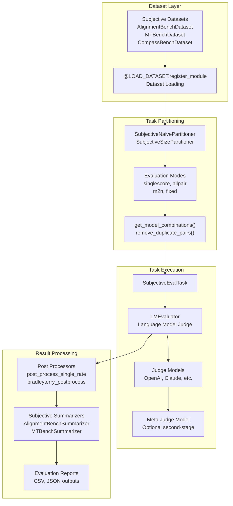
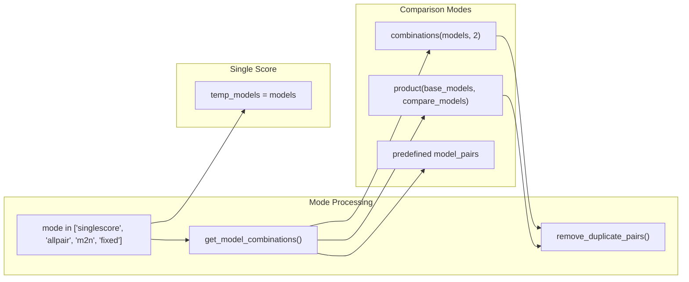
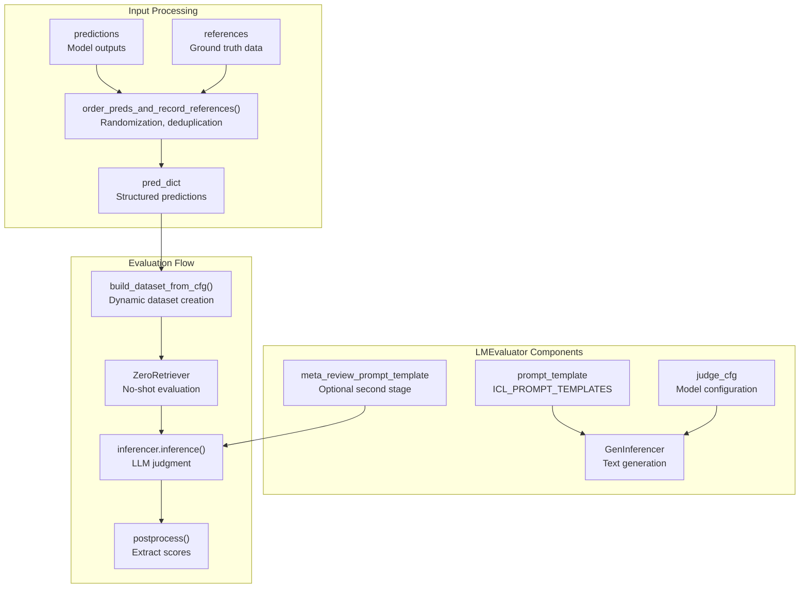
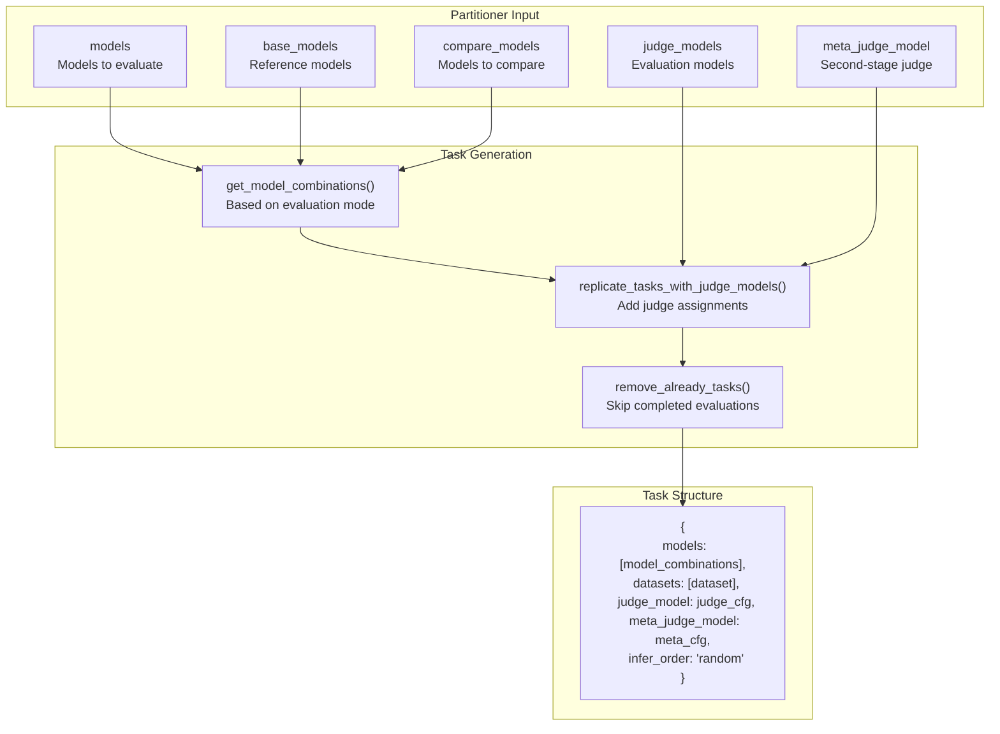
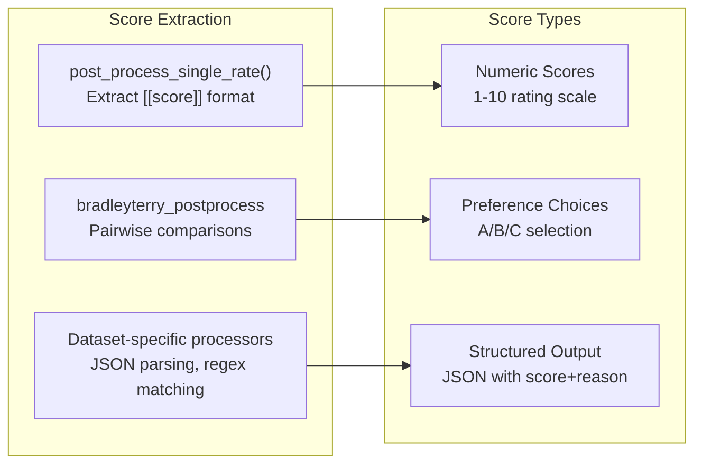

<!-- source: DeepWiki mcp.deepwiki.com · repo open-compass/opencompass · page 6.3 Subjective Evaluation Framework · fetched 2026-10-21 -->

# Subjective Evaluation

<details>
<summary>Relevant source files</summary>

The following files were used as context for generating this wiki page:

- [.gitignore](.gitignore)
- [opencompass/partitioners/sub_naive.py](opencompass/partitioners/sub_naive.py)
- [opencompass/partitioners/sub_size.py](opencompass/partitioners/sub_size.py)
- [opencompass/summarizers/__init__.py](opencompass/summarizers/__init__.py)
- [opencompass/tasks/subjective_eval.py](opencompass/tasks/subjective_eval.py)
- [tools/convert_alignmentbench.py](tools/convert_alignmentbench.py)

</details>


This document covers OpenCompass's subjective evaluation system, which uses human judgment or LLM-as-judge methodology to evaluate model outputs on tasks that require qualitative assessment. This includes preference-based comparisons, quality ratings, and nuanced evaluations that cannot be captured by rule-based metrics.

For rule-based evaluation methods, see [Objective Evaluation Datasets](#5.1). For LLM-as-judge implementation details, see [LLM-as-Judge Evaluation](#6.3).

## Architecture Overview

The subjective evaluation system in OpenCompass consists of several interconnected components that handle dataset loading, task partitioning, LLM-based judgment, and result aggregation.

### Core Subjective Evaluation Pipeline



Sources: [opencompass/datasets/subjective/__init__.py:1-38](), [opencompass/partitioners/sub_naive.py:126-233](), [opencompass/openicl/icl_evaluator/lm_evaluator.py:102-368](), [opencompass/summarizers/subjective/__init__.py:1-22]()

## Evaluation Modes

OpenCompass supports multiple subjective evaluation modes, each designed for different comparison scenarios.

| Mode | Description | Model Selection | Use Case |
|------|-------------|----------------|----------|
| `singlescore` | Single model scoring | All models individually | Absolute quality assessment |
| `allpair` | All pairs comparison | All combinations of model pairs | Comprehensive pairwise comparison |
| `m2n` | Many-to-many comparison | Base models vs compare models | Targeted model comparison |
| `fixed` | Fixed model pairs | Predefined pairs | Specific comparisons |

### Mode Implementation Details



Sources: [opencompass/partitioners/sub_naive.py:107-124](), [opencompass/partitioners/sub_naive.py:192-201]()

## LMEvaluator Implementation

The `LMEvaluator` class is the core component responsible for using language models to evaluate other model outputs. It supports both single-model scoring and multi-model comparison scenarios.

### LMEvaluator Architecture



Sources: [opencompass/openicl/icl_evaluator/lm_evaluator.py:102-161](), [opencompass/openicl/icl_evaluator/lm_evaluator.py:163-357]()

### Key LMEvaluator Methods

The `LMEvaluator.score()` method handles both single-model and multi-model evaluation scenarios:

- **Multi-model comparison**: Input is a list of prediction dictionaries, supports order randomization via `infer_order` parameter
- **Single-model scoring**: Input is a single prediction dictionary, supports multi-evaluation with different prompt settings
- **Deduplication**: Automatically removes identical predictions to avoid bias
- **Multi-round support**: Handles conversational evaluation with `pack_all_predictions` option

Sources: [opencompass/openicl/icl_evaluator/lm_evaluator.py:163-298]()

## Subjective Datasets

OpenCompass provides numerous subjective evaluation datasets, each with specialized loaders and postprocessors.

### Available Subjective Datasets

| Dataset | Class | Purpose | Postprocessor |
|---------|-------|---------|---------------|
| AlignmentBench | `AlignmentBenchDataset` | Alignment evaluation | `alignbench_postprocess` |
| MTBench | `MTBenchDataset` | Multi-turn conversations | `mtbench_postprocess` |
| ArenaHard | `ArenaHardDataset` | Challenging comparisons | `arenahard_postprocess` |
| AlpacaEval | `AlpacaEvalDataset` | Instruction following | `alpacaeval_postprocess` |
| CompassBench | `CompassBenchDataset` | Comprehensive evaluation | Built-in processing |
| WildBench | `WildBenchDataset` | Real-world scenarios | `wildbench_postprocess` |

### Dataset Configuration Structure

Subjective datasets follow a consistent configuration pattern:

```python
dict(
    abbr='dataset_name',
    type=DatasetClass,
    path='./data/subjective/dataset_path',
    name='dataset_split',
    reader_cfg=dict(
        input_columns=['question'],
        output_column='judge'
    ),
    infer_cfg=subjective_infer_cfg,
    eval_cfg=subjective_eval_cfg,
    mode='singlescore',  # or 'allpair', 'm2n', 'fixed'
    infer_order='random'  # or 'double', None
)
```

Sources: [opencompass/datasets/subjective/__init__.py:1-38](), [opencompass/configs/datasets/subjective/writingbench/writingbench_judge.py:59-69]()

## Task Partitioning

The subjective evaluation system uses specialized partitioners to handle the unique requirements of LLM-based judgment.

### SubjectiveNaivePartitioner

The `SubjectiveNaivePartitioner` extends the base `NaivePartitioner` to handle multiple models per task and judge model integration.



Sources: [opencompass/partitioners/sub_naive.py:126-156](), [opencompass/partitioners/sub_naive.py:157-232]()

### Task Replication with Judge Models

The partitioner replicates tasks for each judge model and optionally adds meta-review stages:

- **Standard judging**: Each task is replicated for every judge model
- **Meta judging**: Additional tasks are created for meta-review with aggregated judge outputs
- **Task filtering**: Already completed tasks are automatically skipped

Sources: [opencompass/partitioners/sub_naive.py:31-49](), [opencompass/partitioners/sub_naive.py:52-104]()

## Result Processing and Summarization

The subjective evaluation system includes specialized postprocessors and summarizers for different evaluation formats.

### Common Postprocessors



Sources: [opencompass/summarizers/subjective/common_summarizer.py:26-37](), [opencompass/datasets/subjective/writingbench.py:81-92]()

### Summarizer Implementation

Summarizers aggregate evaluation results across models, datasets, and capabilities:

| Summarizer | Purpose | Key Features |
|------------|---------|--------------|
| `CommonSummarizer` | General-purpose scoring | Capability-based aggregation |
| `CompassArenaSummarizer` | Arena-style comparisons | Win rate calculations |
| `AlignmentBenchSummarizer` | Alignment evaluation | Multi-dimensional scoring |
| `MTBenchSummarizer` | Multi-turn conversations | Turn-by-turn analysis |

### Result Output Structure

The summarization process produces structured results with multiple output formats:

- **CSV reports**: Tabular results for easy analysis
- **JSON outputs**: Structured data for programmatic access
- **Capability breakdowns**: Results grouped by evaluation dimensions
- **Model comparisons**: Head-to-head performance matrices

Sources: [opencompass/summarizers/subjective/common_summarizer.py:79-151](), [opencompass/summarizers/subjective/qacompassbench.py:128-189]()

## Integration with Task Execution

Subjective evaluation integrates with OpenCompass's task execution framework through specialized task types and runners.

### Execution Flow

1. **Task Creation**: `SubjectiveNaivePartitioner` creates tasks with judge model assignments
2. **Task Execution**: `SubjectiveEvalTask` handles LLM-based evaluation
3. **Result Collection**: Evaluation outputs are stored in structured format
4. **Summarization**: Results are aggregated across models and datasets

The system supports both local and distributed execution through the standard OpenCompass runner infrastructure, with special handling for LLM API rate limiting and retry logic in judge models.

Sources: [opencompass/partitioners/sub_naive.py:214-232](), [opencompass/openicl/icl_evaluator/lm_evaluator.py:122-161]()

---

