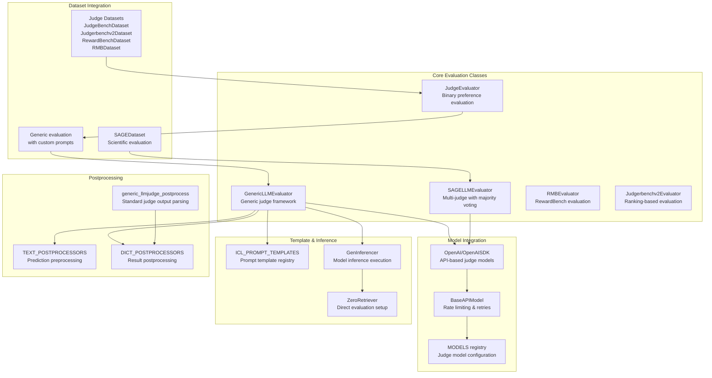
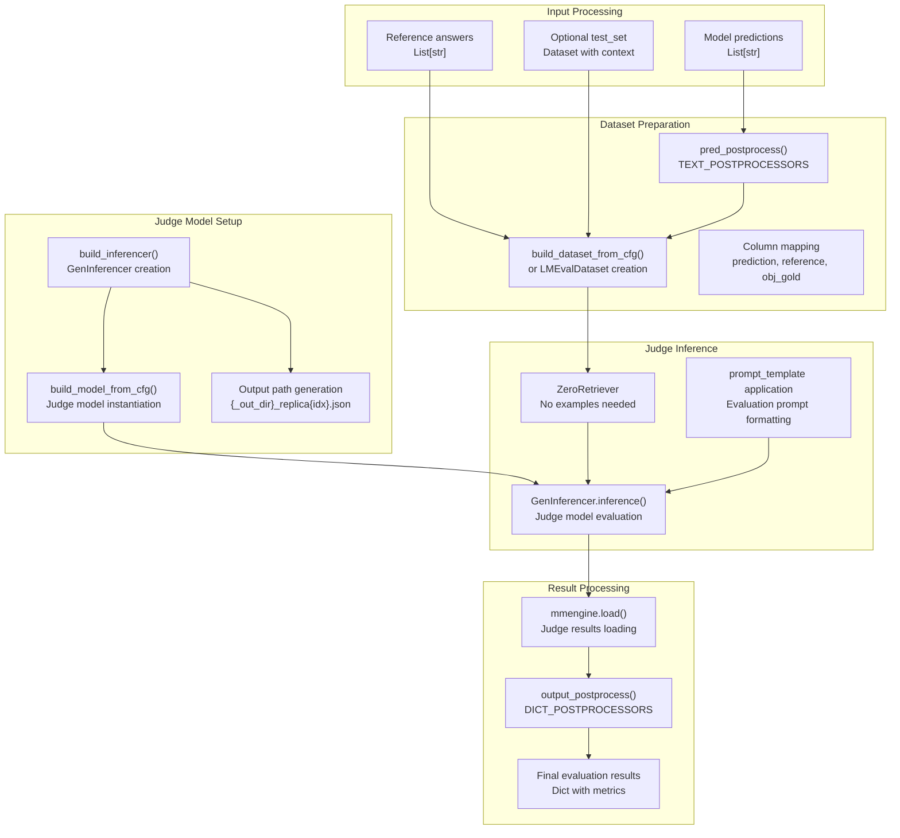
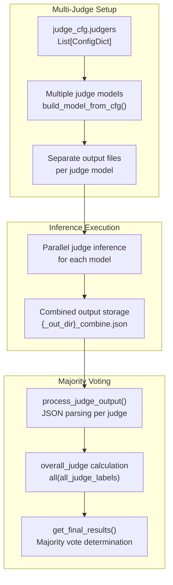
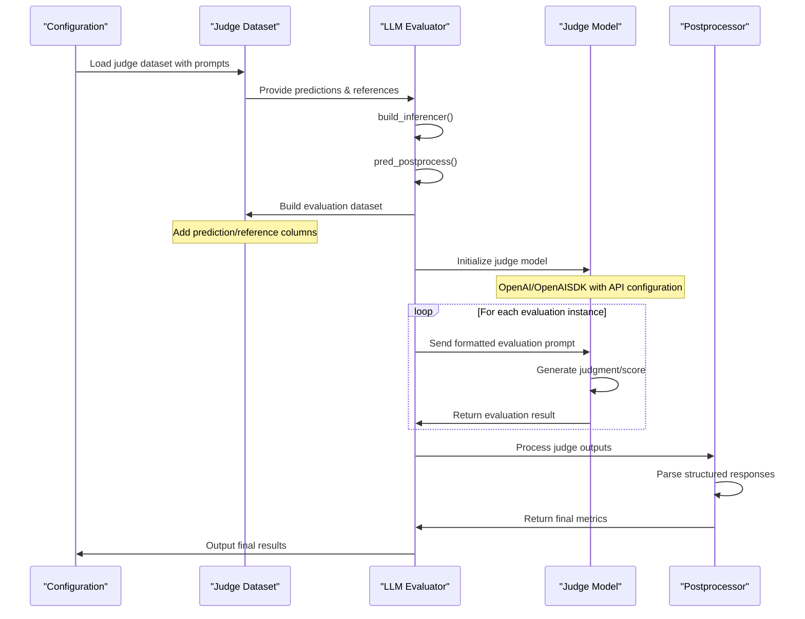

<!-- source: DeepWiki mcp.deepwiki.com · repo open-compass/opencompass · page 6.4 LLM-as-Judge Evaluation · fetched 2026-10-21 -->

# LLM-as-Judge Evaluation

<details>
<summary>Relevant source files</summary>

The following files were used as context for generating this wiki page:

- [opencompass/configs/datasets/subjective/writingbench/writingbench_judge.py](opencompass/configs/datasets/subjective/writingbench/writingbench_judge.py)
- [opencompass/configs/models/mistral/lmdeploy_mixtral_8x22b_instruct_v0_1.py](opencompass/configs/models/mistral/lmdeploy_mixtral_8x22b_instruct_v0_1.py)
- [opencompass/datasets/subjective/__init__.py](opencompass/datasets/subjective/__init__.py)
- [opencompass/datasets/subjective/compassbench_checklist.py](opencompass/datasets/subjective/compassbench_checklist.py)
- [opencompass/datasets/subjective/writingbench.py](opencompass/datasets/subjective/writingbench.py)
- [opencompass/openicl/icl_evaluator/lm_evaluator.py](opencompass/openicl/icl_evaluator/lm_evaluator.py)
- [opencompass/summarizers/subjective/__init__.py](opencompass/summarizers/subjective/__init__.py)
- [opencompass/summarizers/subjective/common_summarizer.py](opencompass/summarizers/subjective/common_summarizer.py)
- [opencompass/summarizers/subjective/qacompassbench.py](opencompass/summarizers/subjective/qacompassbench.py)
- [opencompass/utils/prompt.py](opencompass/utils/prompt.py)

</details>


LLM-as-Judge evaluation is a paradigm where language models are used to evaluate the quality of other model outputs, providing automated assessment capabilities for subjective tasks where rule-based evaluation is insufficient. This system enables evaluation of open-ended generation tasks, preference comparisons, and quality assessments that require human-like judgment.

This document covers the LLM judge evaluation framework, including the core evaluator classes, dataset integrations, and evaluation workflows. For rule-based objective evaluation, see [Objective Evaluation Datasets](#5.1). For human-based subjective evaluation, see [Subjective Evaluation](#6.2).

## Core Architecture

The LLM-as-Judge system in OpenCompass is built around several key components that work together to provide automated evaluation capabilities:



**Sources:** [opencompass/evaluator/generic_llm_evaluator.py:1-221](), [opencompass/openicl/icl_evaluator/icl_judge_evaluator.py:1-365](), [opencompass/datasets/sage/evaluation.py:187-408](), [opencompass/models/openai_api.py:31-794]()

## GenericLLMEvaluator

The `GenericLLMEvaluator` class serves as the primary framework for LLM-based evaluation, providing a flexible system for using judge models to assess model outputs:

### Key Components

| Component | Purpose | Configuration |
|-----------|---------|---------------|
| `prompt_template` | Defines the evaluation prompt structure | `ICL_PROMPT_TEMPLATES.build()` |
| `judge_cfg` | Judge model configuration | Model type, API keys, parameters |
| `dataset_cfg` | Dataset configuration for evaluation | Optional dataset building |
| `pred_postprocessor` | Prediction preprocessing | `TEXT_POSTPROCESSORS` |
| `dict_postprocessor` | Result postprocessing | `DICT_POSTPROCESSORS` |

### Evaluation Workflow



**Sources:** [opencompass/evaluator/generic_llm_evaluator.py:85-166](), [opencompass/evaluator/generic_llm_evaluator.py:60-84](), [opencompass/evaluator/generic_llm_evaluator.py:175-193]()

## Specialized Judge Evaluators

### JudgeEvaluator

Handles binary preference evaluation for tasks like model comparison:

```python
# Binary choice extraction from judge output
choice = prediction.split("\"Choice\": \"Model ")[-1][0]
# Compare against gold winner
if choice == gold_winner:
    correct += 1
```

**Sources:** [opencompass/openicl/icl_evaluator/icl_judge_evaluator.py:10-34]()

### RMBEvaluator

Specialized evaluator for RewardBench dataset with pair and BON (Best of N) accuracy calculations:

| Metric Type | Calculation Method | Purpose |
|-------------|-------------------|---------|
| Pair Accuracy | Individual pairwise comparisons | Direct preference assessment |
| BON Accuracy | All comparisons in group must be correct | Consistency evaluation |
| Category Split | Helpfulness vs Harmlessness | Domain-specific metrics |

**Sources:** [opencompass/openicl/icl_evaluator/icl_judge_evaluator.py:36-129]()

### Judgerbenchv2Evaluator

Advanced evaluator that incorporates ranking loss and score differences:

```python
# Rank difference calculation
rank1 = self.get_rank_dict(dict1)
rank2 = self.get_rank_dict(dict2)
rank_diffs = {m: abs(rank1[m] - rank2[m]) for m in rank1}

# Final score with normalization
final_score = (acc - total_normalized_diff + 100) / 2
```

**Sources:** [opencompass/openicl/icl_evaluator/icl_judge_evaluator.py:255-364]()

### SAGELLMEvaluator

Multi-judge system with majority voting for scientific evaluation:



**Sources:** [opencompass/datasets/sage/evaluation.py:187-408](), [opencompass/datasets/sage/evaluation.py:228-255](), [opencompass/datasets/sage/evaluation.py:164-185]()

## Dataset Integration

### Judge-Specific Datasets

OpenCompass supports several specialized datasets for judge evaluation:

| Dataset | Evaluator | Purpose | Configuration |
|---------|-----------|---------|---------------|
| JudgeBench | `JudgeEvaluator` | Binary preference evaluation | [configs/datasets/judge/judgebench.py]() |
| Judgerbenchv2 | `Judgerbenchv2Evaluator` | Multi-category ranking | [configs/datasets/judge/judgerbenchv2.py]() |
| RewardBench | `JudgeEvaluator` | Reward model evaluation | [configs/datasets/judge/rewardbench.py]() |
| RMB | `RMBEvaluator` | Preference and consistency | [configs/datasets/judge/rmb.py]() |
| SAGE | `SAGELLMEvaluator` | Scientific evaluation | [configs/datasets/sage/]() |

### Configuration Pattern

Judge datasets follow a consistent configuration pattern:

```python
# Standard judge dataset configuration
dataset_config = dict(
    type=DatasetClass,
    path='./data/judge_eval/dataset_name',
    reader_cfg=dict(
        input_columns=['prompt'],
        output_column='judge'
    ),
    infer_cfg=dict(
        prompt_template=dict(type=PromptTemplate, template=...),
        inferencer=dict(type=GenInferencer, max_out_len=4096)
    ),
    eval_cfg=dict(
        evaluator=dict(type=EvaluatorClass)
    )
)
```

**Sources:** [opencompass/configs/datasets/judge/judgebench.py:40-71](), [opencompass/configs/datasets/judge/rewardbench.py:40-71](), [opencompass/configs/datasets/judge/judgerbenchv2.py:17-47]()

## Evaluation Workflow

The complete LLM-as-Judge evaluation process follows this workflow:



**Sources:** [opencompass/evaluator/generic_llm_evaluator.py:85-166](), [opencompass/datasets/sage/evaluation.py:256-361]()

## Prompt Templates and Configuration

### Judge Model Configuration

Judge models are typically configured with specific parameters optimized for evaluation:

```python
DEFAULT_JUDGE_CFG = dict(
    type=OpenAISDK,
    path=os.environ['OC_JUDGE_MODEL'],
    key=os.environ['OC_JUDGE_API_KEY'],
    openai_api_base=[os.environ.get('OC_JUDGE_API_BASE', 'https://api.openai.com/v1/')],
    meta_template=dict(round=[
        dict(role='HUMAN', api_role='HUMAN'),
        dict(role='BOT', api_role='BOT', generate=True),
    ]),
    query_per_second=16,
    batch_size=1024,
    temperature=0.001,
    max_out_len=16384,
    max_seq_len=49152,
)
```

### Evaluation Prompt Templates

Different evaluation tasks require specific prompt structures:

#### Binary Choice Evaluation
```python
prompt_choice_prefix = """
Please act as an impartial judge to evaluate the responses provided by two AI assistants to the user question below. Your evaluation should focus on the following criteria: helpfulness, relevance, accuracy, depth, creativity, and level of detail.

Your final reply must be structured in the following format:
{
  "Choice": "[Model A or Model B]"
}
"""
```

#### SAGE Scientific Evaluation
The SAGE evaluation uses detailed grading protocols with structured JSON output:

```python
# Grading scale: A (CORRECT), B (INCORRECT), C (INVALID)
# Output format: {"judgements": [{"label": "A/B/C", "explanation": "..."}]}
```

**Sources:** [opencompass/evaluator/generic_llm_evaluator.py:194-220](), [opencompass/configs/datasets/judge/judgebench.py:19-38](), [opencompass/datasets/sage/prompt.py:30-154]()

## Result Processing and Postprocessing

### Generic Judge Output Processing

The system provides standardized postprocessing for judge outputs:

```python
def _generic_llmjudge_postprocess(judgement: str):
    match = re.search(r'(A|B)', judgement)
    grade_letter = match.group(0) if match else 'unknown'
    return grade_letter

def get_final_results(judged_answers, references, origial_responses, metric_name='accuracy'):
    # Calculate accuracy, attempted ratio, F1 score
    # Return detailed results with per-instance information
```

### Result Structure

Judge evaluations produce structured results:

| Field | Description | Type |
|-------|-------------|------|
| `accuracy` | Primary evaluation metric | `float` |
| `details` | Per-instance evaluation results | `List[Dict]` |
| `attempted_ratio` | Percentage of valid judge responses | `float` |
| `correct_count` | Number of correct judgments | `int` |

**Sources:** [opencompass/datasets/generic.py:60-111](), [opencompass/datasets/sage/evaluation.py:58-86]()

## Configuration Examples

### Basic Judge Evaluation

```python
# Simple judge evaluation setup
from opencompass.configs.datasets.judge.judgebench import get_judgebench_datasets
from opencompass.models import TurboMindModelwithChatTemplate

datasets = [*get_judgebench_datasets]
models = [
    dict(
        type=TurboMindModelwithChatTemplate,
        abbr='qwen-7b-hf',
        path='Qwen/Qwen-7B',
        max_out_len=2048,
    ),
]
```

### Advanced Multi-Judge SAGE Setup

```python
# SAGE evaluation with multiple judges
sage_datasets[0]["eval_cfg"]["evaluator"]["judge_cfg"]["judgers"][0].update(dict(
    abbr="gpt-4o",
    openai_api_base="https://api.openai.com/v1/",
    path="gpt-4o-2024-05-13",
    key="YOUR_API_KEY",
    temperature=0.6,
    max_out_len=32768,
))
```

**Sources:** [examples/eval_judgebench.py:1-53](), [opencompass/configs/datasets/sage/README.md:9-16](), [opencompass/configs/datasets/sage/sage_val_gen_906a48.py:211-237]()

---

