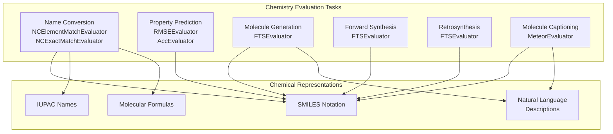
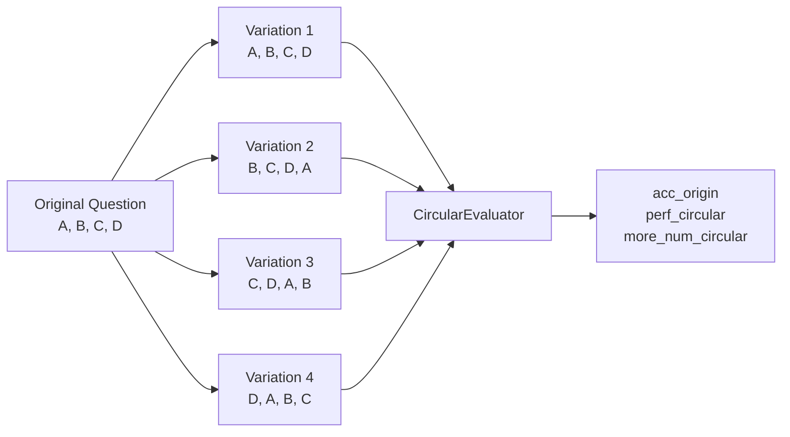

<!-- source: DeepWiki mcp.deepwiki.com · repo open-compass/opencompass · page 6.5 Specialized Evaluators · fetched 2026-10-21 -->

# Specialized Evaluation

<details>
<summary>Relevant source files</summary>

The following files were used as context for generating this wiki page:

- [.pre-commit-config-zh-cn.yaml](.pre-commit-config-zh-cn.yaml)
- [.pre-commit-config.yaml](.pre-commit-config.yaml)
- [dataset-index.yml](dataset-index.yml)
- [docs/zh_cn/advanced_guides/compassbench_intro.md](docs/zh_cn/advanced_guides/compassbench_intro.md)
- [docs/zh_cn/advanced_guides/compassbench_v2_0.md](docs/zh_cn/advanced_guides/compassbench_v2_0.md)
- [opencompass/configs/datasets/IFBench/IFBench_gen.py](opencompass/configs/datasets/IFBench/IFBench_gen.py)
- [opencompass/configs/datasets/MedCalc_Bench/MedCalcBench_official_gen_a5155f.py](opencompass/configs/datasets/MedCalc_Bench/MedCalcBench_official_gen_a5155f.py)
- [opencompass/configs/datasets/TheoremQA/ThroremQA_0shot_cot_gen_8acdf7.py](opencompass/configs/datasets/TheoremQA/ThroremQA_0shot_cot_gen_8acdf7.py)
- [opencompass/configs/datasets/srbench/srbench_gen.py](opencompass/configs/datasets/srbench/srbench_gen.py)
- [opencompass/configs/models/deepseek/lmdeploy_deepseek_v2.py](opencompass/configs/models/deepseek/lmdeploy_deepseek_v2.py)
- [opencompass/configs/models/deepseek/lmdeploy_deepseek_v2_5.py](opencompass/configs/models/deepseek/lmdeploy_deepseek_v2_5.py)
- [opencompass/configs/models/deepseek/lmdeploy_deepseek_v2_5_1210.py](opencompass/configs/models/deepseek/lmdeploy_deepseek_v2_5_1210.py)
- [opencompass/configs/summarizers/groups/biodata.py](opencompass/configs/summarizers/groups/biodata.py)
- [opencompass/datasets/IFBench/evaluation_lib.py](opencompass/datasets/IFBench/evaluation_lib.py)
- [opencompass/datasets/IFBench/ifbench.py](opencompass/datasets/IFBench/ifbench.py)
- [opencompass/datasets/IFBench/instructions.py](opencompass/datasets/IFBench/instructions.py)
- [opencompass/datasets/IFBench/instructions_registry.py](opencompass/datasets/IFBench/instructions_registry.py)
- [opencompass/datasets/IFBench/instructions_util.py](opencompass/datasets/IFBench/instructions_util.py)
- [opencompass/datasets/MedCalc_Bench.py](opencompass/datasets/MedCalc_Bench.py)
- [opencompass/datasets/TheoremQA/__init__.py](opencompass/datasets/TheoremQA/__init__.py)
- [opencompass/datasets/TheoremQA/main.py](opencompass/datasets/TheoremQA/main.py)
- [opencompass/datasets/__init__.py](opencompass/datasets/__init__.py)
- [opencompass/datasets/livecodebench/execute_utils.py](opencompass/datasets/livecodebench/execute_utils.py)
- [opencompass/datasets/livecodebench/prompts.py](opencompass/datasets/livecodebench/prompts.py)
- [opencompass/datasets/livecodebench/testing_util.py](opencompass/datasets/livecodebench/testing_util.py)
- [opencompass/datasets/scicode.py](opencompass/datasets/scicode.py)
- [opencompass/datasets/srbench.py](opencompass/datasets/srbench.py)
- [opencompass/models/glm.py](opencompass/models/glm.py)
- [opencompass/models/interntrain.py](opencompass/models/interntrain.py)
- [opencompass/openicl/icl_evaluator/icl_plugin_evaluator.py](opencompass/openicl/icl_evaluator/icl_plugin_evaluator.py)
- [opencompass/summarizers/subjective/compassbench_v13.py](opencompass/summarizers/subjective/compassbench_v13.py)
- [opencompass/summarizers/summarizer_pretrain.py](opencompass/summarizers/summarizer_pretrain.py)
- [opencompass/utils/datasets_info.py](opencompass/utils/datasets_info.py)
- [requirements/extra.txt](requirements/extra.txt)
- [requirements/runtime.txt](requirements/runtime.txt)

</details>


This document covers domain-specific evaluation methods and specialized evaluation techniques in OpenCompass that extend beyond general-purpose evaluation paradigms. These methods are designed for specific domains (code, chemistry, mathematics) and specialized evaluation approaches that require custom evaluation logic, external services, or domain expertise.

For general evaluation methods, see [In-Context Learning Evaluation](#6.1). For human preference evaluation, see [Subjective Evaluation](#6.2). For general LLM-as-judge approaches, see [LLM-as-Judge Evaluation](#6.3).

## Overview of Specialized Evaluation Types

OpenCompass supports several categories of specialized evaluation:

1. **Code Evaluation** - Programming language assessment with execution environments
2. **Chemistry Evaluation** - Molecular and chemical property prediction tasks  
3. **Mathematical Evaluation** - Theorem proving and mathematical reasoning
4. **Specialized Evaluation Techniques** - Advanced evaluation methodologies

## Code Evaluation Framework

### Architecture

Code evaluation in OpenCompass uses a containerized approach to safely execute generated code across multiple programming languages. The system integrates with external code evaluation services to provide secure sandboxed execution environments.

```mermaid
graph TB
    subgraph "Code Evaluation Pipeline"
        MODEL[Model Generation] --> COLLECT[collect_code_preds.py]
        COLLECT --> DOCKER[Docker Service]
        DOCKER --> EVAL[Code Execution]
        EVAL --> RESULTS[Pass@k Results]
    end
    
    subgraph "Supported Languages"
        PYTHON[Python - HumanEval]
        CPP[C++ - HumanEval-X]
        GO[Go - HumanEval-X] 
        JAVA[Java - HumanEval-X]
        JS[JavaScript - HumanEval-X]
    end
    
    subgraph "Evaluation Services"
        SERVICE[code-evaluator service]
        DS1000[DS1000 Service]
        HUMANEVAL[HumanEval-X Service]
    end
    
    MODEL --> PYTHON
    MODEL --> CPP
    MODEL --> GO
    MODEL --> JAVA
    MODEL --> JS
    
    DOCKER --> SERVICE
    DOCKER --> DS1000
    DOCKER --> HUMANEVAL
```

Sources: [docs/zh_cn/advanced_guides/code_eval_service.md:1-223](), [docs/en/advanced_guides/code_eval_service.md:1-224]()

### Code Evaluation Setup

The code evaluation framework supports multiple datasets and execution environments:

| Dataset | Languages | Evaluation Method |
|---------|-----------|-------------------|
| HumanEval | Python | Docker container execution |
| HumanEval-X | Python, C++, Go, Java, JS | Multi-language Docker services |
| DS1000 | Python | Library-specific execution (Pandas, NumPy, etc.) |
| MBPP | Python | Python-specific execution with test cases |

### Pass@k Evaluation

Code evaluation supports both `pass@1` and `pass@k` metrics:

**Pass@1 Evaluation**: Single response generation
- Uses standard `GenInferencer` with single output
- Direct execution and scoring

**Pass@k Evaluation**: Multiple response generation  
- Requires `num_return_sequences` parameter in generation config
- Alternative approach using dataset repetition for unsupported models
- Uses specialized evaluators like `MBPPPassKEvaluator`

Sources: [docs/zh_cn/advanced_guides/code_eval.md:1-107](), [docs/en/advanced_guides/code_eval.md:1-104]()

## Chemistry Evaluation Framework

### Chemistry Domain Tasks

OpenCompass provides comprehensive chemistry evaluation through multiple specialized datasets and evaluators designed for molecular and chemical property prediction tasks.



Sources: [opencompass/datasets/smolinstruct.py:1-489]()

### Chemistry Evaluators

The chemistry evaluation framework includes several specialized evaluators:

**NCElementMatchEvaluator**: Molecular formula element matching
- Parses molecular formulas using `parse_molecule()` function
- Compares elemental composition between predicted and reference formulas
- Handles chemical validity checking and error cases

**FTSEvaluator**: Chemical similarity evaluation
- Uses RDKit for molecular fingerprint comparison
- Computes Tanimoto similarity between SMILES structures
- Provides chemical validity scoring

**RMSEEvaluator**: Numerical property prediction
- Extracts numerical values from predictions using regex patterns
- Calculates root mean square error for continuous properties

Sources: [opencompass/datasets/smolinstruct.py:209-406]()

### Chemistry Dataset Configuration

Chemistry datasets in OpenCompass follow standardized configuration patterns:

```python
# Example configuration structure from SmolInstruct
{
    'abbr': 'NC-I2F-0shot-instruct',
    'type': 'SmolInstructDataset', 
    'path': 'osunlp/SMolInstruct',
    'name': 'name_conversion-i2f',
    'reader_cfg': dict(input_columns=['input'], output_column='output'),
    'infer_cfg': dict(prompt_template=..., retriever=..., inferencer=...),
    'eval_cfg': dict(evaluator=dict(type='NCElementMatchEvaluator'))
}
```

Sources: [opencompass/configs/datasets/SmolInstruct/smolinstruct_nc_0shot_instruct.py:1-67](), [opencompass/configs/datasets/ChemBench/ChemBench_gen_a9f753.py:1-77]()

## Mathematical Evaluation

### TheoremQA Framework

Mathematical evaluation includes specialized handling for theorem proving and mathematical reasoning tasks through the TheoremQA dataset utilities.

**Answer Extraction**: The `extract_theoremqa_answer()` function handles multiple answer formats:
- Boolean answers (True/False, Yes/No)  
- Multiple choice options (A, B, C, D, E, F)
- Numerical expressions with LaTeX parsing
- Unit handling and mathematical expression evaluation

**Mathematical Expression Processing**: 
- Uses `latex2sympy2_extended` for LaTeX to symbolic conversion
- Implements timeout mechanisms for complex expression evaluation
- Handles mathematical units and dimensional analysis

Sources: [opencompass/datasets/TheoremQA/utils.py:1-116]()

## Specialized Evaluation Techniques

### Circular Evaluation

Circular evaluation addresses option bias in multiple-choice questions by systematically shuffling answer options.



**CircularDatasetMeta**: Metaclass for creating circular evaluation datasets
- `default_circular_splits`: Specifies which dataset splits to augment
- `default_option_keys`: Keys to shuffle (e.g., ['A', 'B', 'C', 'D'])
- `default_answer_key`: Field containing correct answer to update

**CircularEvaluator**: Specialized evaluator producing multiple metrics:
- `acc_circular`: Accuracy treating each variation as separate question
- `perf_circular`: Accuracy requiring all variations to be correct  
- `more_num_circular`: Accuracy with threshold-based correctness

Sources: [docs/zh_cn/advanced_guides/circular_eval.md:1-112](), [docs/en/advanced_guides/circular_eval.md:1-113]()

### Contamination Assessment

Data contamination evaluation helps identify potential training data leakage using two approaches:

**Co-Distribution Data Method**: 
- Uses reference datasets (e.g., mock_gsm8k_test) as clean comparison
- Compares perplexity across train/test/reference splits
- Identifies potential contamination through perplexity analysis

**Pre-trained Set Method**:
- Searches test data in Common Crawl and web sources  
- Labels samples as clean/input-contaminated/input-and-label-contaminated
- Reports accuracy across contamination levels

Sources: [docs/zh_cn/advanced_guides/contamination_eval.md:1-123](), [docs/en/advanced_guides/contamination_eval.md:1-124]()

### Prompt Attack Evaluation

Prompt attack evaluation assesses model robustness against adversarial prompt modifications using PromptBench integration.

**Attack Types Supported**:
- `textfooler`: Word-level adversarial attacks
- `textbugger`: Character-level perturbations  
- `deepwordbug`: Deep learning-based word bugs
- `bertattack`: BERT-based adversarial examples
- `checklist`: Systematic behavioral testing
- `stresstest`: Stress testing with variations

**AttackInferencer**: Specialized inferencer for attack experiments
- `original_prompt_list`: Base prompts to attack
- `adv_key`: Template key for adversarial modifications
- `query_budget`: Maximum attack iterations
- `prompt_topk`: Number of top prompts to evaluate

Sources: [docs/zh_cn/advanced_guides/prompt_attack.md:1-108](), [docs/en/advanced_guides/prompt_attack.md:1-108]()

## Integration with External Services

### Specialized Model APIs

OpenCompass integrates with specialized inference services for domain-specific evaluation:

**LightLLM Integration**: High-performance inference backend
- `LightllmAPI`: Direct API model for generation and perplexity
- `LightllmChatAPI`: Chat-based API with conversation handling
- Supports concurrent execution with rate limiting via `TokenBucket`

Sources: [opencompass/models/lightllm_api.py:1-351](), [docs/zh_cn/advanced_guides/evaluation_lightllm.md:1-72]()

### External Evaluation Services  

**Code Evaluator Service**: Docker-based execution environment
- Supports multiple programming languages
- Provides secure sandboxed execution
- REST API interface for remote evaluation

**Reward Bench Integration**: Specialized preference evaluation
- `RewardBenchDataset`: Handles preference pair data
- Integrates with judge models for preference scoring
- Supports conversation-based evaluation formats

Sources: [opencompass/datasets/judge/rewardbench.py:1-58]()

## Configuration Patterns

### Specialized Dataset Configuration

Specialized evaluation datasets follow consistent configuration patterns while accommodating domain-specific requirements:

```python
# Chemistry dataset example
{
    'type': 'SmolInstructDataset',
    'path': 'osunlp/SMolInstruct', 
    'name': 'property_prediction-bbbp',
    'eval_cfg': {
        'evaluator': {'type': 'AccEvaluator'},
        'pred_postprocessor': {'type': 'smolinstruct_acc_0shot_postprocess'}
    }
}

# Code dataset example  
{
    'type': 'HumanevalXDataset',
    'language': 'python',
    'eval_cfg': {
        'evaluator': {
            'type': 'HumanevalXEvaluator',
            'ip_address': 'localhost',
            'port': 5000
        }
    }
}
```

Sources: [opencompass/configs/datasets/SmolInstruct/smolinstruct_pp_acc_0_shot_instruct.py:1-65](), [docs/zh_cn/advanced_guides/code_eval_service.md:84-93]()

---

