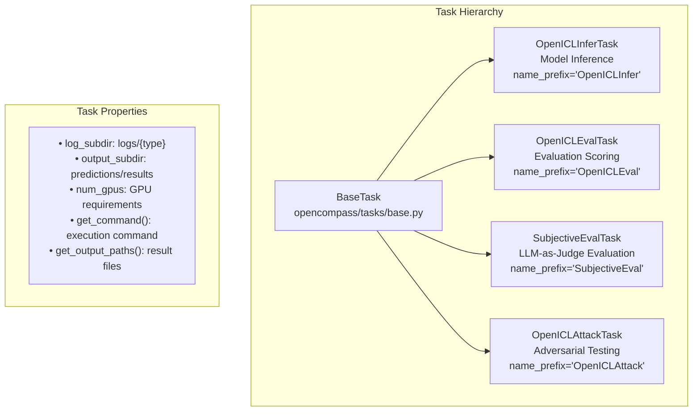
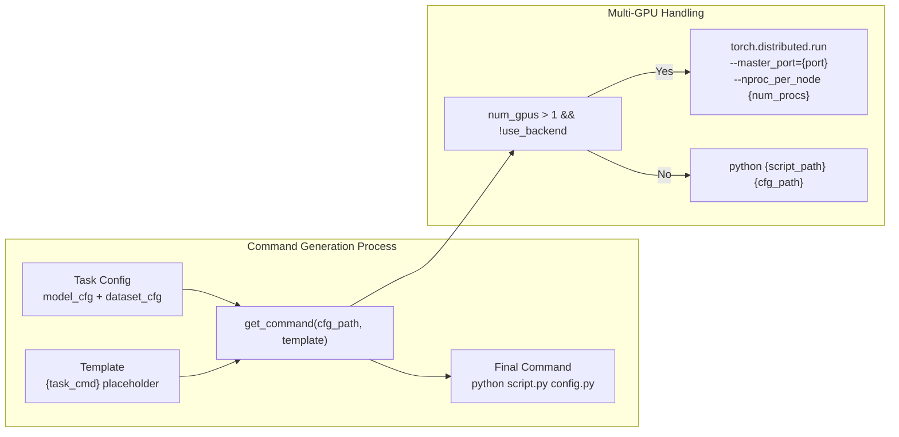
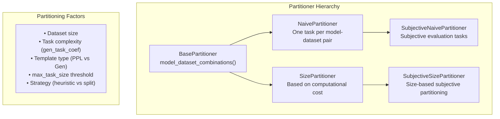
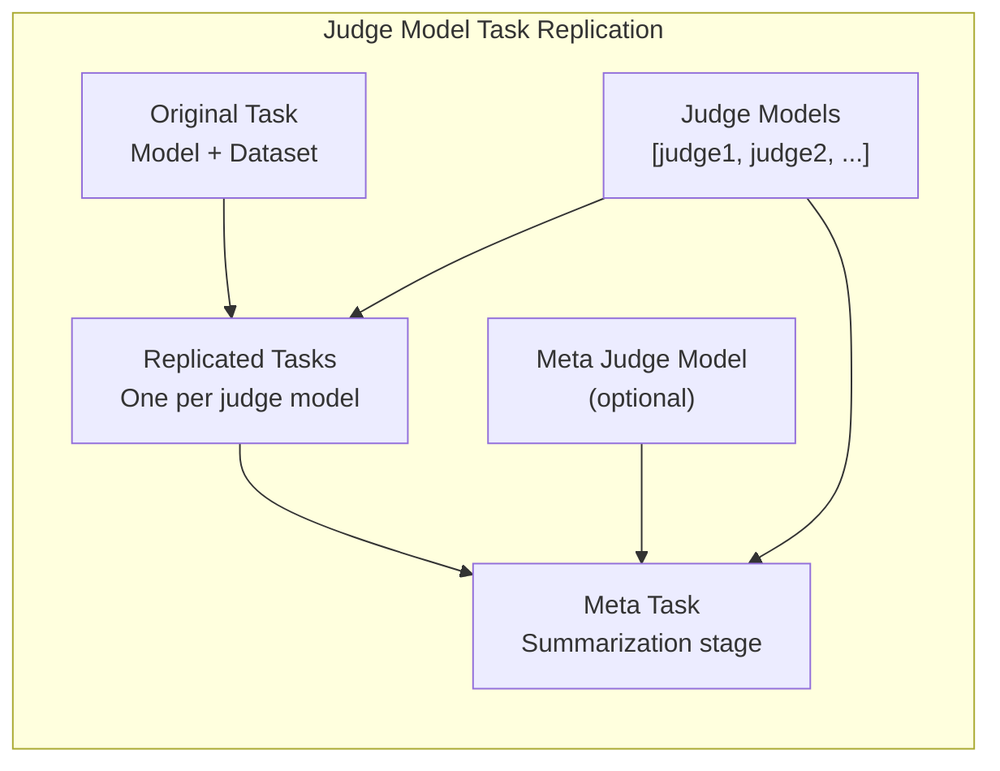
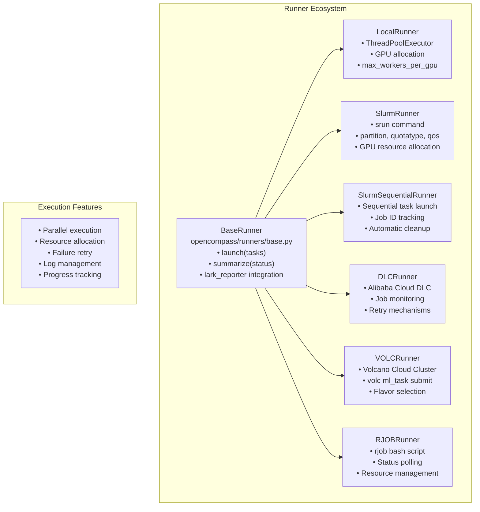
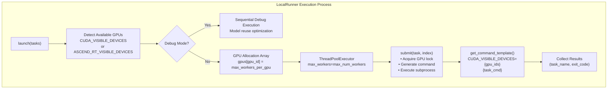
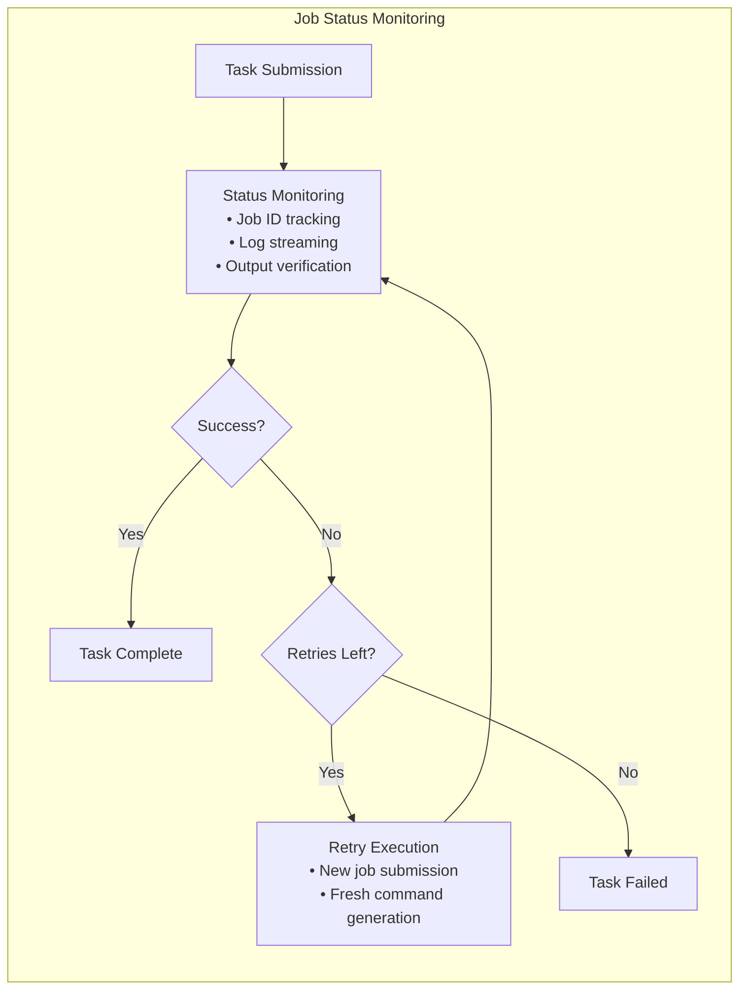

<!-- source: DeepWiki mcp.deepwiki.com · repo open-compass/opencompass · page 7 Task Execution and Distribution · fetched 2026-10-21 -->

# Task Execution and Distribution

<details>
<summary>Relevant source files</summary>

The following files were used as context for generating this wiki page:

- [examples/eval_model_rollout.py](examples/eval_model_rollout.py)
- [opencompass/configs/models/bluelm/bluelm_3b.py](opencompass/configs/models/bluelm/bluelm_3b.py)
- [opencompass/datasets/cmnli.py](opencompass/datasets/cmnli.py)
- [opencompass/datasets/generic.py](opencompass/datasets/generic.py)
- [opencompass/lagent/actions/python_interpreter.py](opencompass/lagent/actions/python_interpreter.py)
- [opencompass/models/__init__.py](opencompass/models/__init__.py)
- [opencompass/models/bluelm_api.py](opencompass/models/bluelm_api.py)
- [opencompass/models/openai_api.py](opencompass/models/openai_api.py)
- [opencompass/models/vllm.py](opencompass/models/vllm.py)
- [opencompass/models/zhipuai_v2_api.py](opencompass/models/zhipuai_v2_api.py)
- [opencompass/runners/__init__.py](opencompass/runners/__init__.py)
- [opencompass/runners/base.py](opencompass/runners/base.py)
- [opencompass/runners/dlc.py](opencompass/runners/dlc.py)
- [opencompass/runners/local.py](opencompass/runners/local.py)
- [opencompass/runners/local_api.py](opencompass/runners/local_api.py)
- [opencompass/runners/rjob.py](opencompass/runners/rjob.py)
- [opencompass/runners/slurm.py](opencompass/runners/slurm.py)
- [opencompass/runners/slurm_sequential.py](opencompass/runners/slurm_sequential.py)
- [opencompass/runners/volc.py](opencompass/runners/volc.py)
- [opencompass/tasks/openicl_attack.py](opencompass/tasks/openicl_attack.py)
- [opencompass/tasks/openicl_eval.py](opencompass/tasks/openicl_eval.py)
- [opencompass/tasks/openicl_infer.py](opencompass/tasks/openicl_infer.py)
- [opencompass/utils/build.py](opencompass/utils/build.py)
- [opencompass/utils/types.py](opencompass/utils/types.py)

</details>


This document covers OpenCompass's task execution and distribution system, which manages how evaluation workloads are partitioned, scheduled, and executed across different computing environments. The system supports various execution backends from local machines to distributed clusters, with intelligent task partitioning to optimize resource utilization and execution time.

For information about the overall evaluation pipeline, see [Evaluation Pipeline](#3.1). For details about specific runner configurations and environments, see [Runner Types and Environments](#7.1).

## Task Execution Framework

OpenCompass uses a task-based execution model where evaluation work is divided into discrete, independent tasks that can be executed in parallel across different computing environments. Each task represents a specific evaluation operation for a model-dataset combination.

### Task Types

The framework defines several task types, all inheriting from `BaseTask`:



**OpenICLInferTask** handles model inference, generating predictions from language models. It supports various backends including VLLM and LMDeploy for accelerated inference, and can run with multi-GPU distributed execution.

**OpenICLEvalTask** processes model predictions to compute evaluation metrics. It loads predictions, applies post-processing, runs evaluators, and saves detailed results with support for extraction rate calculations and BPB (Bits Per Byte) metrics.

**SubjectiveEvalTask** manages subjective evaluations using LLM-as-judge methodologies, supporting both single judge and meta-judge configurations for comparative evaluation.

Sources: [opencompass/tasks/openicl_infer.py:20-165](), [opencompass/tasks/openicl_eval.py:24-470](), [opencompass/tasks/subjective_eval.py:23-468]()

### Task Configuration and Command Generation

Each task generates its execution command through the `get_command()` method, which creates appropriate commands for different execution environments:



Sources: [opencompass/tasks/openicl_infer.py:38-63](), [opencompass/tasks/openicl_eval.py:57-69]()

## Task Partitioning Strategies

Task partitioning determines how model-dataset combinations are divided into executable units. OpenCompass provides different partitioning strategies to optimize resource utilization and execution efficiency.

### Partitioner Architecture



The **SubjectiveSizePartitioner** implements sophisticated cost-based partitioning:

- Calculates dataset computational cost using `get_cost()` method
- Applies `gen_task_coef` multiplier for generation tasks (default: 20x)
- Identifies expensive datasets (BBH, GSM8K, Math) with 10x additional penalty
- Supports `heuristic` strategy (merge small datasets) and `split` strategy (divide large datasets only)

Sources: [opencompass/partitioners/sub_size.py:20-288](), [opencompass/partitioners/sub_naive.py:126-233]()

### Judge Model Replication

For subjective evaluation, partitioners replicate tasks across multiple judge models:



The `replicate_tasks_with_judge_models()` function creates separate tasks for each judge model, with optional meta-judge tasks for result aggregation.

Sources: [opencompass/partitioners/sub_naive.py:31-49]()

## Runner Architecture

Runners manage task execution across different computing environments. Each runner inherits from `BaseRunner` and implements environment-specific execution logic.

### Runner Types and Capabilities



Sources: [opencompass/runners/base.py:10-85](), [opencompass/runners/local.py:39-249](), [opencompass/runners/slurm.py:19-163]()

### Local Runner Execution Flow

The `LocalRunner` provides sophisticated local execution with GPU management:



The local runner uses a lock-based GPU allocation system to prevent resource conflicts and supports model instance reuse in debug mode for efficiency.

Sources: [opencompass/runners/local.py:69-196](), [opencompass/runners/local.py:24-36]()

### Distributed Runner Command Generation

Distributed runners (Slurm, DLC, VOLC) generate environment-specific commands with resource specifications:

**SlurmRunner** command template:
```
srun -p {partition} --quotatype={quotatype} --qos={qos} --gres=gpu:{num_gpus} -N1 -u -J '{task_name}' {task_cmd}
```

**DLCRunner** command template:
```
dlc submit pytorchjob --command '{shell_cmd}' --name {task_name} --workspace_id {workspace_id} --resource_id={resource_id} --worker_gpu {num_gpus}
```

Each runner handles environment variables, resource allocation, and job monitoring specific to its platform.

Sources: [opencompass/runners/slurm.py:101-113](), [opencompass/runners/dlc.py:201-215]()

## Execution Coordination

The task execution system coordinates multiple components to achieve efficient distributed evaluation:

```mermaid
graph TB
    subgraph "Execution Coordination Flow"
        Configuration["Evaluation Configuration<br/>models + datasets + runner_cfg"]
        
        Partitioner["Task Partitioner<br/>partition(models, datasets)<br/>→ List[task_cfg]"]
        
        Runner["Runner Instance<br/>launch(tasks)<br/>→ List[(task_name, exit_code)]"]
        
        TaskExecution["Task Execution<br/>• Command generation<br/>• Resource allocation<br/>• Subprocess management"]
        
        ResultCollection["Result Collection<br/>• Output file verification<br/>• Status aggregation<br/>• Failure retry"]
        
        Summarization["Result Summarization<br/>• Success/failure counts<br/>• Lark notifications<br/>• Error reporting"]
    end
    
    Configuration --> Partitioner
    Partitioner --> Runner
    Runner --> TaskExecution
    TaskExecution --> ResultCollection
    ResultCollection --> Summarization
    
    subgraph "Task Lifecycle"
        TaskStates["CREATED → SUBMITTED → RUNNING → COMPLETED/FAILED"]
    end
```



### Status Monitoring and Retry Logic

Runners implement sophisticated monitoring and retry mechanisms:



The `_job_failed()` method checks both return codes and output file existence to determine task success, enabling robust failure detection and recovery.

Sources: [opencompass/runners/base.py:54-84](), [opencompass/runners/dlc.py:356-358]()

This task execution and distribution system enables OpenCompass to efficiently scale evaluation workloads across diverse computing environments while maintaining reliability and providing comprehensive monitoring capabilities.

---

