<!-- source: DeepWiki mcp.deepwiki.com · repo open-compass/opencompass · page 7.1 Task Partitioning Strategies · fetched 2026-10-21 -->

# Task Partitioning Strategies

<details>
<summary>Relevant source files</summary>

The following files were used as context for generating this wiki page:

- [.gitignore](.gitignore)
- [docs/en/get_started/faq.md](docs/en/get_started/faq.md)
- [docs/en/get_started/quick_start.md](docs/en/get_started/quick_start.md)
- [docs/en/notes/contribution_guide.md](docs/en/notes/contribution_guide.md)
- [docs/en/user_guides/experimentation.md](docs/en/user_guides/experimentation.md)
- [docs/zh_cn/get_started/faq.md](docs/zh_cn/get_started/faq.md)
- [docs/zh_cn/get_started/quick_start.md](docs/zh_cn/get_started/quick_start.md)
- [docs/zh_cn/notes/contribution_guide.md](docs/zh_cn/notes/contribution_guide.md)
- [docs/zh_cn/user_guides/experimentation.md](docs/zh_cn/user_guides/experimentation.md)
- [opencompass/cli/main.py](opencompass/cli/main.py)
- [opencompass/openicl/icl_retriever/icl_votek_retriever.py](opencompass/openicl/icl_retriever/icl_votek_retriever.py)
- [opencompass/partitioners/base.py](opencompass/partitioners/base.py)
- [opencompass/partitioners/sub_naive.py](opencompass/partitioners/sub_naive.py)
- [opencompass/partitioners/sub_size.py](opencompass/partitioners/sub_size.py)
- [opencompass/summarizers/__init__.py](opencompass/summarizers/__init__.py)
- [opencompass/tasks/subjective_eval.py](opencompass/tasks/subjective_eval.py)
- [opencompass/utils/result_station.py](opencompass/utils/result_station.py)
- [opencompass/utils/run.py](opencompass/utils/run.py)
- [run.py](run.py)
- [tools/convert_alignmentbench.py](tools/convert_alignmentbench.py)

</details>


## Purpose and Scope

This document describes the task partitioning strategies in OpenCompass, which are responsible for dividing evaluation workloads into independent executable units called "tasks". Partitioners determine how model-dataset pairs are split and grouped to optimize parallel execution and resource utilization.

For information about task execution after partitioning, see [Runner Types and Environments](#7.2). For information about the overall evaluation pipeline, see [Evaluation Pipeline Overview](#3.1).

## Overview of Partitioning in OpenCompass

OpenCompass uses a partitioning system to convert a high-level evaluation configuration (models + datasets) into granular tasks that can be executed in parallel. Each partitioner implements a specific strategy for dividing work:

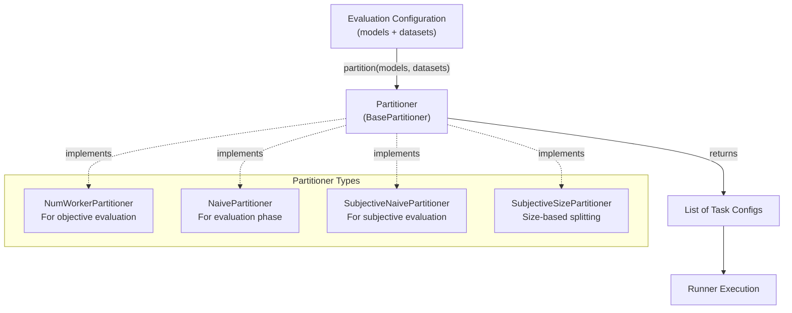

**Sources:** [opencompass/partitioners/base.py:13-102](), [opencompass/cli/main.py:333-361]()

## Base Partitioner Architecture

All partitioners inherit from `BasePartitioner`, which provides the foundational structure for task creation.

### BasePartitioner Class

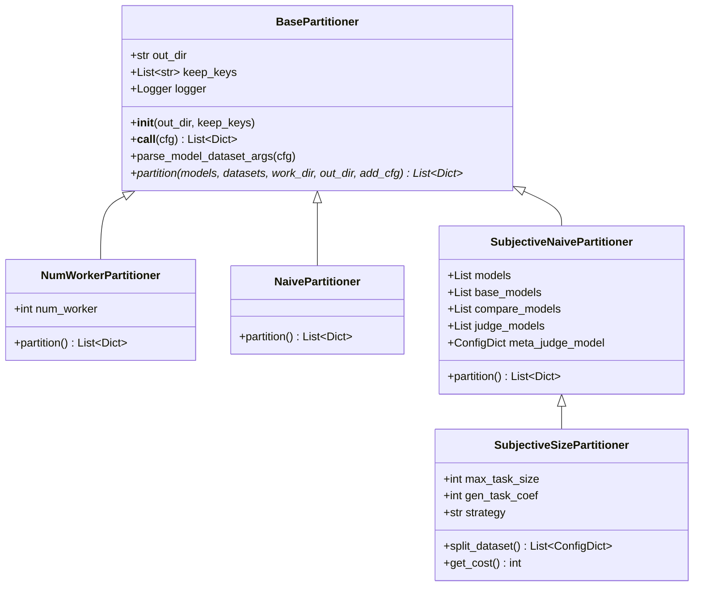

**Sources:** [opencompass/partitioners/base.py:13-191]()

### Task Configuration Structure

Each partitioner outputs a list of task configurations. Each task has the following structure:

```python
{
    'models': [],           # List of model configs
    'datasets': [[]],       # Nested list of dataset configs (each list corresponds to a model)
    'work_dir': '',         # Working directory for outputs
    # Additional fields from add_cfg (e.g., judge_cfg, dump_details)
}
```

The `__call__` method in `BasePartitioner` orchestrates the partitioning:

1. Parses model-dataset arguments from configuration
2. Extracts additional configuration keys specified in `keep_keys`
3. Calls the abstract `partition` method implemented by subclasses
4. Logs the number of tasks created

**Sources:** [opencompass/partitioners/base.py:40-102]()

### Configuration Preservation

`BasePartitioner` supports preserving specific configuration keys from the experiment config to task configs through the `keep_keys` parameter. Default preserved keys include:

- `eval.runner.task.judge_cfg`
- `eval.runner.task.dump_details`
- `eval.given_pred`
- `eval.runner.task.cal_extract_rate`

**Sources:** [opencompass/partitioners/base.py:27-38]()

## Objective Evaluation Partitioners

### NumWorkerPartitioner

`NumWorkerPartitioner` is the default partitioner for the inference phase. It splits datasets across a specified number of workers to balance workload.

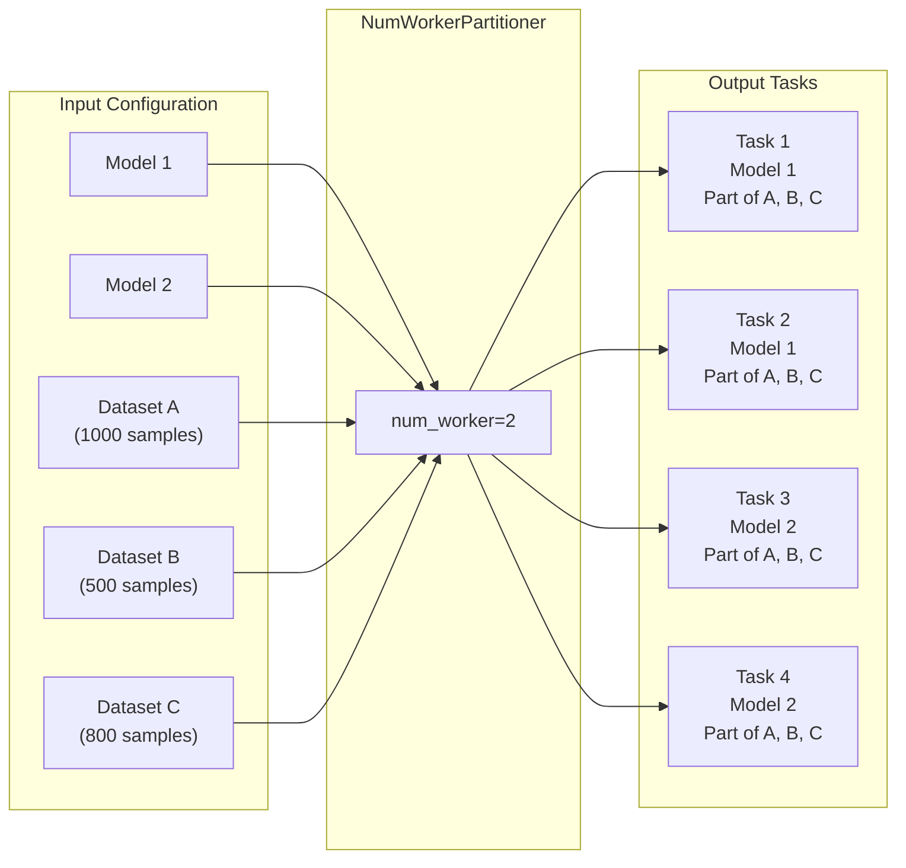

The partitioner ensures that:
- Each model is evaluated on all datasets
- Work is split into `num_worker` tasks per model
- Each task contains a portion of all datasets to balance execution time

Configuration is set by `fill_infer_cfg` in [opencompass/utils/run.py:367-392]():

```python
new_cfg = dict(infer=dict(
    partitioner=dict(type=get_config_type(NumWorkerPartitioner),
                     num_worker=args.max_num_workers),
    ...
))
```

**Sources:** [opencompass/utils/run.py:367-392](), [opencompass/partitioners/__init__.py:16]()

### NaivePartitioner

`NaivePartitioner` is the default partitioner for the evaluation phase. It creates one task per model-dataset pair without any splitting.

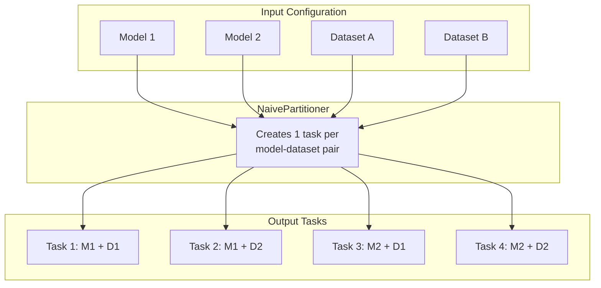

This simple strategy is appropriate for evaluation tasks which are typically much faster than inference.

Configuration is set by `fill_eval_cfg` in [opencompass/utils/run.py:395-419]():

```python
new_cfg = dict(
    eval=dict(partitioner=dict(type=get_config_type(NaivePartitioner)),
    ...
))
```

**Sources:** [opencompass/utils/run.py:395-419](), [opencompass/partitioners/naive.py]()

## Subjective Evaluation Partitioners

Subjective evaluation uses judge models to score model outputs, requiring special partitioning strategies that group models for comparison.

### SubjectiveNaivePartitioner

`SubjectiveNaivePartitioner` handles subjective evaluation by grouping models according to evaluation modes and replicating tasks across judge models.

#### Evaluation Modes

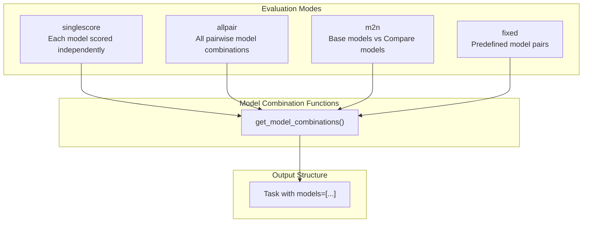

The `get_model_combinations` function [opencompass/partitioners/sub_naive.py:107-123]() determines model groupings:

| Mode | Description | Model Grouping |
|------|-------------|----------------|
| `singlescore` | Individual scoring | Each model evaluated separately |
| `allpair` | All pairs | All 2-combinations of models |
| `m2n` | Base vs Compare | Cartesian product of base_models × compare_models |
| `fixed` | Custom pairs | User-defined model pairs |

**Sources:** [opencompass/partitioners/sub_naive.py:107-123]()

#### Judge Model Replication

Tasks are replicated across multiple judge models to enable meta-review or consensus scoring:

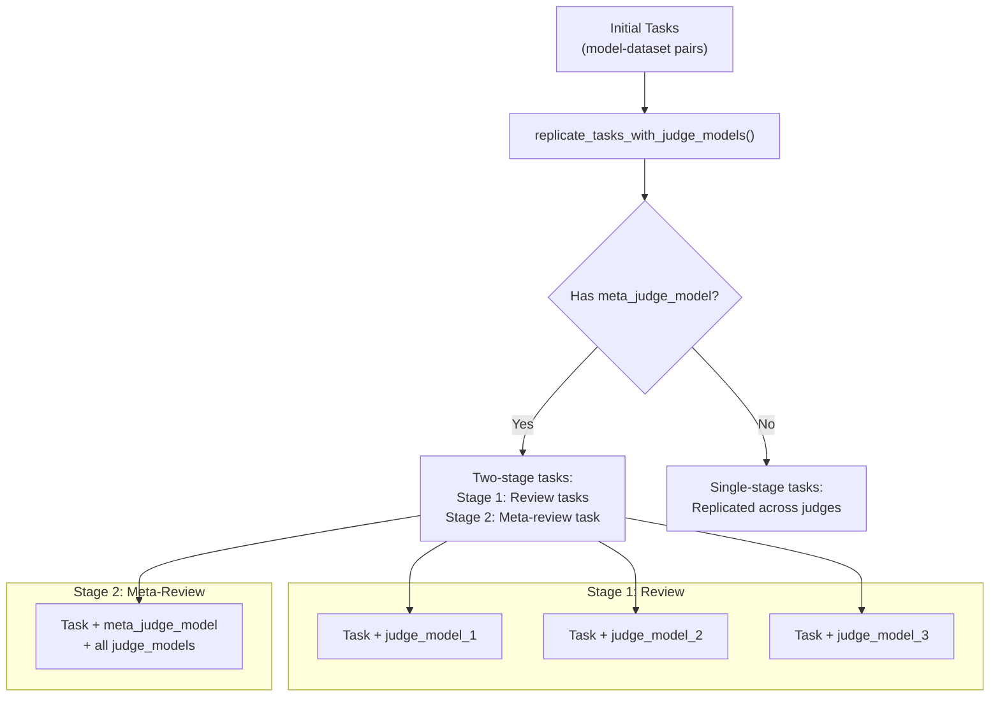

The replication logic in [opencompass/partitioners/sub_naive.py:31-49]() creates:

- **Without meta-judge**: Flat list of tasks, each paired with one judge model
- **With meta-judge**: Two-stage list where stage 1 contains review tasks and stage 2 contains meta-review tasks

**Sources:** [opencompass/partitioners/sub_naive.py:31-49](), [opencompass/partitioners/sub_naive.py:213-217]()

#### Task Filtering

`SubjectiveNaivePartitioner` checks for completed tasks to enable resumption:

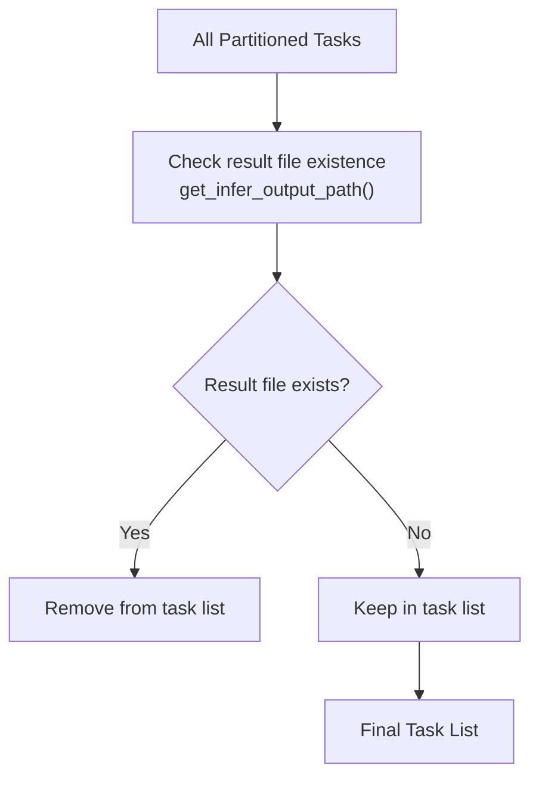

The `remove_already_tasks` function [opencompass/partitioners/sub_naive.py:52-104]() inspects the work directory for existing result files and filters completed tasks from the execution list.

**Sources:** [opencompass/partitioners/sub_naive.py:52-104]()

#### Partition Flow

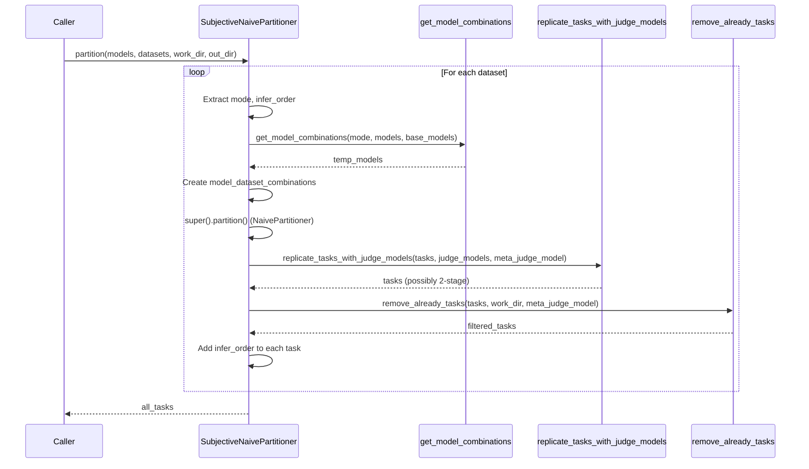

**Sources:** [opencompass/partitioners/sub_naive.py:157-232]()

### SubjectiveSizePartitioner

`SubjectiveSizePartitioner` extends `SubjectiveNaivePartitioner` to handle large datasets by splitting them based on estimated computational cost.

#### Cost Calculation

The partitioner estimates computational cost using two factors:

1. **Dataset size**: Number of samples in the dataset
2. **Task multiplier**: Based on evaluation type and dataset characteristics

```mermaid
graph TD
    Dataset["Dataset Configuration"]
    
    GetSize["Get dataset size<br/>(from cache or build)"]
    GetFactor["Calculate factor<br/>get_factor()"]
    
    IsGen{Is generation<br/>task?}
    IsPPL{Is PPL<br/>task?}
    IsSpecial{Special dataset<br/>(math, code, etc)?}
    
    GenCoef["factor = gen_task_coef<br/>(default: 20)"]
    PPLCoef["factor = num_labels"]
    SpecialCoef["factor *= 10"]
    
    Cost["cost = size × factor"]
    
    Dataset --> GetSize
    Dataset --> GetFactor
    GetFactor --> IsGen
    IsGen -->|Yes| GenCoef
    IsGen -->|No| IsPPL
    IsPPL -->|Yes| PPLCoef
    GenCoef --> IsSpecial
    PPLCoef --> IsSpecial
    IsSpecial -->|Yes| SpecialCoef
    IsSpecial -->|No| Cost
    SpecialCoef --> Cost
    GetSize --> Cost
```

The `get_factor` method [opencompass/partitioners/sub_size.py:224-246]() determines the task multiplier:

- **Generation tasks**: Multiplied by `gen_task_coef` (default: 20)
- **PPL tasks**: Multiplied by number of label options
- **Special datasets** (BBH, GSM8K, MATH, etc.): Multiplied by additional 10×

**Sources:** [opencompass/partitioners/sub_size.py:224-246](), [opencompass/partitioners/sub_size.py:248-287]()

#### Dataset Splitting

When a dataset's cost exceeds `max_task_size`, it is split into multiple parts:

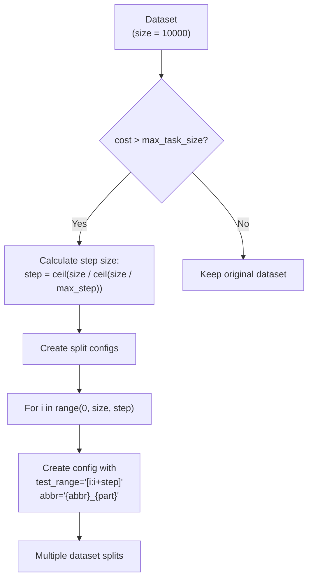

The `split_dataset` method [opencompass/partitioners/sub_size.py:207-222]() creates split configurations by:

1. Computing optimal step size to evenly distribute samples
2. Creating new dataset configs with modified `test_range`
3. Appending partition index to dataset abbreviation

**Sources:** [opencompass/partitioners/sub_size.py:207-222]()

#### Partitioning Strategies

`SubjectiveSizePartitioner` supports two strategies:

| Strategy | Description | Use Case |
|----------|-------------|----------|
| `heuristic` | Split large datasets, merge small ones into combined tasks | Default, balances task granularity and overhead |
| `split` | Only split large datasets, keep each dataset separate | Maximum parallelism, higher overhead |

**Heuristic Strategy**:

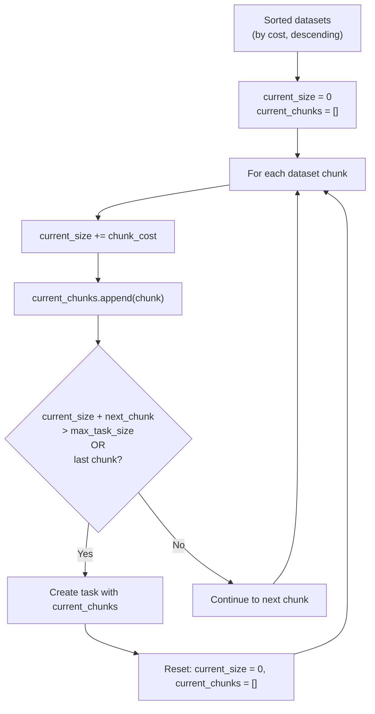

**Sources:** [opencompass/partitioners/sub_size.py:151-178]()

#### Size-Based Partition Flow

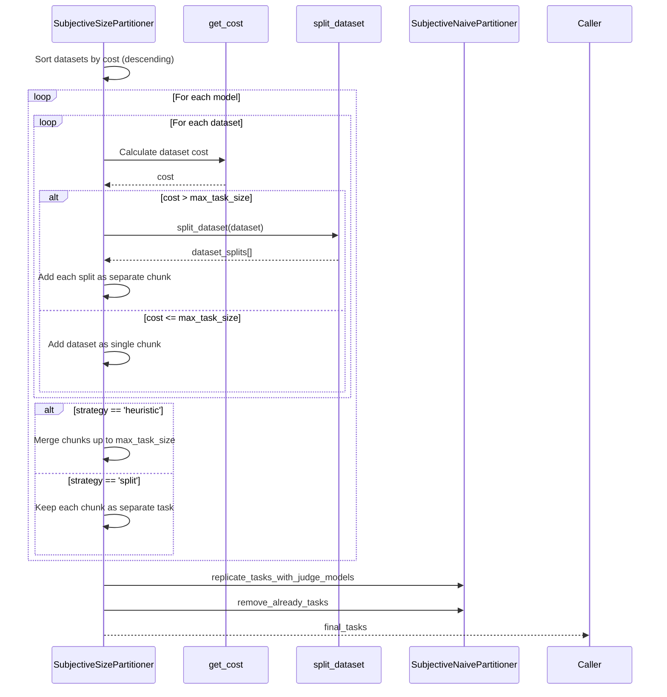

**Sources:** [opencompass/partitioners/sub_size.py:73-196]()

## Partitioning Configuration

Partitioners are configured in two phases: inference and evaluation.

### Inference Phase Configuration

Set via `fill_infer_cfg` in [opencompass/utils/run.py:367-392]():

```python
new_cfg = dict(infer=dict(
    partitioner=dict(
        type=get_config_type(NumWorkerPartitioner),
        num_worker=args.max_num_workers  # Controls parallelism
    ),
    runner=dict(
        max_num_workers=args.max_num_workers,
        debug=args.debug,
        task=dict(type=get_config_type(OpenICLInferTask)),
        lark_bot_url=cfg['lark_bot_url'],
    )
))
```

### Evaluation Phase Configuration

Set via `fill_eval_cfg` in [opencompass/utils/run.py:395-419]():

```python
new_cfg = dict(
    eval=dict(
        partitioner=dict(type=get_config_type(NaivePartitioner)),
        runner=dict(
            max_num_workers=args.max_num_workers,
            debug=args.debug,
            task=dict(type=get_config_type(OpenICLEvalTask)),
            lark_bot_url=cfg['lark_bot_url'],
        )
    )
)
```

### Subjective Evaluation Configuration

For subjective evaluation, the configuration specifies judge models and evaluation modes in the dataset configuration:

```python
datasets = [
    dict(
        type='CustomDataset',
        mode='m2n',  # Evaluation mode
        infer_order='double',  # Optional: 'random', 'double', or None
        base_models=[...],  # For m2n mode
        # Other dataset config
    )
]
```

**Sources:** [opencompass/utils/run.py:367-419](), [opencompass/partitioners/sub_naive.py:192-195]()

## Task Structure and Output

### Task Dictionary Schema

Each task dictionary contains:

```python
{
    'models': [model_config],              # List of 1+ model configs
    'datasets': [[dataset_config, ...]],   # Nested list: outer=models, inner=datasets
    'work_dir': '/path/to/work',           # Base working directory
    
    # For subjective evaluation:
    'judge_model': judge_config,           # Judge model config (stage 1)
    'meta_judge_model': meta_judge_config, # Meta-judge config (stage 2)
    'judge_models': [judge_configs],       # All judges (for meta-review)
    'infer_order': 'double',               # Inference ordering strategy
    
    # Optional fields from add_cfg:
    'runner': {...},
    'task': {...},
}
```

### Output Path Calculation

Task output paths are determined by `get_infer_output_path` which combines:
- Model abbreviation (via `model_abbr_from_cfg`)
- Dataset abbreviation (via `dataset_abbr_from_cfg`)
- Output directory
- Optional partition suffix (e.g., `_0`, `_1`)

For subjective evaluation with judges, the model abbreviation is transformed via `deal_with_judge_model_abbr` to include judge information.

**Sources:** [opencompass/partitioners/base.py:40-53](), [opencompass/partitioners/sub_naive.py:187-232]()

### Partition Result Logging

The `BasePartitioner.__call__` method logs partitioning results:

```mermaid
flowchart LR
    Tasks["Generated Tasks"]
    
    CheckStruct{Is two-stage list?}
    
    LogSubj["Log: 'Partitioned into 2 stages<br/>and X tasks in stage 1,<br/>Y tasks in stage 2'"]
    
    LogObj["Log: 'Partitioned into N tasks'"]
    
    LogDetails["For each task:<br/>Log task_abbr_from_cfg(task)"]
    
    Tasks --> CheckStruct
    CheckStruct -->|Yes<br/>(subjective)| LogSubj
    CheckStruct -->|No<br/>(objective)| LogObj
    LogSubj --> LogDetails
    LogObj --> LogDetails
```

**Sources:** [opencompass/partitioners/base.py:87-101]()

## Summary Table

| Partitioner | Primary Use | Splitting Strategy | Key Parameters |
|-------------|-------------|-------------------|----------------|
| `NumWorkerPartitioner` | Inference phase (objective) | Split datasets across N workers per model | `num_worker` |
| `NaivePartitioner` | Evaluation phase (objective) | One task per model-dataset pair | None |
| `SubjectiveNaivePartitioner` | Subjective evaluation | Group models by evaluation mode, replicate across judges | `models`, `judge_models`, `meta_judge_model` |
| `SubjectiveSizePartitioner` | Large-scale subjective evaluation | Split large datasets by cost, merge small ones | `max_task_size`, `gen_task_coef`, `strategy` |

**Sources:** [opencompass/partitioners/__init__.py](), [opencompass/utils/run.py:367-419]()

---

