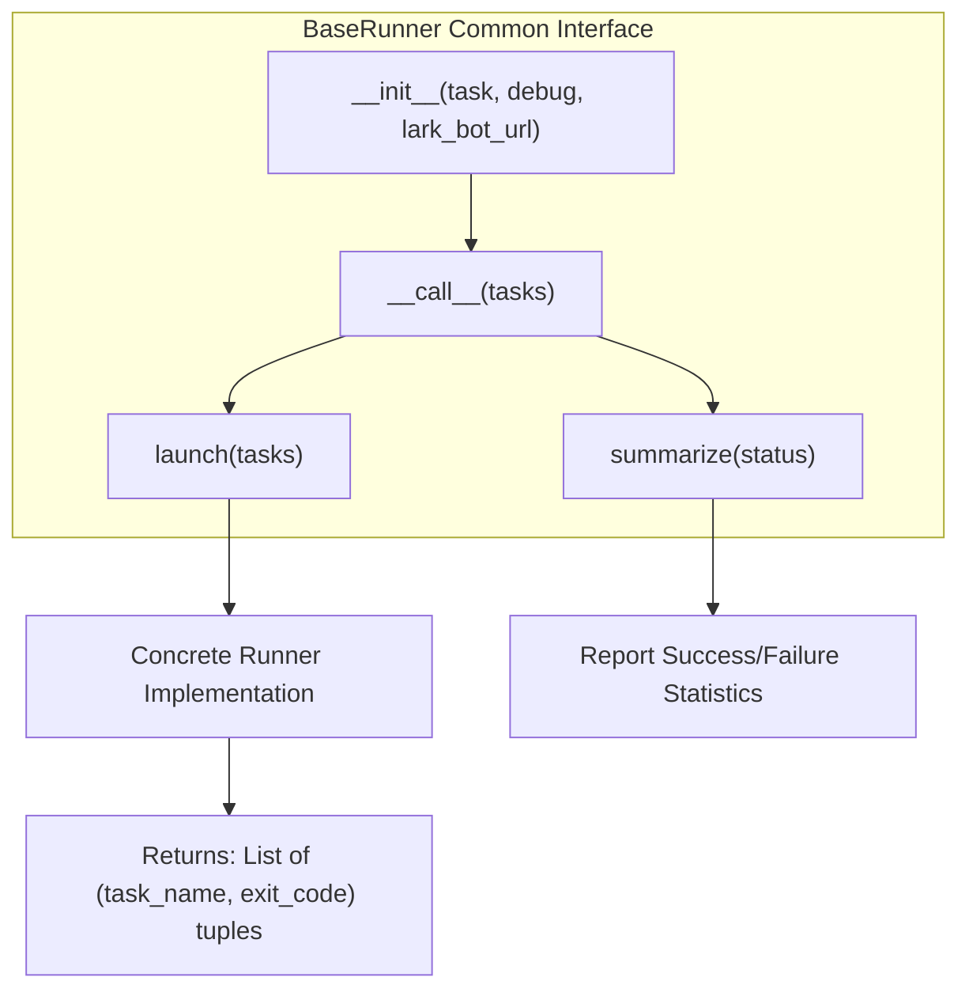
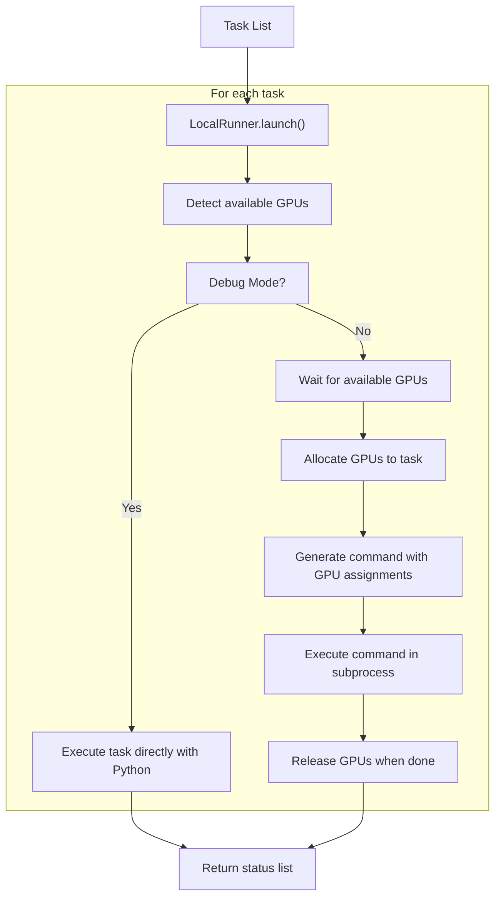
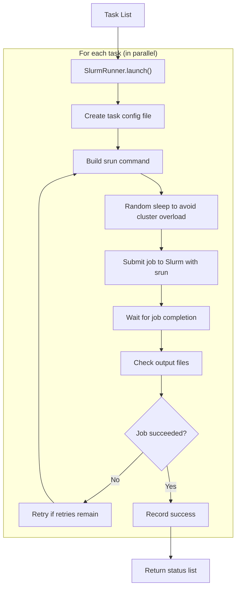
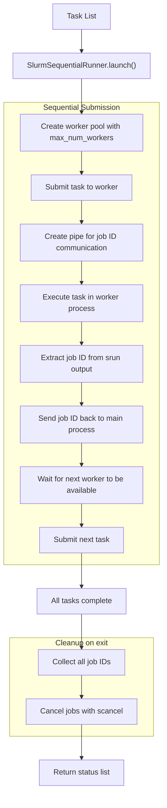
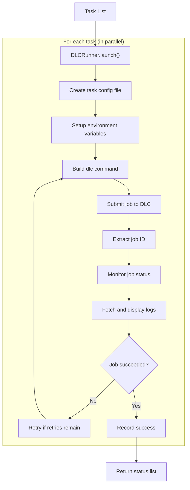
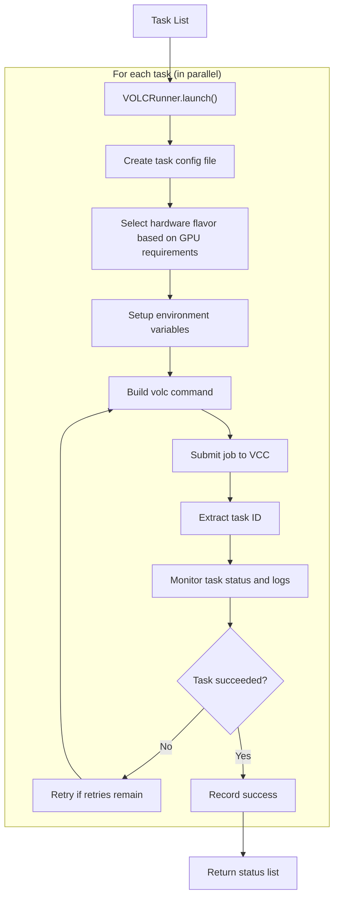
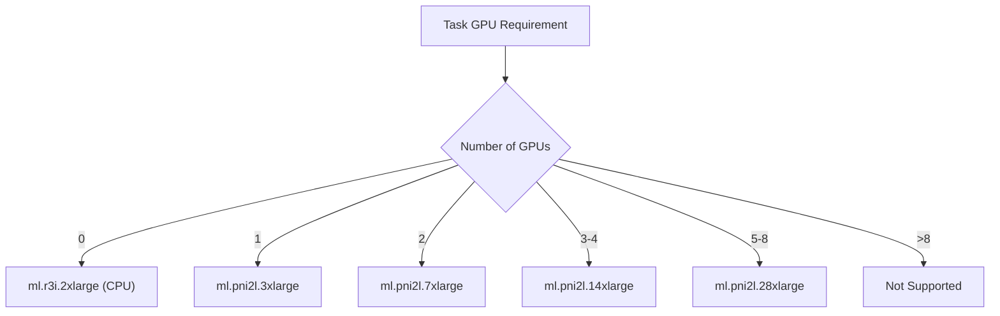
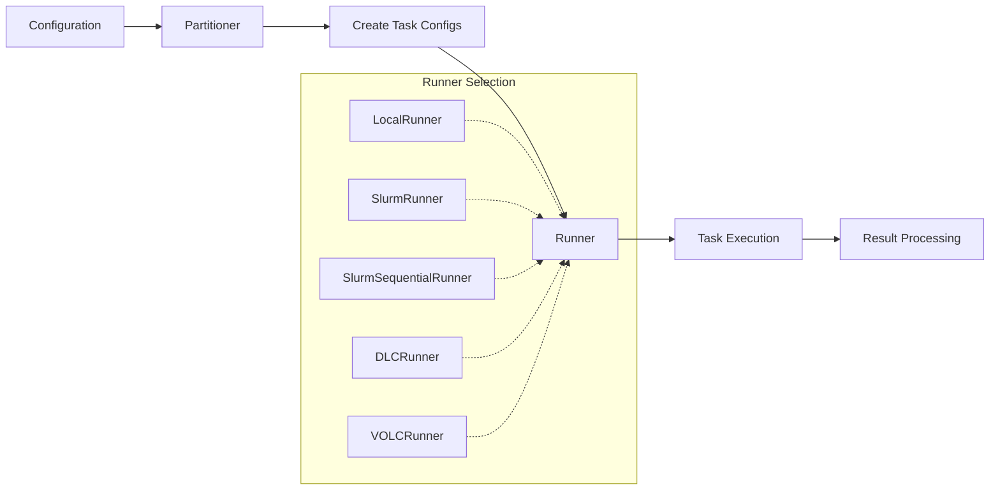

<!-- source: DeepWiki mcp.deepwiki.com · repo open-compass/opencompass · page 7.2 Runner Types and Environments · fetched 2026-10-21 -->

# Runner Types and Environments

<details>
<summary>Relevant source files</summary>

The following files were used as context for generating this wiki page:

- [README.md](README.md)
- [README_zh-CN.md](README_zh-CN.md)
- [docs/en/index.rst](docs/en/index.rst)
- [docs/en/notes/news.md](docs/en/notes/news.md)
- [docs/zh_cn/advanced_guides/evaluation_lmdeploy.md](docs/zh_cn/advanced_guides/evaluation_lmdeploy.md)
- [docs/zh_cn/index.rst](docs/zh_cn/index.rst)
- [docs/zh_cn/notes/news.md](docs/zh_cn/notes/news.md)
- [examples/eval_model_rollout.py](examples/eval_model_rollout.py)
- [opencompass/configs/models/bluelm/bluelm_3b.py](opencompass/configs/models/bluelm/bluelm_3b.py)
- [opencompass/datasets/cmnli.py](opencompass/datasets/cmnli.py)
- [opencompass/datasets/generic.py](opencompass/datasets/generic.py)
- [opencompass/lagent/actions/python_interpreter.py](opencompass/lagent/actions/python_interpreter.py)
- [opencompass/models/__init__.py](opencompass/models/__init__.py)
- [opencompass/models/bluelm_api.py](opencompass/models/bluelm_api.py)
- [opencompass/models/openai_api.py](opencompass/models/openai_api.py)
- [opencompass/models/vllm.py](opencompass/models/vllm.py)
- [opencompass/models/zhipuai_v2_api.py](opencompass/models/zhipuai_v2_api.py)
- [opencompass/runners/__init__.py](opencompass/runners/__init__.py)
- [opencompass/runners/base.py](opencompass/runners/base.py)
- [opencompass/runners/dlc.py](opencompass/runners/dlc.py)
- [opencompass/runners/local.py](opencompass/runners/local.py)
- [opencompass/runners/local_api.py](opencompass/runners/local_api.py)
- [opencompass/runners/rjob.py](opencompass/runners/rjob.py)
- [opencompass/runners/slurm.py](opencompass/runners/slurm.py)
- [opencompass/runners/slurm_sequential.py](opencompass/runners/slurm_sequential.py)
- [opencompass/runners/volc.py](opencompass/runners/volc.py)
- [opencompass/tasks/openicl_attack.py](opencompass/tasks/openicl_attack.py)
- [opencompass/tasks/openicl_eval.py](opencompass/tasks/openicl_eval.py)
- [opencompass/tasks/openicl_infer.py](opencompass/tasks/openicl_infer.py)
- [opencompass/utils/build.py](opencompass/utils/build.py)
- [opencompass/utils/types.py](opencompass/utils/types.py)

</details>


This page documents the various runner implementations available in OpenCompass and their computing environments. Runners are responsible for executing evaluation tasks across different environments - from local execution to distributed cluster setups.

For information about how tasks are partitioned before being sent to runners, see [Task Partitioning](#7.2).

## Overview

Runners in OpenCompass provide a unified interface for executing evaluation tasks while abstracting away the details of the underlying execution environment. Each runner type is designed for a specific execution environment:

- **LocalRunner**: For running tasks on a local machine
- **SlurmRunner**: For running tasks on a Slurm-based cluster
- **SlurmSequentialRunner**: An enhanced Slurm runner with sequential job submission
- **DLCRunner**: For running on Alibaba Cloud Deep Learning Cluster
- **VOLCRunner**: For running on Volcano Cloud Cluster

```mermaid
classDiagram
    class BaseRunner {
        +__init__(task, debug, lark_bot_url)
        +__call__(tasks)
        +launch(tasks)*
        +summarize(status)
    }
    
    class LocalRunner {
        +__init__(task, max_num_workers, debug, max_workers_per_gpu, lark_bot_url)
        +launch(tasks)
        -_launch(task, gpu_ids, index)
    }
    
    class SlurmRunner {
        +__init__(task, max_num_workers, retry, partition, quotatype, qos, debug, lark_bot_url)
        +launch(tasks)
        -_launch(cfg, random_sleep)
        -_job_failed(return_code, output_paths)
    }
    
    class SlurmSequentialRunner {
        +__init__(task, task_prefix, max_num_workers, retry, partition, quotatype, qos, debug, lark_bot_url)
        +launch(tasks)
        -_launch_wo_debug(tasks)
        -_launch(cfg, child_conn)
        -_job_failed(return_code, output_paths)
    }
    
    class DLCRunner {
        +__init__(task, aliyun_cfg, max_num_workers, eval_with_gpu, retry, debug, lark_bot_url)
        +launch(tasks)
        -_launch(cfg, random_sleep)
        -_job_failed(return_code, output_paths)
    }
    
    class VOLCRunner {
        +__init__(task, volcano_cfg, queue_name, preemptible, priority, max_num_workers, retry, debug, lark_bot_url)
        +launch(tasks)
        -_launch(task_cfg, random_sleep)
        -_job_failed(task_status, output_paths)
        -_choose_flavor(num_gpus)
    }
    
    BaseRunner <|-- LocalRunner
    BaseRunner <|-- SlurmRunner
    BaseRunner <|-- SlurmSequentialRunner
    BaseRunner <|-- DLCRunner
    BaseRunner <|-- VOLCRunner
```



Sources: [opencompass/runners/base.py:10-85](), [opencompass/runners/local.py:40-52](), [opencompass/runners/slurm.py:20-37](), [opencompass/runners/slurm_sequential.py:22-50](), [opencompass/runners/dlc.py:23-36](), [opencompass/runners/volc.py:22-39]()

## Common Runner Interface

All runners in OpenCompass inherit from the `BaseRunner` class, which defines the basic interface:



Sources: [opencompass/runners/base.py:10-85]()

Key components of the base runner:

1. **Constructor**: Initializes the runner with a task configuration, debug flag, and optional Lark bot URL for notifications.
2. **`__call__` method**: Entry point that executes the task launch and summarization.
3. **`launch` method**: Abstract method implemented by each concrete runner for actual task execution.
4. **`summarize` method**: Analyzes task outcomes and optionally sends notifications.

## LocalRunner

The `LocalRunner` executes tasks on the local machine using Python subprocesses. It's ideal for development, debugging, or when you have sufficient local resources.

### Key Features

- Manages GPU allocation with CUDA_VISIBLE_DEVICES
- Supports NPU allocation with ASCEND_RT_VISIBLE_DEVICES
- Adjusts for Windows vs. UNIX environments
- Controls maximum concurrent workers and workers per GPU
- Keeps track of GPU usage and allocation

### Workflow



Sources: [opencompass/runners/local.py:39-248]()

### Configuration Example

```python
runner = dict(
    type='LocalRunner',
    max_num_workers=4,
    max_workers_per_gpu=1,
    task=dict(type='OpenICLEvalTask'),
)
```

The `LocalRunner` is suitable for:
- Development and debugging
- Small-scale evaluations
- Systems with limited resources

## SlurmRunner

The `SlurmRunner` submits tasks to a Slurm cluster, which is commonly used in academic and research environments for high-performance computing.

### Key Features

- Submits jobs using the `srun` command
- Configures Slurm-specific parameters (partition, quotatype, QoS)
- Supports retries for failed jobs
- Handles parallel submission of tasks

### Workflow



Sources: [opencompass/runners/slurm.py:20-162]()

### Configuration Example

```python
runner = dict(
    type='SlurmRunner',
    partition='partition_name',
    quotatype='reserved',  # or 'auto', 'spot'
    qos='normal',
    max_num_workers=32,
    retry=2,
    task=dict(type='OpenICLEvalTask'),
)
```

The `SlurmRunner` is suitable for:
- Large-scale evaluations
- Environments with Slurm clusters
- Evaluations requiring significant compute resources

## SlurmSequentialRunner

The `SlurmSequentialRunner` is an enhanced version of the `SlurmRunner` that launches tasks sequentially to avoid overwhelming the job scheduler.

### Key Features

- Only one task will be in PENDING status at any time
- Automatically kills all jobs by job_id on exit
- Uses inter-process communication to track job IDs
- Manages controlled sequential submission

### Workflow



Sources: [opencompass/runners/slurm_sequential.py:22-273]()

### Configuration Example

```python
runner = dict(
    type='SlurmSequentialRunner',
    partition='partition_name',
    task_prefix='opencompass_',  # prefix for job names
    quotatype='reserved',
    max_num_workers=32,
    retry=2,
    task=dict(type='OpenICLEvalTask'),
)
```

The `SlurmSequentialRunner` is suitable for:
- Environments where job scheduler stability is a concern
- Cases where you need controlled, sequential job submission
- Scenarios requiring clean termination of jobs on interruption

## DLCRunner

The `DLCRunner` submits tasks to the Alibaba Cloud Deep Learning Cluster (DLC), providing integration with Alibaba Cloud's AI infrastructure.

### Key Features

- Submits jobs using the `dlc` command (`dlc create job` or `dlc submit pytorchjob`)
- Configures comprehensive cloud environment variables
- Monitors job status and logs in real-time
- Handles job retries and resource allocation

### Environment Configuration

The `DLCRunner` sets up a comprehensive execution environment with multiple configuration options:

**Python Environment Setup:**
- Conda environment activation: `source {bashrc_path}; conda activate {conda_env_name}`
- Python path configuration: `export PYTHONPATH={pwd}:$PYTHONPATH`
- Custom Python environment: `export PATH={python_env_path}/bin:$PATH`

**HuggingFace Configuration:**
- Cache directory: `export HF_HUB_CACHE={huggingface_cache}`
- Offline mode: `export HF_DATASETS_OFFLINE=1; export TRANSFORMERS_OFFLINE=1`
- Custom endpoint: `export HF_ENDPOINT={hf_endpoint}`

**Additional Environment Variables:**
- PyTorch cache: `export TORCH_HOME={torch_cache}`
- HTTP proxy settings for network access
- Custom environment variables via `extra_envs`

Sources: [opencompass/runners/dlc.py:128-176]()

### Workflow



Sources: [opencompass/runners/dlc.py:23-347]()

### Configuration Example

```python
runner = dict(
    type='DLCRunner',
    aliyun_cfg=dict(
        worker_image='registry.cn-beijing.aliyuncs.com/pai-dlc/pytorch-gpu:2.0.1-cuda11.7-cudnn8-devel',
        workspace_id='workspace_id',
        resource_id='resource_id',
        data_sources=['oss://bucket/path/to/data:data'],
        python_env_path='/path/to/python',
        huggingface_cache='/path/to/huggingface',
        priority=1,
    ),
    max_num_workers=32,
    retry=2,
    task=dict(type='OpenICLEvalTask'),
)
```

The `DLCRunner` is suitable for:
- Users of Alibaba Cloud infrastructure
- Large-scale evaluations on the cloud
- Teams with DLC access and configuration

## VOLCRunner

The `VOLCRunner` submits tasks to the Volcano Cloud Cluster (VCC), providing integration with another cloud infrastructure option.

### Key Features

- Submits jobs using the `volc ml_task submit` command
- Automatically selects appropriate hardware flavors based on GPU requirements
- Supports preemptible and priority settings (1-9, where 9 is highest)
- Monitors task status and logs through `volc ml_task get` and `volc ml_task logs`

### Environment Configuration

The `VOLCRunner` configures the execution environment similar to other cloud runners:

**Python Environment Setup:**
- Conda environment: `source {bashrc_path}; source activate {conda_env_name}`
- Python path: `export PYTHONPATH={pwd}:$PYTHONPATH`

**HuggingFace and PyTorch Configuration:**
- Cache directories: `export HF_HUB_CACHE={huggingface_cache}`
- Offline mode: `export HF_DATASETS_OFFLINE=1; export TRANSFORMERS_OFFLINE=1`
- PyTorch cache: `export TORCH_HOME={torch_cache}`

**YAML Configuration Files:**
The runner generates YAML configuration files for task specification and hardware selection.

Sources: [opencompass/runners/volc.py:116-156](), [opencompass/runners/volc.py:254-276]()

### Workflow



Sources: [opencompass/runners/volc.py:22-276]()

### Hardware Selection Logic

The `VOLCRunner` automatically selects the appropriate hardware flavor based on the task's GPU requirements:



Sources: [opencompass/runners/volc.py:254-276]()

### Configuration Example

```python
runner = dict(
    type='VOLCRunner',
    volcano_cfg=dict(
        volcano_config_path='/path/to/volcano/config.yaml',
        python_env_path='/path/to/python',
        huggingface_cache='/path/to/huggingface',
    ),
    queue_name='your_queue_name',
    preemptible=False,
    priority=5,  # 1-9, 9 is highest
    max_num_workers=32,
    retry=2,
    task=dict(type='OpenICLEvalTask'),
)
```

The `VOLCRunner` is suitable for:
- Users of Volcano Cloud infrastructure
- Teams with VCC access and configuration
- Evaluations requiring specific hardware resource scaling

## Comparison of Runner Types

| Feature | LocalRunner | SlurmRunner | SlurmSequentialRunner | DLCRunner | VOLCRunner |
|---------|------------|------------|---------------------|----------|-----------|
| **Environment** | Local machine | Slurm cluster | Slurm cluster | Alibaba Cloud DLC | Volcano Cloud |
| **Command** | Python subprocess | `srun` | `srun` | `dlc` | `volc ml_task` |
| **GPU Management** | Explicit CUDA_VISIBLE_DEVICES | `--gres=gpu:N` | `--gres=gpu:N` | `--worker_gpu N` | Auto flavor selection |
| **Parallelism** | Thread pool | Parallel processes | Sequential submission | Parallel processes | Parallel processes |
| **Job Control** | Local process | Slurm job | Slurm job with ID tracking | DLC job | VCC task |
| **Error Recovery** | Retry | Retry | Retry with clean termination | Retry with monitoring | Retry with monitoring |
| **Best for** | Development, small-scale tests | HPC clusters | Stable job submission | Alibaba Cloud users | Volcano Cloud users |

## Choosing the Right Runner

When selecting a runner for your evaluation, consider:

1. **Available Infrastructure**: Choose a runner that matches your computing infrastructure.
2. **Scale of Evaluation**: For large evaluations, consider a distributed runner.
3. **Resource Requirements**: Match runner capabilities to the resource needs of your models.
4. **Stability Needs**: For long-running evaluations, consider runners with robust error recovery.

For most users:
- Use `LocalRunner` for development and testing
- Use `SlurmRunner` or `SlurmSequentialRunner` in academic/research environments
- Use `DLCRunner` or `VOLCRunner` when working with specific cloud providers

## Integration with OpenCompass Workflow

Runners are integrated into the OpenCompass evaluation pipeline through the task partitioning system. Here's how they fit in:



Sources: [opencompass/runners/base.py:31-41](), [opencompass/partitioners/naive.py:13-81]()

---

