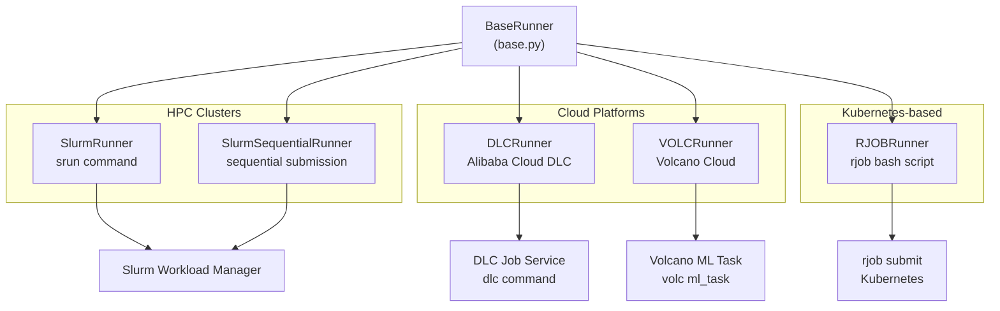
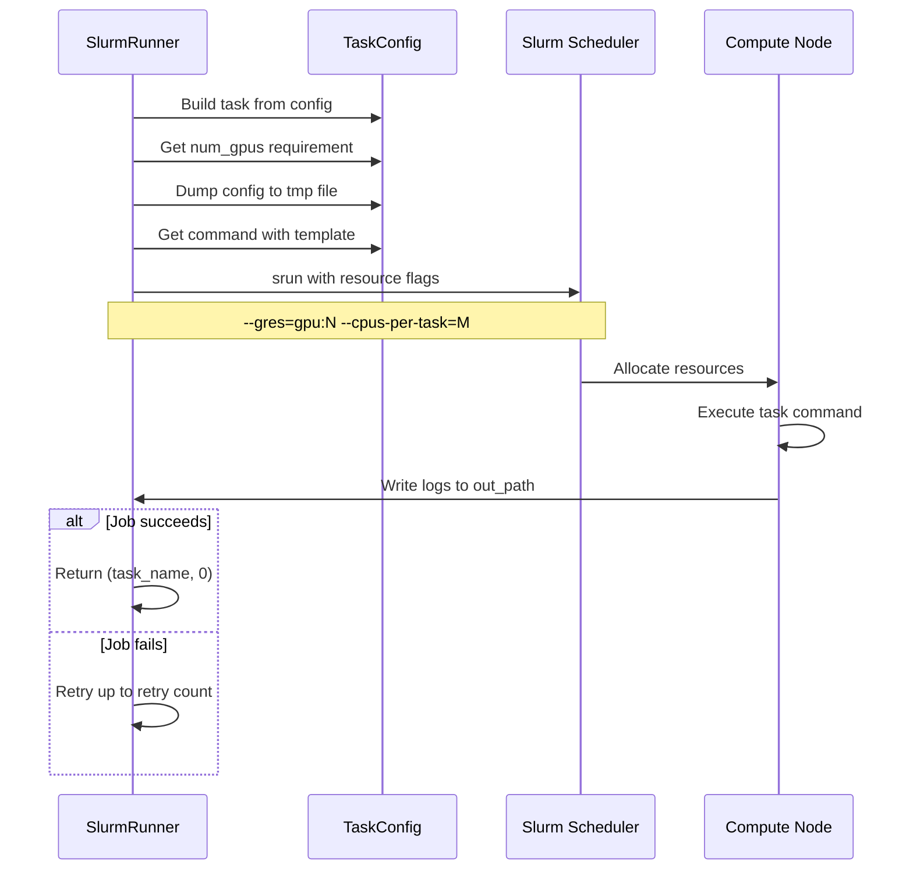
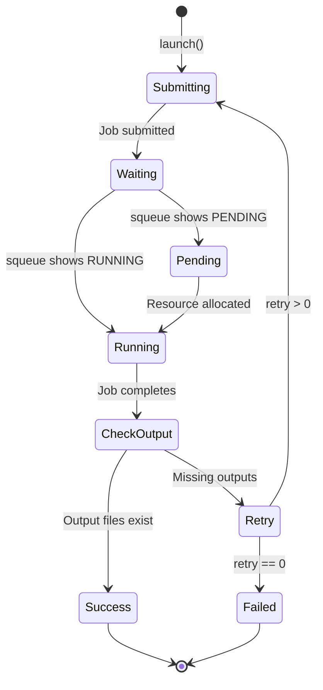
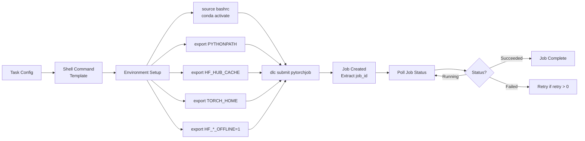
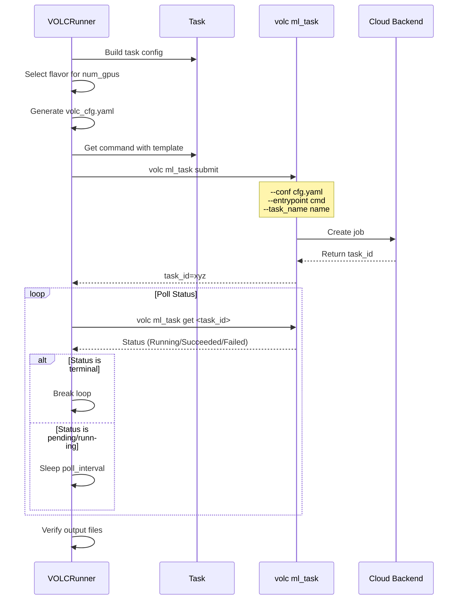
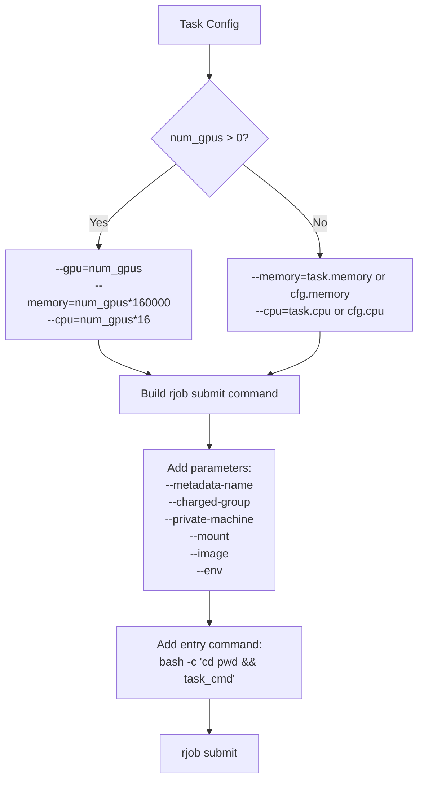
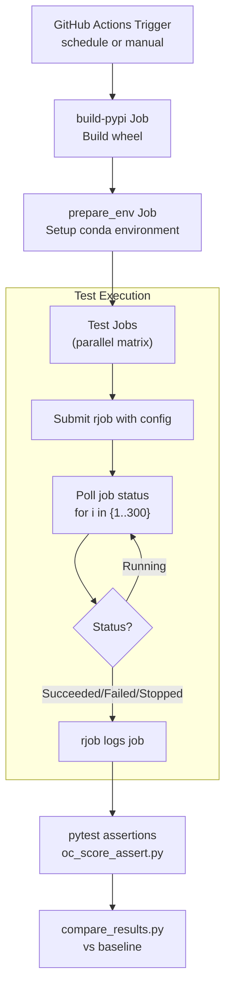
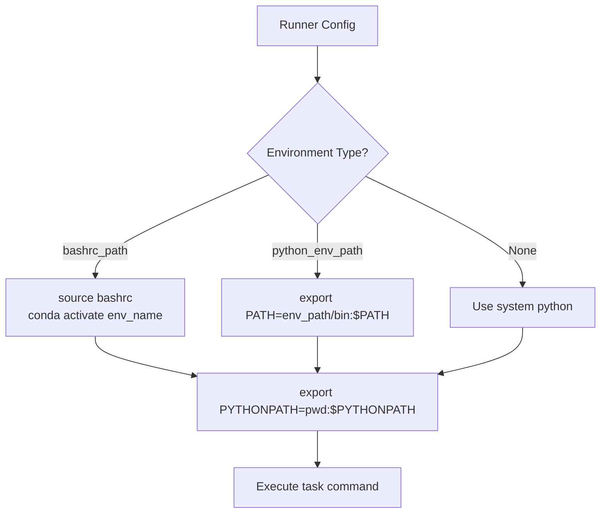

<!-- source: DeepWiki mcp.deepwiki.com · repo open-compass/opencompass · page 7.3 Distributed Execution · fetched 2026-10-21 -->

# Distributed Execution

<details>
<summary>Relevant source files</summary>

The following files were used as context for generating this wiki page:

- [.github/scripts/eval_regression_api.py](.github/scripts/eval_regression_api.py)
- [.github/scripts/eval_regression_base_fullbench.py](.github/scripts/eval_regression_base_fullbench.py)
- [.github/scripts/eval_regression_base_longtext_fullbench.py](.github/scripts/eval_regression_base_longtext_fullbench.py)
- [.github/scripts/eval_regression_base_models.py](.github/scripts/eval_regression_base_models.py)
- [.github/scripts/eval_regression_chat_longtext_fullbench.py](.github/scripts/eval_regression_chat_longtext_fullbench.py)
- [.github/scripts/eval_regression_chat_models.py](.github/scripts/eval_regression_chat_models.py)
- [.github/scripts/eval_regression_chat_obj_fullbench_other.py](.github/scripts/eval_regression_chat_obj_fullbench_other.py)
- [.github/scripts/eval_regression_chat_obj_fullbench_v5.py](.github/scripts/eval_regression_chat_obj_fullbench_v5.py)
- [.github/scripts/eval_regression_chat_obj_fullbench_v6.py](.github/scripts/eval_regression_chat_obj_fullbench_v6.py)
- [.github/scripts/eval_regression_chat_obj_fullbench_v7.py](.github/scripts/eval_regression_chat_obj_fullbench_v7.py)
- [.github/scripts/eval_regression_chat_sub_fullbench.py](.github/scripts/eval_regression_chat_sub_fullbench.py)
- [.github/scripts/oc_score_assert.py](.github/scripts/oc_score_assert.py)
- [.github/scripts/oc_score_baseline.yaml](.github/scripts/oc_score_baseline.yaml)
- [.github/scripts/oc_score_baseline_fullbench.yaml](.github/scripts/oc_score_baseline_fullbench.yaml)
- [.github/scripts/oc_score_baseline_testrange.yaml](.github/scripts/oc_score_baseline_testrange.yaml)
- [.github/workflows/daily-run-test.yml](.github/workflows/daily-run-test.yml)
- [.github/workflows/pr-run-test.yml](.github/workflows/pr-run-test.yml)
- [examples/eval_model_rollout.py](examples/eval_model_rollout.py)
- [opencompass/configs/models/bluelm/bluelm_3b.py](opencompass/configs/models/bluelm/bluelm_3b.py)
- [opencompass/datasets/cmnli.py](opencompass/datasets/cmnli.py)
- [opencompass/datasets/generic.py](opencompass/datasets/generic.py)
- [opencompass/lagent/actions/python_interpreter.py](opencompass/lagent/actions/python_interpreter.py)
- [opencompass/models/__init__.py](opencompass/models/__init__.py)
- [opencompass/models/bluelm_api.py](opencompass/models/bluelm_api.py)
- [opencompass/models/openai_api.py](opencompass/models/openai_api.py)
- [opencompass/models/vllm.py](opencompass/models/vllm.py)
- [opencompass/models/zhipuai_v2_api.py](opencompass/models/zhipuai_v2_api.py)
- [opencompass/runners/__init__.py](opencompass/runners/__init__.py)
- [opencompass/runners/base.py](opencompass/runners/base.py)
- [opencompass/runners/dlc.py](opencompass/runners/dlc.py)
- [opencompass/runners/local.py](opencompass/runners/local.py)
- [opencompass/runners/local_api.py](opencompass/runners/local_api.py)
- [opencompass/runners/rjob.py](opencompass/runners/rjob.py)
- [opencompass/runners/slurm.py](opencompass/runners/slurm.py)
- [opencompass/runners/slurm_sequential.py](opencompass/runners/slurm_sequential.py)
- [opencompass/runners/volc.py](opencompass/runners/volc.py)
- [opencompass/tasks/openicl_attack.py](opencompass/tasks/openicl_attack.py)
- [opencompass/tasks/openicl_eval.py](opencompass/tasks/openicl_eval.py)
- [opencompass/tasks/openicl_infer.py](opencompass/tasks/openicl_infer.py)
- [opencompass/utils/build.py](opencompass/utils/build.py)
- [opencompass/utils/types.py](opencompass/utils/types.py)

</details>


## Purpose and Scope

This document describes how OpenCompass executes evaluation tasks across distributed computing environments, including HPC clusters, cloud platforms, and Kubernetes-based systems. Distributed execution enables parallel processing of multiple evaluation tasks, efficient resource utilization, and scalability to large-scale benchmark evaluations.

For information about how tasks are partitioned before distributed execution, see [Task Partitioning Strategies](#7.1). For an overview of different runner types, see [Runner Types and Environments](#7.2).

## Cluster Integration Architecture

OpenCompass supports multiple distributed computing platforms through a unified runner abstraction. Each runner type handles platform-specific job submission, monitoring, and resource management while maintaining a consistent interface.



**Sources:** [opencompass/runners/base.py:10-53](), [opencompass/runners/slurm.py:19-48](), [opencompass/runners/dlc.py:23-49](), [opencompass/runners/volc.py:21-52](), [opencompass/runners/rjob.py:20-53]()

## Slurm Integration

### SlurmRunner

The `SlurmRunner` submits jobs to Slurm-managed HPC clusters using the `srun` command. It supports parallel job submission with configurable resource requirements.

**Key Configuration Parameters:**

| Parameter | Description | Default |
|-----------|-------------|---------|
| `max_num_workers` | Maximum concurrent jobs | 32 |
| `retry` | Number of retries on failure | 2 |
| `partition` | Slurm partition name | None |
| `quotatype` | Quota type (reserved/spot/auto) | None |
| `qos` | Quality of service | None |
| `extra_command` | Additional srun flags | [] |

**Job Submission Flow:**



**Command Template Construction:**

The runner constructs `srun` commands with the following structure:

```
srun --job-name=<task_name> 
     --partition=<partition>
     --quotatype=<quotatype>
     --gres=gpu:<num_gpus>
     --cpus-per-task=<cpus>
     <task_command>
```

**Sources:** [opencompass/runners/slurm.py:59-145](), [opencompass/runners/slurm.py:67-123]()

### SlurmSequentialRunner

The `SlurmSequentialRunner` is a variant that launches tasks one-by-one, ensuring at most one task is in PENDING status at any time. This approach provides better stability when submitting large batches of jobs.

**Key Differences from SlurmRunner:**

- **Sequential submission**: Tasks are submitted only after the previous task is allocated
- **Job ID tracking**: Extracts job IDs from srun output for monitoring
- **Automatic cleanup**: Can kill all spawned jobs on exit
- **No random sleep**: Eliminates the need for random delays between submissions

**Job Status Monitoring:**

The runner monitors job status by parsing `squeue` output and tracking active/pending/completed jobs:



**Sources:** [opencompass/runners/slurm_sequential.py:21-82](), [opencompass/runners/slurm_sequential.py:120-201]()

## Alibaba Cloud DLC Integration

The `DLCRunner` integrates with Alibaba Cloud's Deep Learning Cluster (DLC) service, which provides managed infrastructure for training and inference workloads.

### Job Submission Process



### DLC Command Structure

The runner constructs DLC commands as follows:

```
dlc submit pytorchjob \
  --command '<shell_cmd>' \
  --name <task_name> \
  --workspace_id <workspace_id> \
  --resource_id <resource_id> \
  --priority <priority> \
  --workers 1 \
  --worker_cpu <cpus> \
  --worker_gpu <num_gpus> \
  --worker_memory <memory>Gi \
  --worker_image <image> \
  --data_sources <data_sources>
```

### Job Monitoring Loop

The runner continuously monitors job status by parsing `dlc get job` output:

| DLC Status | Runner Action |
|------------|---------------|
| Pending | Continue polling (sleep 10s) |
| Running | Continue polling (sleep 10s) |
| Succeeded | Job complete, verify outputs |
| Failed | Retry if retries remaining |
| Stopped | Treat as failure |

**Sources:** [opencompass/runners/dlc.py:89-273](), [opencompass/runners/dlc.py:128-230]()

## Volcano Cloud Integration

The `VOLCRunner` submits jobs to Volcano Cloud Cluster (VCC), a cloud-based machine learning platform.

### Flavor Selection

VCC uses predefined "flavors" that specify resource configurations. The runner selects appropriate flavors based on GPU requirements:

```python
# Flavor selection logic from volc.py
def _choose_flavor(self, num_gpus: int):
    if num_gpus == 0:
        flavor = 'ml.c3.large'  # CPU only
    elif num_gpus <= 2:
        flavor = 'ml.g2v.2xlarge'  # 2 GPUs
    elif num_gpus <= 4:
        flavor = 'ml.g2v.4xlarge'  # 4 GPUs
    # ... more configurations
```

### VCC Configuration File

The runner generates a YAML configuration file for each job:

```yaml
apiVersion: v1
kind: Job
metadata:
  name: <task_name>
spec:
  flavor: <selected_flavor>
  framework: PyTorch
  entrypoint: <shell_command>
  envs:
    - HF_HUB_CACHE: <cache_path>
    - PYTHONPATH: <pwd>
```

### Job Lifecycle Management



**Sources:** [opencompass/runners/volc.py:81-206](), [opencompass/runners/volc.py:207-268]()

## rjob Integration (Kubernetes)

The `RJOBRunner` uses the `rjob` command-line tool to submit jobs to Kubernetes clusters. This is particularly useful for internal cluster management systems.

### Job Submission Configuration

The runner supports flexible configuration through the `rjob_cfg` dictionary:

| Config Key | Purpose | Example |
|------------|---------|---------|
| `charged_group` | Billing group | `'opencompass_gpu'` |
| `private_machine` | Machine allocation | `'group'` |
| `mount` | GPFS/storage mounts | `['gpfs://gpfs1/data:/data']` |
| `image` | Container image | `'registry.example.com/image'` |
| `env` | Environment variables | `{'HF_HUB_CACHE': '/cache'}` |

### Resource Allocation Logic



### Status Monitoring

The runner polls job status using `rjob get` and parses the output for status keywords:

```python
# Status detection from rjob.py
status_keywords = [
    'inqueue', 'unknown', 'starting', 'pending', 
    'running', 'timeout', 'restarting', 'queued',
    'suspended', 'submitted', 'succeeded', 'stopped',
    'failed', 'cancelled'
]
```

**Monitoring Loop:**

```mermaid
stateDiagram-v2
    [*] --> Submit: rjob submit
    Submit --> Poll: Sleep 10s
    
    Poll --> ParseOutput: rjob get
    
    ParseOutput --> Inqueue: Status: inqueue
    ParseOutput --> Pending: Status: pending
    ParseOutput --> Running: Status: running
    ParseOutput --> Terminal: Status: succeeded/failed/stopped
    
    Inqueue --> Poll: Sleep poll_interval
    Pending --> Poll: Sleep poll_interval
    Running --> Poll: Sleep poll_interval
    
    Terminal --> CheckOutput{Output files exist?}
    CheckOutput -->|Yes| [*]: returncode=0
    CheckOutput -->|No| [*]: returncode=1
```

**Sources:** [opencompass/runners/rjob.py:159-286](), [opencompass/runners/rjob.py:67-157]()

## CI/CD Integration with Distributed Execution

The GitHub Actions workflows demonstrate practical distributed execution usage:

### Daily Regression Testing

The `daily-run-test.yml` workflow uses rjob for distributed testing:

```yaml
# Environment setup
KUBEBRAIN_CLUSTER_ENTRY: https://h.pjlab.org.cn
KUBEBRAIN_NAMESPACE: ailab-opencompass
JOB_NAME: daily-test-${{ github.run_id }}

# Job submission
rjob submit \
  --metadata-name=cmd-${{ env.JOB_NAME }} \
  --charged-group=opencompass_gpu \
  --gpu=2 --cpu=32 --memory=32568 \
  --image=registry.h.pjlab.org.cn/ailab-puyu/xpuyu:torch \
  --mount=gpfs://gpfs1/opencompass-shared:/mnt/shared-storage-user/opencompass-shared \
  --env=HF_DATASETS_OFFLINE=1 \
  -- bash -exc 'script.sh'
```

### Test Execution Flow



**Sources:** [.github/workflows/daily-run-test.yml:220-235](), [.github/workflows/daily-run-test.yml:275-290]()

## Resource Management

### GPU Allocation

Each runner handles GPU allocation differently based on the underlying scheduler:

| Runner | GPU Specification | Example |
|--------|-------------------|---------|
| SlurmRunner | `--gres=gpu:<N>` | `--gres=gpu:4` |
| DLCRunner | `--worker_gpu <N>` | `--worker_gpu 4` |
| VOLCRunner | Flavor-based | `ml.g2v.4xlarge` |
| RJOBRunner | `--gpu=<N>` | `--gpu=4` |

### Memory and CPU Scaling

Most runners implement automatic scaling of memory and CPU based on GPU count:

```python
# Common pattern across runners
if num_gpus > 0:
    cpu = num_gpus * 8      # 8 CPUs per GPU
    memory = num_gpus * 128  # 128GB per GPU
else:
    cpu = config.get('cpu', 12)
    memory = config.get('memory', 192)
```

**Sources:** [opencompass/runners/dlc.py:210-212](), [opencompass/runners/rjob.py:190-202]()

## Environment Configuration

### Common Environment Variables

All distributed runners support setting environment variables for offline operation and cache management:

| Variable | Purpose | Typical Value |
|----------|---------|---------------|
| `HF_DATASETS_OFFLINE` | Disable HuggingFace downloads | `1` |
| `HF_HUB_CACHE` | HuggingFace cache directory | `/path/to/cache` |
| `TRANSFORMERS_OFFLINE` | Disable transformers downloads | `1` |
| `TORCH_HOME` | PyTorch cache directory | `/path/to/torch` |
| `PYTHONPATH` | Python path | `<pwd>:$PYTHONPATH` |

### Python Environment Setup

Runners support multiple methods for Python environment configuration:



**Sources:** [opencompass/runners/dlc.py:128-178](), [opencompass/runners/volc.py:116-157]()

## Fault Tolerance and Retry Logic

### Retry Mechanisms

All distributed runners implement retry logic for transient failures:

```mermaid
stateDiagram-v2
    [*] --> Submit: Initial submission
    Submit --> Monitor: Job running
    
    Monitor --> CheckResult{Job Result?}
    
    CheckResult -->|Success & outputs exist| [*]: Return 0
    CheckResult -->|Failed| CheckRetry{retry_count > 0?}
    
    CheckRetry -->|Yes| DecrementRetry: retry_count -= 1
    CheckRetry -->|No| [*]: Return 1
    
    DecrementRetry --> Submit: Resubmit
```

### Output Verification

After job completion, runners verify that expected output files exist:

```python
# Common verification pattern
def _job_failed(self, return_code: int, output_paths: List[str]) -> bool:
    if return_code != 0:
        return True
    return not all(osp.exists(path) for path in output_paths)
```

This ensures that even if a job reports success, missing outputs trigger a retry.

**Sources:** [opencompass/runners/rjob.py:287-289](), [opencompass/runners/dlc.py:241-273]()

## Configuration Examples

### SlurmRunner Configuration

```python
from opencompass.runners import SlurmRunner

runner = SlurmRunner(
    task=dict(type='OpenICLInferTask'),
    max_num_workers=64,
    retry=3,
    partition='gpu_partition',
    quotatype='reserved',
    qos='high',
    extra_command=['-c 16', '--mem=128G']
)
```

### DLCRunner Configuration

```python
from opencompass.runners import DLCRunner

aliyun_cfg = dict(
    workspace_id='ws-xxxxx',
    resource_id='eas-xxxxx',
    worker_image='registry.cn-shanghai.aliyuncs.com/my-image',
    data_sources=['d-xxxxx'],
    bashrc_path='/home/user/.bashrc',
    conda_env_name='opencompass',
    huggingface_cache='/mnt/cache/huggingface',
    torch_cache='/mnt/cache/torch',
    priority=1
)

runner = DLCRunner(
    task=dict(type='OpenICLInferTask'),
    aliyun_cfg=aliyun_cfg,
    max_num_workers=32,
    retry=2
)
```

### RJOBRunner Configuration

```python
from opencompass.runners import RJOBRunner

rjob_cfg = dict(
    task_id='experiment-001',
    charged_group='opencompass_gpu',
    private_machine='group',
    mount=[
        'gpfs://gpfs1/shared:/mnt/shared',
        'gpfs://gpfs1/models:/mnt/models'
    ],
    image='registry.example.com/opencompass:latest',
    env={
        'HF_HUB_CACHE': '/mnt/shared/hf_cache',
        'COMPASS_DATA_CACHE': '/mnt/shared/compass_cache',
        'HF_DATASETS_OFFLINE': '1'
    },
    host_network=True,
    cpu=16,
    memory=300000
)

runner = RJOBRunner(
    task=dict(type='OpenICLInferTask'),
    rjob_cfg=rjob_cfg,
    max_num_workers=32,
    retry=100,
    phase='infer'
)
```

**Sources:** [opencompass/runners/slurm.py:38-48](), [opencompass/runners/dlc.py:38-49](), [opencompass/runners/rjob.py:36-53]()

## Debugging and Logging

### Log File Management

Each runner creates log files for tracking job execution:

```python
# Common pattern
out_path = task.get_log_path(file_extension='out')
mmengine.mkdir_or_exist(osp.split(out_path)[0])
stdout = open(out_path, 'w', encoding='utf-8')
```

Log files are typically stored in:
```
<work_dir>/logs/<runner_type>/<task_name>.out
```

### Debug Mode

All runners support a debug mode that changes execution behavior:

| Debug Mode | Normal Mode |
|------------|-------------|
| Sequential execution | Parallel execution |
| Direct stdout/stderr | Redirect to log files |
| Keep temporary files | Clean up temp files |
| No random sleep | Random sleep delays |

**Sources:** [opencompass/runners/base.py:20-24](), [opencompass/runners/local.py:97-152]()

---

