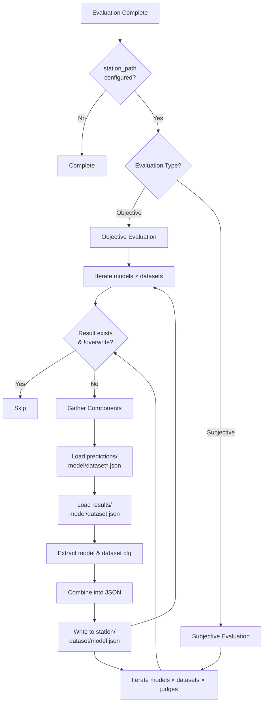
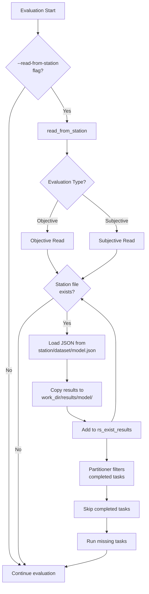
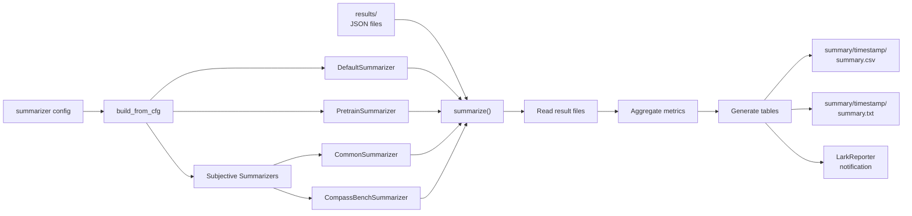
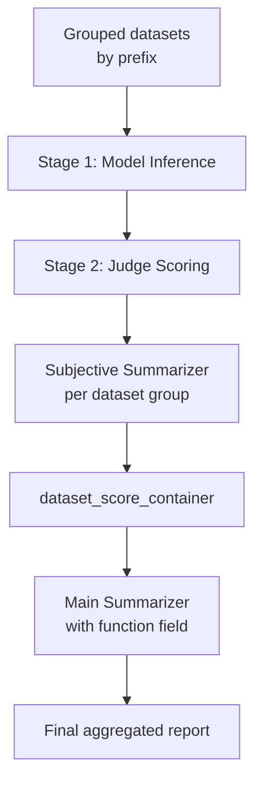
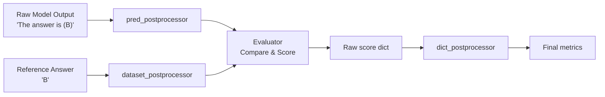

<!-- source: DeepWiki mcp.deepwiki.com · repo open-compass/opencompass · page 8 Result Management and Analysis · fetched 2026-10-21 -->

# Result Management and Analysis

<details>
<summary>Relevant source files</summary>

The following files were used as context for generating this wiki page:

- [docs/en/get_started/faq.md](docs/en/get_started/faq.md)
- [docs/en/get_started/quick_start.md](docs/en/get_started/quick_start.md)
- [docs/en/notes/contribution_guide.md](docs/en/notes/contribution_guide.md)
- [docs/en/user_guides/experimentation.md](docs/en/user_guides/experimentation.md)
- [docs/zh_cn/get_started/faq.md](docs/zh_cn/get_started/faq.md)
- [docs/zh_cn/get_started/quick_start.md](docs/zh_cn/get_started/quick_start.md)
- [docs/zh_cn/notes/contribution_guide.md](docs/zh_cn/notes/contribution_guide.md)
- [docs/zh_cn/user_guides/experimentation.md](docs/zh_cn/user_guides/experimentation.md)
- [opencompass/cli/main.py](opencompass/cli/main.py)
- [opencompass/openicl/icl_retriever/icl_votek_retriever.py](opencompass/openicl/icl_retriever/icl_votek_retriever.py)
- [opencompass/partitioners/base.py](opencompass/partitioners/base.py)
- [opencompass/utils/result_station.py](opencompass/utils/result_station.py)
- [opencompass/utils/run.py](opencompass/utils/run.py)
- [run.py](run.py)

</details>


This document describes how OpenCompass manages, stores, and reports evaluation results. It covers the work directory structure, the result station system for persistent storage and reuse, summarization and reporting mechanisms, and the post-processing pipeline that transforms raw model outputs into final evaluation scores.

For information about the evaluation pipeline that generates these results, see [Evaluation Pipeline Overview](#3.1). For information about how tasks are executed to produce results, see [Task Execution and Distribution](#7).

---

## Work Directory Structure

OpenCompass organizes all evaluation artifacts in a structured work directory. By default, results are stored under `outputs/default/`, with each evaluation run creating a timestamped subdirectory.

### Directory Layout

```
outputs/default/
├── 20230220_183030/              # Timestamped experiment folder
│   ├── configs/                  # Configuration files for this run
│   │   └── 20230220_183030_12345.py
│   ├── logs/                     # Execution logs
│   │   ├── infer/               # Inference stage logs
│   │   │   └── model_name/
│   │   └── eval/                # Evaluation stage logs
│   │       └── model_name/
│   ├── predictions/              # Raw model outputs
│   │   └── model_name/
│   │       ├── dataset1.json
│   │       ├── dataset2_0.json   # Partitioned datasets
│   │       └── dataset2_1.json
│   └── results/                  # Evaluation scores
│       └── model_name/
│           ├── dataset1.json
│           └── dataset2.json
└── latest -> 20230220_183030/    # Symlink to latest run
```

The work directory path is controlled by the `--work-dir` / `-w` parameter in [run.py](). The timestamp format is `YYYYMMDD_HHMMSS`, ensuring unique directories for each evaluation run.

**Sources:** [docs/zh_cn/user_guides/experimentation.md:100-125](), [docs/en/user_guides/experimentation.md:98-125]()

### Predictions Directory

The `predictions/` folder stores raw model inference outputs before evaluation. Each prediction file is a JSON dictionary mapping sample indices to model outputs:

```json
{
    "0": {
        "prediction": "The answer is B",
        "origin_prompt": "...",
        "token_len": 145
    },
    "1": {
        "prediction": "42",
        ...
    }
}
```

For large datasets, OpenCompass may partition tasks and create multiple numbered files (e.g., `dataset_0.json`, `dataset_1.json`). The system later merges these during evaluation.

**Sources:** [opencompass/utils/result_station.py:62-83]()

### Results Directory

The `results/` folder contains evaluated scores and metrics after comparing predictions with ground truth. Each result file contains:

```json
{
    "accuracy": 0.75,
    "details": [
        {"correct": true, "pred": "B", "answer": "B"},
        {"correct": false, "pred": "C", "answer": "A"}
    ]
}
```

The `details` field is included when `--dump-eval-details` is enabled (default), providing sample-level correctness information.

**Sources:** [opencompass/cli/main.py:376-380](), [opencompass/partitioners/base.py:32-35]()

---

## Result Persistence and Stations

OpenCompass provides a **result station** system for persistent storage and reuse of evaluation results across different runs. This enables efficient experimentation by avoiding redundant inference and evaluation.

### Result Station Concept

A result station is a persistent storage location (specified by `--station-path` or `station_path` in config) organized by dataset, where each model's results are stored as self-contained JSON files:

```
station/
├── mmlu/
│   ├── model1.json
│   ├── model2.json
│   └── model3_judged-by--gpt4.json   # Subjective evaluation
├── gsm8k/
│   └── model1.json
└── alignbench/
    └── model1_gpt4.json
```

Each station file contains three components:
1. **predictions**: Raw model outputs
2. **results**: Evaluation scores
3. **cfg**: Model and dataset configurations used

**Sources:** [opencompass/utils/result_station.py:11-112]()

### Saving Results to Station

The `save_to_station()` function is called after evaluation completes to persist results. It handles both objective and subjective evaluation scenarios.



**Objective Evaluation Save Process:**
- Locates prediction files matching the pattern `dataset*.json` in `predictions/model/`
- Loads result file from `results/model/dataset.json`
- Combines with model and dataset configuration
- Writes to `station_path/dataset/model.json`

**Subjective Evaluation Save Process:**
- Similar to objective, but includes judge model information
- Result filename format: `base_model_name_model_name_judged-by--judge_model.json`
- Handles multi-stage subjective evaluation with different judge models

**Sources:** [opencompass/utils/result_station.py:11-239](), [opencompass/cli/main.py:409-411]()

### Reading Results from Station

The `read_from_station()` function loads existing results at the start of an evaluation run, enabling the reuse mechanism.



When `--read-from-station` is specified, the system:
1. Queries the station for existing results matching current models and datasets
2. Copies found results to the local `work_dir/results/` directory
3. Populates `rs_exist_results` list with completed (model, dataset) pairs
4. Partitioner uses this list to filter out completed tasks

This allows resuming evaluations or skipping already-completed model-dataset combinations.

**Sources:** [opencompass/utils/result_station.py:241-375](), [opencompass/cli/main.py:304-307](), [opencompass/partitioners/base.py:113-128]()

### Reuse Mechanism

The `--reuse` / `-r` flag enables reusing results from previous runs in the same work directory, without requiring a station:

```bash
# Reuse latest results in work directory
python run.py config.py --reuse

# Reuse results from specific timestamp
python run.py config.py --reuse 20230220_183030
```

The reuse mechanism differs from station-based reuse:
- **Reuse**: Looks in current `work_dir` for existing predictions/results
- **Station**: Looks in separate `station_path` for persistently stored results

Both mechanisms allow the partitioner to skip completed tasks. The actual filtering happens in `NumWorkerPartitioner` and `SubjectiveNaivePartitioner`, which check for existing output files before creating tasks.

**Sources:** [opencompass/cli/main.py:271-281](), [docs/zh_cn/user_guides/experimentation.md:56]()

---

## Summarization and Reporting

After evaluation completes, OpenCompass uses **summarizers** to aggregate results across datasets and models, generating human-readable reports.

### Summarizer Architecture



Summarizers are registered components that implement a `summarize()` method. The configuration specifies which summarizer to use:

```python
# In config file
summarizer = dict(
    type=PretrainSummarizer,
    config=cfg  # Reference to full config
)
```

**Sources:** [opencompass/cli/main.py:414-446]()

### Objective Evaluation Summarization

For objective evaluations, `DefaultSummarizer` and `PretrainSummarizer` read result JSON files and generate tabular summaries:

**Process:**
1. Scan `results/` directory for all `model/dataset.json` files
2. Extract metric values (accuracy, F1, etc.) from each file
3. Organize into a table with models as rows and datasets as columns
4. Calculate any aggregate scores (e.g., MMLU average across subjects)
5. Write to CSV and TXT files in `summary/` directory

Example output:
```
dataset     version    metric    mode    model1    model2
----------  ---------  --------  ------  --------  --------
gsm8k       1d7fe4     accuracy  gen     65.2      58.7
mmlu        ea04bd     accuracy  ppl     45.3      42.1
```

The summarizer configuration can specify:
- Custom metric aggregation rules
- Subset of datasets to include
- Formatting options for the output table

**Sources:** [opencompass/cli/main.py:442-446](), [docs/zh_cn/user_guides/experimentation.md:98-125]()

### Subjective Evaluation Summarization

Subjective evaluations require specialized summarizers due to multi-stage evaluation:



The process differs from objective evaluation:
1. Datasets are grouped by prefix (e.g., all `alignbench_*` datasets)
2. Each group gets its own summarizer instance
3. Individual summarizers compute scores per dataset
4. Main summarizer with `function` field aggregates across all groups

Common subjective summarizers:
- **CommonSummarizer**: Basic subjective result aggregation
- **CompassBenchSummarizer**: Specialized for CompassBench multi-dimensional evaluation

**Sources:** [opencompass/cli/main.py:417-440]()

### Report Generation

Summarizers generate multiple output formats:

**CSV Format:**
- Machine-readable tabular data
- Easy to import into spreadsheets or analysis tools
- Located at `summary/{timestamp}/summary.csv`

**TXT Format:**
- Human-readable formatted table
- Printed to console and saved to file
- Uses `tabulate` library for formatting

**Lark Notification:**
When `--lark` flag is enabled with a configured `lark_bot_url`, OpenCompass sends status updates to a Lark (Feishu) bot:
- Task launch notification
- Evaluation completion notification
- Summary results

The notification is sent via `LarkReporter.post()` after summarization completes.

**Sources:** [opencompass/cli/main.py:309-314](), [docs/zh_cn/user_guides/experimentation.md:68-96]()

---

## Post-processing Pipeline

Before evaluation can compute final metrics, raw model outputs must be cleaned and standardized through a post-processing pipeline.

### Pipeline Overview



The pipeline consists of three post-processing stages:

1. **pred_postprocessor**: Cleans model predictions
2. **dataset_postprocessor**: Normalizes reference answers  
3. **dict_postprocessor**: Extracts final scores from evaluator output

**Sources:** Inferred from architecture diagram

### Prediction Post-processing

The `pred_postprocessor` transforms raw model outputs into standardized formats for comparison. Common operations include:

**Answer Extraction:**
- Parse structured responses (e.g., "Answer: B" → "B")
- Extract from multiple-choice formats
- Handle various answer formats (A/B/C/D, 1/2/3/4, etc.)

**Text Normalization:**
- Remove extra whitespace
- Lowercase conversion
- Strip special characters
- Handle edge cases (empty responses, refusals)

Post-processors are registered in the `TEXT_POSTPROCESSORS` registry and configured per dataset. Example configuration:

```python
eval_cfg = dict(
    evaluator=dict(
        type=AccEvaluator,
        pred_postprocessor=dict(
            type='first_capital_postprocess'  # Extract first capital letter
        )
    )
)
```

**Sources:** Inferred from architecture diagram and Diagram 4

### Dataset Post-processing

The `dataset_postprocessor` ensures reference answers match the format of post-processed predictions. This is crucial for fair comparison.

For example, if predictions are extracted as single letters ("B"), the reference answers must also be converted to single letters, even if originally stored as full text.

**Sources:** Inferred from architecture diagram

### Dictionary Post-processing  

After evaluation, the `dict_postprocessor` extracts meaningful metrics from evaluator output. Some evaluators return nested dictionaries with multiple metrics:

```python
{
    "accuracy": 0.75,
    "precision": 0.80,
    "recall": 0.70,
    "details": [...]
}
```

The dict_postprocessor selects which metrics to include in final results and can compute derived metrics (e.g., F1 from precision/recall).

**Sources:** Inferred from architecture diagram

### Specialized Post-processing

Different dataset types require specialized post-processing:

**Math Datasets (GSM8K, MATH):**
- Extract numerical answers from reasoning chains
- Normalize mathematical notation
- Handle fraction/decimal equivalence

**Code Datasets (HumanEval, MBPP):**
- Extract code blocks from markdown
- Remove comments and docstrings
- Validate syntax

**Multiple Choice (MMLU, CMMLU):**
- Map various answer formats (A/B/C/D, 1/2/3/4, Yes/No)
- Handle option letter extraction with regex patterns
- Reject invalid responses

Specialized evaluators like `TheoremQAEvaluatorV3`, `SciCodeEvaluator`, and `IFBenchEvaluator` implement custom post-processing logic for their specific domains.

**Sources:** Inferred from Diagram 4, [opencompass/utils/run.py:462-503]()

---

## Configuration and Control

### Command Line Parameters

Result management is controlled through several CLI parameters:

```bash
python run.py config.py \
    --work-dir outputs/my_exp \     # Work directory location
    --reuse latest \                # Reuse previous results
    --station-path /path/to/station \ # Persistent storage
    --station-overwrite \           # Overwrite station results
    --read-from-station \           # Load from station at start
    --dump-eval-details \           # Include per-sample details
    --mode all                      # infer/eval/viz/all
```

**Key Parameters:**
- `--work-dir` / `-w`: Sets work directory (default: `outputs/default`)
- `--reuse` / `-r`: Reuses results from previous runs
- `--station-path`: Configures result station location
- `--station-overwrite`: Forces overwriting existing station files
- `--read-from-station`: Enables loading results from station
- `--dump-eval-details`: Includes detailed per-sample correctness (default: True)
- `--mode`: Controls execution stages (all/infer/eval/viz)

**Sources:** [opencompass/cli/main.py:82-161]()

### Execution Modes

The `--mode` parameter controls which stages execute:

- **all**: (Default) Complete pipeline: inference → evaluation → visualization
- **infer**: Only run inference, generate predictions
- **eval**: Only evaluate existing predictions
- **viz**: Only generate summary from existing results

This allows flexible workflows, such as:
1. Run inference on a powerful cluster (`--mode infer`)
2. Copy predictions to local machine
3. Run evaluation locally (`--mode eval`)
4. Regenerate summaries after tweaking configs (`--mode viz`)

**Sources:** [opencompass/cli/main.py:64-71](), [docs/zh_cn/user_guides/experimentation.md:55]()

### Partitioner Integration

Result management integrates with the partitioning system to enable efficient task reuse. The `BasePartitioner` passes configuration through `keep_keys` to ensure evaluation tasks have access to result settings:

```python
keep_keys = [
    'eval.runner.task.judge_cfg',
    'eval.runner.task.dump_details',    # Per-sample details flag
    'eval.given_pred',                  # Pre-computed predictions
    'eval.runner.task.cal_extract_rate', # Answer extraction rate
]
```

When `rs_exist_results` is present (from station or reuse), the partitioner filters out completed model-dataset pairs before creating tasks.

**Sources:** [opencompass/partitioners/base.py:27-38](), [opencompass/partitioners/base.py:113-128]()

---

This completes the documentation for Result Management and Analysis in OpenCompass. The system provides flexible storage, efficient reuse mechanisms, comprehensive summarization, and robust post-processing to transform raw model outputs into actionable evaluation insights.

---

