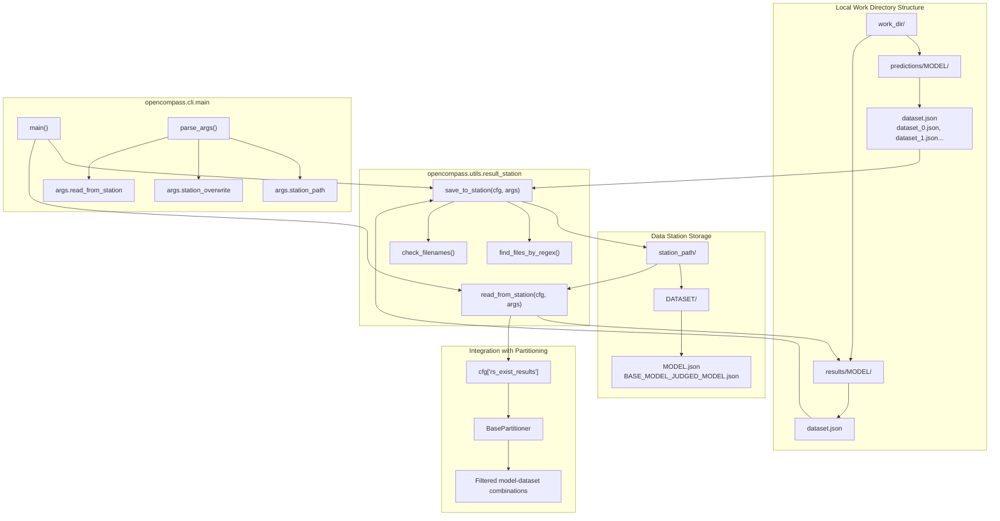
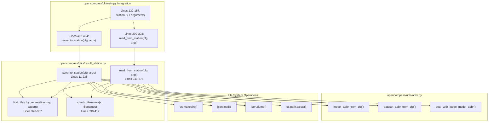
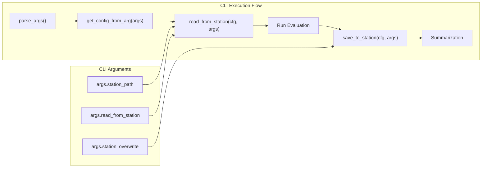
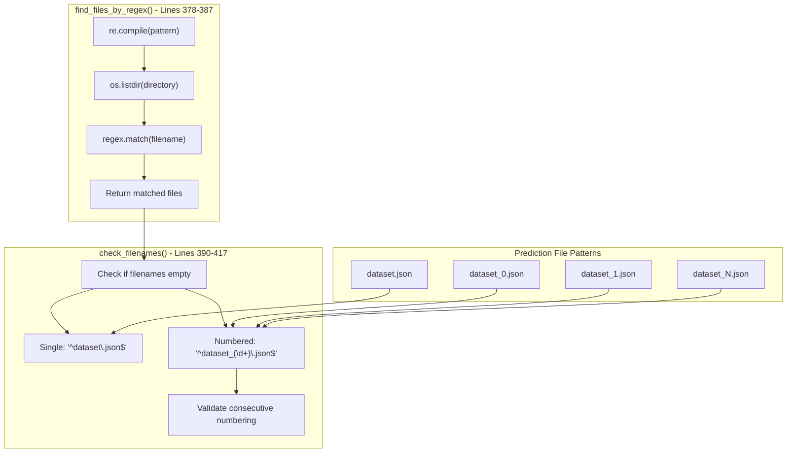
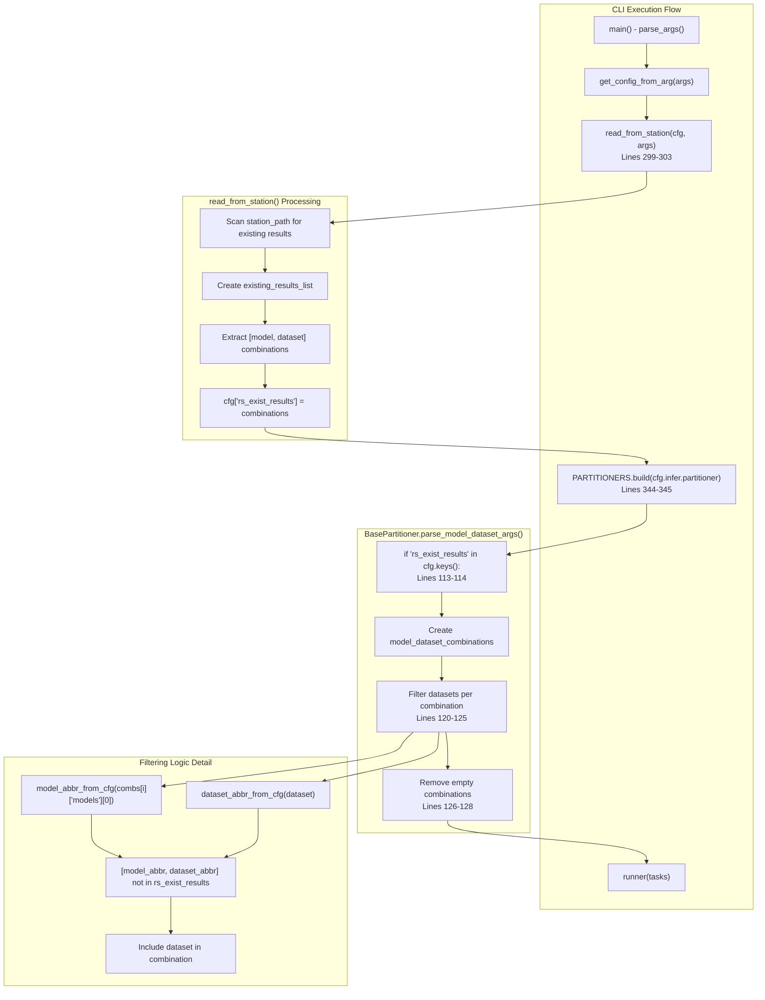

<!-- source: DeepWiki mcp.deepwiki.com · repo open-compass/opencompass · page 8.1 Result Persistence and Stations · fetched 2026-10-21 -->

# Result Persistence and Data Stations

<details>
<summary>Relevant source files</summary>

The following files were used as context for generating this wiki page:

- [docs/en/get_started/faq.md](docs/en/get_started/faq.md)
- [docs/en/get_started/quick_start.md](docs/en/get_started/quick_start.md)
- [docs/en/notes/contribution_guide.md](docs/en/notes/contribution_guide.md)
- [docs/en/user_guides/experimentation.md](docs/en/user_guides/experimentation.md)
- [docs/zh_cn/get_started/faq.md](docs/zh_cn/get_started/faq.md)
- [docs/zh_cn/get_started/quick_start.md](docs/zh_cn/get_started/quick_start.md)
- [docs/zh_cn/notes/contribution_guide.md](docs/zh_cn/notes/contribution_guide.md)
- [docs/zh_cn/user_guides/experimentation.md](docs/zh_cn/user_guides/experimentation.md)
- [opencompass/cli/main.py](opencompass/cli/main.py)
- [opencompass/openicl/icl_retriever/icl_votek_retriever.py](opencompass/openicl/icl_retriever/icl_votek_retriever.py)
- [opencompass/partitioners/base.py](opencompass/partitioners/base.py)
- [opencompass/utils/result_station.py](opencompass/utils/result_station.py)
- [opencompass/utils/run.py](opencompass/utils/run.py)
- [run.py](run.py)

</details>


This document covers OpenCompass's result persistence system and data stations, which enable sharing, storing, and reusing evaluation results across experiments and users. Data stations provide a centralized storage mechanism for evaluation results that can be accessed independently of specific work directories.

For information about result summarization and reporting after evaluation completion, see [Summarization and Reporting](8.2).

## Overview

The result persistence system in OpenCompass allows evaluation results to be stored in external data stations for sharing and reuse. The system is implemented primarily through the `result_station` module and integrates with the core evaluation pipeline through the CLI interface and task partitioning system. Data stations operate independently of the local `work_dir` structure and provide functionality for uploading, reading, and managing evaluation results across different experiments.

The system supports both objective and subjective evaluation results, with different handling strategies for each type. It integrates with the `BasePartitioner` class to enable intelligent skipping of already-completed evaluations.

Station System Architecture



Sources: [opencompass/utils/result_station.py:1-418](), [opencompass/cli/main.py:139-157](), [opencompass/partitioners/base.py:113-128]()

## Data Station Architecture

The data station system is implemented through core functions in the `result_station` module that handle the transfer of evaluation data between local work directories and shared storage locations.

Result Station Module Structure



### Persistence Mechanisms

The system implements three primary persistence mechanisms:

| Mechanism | Function | Purpose |
|-----------|----------|---------|
| **Upload** | `save_to_station()` | Transfer local results to shared storage |
| **Download** | `read_from_station()` | Retrieve existing results from shared storage |
| **Validation** | `check_filenames()` + `find_files_by_regex()` | Ensure data integrity and completeness |

Sources: [opencompass/utils/result_station.py:11-418](), [opencompass/cli/main.py:402-404](), [opencompass/cli/main.py:299-303]()

## Storage Format and Structure

Data stations organize evaluation results using a hierarchical directory structure where each model-dataset combination is stored as a JSON file.

### Directory Organization

The data station uses the following directory structure:

```
station_path/
├── dataset_name_1/
│   ├── model_name_1.json
│   ├── model_name_2.json
│   └── ...
├── dataset_name_2/
│   ├── model_name_1.json
│   └── ...
└── ...
```

### JSON File Format

Each result file contains a standardized structure with three main components assembled in `save_to_station()`:

| Component | Type | Source Location | Description |
|-----------|------|-----------------|-------------|
| `predictions` | `List[Dict]` | `work_dir/predictions/MODEL/` | Model predictions loaded and concatenated from prediction JSON files |
| `results` | `Dict` | `work_dir/results/MODEL/dataset.json` | Aggregated evaluation scores and metrics |
| `cfg` | `Dict` | Configuration objects | Model, dataset, and optionally judge model configurations |

**Example Structure:**
```json
{
    "predictions": [
        {
            "prediction": "model_output",
            "gold": "expected_answer",
            "index": 0
        }
    ],
    "results": {
        "accuracy": 0.85,
        "score": 85.0,
        "details": {...}
    },
    "cfg": {
        "models": {
            "type": "opencompass.models.HuggingFace",
            "abbr": "llama-7b-hf",
            "path": "huggyllama/llama-7b"
        },
        "datasets": {
            "type": "SomeDataset",
            "abbr": "dataset_name"
        },
        "judge_models": {...}  // Only for subjective datasets
    }
}
```

**File Naming Conventions:**
- Objective datasets: `MODEL.json`
- Subjective datasets: `[BASE_MODEL_]JUDGED_MODEL.json`

Sources: [opencompass/utils/result_station.py:96-111](), [opencompass/utils/result_station.py:153-154](), [opencompass/utils/result_station.py:86-94]()

## Core Operations

### Saving Results to Data Station

The `save_to_station` function handles uploading evaluation results from the local work directory to a data station. It processes both objective and subjective evaluation results with different handling strategies.

```mermaid
graph TD
    subgraph "save_to_station() Flow"
        START["save_to_station(cfg, args)"]
        CHECK_JUDGE["Check 'judge_models' in cfg"]
        OBJECTIVE["Objective Dataset Processing"]
        SUBJECTIVE["Subjective Dataset Processing"]
        
        subgraph "Objective Processing"
            GET_MODELS_OBJ["model_abbr_from_cfg(model)"]
            GET_DATASETS_OBJ["dataset_abbr_from_cfg(dataset)"]
            CHECK_EXISTS_OBJ["Check existing results"]
            LOAD_RESULTS_OBJ["Load from work_dir/results/"]
            LOAD_PREDS_OBJ["Load from work_dir/predictions/"]
            SAVE_JSON_OBJ["Save to station_path/dataset/model.json"]
        end
        
        subgraph "Subjective Processing"
            GET_JUDGE_MODELS["Get judge_models list"]
            DEAL_WITH_JUDGE["deal_with_judge_model_abbr()"]
            CHECK_BASE_MODELS["Check base_models in dataset"]
            LOAD_RESULTS_SUBJ["Load subjective results"]
            SAVE_JSON_SUBJ["Save with judge model suffix"]
        end
    end
    
    START --> CHECK_JUDGE
    CHECK_JUDGE -->|No judge_models| OBJECTIVE
    CHECK_JUDGE -->|Has judge_models| SUBJECTIVE
    
    OBJECTIVE --> GET_MODELS_OBJ
    GET_MODELS_OBJ --> GET_DATASETS_OBJ
    GET_DATASETS_OBJ --> CHECK_EXISTS_OBJ
    CHECK_EXISTS_OBJ --> LOAD_RESULTS_OBJ
    LOAD_RESULTS_OBJ --> LOAD_PREDS_OBJ
    LOAD_PREDS_OBJ --> SAVE_JSON_OBJ
    
    SUBJECTIVE --> GET_JUDGE_MODELS
    GET_JUDGE_MODELS --> DEAL_WITH_JUDGE
    DEAL_WITH_JUDGE --> CHECK_BASE_MODELS
    CHECK_BASE_MODELS --> LOAD_RESULTS_SUBJ
    LOAD_RESULTS_SUBJ --> SAVE_JSON_SUBJ
```



Sources: [opencompass/utils/result_station.py:11-238]()

### Reading Results from Data Station

The `read_from_station` function retrieves existing evaluation results from a data station and integrates them into the local work directory, allowing experiments to skip already-completed evaluations.

```mermaid
graph TD
    subgraph "read_from_station() Flow"
        START_READ["read_from_station(cfg, args)"]
        CHECK_JUDGE_READ["Check 'judge_models' in cfg"]
        OBJECTIVE_READ["Objective Results Reading"]
        SUBJECTIVE_READ["Subjective Results Reading"]
        
        subgraph "Objective Reading"
            SCAN_STATION_OBJ["Scan station_path for results"]
            CHECK_FILE_EXISTS["Check model.json exists"]
            LOAD_STATION_JSON["Load JSON from station"]
            SAVE_LOCAL_RESULTS["Save to local results/"]
            ADD_TO_EXISTS_LIST["Add to existing_results_list"]
        end
        
        subgraph "Subjective Reading"
            SCAN_STATION_SUBJ["Scan for judge model results"]
            CHECK_COMPLETE["Check complete result set"]
            LOAD_JUDGE_RESULTS["Load judge-specific results"]
            SAVE_LOCAL_JUDGE["Save to local with judge suffix"]
        end
    end
    
    START_READ --> CHECK_JUDGE_READ
    CHECK_JUDGE_READ -->|No judge_models| OBJECTIVE_READ
    CHECK_JUDGE_READ -->|Has judge_models| SUBJECTIVE_READ
    
    OBJECTIVE_READ --> SCAN_STATION_OBJ
    SCAN_STATION_OBJ --> CHECK_FILE_EXISTS
    CHECK_FILE_EXISTS --> LOAD_STATION_JSON
    LOAD_STATION_JSON --> SAVE_LOCAL_RESULTS
    SAVE_LOCAL_RESULTS --> ADD_TO_EXISTS_LIST
    
    SUBJECTIVE_READ --> SCAN_STATION_SUBJ
    SCAN_STATION_SUBJ --> CHECK_COMPLETE
    CHECK_COMPLETE --> LOAD_JUDGE_RESULTS
    LOAD_JUDGE_RESULTS --> SAVE_LOCAL_JUDGE
```



Sources: [opencompass/utils/result_station.py:241-375]()

## CLI Integration

The data station functionality is integrated into OpenCompass through command-line arguments that control how results are persisted and retrieved.

### Command-Line Arguments

| Argument | Short Form | Type | Default | Description |
|----------|------------|------|---------|-------------|
| `--station-path` | `-sp` | `str` | `None` | Path to the results station directory |
| `--station-overwrite` | - | `bool` | `False` | Overwrite existing results at the station |
| `--read-from-station` | - | `bool` | `False` | Read existing results from the station before evaluation |

**CLI Argument Definitions:**
- **Lines 140-145**: `--station-path` argument definition
- **Lines 147-150**: `--station-overwrite` argument definition  
- **Lines 152-157**: `--read-from-station` argument definition

**Configuration Priority:**
```python
# Station path resolution in save_to_station() and read_from_station()
if args.station_path is not None:
    station_path = args.station_path
else:
    station_path = cfg.get('station_path')
```

### Integration Points

The CLI integration occurs at several points in the main execution flow:



Sources: [opencompass/cli/main.py:139-157](), [opencompass/cli/main.py:299-304](), [opencompass/cli/main.py:402-404]()

## File Management and Validation

The data station system includes robust file management and validation mechanisms to ensure data integrity and handle various file naming patterns.

### File Pattern Matching and Validation

File Pattern Matching Logic



**Pattern Matching Implementation:**

The `find_files_by_regex()` function uses this regex pattern:
```python
local_prediction_regex = rf'^{re.escape(dataset)}(?:_\d+)?\.json$'
```

**Validation Rules in `check_filenames()`:**

| Pattern Type | Format | Validation Logic |
|-------------|--------|------------------|
| Single file | `dataset.json` | Exactly one file matching `^dataset\.json$` |
| Numbered series | `dataset_0.json`, `dataset_1.json`, ...` | All files match `^dataset_(\d+)\.json$` with consecutive numbering from 0 |

**Error Conditions:**
- Mixed patterns (both single and numbered files)
- Non-consecutive numbering in numbered series
- Empty filename list

Sources: [opencompass/utils/result_station.py:378-417](), [opencompass/utils/result_station.py:64-67](), [opencompass/utils/result_station.py:179-182]()

## Integration with Evaluation Pipeline

Data stations integrate with the broader OpenCompass evaluation pipeline through configuration management and result reuse mechanisms.

### Configuration Integration

The system reads station configuration from both CLI arguments and configuration files:

```python
if args.station_path is not None:
    station_path = args.station_path
else:
    station_path = cfg.get('station_path')
```

### Integration with Task Partitioning

Result Reuse and Task Filtering Pipeline



**Key Implementation Details:**

1. **Station Scanning** (`read_from_station`): Builds `existing_results_list` containing `{'combination': [model, dataset], 'file': ...}` entries

2. **Configuration Injection** (`main.py:302-303`): Extracts combinations and sets `cfg['rs_exist_results']`

3. **Partitioner Filtering** (`BasePartitioner:119-125`): Filters out datasets where `[model_abbr, dataset_abbr]` exists in `rs_exist_results`

4. **Empty Combination Removal** (`BasePartitioner:126-128`): Removes model combinations with no remaining datasets

**Filtering Code Logic:**
```python
# Lines 119-125 in BasePartitioner.parse_model_dataset_args()
combs[i]['datasets'] = [
    dataset for dataset in combs[i]['datasets'] if [
        model_abbr_from_cfg(combs[i]['models'][0]),
        dataset_abbr_from_cfg(dataset)
    ] not in rs_exist_results
]
```

This enables efficient incremental evaluation where only missing model-dataset combinations are computed, avoiding redundant work.

Sources: [opencompass/cli/main.py:299-303](), [opencompass/partitioners/base.py:113-128](), [opencompass/utils/result_station.py:275-279](), [opencompass/utils/result_station.py:365-370]()

## Error Handling and Edge Cases

The data station system includes comprehensive error handling for common scenarios:

### Missing Files
- Prediction files: Continues with warning in visualization mode, raises error otherwise
- Result files: Raises `ValueError` with specific file path

### Incomplete Results
- Subjective evaluations: Checks for complete judge model result sets
- Multi-part predictions: Validates consecutive numbering

### Overwrite Protection
- Default behavior prevents overwriting existing results
- `--station-overwrite` flag allows explicit overwrites
- Existence checks based on model and dataset abbreviations

Sources: [opencompass/utils/result_station.py:52-56](), [opencompass/utils/result_station.py:167-171](), [opencompass/utils/result_station.py:37-46]()

---

