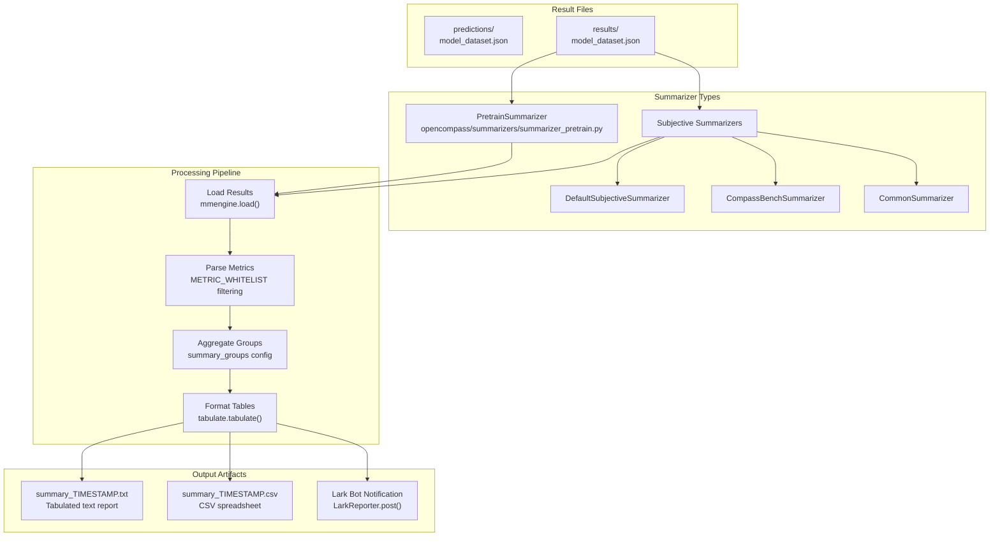
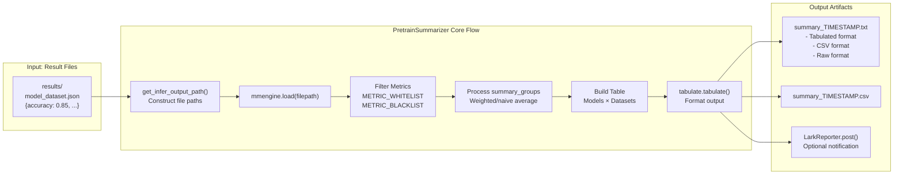
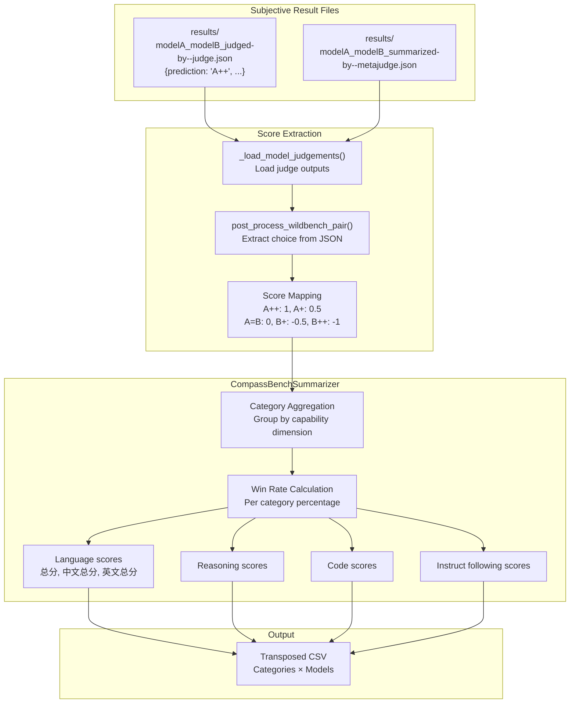
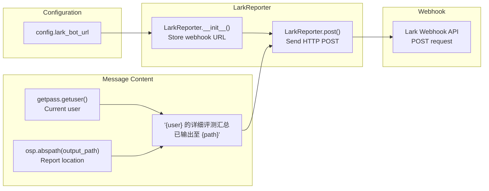
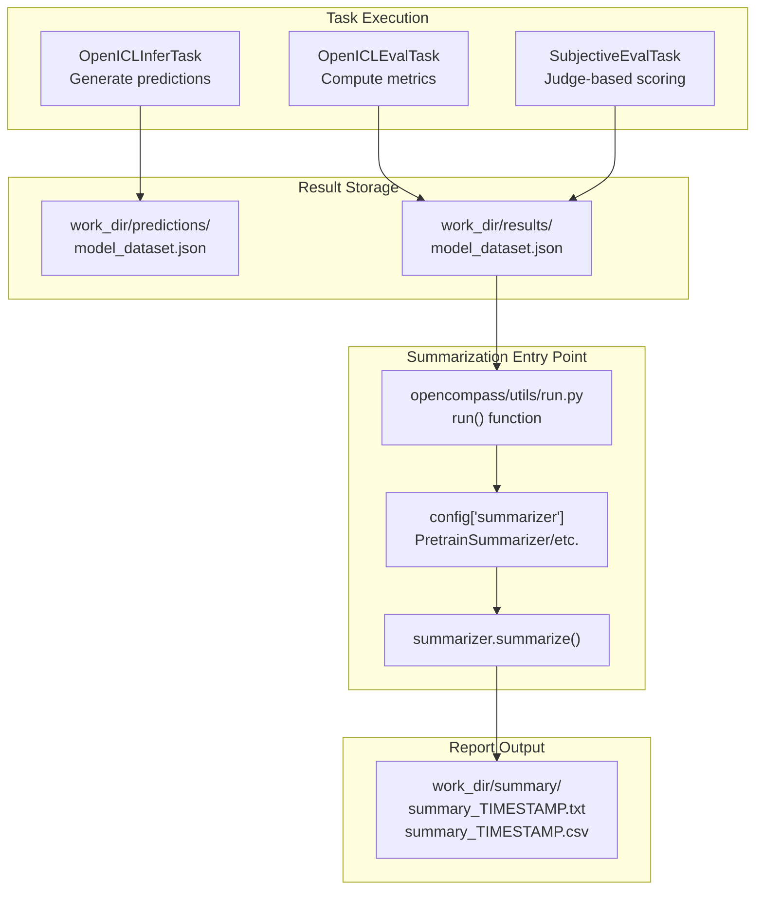

<!-- source: DeepWiki mcp.deepwiki.com · repo open-compass/opencompass · page 8.2 Summarization and Reporting · fetched 2026-10-21 -->

# Summarization and Reporting

<details>
<summary>Relevant source files</summary>

The following files were used as context for generating this wiki page:

- [.gitignore](.gitignore)
- [.pre-commit-config-zh-cn.yaml](.pre-commit-config-zh-cn.yaml)
- [.pre-commit-config.yaml](.pre-commit-config.yaml)
- [docs/zh_cn/advanced_guides/compassbench_intro.md](docs/zh_cn/advanced_guides/compassbench_intro.md)
- [docs/zh_cn/advanced_guides/compassbench_v2_0.md](docs/zh_cn/advanced_guides/compassbench_v2_0.md)
- [opencompass/models/glm.py](opencompass/models/glm.py)
- [opencompass/models/interntrain.py](opencompass/models/interntrain.py)
- [opencompass/partitioners/sub_naive.py](opencompass/partitioners/sub_naive.py)
- [opencompass/partitioners/sub_size.py](opencompass/partitioners/sub_size.py)
- [opencompass/summarizers/__init__.py](opencompass/summarizers/__init__.py)
- [opencompass/summarizers/subjective/compassbench_v13.py](opencompass/summarizers/subjective/compassbench_v13.py)
- [opencompass/summarizers/summarizer_pretrain.py](opencompass/summarizers/summarizer_pretrain.py)
- [opencompass/tasks/subjective_eval.py](opencompass/tasks/subjective_eval.py)
- [tools/convert_alignmentbench.py](tools/convert_alignmentbench.py)

</details>


This document describes the summarization and reporting system in OpenCompass, which aggregates evaluation results and generates human-readable reports. After inference and evaluation phases complete, summarizers process the raw result files to compute final metrics, aggregate scores across datasets, and produce formatted outputs in CSV and text formats.

For information about the evaluation phase that produces the raw results, see [Objective Evaluators](#6.2) and [Subjective Evaluation Framework](#6.3). For details on result persistence before summarization, see [Result Persistence and Stations](#8.1).

## Summarizer Architecture



**Sources:** [opencompass/summarizers/__init__.py:1-8](), [opencompass/summarizers/summarizer_pretrain.py:1-339](), [opencompass/summarizers/subjective/compassbench_v13.py:1-196]()

OpenCompass provides two main categories of summarizers:

| Summarizer Type | Purpose | Key Classes | Output Format |
|----------------|---------|-------------|---------------|
| Objective | Aggregate rule-based evaluation metrics | `PretrainSummarizer`, `DefaultSummarizer` | CSV/TXT tables with accuracy, pass@1, etc. |
| Subjective | Aggregate LLM-judge scores | `CompassBenchSummarizer`, `CommonSummarizer`, `DefaultSubjectiveSummarizer` | CSV/TXT tables with win rates, pairwise comparisons |

## PretrainSummarizer - Objective Evaluation



**Sources:** [opencompass/summarizers/summarizer_pretrain.py:21-339]()

### Core Processing Logic

The `PretrainSummarizer` class aggregates objective evaluation results across models and datasets. Key processing steps:

**1. Result Collection** [opencompass/summarizers/summarizer_pretrain.py:44-77]()

```python
# For each model-dataset pair
for model in model_cfgs:
    for dataset in dataset_cfgs:
        filepath = get_infer_output_path(model, dataset, 
                                         osp.join(work_dir, 'results'))
        result = mmengine.load(filepath)
        # Result format: {'accuracy': 0.85, 'pass@1': 0.42, ...}
```

**2. Metric Filtering** [opencompass/summarizers/summarizer_pretrain.py:18-19](), [opencompass/summarizers/summarizer_pretrain.py:66-76]()

Only metrics in the whitelist are included in the final report:

```python
METRIC_WHITELIST = ['pass@1', 'score', 'auc_score', 'accuracy', 
                    'humaneval_pass@1', 'rouge1', 'avg_toxicity_score', 
                    'bleurt_diff', 'matthews_correlation', 'truth']
METRIC_BLACKLIST = ['bp', 'sys_len', 'ref_len']
```

Metrics are sorted by whitelist priority, with whitelisted metrics appearing first.

**3. Group Aggregation** [opencompass/summarizers/summarizer_pretrain.py:103-135]()

The `summary_groups` configuration allows aggregating multiple datasets into a single metric:

```python
summary_groups = [
    {
        'name': 'mmlu_average',
        'subsets': ['mmlu_stem', 'mmlu_humanities', 'mmlu_social_sciences'],
        'weights': {'mmlu_stem': 0.4, 'mmlu_humanities': 0.3, 
                   'mmlu_social_sciences': 0.3}  # Optional weighted average
    }
]
```

If `weights` are provided, a weighted average is computed; otherwise, a naive average is used.

**4. Table Generation** [opencompass/summarizers/summarizer_pretrain.py:138-203]()

The summarizer builds a table with structure:

| Row Type | Content |
|----------|---------|
| Header | `['dataset', 'version', 'metric', 'mode'] + model_abbrs` |
| Time | Current timestamp for each model |
| Checkpoint | Model checkpoint identifier |
| Max Seq Len | Model's `max_seq_len` configuration |
| Dataset Rows | One row per dataset-metric pair |

Each cell contains the metric value formatted to 2 decimal places.

### Output Formats

**Text File** [opencompass/summarizers/summarizer_pretrain.py:224-248]()

The text output contains three sections:
1. **Tabulate format**: Pretty-printed table using `tabulate.tabulate()`
2. **CSV format**: Comma-separated values
3. **Raw format**: Complete result dictionaries for each model-dataset pair

**CSV File** [opencompass/summarizers/summarizer_pretrain.py:255-257]()

A standalone CSV file is generated for easy import into spreadsheet applications.

**Example Output Structure:**
```
dataset,version,metric,mode,model1,model2
mmlu,abc123,accuracy,gen,85.23,87.45
gsm8k,def456,accuracy,gen,72.10,75.30
```

### Evaluation Mode Tracking

The summarizer automatically detects the evaluation mode (generation vs perplexity) based on the inferencer type [opencompass/summarizers/summarizer_pretrain.py:89-101]():

```python
inferencer = dataset.get('infer_cfg', {}).get('inferencer', {}).get('type', '')
if 'GenInferencer' in inferencer:
    dataset_eval_mode[dataset_abbr] = 'gen'
elif 'PPLInferencer' in inferencer:
    dataset_eval_mode[dataset_abbr] = 'ppl'
```

This mode is displayed in the `mode` column of the output table.

**Sources:** [opencompass/summarizers/summarizer_pretrain.py:21-339]()

## Subjective Evaluation Summarization



**Sources:** [opencompass/summarizers/subjective/compassbench_v13.py:1-196]()

### CompassBench Scoring System

The `CompassBenchSummarizer` processes pairwise model comparisons for CompassBench evaluation [opencompass/summarizers/subjective/compassbench_v13.py:38-196]().

**Pairwise Comparison Format** [opencompass/summarizers/subjective/compassbench_v13.py:24-30]()

Judge models output structured JSON responses:
```python
{
    "analysis of A": "[analysis]",
    "analysis of B": "[analysis]", 
    "reason of A=B": "[reasons]",
    "reason of A>B": "[reasons]",
    "reason of B>A": "[reasons]",
    "choice": "A++"  # One of: A++, A+, A=B, B+, B++
}
```

The `post_process_wildbench_pair()` function extracts the `choice` field using regex.

**Score Mapping** [opencompass/summarizers/subjective/compassbench_v13.py:89]()

Five-level comparison scores are mapped to numerical values:

| Choice | Score | Interpretation |
|--------|-------|----------------|
| `A++` | 1.0 | Response A much better |
| `A+` | 0.5 | Response A slightly better |
| `A=B` | 0.0 | Equal quality |
| `B+` | -0.5 | Response B slightly better |
| `B++` | -1.0 | Response B much better |

**Category Aggregation** [opencompass/summarizers/subjective/compassbench_v13.py:86-121]()

Scores are accumulated by category (extracted from dataset metadata):

```python
for judged_answer, reference in zip(judged_answers, references):
    category = reference['category']  # e.g., "NLP_en", "creation_cn"
    flag = 1 if reference['answer1'] == base_model else -1
    score_1 = score_mapping[judged_answer] * flag
    win_compare_model[category] += score_2
```

Final category scores are averaged and converted to percentages [opencompass/summarizers/subjective/compassbench_v13.py:114-118]():
```python
win_compare_model[category] = win_compare_model[category] / count * 100
```

**Multi-dimensional Reporting** [opencompass/summarizers/subjective/compassbench_v13.py:32-36](), [opencompass/summarizers/subjective/compassbench_v13.py:140-169]()

CompassBench organizes results by capability dimension:

```python
MAP = {
    'language': ['总分', '中文总分', '英文总分', '自然语言处理_cn', '创作_cn', ...],
    'instruct': ['总分', '中文总分', '英文总分'],
    'reasoning': ['总分', '中文总分', '英文总分', 'Common Sense Reasoning_cn', ...],
    'coding': ['总分', '中文总分', '英文总分']
}
```

The summarizer computes:
- **Chinese total** (中文总分): Average across all `_cn` subcategories
- **English total** (英文总分): Average across all `_en` subcategories  
- **Overall total** (总分): Average of Chinese and English totals

**Output Structure** [opencompass/summarizers/subjective/compassbench_v13.py:170-195]()

The final CSV is transposed with categories as rows and models as columns:

```
                              model1    model2    model3
language_总分                  45.23     52.10     48.67
language_中文总分               43.50     50.20     47.30
language_英文总分               47.80     54.00     50.10
language_NLP_en                49.20     55.30     51.40
reasoning_总分                 38.70     42.50     40.10
...
```

**Sources:** [opencompass/summarizers/subjective/compassbench_v13.py:1-196](), [docs/zh_cn/advanced_guides/compassbench_intro.md:1-195]()

## Lark Notification System



**Sources:** [opencompass/summarizers/summarizer_pretrain.py:28-32](), [opencompass/summarizers/summarizer_pretrain.py:250-253]()

The `LarkReporter` class provides optional notification capabilities [opencompass/summarizers/summarizer_pretrain.py:28-32]():

```python
# In configuration
config = {
    'lark_bot_url': 'https://open.feishu.cn/open-apis/bot/v2/hook/...'
}

# In PretrainSummarizer
self.lark_reporter = None
if self.cfg.get('lark_bot_url', None):
    self.lark_reporter = LarkReporter(self.cfg['lark_bot_url'])
```

After report generation, a notification is sent [opencompass/summarizers/summarizer_pretrain.py:250-253]():

```python
if self.lark_reporter:
    content = f'{getpass.getuser()} 的'
    content += f'详细评测汇总已输出至 {osp.abspath(output_path)}'
    self.lark_reporter.post(content)
```

This enables team notifications when long-running evaluations complete.

**Sources:** [opencompass/summarizers/summarizer_pretrain.py:28-32](), [opencompass/summarizers/summarizer_pretrain.py:250-253]()

## Integration with Evaluation Pipeline



**Sources:** Diagram 2 from high-level architecture

The summarization phase is triggered automatically after all evaluation tasks complete. The main entry point is typically in the run orchestration logic, which:

1. Waits for all `OpenICLEvalTask` and `SubjectiveEvalTask` instances to finish
2. Instantiates the configured summarizer (usually `PretrainSummarizer` for objective tasks)
3. Calls `summarizer.summarize()` to process all result files
4. Outputs formatted reports to `work_dir/summary/`

The summarizer reads configuration from:
- `config['summarizer']`: Summarizer class and parameters
- `config['models']`: List of models to include in the report
- `config['datasets']`: List of datasets to include in the report
- `config['work_dir']`: Base directory for reading results and writing reports

**Sources:** [opencompass/summarizers/summarizer_pretrain.py:24-42]()

## Summary Group Configuration

Summary groups enable hierarchical metric aggregation. This is particularly useful for benchmarks with multiple subsets.

**Configuration Example:**

```python
summarizer = dict(
    type='PretrainSummarizer',
    summary_groups=[
        {
            'name': 'mmlu',
            'subsets': ['mmlu_stem', 'mmlu_humanities', 'mmlu_social_sciences', 
                       'mmlu_other'],
            'weights': {
                'mmlu_stem': 0.3,
                'mmlu_humanities': 0.3,
                'mmlu_social_sciences': 0.2,
                'mmlu_other': 0.2
            }
        },
        {
            'name': 'ceval',
            'subsets': ['ceval_stem', 'ceval_social_science', 'ceval_humanities',
                       'ceval_other']
            # No weights = naive average
        }
    ]
)
```

**Processing Logic** [opencompass/summarizers/summarizer_pretrain.py:103-135]():

1. For each group, collect results from all subset datasets
2. If all subsets are present:
   - With weights: Compute weighted average
   - Without weights: Compute arithmetic mean
3. Add group result to the global results dictionary
4. If subsets are missing: Record error in results

The aggregated group metric appears as a dataset row in the final table.

**Sources:** [opencompass/summarizers/summarizer_pretrain.py:103-135]()

## Prompt Version Tracking

The summarizer includes prompt version hashes in the output to facilitate reproducibility [opencompass/summarizers/summarizer_pretrain.py:136]():

```python
prompt_version = {
    dataset_abbr_from_cfg(d): get_prompt_hash(d)[:6] 
    for d in dataset_cfgs
}
```

Each dataset row in the table includes a 6-character hash of the prompt template configuration, allowing users to identify which prompt version was used for evaluation. This is critical for comparing results across runs or identifying when prompt changes affect scores.

**Sources:** [opencompass/summarizers/summarizer_pretrain.py:136]()

---

