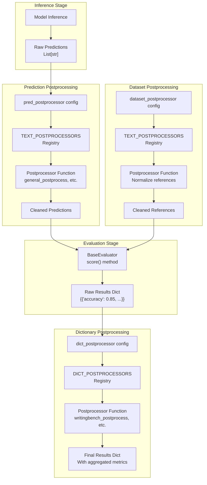
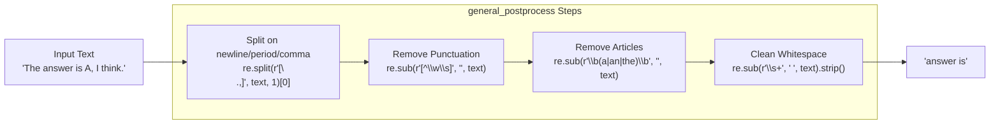
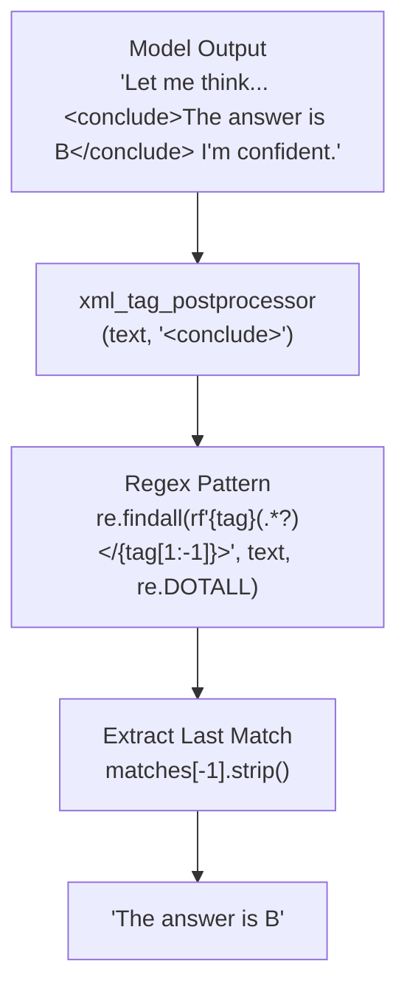
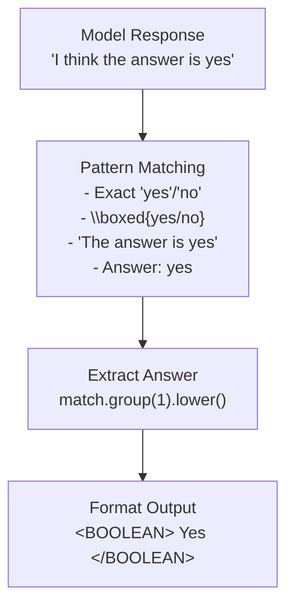
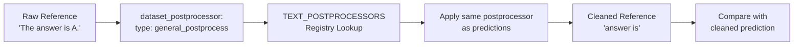
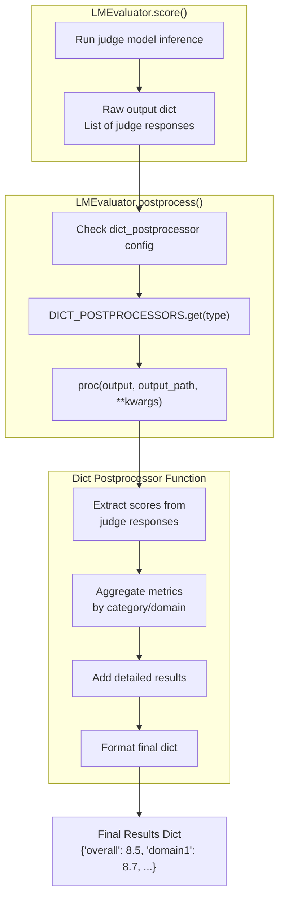
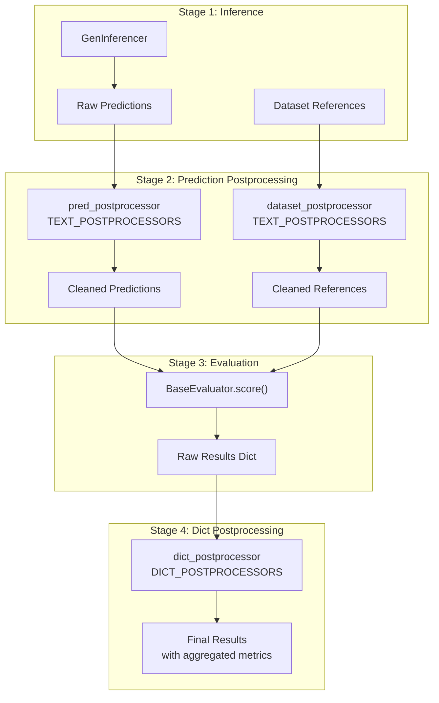
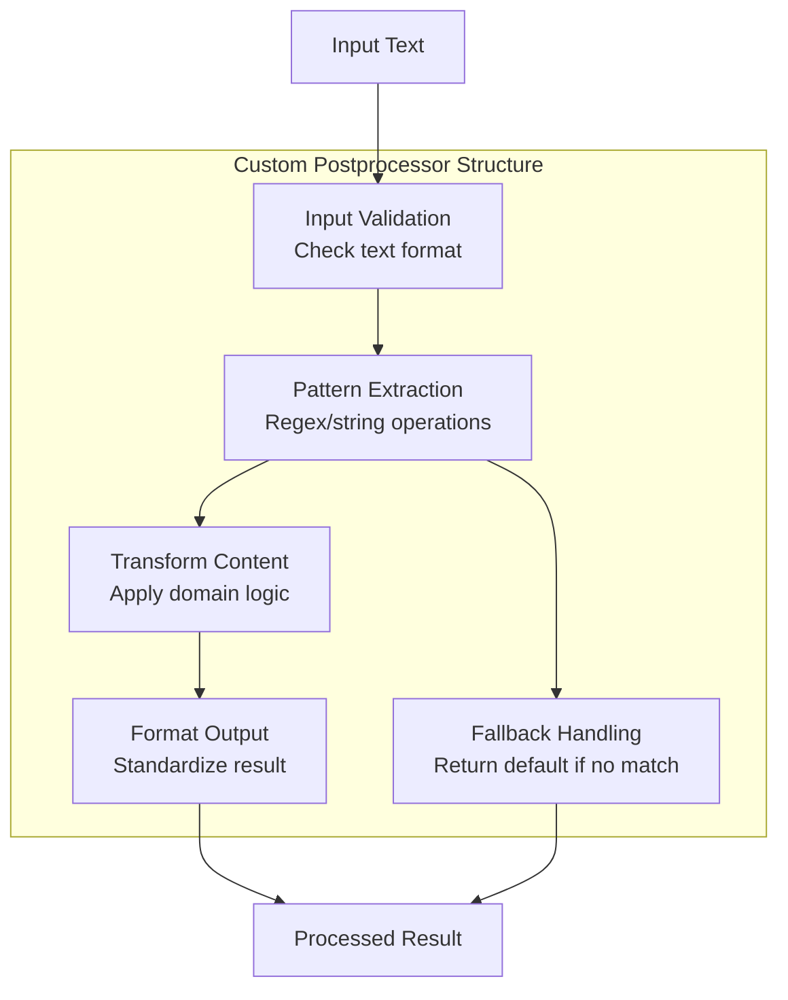

<!-- source: DeepWiki mcp.deepwiki.com · repo open-compass/opencompass · page 8.3 Post-processing Pipeline · fetched 2026-10-21 -->

# Post-processing Pipeline

<details>
<summary>Relevant source files</summary>

The following files were used as context for generating this wiki page:

- [dataset-index.yml](dataset-index.yml)
- [opencompass/configs/datasets/IFBench/IFBench_gen.py](opencompass/configs/datasets/IFBench/IFBench_gen.py)
- [opencompass/configs/datasets/MedCalc_Bench/MedCalcBench_official_gen_a5155f.py](opencompass/configs/datasets/MedCalc_Bench/MedCalcBench_official_gen_a5155f.py)
- [opencompass/configs/datasets/srbench/srbench_gen.py](opencompass/configs/datasets/srbench/srbench_gen.py)
- [opencompass/configs/datasets/subjective/writingbench/writingbench_judge.py](opencompass/configs/datasets/subjective/writingbench/writingbench_judge.py)
- [opencompass/configs/models/mistral/lmdeploy_mixtral_8x22b_instruct_v0_1.py](opencompass/configs/models/mistral/lmdeploy_mixtral_8x22b_instruct_v0_1.py)
- [opencompass/configs/summarizers/groups/biodata.py](opencompass/configs/summarizers/groups/biodata.py)
- [opencompass/datasets/IFBench/evaluation_lib.py](opencompass/datasets/IFBench/evaluation_lib.py)
- [opencompass/datasets/IFBench/ifbench.py](opencompass/datasets/IFBench/ifbench.py)
- [opencompass/datasets/IFBench/instructions.py](opencompass/datasets/IFBench/instructions.py)
- [opencompass/datasets/IFBench/instructions_registry.py](opencompass/datasets/IFBench/instructions_registry.py)
- [opencompass/datasets/IFBench/instructions_util.py](opencompass/datasets/IFBench/instructions_util.py)
- [opencompass/datasets/MedCalc_Bench.py](opencompass/datasets/MedCalc_Bench.py)
- [opencompass/datasets/__init__.py](opencompass/datasets/__init__.py)
- [opencompass/datasets/scicode.py](opencompass/datasets/scicode.py)
- [opencompass/datasets/srbench.py](opencompass/datasets/srbench.py)
- [opencompass/datasets/subjective/__init__.py](opencompass/datasets/subjective/__init__.py)
- [opencompass/datasets/subjective/compassbench_checklist.py](opencompass/datasets/subjective/compassbench_checklist.py)
- [opencompass/datasets/subjective/writingbench.py](opencompass/datasets/subjective/writingbench.py)
- [opencompass/openicl/icl_evaluator/lm_evaluator.py](opencompass/openicl/icl_evaluator/lm_evaluator.py)
- [opencompass/summarizers/subjective/__init__.py](opencompass/summarizers/subjective/__init__.py)
- [opencompass/summarizers/subjective/common_summarizer.py](opencompass/summarizers/subjective/common_summarizer.py)
- [opencompass/summarizers/subjective/qacompassbench.py](opencompass/summarizers/subjective/qacompassbench.py)
- [opencompass/utils/datasets_info.py](opencompass/utils/datasets_info.py)
- [opencompass/utils/prompt.py](opencompass/utils/prompt.py)
- [requirements/extra.txt](requirements/extra.txt)

</details>


This document covers OpenCompass's post-processing pipeline that transforms raw model outputs and evaluation results into standardized formats. The pipeline consists of three main postprocessor types that operate at different stages of the evaluation workflow.

For information about evaluation methods that use these postprocessors, see [Evaluation Methods](#6). For details about the complete evaluation pipeline, see [Evaluation Pipeline](#3.1).

## Purpose and Architecture

The post-processing pipeline in OpenCompass consists of three distinct postprocessor types that operate at different stages:

| Postprocessor Type | Purpose | Configuration Key | Registry |
|-------------------|---------|-------------------|----------|
| **pred_postprocessor** | Clean and extract answers from model predictions | `pred_postprocessor` | `TEXT_POSTPROCESSORS` |
| **dataset_postprocessor** | Normalize reference answers in datasets | `dataset_postprocessor` | `TEXT_POSTPROCESSORS` |
| **dict_postprocessor** | Process evaluation result dictionaries | `dict_postprocessor` | `DICT_POSTPROCESSORS` |

**Complete Post-processing Pipeline**



Sources: [opencompass/utils/text_postprocessors.py:1-286](), [opencompass/registry.py:4-5](), [opencompass/openicl/icl_evaluator/lm_evaluator.py:359-367]()

## Prediction Postprocessors

Prediction postprocessors clean and extract answers from raw model outputs. They are registered in the `TEXT_POSTPROCESSORS` registry and configured via the `pred_postprocessor` key in dataset eval configurations.

### Basic Text Cleaning

The `general` and `general_cn` postprocessors provide fundamental text normalization:

| Postprocessor | Function | Key Operations |
|---------------|----------|----------------|
| `general` | `general_postprocess` | Remove punctuation, articles (a/an/the), normalize whitespace |
| `general_cn` | `general_cn_postprocess` | Same as general + Chinese tokenization with jieba |
| `first-capital` | `first_capital_postprocess` | Extract first uppercase letter |
| `last-capital` | `last_capital_postprocess` | Extract last uppercase letter |

**Text Cleaning Pipeline**



Sources: [opencompass/utils/text_postprocessors.py:7-43]()

### Multiple Choice Processing

For multiple choice questions, OpenCompass provides sophisticated option extraction:

```python
# first_option_postprocess with extensive pattern matching
patterns = [
    f'答案是?\\s*([{options}])',           # "答案是A"
    f'[Tt]he answer is:?\\s+\\(?([{options}])\\)?',  # "The answer is A"  
    f'答案选项为?\\s*：\\s*([{options}])',  # "答案选项为：A"
    # ... 30+ more patterns
]
```

The `multiple_select_postprocess` handles questions with multiple correct answers by extracting all uppercase letters and sorting them.

Sources: [opencompass/utils/text_postprocessors.py:73-185]()

## Answer Extraction Patterns

### Pattern-Based Extraction

The `think_pred_postprocess` and `xml_tag_postprocessor` functions extract content using regex patterns and XML-style tags:

**XML Tag Extraction Flow**



### Reasoning Content Filtering

The `extract_non_reasoning_content` function removes intermediate reasoning steps marked with think tags:

```python
# Removes content between  tags
reasoning_regex = re.compile(rf'{think_start_token}(.*?){think_end_token}', re.DOTALL)
non_reasoning_content = reasoning_regex.sub('', text).strip()
```

Sources: [opencompass/utils/text_postprocessors.py:187-286]()

### Chemistry Domain (SmolInstruct)

Chemistry datasets require specialized postprocessors for different answer formats:

| Postprocessor | Purpose | Output Format |
|---------------|---------|---------------|
| `smolinstruct_acc_postprocess` | Yes/No questions | `<BOOLEAN> Yes </BOOLEAN>` |
| `smolinstruct_acc_0shot_postprocess` | Zero-shot Yes/No | Enhanced pattern matching |
| Chemical formula extraction | SMILES/Formula parsing | Structured chemical data |

**Yes/No Answer Processing**



### Mathematical Domain (TheoremQA)

TheoremQA datasets use specialized extraction for mathematical expressions:

```python
def extract_theoremqa_answer(pred: str, answer_flag: bool = True):
    # Handle boolean answers
    if any([option in pred.lower() for option in ['yes', 'true']]):
        pred = 'True'
    # Extract numerical answers with latex2sympy conversion
    pred = pred.split('=')[-1].strip()
    pred = clean_units(pred)
    tmp = str(latex2sympy(pred))
```

Sources: [opencompass/datasets/smolinstruct.py:442-489](), [opencompass/datasets/TheoremQA/utils.py:19-55]()

### Symbolic Regression Domain (SRBench)

The SRBench dataset uses a custom postprocessor to clean mathematical formula strings:

```python
# mydataset_postprocess from srbench.py
def mydataset_postprocess(formula_str):
    # Remove Markdown symbols
    formula_str = formula_str.replace('×', '*').replace('·', '*').replace('÷', '/')
    formula_str = formula_str.replace('−', '-').replace('^', '**')
    
    # Remove markdown backticks and $ symbols
    formula_str = formula_str.replace('`', '').replace('$', '').strip()
    
    # Extract first line (prevent multi-line explanatory output)
    formula_str = formula_str.split('\n')[0].strip()
    
    # Remove non-legal characters with regex
    formula_str = re.sub(r'[^\w\s\+\-\*/\^\=\.\(\)]', '', formula_str)
    
    return formula_str.strip()
```

This postprocessor is configured in the dataset configuration:

```python
srbench_eval_cfg = dict(
    evaluator=dict(type=SRbenchDatasetEvaluator, path='opencompass/srbench'),
    pred_postprocessor=dict(type=mydataset_postprocess),
    pred_role='BOT',
)
```

Sources: [opencompass/datasets/srbench.py:48-67](), [opencompass/configs/datasets/srbench/srbench_gen.py:40-44]()

## Dataset Postprocessors

Dataset postprocessors normalize reference answers to match the format of processed predictions. They use the same `TEXT_POSTPROCESSORS` registry but are configured via the `dataset_postprocessor` key.

**Dataset Postprocessor Usage Pattern**



### Example: Consistent Answer Formatting

When predictions are processed with `general_postprocess`, references should use the same postprocessor:

```python
eval_cfg = dict(
    evaluator=dict(type=AccEvaluator),
    pred_postprocessor=dict(type='general'),
    dataset_postprocessor=dict(type='general'),  # Apply same cleaning to references
)
```

This ensures predictions and references are compared in the same normalized format, preventing mismatches due to punctuation or formatting differences.

Sources: [opencompass/utils/text_postprocessors.py:1-286](), [opencompass/openicl/icl_evaluator/icl_base_evaluator.py]()

## Dictionary Postprocessors

Dictionary postprocessors transform raw evaluation result dictionaries into final output formats. They are registered in the `DICT_POSTPROCESSORS` registry and configured via the `dict_postprocessor` key in LMEvaluator configurations.

**Dictionary Postprocessor Integration**



### WritingBench Example

The WritingBench dataset uses `writingbench_postprocess` to aggregate scores across multiple evaluation criteria:

```python
@DICT_POSTPROCESSORS.register_module('writingbench')
def writingbench_postprocess(output: dict, output_path: str) -> dict:
    # Extract judge answers and references
    judged_answers, references = get_judgeanswer_and_reference(
        output, output_path, post_process_writingbench)
    
    # Aggregate scores by domain
    scores = defaultdict(list)
    for ans, ref in zip(judged_answers, references):
        domain = ref['domain1']
        score = ans['score']
        if score is not None:
            scores['overall'].append(score)
            scores[domain].append(score)
    
    # Calculate domain averages
    single_model_scores = {
        task: sum(score) / len(score)
        for task, score in scores.items()
    }
    
    # Include detailed results
    results = single_model_scores
    results['details'] = output
    return results
```

Configuration in LMEvaluator:

```python
subjective_eval_cfg = dict(
    evaluator=dict(
        type=LMEvaluator,
        multi_eval=True,
        dict_postprocessor=dict(type='writingbench'),  # Apply dict postprocessor
    ),
    pred_role='BOT',
)
```

Sources: [opencompass/datasets/subjective/writingbench.py:95-116](), [opencompass/configs/datasets/subjective/writingbench/writingbench_judge.py:54](), [opencompass/openicl/icl_evaluator/lm_evaluator.py:359-367]()

### MedCalc-Bench Example

MedCalc-Bench uses a dict postprocessor to extract structured answers from JSON-formatted responses:

```python
def extract_answer(answer, calid):
    # Extract answer from JSON format
    extracted_answer = re.findall(r'[Aa]nswer":\s*(.*?)\}', answer)
    
    if len(extracted_answer) == 0:
        extracted_answer = 'Not Found'
    else:
        extracted_answer = extracted_answer[-1].strip().strip('"')
    
    # Format based on calculator type
    if calid in [13, 68]:  # Date format
        match = re.search(r'^(0?[1-9]|1[0-2])\/(0?[1-9]|[12][0-9]|3[01])\/(\d{4})', 
                         extracted_answer)
        if match:
            answer = f'{int(match.group(1)):02}/{int(match.group(2)):02}/{match.group(3)}'
    # ... more calculator-specific formatting
    
    return answer
```

Sources: [opencompass/datasets/MedCalc_Bench.py:73-150]()

## Integration with Evaluation Pipeline

### Configuration Integration

All three postprocessor types are configured in the `eval_cfg` section of dataset configurations:

```python
# Objective evaluation with prediction postprocessing
eval_cfg = dict(
    evaluator=dict(type=AccEvaluator),
    pred_postprocessor=dict(type='general'),
    dataset_postprocessor=dict(type='general'),
)

# Subjective evaluation with dict postprocessing
eval_cfg = dict(
    evaluator=dict(
        type=LMEvaluator,
        dict_postprocessor=dict(type='writingbench'),
    ),
    pred_postprocessor=dict(type='xml_tag', tag='<conclusion>'),
)
```

### Complete Evaluation Workflow

**Three-Stage Postprocessing Flow**



Sources: [opencompass/configs/datasets/SmolInstruct/smolinstruct_pp_acc_0_shot_instruct.py:48-51](), [opencompass/configs/datasets/subjective/writingbench/writingbench_judge.py:34-57]()

### Postprocessor Execution in BaseEvaluator

The BaseEvaluator applies postprocessors before scoring:

```python
# From BaseEvaluator._postprocess method
def _postprocess(self, predictions, references, **kwargs):
    # Apply pred_postprocessor
    if self.pred_postprocessor:
        predictions = [self.pred_postprocessor(pred) for pred in predictions]
    
    # Apply dataset_postprocessor
    if self.dataset_postprocessor:
        references = [self.dataset_postprocessor(ref) for ref in references]
    
    return predictions, references
```

For LMEvaluator with dict postprocessing:

```python
# From LMEvaluator.postprocess method
def postprocess(self, output: Dict) -> Dict:
    if self.dict_postprocessor is None:
        return output
    else:
        kwargs = self.dict_postprocessor
        proc = DICT_POSTPROCESSORS.get(kwargs.pop('type'))
        return proc(output, self.output_path, **kwargs)
```

Sources: [opencompass/openicl/icl_evaluator/lm_evaluator.py:359-367](), [opencompass/utils/text_postprocessors.py:215-239]()

## Custom Postprocessor Development

### Registration Pattern

Create custom postprocessors using the registry decorator:

```python
@TEXT_POSTPROCESSORS.register_module('my-custom-processor')
def my_custom_postprocess(text: str, **kwargs) -> str:
    # Custom processing logic
    return processed_text
```

### Common Patterns

1. **Regex-based extraction**: Use `re.search()` or `re.findall()` for pattern matching
2. **Multi-step processing**: Chain multiple transformations (clean → normalize → extract)
3. **Fallback handling**: Provide default returns when patterns don't match
4. **Domain-specific formatting**: Convert to required output format (XML tags, specific strings)

**Custom Postprocessor Template**



Sources: [opencompass/utils/text_postprocessors.py:1-286](), [opencompass/datasets/smolinstruct.py:442-489]()

---

