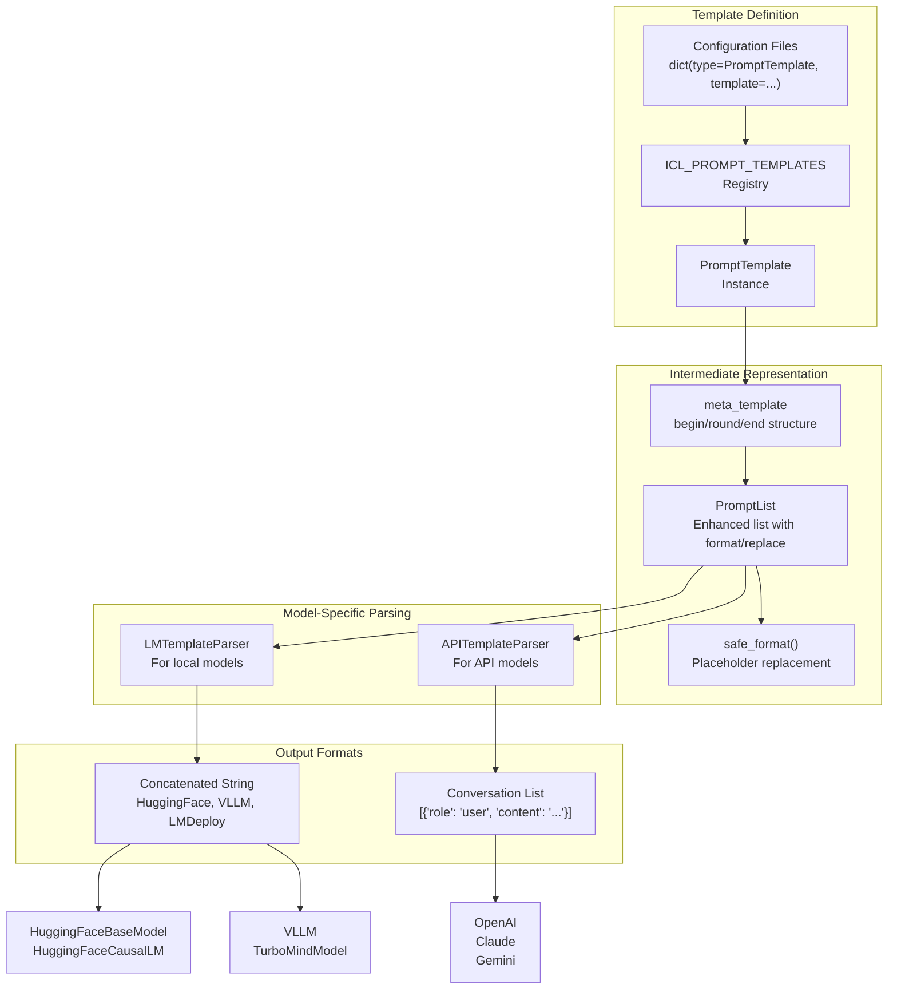
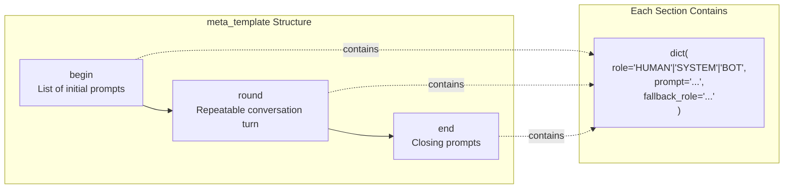
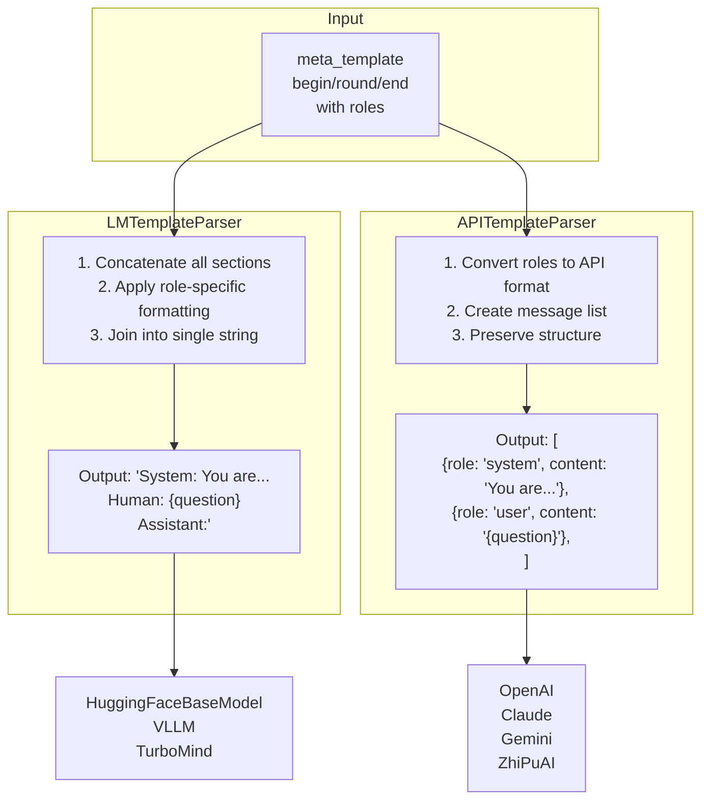
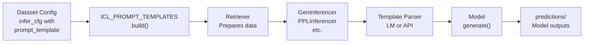

<!-- source: DeepWiki mcp.deepwiki.com · repo open-compass/opencompass · page 9 Prompt Engineering · fetched 2026-10-21 -->

# Prompt Engineering

<details>
<summary>Relevant source files</summary>

The following files were used as context for generating this wiki page:

- [opencompass/configs/datasets/subjective/writingbench/writingbench_judge.py](opencompass/configs/datasets/subjective/writingbench/writingbench_judge.py)
- [opencompass/configs/models/mistral/lmdeploy_mixtral_8x22b_instruct_v0_1.py](opencompass/configs/models/mistral/lmdeploy_mixtral_8x22b_instruct_v0_1.py)
- [opencompass/datasets/subjective/__init__.py](opencompass/datasets/subjective/__init__.py)
- [opencompass/datasets/subjective/compassbench_checklist.py](opencompass/datasets/subjective/compassbench_checklist.py)
- [opencompass/datasets/subjective/writingbench.py](opencompass/datasets/subjective/writingbench.py)
- [opencompass/openicl/icl_evaluator/lm_evaluator.py](opencompass/openicl/icl_evaluator/lm_evaluator.py)
- [opencompass/summarizers/subjective/__init__.py](opencompass/summarizers/subjective/__init__.py)
- [opencompass/summarizers/subjective/common_summarizer.py](opencompass/summarizers/subjective/common_summarizer.py)
- [opencompass/summarizers/subjective/qacompassbench.py](opencompass/summarizers/subjective/qacompassbench.py)
- [opencompass/utils/prompt.py](opencompass/utils/prompt.py)

</details>


This document describes OpenCompass's prompt template system, which provides a unified interface for constructing and formatting prompts across different model types. The system handles both local models (which require concatenated text) and API-based models (which require structured conversation formats).

For information about how prompts are used during inference, see [Inference Strategies](#6.1). For details on configuring evaluators that use prompt templates, see [LLM-as-Judge Evaluation](#6.4).

## Overview

OpenCompass uses a structured prompt template system that separates prompt content from model-specific formatting. This allows the same evaluation logic to work across HuggingFace models, API-based models like OpenAI, and accelerated backends like VLLM.

**Key Components:**
- `PromptTemplate`: Configuration object registered in `ICL_PROMPT_TEMPLATES` registry
- `PromptList`: Intermediate representation supporting format/replace operations
- `LMTemplateParser`: Converts templates to concatenated strings for local models
- `APITemplateParser`: Converts templates to conversation structures for API models
- `meta_template`: Structured format defining begin/round/end sections with role-based prompts

Sources: [opencompass/utils/prompt.py:1-220](), [opencompass/openicl/icl_evaluator/lm_evaluator.py:141-144]()

## Prompt Template Architecture


**Diagram: Prompt Template System Flow**

The prompt template system transforms high-level template definitions into model-specific formats. Configuration files define templates that are registered in `ICL_PROMPT_TEMPLATES`, converted to `PromptList` intermediate representations, then parsed into either concatenated strings (local models) or conversation structures (API models).

Sources: [opencompass/utils/prompt.py:79-220](), [opencompass/openicl/icl_evaluator/lm_evaluator.py:141-155]()

## PromptList and Safe Formatting

### PromptList Class

`PromptList` is an enhanced list class that serves as an intermediate representation for prompts. It provides methods for template manipulation before final formatting.

**Key Methods:**

| Method | Signature | Purpose |
|--------|-----------|---------|
| `format()` | `format(**kwargs) -> PromptList` | Replace placeholders like `{question}`, `{prediction}` with actual values |
| `replace()` | `replace(src: str, dst: Union[str, PromptList]) -> PromptList` | Replace substring occurrences, can splice in other PromptLists |
| `__str__()` | Returns concatenated string | Convert to final string representation |
| `__add__()` | Supports `+` operator | Concatenate strings or PromptLists |

**Structure:** Each item in a PromptList can be:
- A string: Direct text content
- A dict with `prompt` key: Text with associated metadata (e.g., role information)

Sources: [opencompass/utils/prompt.py:79-220]()

### Safe Format Function

The `safe_format()` function provides placeholder replacement without raising errors for missing keys:

```python
def safe_format(input_str: str, **kwargs) -> str:
    """Safely formats a string with the given keyword arguments. 
    If a keyword is not found in the string, it will be ignored."""
    for k, v in kwargs.items():
        input_str = input_str.replace(f'{{{k}}}', str(v))
    return input_str
```

This allows templates to include optional placeholders like `{prediction}` and `{reference}` that may not always be present.

**Common Placeholders:**
- `{question}`: The input question or prompt
- `{prediction}`: Model's generated prediction
- `{reference}`: Ground truth or reference answer
- `{capability}`: Evaluation dimension or capability being tested
- `{criteria}`: Evaluation criteria for subjective benchmarks

Sources: [opencompass/utils/prompt.py:11-36](), [opencompass/datasets/subjective/writingbench.py:15-43]()

## Meta Template Structure

The `meta_template` is a structured configuration that defines how prompts are formatted for multi-turn conversations. It consists of three main sections:


**Diagram: Meta Template Structure**

Sources: [opencompass/configs/datasets/subjective/writingbench/writingbench_judge.py:38-52]()

### Section Definitions

**begin:** Initial prompts sent before any conversation rounds. Typically contains system prompts.

```python
begin=[
    dict(
        role='SYSTEM',
        fallback_role='HUMAN',  # Use if model doesn't support SYSTEM role
        prompt='You are an expert evaluator with extensive experience...'
    )
]
```

**round:** Represents one turn of conversation. This section repeats for multi-turn evaluations.

```python
round=[
    dict(
        role='HUMAN',
        prompt='{question}'  # Placeholder will be replaced
    ),
    dict(
        role='BOT',
        prompt='{prediction}'  # For including model response
    )
]
```

**end:** Closing prompts sent after all rounds. Often empty.

```python
end=[]
```

Sources: [opencompass/configs/datasets/subjective/writingbench/writingbench_judge.py:23-52]()

### Role Types

| Role | Purpose | Used By |
|------|---------|---------|
| `SYSTEM` | System-level instructions | API models with system message support |
| `HUMAN` | User input | All model types |
| `BOT` | Assistant/model response | All model types |
| `fallback_role` | Alternative role if primary not supported | Models without SYSTEM role support |

### Complete Example

Here's a complete prompt template configuration from WritingBench evaluation:

```python
prompt_template=dict(
    type=PromptTemplate,
    template=dict(
        begin=[
            dict(
                role='SYSTEM',
                fallback_role='HUMAN',
                prompt='You are an expert evaluator with extensive experience in evaluating response of given query.'
            )
        ],
        round=[
            dict(
                role='HUMAN',
                prompt='{prediction}'  # Will be replaced with actual response
            ),
        ]
    ),
)
```

Sources: [opencompass/configs/datasets/subjective/writingbench/writingbench_judge.py:38-52]()

## Template Parsing for Different Model Types

OpenCompass uses two different parsing strategies based on the model type:


**Diagram: Template Parsing Strategies**

Sources: [opencompass/openicl/icl_evaluator/lm_evaluator.py:141-155]()

### LMTemplateParser: Concatenation for Local Models

**Purpose:** Convert structured templates into concatenated strings that local models can process.

**Process:**
1. Extract prompts from `begin`, `round`, and `end` sections
2. Apply role-specific prefixes (e.g., "Human:", "Assistant:")
3. Concatenate all parts into a single string
4. Add special tokens if configured (BOS, EOS)

**Example Transformation:**

Input meta_template:
```python
dict(
    begin=[dict(role='SYSTEM', prompt='You are helpful.')],
    round=[
        dict(role='HUMAN', prompt='What is 2+2?'),
        dict(role='BOT', prompt='')  # Leave empty for generation
    ]
)
```

Output for HuggingFace model:
```
System: You are helpful.
Human: What is 2+2?
Assistant:
```

**Used By:**
- `HuggingFaceBaseModel`
- `HuggingFaceCausalLM`
- `HuggingFacewithChatTemplate`
- `VLLM`
- `TurboMindModel`
- `InternTrain`

Sources: Diagram based on architecture overview

### APITemplateParser: Conversation Structure for API Models

**Purpose:** Convert structured templates into API-compatible conversation lists.

**Process:**
1. Map roles to API-specific names (HUMAN→user, BOT→assistant, SYSTEM→system)
2. Create list of message dictionaries
3. Preserve multi-turn structure
4. Handle role fallbacks

**Example Transformation:**

Input meta_template:
```python
dict(
    begin=[dict(role='SYSTEM', prompt='You are helpful.')],
    round=[
        dict(role='HUMAN', prompt='What is 2+2?')
    ]
)
```

Output for OpenAI API:
```python
[
    {'role': 'system', 'content': 'You are helpful.'},
    {'role': 'user', 'content': 'What is 2+2?'}
]
```

**Role Mapping:**

| OpenCompass Role | API Format |
|------------------|-----------|
| SYSTEM | `system` |
| HUMAN | `user` |
| BOT | `assistant` |

**Used By:**
- `OpenAI` and `OpenAISDK`
- `ClaudeAPI`
- `GeminiAPI`
- `ZhiPuV2AI`
- `BlueLMAPI`

Sources: Diagram based on architecture overview

## Practical Examples from the Codebase

### Example 1: Simple Generation Prompt

This example from WritingBench shows a minimal inference prompt:

```python
subjective_infer_cfg = dict(
    prompt_template=dict(
        type=PromptTemplate,
        template=dict(round=[
            dict(
                role='HUMAN',
                prompt='{question}'
            ),
        ]),
    ),
    retriever=dict(type=ZeroRetriever),
    inferencer=dict(type=GenInferencer,),
)
```

The `{question}` placeholder will be replaced with actual questions from the dataset. For local models, this becomes simply: `"Human: <actual question>\nAssistant:"`. For API models, it becomes: `[{'role': 'user', 'content': '<actual question>'}]`.

Sources: [opencompass/configs/datasets/subjective/writingbench/writingbench_judge.py:20-32]()

### Example 2: Judge Model with System Prompt

This example shows how subjective evaluation uses a system prompt to instruct the judge model:

```python
subjective_eval_cfg = dict(
    evaluator=dict(
        type=LMEvaluator,
        multi_eval=True,
        prompt_template=dict(
            type=PromptTemplate,
            template=dict(
                begin=[
                    dict(
                        role='SYSTEM',
                        fallback_role='HUMAN',
                        prompt='You are an expert evaluator with extensive experience in evaluating response of given query.'
                    )
                ],
                round=[
                    dict(
                        role='HUMAN',
                        prompt='{prediction}'
                    ),
                ]
            ),
        ),
        dict_postprocessor=dict(type=writingbench_postprocess),
    ),
    pred_role='BOT',
)
```

The `fallback_role='HUMAN'` ensures compatibility with models that don't support system messages. The `{prediction}` placeholder gets replaced with the model's actual output that needs to be judged.

Sources: [opencompass/configs/datasets/subjective/writingbench/writingbench_judge.py:34-56]()

### Example 3: Multi-Evaluation with Dynamic Prompts

WritingBench demonstrates advanced prompt engineering where multiple criteria are evaluated:

```python
# In the dataset loader:
judge_prompt_list = []
for criteria_item in criteria:
    temp_prompt = base_prompt.format(
        question=query,
        criteria=criteria_item,
        prediction='{prediction}'  # Keep as placeholder
    )
    judge_prompt_list.append(temp_prompt)

raw_data.append({
    'question': query,
    'judge': {
        'index': idx,
        'judge_prompt_list': judge_prompt_list
    }
})
```

The LMEvaluator handles `multi_eval=True` mode by expanding the predictions to match the number of judge prompts:

```python
if self.multi_eval:
    assert references is not None
    assert 'judge_prompt_list' in references[0]
    self.multi_eval_times = len(references[0]['judge_prompt_list'])
    temp_predictions_save_list = []
    for idx, pred in enumerate(predictions['model_preds']):
        for judge_prompt in references[idx]['judge_prompt_list']:
            temp_prediction = judge_prompt.replace(
                '{prediction}', pred)
            temp_predictions_save_list.append(temp_prediction)
    predictions['model_preds'] = temp_predictions_save_list
```

This allows one model response to be evaluated against multiple criteria with different prompts.

Sources: [opencompass/datasets/subjective/writingbench.py:49-78](), [opencompass/openicl/icl_evaluator/lm_evaluator.py:215-226]()

## Prompt Hash for Caching

OpenCompass computes a hash of prompt configurations to enable result reuse:

```python
def get_prompt_hash(dataset_cfg: Union[ConfigDict, List[ConfigDict]]) -> str:
    """Get the hash of the prompt configuration.
    
    Returns:
        str: The hash of the prompt configuration.
    """
    # ... processing logic ...
    d_json = json.dumps(dataset_cfg.infer_cfg.to_dict(), sort_keys=True)
    hash_object = hashlib.sha256(d_json.encode())
    return hash_object.hexdigest()
```

This hash is used by the result station system to determine if cached results can be reused. When the same model is evaluated with the same prompt configuration, previous results are loaded instead of re-running inference.

Sources: [opencompass/utils/prompt.py:38-77]()

## Integration with Evaluation Pipeline

The prompt template system integrates with the broader evaluation pipeline:


**Diagram: Prompt Templates in Evaluation Pipeline**

1. **Configuration Phase:** Dataset configs specify `prompt_template` in `infer_cfg`
2. **Build Phase:** `ICL_PROMPT_TEMPLATES.build()` instantiates the template
3. **Retrieval Phase:** Retriever prepares data samples with placeholders
4. **Inference Phase:** Inferencer formats prompts using the template
5. **Parsing Phase:** Appropriate parser converts to model-specific format
6. **Generation Phase:** Model processes the formatted prompt

Sources: [opencompass/openicl/icl_evaluator/lm_evaluator.py:141-155](), [opencompass/configs/datasets/subjective/writingbench/writingbench_judge.py:1-70]()

## Best Practices

### Template Design

1. **Use Placeholders:** Always use placeholders like `{question}` instead of hardcoding values
2. **Provide Fallbacks:** Include `fallback_role` for compatibility across model types
3. **Keep System Prompts in begin:** System-level instructions belong in the `begin` section
4. **Use Clear Role Names:** Stick to standard roles (HUMAN, BOT, SYSTEM) for consistency

### Multi-Model Compatibility

1. **Test Both Parsers:** Ensure templates work with both LM and API parsers
2. **Avoid Model-Specific Tokens:** Don't include special tokens (like `<|im_start|>`) in templates
3. **Use safe_format:** For optional placeholders, rely on `safe_format()` to handle missing keys

### Performance Optimization

1. **Cache Aware:** Keep prompt configurations consistent to leverage result caching
2. **Minimize Rounds:** Only use multi-turn structure when necessary
3. **Batch Compatible:** Design templates that work well with batch inference

Sources: [opencompass/utils/prompt.py:11-36](), [opencompass/configs/datasets/subjective/writingbench/writingbench_judge.py:1-70]()

---

