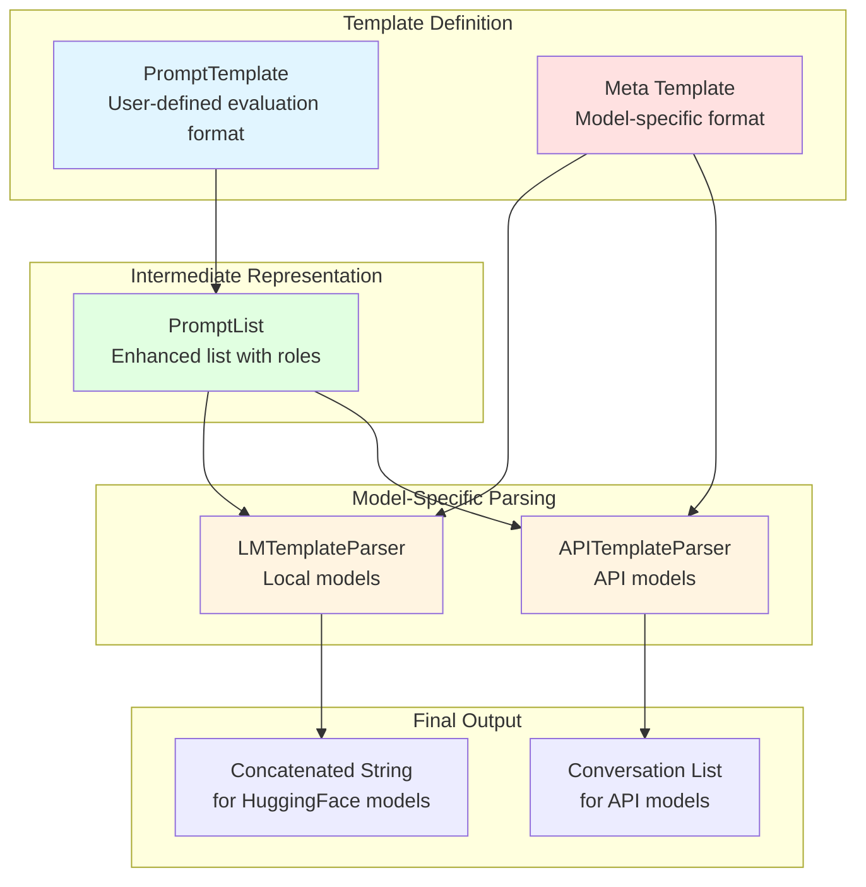
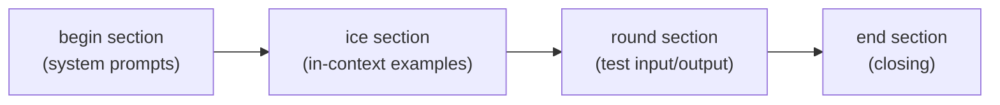
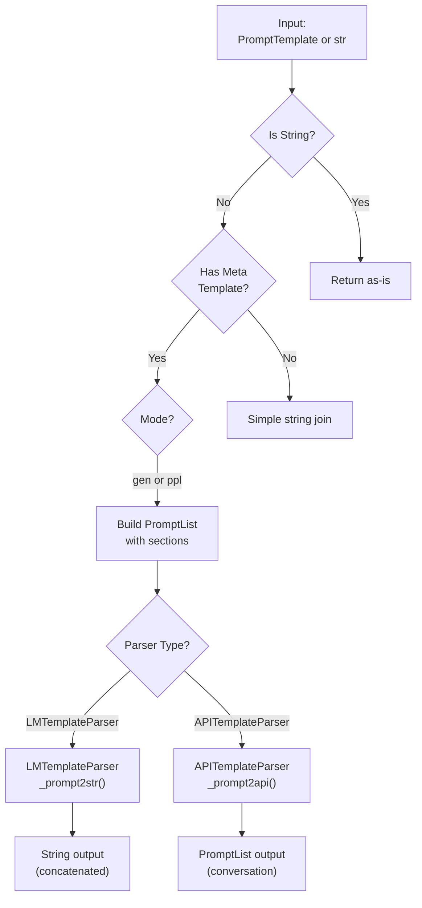
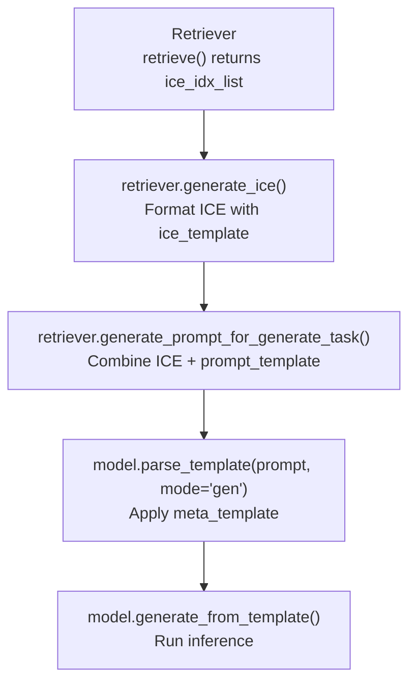

<!-- source: DeepWiki mcp.deepwiki.com · repo open-compass/opencompass · page 9.1 Prompt Templates and Meta Templates · fetched 2026-10-21 -->

# Prompt Templates and Meta Templates

<details>
<summary>Relevant source files</summary>

The following files were used as context for generating this wiki page:

- [docs/en/prompt/chain_of_thought.md](docs/en/prompt/chain_of_thought.md)
- [docs/zh_cn/prompt/chain_of_thought.md](docs/zh_cn/prompt/chain_of_thought.md)
- [opencompass/configs/datasets/subjective/writingbench/writingbench_judge.py](opencompass/configs/datasets/subjective/writingbench/writingbench_judge.py)
- [opencompass/configs/models/mistral/lmdeploy_mixtral_8x22b_instruct_v0_1.py](opencompass/configs/models/mistral/lmdeploy_mixtral_8x22b_instruct_v0_1.py)
- [opencompass/datasets/game24.py](opencompass/datasets/game24.py)
- [opencompass/datasets/subjective/__init__.py](opencompass/datasets/subjective/__init__.py)
- [opencompass/datasets/subjective/compassbench_checklist.py](opencompass/datasets/subjective/compassbench_checklist.py)
- [opencompass/datasets/subjective/writingbench.py](opencompass/datasets/subjective/writingbench.py)
- [opencompass/models/base.py](opencompass/models/base.py)
- [opencompass/models/base_api.py](opencompass/models/base_api.py)
- [opencompass/openicl/icl_evaluator/lm_evaluator.py](opencompass/openicl/icl_evaluator/lm_evaluator.py)
- [opencompass/openicl/icl_inferencer/icl_attack_inferencer.py](opencompass/openicl/icl_inferencer/icl_attack_inferencer.py)
- [opencompass/openicl/icl_inferencer/icl_base_inferencer.py](opencompass/openicl/icl_inferencer/icl_base_inferencer.py)
- [opencompass/openicl/icl_inferencer/icl_clp_inferencer.py](opencompass/openicl/icl_inferencer/icl_clp_inferencer.py)
- [opencompass/openicl/icl_inferencer/icl_gen_inferencer.py](opencompass/openicl/icl_inferencer/icl_gen_inferencer.py)
- [opencompass/openicl/icl_inferencer/icl_ppl_inferencer.py](opencompass/openicl/icl_inferencer/icl_ppl_inferencer.py)
- [opencompass/openicl/icl_inferencer/icl_sc_inferencer.py](opencompass/openicl/icl_inferencer/icl_sc_inferencer.py)
- [opencompass/openicl/icl_inferencer/icl_tot_inferencer.py](opencompass/openicl/icl_inferencer/icl_tot_inferencer.py)
- [opencompass/registry.py](opencompass/registry.py)
- [opencompass/summarizers/subjective/__init__.py](opencompass/summarizers/subjective/__init__.py)
- [opencompass/summarizers/subjective/common_summarizer.py](opencompass/summarizers/subjective/common_summarizer.py)
- [opencompass/summarizers/subjective/qacompassbench.py](opencompass/summarizers/subjective/qacompassbench.py)
- [opencompass/utils/lark.py](opencompass/utils/lark.py)
- [opencompass/utils/prompt.py](opencompass/utils/prompt.py)
- [requirements.txt](requirements.txt)
- [tests/openicl/test_prompt_template.py](tests/openicl/test_prompt_template.py)

</details>


## Purpose and Scope

This document explains the prompt template system in OpenCompass, which handles the construction and formatting of prompts for language model evaluation. The system provides a flexible way to define how test inputs, in-context examples (ICE), and model-specific conversation formats are assembled into final prompts.

For information about how templates are used during inference, see [Inference Strategies](#6.1). For details on model integration and how different model types handle templates, see [Model Abstraction and Base Classes](#4.1).

## Overview

OpenCompass uses a two-layer templating system:

1. **Prompt Templates** (`PromptTemplate`): Define the structure of evaluation prompts with placeholders for test data
2. **Meta Templates**: Define model-specific conversation formats with roles (e.g., HUMAN, BOT, SYSTEM) and special tokens

The system produces different output formats depending on the target model:
- **Local Models**: Concatenated strings via `LMTemplateParser`
- **API Models**: Structured conversation lists via `APITemplateParser`



**Sources:** [opencompass/models/base.py:265-516](), [opencompass/models/base_api.py:164-424](), [opencompass/utils/prompt.py:79-220]()

## Core Components

### PromptTemplate Class

The `PromptTemplate` class is registered in the `ICL_PROMPT_TEMPLATES` registry and supports two template formats:

1. **Simple String Templates**: Plain text with placeholders
   ```python
   template = "Question: {question}\nAnswer: {answer}"
   ```

2. **Meta Template Dictionaries**: Structured format with roles and sections
   ```python
   template = dict(
       begin=[dict(role='SYSTEM', prompt='You are a helpful assistant')],
       round=[
           dict(role='HUMAN', prompt='{question}'),
           dict(role='BOT', prompt='{answer}')
       ]
   )
   ```

The template uses special tokens:
- `ice_token`: Marks where in-context examples should be inserted (default: `'</E>'`)
- Placeholder syntax: `{field_name}` for variable substitution

**Sources:** [tests/openicl/test_prompt_template.py:10-45](), [opencompass/openicl/icl_gen_inferencer.py:83-108]()

### Meta Template Structure

Meta templates define model-specific conversation formats and are specified in model configurations. The structure includes:

| Section | Required | Description |
|---------|----------|-------------|
| `round` | Yes | List defining one conversation turn (must contain role dicts) |
| `begin` | No | Content to prepend before all rounds |
| `end` | No | Content to append after all rounds |
| `reserved_roles` | No | Additional role definitions beyond those in `round` |

Each role dictionary can contain:

| Field | Description |
|-------|-------------|
| `role` | Role identifier (e.g., 'HUMAN', 'BOT', 'SYSTEM') |
| `api_role` | Role name for API calls (only for API models) |
| `prompt` | The actual content or placeholder |
| `begin` | Prefix before the prompt content |
| `end` | Suffix after the prompt content |
| `fallback_role` | Alternative role if primary role not found |
| `generate` | Boolean indicating if generation starts here (for gen mode) |

**Example meta template:**
```python
meta_template = dict(
    begin=dict(role='SYSTEM', prompt='You are a helpful assistant.'),
    round=[
        dict(role='HUMAN', prompt='{input}'),
        dict(role='BOT', prompt='{output}', generate=True)
    ],
    end='</s>'
)
```

**Sources:** [opencompass/models/base.py:272-291](), [opencompass/models/base_api.py:171-192]()

### PromptList Class

`PromptList` is an enhanced list class that serves as the intermediate representation for prompts. It provides:

- **Format method**: Replace placeholders with values
  ```python
  prompt_list.format(question="What is 2+2?", answer="4")
  ```

- **Replace method**: Swap substring tokens with content
  ```python
  prompt_list.replace('</E>', ice_examples)
  ```

- **String conversion**: Concatenates all content when converted to string

Elements in a `PromptList` can be:
- Plain strings
- Dictionaries with `role` and `prompt` keys
- Section markers: `{'section': 'ice', 'pos': 'begin'}`

**Sources:** [opencompass/utils/prompt.py:79-220]()

## Template Structure and Sections

### Section Markers

Templates use section markers to organize content into logical blocks:



Section markers are dictionaries:
```python
{'section': 'begin', 'pos': 'begin'}  # Start of begin section
{'section': 'begin', 'pos': 'end'}    # End of begin section
{'section': 'ice', 'pos': 'begin'}    # Start of ICE
{'section': 'ice', 'pos': 'end'}      # End of ICE
{'section': 'round', 'pos': 'begin'}  # Start of round
{'section': 'round', 'pos': 'end'}    # End of round
```

Valid section names: `'begin'`, `'ice'`, `'round'`, `'end'`

**Sources:** [opencompass/models/base.py:326-377](), [opencompass/models/base_api.py:226-274]()

### Multi-Round Conversations

Templates support multiple conversation rounds within a single test case:

```python
multiround_template = dict(
    round=[
        dict(role='HUMAN', prompt='{input}'),
        dict(role='BOT', prompt='A1', end='\n'),
        dict(role='HUMAN', prompt='Q1'),
        dict(role='BOT', prompt='A2', end='\n\n'),
        dict(role='HUMAN', prompt='Q2'),
        dict(role='BOT', prompt='Answer: {answer}')
    ]
)
```

The parser uses `_split_rounds()` to identify round boundaries by tracking role indices. A new round begins when a role appears that comes earlier in the template definition than the previous role.

**Sources:** [opencompass/models/base.py:396-421](), [tests/openicl/test_prompt_template.py:18-25]()

## Template Parsing

### Parsing Flow



**Sources:** [opencompass/models/base.py:300-394](), [opencompass/models/base_api.py:193-303]()

### LMTemplateParser

The `LMTemplateParser` class converts templates to concatenated strings for local models (HuggingFace, InternTrain, etc.).

**Key Methods:**

| Method | Purpose |
|--------|---------|
| `parse_template(prompt_template, mode)` | Main entry point, returns string |
| `_prompt2str(prompt, role_dict, for_gen)` | Recursively converts prompt to string |
| `_role2str(role_prompt, role_dict, for_gen)` | Converts single role to string |
| `_split_rounds(prompt_template, single_round_template)` | Identifies round boundaries |
| `_update_role_dict(prompt)` | Merges role configs |

**Parsing Behavior:**

1. **Generation Mode (`mode='gen'`)**:
   - Stops before roles with `generate=True`
   - Used when model needs to generate completion
   
2. **Perplexity Mode (`mode='ppl'`)**:
   - Includes all content
   - Used when calculating perplexity scores

**Example Output:**
```python
# Input: PromptList with roles
# Output: "SYSTEM: instruct\nHUMAN: Hello\nBOT: Answer: "
```

**Sources:** [opencompass/models/base.py:265-516]()

### APITemplateParser

The `APITemplateParser` class maintains conversation structure for API models (OpenAI, Claude, etc.).

**Key Methods:**

| Method | Purpose |
|--------|---------|
| `parse_template(prompt_template, mode)` | Returns PromptList of conversation messages |
| `_prompt2api(prompts, role_dict, for_gen)` | Converts to API format |
| `_role2api_role(role_prompt, role_dict, for_gen)` | Maps role to API role |
| `_split_rounds(prompt_template, single_round_template)` | Same as LMTemplateParser |
| `_update_role_dict(prompts)` | Merges role configs |

**Key Differences from LMTemplateParser:**

1. Returns `PromptList` instead of string
2. Each element has `{'role': 'api_role', 'prompt': 'content'}` structure
3. Consecutive messages with same role are merged
4. Inserts `meta_template['begin']` if defined
5. String items in input trigger warnings (ignored for API models)

**Example Output:**
```python
[
    {'role': 'system', 'prompt': 'You are a helpful assistant'},
    {'role': 'user', 'prompt': 'Hello, how are you?'},
    {'role': 'assistant', 'prompt': 'Answer: '}
]
```

**Sources:** [opencompass/models/base_api.py:164-424]()

## Usage in Evaluation

### Dataset Configuration

Templates are specified in dataset configs:

```python
# Simple template example
dataset_infer_cfg = dict(
    prompt_template=dict(
        type=PromptTemplate,
        template="Q: {question}\nA: {answer}"
    ),
    retriever=dict(type=ZeroRetriever),
    inferencer=dict(type=GenInferencer, max_out_len=512)
)
```

```python
# Meta template example
dataset_infer_cfg = dict(
    prompt_template=dict(
        type=PromptTemplate,
        template=dict(
            round=[
                dict(role='HUMAN', prompt='{question}'),
                dict(role='BOT', prompt='Answer: {answer}')
            ]
        )
    ),
    retriever=dict(type=ZeroRetriever),
    inferencer=dict(type=GenInferencer, max_out_len=512)
)
```

**Sources:** [opencompass/configs/datasets/subjective/writingbench/writingbench_judge.py:20-31](), [docs/en/prompt/chain_of_thought.md:13-21]()

### Model Configuration

Meta templates in model configs define the model's native conversation format:

```python
# Example from a model config
models = [
    dict(
        type=TurboMindModelwithChatTemplate,
        abbr='mixtral-8x22b-instruct-v0.1-turbomind',
        path='mistralai/Mixtral-8x22B-Instruct-v0.1',
        meta_template=dict(
            round=[
                dict(role='HUMAN', api_role='user', begin='<s>[INST] ', end=' [/INST]'),
                dict(role='BOT', api_role='assistant', begin='', end='</s>', generate=True)
            ]
        ),
        max_seq_len=32768,
        # ... other configs
    )
]
```

**Sources:** [opencompass/configs/models/mistral/lmdeploy_mixtral_8x22b_instruct_v0_1.py:1-23](), [opencompass/models/base.py:34-50]()

### Template Processing in Inferencers

Inferencers use templates during the inference pipeline:



**Code Flow:**

1. **Retrieve ICE indices** [opencompass/openicl/icl_gen_inferencer.py:98]()
2. **Generate prompts with templates** [opencompass/openicl/icl_gen_inferencer.py:101-107]()
3. **Parse with meta template** [opencompass/openicl/icl_gen_inferencer.py:153]()
4. **Generate outputs** [opencompass/openicl/icl_gen_inferencer.py:154-155]()

**Sources:** [opencompass/openicl/icl_gen_inferencer.py:83-234](), [opencompass/openicl/icl_base_inferencer.py:15-94]()

## Advanced Features

### Ice Token Replacement

The `ice_token` (default `'</E>'`) marks where in-context examples should be inserted:

```python
template = dict(
    begin=[
        dict(role='SYSTEM', prompt='Instructions'),
        '</E>',  # ICE will be inserted here
    ],
    round=[
        dict(role='HUMAN', prompt='{question}'),
        dict(role='BOT', prompt='{answer}')
    ]
)
```

The parser replaces the token with actual ICE content during prompt generation.

**Sources:** [tests/openicl/test_prompt_template.py:46-48]()

### Fallback Roles

When a role isn't found in the meta template, the `fallback_role` is used:

```python
dict(
    role='SYSTEM',
    fallback_role='HUMAN',  # Use HUMAN format if SYSTEM not supported
    prompt='System instructions'
)
```

This allows templates to gracefully degrade for models without certain role types.

**Sources:** [opencompass/models/base.py:436-440](), [opencompass/models/base_api.py:312-320]()

### Generation Control

The `generate` field controls when generation should start in generation mode:

```python
dict(
    role='BOT',
    prompt='Answer: ',
    generate=True  # Stop here in gen mode, let model complete
)
```

- In `mode='gen'`: Parsing stops before this role
- In `mode='ppl'`: All content is included

**Sources:** [opencompass/models/base.py:496-500](), [opencompass/models/base_api.py:416-417]()

### Special Prompt Formats

Different evaluation strategies use templates differently:

**Self-Consistency (SC):**
```python
inferencer=dict(
    type=SCInferencer,
    sc_size=5,  # Generate 5 different reasoning paths
    generation_kwargs=dict(do_sample=True, temperature=0.7)
)
```

**Tree-of-Thought (ToT):**
```python
inferencer=dict(
    type=ToTInferencer,
    task_wrapper=dict(type=Game24PromptWrapper),  # Custom prompts per step
    method_generate='propose',
    method_evaluate='value'
)
```

Each ToT step uses different prompts (standard, cot, propose, value) defined in the wrapper class.

**Sources:** [opencompass/openicl/icl_sc_inferencer.py:21-207](), [opencompass/openicl/icl_tot_inferencer.py:24-390](), [docs/en/prompt/chain_of_thought.md:52-127]()

### LM-as-Judge Templates

For subjective evaluation, templates specify how to format judge prompts:

```python
judge_prompt_template = dict(
    type=PromptTemplate,
    template=dict(
        begin=[dict(role='SYSTEM', prompt='You are an expert evaluator...')],
        round=[dict(role='HUMAN', prompt='{prediction}')]
    )
)

evaluator = dict(
    type=LMEvaluator,
    prompt_template=judge_prompt_template,
    judge_cfg=dict(type=OpenAI, model='gpt-4')
)
```

The judge model receives formatted prompts with the model's prediction to evaluate.

**Sources:** [opencompass/openicl/icl_evaluator/lm_evaluator.py:102-162](), [opencompass/configs/datasets/subjective/writingbench/writingbench_judge.py:38-53]()

## Template Parsing Examples

### Example 1: Simple String Template (No Meta Template)

**Input:**
```python
template = "Question: {question}\nAnswer: {answer}"
entry = {'question': 'What is 2+2?', 'answer': '4'}
```

**Output (both LM and API models):**
```
"Question: What is 2+2?\nAnswer: 4"
```

### Example 2: Meta Template for Local Model

**Meta Template:**
```python
meta_template = dict(
    round=[
        dict(role='HUMAN', begin='User: ', end='\n'),
        dict(role='BOT', begin='Assistant: ', end='\n', generate=True)
    ]
)
```

**Prompt Template:**
```python
prompt_template = PromptList([
    {'section': 'round', 'pos': 'begin'},
    dict(role='HUMAN', prompt='Hello, how are you?'),
    dict(role='BOT', prompt='Answer: '),
    {'section': 'round', 'pos': 'end'}
])
```

**LMTemplateParser Output (mode='gen'):**
```
"User: Hello, how are you?\nAssistant: "
```

Note: Stops before "Answer: " because BOT role has `generate=True`

**Sources:** [tests/openicl/test_prompt_template.py:87-148]()

### Example 3: Meta Template for API Model

**Same inputs as Example 2**

**APITemplateParser Output:**
```python
[
    {'role': 'user', 'prompt': 'Hello, how are you?'},
    {'role': 'assistant', 'prompt': ''}  # Empty, ready for generation
]
```

The `begin` and `end` fields are concatenated into the prompt, and `api_role` is used (mapped from role name).

**Sources:** [opencompass/models/base_api.py:193-303]()

## Registry Integration

Templates are registered in the `ICL_PROMPT_TEMPLATES` registry:

```python
from opencompass.registry import ICL_PROMPT_TEMPLATES

@ICL_PROMPT_TEMPLATES.register_module()
class PromptTemplate:
    def __init__(self, template, ice_token='</E>'):
        self.template = template
        self.ice_token = ice_token
    # ... methods
```

Usage in configs:
```python
prompt_template=dict(
    type=PromptTemplate,  # Resolved from registry
    template="..."
)
```

**Sources:** [opencompass/registry.py:41-43](), [opencompass/openicl/icl_evaluator/lm_evaluator.py:13-14]()

---

