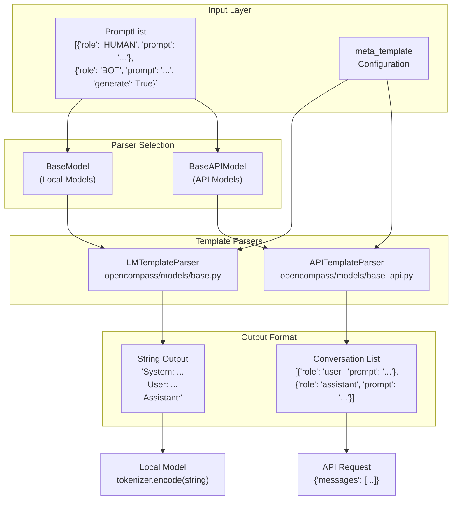
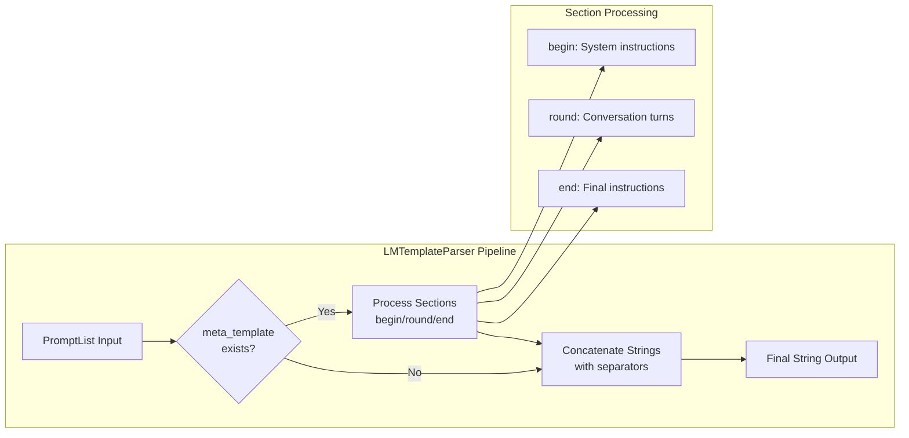
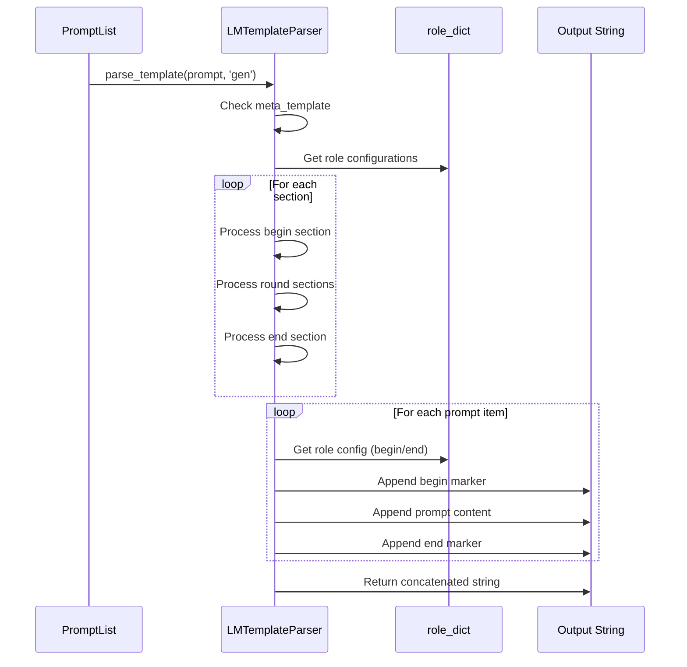
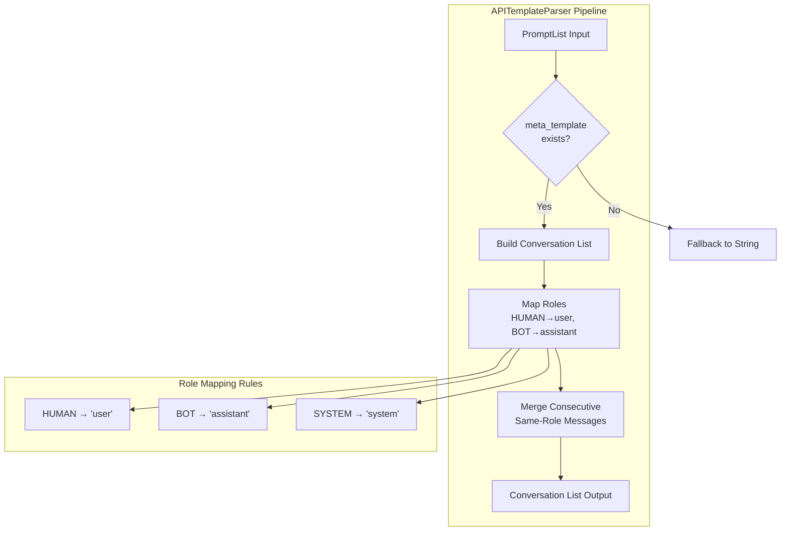
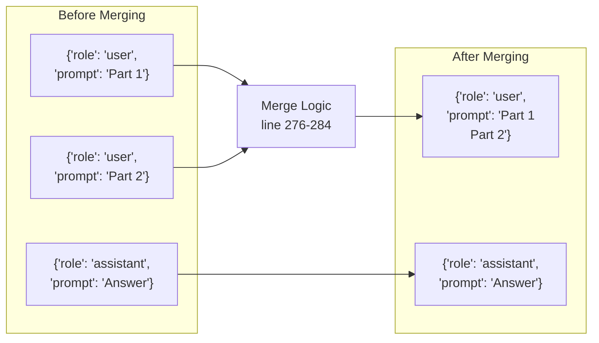

<!-- source: DeepWiki mcp.deepwiki.com · repo open-compass/opencompass · page 9.2 Template Parsing for Different Model Types · fetched 2026-10-21 -->

# Template Parsing for Different Model Types

<details>
<summary>Relevant source files</summary>

The following files were used as context for generating this wiki page:

- [docs/en/prompt/chain_of_thought.md](docs/en/prompt/chain_of_thought.md)
- [docs/zh_cn/prompt/chain_of_thought.md](docs/zh_cn/prompt/chain_of_thought.md)
- [examples/eval_model_rollout.py](examples/eval_model_rollout.py)
- [opencompass/configs/models/bluelm/bluelm_3b.py](opencompass/configs/models/bluelm/bluelm_3b.py)
- [opencompass/datasets/cmnli.py](opencompass/datasets/cmnli.py)
- [opencompass/datasets/game24.py](opencompass/datasets/game24.py)
- [opencompass/datasets/generic.py](opencompass/datasets/generic.py)
- [opencompass/lagent/actions/python_interpreter.py](opencompass/lagent/actions/python_interpreter.py)
- [opencompass/models/__init__.py](opencompass/models/__init__.py)
- [opencompass/models/base.py](opencompass/models/base.py)
- [opencompass/models/base_api.py](opencompass/models/base_api.py)
- [opencompass/models/bluelm_api.py](opencompass/models/bluelm_api.py)
- [opencompass/models/openai_api.py](opencompass/models/openai_api.py)
- [opencompass/models/vllm.py](opencompass/models/vllm.py)
- [opencompass/models/zhipuai_v2_api.py](opencompass/models/zhipuai_v2_api.py)
- [opencompass/openicl/icl_inferencer/icl_attack_inferencer.py](opencompass/openicl/icl_inferencer/icl_attack_inferencer.py)
- [opencompass/openicl/icl_inferencer/icl_base_inferencer.py](opencompass/openicl/icl_inferencer/icl_base_inferencer.py)
- [opencompass/openicl/icl_inferencer/icl_clp_inferencer.py](opencompass/openicl/icl_inferencer/icl_clp_inferencer.py)
- [opencompass/openicl/icl_inferencer/icl_gen_inferencer.py](opencompass/openicl/icl_inferencer/icl_gen_inferencer.py)
- [opencompass/openicl/icl_inferencer/icl_ppl_inferencer.py](opencompass/openicl/icl_inferencer/icl_ppl_inferencer.py)
- [opencompass/openicl/icl_inferencer/icl_sc_inferencer.py](opencompass/openicl/icl_inferencer/icl_sc_inferencer.py)
- [opencompass/openicl/icl_inferencer/icl_tot_inferencer.py](opencompass/openicl/icl_inferencer/icl_tot_inferencer.py)
- [opencompass/registry.py](opencompass/registry.py)
- [opencompass/runners/__init__.py](opencompass/runners/__init__.py)
- [opencompass/runners/base.py](opencompass/runners/base.py)
- [opencompass/runners/dlc.py](opencompass/runners/dlc.py)
- [opencompass/runners/local.py](opencompass/runners/local.py)
- [opencompass/runners/local_api.py](opencompass/runners/local_api.py)
- [opencompass/runners/rjob.py](opencompass/runners/rjob.py)
- [opencompass/runners/slurm.py](opencompass/runners/slurm.py)
- [opencompass/runners/slurm_sequential.py](opencompass/runners/slurm_sequential.py)
- [opencompass/runners/volc.py](opencompass/runners/volc.py)
- [opencompass/tasks/openicl_attack.py](opencompass/tasks/openicl_attack.py)
- [opencompass/tasks/openicl_eval.py](opencompass/tasks/openicl_eval.py)
- [opencompass/tasks/openicl_infer.py](opencompass/tasks/openicl_infer.py)
- [opencompass/utils/build.py](opencompass/utils/build.py)
- [opencompass/utils/lark.py](opencompass/utils/lark.py)
- [opencompass/utils/types.py](opencompass/utils/types.py)
- [requirements.txt](requirements.txt)
- [tests/openicl/test_prompt_template.py](tests/openicl/test_prompt_template.py)

</details>


## Purpose and Scope

This document explains how OpenCompass parses prompt templates differently for local models versus API-based models. Template parsing is the process of converting intermediate prompt representations (PromptList objects with role information) into the final format expected by each model type.

For general information about prompt template structure and meta templates, see [Prompt Templates and Meta Templates](#9.1).

## Overview of Template Parsing Architecture

OpenCompass uses two distinct template parsers depending on the model type:

- **LMTemplateParser**: For local models (HuggingFace, VLLM, TurboMind, etc.) - concatenates prompts into strings
- **APITemplateParser**: For API models (OpenAI, Claude, Gemini, etc.) - structures prompts as conversation messages



**Sources:** [opencompass/models/base.py:221-462](), [opencompass/models/base_api.py:164-464]()

## LMTemplateParser: Local Model Template Parsing

### Architecture and Purpose

`LMTemplateParser` concatenates all prompt components into a single string that can be directly tokenized and fed to local language models. It handles the meta template's begin/round/end sections and merges them with the actual prompt content.



**Sources:** [opencompass/models/base.py:221-462]()

### Key Methods and Implementation

The core parsing logic resides in `LMTemplateParser.parse_template()`:

**Method: `parse_template(prompt_template, mode)`** [opencompass/models/base.py:257-354]()

- **Input**: `PromptList` or `str`, and mode ('gen' or 'ppl')
- **Output**: Concatenated string
- **Process**:
  1. If input is already a string, return it directly
  2. Check if meta_template exists
  3. Process each section (begin, round, end) from meta_template
  4. For each role in the prompt, apply the corresponding template from meta_template
  5. Concatenate all parts with appropriate separators
  6. Handle generation mode by stopping before the role marked with `generate=True`

**Example meta_template structure for local models:**

```python
meta_template = dict(
    begin='<|System|>:{system}\n',
    round=[
        dict(role='HUMAN', begin='<|User|>:', end='\n'),
        dict(role='BOT', begin='<|Bot|>:', end='<eoa>\n', generate=True),
    ]
)
```

**Method: `_prompt2str(prompts, role_dict, for_gen)`** [opencompass/models/base.py:390-429]()

Converts prompt components to strings using the role configurations from meta_template. Handles:
- Role begin/end markers
- Separator insertion
- Generation mode (stops before `generate=True` role)

### Concatenation Process



**Sources:** [opencompass/models/base.py:257-429]()

### Usage in Inference

Local models use the parser during the inference process:

**In GenInferencer** [opencompass/openicl/icl_inferencer/icl_gen_inferencer.py:153]():
```python
parsed_entries = self.model.parse_template(entry, mode='gen')
```

**In PPLInferencer** [opencompass/openicl/icl_inferencer/icl_ppl_inferencer.py:153]():
```python
prompt = self.model.parse_template(prompt, mode='ppl')
```

**In BaseModel** [opencompass/models/base.py:149-161]():
```python
def parse_template(self, prompt_template: PromptType, mode: str) -> str:
    return self.template_parser.parse_template(prompt_template, mode)
```

**Sources:** [opencompass/openicl/icl_inferencer/icl_gen_inferencer.py:153](), [opencompass/models/base.py:149-161]()

## APITemplateParser: API Model Template Parsing

### Architecture and Purpose

`APITemplateParser` structures prompts as conversation messages suitable for API endpoints. Instead of concatenating to a string, it produces a list of dictionaries with 'role' and 'prompt' keys that match API expectations.



**Sources:** [opencompass/models/base_api.py:164-464]()

### Key Methods and Implementation

**Method: `parse_template(prompt_template, mode)`** [opencompass/models/base_api.py:193-303]()

- **Input**: `PromptList` or `str`, and mode ('gen' or 'ppl')
- **Output**: `PromptList` with API-formatted roles, or `str` if no meta_template
- **Process**:
  1. Return string directly if input is string
  2. If meta_template exists, build conversation structure
  3. Process sections (begin, round, end) from prompt template
  4. Convert roles using `_prompt2api()` and `_role2api_role()`
  5. Merge consecutive messages with same role
  6. Insert begin instruction if specified in meta_template

**Method: `_prompt2api(prompts, role_dict, for_gen)`** [opencompass/models/base_api.py:356-393]()

Converts prompt components to API format:
- Processes each prompt item
- Maps roles using `_role2api_role()`
- Stops before `generate=True` role when `for_gen=True`
- Returns list of API-formatted messages and continuation flag

**Method: `_role2api_role(role_prompt, role_dict, for_gen)`** [opencompass/models/base_api.py:395-464]()

Converts a single role prompt to API format:
- Maps internal roles (HUMAN/BOT/SYSTEM) to API roles (user/assistant/system)
- Handles fallback roles
- Returns dict with 'role' and 'prompt' keys
- Checks `generate` flag for generation mode

### Role Mapping Table

| Internal Role | API Role (OpenAI/Claude) | Common Usage |
|--------------|--------------------------|--------------|
| `HUMAN` | `user` | User queries and questions |
| `BOT` | `assistant` | Model responses |
| `SYSTEM` | `system` | System instructions and context |

**Sources:** [opencompass/models/base_api.py:193-464]()

### Conversation Structure Output

The parser produces output in this format:

```python
[
    {'role': 'system', 'prompt': 'You are a helpful assistant.'},
    {'role': 'user', 'prompt': 'What is 2+2?'},
    {'role': 'assistant', 'prompt': '4'},
    {'role': 'user', 'prompt': 'What about 3+3?'}
]
```

This structure is then converted to API-specific message formats:

**In OpenAI models** [opencompass/models/openai_api.py:486-565]():
```python
def _preprocess_messages(self, input, max_out_len, max_seq_len, mode, get_token_len_func):
    # Convert PromptList to messages format
    if isinstance(input, str):
        messages = [{'role': 'user', 'content': input}]
    else:
        messages = []
        for item in input:
            msg = {'content': item['prompt']}
            if item['role'] == 'HUMAN':
                msg['role'] = 'user'
            elif item['role'] == 'BOT':
                msg['role'] = 'assistant'
            elif item['role'] == 'SYSTEM':
                msg['role'] = 'system'
            messages.append(msg)
    return messages, max_out_len
```

**Sources:** [opencompass/models/openai_api.py:486-565]()

### Consecutive Message Merging

API parsers merge consecutive messages from the same role to comply with API requirements:



**Implementation** [opencompass/models/base_api.py:276-284]():
```python
# merge the consecutive prompts assigned to the same role
new_prompt = PromptList([prompt[0]])
last_role = prompt[0]['role']
for item in prompt[1:]:
    if item['role'] == last_role:
        new_prompt[-1]['prompt'] += '\n' + item['prompt']
    else:
        last_role = item['role']
        new_prompt.append(item)
```

**Sources:** [opencompass/models/base_api.py:276-284]()

## Parsing Mode: Generation vs Perplexity

Both parsers support two modes that affect how prompts are processed:

### Generation Mode ('gen')

Used when the model needs to generate new text. The parser stops **before** the role marked with `generate=True` to prepare the prompt for generation.

**Example:**
```python
# Input PromptList
[
    {'role': 'HUMAN', 'prompt': 'Question: What is AI?'},
    {'role': 'BOT', 'prompt': '', 'generate': True}
]

# LMTemplateParser output (gen mode):
"<|User|>:Question: What is AI?\n<|Bot|>:"

# APITemplateParser output (gen mode):
[{'role': 'user', 'prompt': 'Question: What is AI?'}]
```

### Perplexity Mode ('ppl')

Used for perplexity-based evaluation. The parser includes the complete prompt including the reference answer.

**Example:**
```python
# Input PromptList
[
    {'role': 'HUMAN', 'prompt': 'Question: What is AI?'},
    {'role': 'BOT', 'prompt': 'AI is artificial intelligence.'}
]

# LMTemplateParser output (ppl mode):
"<|User|>:Question: What is AI?\n<|Bot|>:AI is artificial intelligence.<eoa>\n"

# APITemplateParser output (ppl mode):
[
    {'role': 'user', 'prompt': 'Question: What is AI?'},
    {'role': 'assistant', 'prompt': 'AI is artificial intelligence.'}
]
```

**Sources:** [opencompass/models/base.py:257-354](), [opencompass/models/base_api.py:193-303]()

## Template Parsing in Evaluation Tasks

### Integration with OpenICLEvalTask

The evaluation task uses template parsing to extract role-specific predictions:

**In OpenICLEvalTask._process_predictions()** [opencompass/tasks/openicl_eval.py:202-224]():

```python
if ('pred_role' in self.eval_cfg and 'meta_template' in self.model_cfg
        and not MODELS.get(self.model_cfg['type']).is_api):
    from opencompass.models.base import LMTemplateParser
    
    parser = LMTemplateParser(self.model_cfg['meta_template'])
    role = parser.roles[self.eval_cfg['pred_role']]
    if pred_list_flag:
        pred_strs = [[
            extract_role_pred(
                _pred,
                role.get('begin', None),
                role.get('end', None),
            ) for _pred in pred
        ] for pred in pred_strs]
```

This extracts the prediction from the specific role's section (e.g., extracting only the BOT's response).

**Sources:** [opencompass/tasks/openicl_eval.py:202-224]()

### Integration with Inferencers

**GenInferencer** [opencompass/openicl/icl_inferencer/icl_gen_inferencer.py:153-156]():
```python
with torch.no_grad():
    parsed_entries = self.model.parse_template(entry, mode='gen')
    results = self.model.generate_from_template(
        entry, max_out_len=self.max_out_len, **extra_gen_kwargs)
```

**PPLInferencer** [opencompass/openicl/icl_inferencer/icl_ppl_inferencer.py:148-165]():
```python
prompt = retriever.generate_prompt_for_generate_task(...)
prompt = self.model.parse_template(prompt, mode='gen')
```

**CLPInferencer** [opencompass/openicl/icl_inferencer/icl_clp_inferencer.py:154]():
```python
prompt = self.model.parse_template(prompt, mode='gen')
```

**Sources:** [opencompass/openicl/icl_inferencer/icl_gen_inferencer.py:153-156](), [opencompass/openicl/icl_inferencer/icl_ppl_inferencer.py:148-165]()

## Practical Examples

### Example 1: Chat Model Template (Local)

```python
# Meta template for local chat model
meta_template = dict(
    begin='<|im_start|>system\n{system}<|im_end|>\n',
    round=[
        dict(role='HUMAN', begin='<|im_start|>user\n', end='<|im_end|>\n'),
        dict(role='BOT', begin='<|im_start|>assistant\n', end='<|im_end|>\n', generate=True),
    ]
)

# Input PromptList
prompt_list = [
    {'role': 'HUMAN', 'prompt': 'Explain quantum computing'},
    {'role': 'BOT', 'prompt': '', 'generate': True}
]

# LMTemplateParser output (generation mode):
# "<|im_start|>user\nExplain quantum computing<|im_end|>\n<|im_start|>assistant\n"
```

### Example 2: API Model Template (OpenAI)

```python
# Meta template for API model
api_meta_template = dict(
    round=[
        dict(role='HUMAN', api_role='HUMAN'),
        dict(role='BOT', api_role='BOT', generate=True),
    ],
    reserved_roles=[
        dict(role='SYSTEM', api_role='SYSTEM'),
    ]
)

# Input PromptList
prompt_list = [
    {'role': 'SYSTEM', 'prompt': 'You are a helpful assistant.'},
    {'role': 'HUMAN', 'prompt': 'Explain quantum computing'},
]

# APITemplateParser output:
# [
#     {'role': 'system', 'prompt': 'You are a helpful assistant.'},
#     {'role': 'user', 'prompt': 'Explain quantum computing'}
# ]

# Then converted to OpenAI API format:
# {
#     'messages': [
#         {'role': 'system', 'content': 'You are a helpful assistant.'},
#         {'role': 'user', 'content': 'Explain quantum computing'}
#     ]
# }
```

**Sources:** [opencompass/models/openai_api.py:486-565](), [opencompass/configs/models/bluelm/bluelm_3b.py:3-6]()

### Example 3: Few-Shot ICL with Template Parsing

```python
# Input with in-context examples
prompt_list = [
    {'role': 'HUMAN', 'prompt': 'Q: What is 2+2?\nA: 4'},  # ICE
    {'role': 'HUMAN', 'prompt': 'Q: What is 3+3?\nA: 6'},  # ICE
    {'role': 'HUMAN', 'prompt': 'Q: What is 5+5?\nA:'},    # Test input
    {'role': 'BOT', 'prompt': '', 'generate': True}
]

# LMTemplateParser concatenates all examples:
# "<|User|>:Q: What is 2+2?\nA: 4\n<|User|>:Q: What is 3+3?\nA: 6\n<|User|>:Q: What is 5+5?\nA:\n<|Bot|>:"

# APITemplateParser creates conversation history:
# [
#     {'role': 'user', 'prompt': 'Q: What is 2+2?\nA: 4'},
#     {'role': 'user', 'prompt': 'Q: What is 3+3?\nA: 6'},
#     {'role': 'user', 'prompt': 'Q: What is 5+5?\nA:'}
# ]
```

**Sources:** [opencompass/models/base.py:257-429](), [opencompass/models/base_api.py:193-303]()

## Comparison Summary

| Aspect | LMTemplateParser | APITemplateParser |
|--------|------------------|-------------------|
| **Target Models** | Local models (HuggingFace, VLLM, TurboMind) | API models (OpenAI, Claude, Gemini) |
| **Output Format** | Single concatenated string | List of conversation messages |
| **Role Handling** | Custom begin/end markers | Standard API roles (user/assistant/system) |
| **Implementation** | [opencompass/models/base.py:221-462]() | [opencompass/models/base_api.py:164-464]() |
| **Used By** | `BaseModel` subclasses | `BaseAPIModel` subclasses |
| **Tokenization** | Direct tokenization of string | API handles tokenization |
| **Separator Strategy** | Configurable separators in meta_template | Newline for consecutive same-role messages |

**Sources:** [opencompass/models/base.py:221-462](), [opencompass/models/base_api.py:164-464]()

---

