# Page: Introduction to OpenCompass

# Introduction to OpenCompass

<details>
<summary>Relevant source files</summary>

The following files were used as context for generating this wiki page:

- [README.md](README.md)
- [README_zh-CN.md](README_zh-CN.md)
- [docs/en/index.rst](docs/en/index.rst)
- [docs/en/notes/news.md](docs/en/notes/news.md)
- [docs/zh_cn/advanced_guides/evaluation_lmdeploy.md](docs/zh_cn/advanced_guides/evaluation_lmdeploy.md)
- [docs/zh_cn/index.rst](docs/zh_cn/index.rst)
- [docs/zh_cn/notes/news.md](docs/zh_cn/notes/news.md)

</details>


## Purpose and Scope

This document provides a high-level introduction to OpenCompass, an open-source platform for evaluating large language models (LLMs). It covers the purpose of OpenCompass, the OpenCompass 2.0 ecosystem, key capabilities, and the fundamental architecture that enables comprehensive model evaluation.

For installation and setup instructions, see [Installation and Setup](#2.1). For running your first evaluation, see [Quick Start Guide](#2.2). For detailed information about specific components, refer to the [Core Architecture](#3) section.

## What is OpenCompass?

OpenCompass is a one-stop platform for large language model evaluation, designed to provide fair, open, and reproducible benchmarks for assessing LLM capabilities. The platform enables researchers and practitioners to systematically evaluate models across multiple dimensions including knowledge, reasoning, coding, and long-context understanding.

The name "OpenCompass" reflects the platform's mission: just as a compass guides navigation, OpenCompass guides users through the complex landscape of LLM evaluation, helping assess model quality and effectiveness with powerful algorithms and an intuitive interface.

**Sources:** [README.md:45-50](), [README_zh-CN.md:45-50](), [README.md:287-297]()

## OpenCompass 2.0 Ecosystem

OpenCompass 2.0 consists of three integrated components that work together to provide a comprehensive evaluation ecosystem:

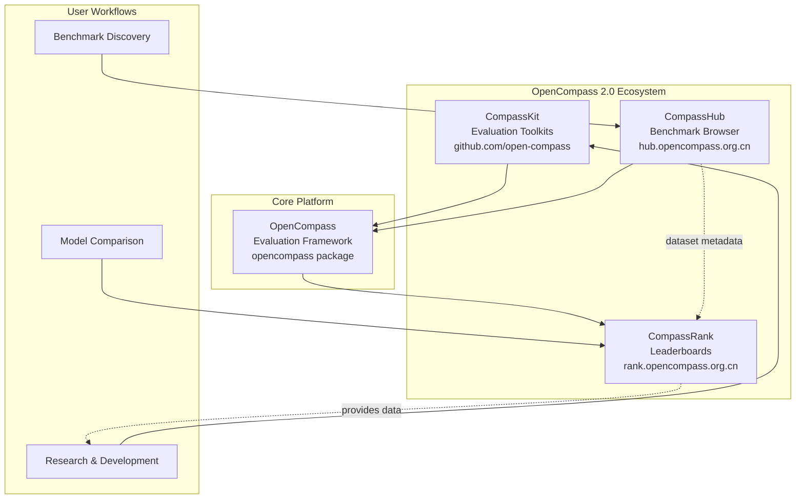

### CompassKit

CompassKit is a collection of evaluation toolkits specifically designed for large language models and large vision-language models. It provides specialized evaluation methods including:

- **Inference strategies**: Generation, perplexity scoring, self-consistency, tree-of-thought reasoning
- **Domain-specific evaluators**: Code execution, mathematical verification, symbolic reasoning
- **Subjective evaluation**: LLM-as-judge frameworks for complex assessment scenarios

### CompassHub

CompassHub ([hub.opencompass.org.cn](https://hub.opencompass.org.cn/home)) serves as a benchmark browser interface that simplifies the exploration and utilization of evaluation benchmarks. It provides:

- Searchable catalog of 70+ evaluation datasets
- Benchmark metadata and documentation
- Dataset submission portal for community contributions
- Integration with OpenCompass for seamless evaluation

### CompassRank

CompassRank ([rank.opencompass.org.cn](https://rank.opencompass.org.cn/home)) presents comprehensive leaderboards for model performance comparison. It incorporates both open-source and proprietary benchmarks, enabling industry-wide model assessment.

**Sources:** [README.md:272-282](), [README_zh-CN.md:266-274]()

## Key Capabilities

OpenCompass provides comprehensive features for LLM evaluation:

| Capability | Description |
|------------|-------------|
| **Model Support** | 20+ HuggingFace models, API models (OpenAI, Claude, Gemini, etc.), and custom models |
| **Dataset Coverage** | 70+ datasets with ~400,000 evaluation questions across multiple domains |
| **Evaluation Dimensions** | Knowledge, reasoning, coding, long-context, language understanding |
| **Evaluation Paradigms** | Zero-shot, few-shot, chain-of-thought, self-consistency, tree-of-thought |
| **Inference Backends** | Native HuggingFace, VLLM, LMDeploy/TurboMind acceleration |
| **Distributed Execution** | Local, Slurm HPC, cloud clusters (Alibaba DLC, Volcano) |
| **Result Management** | Persistent storage, result reuse, automated summarization |
| **Extensibility** | Registry-based plugin architecture for custom components |

**Sources:** [README.md:287-297](), [README.md:313-366]()

## High-Level Architecture

OpenCompass follows a modular architecture organized into distinct layers:

### System Components and Code Entities

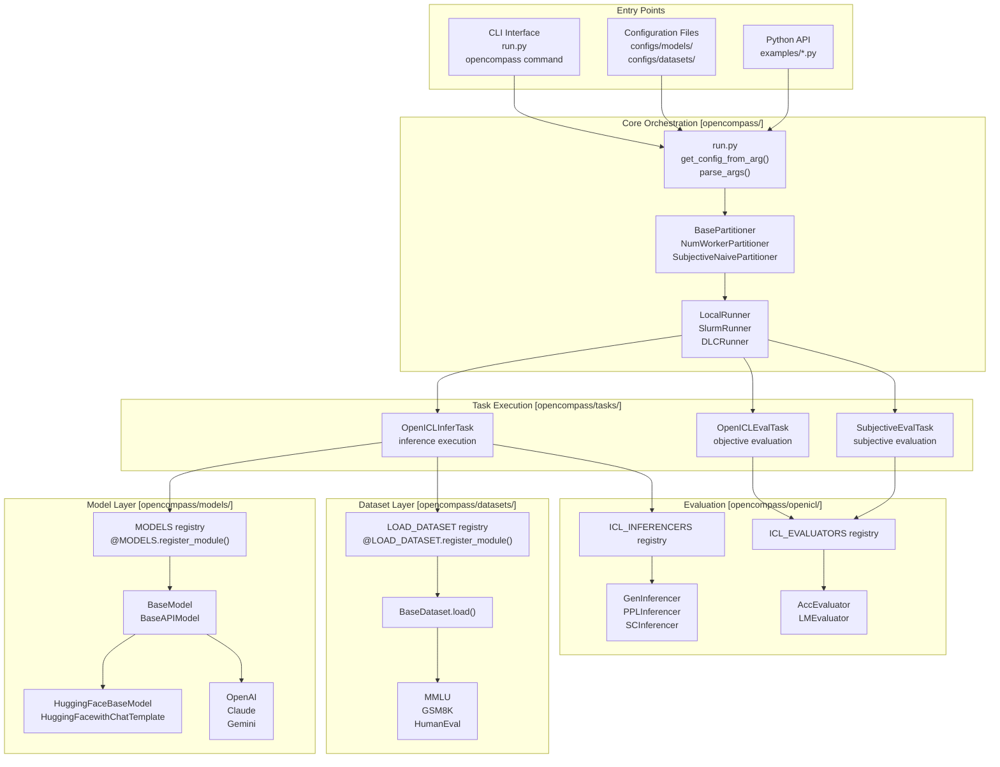

### Architecture Layers

**User Interface Layer**: Provides multiple entry points for initiating evaluations:
- `run.py` - Main CLI entry point
- `opencompass` command - Installed command-line tool
- Configuration files in `configs/` directory
- Python scripts in `examples/` directory

**Core Orchestration Layer**: Manages evaluation workflow:
- `opencompass/utils/run.py` - Configuration parsing and task orchestration via `get_config_from_arg()` and `parse_args()`
- Task partitioners - Split work across workers (`BasePartitioner`, `NumWorkerPartitioner`, `SubjectiveNaivePartitioner`)
- Execution runners - Handle different execution environments (`LocalRunner`, `SlurmRunner`, `DLCRunner`, `VOLCRunner`)

**Task Execution Layer**: Executes evaluation tasks:
- `OpenICLInferTask` - Model inference phase
- `OpenICLEvalTask` - Objective evaluation with rule-based metrics
- `SubjectiveEvalTask` - Subjective evaluation with LLM judges

**Model Integration Layer**: Abstracts model interfaces:
- `MODELS` registry - Enables plugin-based model registration
- `BaseModel` and `BaseAPIModel` - Abstract base classes
- Implementations for HuggingFace models, API models, and accelerated backends

**Dataset Management Layer**: Handles dataset loading and processing:
- `LOAD_DATASET` registry - Plugin-based dataset registration
- `BaseDataset` - Abstract dataset interface with `load()` method
- Pre-configured datasets (MMLU, GSM8K, HumanEval, etc.)

**Evaluation Framework Layer**: Provides evaluation strategies:
- `ICL_INFERENCERS` registry - Inference strategy plugins
- `ICL_EVALUATORS` registry - Evaluator plugins
- Multiple inference strategies (generation, perplexity, self-consistency, etc.)
- Diverse evaluators (accuracy, LLM-based, domain-specific)

**Sources:** [opencompass/utils/run.py:1-100]() (inferred), Architecture Diagram 1

## Evaluation Pipeline Overview

The evaluation process follows a well-defined pipeline from configuration to results:

### End-to-End Evaluation Flow

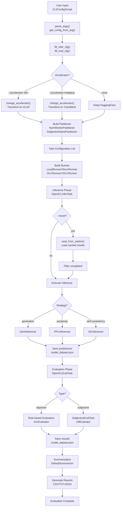

### Pipeline Stages

1. **Configuration Stage**: Parse user input from CLI arguments, configuration files, or Python scripts using `parse_args()` and `get_config_from_arg()`

2. **Setup Stage**: Fill inference and evaluation configurations with `fill_infer_cfg()` and `fill_eval_cfg()`, optionally transform models to accelerated backends via `change_accelerator()`

3. **Partitioning Stage**: Split evaluation tasks across workers using partitioners (`NumWorkerPartitioner` for objective, `SubjectiveNaivePartitioner` for subjective)

4. **Inference Stage**: Execute model inference through `OpenICLInferTask`, applying selected inference strategy (`GenInferencer`, `PPLInferencer`, `SCInferencer`, etc.)

5. **Result Storage**: Save predictions to `predictions/` directory, check for cached results with `read_from_station()` if `--reuse` flag is set

6. **Evaluation Stage**: Score predictions using `OpenICLEvalTask` for objective evaluation or `SubjectiveEvalTask` for LLM-judge evaluation

7. **Summarization Stage**: Aggregate results across datasets and models, generate reports in CSV/TXT/JSON formats

**Sources:** Architecture Diagram 2, [README.md:177-270]()

## Registry System and Plugin Architecture

OpenCompass uses a registry-based plugin architecture that enables easy extension of the platform with new models, datasets, and evaluation strategies.

### Core Registries

| Registry | Purpose | Usage |
|----------|---------|-------|
| `MODELS` | Register model implementations | `@MODELS.register_module()` |
| `LOAD_DATASET` | Register dataset loaders | `@LOAD_DATASET.register_module()` |
| `ICL_INFERENCERS` | Register inference strategies | `@ICL_INFERENCERS.register_module()` |
| `ICL_EVALUATORS` | Register evaluation metrics | `@ICL_EVALUATORS.register_module()` |
| `TEXT_POSTPROCESSORS` | Register output postprocessors | `@TEXT_POSTPROCESSORS.register_module()` |
| `ICL_PROMPT_TEMPLATES` | Register prompt templates | `@ICL_PROMPT_TEMPLATES.register_module()` |

Components self-register by decorating their class definitions with the appropriate registry decorator. Configuration files reference registered components by their string names, which the registry resolves to the actual implementation at runtime.

For detailed information on the registry system, see [Registry System and Plugin Architecture](#3.2). For adding custom components, see [Contributing to OpenCompass](#10.1).

**Sources:** Architecture Diagram 1, Architecture Diagram 3

## Getting Started

To begin using OpenCompass:

1. **Install OpenCompass**: Follow the [Installation and Setup](#2.1) guide to set up the environment and prepare datasets

2. **Run Your First Evaluation**: Use the [Quick Start Guide](#2.2) to execute a simple evaluation with pre-configured models and datasets

3. **Understand Configuration**: Learn about the [Configuration System](#2.3) to customize evaluations for your needs

4. **Explore Models and Datasets**: Browse supported [models](#4) and [datasets](#5) or add your own custom components

5. **Review Results**: Learn about [Result Management and Analysis](#8) to interpret and visualize evaluation outcomes

For troubleshooting common issues, consult the [FAQ and Troubleshooting](#2.4) page.

**Sources:** [README.md:92-270](), [docs/en/index.rst:7-19]()

## Additional Resources

- **Official Website**: [opencompass.org.cn](https://opencompass.org.cn/)
- **Documentation**: [opencompass.readthedocs.io](https://opencompass.readthedocs.io/en/latest/)
- **GitHub Repository**: [github.com/open-compass/opencompass](https://github.com/open-compass/opencompass)
- **CompassHub**: [hub.opencompass.org.cn](https://hub.opencompass.org.cn/home)
- **CompassRank**: [rank.opencompass.org.cn](https://rank.opencompass.org.cn/home)
- **Discord Community**: Join for discussions and support
- **Issue Tracker**: Report bugs and request features on GitHub

**Sources:** [README.md:16-21](), [README_zh-CN.md:16-21]()

---

# Page: Getting Started

# Getting Started

<details>
<summary>Relevant source files</summary>

The following files were used as context for generating this wiki page:

- [README.md](README.md)
- [README_zh-CN.md](README_zh-CN.md)
- [docs/en/index.rst](docs/en/index.rst)
- [docs/en/notes/news.md](docs/en/notes/news.md)
- [docs/zh_cn/advanced_guides/evaluation_lmdeploy.md](docs/zh_cn/advanced_guides/evaluation_lmdeploy.md)
- [docs/zh_cn/index.rst](docs/zh_cn/index.rst)
- [docs/zh_cn/notes/news.md](docs/zh_cn/notes/news.md)

</details>


This document provides a practical introduction to running evaluations with OpenCompass. It covers installation, basic configuration, and executing your first evaluation task. For detailed information about specific evaluation methods, see [Evaluation Methods](#6). For advanced model and dataset customization, see [Model Support](#4) and [Dataset System](#5).

## Installation and Setup

OpenCompass supports multiple installation methods depending on your needs and the level of features required.

### Environment Requirements

OpenCompass requires Python 3.8+ and is optimized for conda environments:

```bash
conda create --name opencompass python=3.10 -y
conda activate opencompass
```

### Installation Options

#### Standard Installation via pip
For most users, pip installation provides access to core functionality:

```bash
# Basic installation
pip install -U opencompass

# Full installation with additional dataset support
pip install "opencompass[full]"

# Installation with API model support
pip install "opencompass[api]"
```

#### Accelerated Inference Support
For users requiring accelerated inference backends, separate environments are recommended due to dependency conflicts:

```bash
# LMDeploy acceleration
pip install "opencompass[lmdeploy]"

# vLLM acceleration  
pip install "opencompass[vllm]"
```

#### Source Installation
For development or access to latest features:

```bash
git clone https://github.com/open-compass/opencompass opencompass
cd opencompass
pip install -e .
```

**Installation Flow Diagram**

```mermaid
flowchart TD
    ENV[Create conda environment<br/>python=3.10]
    PIP[pip install opencompass]
    FULL[pip install opencompass[full]]
    ACC_LMD[pip install opencompass[lmdeploy]]
    ACC_VLLM[pip install opencompass[vllm]]
    SOURCE[git clone + pip install -e .]
    
    ENV --> PIP
    ENV --> FULL
    ENV --> ACC_LMD
    ENV --> ACC_VLLM
    ENV --> SOURCE
    
    PIP --> BASIC[Basic functionality<br/>Core datasets and models]
    FULL --> EXTENDED[Extended dataset support<br/>Additional dependencies]
    ACC_LMD --> LMD_BACKEND[LMDeploy acceleration<br/>TurboMindModel classes]
    ACC_VLLM --> VLLM_BACKEND[vLLM acceleration<br/>VLLM model classes]
    SOURCE --> DEV[Development access<br/>Latest features]
```

Sources: [README.md:96-135]()

## Basic Evaluation Workflow

OpenCompass evaluations follow a standardized pipeline managed by the [`run.py`](run.py:1-4)() entry point, which delegates to [`opencompass.cli.main.main()`](opencompass/cli/main.py:247-444)().

### Core Execution Modes

The evaluation process consists of three distinct phases:

1. **Inference (`infer`)**: Model generates predictions on dataset samples
2. **Evaluation (`eval`)**: Predictions are scored against ground truth  
3. **Visualization (`viz`)**: Results are summarized and formatted

**Evaluation Pipeline Architecture**

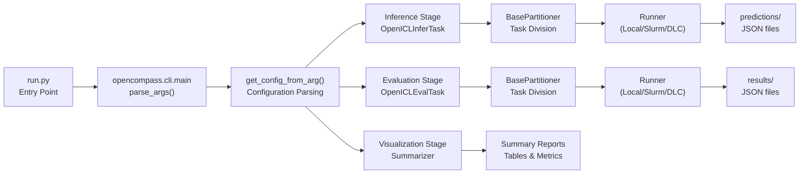

Sources: [opencompass/cli/main.py:318-354](), [opencompass/cli/main.py:357-400](), [opencompass/cli/main.py:407-439]()

### Command Line Interface

The primary interface uses [`run.py`](run.py:1-4)() with flexible configuration options:

#### Configuration File Approach
```bash
# Using a complete configuration file
python run.py configs/eval_demo.py

# With specific execution mode
python run.py configs/eval_demo.py -m infer  # inference only
python run.py configs/eval_demo.py -m eval   # evaluation only
python run.py configs/eval_demo.py -m all    # full pipeline
```

#### Command Line Arguments Approach  
```bash
# Direct model and dataset specification
python run.py --models hf_internlm2_5_1_8b_chat --datasets demo_gsm8k_chat_gen

# HuggingFace model quick setup
python run.py --datasets demo_gsm8k_chat_gen --hf-type chat --hf-path internlm/internlm2_5-1_8b-chat
```

#### Accelerated Inference
```bash
# Using LMDeploy acceleration
python run.py --models hf_internlm2_5_1_8b_chat --datasets demo_gsm8k_chat_gen -a lmdeploy

# Using vLLM acceleration  
python run.py --models hf_internlm2_5_1_8b_chat --datasets demo_gsm8k_chat_gen -a vllm
```

Sources: [opencompass/cli/main.py:21-26](), [opencompass/utils/run.py:87-233]()

## Configuration System

OpenCompass uses a hierarchical configuration system implemented in [`get_config_from_arg()`](opencompass/utils/run.py:87-233)() that supports multiple input methods.

**Configuration Resolution Flow**

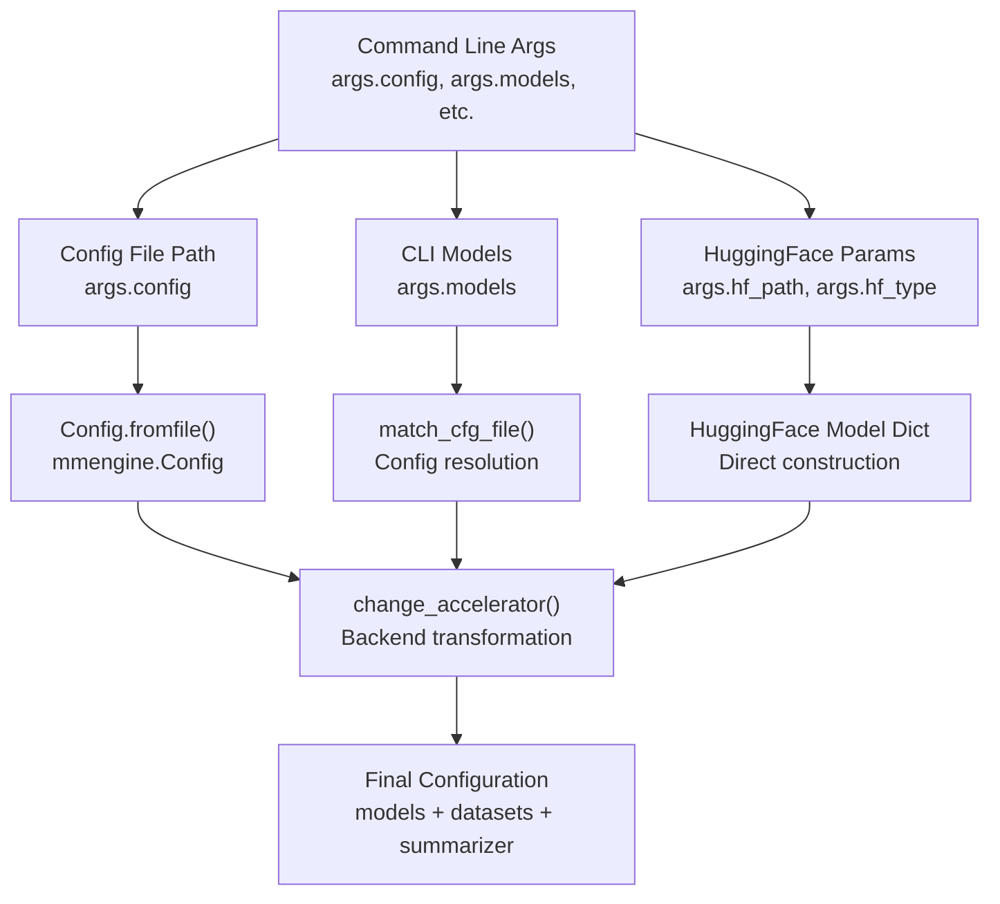

### Configuration Priority Order

The [`get_config_from_arg()`](opencompass/utils/run.py:87-233)() function resolves configuration with the following precedence:

1. **Configuration File** (`args.config`): Complete evaluation specification
2. **CLI Models + Datasets** (`args.models` + `args.datasets`): Pre-defined configs
3. **HuggingFace Parameters** (`args.hf_path` + `args.datasets`): Quick model setup

### Model and Dataset Resolution

Configuration files are resolved through [`match_cfg_file()`](opencompass/utils/run.py:22-71)() which searches standard directories:

- `{config_dir}/models/` and `opencompass/configs/models/`
- `{config_dir}/datasets/` and `opencompass/configs/datasets/`  
- `{config_dir}/summarizers/` and `opencompass/configs/summarizers/`

Sources: [opencompass/utils/run.py:87-233](), [opencompass/utils/run.py:22-71]()

## Your First Evaluation

Let's walk through a complete evaluation example using both approaches.

### Example 1: Pre-configured Evaluation

```bash
# Simple chat model evaluation on GSM8K
opencompass --models hf_internlm2_5_1_8b_chat --datasets demo_gsm8k_chat_gen
```

This command:
1. Resolves the model config from `opencompass/configs/models/`
2. Resolves the dataset config from `opencompass/configs/datasets/`  
3. Uses default summarizer from `opencompass/configs/summarizers/`
4. Executes full pipeline (`infer` → `eval` → `viz`)

### Example 2: Custom HuggingFace Model

```bash
# Custom model with specific parameters
opencompass --datasets demo_gsm8k_chat_gen \
    --hf-type chat \
    --hf-path internlm/internlm2_5-1_8b-chat \
    --max-seq-len 4096 \
    --max-out-len 512 \
    --batch-size 8
```

### Example 3: API Model Evaluation

```bash
export OPENAI_API_KEY="your_api_key"
opencompass --models gpt_4o_2024_05_13 --datasets demo_gsm8k_chat_gen
```

### Understanding Output Structure

Evaluation results are organized in timestamped directories under `outputs/default/`:

```
outputs/default/
├── 20240101_120000/           # Timestamp directory
│   ├── configs/               # Configuration snapshots  
│   ├── logs/                  # Execution logs
│   │   ├── eval/             # Evaluation stage logs
│   │   └── infer/            # Inference stage logs
│   ├── predictions/          # Model outputs (JSON)
│   │   └── MODEL_NAME/
│   └── results/              # Evaluation results (JSON)
│       └── MODEL_NAME/
```

**Result Generation Flow**

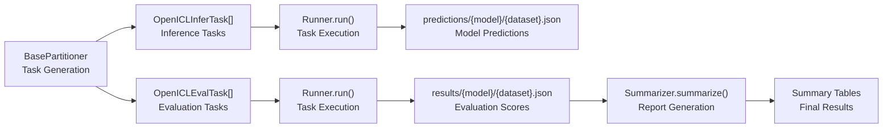

Sources: [docs/en/user_guides/experimentation.md:98-125](), [opencompass/cli/main.py:288-298]()

## Next Steps

After completing your first evaluation:

1. **Explore Models**: See [Model Support](#4) for API models, local models, and accelerated inference options
2. **Add Datasets**: See [Dataset System](#5) for supported benchmarks and custom dataset creation  
3. **Customize Evaluation**: See [Evaluation Methods](#6) for different evaluation paradigms
4. **Scale Execution**: See [Task Execution and Distribution](#7) for distributed computing options

For troubleshooting common issues, see [FAQ and Troubleshooting](#2.3).

Sources: [README.md:177-270](), [opencompass/cli/main.py:247-444](), [docs/en/user_guides/experimentation.md:1-127]()

---

# Page: Installation and Setup

# Installation and Setup

<details>
<summary>Relevant source files</summary>

The following files were used as context for generating this wiki page:

- [README.md](README.md)
- [README_zh-CN.md](README_zh-CN.md)
- [docs/en/index.rst](docs/en/index.rst)
- [docs/en/notes/news.md](docs/en/notes/news.md)
- [docs/zh_cn/advanced_guides/evaluation_lmdeploy.md](docs/zh_cn/advanced_guides/evaluation_lmdeploy.md)
- [docs/zh_cn/index.rst](docs/zh_cn/index.rst)
- [docs/zh_cn/notes/news.md](docs/zh_cn/notes/news.md)
- [opencompass/configs/datasets/TheoremQA/ThroremQA_0shot_cot_gen_8acdf7.py](opencompass/configs/datasets/TheoremQA/ThroremQA_0shot_cot_gen_8acdf7.py)
- [opencompass/configs/models/deepseek/lmdeploy_deepseek_v2.py](opencompass/configs/models/deepseek/lmdeploy_deepseek_v2.py)
- [opencompass/configs/models/deepseek/lmdeploy_deepseek_v2_5.py](opencompass/configs/models/deepseek/lmdeploy_deepseek_v2_5.py)
- [opencompass/configs/models/deepseek/lmdeploy_deepseek_v2_5_1210.py](opencompass/configs/models/deepseek/lmdeploy_deepseek_v2_5_1210.py)
- [opencompass/datasets/TheoremQA/__init__.py](opencompass/datasets/TheoremQA/__init__.py)
- [opencompass/datasets/TheoremQA/main.py](opencompass/datasets/TheoremQA/main.py)
- [opencompass/datasets/livecodebench/execute_utils.py](opencompass/datasets/livecodebench/execute_utils.py)
- [opencompass/datasets/livecodebench/prompts.py](opencompass/datasets/livecodebench/prompts.py)
- [opencompass/datasets/livecodebench/testing_util.py](opencompass/datasets/livecodebench/testing_util.py)
- [opencompass/openicl/icl_evaluator/icl_plugin_evaluator.py](opencompass/openicl/icl_evaluator/icl_plugin_evaluator.py)
- [requirements/runtime.txt](requirements/runtime.txt)

</details>


This document covers the installation process, dependency management, and initial configuration required to run OpenCompass evaluations. It includes system requirements, installation methods, environment setup procedures, and solutions to common installation issues.

For information about basic usage patterns after installation, see [Quick Start Guide](#2.2). For detailed configuration of models and datasets, see [Model Support](#4) and [Dataset System](#5).

## System Requirements

OpenCompass requires a Python environment with specific dependencies for model inference, dataset processing, and evaluation frameworks. The platform supports multiple execution environments from single-GPU local machines to distributed computing clusters.

### Hardware Requirements

**Minimum Configuration:**
- 1 GPU with 6GB+ VRAM (tested on GTX-1660-6G)
- 16GB+ system RAM
- 50GB+ free disk space for models and datasets

**Recommended Configuration:**
- Multiple GPUs for parallel evaluation
- 32GB+ system RAM for large model inference
- 200GB+ SSD storage for caching
- High-bandwidth internet connection for initial setup

### Software Dependencies

**Core Runtime Dependencies:**

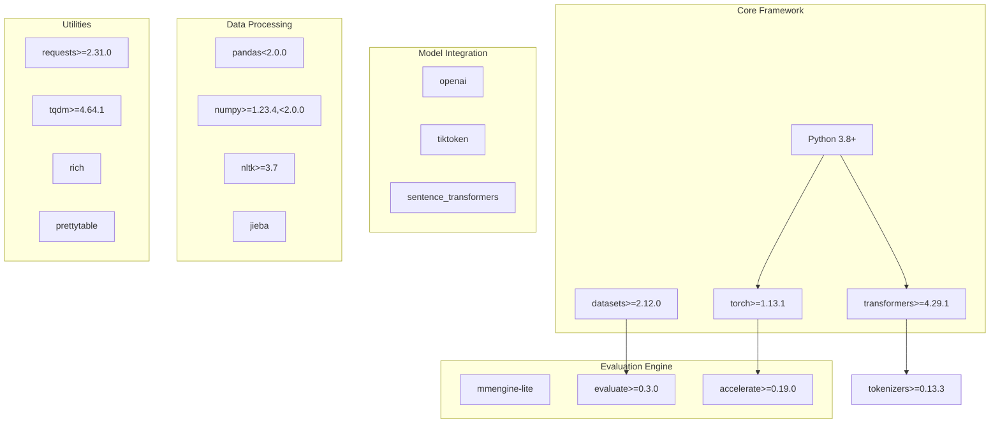

Sources: [requirements/runtime.txt:1-51](), [requirements.txt:1-2]()

## Installation Methods

### Basic Installation

**1. Clone Repository**
```bash
git clone https://github.com/open-compass/opencompass.git
cd opencompass
```

**2. Install Dependencies**
```bash
pip install -r requirements.txt
```

**3. Verify Installation**
```bash
python run.py --help
```

### Development Installation

For contributors and developers requiring pre-commit hooks and code quality tools:

```bash
# Install with development dependencies
pip install -e .

# Setup pre-commit hooks
pip install -U pre-commit
pre-commit install
```

For users in regions with network restrictions:
```bash
# Use China mirror for pre-commit
pre-commit install -c .pre-commit-config-zh-cn.yaml
pre-commit run --all-files -c .pre-commit-config-zh-cn.yaml
```

Sources: [docs/zh_cn/notes/contribution_guide.md:78-91](), [docs/en/notes/contribution_guide.md:78-83]()

## Environment Configuration

### Network Configuration

OpenCompass requires network access for downloading models and datasets from HuggingFace Hub during initial setup.

**Online Mode (Default):**
```bash
python run.py configs/eval_demo.py
```

**Offline Mode:**
```bash
# Set offline environment variables
export HF_DATASETS_OFFLINE=1
export TRANSFORMERS_OFFLINE=1
export HF_EVALUATE_OFFLINE=1
export HF_HUB_OFFLINE=1

python run.py configs/eval_demo.py
```

**Proxy Configuration:**
```bash
# Configure proxy if needed
export http_proxy=http://your-proxy:port
export https_proxy=https://your-proxy:port
python run.py configs/eval_demo.py
```

**Mirror Sites:**
```bash
# Use HuggingFace mirror for faster access
export HF_ENDPOINT=https://hf-mirror.com
python run.py configs/eval_demo.py
```

Sources: [docs/zh_cn/get_started/faq.md:92-106](), [docs/en/get_started/faq.md:72-85]()

### GPU Configuration

OpenCompass automatically detects and utilizes available GPU resources. Control GPU usage through environment variables and configuration parameters.

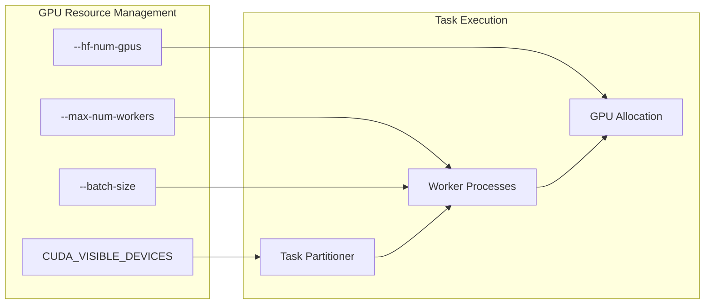

**Local GPU Control:**
```bash
# Limit to specific GPUs
CUDA_VISIBLE_DEVICES=0,1,2,3 python run.py configs/eval_demo.py

# Control parallel workers
python run.py configs/eval_demo.py --max-num-workers 4

# Specify GPU requirement per model
python run.py --hf-num-gpus 2 --datasets demo_gsm8k --hf-path Qwen/Qwen1.5-14B
```

Sources: [docs/zh_cn/get_started/faq.md:45-62](), [docs/en/get_started/faq.md:26-53]()

## Configuration Verification

### Basic Functionality Test

Run a minimal evaluation to verify installation:

```bash
# Debug mode for sequential execution and real-time output
python run.py --datasets siqa_gen winograd_ppl \
    --hf-type base \
    --hf-path facebook/opt-125m \
    --debug
```

Expected output indicating successful setup:
```
[INFO] Starting inference process...
```

### Configuration File Test

Test with a complete configuration file:

```bash
# Test with demo configuration
python run.py configs/eval_demo.py --debug
```

**Configuration Structure Verification:**

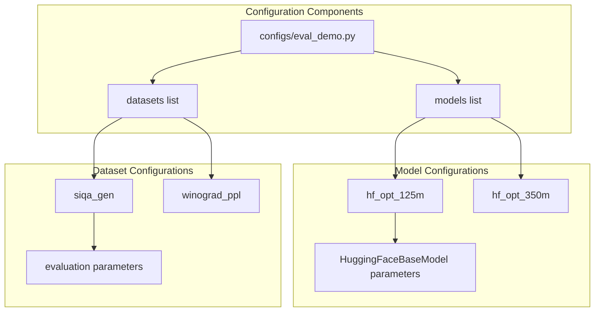

Sources: [docs/en/get_started/quick_start.md:211-230](), [docs/zh_cn/get_started/quick_start.md:356-378]()

## Common Installation Issues

### Dependency Conflicts

**OpenGL Library Issues:**
```bash
# Error: libGL.so.1 not found
pip uninstall opencv-python
pip install opencv-python-headless

# Alternative: install system dependencies
sudo apt-get update
sudo apt-get install -y libgl1 libglib2.0-0
```

**MKL Threading Conflicts:**
```bash
# Error: MKL_THREADING_LAYER=INTEL incompatible
export MKL_SERVICE_FORCE_INTEL=1
python run.py configs/eval_demo.py
```

Sources: [docs/zh_cn/get_started/faq.md:63-88](), [docs/en/get_started/faq.md:54-68]()

### Network Connectivity Issues

**HuggingFace Connection Failures:**

Common error patterns:
- `Connection aborted.', ConnectionResetError(104, 'Connection reset by peer')`
- `urllib3.exceptions.MaxRetryError: HTTPSConnectionPool(host='cdn-lfs.huggingface.co')`

**Solutions:**
1. **Cache Transfer Method:**
   ```bash
   # Copy cache from machine with internet access
   cp -r ~/.cache/huggingface/ /target/machine/.cache/
   
   # Run in offline mode
   HF_DATASETS_OFFLINE=1 TRANSFORMERS_OFFLINE=1 python run.py configs/eval_demo.py
   ```

2. **Mirror Configuration:**
   ```bash
   # Use regional mirrors
   HF_ENDPOINT=https://hf-mirror.com python run.py configs/eval_demo.py
   ```

Sources: [docs/zh_cn/get_started/faq.md:92-109](), [docs/en/get_started/faq.md:72-89]()

### Resource Management Issues

**Insufficient GPU Memory:**
- Reduce `batch_size` parameter in model configurations
- Use gradient checkpointing with `--model-kwargs device_map='auto'`
- Enable model sharding for large models

**Slow Evaluation Performance:**
- Check if using acceleration backends (LMDeploy, VLLM)
- Adjust `--max-partition-size` for better task distribution
- Verify network isn't bottleneck for model downloads

Sources: [docs/zh_cn/get_started/faq.md:122-131](), [docs/en/get_started/faq.md:98-112]()

## Installation Validation

### Complete System Test

```bash
# Run comprehensive test with multiple models and datasets
python run.py --models hf_opt_125m hf_opt_350m \
    --datasets siqa_gen winograd_ppl \
    --debug

# Expected directory structure after successful run
outputs/default/
├── TIMESTAMP/
│   ├── configs/
│   ├── logs/
│   │   ├── eval/
│   │   └── infer/
│   ├── predictions/
│   └── results/
```

### Configuration Listing Test

```bash
# Verify configuration discovery
python tools/list_configs.py

# Expected output format
+-----------------+-----------------------------------+
| Model           | Config Path                       |
|-----------------+-----------------------------------|
| hf_opt_125m     | configs/models/opt/hf_opt_125m.py |
| ...             | ...                               |
```

Sources: [docs/en/get_started/quick_start.md:70-77](), [docs/zh_cn/get_started/quick_start.md:93-102]()

---

# Page: Quick Start Guide

# Quick Start Guide

<details>
<summary>Relevant source files</summary>

The following files were used as context for generating this wiki page:

- [README.md](README.md)
- [README_zh-CN.md](README_zh-CN.md)
- [docs/en/get_started/faq.md](docs/en/get_started/faq.md)
- [docs/en/get_started/quick_start.md](docs/en/get_started/quick_start.md)
- [docs/en/index.rst](docs/en/index.rst)
- [docs/en/notes/contribution_guide.md](docs/en/notes/contribution_guide.md)
- [docs/en/notes/news.md](docs/en/notes/news.md)
- [docs/en/user_guides/experimentation.md](docs/en/user_guides/experimentation.md)
- [docs/zh_cn/advanced_guides/evaluation_lmdeploy.md](docs/zh_cn/advanced_guides/evaluation_lmdeploy.md)
- [docs/zh_cn/get_started/faq.md](docs/zh_cn/get_started/faq.md)
- [docs/zh_cn/get_started/quick_start.md](docs/zh_cn/get_started/quick_start.md)
- [docs/zh_cn/index.rst](docs/zh_cn/index.rst)
- [docs/zh_cn/notes/contribution_guide.md](docs/zh_cn/notes/contribution_guide.md)
- [docs/zh_cn/notes/news.md](docs/zh_cn/notes/news.md)
- [docs/zh_cn/user_guides/experimentation.md](docs/zh_cn/user_guides/experimentation.md)
- [opencompass/cli/main.py](opencompass/cli/main.py)
- [opencompass/openicl/icl_retriever/icl_votek_retriever.py](opencompass/openicl/icl_retriever/icl_votek_retriever.py)
- [opencompass/partitioners/base.py](opencompass/partitioners/base.py)
- [opencompass/utils/result_station.py](opencompass/utils/result_station.py)
- [opencompass/utils/run.py](opencompass/utils/run.py)
- [run.py](run.py)

</details>


This guide covers the basic methods for running your first evaluation with OpenCompass. It demonstrates how to evaluate models on datasets using command-line interfaces and configuration files. For detailed installation instructions, see [Installation and Setup](#2.1). For advanced configuration options and the underlying configuration system, see [Configuration System](#2.3).

## Purpose and Scope

This document explains the three primary methods for launching evaluations in OpenCompass:

1. **CLI with pre-configured models and datasets** - Use predefined configurations
2. **CLI with HuggingFace parameters** - Quick evaluation of HF models without configuration files
3. **Configuration files** - Full control over evaluation settings

All methods ultimately invoke the same evaluation pipeline but differ in how they specify models and datasets.

## Entry Point and Execution Flow

The main entry point for all evaluations is `run.py` in the repository root, which delegates to `opencompass.cli.main.main()`.

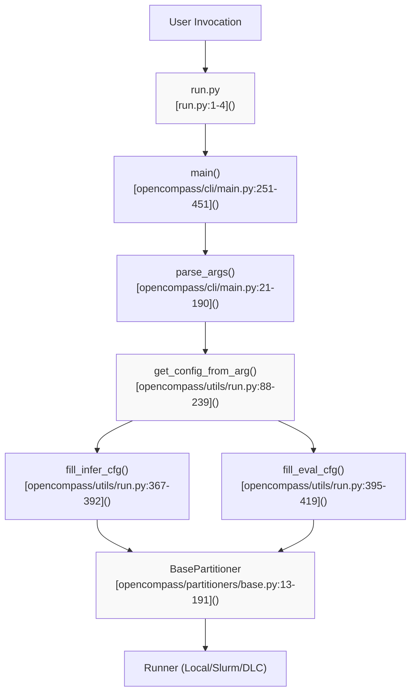

**Sources:** [run.py:1-4](), [opencompass/cli/main.py:251-451](), [opencompass/utils/run.py:88-239]()

## Method 1: CLI with Pre-configured Models and Datasets

OpenCompass provides pre-defined configurations for popular models and datasets in `configs/models/` and `configs/datasets/`.

### Basic Usage

```bash
opencompass --models hf_internlm2_5_1_8b_chat --datasets demo_gsm8k_chat_gen
```

This command:
- Loads model configuration from the registry
- Loads dataset configuration from the registry
- Executes inference and evaluation
- Generates summary reports

### Listing Available Configurations

Use `tools/list_configs.py` to discover available configurations:

```bash
# List all configurations
python tools/list_configs.py

# Filter by keywords
python tools/list_configs.py llama mmlu
```

The tool uses `match_cfg_file()` to search for configuration files:

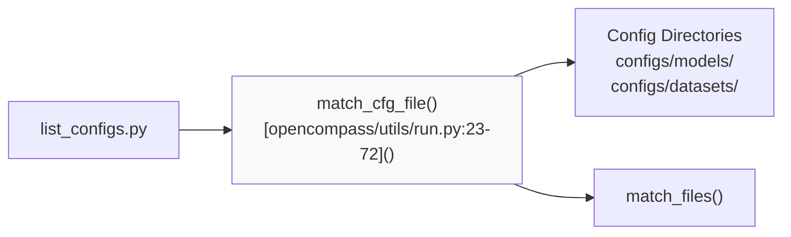

**Sources:** [opencompass/utils/run.py:23-72](), [README.md:227-231]()

### Configuration Resolution Flow

When you specify `--models` and `--datasets`, OpenCompass resolves them through this process:

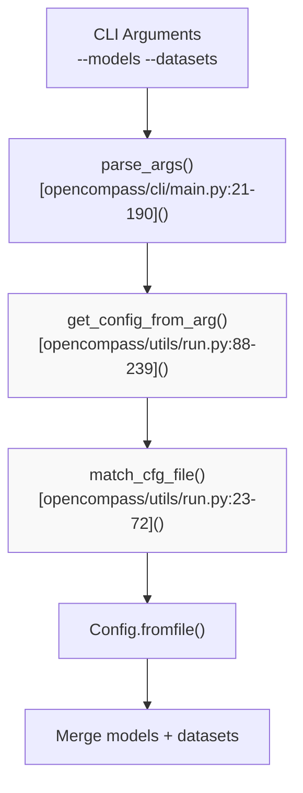

**Sources:** [opencompass/cli/main.py:41-42](), [opencompass/utils/run.py:88-239](), [opencompass/utils/run.py:179-186]()

## Method 2: CLI with HuggingFace Models

For quick evaluation of HuggingFace models without creating configuration files, use the `--hf-path` and `--hf-type` parameters:

```bash
opencompass --datasets demo_gsm8k_chat_gen \
    --hf-type chat \
    --hf-path internlm/internlm2_5-1_8b-chat
```

### HuggingFace Parameter Mapping

The CLI arguments map to model configuration fields as follows:

| CLI Argument | Config Field | Description |
|-------------|--------------|-------------|
| `--hf-type` | `type` | Model class: `base` or `chat` |
| `--hf-path` | `path` | HuggingFace model path |
| `--tokenizer-path` | `tokenizer_path` | Tokenizer path (defaults to model path) |
| `--model-kwargs` | `model_kwargs` | Arguments for model initialization |
| `--tokenizer-kwargs` | `tokenizer_kwargs` | Arguments for tokenizer initialization |
| `--generation-kwargs` | `generation_kwargs` | Generation parameters |
| `--max-seq-len` | `max_seq_len` | Maximum sequence length |
| `--max-out-len` | `max_out_len` | Maximum output tokens |
| `--batch-size` | `batch_size` | Inference batch size |
| `--hf-num-gpus` | `run_cfg.num_gpus` | GPUs required per model instance |

**Sources:** [opencompass/cli/main.py:219-237](), [opencompass/utils/run.py:188-208]()

### Internal Model Construction

The HuggingFace parameters are converted into a model configuration dictionary:

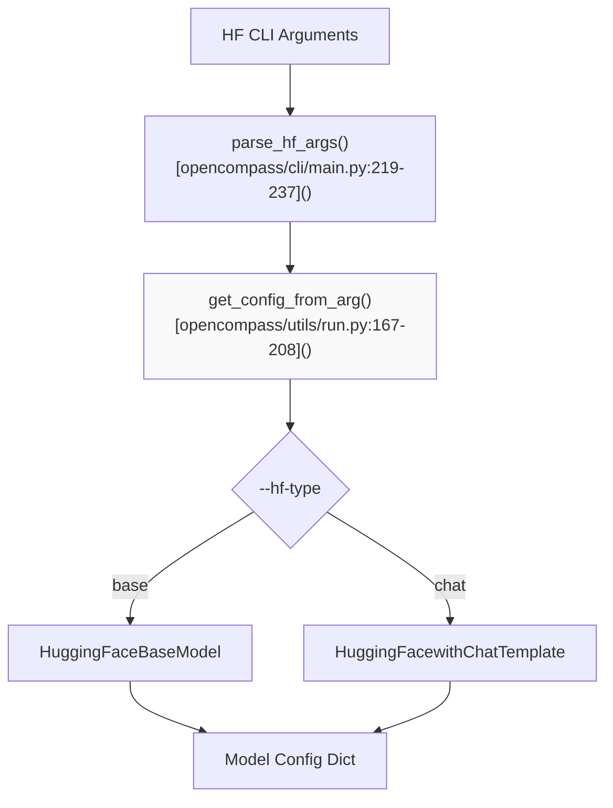

**Sources:** [opencompass/utils/run.py:188-208](), [opencompass/cli/main.py:219-237]()

## Method 3: Configuration Files

Configuration files provide full control over evaluation settings and enable batch evaluation of multiple models and datasets.

### Basic Configuration Structure

A minimal configuration file must define `models` and `datasets`:

```python
from mmengine.config import read_base

with read_base():
    from .datasets.demo.demo_gsm8k_chat_gen import gsm8k_datasets
    from .models.hf_internlm.hf_internlm2_chat_1_8b import models as internlm_models

datasets = gsm8k_datasets
models = internlm_models
```

Execute with:

```bash
opencompass examples/eval_chat_demo.py
```

### Configuration Loading Process

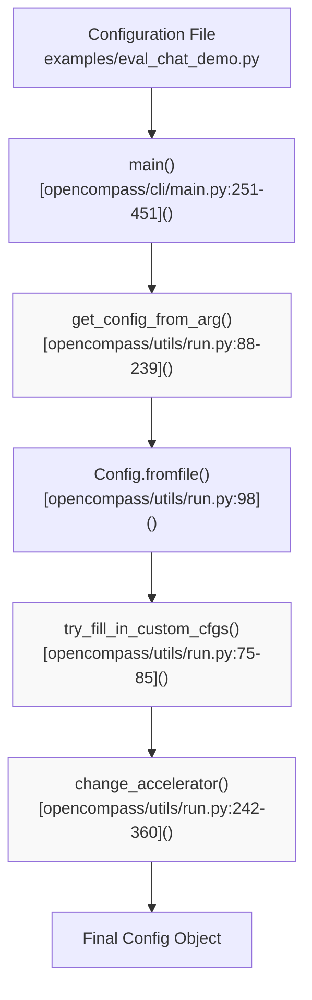

**Sources:** [opencompass/utils/run.py:88-118](), [opencompass/cli/main.py:263]()

### Accelerator Transformation

When using `--accelerator vllm` or `--accelerator lmdeploy`, OpenCompass automatically transforms HuggingFace model configurations:

```mermaid
graph LR
    HFModel["HuggingFace Models"]
    CheckAccel{"`--accelerator`<br/>parameter"}
    ChangeAccel["change_accelerator()<br/>[opencompass/utils/run.py:242-360]()"]
    VLLM["VLLM Models"]
    LMDeploy["TurboMind Models"]
    NoChange["Original Models"]
    
    HFModel --> CheckAccel
    CheckAccel -->|vllm| ChangeAccel
    CheckAccel -->|lmdeploy| ChangeAccel
    CheckAccel -->|None| NoChange
    ChangeAccel -->|vllm| VLLM
    ChangeAccel -->|lmdeploy| LMDeploy
    
    style ChangeAccel fill:#f9f9f9
```

**Sources:** [opencompass/utils/run.py:106-117](), [opencompass/utils/run.py:242-360]()

## Understanding the Evaluation Flow

Once configuration is loaded, OpenCompass executes a three-phase pipeline:

### Phase Overview

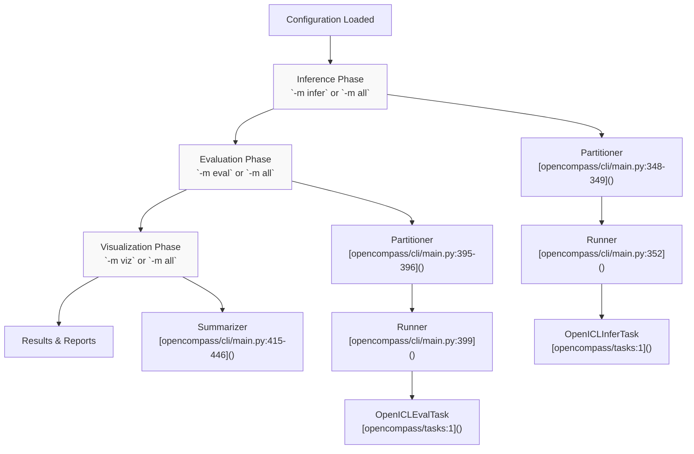

**Sources:** [opencompass/cli/main.py:322-446]()

### Inference Phase (`-m infer` or `-m all`)

Configuration is set up by `fill_infer_cfg()`:

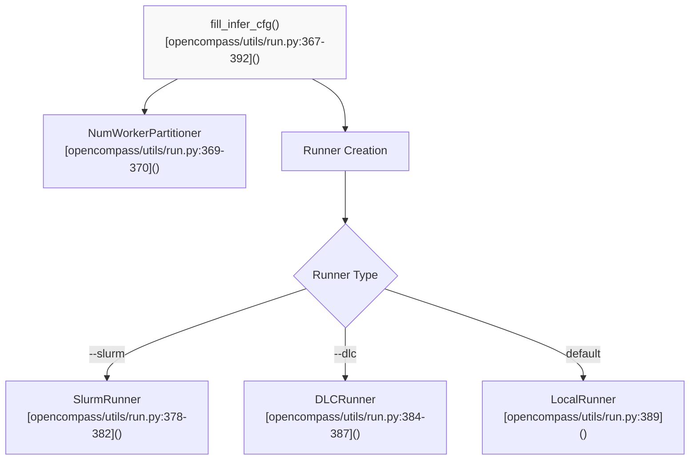

The partitioner splits model-dataset pairs into tasks, and the runner executes them in parallel.

**Sources:** [opencompass/utils/run.py:367-392](), [opencompass/cli/main.py:322-361]()

### Evaluation Phase (`-m eval` or `-m all`)

Similar to inference, configured by `fill_eval_cfg()`:


**Sources:** [opencompass/utils/run.py:395-419](), [opencompass/cli/main.py:364-407]()

### Visualization Phase (`-m viz` or `-m all`)

Summarizers aggregate evaluation results into readable reports:

```mermaid
graph TB
    VizPhase["Visualization Phase"]
    GetSummarizer["Get Summarizer Config<br/>[opencompass/cli/main.py:415-443]()"]
    CheckFunction{"`function` in config?"}
    SubjectivePath["Subjective Summarization<br/>[opencompass/cli/main.py:418-440]()"]
    ObjectivePath["Objective Summarization<br/>[opencompass/cli/main.py:442-446]()"]
    DefaultSummarizer["DefaultSummarizer<br/>[opencompass/cli/main.py:443]()"]
    BuildSummarizer["build_from_cfg()"]
    SummarizeCall["summarize(time_str=...)"]
    
    VizPhase --> GetSummarizer
    GetSummarizer --> CheckFunction
    CheckFunction -->|Yes| SubjectivePath
    CheckFunction -->|No| ObjectivePath
    ObjectivePath --> DefaultSummarizer
    SubjectivePath --> BuildSummarizer
    DefaultSummarizer --> BuildSummarizer
    BuildSummarizer --> SummarizeCall
    
    style VizPhase fill:#f9f9f9
```

**Sources:** [opencompass/cli/main.py:414-446]()

## Key Command-Line Arguments

### Task Control

| Argument | Description | Default |
|----------|-------------|---------|
| `-m`, `--mode` | Execution mode: `all`, `infer`, `eval`, `viz` | `all` |
| `-r`, `--reuse` | Reuse existing results from timestamp | None |
| `--debug` | Run in single-process debug mode | False |
| `--dry-run` | Print tasks without executing | False |

### Resource Control

| Argument | Description | Default |
|----------|-------------|---------|
| `--max-num-workers` | Maximum parallel workers | 1 |
| `--max-workers-per-gpu` | Workers per GPU (local only) | 1 |
| `--hf-num-gpus` | GPUs per model instance | 1 |

### Execution Environment

| Argument | Description | Default |
|----------|-------------|---------|
| `--slurm` | Use Slurm scheduler | False |
| `-p`, `--partition` | Slurm partition | None |
| `--dlc` | Use Alibaba DLC cluster | False |

### Output Control

| Argument | Description | Default |
|----------|-------------|---------|
| `-w`, `--work-dir` | Output directory | `outputs/default` |
| `--dump-eval-details` | Save detailed evaluation results | True |
| `-l`, `--lark` | Enable Lark bot reporting | False |

**Sources:** [opencompass/cli/main.py:21-190]()

### Common Usage Patterns

**Run inference only:**
```bash
opencompass config.py -m infer
```

**Run evaluation on existing inference results:**
```bash
opencompass config.py -m eval -r latest
```

**Use 4 parallel workers with Slurm:**
```bash
opencompass config.py --slurm -p gpu_partition --max-num-workers 4
```

**Debug mode (single process, real-time output):**
```bash
opencompass config.py --debug
```

**Sources:** [opencompass/cli/main.py:45-90](), [docs/en/user_guides/experimentation.md:1-61]()

## Output Structure

All evaluation outputs are organized under the work directory (default: `outputs/default/`):

```mermaid
graph TB
    WorkDir["work_dir/<br/>outputs/default/"]
    Timestamp["YYYYmmdd_HHMMSS/"]
    Configs["configs/<br/>Saved config files"]
    Logs["logs/<br/>infer/ and eval/"]
    Predictions["predictions/<br/>Model outputs"]
    Results["results/<br/>Evaluation scores"]
    
    WorkDir --> Timestamp
    Timestamp --> Configs
    Timestamp --> Logs
    Timestamp --> Predictions
    Timestamp --> Results
    
    ModelSubdir["MODEL_NAME/<br/>Per-model subdirectory"]
    Logs --> ModelSubdir
    Predictions --> ModelSubdir
    Results --> ModelSubdir
```

### Directory Contents

**`configs/`**: Stores configuration files used for each run
- Format: `{timestamp}_{pid}.py`
- Contains complete evaluation configuration

**`logs/`**: Contains execution logs
- `logs/infer/`: Inference phase logs
- `logs/eval/`: Evaluation phase logs
- Organized by model name

**`predictions/`**: Model inference outputs
- JSON files containing model predictions
- Named as `{dataset}.json` or `{dataset}_{partition}.json`

**`results/`**: Evaluation results
- JSON files with metrics and scores
- Named as `{dataset}.json`

**Sources:** [docs/en/user_guides/experimentation.md:98-125](), [opencompass/cli/main.py:289-293]()

### Reusing Results

The `-r` or `--reuse` flag allows resuming interrupted evaluations:

```bash
# Reuse latest results
opencompass config.py -r

# Reuse specific timestamp
opencompass config.py -r 20240315_143022
```

OpenCompass skips completed tasks and continues from where it left off.

**Sources:** [opencompass/cli/main.py:72-81](), [opencompass/cli/main.py:271-286]()

## Summary

OpenCompass provides flexible evaluation methods:

1. **CLI + pre-configured**: Fast evaluation with standard configurations
2. **CLI + HuggingFace**: Quick evaluation without configuration files
3. **Configuration files**: Full control for complex evaluations

All methods converge to the same pipeline:
- `run.py` → `main()` → `get_config_from_arg()` → `fill_infer_cfg()` / `fill_eval_cfg()` → Partitioner → Runner → Tasks

For details on customizing configurations, see [Configuration System](#2.3). For troubleshooting common issues, see [FAQ and Troubleshooting](#2.4).

**Sources:** [README.md:177-268](), [opencompass/cli/main.py:251-451](), [opencompass/utils/run.py:88-419]()

---

# Page: Configuration System

# Configuration System

<details>
<summary>Relevant source files</summary>

The following files were used as context for generating this wiki page:

- [README.md](README.md)
- [README_zh-CN.md](README_zh-CN.md)
- [docs/en/get_started/faq.md](docs/en/get_started/faq.md)
- [docs/en/get_started/quick_start.md](docs/en/get_started/quick_start.md)
- [docs/en/index.rst](docs/en/index.rst)
- [docs/en/notes/contribution_guide.md](docs/en/notes/contribution_guide.md)
- [docs/en/notes/news.md](docs/en/notes/news.md)
- [docs/en/user_guides/experimentation.md](docs/en/user_guides/experimentation.md)
- [docs/zh_cn/advanced_guides/evaluation_lmdeploy.md](docs/zh_cn/advanced_guides/evaluation_lmdeploy.md)
- [docs/zh_cn/get_started/faq.md](docs/zh_cn/get_started/faq.md)
- [docs/zh_cn/get_started/quick_start.md](docs/zh_cn/get_started/quick_start.md)
- [docs/zh_cn/index.rst](docs/zh_cn/index.rst)
- [docs/zh_cn/notes/contribution_guide.md](docs/zh_cn/notes/contribution_guide.md)
- [docs/zh_cn/notes/news.md](docs/zh_cn/notes/news.md)
- [docs/zh_cn/user_guides/experimentation.md](docs/zh_cn/user_guides/experimentation.md)
- [opencompass/cli/main.py](opencompass/cli/main.py)
- [opencompass/openicl/icl_retriever/icl_votek_retriever.py](opencompass/openicl/icl_retriever/icl_votek_retriever.py)
- [opencompass/partitioners/base.py](opencompass/partitioners/base.py)
- [opencompass/utils/result_station.py](opencompass/utils/result_station.py)
- [opencompass/utils/run.py](opencompass/utils/run.py)
- [run.py](run.py)

</details>


## Purpose and Scope

The Configuration System in OpenCompass provides a flexible mechanism for specifying evaluation tasks through multiple input methods: command-line arguments, Python configuration files, or programmatic APIs. This system handles the parsing, validation, consolidation, and transformation of user-specified models, datasets, and evaluation parameters into executable task configurations.

For information about task execution after configuration, see [Task Execution and Monitoring](#2.4). For details on the overall evaluation pipeline, see [Evaluation Pipeline Overview](#3.1).

---

## Overview of Configuration Methods

OpenCompass supports three primary methods for specifying evaluation configurations, all converging through a unified processing pipeline:

```mermaid
graph TB
    CLI["Command Line<br/>(--models, --datasets)"]
    HFShortcut["HF Shortcuts<br/>(--hf-path, --hf-type)"]
    ConfigFile["Python Config File<br/>(config.py)"]
    ProgrammaticAPI["Programmatic API<br/>(examples/*.py)"]
    
    CLI --> parse_args["parse_args()"]
    HFShortcut --> parse_args
    ConfigFile --> parse_args
    ProgrammaticAPI --> parse_args
    
    parse_args --> get_config["get_config_from_arg()"]
    
    get_config --> ConfigObject["Config Object<br/>{models, datasets,<br/>summarizer}"]
    
    ConfigObject --> fill_infer["fill_infer_cfg()"]
    ConfigObject --> fill_eval["fill_eval_cfg()"]
    
    fill_infer --> InferConfig["Inference Config<br/>{partitioner, runner, task}"]
    fill_eval --> EvalConfig["Evaluation Config<br/>{partitioner, runner, task}"]
    
    InferConfig --> Execution["Task Execution"]
    EvalConfig --> Execution
```

**Figure 1: Configuration Methods and Processing Flow**

Sources: [opencompass/cli/main.py:21-249](), [opencompass/utils/run.py:88-240]()

---

## Configuration File Structure

### Core Components

All OpenCompass configuration files must be Python scripts containing at minimum two required fields:

| Field | Type | Description | Example |
|-------|------|-------------|---------|
| `models` | `List[Dict]` | List of model configurations to evaluate | `[dict(type='HuggingFacewithChatTemplate', ...)]` |
| `datasets` | `List[Dict]` | List of dataset configurations to test | `[dict(type='GSM8KDataset', ...)]` |
| `summarizer` | `Dict` (optional) | Configuration for result summarization | `dict(type='DefaultSummarizer')` |

Additional optional fields include:

- `infer`: Custom inference stage configuration
- `eval`: Custom evaluation stage configuration  
- `lark_bot_url`: Lark notification webhook URL
- `work_dir`: Working directory path
- `station_path`: Results persistence path
- `model_dataset_combinations`: Custom model-dataset pairing strategy

Sources: [opencompass/utils/run.py:98-118](), [opencompass/partitioners/base.py:40-102]()

### AMOTIC Consolidation

As of version 0.4.0, OpenCompass has consolidated all configuration files from the previous locations (`./configs/datasets`, `./configs/models`, `./configs/summarizers`) into the `opencompass` package itself. This consolidation enables:

1. **Pip installation support**: Configs are now part of the installed package
2. **Versioning**: Configuration versions match package versions
3. **Easier distribution**: No separate config file management required

Users referencing old configuration paths must update to the new structure:

```python
# Old (deprecated)
from configs.models.hf_llama import models

# New (AMOTIC)
from opencompass.configs.models.hf_llama.hf_llama_7b import models
```

Sources: [README.md:55-56](), [README_zh-CN.md:55-56]()

---

## Configuration Methods in Detail

### Method 1: Command Line with Predefined Configs

Users can specify models and datasets using their configuration names:

```bash
opencompass --models hf_internlm2_chat_1_8b hf_qwen2_1_5b_instruct \
            --datasets demo_gsm8k_chat_gen demo_math_chat_gen
```

The `list_configs.py` tool helps discover available configurations:

```bash
# List all available configs
python tools/list_configs.py

# Filter by keywords
python tools/list_configs.py llama mmlu
```

```mermaid
graph LR
    UserInput["--models M1 M2<br/>--datasets D1 D2"]
    match_cfg_file["match_cfg_file()"]
    ConfigDir["configs/models/<br/>configs/datasets/"]
    LoadedConfigs["Config.fromfile()"]
    
    UserInput --> match_cfg_file
    ConfigDir --> match_cfg_file
    match_cfg_file --> LoadedConfigs
```

**Figure 2: Predefined Configuration Loading**

Sources: [opencompass/utils/run.py:23-72](), [opencompass/utils/run.py:124-165]()

### Method 2: HuggingFace Quick Setup

For HuggingFace models, users can bypass configuration files entirely:

```bash
opencompass --datasets demo_gsm8k_chat_gen \
            --hf-type chat \
            --hf-path internlm/internlm2-chat-1_8b \
            --max-out-len 1024 \
            --batch-size 8 \
            --hf-num-gpus 1
```

This approach dynamically constructs model configuration:

```mermaid
graph TB
    HFArgs["HF CLI Arguments<br/>--hf-path, --hf-type, etc."]
    TypeCheck{"--hf-type?"}
    ChatModel["HuggingFacewithChatTemplate"]
    BaseModel["HuggingFaceBaseModel"]
    ModelDict["dict(<br/>type=...,<br/>path=hf-path,<br/>max_out_len=...,<br/>batch_size=...,<br/>run_cfg=dict(num_gpus=...)"]
    
    HFArgs --> TypeCheck
    TypeCheck -->|"chat"| ChatModel
    TypeCheck -->|"base"| BaseModel
    ChatModel --> ModelDict
    BaseModel --> ModelDict
```

**Figure 3: Dynamic HuggingFace Model Configuration**

Sources: [opencompass/utils/run.py:167-208](), [opencompass/cli/main.py:219-236]()

### Method 3: Python Configuration Files

Configuration files use the `read_base()` context manager for modular inheritance:

```python
# examples/eval_chat_demo.py
from mmengine.config import read_base

with read_base():
    from .datasets.demo.demo_gsm8k_chat_gen import gsm8k_datasets
    from .datasets.demo.demo_math_chat_gen import math_datasets
    from .models.qwen.hf_qwen2_1_5b_instruct import models as qwen_models
    from .models.hf_internlm.hf_internlm2_chat_1_8b import models as internlm_models

datasets = gsm8k_datasets + math_datasets
models = qwen_models + internlm_models
```

The `read_base()` context manager provides:

1. **Relative imports**: Import configs relative to the current file
2. **Lazy loading**: Configs loaded only when needed
3. **Namespace isolation**: Prevents naming conflicts
4. **Composition**: Easily combine multiple configuration sources

Sources: [docs/zh_cn/get_started/quick_start.md:138-152](), [docs/en/get_started/quick_start.md:136-161]()

### Method 4: Custom Dataset Configuration

For datasets not in the registry, use custom dataset arguments:

```bash
opencompass --custom-dataset-path /path/to/dataset.json \
            --custom-dataset-meta-path /path/to/meta.json \
            --custom-dataset-data-type mcq \
            --custom-dataset-infer-method gen \
            --models hf_internlm2_chat_1_8b
```

This internally calls `make_custom_dataset_config()` to generate a dataset configuration:

Sources: [opencompass/utils/run.py:150-158](), [opencompass/cli/main.py:239-248]()

---

## Configuration Processing Pipeline

### Stage 1: Argument Parsing and Config Retrieval

```mermaid
graph TB
    Entry["run.py / main()"]
    
    ParseArgs["parse_args()"]
    
    GetConfig["get_config_from_arg(args)"]
    
    CheckConfig{"Config file<br/>provided?"}
    
    LoadFile["Config.fromfile(path)"]
    
    BuildFromArgs["Build from --models<br/>and --datasets"]
    
    BuildFromHF["Build from HF args<br/>(--hf-path, --hf-type)"]
    
    FillCustom["try_fill_in_custom_cfgs()"]
    
    ConfigObj["Config Object"]
    
    Entry --> ParseArgs
    ParseArgs --> GetConfig
    GetConfig --> CheckConfig
    CheckConfig -->|"Yes"| LoadFile
    CheckConfig -->|"No"| CheckArgs{"--models or<br/>--hf-path?"}
    LoadFile --> FillCustom
    CheckArgs -->|"--models"| BuildFromArgs
    CheckArgs -->|"--hf-path"| BuildFromHF
    BuildFromArgs --> ConfigObj
    BuildFromHF --> ConfigObj
    FillCustom --> ConfigObj
```

**Figure 4: Configuration Retrieval Flow**

The `get_config_from_arg()` function implements a priority-based resolution:

1. **Highest Priority**: Explicit config file path (`args.config`)
2. **Medium Priority**: Model and dataset names (`args.models` + `args.datasets`)
3. **Lowest Priority**: HuggingFace shortcuts (`args.hf_path` + `args.datasets`)

Sources: [opencompass/utils/run.py:88-240](), [opencompass/cli/main.py:251-263]()

### Stage 2: Configuration Filling

After retrieving the base configuration, OpenCompass fills in execution-specific parameters:

```mermaid
graph TB
    BaseConfig["Base Config<br/>{models, datasets}"]
    
    FillInfer["fill_infer_cfg(cfg, args)"]
    FillEval["fill_eval_cfg(cfg, args)"]
    
    InferParams["Inference Parameters"]
    EvalParams["Evaluation Parameters"]
    
    Partitioner["Partitioner Type"]
    Runner["Runner Type"]
    TaskType["Task Type"]
    
    LocalRunner["LocalRunner"]
    SlurmRunner["SlurmRunner"]
    DLCRunner["DLCRunner"]
    
    BaseConfig --> FillInfer
    BaseConfig --> FillEval
    
    FillInfer --> InferParams
    FillEval --> EvalParams
    
    InferParams --> Partitioner
    InferParams --> Runner
    InferParams --> TaskType
    
    Partitioner --> NumWorkerPartitioner["NumWorkerPartitioner"]
    
    Runner --> CheckLaunch{"Launch method?"}
    CheckLaunch -->|"--slurm"| SlurmRunner
    CheckLaunch -->|"--dlc"| DLCRunner
    CheckLaunch -->|"default"| LocalRunner
    
    TaskType --> OpenICLInferTask["OpenICLInferTask"]
```

**Figure 5: Configuration Filling Pipeline**

The `fill_infer_cfg()` function populates:

| Parameter | Source | Purpose |
|-----------|--------|---------|
| `infer.partitioner.type` | Always `NumWorkerPartitioner` | Task partitioning strategy |
| `infer.partitioner.num_worker` | `args.max_num_workers` | Parallel worker count |
| `infer.runner.type` | `args.slurm` / `args.dlc` flags | Execution backend |
| `infer.runner.partition` | `args.partition` | Slurm partition name |
| `infer.runner.max_num_workers` | `args.max_num_workers` | Max parallel workers |
| `infer.runner.max_workers_per_gpu` | `args.max_workers_per_gpu` | GPU sharing ratio |
| `infer.runner.task.type` | Always `OpenICLInferTask` | Task implementation |

Similarly, `fill_eval_cfg()` populates evaluation-specific parameters with `NaivePartitioner` and `OpenICLEvalTask`.

Sources: [opencompass/utils/run.py:367-419](), [opencompass/cli/main.py:322-361]()

### Stage 3: Accelerator Transformation

When users specify an accelerator (e.g., `--accelerator vllm`), the `change_accelerator()` function transforms HuggingFace model configurations:

```mermaid
graph TB
    HFConfig["HuggingFace Model Config<br/>{type: HuggingFaceBaseModel,<br/>path: 'model/path',<br/>generation_kwargs: {...}}"]
    
    ChangeAccel["change_accelerator(models, 'vllm')"]
    
    CheckType{"Model type?"}
    
    BaseType["HuggingFaceBaseModel<br/>HuggingFaceCausalLM<br/>HuggingFaceChatGLM3"]
    
    ChatType["HuggingFacewithChatTemplate"]
    
    VLLMTransform["Transform to VLLM<br/>{type: VLLM,<br/>model_kwargs: {<br/>  tensor_parallel_size: num_gpus<br/>}}"]
    
    LMDeployTransform["Transform to TurboMind<br/>{type: TurboMindModelwithChatTemplate,<br/>engine_config: {<br/>  tp: num_gpus<br/>}}"]
    
    TransformedConfig["Transformed Config"]
    
    HFConfig --> ChangeAccel
    ChangeAccel --> CheckType
    CheckType --> BaseType
    CheckType --> ChatType
    
    BaseType --> CheckAccel{"Accelerator?"}
    ChatType --> CheckAccel
    
    CheckAccel -->|"vllm"| VLLMTransform
    CheckAccel -->|"lmdeploy"| LMDeployTransform
    
    VLLMTransform --> TransformedConfig
    LMDeployTransform --> TransformedConfig
```

**Figure 6: Accelerator Transformation Process**

The transformation preserves essential parameters while mapping HuggingFace-specific settings to accelerator-specific equivalents:

| HuggingFace Parameter | VLLM Mapping | LMDeploy Mapping |
|----------------------|--------------|------------------|
| `run_cfg.num_gpus` | `model_kwargs.tensor_parallel_size` | `engine_config.tp` |
| `max_seq_len` | `model_kwargs.max_model_len` | `engine_config.session_len` |
| `generation_kwargs.temperature` | `generation_kwargs.temperature` | `gen_config.temperature` |
| `generation_kwargs.top_k` | Preserved | `gen_config.top_k` |
| `generation_kwargs.top_p` | Preserved | `gen_config.top_p` |

Sources: [opencompass/utils/run.py:242-360](), [opencompass/utils/run.py:106-117]()

---

## Configuration Object Structure

The final `Config` object after processing contains:

```python
Config({
    # Core evaluation components
    'models': [
        {
            'type': 'opencompass.models.HuggingFacewithChatTemplate',
            'abbr': 'internlm2-chat-1.8b-hf',
            'path': 'internlm/internlm2-chat-1_8b',
            'max_out_len': 1024,
            'batch_size': 8,
            'run_cfg': {'num_gpus': 1}
        }
    ],
    'datasets': [
        {
            'type': 'opencompass.datasets.GSM8KDataset',
            'abbr': 'gsm8k',
            'path': './data/gsm8k/',
            'reader_cfg': {...},
            'infer_cfg': {...},
            'eval_cfg': {...}
        }
    ],
    
    # Optional components
    'summarizer': {
        'type': 'opencompass.summarizers.DefaultSummarizer'
    },
    
    # Execution configuration (filled by fill_infer_cfg/fill_eval_cfg)
    'infer': {
        'partitioner': {
            'type': 'opencompass.partitioners.NumWorkerPartitioner',
            'out_dir': 'outputs/20240101_120000/predictions/',
            'num_worker': 4
        },
        'runner': {
            'type': 'opencompass.runners.LocalRunner',
            'max_num_workers': 4,
            'max_workers_per_gpu': 1,
            'task': {
                'type': 'opencompass.tasks.OpenICLInferTask'
            }
        }
    },
    'eval': {
        'partitioner': {
            'type': 'opencompass.partitioners.NaivePartitioner',
            'out_dir': 'outputs/20240101_120000/results/'
        },
        'runner': {
            'type': 'opencompass.runners.LocalRunner',
            'max_num_workers': 4,
            'task': {
                'type': 'opencompass.tasks.OpenICLEvalTask'
            }
        }
    },
    
    # Working directories
    'work_dir': 'outputs/default/20240101_120000',
    'lark_bot_url': None
})
```

Sources: [opencompass/utils/run.py:239-240](), [opencompass/cli/main.py:263-301]()

---

## Configuration Persistence and Reuse

### Config Dumping

Every evaluation run dumps its configuration to the work directory for reproducibility:

```
outputs/default/20240101_120000/
├── configs/
│   └── 20240101_120000_12345.py  # Dumped config with timestamp and PID
├── logs/
├── predictions/
└── results/
```

The config is reloaded from the dumped file to ensure all types are properly serialized:

```python
# Dump config
output_config_path = osp.join(cfg.work_dir, 'configs',
                              f'{cfg_time_str}_{os.getpid()}.py')
cfg.dump(output_config_path)

# Reload to avoid serialization issues
cfg = Config.fromfile(output_config_path, format_python_code=False)
```

Sources: [opencompass/cli/main.py:296-301]()

### Result Station Integration

When `--station-path` is specified, the configuration participates in result persistence:

```mermaid
graph LR
    EvalConfig["Evaluation Config<br/>{models, datasets}"]
    
    ResultFiles["Result Files<br/>predictions/*.json<br/>results/*.json"]
    
    Station["Result Station<br/>station_path/dataset/model.json"]
    
    Reuse["Reuse Logic<br/>read_from_station()"]
    
    FilterConfig["Filtered Config<br/>(exclude existing results)"]
    
    EvalConfig --> Execute["Execute Evaluation"]
    Execute --> ResultFiles
    ResultFiles --> Station
    
    Station --> Reuse
    Reuse --> FilterConfig
    FilterConfig --> Execute
```

**Figure 7: Configuration and Result Station Integration**

The configuration is saved alongside predictions and results, enabling:

1. **Reproducibility**: Exact config used for each result
2. **Reuse**: Skip already-evaluated model-dataset combinations
3. **Comparison**: Verify config consistency across runs

Sources: [opencompass/utils/result_station.py:11-112](), [opencompass/cli/main.py:304-307]()

---

## Advanced Configuration Features

### Model-Dataset Combinations

For subjective evaluation or complex scenarios, users can explicitly specify model-dataset pairings:

```python
from mmengine.config import read_base

with read_base():
    from .models.hf_internlm import models as internlm_models
    from .models.hf_qwen import models as qwen_models
    from .datasets.alignbench import alignbench_datasets
    from .datasets.mtbench import mtbench_datasets

# Explicit combinations
model_dataset_combinations = [
    {
        'models': internlm_models,
        'datasets': alignbench_datasets
    },
    {
        'models': qwen_models,
        'datasets': mtbench_datasets
    }
]
```

The partitioner uses `model_dataset_combinations` if available, otherwise defaults to Cartesian product of all models × all datasets.

Sources: [opencompass/partitioners/base.py:104-155]()

### Chatml Datasets

OpenCompass supports a special `chatml_datasets` configuration for chat-formatted evaluations with dynamic evaluator construction:

```python
chatml_datasets = [
    {
        'abbr': 'custom_math',
        'path': '/path/to/dataset.json',
        'evaluator': {
            'type': 'math_evaluator'  # Auto-constructs from registry
        }
    }
]
```

The `consturct_chatml_datasets()` function processes these into full dataset configurations with appropriate inferencers and evaluators.

Sources: [opencompass/utils/run.py:421-531]()

### Configuration Validation

OpenCompass validates configurations at multiple stages:

1. **File matching**: `match_cfg_file()` ensures specified configs exist
2. **Field validation**: Checks for required `models` and `datasets` fields  
3. **Combination validation**: Verifies model-dataset combinations reference valid configs
4. **Accelerator compatibility**: `change_accelerator()` validates model type support

Sources: [opencompass/utils/run.py:23-72](), [opencompass/partitioners/base.py:132-147]()

---

## Configuration System Code Entities

| Code Entity | Location | Purpose |
|-------------|----------|---------|
| `parse_args()` | [opencompass/cli/main.py:21-190]() | Parse command-line arguments |
| `get_config_from_arg()` | [opencompass/utils/run.py:88-240]() | Construct Config from arguments |
| `fill_infer_cfg()` | [opencompass/utils/run.py:367-392]() | Populate inference configuration |
| `fill_eval_cfg()` | [opencompass/utils/run.py:395-419]() | Populate evaluation configuration |
| `change_accelerator()` | [opencompass/utils/run.py:242-360]() | Transform HF to accelerator configs |
| `match_cfg_file()` | [opencompass/utils/run.py:23-72]() | Match config files by pattern |
| `try_fill_in_custom_cfgs()` | [opencompass/utils/run.py:75-85]() | Handle custom dataset configs |
| `consturct_chatml_datasets()` | [opencompass/utils/run.py:421-531]() | Build chatml-format datasets |
| `Config.fromfile()` | mmengine | Load Python config file |
| `read_base()` | mmengine | Context manager for config inheritance |
| `BasePartitioner.parse_model_dataset_args()` | [opencompass/partitioners/base.py:104-155]() | Parse model-dataset combinations |

Sources: All sources listed in table above

---

# Page: FAQ and Troubleshooting

# FAQ and Troubleshooting

<details>
<summary>Relevant source files</summary>

The following files were used as context for generating this wiki page:

- [README.md](README.md)
- [README_zh-CN.md](README_zh-CN.md)
- [docs/en/get_started/faq.md](docs/en/get_started/faq.md)
- [docs/en/get_started/quick_start.md](docs/en/get_started/quick_start.md)
- [docs/en/index.rst](docs/en/index.rst)
- [docs/en/notes/contribution_guide.md](docs/en/notes/contribution_guide.md)
- [docs/en/notes/news.md](docs/en/notes/news.md)
- [docs/en/user_guides/experimentation.md](docs/en/user_guides/experimentation.md)
- [docs/zh_cn/advanced_guides/evaluation_lmdeploy.md](docs/zh_cn/advanced_guides/evaluation_lmdeploy.md)
- [docs/zh_cn/get_started/faq.md](docs/zh_cn/get_started/faq.md)
- [docs/zh_cn/get_started/quick_start.md](docs/zh_cn/get_started/quick_start.md)
- [docs/zh_cn/index.rst](docs/zh_cn/index.rst)
- [docs/zh_cn/notes/contribution_guide.md](docs/zh_cn/notes/contribution_guide.md)
- [docs/zh_cn/notes/news.md](docs/zh_cn/notes/news.md)
- [docs/zh_cn/user_guides/experimentation.md](docs/zh_cn/user_guides/experimentation.md)
- [opencompass/cli/main.py](opencompass/cli/main.py)
- [opencompass/openicl/icl_retriever/icl_votek_retriever.py](opencompass/openicl/icl_retriever/icl_votek_retriever.py)
- [opencompass/partitioners/base.py](opencompass/partitioners/base.py)
- [opencompass/utils/result_station.py](opencompass/utils/result_station.py)
- [opencompass/utils/run.py](opencompass/utils/run.py)
- [run.py](run.py)

</details>


This page provides solutions to common issues encountered when using OpenCompass for LLM/VLM evaluation. It covers installation problems, configuration errors, runtime issues, and performance troubleshooting. 

For general usage guidance, see [2.2](#2.2) Quick Start Guide. For advanced configuration and customization, see the [6](#6) Evaluation Methods and [9](#9) Developer Guide sections.

## Overview of Common Issue Categories

OpenCompass troubleshooting typically falls into these categories:

```mermaid
graph TD
    Issues["Common Issues"]
    Issues --> Install["Installation & Dependencies"]
    Issues --> Config["Configuration Problems"] 
    Issues --> Models["Model Loading & Inference"]
    Issues --> Data["Dataset & Data Loading"]
    Issues --> Runtime["Runtime & Execution"]
    Issues --> Results["Results & Output"]
    
    Install --> PyTorch["PyTorch compatibility"]
    Install --> Accelerators["VLLM/LMDeploy setup"]
    Install --> Missing["Missing dependencies"]
    
    Config --> Args["CLI argument errors"]
    Config --> Files["Config file issues"]
    Config --> Paths["Path resolution"]
    
    Models --> HF["HuggingFace models"]
    Models --> API["API model access"]
    Models --> Memory["Memory/GPU issues"]
    
    Data --> Download["Dataset downloads"]
    Data --> Format["Data format errors"]
    Data --> Custom["Custom datasets"]
    
    Runtime --> Partitioner["Task partitioning"]
    Runtime --> Runner["Runner failures"]
    Runtime --> Resources["Resource limits"]
```

**Troubleshooting Flow Diagram**

```mermaid
flowchart TD
    Start["Issue Encountered"]
    Start --> CheckLogs["Check log files in outputs/*/logs/"]
    CheckLogs --> ErrorType{"Error Type?"}
    
    ErrorType -->|Import/Module| ImportFix["Check dependencies & installation"]
    ErrorType -->|Config| ConfigFix["Validate config files & CLI args"]
    ErrorType -->|Model| ModelFix["Check model access & resources"]
    ErrorType -->|Dataset| DataFix["Verify dataset paths & downloads"]
    ErrorType -->|Runtime| RuntimeFix["Check runner/partitioner settings"]
    
    ImportFix --> Solution["Apply fix"]
    ConfigFix --> Solution
    ModelFix --> Solution  
    DataFix --> Solution
    RuntimeFix --> Solution
    
    Solution --> Test["Test with minimal config"]
    Test --> Success{"Fixed?"}
    Success -->|Yes| Done["Issue resolved"]
    Success -->|No| Debug["Enable --debug mode"]
    Debug --> Logs["Review detailed logs"]
    Logs --> Community["Seek community help"]
```

Sources: [opencompass/cli/main.py:1-445](), [opencompass/utils/run.py:1-414](), [run.py:1-5]()

## Installation and Dependencies

### Python Environment Issues

**Problem**: Import errors or version conflicts
```bash
ModuleNotFoundError: No module named 'opencompass'
ImportError: cannot import name 'xxx' from 'opencompass'
```

**Solutions**:

1. **Check Python version**:
   ```bash
   python --version  # Should be 3.8+
   ```

2. **Verify installation**:
   ```bash
   # For pip installation
   pip list | grep opencompass
   
   # For source installation
   cd opencompass && pip install -e .
   ```

3. **Fix environment isolation**:
   ```bash
   conda create --name opencompass python=3.10 -y
   conda activate opencompass
   pip install opencompass
   ```

### Accelerator Backend Issues

**Problem**: VLLM or LMDeploy installation conflicts
```bash
RuntimeError: CUDA version mismatch
ImportError: No module named 'vllm'
```

**Solutions**:

1. **Use separate environments for each backend**:
   ```bash
   # VLLM environment  
   conda create -n oc-vllm python=3.10
   conda activate oc-vllm
   pip install "opencompass[vllm]"
   
   # LMDeploy environment
   conda create -n oc-lmdeploy python=3.10  
   conda activate oc-lmdeploy
   pip install "opencompass[lmdeploy]"
   ```

2. **Check CUDA compatibility**:
   ```bash
   nvidia-smi  # Check CUDA version
   python -c "import torch; print(torch.cuda.is_available())"
   ```

Sources: [README.md:96-136](), [docs/zh_cn/advanced_guides/evaluation_lmdeploy.md:6-26]()

## Configuration Problems

### CLI Argument Errors

**Problem**: Invalid command line arguments
```bash
ValueError: You must specify "--datasets" or "--custom-dataset-path"
AssertionError: '--partition(-p) must be set if you want to use slurm'
```

**Solution**: The argument parser in `main()` validates required parameters:

```bash
# Valid minimal command
opencompass --models hf_internlm2_5_1_8b_chat --datasets demo_gsm8k_chat_gen

# For Slurm execution
opencompass configs/eval_demo.py --slurm -p partition_name

# For custom models  
opencompass --datasets demo_gsm8k_chat_gen --hf-type chat --hf-path internlm/internlm2_5-1_8b-chat
```

### Configuration File Issues

**Problem**: Config file not found or malformed
```bash
ValueError: The provided pattern matches 0 or more than one config
FileNotFoundError: Config file not found
```

**Solutions**:

1. **List available configs**:
   ```bash
   python tools/list_configs.py
   python tools/list_configs.py llama mmlu  # Filter by keywords
   ```

2. **Check config search paths**: The `match_cfg_file()` function searches in:
   - `configs/datasets/`
   - `configs/models/` 
   - `configs/summarizers/`
   - Custom config directory (if specified with `--config-dir`)

3. **Validate config syntax**:
   ```python
   from mmengine.config import Config
   cfg = Config.fromfile('path/to/config.py')
   ```

### Path Resolution Issues

**Problem**: Model or dataset paths not found
```bash
FileNotFoundError: [Errno 2] No such file or directory
ValueError: invalid file: /path/to/file
```

**Solutions**:

1. **Use absolute paths** in configs
2. **Check working directory**: Default is `./outputs/default/`
3. **Verify dataset downloads**:
   ```bash
   # Download core datasets
   wget https://github.com/open-compass/opencompass/releases/download/0.2.2.rc1/OpenCompassData-core-20240207.zip
   unzip OpenCompassData-core-20240207.zip
   ```

Sources: [opencompass/utils/run.py:22-71](), [opencompass/cli/main.py:21-186]()

## Model Loading and Inference

### HuggingFace Model Issues

**Problem**: Model loading failures
```bash
OSError: Model not found  
RuntimeError: CUDA out of memory
ValueError: Unsupported model type
```

**Solutions**:

1. **Check model path and access**:
   ```python
   # Valid HuggingFace paths
   path='internlm/internlm2_5-1_8b-chat'  # Hub model
   path='/local/path/to/model'            # Local model
   ```

2. **Manage GPU memory**:
   ```bash
   # Use model parallel
   --hf-num-gpus 2
   
   # Reduce batch size
   --batch-size 4
   
   # Use CPU offloading
   --model-kwargs device_map=auto
   ```

3. **Accelerator backend switching**: Use `change_accelerator()` for optimization:
   ```bash
   # Switch to VLLM
   opencompass --models hf_internlm2_5_1_8b_chat --datasets demo_gsm8k_chat_gen -a vllm
   
   # Switch to LMDeploy  
   opencompass --models hf_internlm2_5_1_8b_chat --datasets demo_gsm8k_chat_gen -a lmdeploy
   ```

### API Model Issues

**Problem**: API access failures
```bash
openai.error.AuthenticationError: Invalid API key
requests.exceptions.ConnectionError: Connection failed
RateLimitError: Rate limit exceeded
```

**Solutions**:

1. **Set API credentials**:
   ```bash
   export OPENAI_API_KEY="your-api-key"
   export OPENAI_API_BASE="https://api.openai.com/v1"
   ```

2. **Configure rate limiting**: API models use `BaseAPIModel` with built-in retry and rate limiting
3. **Check API endpoints**: Verify the API base URL and model path are correct

### Memory and Resource Issues

**Problem**: Out of memory or resource exhaustion
```bash
RuntimeError: CUDA out of memory
RuntimeError: Too many open files
```

**Solutions**:

1. **Optimize batch processing**:
   ```bash
   --max-num-workers 1  # Reduce parallel tasks
   --max-workers-per-gpu 1  # One task per GPU
   --batch-size 1  # Smaller batches
   ```

2. **Use efficient partitioning**: The `NumWorkerPartitioner` distributes workload optimally
3. **Monitor resources**:
   ```bash
   nvidia-smi  # GPU usage
   htop        # CPU and memory
   ```

Sources: [opencompass/utils/run.py:236-354](), [opencompass/models/__init__.py]()

## Dataset and Data Loading

### Dataset Download Issues

**Problem**: Dataset files missing or corrupted
```bash
FileNotFoundError: Dataset not found
urllib.error.URLError: Connection failed
```

**Solutions**:

1. **Use automatic download**:
   ```bash
   opencompass --datasets demo_gsm8k_chat_gen --dry-run  # Downloads datasets
   ```

2. **Manual download**:
   ```bash
   wget https://github.com/open-compass/opencompass/releases/download/0.2.2.rc1/OpenCompassData-core-20240207.zip
   unzip OpenCompassData-core-20240207.zip
   ```

3. **Use ModelScope source**:
   ```bash
   pip install modelscope[framework]
   export DATASET_SOURCE=ModelScope
   ```

### Custom Dataset Issues

**Problem**: Custom dataset format errors
```bash
ValueError: Invalid dataset configuration
KeyError: Required field missing
```

**Solutions**:

1. **Use `make_custom_dataset_config()`**: The system auto-generates configs for custom datasets
2. **Required fields**:
   ```python
   dataset = {
       'path': '/path/to/dataset',
       'data_type': 'mcq',  # or 'qa'
       'infer_method': 'gen'  # or 'ppl'
   }
   ```

3. **Check dataset structure**: Ensure data files match expected format

### Data Format Issues

**Problem**: Incompatible data formats
```bash
ValueError: Invalid data format
JSONDecodeError: Expecting value
```

**Solutions**:

1. **Validate JSON files**: Check for syntax errors
2. **Check column mappings**: Ensure `reader_cfg` matches data structure  
3. **Use dataset validation tools**: Test with known working datasets first

Sources: [opencompass/datasets/custom.py](), [opencompass/utils/run.py:74-84]()

## Runtime and Execution

### Task Partitioning Issues

**Problem**: Task partitioning failures
```bash
ValueError: No tasks generated
RuntimeError: Partitioner failed
```

**Solutions**:

1. **Check partitioner config**: The `BasePartitioner` requires specific parameters:
   ```python
   partitioner = dict(
       type='NumWorkerPartitioner', 
       num_worker=8
   )
   ```

2. **Verify model-dataset combinations**: Ensure valid combinations exist
3. **Use debug mode**:
   ```bash
   opencompass config.py --debug  # Single-process mode
   ```

### Runner Execution Issues

**Problem**: Task execution failures
```bash
RuntimeError: Runner failed
subprocess.CalledProcessError: Command failed
```

**Solutions**:

1. **Check runner configuration**:
   ```python
   # LocalRunner
   runner = dict(type='LocalRunner', max_num_workers=4)
   
   # SlurmRunner  
   runner = dict(type='SlurmRunner', partition='gpu_partition')
   ```

2. **Monitor task logs**: Check `outputs/*/logs/infer/` and `outputs/*/logs/eval/`
3. **Use retry mechanism**: Runners support automatic retry on failure

### Resource Limit Issues

**Problem**: System resource limits exceeded
```bash
OSError: [Errno 24] Too many open files
RuntimeError: Resource temporarily unavailable
```

**Solutions**:

1. **Increase system limits**:
   ```bash
   ulimit -n 4096  # More file descriptors
   ```

2. **Reduce parallelism**:
   ```bash
   --max-num-workers 2
   --max-workers-per-gpu 1
   ```

3. **Use distributed execution**: Consider Slurm for large-scale evaluation

Sources: [opencompass/partitioners/base.py:13-191](), [opencompass/runners/__init__.py]()

## Results and Output

### Result File Issues

**Problem**: Missing or corrupted result files
```bash
ValueError: invalid file: /path/to/results.json
FileNotFoundError: Result file not found
```

**Solutions**:

1. **Check output structure**:
   ```
   outputs/default/TIMESTAMP/
   ├── predictions/MODEL/
   └── results/MODEL/
   ```

2. **Use result persistence**: The `save_to_station()` function manages result storage
3. **Verify evaluation completion**: Check that eval tasks finished successfully

### Result Station Issues  

**Problem**: Station read/write failures
```bash
ValueError: Station path not found
PermissionError: Cannot write to station
```

**Solutions**:

1. **Set station path**:
   ```bash
   --station-path /path/to/station
   ```

2. **Check permissions**: Ensure write access to station directory
3. **Use overwrite flag**: `--station-overwrite` for existing results

### Summarization Issues

**Problem**: Result summarization failures
```bash
ValueError: No results to summarize
KeyError: Missing summarizer field
```

**Solutions**:

1. **Check summarizer config**:
   ```python
   summarizer = dict(
       type='DefaultSummarizer',
       config=cfg
   )
   ```

2. **Verify result completeness**: All model-dataset combinations must have results
3. **Use appropriate summarizer**: Different summarizers for different evaluation types

Sources: [opencompass/utils/result_station.py:11-339](), [opencompass/summarizers/__init__.py]()

## Performance Optimization

### Slow Inference

**Solutions**:
1. **Use accelerated backends**: Switch to VLLM or LMDeploy
2. **Optimize batch sizes**: Balance memory vs. throughput
3. **Enable GPU parallelism**: Use multiple GPUs with proper configuration

### Memory Optimization

**Solutions**:
1. **Model sharding**: Use `device_map='auto'` for large models
2. **Gradient checkpointing**: Reduce memory footprint
3. **Mixed precision**: Use FP16 when supported

### Disk I/O Optimization

**Solutions**:
1. **Use faster storage**: SSD recommended for datasets
2. **Optimize dataset loading**: Use efficient data loaders
3. **Result caching**: Reuse previous results with `-r` flag

## Debugging Techniques

### Enable Debug Mode
```bash
opencompass config.py --debug --dry-run
```

### Check Log Files
- Inference logs: `outputs/*/logs/infer/`
- Evaluation logs: `outputs/*/logs/eval/`

### Use Minimal Configurations
Start with simple model-dataset pairs to isolate issues.

### Monitor System Resources
```bash
nvidia-smi -l 1  # GPU monitoring
htop            # System monitoring  
```

Sources: [opencompass/cli/main.py:338-441](), [docs/en/user_guides/experimentation.md:50-61]()

---

# Page: Core Architecture

# Core Architecture

<details>
<summary>Relevant source files</summary>

The following files were used as context for generating this wiki page:

- [docs/en/get_started/faq.md](docs/en/get_started/faq.md)
- [docs/en/get_started/quick_start.md](docs/en/get_started/quick_start.md)
- [docs/en/notes/contribution_guide.md](docs/en/notes/contribution_guide.md)
- [docs/en/user_guides/experimentation.md](docs/en/user_guides/experimentation.md)
- [docs/zh_cn/get_started/faq.md](docs/zh_cn/get_started/faq.md)
- [docs/zh_cn/get_started/quick_start.md](docs/zh_cn/get_started/quick_start.md)
- [docs/zh_cn/notes/contribution_guide.md](docs/zh_cn/notes/contribution_guide.md)
- [docs/zh_cn/user_guides/experimentation.md](docs/zh_cn/user_guides/experimentation.md)
- [opencompass/cli/main.py](opencompass/cli/main.py)
- [opencompass/openicl/icl_retriever/icl_votek_retriever.py](opencompass/openicl/icl_retriever/icl_votek_retriever.py)
- [opencompass/partitioners/base.py](opencompass/partitioners/base.py)
- [opencompass/utils/result_station.py](opencompass/utils/result_station.py)
- [opencompass/utils/run.py](opencompass/utils/run.py)
- [run.py](run.py)

</details>


OpenCompass is built on a modular, registry-based architecture that orchestrates distributed evaluation of large language models. This document provides an overview of the fundamental architectural patterns and design principles that enable OpenCompass to flexibly evaluate models across different computing environments.

The architecture is organized into several key subsystems:
- **Evaluation Pipeline** (Section 3.1): End-to-end flow from configuration through inference, evaluation, and summarization
- **Registry System** (Section 3.2): Plugin architecture enabling dynamic component registration and instantiation
- **Task Execution Framework** (Section 3.3): Task abstraction layer for distributed execution

## Architectural Overview

OpenCompass follows a **task-based execution model** where evaluation workloads are decomposed into independent, parallelizable tasks. Each task represents a specific model-dataset combination that can be executed independently across different computing environments.

**System Architecture**

```mermaid
graph TB
    subgraph UserInterface["User Interface Layer"]
        CLI["run.py<br/>CLI Entry Point"]
        ConfigFiles["Configuration Files<br/>configs/models, configs/datasets"]
    end
    
    subgraph CoreOrchestration["Core Orchestration"]
        ConfigParsing["get_config_from_arg()<br/>opencompass/utils/run.py"]
        Partitioners["PARTITIONERS Registry<br/>NumWorkerPartitioner<br/>SubjectiveNaivePartitioner"]
        Runners["RUNNERS Registry<br/>LocalRunner<br/>SlurmRunner<br/>DLCRunner"]
    end
    
    subgraph TaskExecution["Task Execution Layer"]
        InferTask["OpenICLInferTask<br/>opencompass/tasks/openicl_infer.py"]
        EvalTask["OpenICLEvalTask<br/>opencompass/tasks/openicl_eval.py"]
        SubjTask["SubjectiveEvalTask<br/>opencompass/tasks/subjective_eval.py"]
    end
    
    subgraph ComponentRegistries["Component Registries"]
        ModelsReg["MODELS Registry<br/>HuggingFace, VLLM, OpenAI"]
        DatasetsReg["LOAD_DATASET Registry<br/>Dataset Loaders"]
        EvaluatorsReg["ICL_EVALUATORS Registry<br/>Metric Calculators"]
        InferencersReg["ICL_INFERENCERS Registry<br/>GenInferencer, PPLInferencer"]
    end
    
    subgraph ResultManagement["Result Management"]
        Predictions["predictions/<br/>Model Outputs"]
        Results["results/<br/>Evaluation Scores"]
        Summarizers["Summarizers<br/>Result Aggregation"]
        Station["Result Station<br/>Persistent Storage"]
    end
    
    CLI --> ConfigParsing
    ConfigFiles --> ConfigParsing
    ConfigParsing --> Partitioners
    Partitioners --> Runners
    
    Runners --> InferTask
    Runners --> EvalTask
    Runners --> SubjTask
    
    InferTask --> ModelsReg
    InferTask --> DatasetsReg
    InferTask --> InferencersReg
    InferTask --> Predictions
    
    EvalTask --> EvaluatorsReg
    EvalTask --> Results
    
    SubjTask --> ModelsReg
    SubjTask --> EvaluatorsReg
    SubjTask --> Results
    
    Results --> Summarizers
    Results --> Station
    Station --> Summarizers
```

**Sources:** [run.py:1-5](), [opencompass/cli/main.py:251-451](), [opencompass/utils/run.py:88-419](), [opencompass/partitioners/base.py:13-191](), [opencompass/tasks/openicl_infer.py:20-164](), [opencompass/tasks/openicl_eval.py:24-466](), [opencompass/tasks/subjective_eval.py:23-467]()

## Core Design Principles

OpenCompass architecture is guided by the following design principles:

| Principle | Implementation | Benefits |
|-----------|----------------|----------|
| **Registry-Based Plugin System** | Components register via `@REGISTRY.register_module()` decorators | New models, datasets, and evaluators can be added without modifying core code |
| **Task Abstraction** | Evaluation workloads are decomposed into `BaseTask` subclasses with standardized `run()` methods | Tasks execute independently and can be distributed across computing resources |
| **Configuration-Driven** | MMEngine config system with Python-based configuration files supporting inheritance | Experiments are reproducible, shareable, and version-controllable |
| **Environment Agnostic** | Multiple `BaseRunner` implementations (Local, Slurm, DLC, etc.) | Same evaluation can run on local machines, HPC clusters, or cloud platforms |
| **Modular Components** | Clear separation between models, datasets, evaluators, and inferencers | Components can be mixed and matched; each can evolve independently |

**Sources:** [opencompass/registry.py:1-50](), [opencompass/tasks/base.py:13-191](), [opencompass/runners/base.py:10-85](), [opencompass/utils/run.py:88-239]()

## Component Interaction Flow

The following diagram shows how the major components interact during a typical evaluation run:

**High-Level Execution Flow**

```mermaid
sequenceDiagram
    participant User
    participant RunPy["run.py"]
    participant MainFunc["main()<br/>opencompass/cli/main.py"]
    participant GetConfig["get_config_from_arg()<br/>opencompass/utils/run.py"]
    participant Partitioner["BasePartitioner<br/>partition()"]
    participant Runner["BaseRunner<br/>launch()"]
    participant Task["Task.run()<br/>OpenICLInferTask/EvalTask"]
    participant Registry["Component Registries<br/>MODELS, LOAD_DATASET"]
    
    User->>RunPy: python run.py config.py
    RunPy->>MainFunc: main()
    MainFunc->>GetConfig: get_config_from_arg(args)
    GetConfig-->>MainFunc: unified config
    
    Note over MainFunc: Inference Phase (--mode infer/all)
    MainFunc->>MainFunc: fill_infer_cfg(cfg, args)
    MainFunc->>Partitioner: PARTITIONERS.build(cfg.infer.partitioner)
    Partitioner->>Partitioner: partition() -> List[task_configs]
    MainFunc->>Runner: RUNNERS.build(cfg.infer.runner)
    Runner->>Runner: launch(tasks)
    
    loop For each task
        Runner->>Task: TASKS.build(task_cfg)
        Task->>Registry: build_model_from_cfg()
        Task->>Registry: build_dataset_from_cfg()
        Task->>Task: run() -> save to predictions/
    end
    
    Note over MainFunc: Evaluation Phase (--mode eval/all)
    MainFunc->>MainFunc: fill_eval_cfg(cfg, args)
    MainFunc->>Partitioner: PARTITIONERS.build(cfg.eval.partitioner)
    Partitioner->>Partitioner: partition() -> List[task_configs]
    MainFunc->>Runner: RUNNERS.build(cfg.eval.runner)
    Runner->>Runner: launch(tasks)
    
    loop For each task
        Runner->>Task: TASKS.build(task_cfg)
        Task->>Task: run() -> save to results/
    end
    
    Note over MainFunc: Visualization Phase (--mode viz/all)
    MainFunc->>MainFunc: build_from_cfg(summarizer_cfg)
    MainFunc->>MainFunc: summarizer.summarize()
```

**Sources:** [run.py:1-5](), [opencompass/cli/main.py:251-451](), [opencompass/utils/run.py:88-419](), [opencompass/partitioners/base.py:40-102](), [opencompass/runners/base.py:10-85](), [opencompass/tasks/openicl_infer.py:64-143](), [opencompass/tasks/openicl_eval.py:67-329]()

The execution flow consists of three main phases:

1. **Configuration Phase**: User arguments and configuration files are parsed by `get_config_from_arg()` into a unified configuration object
2. **Execution Phase**: Tasks are partitioned, distributed to runners, and executed (inference and/or evaluation)
3. **Summarization Phase**: Results are aggregated and formatted for presentation

Each phase is controlled by command-line arguments (`--mode`, `--models`, `--datasets`, etc.) and can be executed independently or as part of a complete evaluation run.

## Key Subsystems Overview

OpenCompass architecture consists of several interconnected subsystems, each responsible for specific aspects of the evaluation workflow.

### Task Execution System

The task execution system decomposes evaluation workloads into independent units of work:

| Component | Purpose | Key Classes |
|-----------|---------|-------------|
| **Task Abstraction** | Define unit of work with standardized interface | `BaseTask`, `OpenICLInferTask`, `OpenICLEvalTask`, `SubjectiveEvalTask` |
| **Partitioners** | Split model-dataset combinations into parallelizable tasks | `BasePartitioner`, `NumWorkerPartitioner`, `SubjectiveNaivePartitioner` |
| **Runners** | Execute tasks in different computing environments | `LocalRunner`, `SlurmRunner`, `DLCRunner`, `VOLCRunner` |

Tasks are the fundamental execution unit. Each task is self-contained and includes all necessary configuration to run independently. See Section 3.3 for details.

**Sources:** [opencompass/tasks/base.py:13-191](), [opencompass/tasks/openicl_infer.py:20-164](), [opencompass/tasks/openicl_eval.py:24-466](), [opencompass/partitioners/base.py:13-191](), [opencompass/runners/base.py:10-85]()

### Registry and Plugin System

The registry system enables dynamic component discovery and instantiation:

**Core Registries**

```mermaid
graph TB
    subgraph Registries["Component Registries"]
        MODELS["MODELS<br/>opencompass/registry.py"]
        DATASETS["LOAD_DATASET<br/>opencompass/registry.py"]
        EVALUATORS["ICL_EVALUATORS<br/>opencompass/registry.py"]
        INFERENCERS["ICL_INFERENCERS<br/>opencompass/registry.py"]
        TASKS["TASKS<br/>opencompass/registry.py"]
        RUNNERS["RUNNERS<br/>opencompass/registry.py"]
        PARTITIONERS["PARTITIONERS<br/>opencompass/registry.py"]
    end
    
    subgraph Registration["Component Registration"]
        ModelImpl["@MODELS.register_module()<br/>class HuggingFace"]
        DatasetImpl["@LOAD_DATASET.register_module()<br/>class MMBenchDataset"]
        EvalImpl["@ICL_EVALUATORS.register_module()<br/>class AccEvaluator"]
        InferImpl["@ICL_INFERENCERS.register_module()<br/>class GenInferencer"]
    end
    
    subgraph Usage["Component Instantiation"]
        BuildModel["MODELS.build(cfg)"]
        BuildDataset["LOAD_DATASET.build(cfg)"]
        BuildEval["ICL_EVALUATORS.build(cfg)"]
    end
    
    MODELS --> ModelImpl
    DATASETS --> DatasetImpl
    EVALUATORS --> EvalImpl
    INFERENCERS --> InferImpl
    
    ModelImpl --> BuildModel
    DatasetImpl --> BuildDataset
    EvalImpl --> BuildEval
```

Components register themselves using decorators (e.g., `@MODELS.register_module()`) and are instantiated dynamically using `Registry.build(cfg)`. This enables a plugin architecture where new components can be added without modifying core code. See Section 3.2 for details.

**Sources:** [opencompass/registry.py:1-50](), [opencompass/utils/build.py:8-24](), [opencompass/models/huggingface.py:1-300](), [opencompass/datasets/base.py:1-100]()

### Configuration Management

OpenCompass uses a hierarchical configuration system based on MMEngine:

**Configuration Processing Flow**

```mermaid
graph LR
    Input["User Input<br/>CLI args, config files"]
    GetConfig["get_config_from_arg()<br/>opencompass/utils/run.py:88"]
    FillCfg["fill_infer_cfg()<br/>fill_eval_cfg()<br/>opencompass/utils/run.py:367,395"]
    BuildComponents["Component Building<br/>REGISTRIES.build()"]
    Execution["Task Execution"]
    
    Input --> GetConfig
    GetConfig --> FillCfg
    FillCfg --> BuildComponents
    BuildComponents --> Execution
```

Configuration sources include:
- **Command-line arguments**: `--models`, `--datasets`, `--hf-path`, etc.
- **Configuration files**: Python files in `configs/` directory supporting inheritance
- **Default values**: Filled in by `fill_infer_cfg()` and `fill_eval_cfg()`

**Sources:** [opencompass/utils/run.py:88-419](), [opencompass/cli/main.py:21-190]()

## Registry and Plugin System

OpenCompass uses a comprehensive registry system built on MMEngine's registry pattern to enable modular component registration and dynamic instantiation.

### Registry Architecture

```mermaid
graph TB
    subgraph "Core Registries"
        MODELS_REG["MODELS<br/>(Model Registry)"]
        DATASETS_REG["LOAD_DATASET<br/>(Dataset Registry)"]
        EVALUATORS_REG["ICL_EVALUATORS<br/>(Evaluator Registry)"]
        TASKS_REG["TASKS<br/>(Task Registry)"]
        RUNNERS_REG["RUNNERS<br/>(Runner Registry)"]
        PARTITIONERS_REG["PARTITIONERS<br/>(Partitioner Registry)"]
    end
    
    subgraph "Component Registration"
        MODEL_IMPL["@MODELS.register_module()<br/>class HuggingFace"]
        DATASET_IMPL["@LOAD_DATASET.register_module()<br/>class CMNLIDataset"]
        EVAL_IMPL["@ICL_EVALUATORS.register_module()<br/>class AccEvaluator"]
        TASK_IMPL["@TASKS.register_module()<br/>class OpenICLInferTask"]
        RUNNER_IMPL["@RUNNERS.register_module()<br/>class LocalRunner"]
        PART_IMPL["@PARTITIONERS.register_module()<br/>class SizePartitioner"]
    end
    
    subgraph "Dynamic Building"
        BUILD["Registry.build(cfg)"]
        CONFIG["ConfigDict"]
    end
    
    MODELS_REG --> MODEL_IMPL
    DATASETS_REG --> DATASET_IMPL
    EVALUATORS_REG --> EVAL_IMPL
    TASKS_REG --> TASK_IMPL
    RUNNERS_REG --> RUNNER_IMPL
    PARTITIONERS_REG --> PART_IMPL
    
    CONFIG --> BUILD
    BUILD --> MODELS_REG
    BUILD --> DATASETS_REG
    BUILD --> EVALUATORS_REG
```

The registry system enables:
- **Dynamic Component Loading**: Components are registered via decorators and built from configuration
- **Plugin Architecture**: New components can be added without modifying core code
- **Type Safety**: Registries ensure proper component instantiation

**Sources:** [opencompass/registry.py:1-50](), [opencompass/utils/build.py:1-25](), [opencompass/models/vllm.py:17-166](), [opencompass/datasets/cmnli.py:12-72]()

## Configuration Management

OpenCompass leverages MMEngine's configuration system to provide flexible, hierarchical configuration management with support for inheritance and composition.

### Configuration Flow

```mermaid
graph TB
    subgraph "Configuration Sources"
        CliArgs["CLI Arguments<br/>--models, --datasets"]
        ConfigFile["Config File<br/>args.config"]
        HfArgs["HuggingFace Args<br/>--hf-path, --hf-type"]
        CustomDataset["Custom Dataset<br/>--custom-dataset-path"]
    end
    
    subgraph "Configuration Processing"
        GetConfigFromArg["get_config_from_arg()<br/>line 87-233"]
        MatchCfgFile["match_cfg_file()<br/>line 22-71"]
        TryFillCustom["try_fill_in_custom_cfgs()<br/>line 74-84"]
        ConfigFromfile["Config.fromfile()"]
    end
    
    subgraph "Runtime Configuration"
        FillInferCfg["fill_infer_cfg()<br/>line 361-387"]
        FillEvalCfg["fill_eval_cfg()<br/>line 389-413"]
        ChangeAccelerator["change_accelerator()<br/>line 236-354"]
    end
    
    subgraph "Component Building"
        PartitionerBuild["PARTITIONERS.build(cfg.infer.partitioner)"]
        RunnerBuild["RUNNERS.build(cfg.infer.runner)"]
        TaskBuild["TASKS.build(task_cfg)"]
    end
    
    CliArgs --> GetConfigFromArg
    ConfigFile --> GetConfigFromArg
    HfArgs --> GetConfigFromArg
    CustomDataset --> GetConfigFromArg
    
    GetConfigFromArg --> MatchCfgFile
    GetConfigFromArg --> TryFillCustom
    GetConfigFromArg --> ConfigFromfile
    
    GetConfigFromArg --> FillInferCfg
    GetConfigFromArg --> FillEvalCfg
    GetConfigFromArg --> ChangeAccelerator
    
    FillInferCfg --> PartitionerBuild
    FillEvalCfg --> PartitionerBuild
    PartitionerBuild --> RunnerBuild
    RunnerBuild --> TaskBuild
```

Key configuration components from `utils.run`:
- **Model Configuration**: Built via `match_cfg_file()` or HuggingFace parameters, supports accelerator changes
- **Dataset Configuration**: Loaded from dataset configs or custom dataset paths via `make_custom_dataset_config()`
- **Task Configuration**: Generated by `fill_infer_cfg()` and `fill_eval_cfg()` with runner and partitioner settings
- **Runner Configuration**: Configures `LocalRunner`, `SlurmRunner`, or `DLCRunner` based on CLI flags

**Sources:** [opencompass/cli/main.py:259-329](), [opencompass/utils/run.py:87-413](), [opencompass/utils/run.py:22-84]()

## Model Abstraction Layer

OpenCompass provides a unified interface for various model types through a hierarchical model abstraction system.

### Model Class Hierarchy

```mermaid
classDiagram
    class BaseModel {
        +path str
        +max_seq_len int
        +meta_template Dict
        +generate(inputs, max_out_len) List~str~
        +get_ppl(inputs, mask_length) List~float~
        +get_token_len(prompt) int
    }
    
    class BaseAPIModel {
        +key str
        +url str
        +path str
        +query_per_second int
        +generate(inputs, max_out_len) List~str~
        +get_ppl(inputs, mask_length) List~float~
    }
    
    class HuggingFace {
        +tokenizer AutoTokenizer
        +model AutoModelForCausalLM
        +generate() List~str~
        +get_ppl() List~float~
    }
    
    class VLLM {
        +model LLM
        +tokenizer Tokenizer
        +generation_kwargs dict
        +generate() List~str~
        +get_ppl() List~float~
    }
    
    class OpenAI {
        +model str
        +api_base str
        +generate() List~str~
    }
    
    BaseModel <|-- BaseAPIModel
    BaseModel <|-- HuggingFace
    BaseModel <|-- VLLM
    BaseAPIModel <|-- OpenAI
```

The model abstraction enables:
- **Unified Interface**: All models implement `generate()`, `get_ppl()`, and `get_token_len()` methods
- **Backend Flexibility**: Support for local models (HuggingFace, VLLM) and API models (OpenAI, Claude)
- **Acceleration Integration**: Seamless integration with inference acceleration frameworks

**Sources:** [opencompass/models/base.py:1-400](), [opencompass/models/huggingface.py:1-300](), [opencompass/models/vllm.py:1-166](), [opencompass/models/openai_api.py:1-200]()

## Evaluation Pipeline Architecture

The evaluation pipeline orchestrates the complete flow from task partitioning through result summarization.

### Pipeline Components

```mermaid
graph TB
    subgraph "Input Processing"
        CONFIG_PARSE["Configuration Parsing"]
        MODEL_REGISTRY["Model Registration"]
        DATASET_REGISTRY["Dataset Registration"]
    end
    
    subgraph "Task Management"
        PARTITIONER["Task Partitioning<br/>(BasePartitioner)"]
        TASK_GENERATION["Task Generation"]
        TASK_DISTRIBUTION["Task Distribution"]
    end
    
    subgraph "Execution Phase"
        INFERENCE["Inference Phase<br/>(OpenICLInferTask)"]
        EVALUATION["Evaluation Phase<br/>(OpenICLEvalTask)"]
        RESULTS_STORAGE["Results Storage"]
    end
    
    subgraph "Result Processing"
        RESULT_COLLECTION["Result Collection"]
        SUMMARIZATION["Summarization"]
        VISUALIZATION["Visualization"]
    end
    
    CONFIG_PARSE --> MODEL_REGISTRY
    CONFIG_PARSE --> DATASET_REGISTRY
    MODEL_REGISTRY --> PARTITIONER
    DATASET_REGISTRY --> PARTITIONER
    
    PARTITIONER --> TASK_GENERATION
    TASK_GENERATION --> TASK_DISTRIBUTION
    TASK_DISTRIBUTION --> INFERENCE
    
    INFERENCE --> EVALUATION
    EVALUATION --> RESULTS_STORAGE
    RESULTS_STORAGE --> RESULT_COLLECTION
    
    RESULT_COLLECTION --> SUMMARIZATION
    SUMMARIZATION --> VISUALIZATION
```

**Sources:** [opencompass/cli/main.py:318-440](), [opencompass/partitioners/base.py:40-102](), [opencompass/tasks/openicl_infer.py:64-90](), [opencompass/tasks/openicl_eval.py:67-105](), [opencompass/summarizers/default.py:1-100]()

---

# Page: Evaluation Pipeline Overview

# Evaluation Pipeline Overview

<details>
<summary>Relevant source files</summary>

The following files were used as context for generating this wiki page:

- [README.md](README.md)
- [README_zh-CN.md](README_zh-CN.md)
- [docs/en/get_started/faq.md](docs/en/get_started/faq.md)
- [docs/en/get_started/quick_start.md](docs/en/get_started/quick_start.md)
- [docs/en/index.rst](docs/en/index.rst)
- [docs/en/notes/contribution_guide.md](docs/en/notes/contribution_guide.md)
- [docs/en/notes/news.md](docs/en/notes/news.md)
- [docs/en/user_guides/experimentation.md](docs/en/user_guides/experimentation.md)
- [docs/zh_cn/advanced_guides/evaluation_lmdeploy.md](docs/zh_cn/advanced_guides/evaluation_lmdeploy.md)
- [docs/zh_cn/get_started/faq.md](docs/zh_cn/get_started/faq.md)
- [docs/zh_cn/get_started/quick_start.md](docs/zh_cn/get_started/quick_start.md)
- [docs/zh_cn/index.rst](docs/zh_cn/index.rst)
- [docs/zh_cn/notes/contribution_guide.md](docs/zh_cn/notes/contribution_guide.md)
- [docs/zh_cn/notes/news.md](docs/zh_cn/notes/news.md)
- [docs/zh_cn/user_guides/experimentation.md](docs/zh_cn/user_guides/experimentation.md)
- [opencompass/cli/main.py](opencompass/cli/main.py)
- [opencompass/openicl/icl_retriever/icl_votek_retriever.py](opencompass/openicl/icl_retriever/icl_votek_retriever.py)
- [opencompass/partitioners/base.py](opencompass/partitioners/base.py)
- [opencompass/utils/result_station.py](opencompass/utils/result_station.py)
- [opencompass/utils/run.py](opencompass/utils/run.py)
- [run.py](run.py)

</details>


This document describes the end-to-end evaluation pipeline in OpenCompass, covering the complete workflow from task configuration through result generation. The pipeline consists of four main stages: **Configuration**, **Inference**, **Evaluation**, and **Visualization**. For details on specific components, see [Configuration System](#2.3), [Model Support](#4), [Dataset System](#5), [Task Execution and Distribution](#7), and [Result Management and Analysis](#8).

## Pipeline Stages

The OpenCompass evaluation pipeline transforms user specifications into actionable tasks, executes them across distributed compute resources, and produces comprehensive evaluation reports. The following diagram shows the high-level flow:

```mermaid
flowchart TD
    Start["User Input"]
    Start --> ConfigMethod{Configuration Method}
    
    ConfigMethod -->|CLI| CLI["Command Line<br/>--models --datasets"]
    ConfigMethod -->|Config File| ConfigFile["Python Config<br/>configs/*.py"]
    ConfigMethod -->|HF Quick| HFPath["--hf-path --hf-type"]
    
    CLI --> GetConfig["get_config_from_arg()"]
    ConfigFile --> GetConfig
    HFPath --> GetConfig
    
    GetConfig --> FillCfg["fill_infer_cfg()<br/>fill_eval_cfg()"]
    
    FillCfg --> Accelerator{Accelerator?}
    Accelerator -->|--accelerator| ChangeAccel["change_accelerator()"]
    Accelerator -->|None| Partition
    ChangeAccel --> Partition["Build Partitioner"]
    
    Partition --> PartType{Partitioner Type}
    PartType -->|Objective| NumWorker["NumWorkerPartitioner"]
    PartType -->|Subjective| SubjPart["SubjectiveNaivePartitioner<br/>SubjectiveSizePartitioner"]
    
    NumWorker --> TaskList["List of Task Configs"]
    SubjPart --> TaskList
    
    TaskList --> BuildRunner["Build Runner"]
    BuildRunner --> RunnerType{Runner Type}
    
    RunnerType -->|Local| LocalR["LocalRunner"]
    RunnerType -->|Slurm| SlurmR["SlurmRunner"]
    RunnerType -->|DLC| DLCR["DLCRunner"]
    
    LocalR --> InferPhase["Inference Phase<br/>OpenICLInferTask"]
    SlurmR --> InferPhase
    DLCR --> InferPhase
    
    InferPhase --> Reuse{--reuse?}
    Reuse -->|Yes| ReadStation["read_from_station()"]
    Reuse -->|No| RunInfer
    ReadStation --> Filter["Filter completed tasks"]
    Filter --> RunInfer["Execute Inference"]
    
    RunInfer --> SavePred["Save to predictions/"]
    SavePred --> EvalPhase["Evaluation Phase<br/>OpenICLEvalTask"]
    
    EvalPhase --> SaveResults["Save to results/"]
    SaveResults --> Station{station_path?}
    Station -->|Yes| SaveStation["save_to_station()"]
    Station -->|No| Viz
    SaveStation --> Viz["Visualization Phase<br/>Summarizers"]
    
    Viz --> Report["CSV/TXT Reports"]
```

**Sources:** [opencompass/cli/main.py:251-447](), [opencompass/utils/run.py:88-240](), [opencompass/utils/run.py:367-420](), [README.md:177-270]()

## Configuration Phase

The configuration phase begins at the entry point `run.py`, which delegates to `opencompass.cli.main.main()`. The system supports three configuration methods, all converging to a unified configuration object through `get_config_from_arg()`.

```mermaid
flowchart LR
    subgraph "Configuration Sources"
        CLI["CLI Arguments<br/>--models --datasets"]
        ConfigFile["Config File<br/>Python dict"]
        HFQuick["HF Quick<br/>--hf-path --hf-type"]
    end
    
    subgraph "Configuration Processing"
        ParseArgs["parse_args()<br/>opencompass/cli/main.py"]
        GetConfig["get_config_from_arg()<br/>opencompass/utils/run.py:88"]
        
        ParseArgs --> GetConfig
        
        GetConfig --> MatchCfg["match_cfg_file()<br/>Pattern matching"]
        GetConfig --> CustomDS["make_custom_dataset_config()"]
        GetConfig --> BuildModel["Build model dict"]
    end
    
    subgraph "Configuration Output"
        ConfigObj["Config Object<br/>models + datasets + summarizer"]
    end
    
    CLI --> ParseArgs
    ConfigFile --> ParseArgs
    HFQuick --> ParseArgs
    
    MatchCfg --> ConfigObj
    CustomDS --> ConfigObj
    BuildModel --> ConfigObj
    
    ConfigObj --> FillInfer["fill_infer_cfg()"]
    ConfigObj --> FillEval["fill_eval_cfg()"]
```

### Configuration Methods

| Method | Entry Point | Key Functions | Output |
|--------|-------------|---------------|--------|
| CLI with predefined configs | `--models MODEL --datasets DS` | `match_cfg_file()` [opencompass/utils/run.py:23-72]() | Config with resolved paths |
| Config file | `python run.py config.py` | `Config.fromfile()` | Full config object |
| HF quick config | `--hf-path PATH --hf-type TYPE` | Model dict construction [opencompass/utils/run.py:188-208]() | Single model config |

The `get_config_from_arg()` function [opencompass/utils/run.py:88-240]() handles three priority levels:

1. If `args.config` is provided, load from file and optionally apply accelerator transformation
2. If `args.models` and `args.datasets` are provided, match configuration files from `configs/` directories
3. If `args.hf_path` is provided, construct a HuggingFace model configuration on-the-fly

### Accelerator Transformation

When `--accelerator` is specified (vllm or lmdeploy), the system transforms model configurations using `change_accelerator()`:

```mermaid
flowchart TD
    ModelList["Model Configs<br/>List of dicts"]
    
    ModelList --> CheckType{Model Type}
    
    CheckType -->|HuggingFaceBaseModel| TransformBase["Transform to<br/>VLLM or TurboMind"]
    CheckType -->|HuggingFacewithChatTemplate| TransformChat["Transform to<br/>VLLMwithChatTemplate or<br/>TurboMindModelwithChatTemplate"]
    CheckType -->|Other| KeepOriginal["Keep original config<br/>Log warning"]
    
    TransformBase --> ExtractParams["Extract generation_kwargs<br/>temperature, top_k, top_p"]
    TransformChat --> ExtractParams
    
    ExtractParams --> BuildAccel{Accelerator Type}
    
    BuildAccel -->|vllm| VLLMCfg["Build VLLM config<br/>tensor_parallel_size<br/>max_model_len"]
    BuildAccel -->|lmdeploy| LMDCfg["Build LMDeploy config<br/>engine_config<br/>gen_config"]
    
    VLLMCfg --> NewModelList["Transformed Model Configs"]
    LMDCfg --> NewModelList
    KeepOriginal --> NewModelList
```

**Sources:** [opencompass/utils/run.py:242-361](), [opencompass/utils/run.py:106-117]()

### Configuration Filling

After obtaining the base configuration, the system fills inference and evaluation configurations:

- **`fill_infer_cfg()`** [opencompass/utils/run.py:367-393](): Creates inference partitioner and runner configurations
  - Sets `NumWorkerPartitioner` with `num_worker` parameter
  - Configures runner type: `LocalRunner`, `SlurmRunner`, or `DLCRunner`
  - Sets task type to `OpenICLInferTask`
  
- **`fill_eval_cfg()`** [opencompass/utils/run.py:395-420](): Creates evaluation partitioner and runner configurations  
  - Sets `NaivePartitioner` for evaluation
  - Configures runner type matching inference
  - Sets task type to `OpenICLEvalTask`

**Sources:** [opencompass/utils/run.py:367-420](), [opencompass/cli/main.py:321-362]()

## Task Partitioning

The partitioner transforms the high-level configuration (models × datasets) into concrete executable tasks. The `BasePartitioner` [opencompass/partitioners/base.py:13-191]() defines the partitioning interface.

```mermaid
flowchart TD
    Config["Config Object<br/>models + datasets"]
    
    Config --> PartCall["Partitioner.__call__()"]
    
    PartCall --> KeepKeys["Extract keep_keys<br/>judge_cfg, dump_details"]
    PartCall --> ParseArgs["parse_model_dataset_args()"]
    
    ParseArgs --> CheckCombs{model_dataset_combinations?}
    
    CheckCombs -->|Yes| UseComb["Use specified combinations"]
    CheckCombs -->|No + reuse| FilterReuse["Filter by rs_exist_results"]
    CheckCombs -->|No| DefaultComb["Default: all models × datasets"]
    
    UseComb --> PartMethod["partition() method"]
    FilterReuse --> PartMethod
    DefaultComb --> PartMethod
    
    PartMethod --> PartType{Partitioner Type}
    
    PartType -->|NumWorkerPartitioner| NumWork["Split by max_num_workers<br/>Balance task size"]
    PartType -->|SubjectiveNaivePartitioner| SubjNaive["One task per<br/>model-dataset-judge"]
    PartType -->|SubjectiveSizePartitioner| SubjSize["Split by estimated cost"]
    
    NumWork --> TaskList["List of Task Dicts"]
    SubjNaive --> TaskList
    SubjSize --> TaskList
    
    TaskList --> TaskStruct["Task Structure:<br/>models: []<br/>datasets: [[]]<br/>work_dir: str<br/>**add_cfg"]
```

### Task Structure

Each task is a dictionary with the following structure [opencompass/partitioners/base.py:46-52]():

```python
{
    'models': [],        # List of model configs
    'datasets': [[]],    # Nested list of dataset configs
    'work_dir': '',      # Working directory
    **add_cfg           # Additional configs (judge_cfg, dump_details, etc.)
}
```

### Result Reuse Logic

When `--reuse` is specified, the partitioner filters out already-completed tasks by checking `rs_exist_results` [opencompass/partitioners/base.py:113-128]():

1. For each model-dataset combination, check if `[model_abbr, dataset_abbr]` exists in `rs_exist_results`
2. Remove completed combinations from the task list
3. Only schedule remaining combinations for execution

**Sources:** [opencompass/partitioners/base.py:13-191](), [opencompass/cli/main.py:348-361]()

## Inference Phase

The inference phase executes model predictions on datasets. Tasks are dispatched to runners, which manage parallel execution across compute resources.

```mermaid
flowchart TD
    TaskList["Task List from Partitioner"]
    
    TaskList --> BuildRunner["Build Runner<br/>RUNNERS.build()"]
    
    BuildRunner --> RunnerType{Runner Type}
    
    RunnerType -->|LocalRunner| LocalExec["GPU Allocation<br/>max_workers_per_gpu<br/>Semaphore control"]
    RunnerType -->|SlurmRunner| SlurmExec["Slurm Job Submission<br/>srun commands<br/>Partition management"]
    RunnerType -->|DLCRunner| DLCExec["Alibaba DLC<br/>Container jobs"]
    
    LocalExec --> RunTask["runner.__call__(tasks)"]
    SlurmExec --> RunTask
    DLCExec --> RunTask
    
    RunTask --> TaskExec["OpenICLInferTask"]
    
    TaskExec --> CheckReuse{Reuse predictions?}
    CheckReuse -->|Yes| LoadPred["Load from predictions/"]
    CheckReuse -->|No| ModelLoad["Load model"]
    
    LoadPred --> FilterDS["Skip completed datasets"]
    FilterDS --> ModelLoad
    
    ModelLoad --> InferStrategy{Inference Strategy}
    
    InferStrategy -->|GenInferencer| GenInf["Direct generation<br/>model.generate()"]
    InferStrategy -->|PPLInferencer| PPLInf["Perplexity scoring<br/>Multiple forward passes"]
    InferStrategy -->|SCInferencer| SCInf["Self-consistency<br/>Multiple samples"]
    
    GenInf --> SaveOutput["Save to predictions/<br/>model/dataset.json"]
    PPLInf --> SaveOutput
    SCInf --> SaveOutput
    
    SaveOutput --> CheckComplete{All tasks done?}
    CheckComplete -->|No| TaskExec
    CheckComplete -->|Yes| EvalPhase["Proceed to Evaluation"]
```

### Inference Strategies

The system supports multiple inference strategies registered in `ICL_INFERENCERS`:

| Inferencer | Use Case | Method |
|------------|----------|--------|
| `GenInferencer` | Free-form generation | `model.generate()` |
| `PPLInferencer` | Multiple choice via perplexity | Compare log probabilities |
| `CLPInferencer` | Conditional log probability | Single token probability |
| `SCInferencer` | Self-consistency | Multiple generations + voting |
| `ToTInferencer` | Tree-of-thought | Structured reasoning |

### Output Structure

Inference outputs are saved to `{work_dir}/predictions/{model_abbr}/{dataset_abbr}.json` with the structure:

```json
{
    "0": {"prediction": "...", "origin_prompt": "..."},
    "1": {"prediction": "...", "origin_prompt": "..."},
    ...
}
```

**Sources:** [opencompass/cli/main.py:321-361](), [opencompass/tasks/openicl_infer.py](), [Diagram 2 from high-level diagrams]()

## Evaluation Phase

The evaluation phase compares model predictions against gold answers using registered evaluators.

```mermaid
flowchart TD
    PredFiles["Prediction Files<br/>predictions/model/dataset.json"]
    
    PredFiles --> BuildEvalRunner["Build Evaluation Runner"]
    
    BuildEvalRunner --> EvalPartitioner["NaivePartitioner<br/>One task per model-dataset"]
    
    EvalPartitioner --> EvalTasks["OpenICLEvalTask or<br/>SubjectiveEvalTask"]
    
    EvalTasks --> LoadPred["Load predictions"]
    EvalTasks --> LoadRefs["Load references"]
    
    LoadPred --> EvalType{Evaluation Type}
    LoadRefs --> EvalType
    
    EvalType -->|Objective| ObjEval["Objective Evaluators<br/>ICL_EVALUATORS registry"]
    EvalType -->|Subjective| SubjEval["LM-based Evaluators<br/>LMEvaluator"]
    
    ObjEval --> PostProcess["pred_postprocessor<br/>dataset_postprocessor<br/>dict_postprocessor"]
    SubjEval --> JudgeModel["Judge Model Inference"]
    
    PostProcess --> CalcMetrics["Calculate Metrics<br/>Accuracy, F1, etc."]
    JudgeModel --> ExtractScore["Extract scores"]
    
    CalcMetrics --> SaveResult["Save to results/<br/>model/dataset.json"]
    ExtractScore --> SaveResult
    
    SaveResult --> CheckDump{dump_details?}
    CheckDump -->|Yes| DumpDetails["Include per-sample results"]
    CheckDump -->|No| SummaryOnly["Summary only"]
    
    DumpDetails --> ResultFile["Result JSON"]
    SummaryOnly --> ResultFile
```

### Evaluator Registry

Evaluators are registered in `ICL_EVALUATORS` and selected based on dataset configuration:

- **Rule-based evaluators**: Direct comparison with pattern matching
- **LM-based evaluators** (`LMEvaluator`): Use judge models for complex assessment
- **Specialized evaluators**: Domain-specific logic (e.g., `SciCodeEvaluator`, `TheoremQAEvaluatorV3`)

### Result Structure

Evaluation results are saved to `{work_dir}/results/{model_abbr}/{dataset_abbr}.json`:

```json
{
    "metric": 0.85,
    "details": [
        {"index": 0, "correct": true, "prediction": "A", "gold": "A"},
        ...
    ]
}
```

The `details` field is included when `--dump-eval-details` is enabled (default: True).

**Sources:** [opencompass/cli/main.py:364-407](), [opencompass/tasks/openicl_eval.py](), [opencompass/cli/main.py:376-382]()

## Visualization and Summarization

After evaluation completes, the summarization phase aggregates results into human-readable reports.

```mermaid
flowchart TD
    ResultFiles["Result Files<br/>results/model/dataset.json"]
    
    ResultFiles --> SummConfig{Summarizer Config}
    
    SummConfig -->|Default| DefaultSumm["DefaultSummarizer"]
    SummConfig -->|Objective| PretrainSumm["PretrainSummarizer"]
    SummConfig -->|Subjective| SubjSumm["CommonSummarizer<br/>CompassBenchSummarizer"]
    
    DefaultSumm --> LoadResults["Load all result files"]
    PretrainSumm --> LoadResults
    SubjSumm --> LoadResults
    
    LoadResults --> Aggregate["Aggregate metrics<br/>Group by model and dataset"]
    
    Aggregate --> FormatTable["Format as table<br/>Rows: models<br/>Cols: datasets"]
    
    FormatTable --> SaveCSV["Save summary.csv"]
    FormatTable --> SaveTXT["Save summary.txt"]
    
    SaveCSV --> CheckLark{Lark notification?}
    SaveTXT --> CheckLark
    
    CheckLark -->|Yes| PostLark["LarkReporter.post()"]
    CheckLark -->|No| Done["Complete"]
    PostLark --> Done
```

### Summarizer Types

The system supports multiple summarizer implementations:

- **`DefaultSummarizer`**: Basic table formatting for objective metrics
- **`PretrainSummarizer`**: Enhanced formatting with metric aggregation
- **Subjective summarizers**: Handle judge-based evaluation results with special formatting

### Output Files

Summarization produces the following files in `{work_dir}/`:

- `{timestamp}/summary/summary_DATE_TIME.txt`: Plain text table
- `{timestamp}/summary/summary_DATE_TIME.csv`: CSV format for programmatic access
- Console output: Formatted table printed to stdout

**Sources:** [opencompass/cli/main.py:414-446](), [opencompass/summarizers/default.py]()

## Result Persistence (Station System)

OpenCompass supports persisting evaluation results to a "result station" for reuse across runs. This is controlled by the `--station-path` argument.

```mermaid
flowchart LR
    subgraph "Save Flow"
        Results["results/<br/>predictions/"]
        SaveCheck{station_path set?}
        Results --> SaveCheck
        SaveCheck -->|Yes| SaveStation["save_to_station()"]
        SaveStation --> StationDir["Station Directory<br/>dataset/model.json"]
    end
    
    subgraph "Read Flow"
        ReadFlag{--read-from-station?}
        ReadFlag -->|Yes| ReadStation["read_from_station()"]
        ReadStation --> ExistList["rs_exist_results list"]
        ExistList --> Partitioner["Partitioner filters<br/>completed combinations"]
    end
    
    subgraph "Station Structure"
        StationDir --> DatasetDir["dataset_name/"]
        DatasetDir --> ModelFile["model_name.json:<br/>predictions<br/>results<br/>cfg"]
    end
```

### Station Operations

**Save** [opencompass/utils/result_station.py:11-228]():
- Triggered when `--station-path` is set
- Combines predictions, results, and configs into a single JSON file
- Skips already-saved results unless `--station-overwrite` is specified
- Structure: `{station_path}/{dataset_abbr}/{model_abbr}.json`

**Read** [opencompass/utils/result_station.py]():
- Triggered by `--read-from-station` flag
- Loads existing results and populates `rs_exist_results` list
- Partitioner uses this list to skip completed model-dataset pairs

**Sources:** [opencompass/utils/result_station.py:11-228](), [opencompass/cli/main.py:304-307](), [opencompass/cli/main.py:409-411]()

## Work Directory Structure

All evaluation artifacts are organized in the work directory (default: `outputs/default/`):

```
outputs/default/
└── YYYYMMDD_HHMMSS/
    ├── configs/
    │   └── {timestamp}_{pid}.py          # Config snapshot
    ├── logs/
    │   ├── infer/
    │   │   └── {model}/
    │   │       └── {dataset}.out          # Inference logs
    │   └── eval/
    │       └── {model}/
    │           └── {dataset}.out          # Evaluation logs
    ├── predictions/
    │   └── {model}/
    │       └── {dataset}.json             # Model outputs
    ├── results/
    │   └── {model}/
    │       └── {dataset}.json             # Evaluation scores
    └── summary/
        ├── summary_{timestamp}.txt        # Text report
        └── summary_{timestamp}.csv        # CSV report
```

### Reuse Mechanism

When using `--reuse` (or `-r`):

1. System identifies the latest (or specified) timestamp directory
2. Checks for existing prediction and result files
3. Tasks with complete outputs are skipped
4. Incomplete tasks resume from the last completed sample (identified by `tmp_` prefix)

**Sources:** [docs/zh_cn/user_guides/experimentation.md:98-125](), [opencompass/cli/main.py:270-290]()

## Command-Line Interface Summary

The following table summarizes key CLI arguments for controlling the pipeline:

| Argument | Purpose | Default | Stage |
|----------|---------|---------|-------|
| `--models` | Specify models to evaluate | None | Configuration |
| `--datasets` | Specify datasets to evaluate | None | Configuration |
| `--hf-path` | Quick HF model path | None | Configuration |
| `--accelerator` | Use vllm/lmdeploy | None | Configuration |
| `-m/--mode` | Run mode: all, infer, eval, viz | all | All |
| `-r/--reuse` | Reuse previous results | None | Inference/Eval |
| `-w/--work-dir` | Output directory | outputs/default | All |
| `--max-num-workers` | Parallel task limit | 1 | Execution |
| `--slurm` | Use Slurm runner | False | Execution |
| `--debug` | Single-process mode | False | Execution |
| `--dump-eval-details` | Include per-sample details | True | Evaluation |
| `--station-path` | Result persistence path | None | Post-evaluation |

**Sources:** [opencompass/cli/main.py:21-249](), [docs/en/user_guides/experimentation.md:5-60]()

---

# Page: Registry System and Plugin Architecture

# Registry System and Plugin Architecture

<details>
<summary>Relevant source files</summary>

The following files were used as context for generating this wiki page:

- [dataset-index.yml](dataset-index.yml)
- [docs/en/prompt/chain_of_thought.md](docs/en/prompt/chain_of_thought.md)
- [docs/zh_cn/prompt/chain_of_thought.md](docs/zh_cn/prompt/chain_of_thought.md)
- [opencompass/configs/datasets/IFBench/IFBench_gen.py](opencompass/configs/datasets/IFBench/IFBench_gen.py)
- [opencompass/configs/datasets/MedCalc_Bench/MedCalcBench_official_gen_a5155f.py](opencompass/configs/datasets/MedCalc_Bench/MedCalcBench_official_gen_a5155f.py)
- [opencompass/configs/datasets/srbench/srbench_gen.py](opencompass/configs/datasets/srbench/srbench_gen.py)
- [opencompass/configs/summarizers/groups/biodata.py](opencompass/configs/summarizers/groups/biodata.py)
- [opencompass/datasets/IFBench/evaluation_lib.py](opencompass/datasets/IFBench/evaluation_lib.py)
- [opencompass/datasets/IFBench/ifbench.py](opencompass/datasets/IFBench/ifbench.py)
- [opencompass/datasets/IFBench/instructions.py](opencompass/datasets/IFBench/instructions.py)
- [opencompass/datasets/IFBench/instructions_registry.py](opencompass/datasets/IFBench/instructions_registry.py)
- [opencompass/datasets/IFBench/instructions_util.py](opencompass/datasets/IFBench/instructions_util.py)
- [opencompass/datasets/MedCalc_Bench.py](opencompass/datasets/MedCalc_Bench.py)
- [opencompass/datasets/__init__.py](opencompass/datasets/__init__.py)
- [opencompass/datasets/game24.py](opencompass/datasets/game24.py)
- [opencompass/datasets/scicode.py](opencompass/datasets/scicode.py)
- [opencompass/datasets/srbench.py](opencompass/datasets/srbench.py)
- [opencompass/models/base.py](opencompass/models/base.py)
- [opencompass/models/base_api.py](opencompass/models/base_api.py)
- [opencompass/openicl/icl_inferencer/icl_attack_inferencer.py](opencompass/openicl/icl_inferencer/icl_attack_inferencer.py)
- [opencompass/openicl/icl_inferencer/icl_base_inferencer.py](opencompass/openicl/icl_inferencer/icl_base_inferencer.py)
- [opencompass/openicl/icl_inferencer/icl_clp_inferencer.py](opencompass/openicl/icl_inferencer/icl_clp_inferencer.py)
- [opencompass/openicl/icl_inferencer/icl_gen_inferencer.py](opencompass/openicl/icl_inferencer/icl_gen_inferencer.py)
- [opencompass/openicl/icl_inferencer/icl_ppl_inferencer.py](opencompass/openicl/icl_inferencer/icl_ppl_inferencer.py)
- [opencompass/openicl/icl_inferencer/icl_sc_inferencer.py](opencompass/openicl/icl_inferencer/icl_sc_inferencer.py)
- [opencompass/openicl/icl_inferencer/icl_tot_inferencer.py](opencompass/openicl/icl_inferencer/icl_tot_inferencer.py)
- [opencompass/registry.py](opencompass/registry.py)
- [opencompass/utils/datasets_info.py](opencompass/utils/datasets_info.py)
- [opencompass/utils/lark.py](opencompass/utils/lark.py)
- [requirements.txt](requirements.txt)
- [requirements/extra.txt](requirements/extra.txt)
- [tests/openicl/test_prompt_template.py](tests/openicl/test_prompt_template.py)

</details>


This document describes OpenCompass's registry system and plugin architecture, which enables extensible, modular component registration and instantiation. The registry pattern allows datasets, evaluators, inferencers, models, and other components to self-register and be dynamically instantiated from configuration files.

For information about the overall evaluation pipeline and task execution, see [3.1](#3.1). For details on specific model implementations, see [4](#4). For dataset loading mechanisms, see [5.1](#5.1).

## Overview

OpenCompass implements a centralized registry system that manages component discovery and instantiation. Components self-register using Python decorators, allowing the framework to build them dynamically from configuration dictionaries. This pattern eliminates the need for hardcoded component mappings and enables users to extend the framework by simply adding new classes with appropriate decorators.

The registry system is built on `mmengine.registry.Registry` with custom extensions to support OpenCompass-specific requirements.

**Sources:** [opencompass/registry.py:1-83]()

## Core Registry Architecture

```mermaid
graph TB
    subgraph "Base Registry Layer"
        MMEngineReg["mmengine.registry.Registry<br/>(upstream)"]
        CustomReg["opencompass.registry.Registry<br/>force=True default"]
    end
    
    subgraph "OpenCompass Registries"
        LOAD_DATASET["LOAD_DATASET<br/>Dataset loaders"]
        ICL_EVALUATORS["ICL_EVALUATORS<br/>Evaluation logic"]
        ICL_INFERENCERS["ICL_INFERENCERS<br/>Inference strategies"]
        MODELS["MODELS<br/>Model wrappers"]
        TEXT_POSTPROCESSORS["TEXT_POSTPROCESSORS<br/>Text processing"]
        ICL_PROMPT_TEMPLATES["ICL_PROMPT_TEMPLATES<br/>Prompt templates"]
        TOT_WRAPPER["TOT_WRAPPER<br/>Tree-of-Thought wrappers"]
    end
    
    subgraph "Registered Components"
        SRbenchDataset["@LOAD_DATASET.register_module()<br/>SRbenchDataset"]
        SciCodeDataset["@LOAD_DATASET.register_module()<br/>SciCodeDataset"]
        GenInferencer["@ICL_INFERENCERS.register_module()<br/>GenInferencer"]
        PPLInferencer["@ICL_INFERENCERS.register_module()<br/>PPLInferencer"]
        SCInferencer["@ICL_INFERENCERS.register_module()<br/>SCInferencer"]
        ToTInferencer["@ICL_INFERENCERS.register_module()<br/>ToTInferencer"]
        SRbenchEval["@ICL_EVALUATORS.register_module()<br/>SRbenchDatasetEvaluator"]
        SciCodeEval["@ICL_EVALUATORS.register_module()<br/>SciCodeEvaluator"]
    end
    
    MMEngineReg --> CustomReg
    CustomReg --> LOAD_DATASET
    CustomReg --> ICL_EVALUATORS
    CustomReg --> ICL_INFERENCERS
    CustomReg --> MODELS
    CustomReg --> TEXT_POSTPROCESSORS
    CustomReg --> ICL_PROMPT_TEMPLATES
    CustomReg --> TOT_WRAPPER
    
    LOAD_DATASET --> SRbenchDataset
    LOAD_DATASET --> SciCodeDataset
    ICL_INFERENCERS --> GenInferencer
    ICL_INFERENCERS --> PPLInferencer
    ICL_INFERENCERS --> SCInferencer
    ICL_INFERENCERS --> ToTInferencer
    ICL_EVALUATORS --> SRbenchEval
    ICL_EVALUATORS --> SciCodeEval
```

**Sources:** [opencompass/registry.py:7-83](), [opencompass/datasets/srbench.py:16-17](), [opencompass/datasets/scicode.py:23-24](), [opencompass/openicl/icl_inferencer/icl_gen_inferencer.py:26-27](), [opencompass/openicl/icl_inferencer/icl_ppl_inferencer.py:22-23]()

## Registry Implementation

### Custom Registry Class

The `Registry` class extends `mmengine.registry.Registry` with modified default behavior:

```python
class Registry(OriginalRegistry):
    def register_module(
            self,
            name: Optional[Union[str, List[str]]] = None,
            force: bool = True,  # Changed default
            module: Optional[Type] = None) -> Union[type, Callable]:
        return super().register_module(name, force, module)
```

**Key Difference:** The `force=True` default allows components to be re-registered without errors, facilitating development workflows and module reloading.

**Sources:** [opencompass/registry.py:7-25]()

### Global Registry Instances

OpenCompass defines several global registry instances:

| Registry Name | Purpose | Primary Components |
|--------------|---------|-------------------|
| `LOAD_DATASET` | Dataset loading functions | `SRbenchDataset`, `SciCodeDataset`, `IFEvalDataset` |
| `ICL_EVALUATORS` | Evaluation logic | `SRbenchDatasetEvaluator`, `SciCodeEvaluator`, `IFBenchEvaluator` |
| `ICL_INFERENCERS` | Inference strategies | `GenInferencer`, `PPLInferencer`, `CLPInferencer`, `SCInferencer`, `ToTInferencer`, `AttackInferencer` |
| `MODELS` | Model wrappers | `BaseModel`, `BaseAPIModel`, and implementations |
| `TEXT_POSTPROCESSORS` | Text processing functions | `mydataset_postprocess`, etc. |
| `ICL_PROMPT_TEMPLATES` | Prompt templates | `PromptTemplate` variants |
| `TOT_WRAPPER` | Tree-of-Thought wrappers | ToT-specific prompt wrappers |

**Sources:** [opencompass/registry.py:27-83]()

## Component Registration Pattern

### Decorator-Based Registration

Components register themselves using the `@registry.register_module()` decorator:

```mermaid
sequenceDiagram
    participant Code as "Component Class"
    participant Decorator as "@REGISTRY.register_module()"
    participant Registry as "Registry Instance"
    participant ConfigFile as "Config Dict"
    participant Builder as "Registry.build()"
    
    Code->>Decorator: Class definition with decorator
    Decorator->>Registry: register_module(cls, name=None)
    Registry->>Registry: Store mapping: name → class
    Note over Registry: {'SRbenchDataset': <class>}
    
    ConfigFile->>Builder: dict(type='SRbenchDataset', path='...')
    Builder->>Registry: get('SRbenchDataset')
    Registry->>Builder: Return class reference
    Builder->>Code: Instantiate with kwargs
    Builder->>ConfigFile: Return instance
```

**Sources:** [opencompass/datasets/srbench.py:16-46](), [opencompass/openicl/icl_inferencer/icl_gen_inferencer.py:26-27]()

### Dataset Registration Example

**File:** [opencompass/datasets/srbench.py:16-46]()

```python
@LOAD_DATASET.register_module()
class SRbenchDataset(BaseDataset):
    
    @staticmethod
    def load(path: str):
        base_path = get_data_path(path)
        formula_data_path = os.path.join(base_path, 'formula_data.json')
        dataset = load_dataset('json', data_files=formula_data_path)['train']
        # ... processing logic
        return dataset
```

The `@LOAD_DATASET.register_module()` decorator registers `SRbenchDataset` so it can be instantiated from config:

```python
dataset_cfg = dict(
    type=SRbenchDataset,  # or type='SRbenchDataset' as string
    path='opencompass/srbench',
    # other kwargs passed to __init__
)
dataset = LOAD_DATASET.build(dataset_cfg)
```

**Sources:** [opencompass/datasets/srbench.py:16-46](), [opencompass/configs/datasets/srbench/srbench_gen.py:46-55]()

### Evaluator Registration Example

**File:** [opencompass/datasets/srbench.py:93-314]()

```python
class SRbenchDatasetEvaluator(BaseEvaluator):
    
    def __init__(self, path=''):
        self.dataset = SRbenchDataset.load(path)
    
    def score(self, predictions, references) -> dict:
        # Evaluation logic
        return metrics_out
```

Note: While `SRbenchDatasetEvaluator` is referenced in config, it doesn't have an explicit `@ICL_EVALUATORS.register_module()` decorator in the shown code. However, other evaluators like `SciCodeEvaluator` do:

**File:** [opencompass/datasets/scicode.py:219-220]()

```python
@ICL_EVALUATORS.register_module()
class SciCodeEvaluator(BaseEvaluator):
    # ...
```

**Sources:** [opencompass/datasets/srbench.py:93-96](), [opencompass/datasets/scicode.py:219-220]()

### Inferencer Registration Example

**File:** [opencompass/openicl/icl_inferencer/icl_gen_inferencer.py:26-82]()

```python
@ICL_INFERENCERS.register_module()
class GenInferencer(BaseInferencer):
    """Generation Inferencer class to directly evaluate by generation."""
    
    def __init__(
            self,
            model: BaseModel,
            max_out_len: int,
            stopping_criteria: List[str] = [],
            # ... other params
            **kwargs) -> None:
        super().__init__(model=model, ...)
        self.max_out_len = max_out_len
        # ...
```

Multiple inferencer variants register to the same registry:

**File:** [opencompass/openicl/icl_inferencer/icl_ppl_inferencer.py:22-23]()
```python
@ICL_INFERENCERS.register_module()
class PPLInferencer(BaseInferencer):
    """PPL Inferencer class to evaluate by perplexity."""
```

**File:** [opencompass/openicl/icl_inferencer/icl_clp_inferencer.py:21-22]()
```python
@ICL_INFERENCERS.register_module()
class CLPInferencer(BaseInferencer):
    """Conditional log probability based In-context Learning Inferencer."""
```

**File:** [opencompass/openicl/icl_inferencer/icl_sc_inferencer.py:21]()
```python
class SCInferencer(BaseInferencer):
    """Self-Consistency Inferencer class to evaluate by multiple generations."""
```

**File:** [opencompass/openicl/icl_inferencer/icl_tot_inferencer.py:24-25]()
```python
@ICL_INFERENCERS.register_module()
class ToTInferencer(GenInferencer):
    """Tree-of-Thought Inferencer class to evaluate by tree style reasoning paths."""
```

**File:** [opencompass/openicl/icl_inferencer/icl_attack_inferencer.py:23-24]()
```python
@ICL_INFERENCERS.register_module()
class AttackInferencer(BaseInferencer):
    """Generation Inferencer class to directly evaluate by generation."""
```

**Sources:** [opencompass/openicl/icl_inferencer/icl_gen_inferencer.py:26-82](), [opencompass/openicl/icl_inferencer/icl_ppl_inferencer.py:22-56](), [opencompass/openicl/icl_inferencer/icl_clp_inferencer.py:21-70]()

## Component Instantiation Flow

```mermaid
graph LR
    subgraph "Configuration Phase"
        ConfigFile["Dataset Config<br/>srbench_gen.py"]
        ConfigDict["dict(<br/>type='SRbenchDataset',<br/>path='...',<br/>reader_cfg=...<br/>)"]
    end
    
    subgraph "Registry Lookup"
        BuildCall["LOAD_DATASET.build(cfg)"]
        RegistryMap["Registry Mapping<br/>{'SRbenchDataset': class}"]
        ClassRef["SRbenchDataset class"]
    end
    
    subgraph "Instantiation"
        Init["SRbenchDataset.__init__()"]
        Load["SRbenchDataset.load()"]
        Instance["Dataset Instance"]
    end
    
    ConfigFile --> ConfigDict
    ConfigDict --> BuildCall
    BuildCall --> RegistryMap
    RegistryMap --> ClassRef
    ClassRef --> Init
    Init --> Load
    Load --> Instance
```

**Sources:** [opencompass/configs/datasets/srbench/srbench_gen.py:46-55]()

### Configuration to Instance Example

**Configuration File:** [opencompass/configs/datasets/srbench/srbench_gen.py:46-55]()

```python
srbench_datasets.append(
    dict(
        abbr='srbench',
        type=SRbenchDataset,
        path='opencompass/srbench',
        reader_cfg=srbench_reader_cfg,
        infer_cfg=srbench_infer_cfg,
        eval_cfg=srbench_eval_cfg,
    )
)
```

**Instantiation Process:**

1. The config dict specifies `type=SRbenchDataset` (or `type='SRbenchDataset'` as string)
2. `LOAD_DATASET.build(config_dict)` is called
3. Registry looks up `'SRbenchDataset'` → `SRbenchDataset` class
4. Calls `SRbenchDataset(**filtered_kwargs)` where kwargs exclude `type`
5. Returns instantiated dataset object

**Sources:** [opencompass/configs/datasets/srbench/srbench_gen.py:46-55]()

## Nested Component Building

Registries support nested component instantiation. Components can reference other registered components in their configuration:

```mermaid
graph TB
    subgraph "Dataset Config"
        DatasetCfg["dict(<br/>type='SRbenchDataset',<br/>infer_cfg=...,<br/>eval_cfg=...<br/>)"]
    end
    
    subgraph "Nested: infer_cfg"
        InferCfg["dict(<br/>prompt_template=dict(type=PromptTemplate),<br/>retriever=dict(type=ZeroRetriever),<br/>inferencer=dict(type=GenInferencer)<br/>)"]
    end
    
    subgraph "Nested: eval_cfg"
        EvalCfg["dict(<br/>evaluator=dict(type=SRbenchDatasetEvaluator),<br/>pred_postprocessor=dict(type=mydataset_postprocess)<br/>)"]
    end
    
    subgraph "Registry Resolution"
        ICL_INFERENCERS_build["ICL_INFERENCERS.build()"]
        ICL_EVALUATORS_build["ICL_EVALUATORS.build()"]
        TEXT_POSTPROCESSORS_get["TEXT_POSTPROCESSORS.get()"]
    end
    
    DatasetCfg --> InferCfg
    DatasetCfg --> EvalCfg
    InferCfg --> ICL_INFERENCERS_build
    EvalCfg --> ICL_EVALUATORS_build
    EvalCfg --> TEXT_POSTPROCESSORS_get
```

**Example from config:** [opencompass/configs/datasets/srbench/srbench_gen.py:24-44]()

```python
srbench_infer_cfg = dict(
    prompt_template=dict(
        type=PromptTemplate,
        template=dict(round=[dict(role='HUMAN', prompt=INFER_TEMPLATE)])
    ),
    retriever=dict(type=ZeroRetriever),
    inferencer=dict(type=GenInferencer),
)

srbench_eval_cfg = dict(
    evaluator=dict(type=SRbenchDatasetEvaluator, path='opencompass/srbench'),
    pred_postprocessor=dict(type=mydataset_postprocess),
    pred_role='BOT',
)
```

**Sources:** [opencompass/configs/datasets/srbench/srbench_gen.py:24-44]()

## Dataset Auto-Import Pattern

OpenCompass uses a centralized import pattern to ensure all components are registered before use:

**File:** [opencompass/datasets/__init__.py:1-194]()

The `__init__.py` file imports all dataset modules with wildcard imports:

```python
from .advglue import *  # noqa: F401, F403
from .afqmcd import *  # noqa: F401, F403
from .agieval import *  # noqa: F401, F403
# ... 190+ import statements
from .srbench import *  # noqa: F401, F403
from .scicode import *  # noqa: F401, F403
```

**Purpose:** When any code imports from `opencompass.datasets`, all dataset classes execute their `@LOAD_DATASET.register_module()` decorators, populating the registry before first use.

**Sources:** [opencompass/datasets/__init__.py:1-194]()

## Dataset Discovery System

OpenCompass maintains metadata about available datasets separate from the code registry:

### dataset-index.yml

**File:** [dataset-index.yml:1-1510]()

This YAML file catalogs datasets with human-readable metadata:

```yaml
- srbench:
    name: SRBench
    category: ''
    paper: ''
    configpath: opencompass/configs/datasets/srbench/srbench_gen.py
    configpath_llmjudge: ''
    
- scicode:
    name: SciCode
    category: Code
    paper: ''
    configpath: opencompass/configs/datasets/scicode/scicode_gen.py
    configpath_llmjudge: ''
```

**Purpose:** Provides discoverability and documentation without requiring code execution. Tools can parse this YAML to generate documentation or UI elements.

**Sources:** [dataset-index.yml:1-1510]()

### DATASETS_MAPPING

**File:** [opencompass/utils/datasets_info.py:1-587]()

This dictionary maps dataset identifiers to storage locations:

```python
DATASETS_MAPPING = {
    "opencompass/srbench": {
        "ms_id": "",
        "hf_id": "",
        "local": "./data/SRBENCH",
    },
    "opencompass/scicode": {
        "ms_id": "",
        "hf_id": "",
        "local": "./data/scicode",
    },
    # ... 80+ entries
}
```

**Purpose:** Central lookup for dataset file paths, ModelScope IDs, and HuggingFace IDs. Used by data preparation utilities.

**Sources:** [opencompass/utils/datasets_info.py:1-587]()

### DATASETS_URL

**File:** [opencompass/utils/datasets_info.py:589-966]()

```python
DATASETS_URL = {
    "SRBENCH": {
        "url": "http://opencompass.oss-cn-shanghai.aliyuncs.com/datasets/data/srbench.zip",
        "md5": "384537d681dceb1c76ba52e4004c5714"
    },
    "/scicode": {
        "url": "http://opencompass.oss-cn-shanghai.aliyuncs.com/datasets/data/scicode.zip",
        "md5": "9c6c64b8c70edc418f713419ea39989c",
    },
    # ... 60+ entries
}
```

**Purpose:** Provides download URLs and checksums for automatic dataset retrieval.

**Sources:** [opencompass/utils/datasets_info.py:589-966]()

## Adding New Components

### Step 1: Implement Component Class

Create a new class inheriting from the appropriate base class:

- `BaseDataset` for datasets
- `BaseEvaluator` for evaluators  
- `BaseInferencer` for inferencers
- `BaseModel` or `BaseAPIModel` for models

### Step 2: Add Registration Decorator

Add the appropriate registry decorator to your class:

```python
from opencompass.registry import LOAD_DATASET, ICL_EVALUATORS

@LOAD_DATASET.register_module()
class MyCustomDataset(BaseDataset):
    @staticmethod
    def load(path: str):
        # Load logic
        return dataset

@ICL_EVALUATORS.register_module()
class MyCustomEvaluator(BaseEvaluator):
    def score(self, predictions, references):
        # Evaluation logic
        return metrics
```

### Step 3: Import in __init__.py

Add import to the appropriate `__init__.py`:

```python
# In opencompass/datasets/__init__.py
from .my_custom_dataset import *  # noqa: F401, F403
```

### Step 4: Create Configuration File

Create a config file using the registered component:

```python
# configs/datasets/my_custom/my_custom_gen.py
from opencompass.openicl.icl_prompt_template import PromptTemplate
from opencompass.openicl.icl_retriever import ZeroRetriever
from opencompass.openicl.icl_inferencer import GenInferencer
from opencompass.datasets import MyCustomDataset, MyCustomEvaluator

my_custom_datasets = [
    dict(
        abbr='my_custom',
        type=MyCustomDataset,
        path='path/to/data',
        reader_cfg=dict(input_columns=['input'], output_column='output'),
        infer_cfg=dict(
            prompt_template=dict(type=PromptTemplate, template=...),
            retriever=dict(type=ZeroRetriever),
            inferencer=dict(type=GenInferencer),
        ),
        eval_cfg=dict(
            evaluator=dict(type=MyCustomEvaluator),
            pred_role='BOT',
        ),
    )
]
```

**Sources:** [opencompass/configs/datasets/srbench/srbench_gen.py:1-57](), [opencompass/datasets/__init__.py:1-194]()

## Registry Query and Inspection

### Listing Registered Components

```python
from opencompass.registry import LOAD_DATASET, ICL_INFERENCERS

# Get all registered names
dataset_names = LOAD_DATASET.module_dict.keys()
inferencer_names = ICL_INFERENCERS.module_dict.keys()

# Get specific component class
DatasetClass = LOAD_DATASET.get('SRbenchDataset')
InferencerClass = ICL_INFERENCERS.get('GenInferencer')
```

### Building from Configuration

```python
from opencompass.registry import LOAD_DATASET

config = {
    'type': 'SRbenchDataset',
    'path': 'opencompass/srbench',
}

# Build instance
dataset = LOAD_DATASET.build(config)
```

**Sources:** [opencompass/registry.py:7-25]()

## Text Postprocessor Registration

Text postprocessors are registered as functions rather than classes:

**File:** [opencompass/datasets/srbench.py:48-67]()

```python
def mydataset_postprocess(formula_str):
    # Remove Markdown artifacts
    formula_str = formula_str.replace('×', '*').replace('·', '*').replace('÷', '/')
    formula_str = formula_str.replace('−', '-').replace('^', '**')
    # ... more processing
    return formula_str.strip()
```

**Usage in config:** [opencompass/configs/datasets/srbench/srbench_gen.py:40-44]()

```python
srbench_eval_cfg = dict(
    evaluator=dict(type=SRbenchDatasetEvaluator, path='opencompass/srbench'),
    pred_postprocessor=dict(type=mydataset_postprocess),
    pred_role='BOT',
)
```

**Retrieval:** [opencompass/openicl/icl_inferencer/icl_attack_inferencer.py:169-172]()

```python
if 'pred_postprocessor' in self.eval_cfg:
    kwargs = self.eval_cfg['pred_postprocessor'].copy()
    proc = TEXT_POSTPROCESSORS.get(kwargs.pop('type'))
    pred_strs = [proc(s, **kwargs) for s in pred_strs]
```

**Sources:** [opencompass/datasets/srbench.py:48-67](), [opencompass/configs/datasets/srbench/srbench_gen.py:40-44](), [opencompass/openicl/icl_inferencer/icl_attack_inferencer.py:169-172]()

## Special Registry: Instructions

Some datasets use internal registries for sub-components. For example, IFBench uses an `INSTRUCTION_DICT` for instruction checkers:

**File:** [opencompass/datasets/IFBench/instructions_registry.py:22-67]()

```python
INSTRUCTION_DICT = {
    'count:word_count_range': instructions.WordCountRangeChecker,
    'count:unique_word_count': instructions.UniqueWordCountChecker,
    'ratio:stop_words': instructions.StopWordPercentageChecker,
    # ... 40+ instruction types
}
```

**Usage:** [opencompass/datasets/IFBench/evaluation_lib.py:86-89]()

```python
for index, instruction_id in enumerate(instruction_list):
    instruction_cls = instructions_registry.INSTRUCTION_DICT[instruction_id]
    instruction = instruction_cls(instruction_id)
    # Instantiate and check instruction
```

**Purpose:** Domain-specific component registry separate from global OpenCompass registries, used for specialized evaluation logic.

**Sources:** [opencompass/datasets/IFBench/instructions_registry.py:1-67](), [opencompass/datasets/IFBench/evaluation_lib.py:78-110]()

## Component Inheritance Hierarchy

```mermaid
graph TB
    subgraph "Base Classes"
        BaseDataset["BaseDataset"]
        BaseEvaluator["BaseEvaluator"]
        BaseInferencer["BaseInferencer"]
        BaseModel["BaseModel"]
        BaseAPIModel["BaseAPIModel"]
    end
    
    subgraph "Dataset Implementations"
        SRbenchDataset["SRbenchDataset"]
        SciCodeDataset["SciCodeDataset"]
        IFEvalDataset["IFEvalDataset"]
        MedCalcDataset["MedCalc_BenchDataset"]
    end
    
    subgraph "Evaluator Implementations"
        SRbenchEval["SRbenchDatasetEvaluator"]
        SciCodeEval["SciCodeEvaluator"]
        IFBenchEval["IFBenchEvaluator"]
        MedCalcEval["MedCalcOfficial_Evaluator"]
    end
    
    subgraph "Inferencer Implementations"
        GenInf["GenInferencer"]
        PPLInf["PPLInferencer"]
        CLPInf["CLPInferencer"]
        SCInf["SCInferencer"]
        ToTInf["ToTInferencer"]
        AttackInf["AttackInferencer"]
    end
    
    BaseDataset --> SRbenchDataset
    BaseDataset --> SciCodeDataset
    BaseDataset --> IFEvalDataset
    BaseDataset --> MedCalcDataset
    
    BaseEvaluator --> SRbenchEval
    BaseEvaluator --> SciCodeEval
    BaseEvaluator --> IFBenchEval
    BaseEvaluator --> MedCalcEval
    
    BaseInferencer --> GenInf
    BaseInferencer --> PPLInf
    BaseInferencer --> CLPInf
    BaseInferencer --> SCInf
    GenInf --> ToTInf
    BaseInferencer --> AttackInf
```

**Key Points:**
- `ToTInferencer` extends `GenInferencer` (not `BaseInferencer` directly)
- `SCInferencer` extends `BaseInferencer` but uses similar patterns to `GenInferencer`
- Most inferencers inherit directly from `BaseInferencer`

**Sources:** [opencompass/datasets/srbench.py:17](), [opencompass/datasets/scicode.py:24](), [opencompass/openicl/icl_inferencer/icl_gen_inferencer.py:27](), [opencompass/openicl/icl_inferencer/icl_tot_inferencer.py:25](), [opencompass/openicl/icl_inferencer/icl_base_inferencer.py:15]()

## Registry Dependencies

The registry system has minimal dependencies and can be understood in isolation:

**Core Dependencies:**
- `mmengine.registry.Registry` - Base registry implementation
- Python decorators - For `@register_module()` syntax
- Type hints - For configuration validation

**No Dependencies On:**
- Task execution system
- Model implementations  
- Dataset file formats

This separation allows components to be developed, tested, and registered independently of the broader evaluation pipeline.

**Sources:** [opencompass/registry.py:1-25]()

---

# Page: Task Execution Framework

# Task Execution Framework

<details>
<summary>Relevant source files</summary>

The following files were used as context for generating this wiki page:

- [.gitignore](.gitignore)
- [examples/eval_model_rollout.py](examples/eval_model_rollout.py)
- [opencompass/configs/models/bluelm/bluelm_3b.py](opencompass/configs/models/bluelm/bluelm_3b.py)
- [opencompass/datasets/cmnli.py](opencompass/datasets/cmnli.py)
- [opencompass/datasets/generic.py](opencompass/datasets/generic.py)
- [opencompass/lagent/actions/python_interpreter.py](opencompass/lagent/actions/python_interpreter.py)
- [opencompass/models/__init__.py](opencompass/models/__init__.py)
- [opencompass/models/bluelm_api.py](opencompass/models/bluelm_api.py)
- [opencompass/models/openai_api.py](opencompass/models/openai_api.py)
- [opencompass/models/vllm.py](opencompass/models/vllm.py)
- [opencompass/models/zhipuai_v2_api.py](opencompass/models/zhipuai_v2_api.py)
- [opencompass/partitioners/sub_naive.py](opencompass/partitioners/sub_naive.py)
- [opencompass/partitioners/sub_size.py](opencompass/partitioners/sub_size.py)
- [opencompass/runners/__init__.py](opencompass/runners/__init__.py)
- [opencompass/runners/base.py](opencompass/runners/base.py)
- [opencompass/runners/dlc.py](opencompass/runners/dlc.py)
- [opencompass/runners/local.py](opencompass/runners/local.py)
- [opencompass/runners/local_api.py](opencompass/runners/local_api.py)
- [opencompass/runners/rjob.py](opencompass/runners/rjob.py)
- [opencompass/runners/slurm.py](opencompass/runners/slurm.py)
- [opencompass/runners/slurm_sequential.py](opencompass/runners/slurm_sequential.py)
- [opencompass/runners/volc.py](opencompass/runners/volc.py)
- [opencompass/summarizers/__init__.py](opencompass/summarizers/__init__.py)
- [opencompass/tasks/openicl_attack.py](opencompass/tasks/openicl_attack.py)
- [opencompass/tasks/openicl_eval.py](opencompass/tasks/openicl_eval.py)
- [opencompass/tasks/openicl_infer.py](opencompass/tasks/openicl_infer.py)
- [opencompass/tasks/subjective_eval.py](opencompass/tasks/subjective_eval.py)
- [opencompass/utils/build.py](opencompass/utils/build.py)
- [opencompass/utils/types.py](opencompass/utils/types.py)
- [tools/convert_alignmentbench.py](tools/convert_alignmentbench.py)

</details>


The Task Execution Framework manages the distributed execution of evaluation workloads across different computing environments. It handles task partitioning, resource allocation, command generation, and parallel execution of inference and evaluation jobs. For information about the overall evaluation pipeline flow, see [Evaluation Pipeline](#3.1). For details about specific runner environments, see [Runner Types and Environments](#7.1).

## Core Architecture

The framework consists of three main components: Tasks that define units of work, Partitioners that split configurations into parallelizable tasks, and Runners that execute tasks across different computing environments.

```mermaid
graph TD
    subgraph "Task Definition Layer"
        BaseTask["BaseTask"]
        OpenICLInferTask["OpenICLInferTask"]
        OpenICLEvalTask["OpenICLEvalTask"] 
        SubjectiveEvalTask["SubjectiveEvalTask"]
        OpenICLAttackTask["OpenICLAttackTask"]
    end
    
    subgraph "Partitioning Layer"
        NaivePartitioner["NaivePartitioner"]
        NumWorkerPartitioner["NumWorkerPartitioner"]
        SubjectiveNaivePartitioner["SubjectiveNaivePartitioner"]
        SubjectiveSizePartitioner["SubjectiveSizePartitioner"]
        Config["Config\n(models + datasets)"]
        TaskList["List[TaskConfig]"]
    end
    
    subgraph "Execution Layer"
        BaseRunner["BaseRunner"]
        LocalRunner["LocalRunner"]
        SlurmRunner["SlurmRunner"]
        SlurmSequentialRunner["SlurmSequentialRunner"]
        DLCRunner["DLCRunner"]
        VOLCRunner["VOLCRunner"]
    end
    
    BaseTask --> OpenICLInferTask
    BaseTask --> OpenICLEvalTask
    BaseTask --> SubjectiveEvalTask
    BaseTask --> OpenICLAttackTask
    
    Config --> NaivePartitioner
    Config --> NumWorkerPartitioner
    Config --> SubjectiveNaivePartitioner
    Config --> SubjectiveSizePartitioner
    NaivePartitioner --> TaskList
    NumWorkerPartitioner --> TaskList
    SubjectiveNaivePartitioner --> TaskList
    SubjectiveSizePartitioner --> TaskList
    TaskList --> BaseRunner
    
    BaseRunner --> LocalRunner
    BaseRunner --> SlurmRunner
    BaseRunner --> SlurmSequentialRunner
    BaseRunner --> DLCRunner
    BaseRunner --> VOLCRunner
```

Sources: [opencompass/tasks/base.py](), [opencompass/tasks/subjective_eval.py:22-48](), [opencompass/runners/base.py:10-85](), [opencompass/partitioners/sub_naive.py:126-233](), [opencompass/partitioners/sub_size.py:20-288]()

## Configuration Management

The task execution framework begins with configuration parsing and setup through `get_config_from_arg()`, which handles multiple input formats and prepares unified configuration objects.

```mermaid
graph TD
    subgraph "Configuration Flow"
        Args["CLI Arguments"] --> GetConfig["get_config_from_arg()"]
        GetConfig --> ConfigType{"Config Type?"}
        ConfigType -->|File| ConfigFromFile["Config.fromfile()"]
        ConfigType -->|CLI Args| BuildFromArgs["Build from models + datasets"]
        ConfigType -->|HF Path| HFConstruction["HuggingFace model construction"]
        
        ConfigFromFile --> UnifiedConfig["Unified Config Object"]
        BuildFromArgs --> UnifiedConfig
        HFConstruction --> UnifiedConfig
        
        UnifiedConfig --> FillInferCfg["fill_infer_cfg()"]
        UnifiedConfig --> FillEvalCfg["fill_eval_cfg()"]
        
        FillInferCfg --> PartitionerBuild["PARTITIONERS.build()"]
        FillEvalCfg --> PartitionerBuild
        PartitionerBuild --> TaskGeneration["Task Generation"]
    end
```

Sources: [opencompass/utils/run.py:87-233](), [opencompass/utils/run.py:361-413]()

## Task Types

Tasks represent atomic units of work that can be executed independently. Each task type handles a specific phase of the evaluation process.

### Inference Tasks

`OpenICLInferTask` executes model inference to generate predictions. It follows a structured workflow using ICL components:

```mermaid
graph TD
    subgraph "OpenICLInferTask._inference() Flow"
        StartInfer["_inference()"] --> BuildTemplate["ICL_PROMPT_TEMPLATES.build()"]
        BuildTemplate --> BuildRetriever["ICL_RETRIEVERS.build()"]
        BuildRetriever --> BuildInferencer["ICL_INFERENCERS.build()"]
        
        BuildInferencer --> SetDefaults["_set_default_value()\nmax_out_len, batch_size"]
        SetDefaults --> RunInference["inferencer.inference()"]
        RunInference --> SavePreds["Save to predictions/*.json"]
    end
```

Sources: [opencompass/tasks/openicl_infer.py:91-143]()

### Evaluation Tasks  

`OpenICLEvalTask` implements a comprehensive evaluation pipeline with postprocessing and detailed result formatting:

```mermaid
graph TD
    subgraph "OpenICLEvalTask._score() Flow"
        StartScore["_score()"] --> LoadTest["_load_and_preprocess_test_data()"]
        LoadTest --> LoadPreds["_load_predictions()"]
        LoadPreds --> ProcessPreds["_process_predictions()"]
        ProcessPreds --> EvaluatePreds["_evaluate_predictions()"]
        EvaluatePreds --> SaveResults["_save_results()"]
        
        subgraph "Prediction Processing"
            ProcessPreds --> ExtractRole["extract_role_pred()"]
            ExtractRole --> ModelPostproc["Model pred_postprocessor"]
            ModelPostproc --> DatasetPostproc["Dataset pred_postprocessor"]
        end
        
        subgraph "Evaluation Details"
            EvaluatePreds --> BuildEvaluator["ICL_EVALUATORS.build()"]
            BuildEvaluator --> RunEvaluate["evaluator.evaluate()"]
            RunEvaluate --> FormatDetails["format_details()"]
            FormatDetails --> CalcBPB["calculate_bpb()"]
        end
    end
```

Sources: [opencompass/tasks/openicl_eval.py:87-328]()

### Subjective Evaluation Tasks

`SubjectiveEvalTask` handles human preference evaluation with judge models and supports multiple evaluation modes including meta-evaluation:

```mermaid
graph TD
    subgraph "SubjectiveEvalTask Workflow"
        SubjTask["SubjectiveEvalTask"] --> LoadModelPred["_load_model_pred()"]
        LoadModelPred --> LoadJudgements["_load_model_judgements()"]
        LoadJudgements --> Score["_score()"]
        
        subgraph "Judge Model Flow"
            JudgeCfg["judge_cfg"] --> MetaCheck{"meta_judge_model?"}
            MetaCheck -->|Yes| MetaJudge["meta=True"]
            MetaCheck -->|No| RegularJudge["meta=False"]
            MetaJudge --> BuildEvaluator["ICL_EVALUATORS.build()"]
            RegularJudge --> BuildEvaluator
        end
        
        Score --> BuildEvaluator
        BuildEvaluator --> EvaluatorScore["evaluator.score()"]
        EvaluatorScore --> SaveResult["Save to results/*.json"]
    end
```

Sources: [opencompass/tasks/subjective_eval.py:79-416]()

### Attack Tasks

`OpenICLAttackTask` performs adversarial testing by modifying prompts to measure model robustness through prompt selection and attack generation.

Sources: [opencompass/tasks/openicl_attack.py:18-204]()

## Command Generation and GPU Management

Tasks generate executable commands through the `get_command()` method, which handles GPU allocation and distributed execution setup.

```mermaid
graph TD
    subgraph "Command Generation Process"
        Task["Task.get_command()"] --> CheckGPUs["Check num_gpus"]
        CheckGPUs --> MultiGPU{"num_gpus > 1?"}
        MultiGPU -->|Yes| TorchRun["torchrun --master_port={port} --nproc_per_node {num_procs}"]
        MultiGPU -->|No| Python["python {script_path}"]
        TorchRun --> Template["template.format(task_cmd=command)"]
        Python --> Template
        Template --> FinalCommand["Final Command"]
    end
```

Sources: [opencompass/tasks/openicl_infer.py:38-62](), [opencompass/tasks/openicl_eval.py:54-65]()

## Runner Architecture

Runners execute tasks across different computing environments, handling resource allocation, job scheduling, and failure recovery.

### Base Runner Interface

All runners inherit from `BaseRunner` and implement the `launch()` method for parallel task execution:

```mermaid
graph TD
    subgraph "BaseRunner Interface"
        Launch["launch(tasks)"] --> Status["List[Tuple[str, int]]"]
        Launch --> Summarize["summarize(status)"]
        Summarize --> LarkReport["LarkReporter.post()"]
    end
```

Sources: [opencompass/runners/base.py:31-85]()

### Local Runner

`LocalRunner` executes tasks locally with sophisticated GPU resource management and thread pooling:

```mermaid
graph TD
    subgraph "LocalRunner.launch() Implementation"
        LaunchTasks["launch(tasks)"] --> DebugCheck{"self.debug?"}
        DebugCheck -->|Yes| DebugMode["Direct execution\ntask.run()"]
        DebugCheck -->|No| ProductionMode["ThreadPoolExecutor"]
        
        ProductionMode --> InitGPUs["gpus = np.zeros(max_gpu_id + 1)\ngpus[all_gpu_ids] = max_workers_per_gpu"]
        InitGPUs --> SubmitLoop["submit(task, index)"]
        
        subgraph "GPU Allocation Logic"
            SubmitLoop --> AcquireLock["lock.acquire()"]
            AcquireLock --> CheckGPUs["sum(gpus > 0) >= num_gpus?"]
            CheckGPUs -->|No| WaitGPU["time.sleep(1)"]
            WaitGPU --> AcquireLock
            CheckGPUs -->|Yes| AllocGPUs["gpu_ids = np.where(gpus)[0][:num_gpus]\ngpus[gpu_ids] -= 1"]
            AllocGPUs --> ReleaseLock["lock.release()"]
            ReleaseLock --> LaunchTask["_launch(task, gpu_ids)"]
        end
    end
```

Sources: [opencompass/runners/local.py:69-196]()

### Slurm Runner

`SlurmRunner` submits jobs to Slurm clusters with retry logic and proper resource specification:

```mermaid
graph TD
    subgraph "SlurmRunner._launch() Implementation"
        Launch["_launch(cfg)"] --> BuildTask["TASKS.build(dict(cfg=cfg, type=self.task_cfg['type']))"]
        BuildTask --> BuildSrunCmd["Build srun command"]
        
        subgraph "Slurm Command Construction"
            BuildSrunCmd --> BaseCmd["tmpl = 'srun'"]
            BaseCmd --> AddPartition["tmpl += f' -p {self.partition}'"]
            AddPartition --> AddQuota["tmpl += f' --quotatype={self.quotatype}'"]
            AddQuota --> AddGPUs["tmpl += f' --gres=gpu:{num_gpus}'"]
            AddGPUs --> AddJob["tmpl += f' -N1 -u -J {task_name[:512]} {task_cmd}'"]
        end
        
        AddJob --> ExecuteCmd["subprocess.run(cmd)"]
        ExecuteCmd --> CheckFail["_job_failed(return_code, output_paths)"]
        CheckFail --> RetryLogic["Retry with cmd regeneration"]
    end
```

Sources: [opencompass/runners/slurm.py:79-162]()

### DLC Runner

`DLCRunner` manages Alibaba Cloud Deep Learning Cluster jobs with comprehensive monitoring:

```mermaid
graph TD
    subgraph "DLCRunner Job Lifecycle"
        DLCLaunch["_launch(cfg)"] --> BuildDLCCmd["Build dlc command"]
        BuildDLCCmd --> SubmitJob["subprocess.getoutput(cmd)"]
        SubmitJob --> ExtractJobID["Extract job_id from output"]
        
        subgraph "Job Monitoring Loop"
            ExtractJobID --> PollStatus["subprocess.getoutput(f'dlc get job {job_id}')"]
            PollStatus --> ParseJSON["json.loads(raw_job_info)"]
            ParseJSON --> CheckStatus["status = job_info['Status']"]
            CheckStatus --> StatusDecision{"Status?"}
            StatusDecision -->|"Running"| GetLogs["subprocess.getoutput(logs_cmd)"]
            StatusDecision -->|"Succeeded"| Success["return 0"]
            StatusDecision -->|"Failed"| Failed["return -1"]
            GetLogs --> WriteLog["stdout.write(log_output)"]
            WriteLog --> SleepPoll["time.sleep(dlc_sleep_time)"]
            SleepPoll --> PollStatus
        end
    end
```

Sources: [opencompass/runners/dlc.py:89-354]()

## Task Partitioning Strategies

The framework provides multiple partitioning strategies to optimize task distribution and resource utilization.

### Partitioner Types

```mermaid
graph TD
    subgraph "Partitioner Strategy Selection"
        InferStage["Inference Stage"] --> NumWorkerPartitioner["NumWorkerPartitioner\n(fill_infer_cfg)"]
        EvalStage["Evaluation Stage"] --> NaivePartitioner["NaivePartitioner\n(fill_eval_cfg)"]
        
        SubjectiveEval["Subjective Evaluation"] --> SubjMode{"Mode?"}
        SubjMode -->|"Basic"| SubjectiveNaivePartitioner["SubjectiveNaivePartitioner"]
        SubjMode -->|"Size-based"| SubjectiveSizePartitioner["SubjectiveSizePartitioner"]
        
        SubjectiveNaivePartitioner --> JudgeReplication["replicate_tasks_with_judge_models()"]
        SubjectiveSizePartitioner --> SizePartition["split_dataset() based on max_task_size"]
    end
```

### Subjective Evaluation Partitioning

`SubjectiveNaivePartitioner` handles complex model combinations and judge model assignment:

```mermaid
graph TD
    subgraph "Subjective Partitioning Process"
        Dataset["dataset"] --> ModeCheck{"dataset['mode']?"}
        ModeCheck -->|"singlescore"| DirectModels["temp_models = models"]
        ModeCheck -->|"allpair"| AllPairComb["get_model_combinations('allpair')"]
        ModeCheck -->|"m2n"| M2NComb["get_model_combinations('m2n')"]
        
        DirectModels --> CreateTasks["Create base tasks"]
        AllPairComb --> CreateTasks
        M2NComb --> CreateTasks
        
        CreateTasks --> JudgeAssignment["replicate_tasks_with_judge_models()"]
        JudgeAssignment --> MetaCheck{"meta_judge_model?"}
        MetaCheck -->|Yes| TwoStage["Two-stage tasks:\n[judge_tasks, meta_tasks]"]
        MetaCheck -->|No| SingleStage["Single-stage with judge_models"]
        
        TwoStage --> FilterDone["remove_already_tasks()"]
        SingleStage --> FilterDone
    end
```

### Size-Based Partitioning

`SubjectiveSizePartitioner` implements dataset splitting based on computational cost estimation:

```mermaid
graph TD
    subgraph "Size-Based Partitioning Algorithm"
        StartPartition["partition()"] --> CalcCost["get_cost(dataset)"]
        CalcCost --> CostCheck{"dataset_size > max_task_size?"}
        CostCheck -->|Yes| SplitDataset["split_dataset()"]
        CostCheck -->|No| AddChunk["chunks.append((dataset_size, dataset))"]
        
        SplitDataset --> CreateSplits["Create dataset_splits with test_range"]
        CreateSplits --> AddSplitChunks["Add split chunks"]
        
        AddChunk --> StrategyCheck{"strategy?"}
        AddSplitChunks --> StrategyCheck
        StrategyCheck -->|"heuristic"| MergeTasks["Merge small tasks up to max_task_size"]
        StrategyCheck -->|"split"| SeparateTasks["Each chunk as separate task"]
    end
```

Sources: [opencompass/utils/run.py:361-413](), [opencompass/partitioners/sub_naive.py:126-233](), [opencompass/partitioners/sub_size.py:73-196]()

## Resource Management

### GPU Allocation in Local Runner

The local runner manages GPU resources using numpy arrays to track availability:

| Component | Purpose | Implementation |
|-----------|---------|----------------|
| `gpus` array | Track GPU availability | `np.zeros(max_gpu_id + 1)` |
| `max_workers_per_gpu` | Concurrent tasks per GPU | Configurable limit |
| `Lock` | Thread-safe allocation | Prevents race conditions |

Sources: [opencompass/runners/local.py:154-189]()

### Cluster Resource Templates

Different runners use environment-specific resource templates:

| Runner | Template Variables | Resource Specification |
|--------|-------------------|----------------------|
| Slurm | `partition`, `gres=gpu:N` | `--gres=gpu:{num_gpus}` |
| DLC | `worker_gpu`, `worker_memory` | Alibaba Cloud flavors |
| VOLC | `flavor`, `queue_name` | Volcano Cloud resources |

Sources: [opencompass/runners/slurm.py:102-113](), [opencompass/runners/dlc.py:210-213](), [opencompass/runners/volc.py:254-276]()

## Execution Flow Integration

The complete execution flow from CLI to task completion:

```mermaid
sequenceDiagram
    participant CLI as "opencompass CLI"
    participant Part as "BasePartitioner"
    participant Runner as "BaseRunner"
    participant Task as "Task"
    participant Env as "Environment"
    
    CLI->>Part: partition(cfg)
    Part->>Part: parse_model_dataset_args()
    Part->>Runner: tasks = [TaskConfig]
    Runner->>Runner: launch(tasks)
    
    loop For each task
        Runner->>Task: TASKS.build(task_cfg)
        Task->>Task: get_command(cfg_path, template)
        Runner->>Env: subprocess.run(cmd)
        Env->>Task: Execute task script
        Task->>Task: run() - inference/eval
    end
    
    Runner->>CLI: status = [(task_name, exit_code)]
```

Sources: [opencompass/cli/main.py:344-354](), [opencompass/cli/main.py:388-400]()

## Environment-Specific Features

### Debug Mode Support

All runners support debug mode for local testing:

```python
if self.debug:
    # Execute directly without subprocess
    task.run()
else:
    # Use subprocess with proper logging
    subprocess.run(cmd, stdout=log_file)
```

Sources: [opencompass/runners/local.py:122-146]()

### Retry and Failure Handling

Runners implement configurable retry logic for job failures:

```mermaid
graph TD
    JobRun["Job execution"] --> CheckFail{"Job failed?"}
    CheckFail -->|No| Success["Success"]
    CheckFail -->|Yes| CheckRetry{"retry > 0?"}
    CheckRetry -->|Yes| DecrementRetry["retry -= 1"]
    DecrementRetry --> JobRun
    CheckRetry -->|No| FinalFail["Final failure"]
```

Sources: [opencompass/runners/slurm.py:138-151](), [opencompass/runners/dlc.py:335-341]()

---

# Page: Model Support

# Model Support

<details>
<summary>Relevant source files</summary>

The following files were used as context for generating this wiki page:

- [examples/eval_model_rollout.py](examples/eval_model_rollout.py)
- [opencompass/configs/models/bluelm/bluelm_3b.py](opencompass/configs/models/bluelm/bluelm_3b.py)
- [opencompass/datasets/cmnli.py](opencompass/datasets/cmnli.py)
- [opencompass/datasets/generic.py](opencompass/datasets/generic.py)
- [opencompass/lagent/actions/python_interpreter.py](opencompass/lagent/actions/python_interpreter.py)
- [opencompass/models/__init__.py](opencompass/models/__init__.py)
- [opencompass/models/bluelm_api.py](opencompass/models/bluelm_api.py)
- [opencompass/models/openai_api.py](opencompass/models/openai_api.py)
- [opencompass/models/vllm.py](opencompass/models/vllm.py)
- [opencompass/models/zhipuai_v2_api.py](opencompass/models/zhipuai_v2_api.py)
- [opencompass/runners/__init__.py](opencompass/runners/__init__.py)
- [opencompass/runners/base.py](opencompass/runners/base.py)
- [opencompass/runners/dlc.py](opencompass/runners/dlc.py)
- [opencompass/runners/local.py](opencompass/runners/local.py)
- [opencompass/runners/local_api.py](opencompass/runners/local_api.py)
- [opencompass/runners/rjob.py](opencompass/runners/rjob.py)
- [opencompass/runners/slurm.py](opencompass/runners/slurm.py)
- [opencompass/runners/slurm_sequential.py](opencompass/runners/slurm_sequential.py)
- [opencompass/runners/volc.py](opencompass/runners/volc.py)
- [opencompass/tasks/openicl_attack.py](opencompass/tasks/openicl_attack.py)
- [opencompass/tasks/openicl_eval.py](opencompass/tasks/openicl_eval.py)
- [opencompass/tasks/openicl_infer.py](opencompass/tasks/openicl_infer.py)
- [opencompass/utils/build.py](opencompass/utils/build.py)
- [opencompass/utils/types.py](opencompass/utils/types.py)

</details>


This page provides a comprehensive overview of the model integration system in OpenCompass, detailing how different types of language models are supported, configured, and used for evaluations. It covers both API-based models that call external services and locally deployed models that run on your infrastructure. For information about accelerating model inference, see [Accelerated Inference](#4.3).

## Model System Architecture

OpenCompass implements a flexible model integration system that supports various types of language models through a consistent interface. The system is built around a core hierarchy of model classes that enable both local model evaluation and API-based model evaluation.

```mermaid
classDiagram
    class BaseModel {
        +generate(inputs, max_out_len)
        +get_ppl(text)
    }
    
    class BaseAPIModel {
        +acquire()
        +release()
        +flush()
        +query_per_second
        +retry
    }
    
    class HuggingFace {
        +device
        +model
        +tokenizer
    }
    
    class VLLM {
        +engine_config
        +gen_config
    }
    
    class TurboMindModel {
        +engine_config
        +gen_config
    }
    
    class OpenAI {
        +headers
        +url
        +model
    }
    
    class Claude {
        +headers
        +url
        +model
    }
    
    class OtherAPIModels {
        +Qwen
        +BaiChuan
        +ZhiPuAI
        +etc...
    }
    
    BaseModel <|-- HuggingFace
    BaseModel <|-- VLLM
    BaseModel <|-- TurboMindModel
    
    BaseModel <|-- BaseAPIModel
    BaseAPIModel <|-- OpenAI
    BaseAPIModel <|-- Claude
    BaseAPIModel <|-- OtherAPIModels
```

Sources: [opencompass/models/__init__.py:1-52](), [opencompass/models/base.py](), [opencompass/models/base_api.py]()

## Model Types Overview

OpenCompass organizes model support into three main categories:

| Category | Description | Examples | Base Class |
|----------|-------------|----------|------------|
| **API-based Models** | Models accessed through remote APIs | OpenAI, Claude, Qwen, Baidu, ZhiPu | `BaseAPIModel` |
| **Local Models** | Models deployed and run locally | HuggingFace, GLM | `BaseModel` |
| **Accelerated Models** | Optimized local models for faster inference | TurboMind, VLLM | `BaseModel` |

Sources: [opencompass/models/__init__.py:1-52]()

## Model Registry System

OpenCompass uses a model registry pattern to make all supported model implementations available through imports. The registry is implemented in the models `__init__.py` file, which exposes all model classes to the configuration system.

```mermaid
flowchart TD
    subgraph "Model Registry"
        BaseModels["Base Model Classes"]
        ModelTypes["Model Implementations"]
        Registry["__init__.py Import System"]
        
        BaseModels -->|"defines interface"| ModelTypes
        ModelTypes -->|"registered in"| Registry
        Registry -->|"imported by"| Config["Configuration System"]
    end
    
    subgraph "Model Configuration"
        Config -->|"creates"| ModelInstance["Model Instances"]
        ModelInstance -->|"used by"| Evaluator["Evaluation System"]
    end
    
    BaseModels -->|"BaseModel"| LocalModels["Local Models"]
    BaseModels -->|"BaseAPIModel"| APIModels["API Models"]
    
    LocalModels -->|"HuggingFace\nTurboMind\nVLLM"| ModelTypes
    APIModels -->|"OpenAI\nClaude\nZhiPuAI\nQwen\netc"| ModelTypes
```

Sources: [opencompass/models/__init__.py:1-52]()

## API-based Models

API-based models connect to external services to perform inference. These models inherit from the `BaseAPIModel` class, which handles API rate limiting, retries, and error handling.

### Core API Model Features

- **Rate Limiting**: Controls query frequency through the `query_per_second` parameter
- **Retry Logic**: Automatically retries failed requests based on the `retry` parameter
- **Token Management**: Semaphore system for concurrent API access
- **Timeout Handling**: Graceful handling of API timeouts and connection errors

### Supported API Models

OpenCompass supports a comprehensive range of commercial and research API-based models:

| Model Provider | Class Name | Special Features |
|----------------|------------|------------------|
| OpenAI | `OpenAI`, `OpenAISDK`, `OpenAISDKStreaming` | Key rotation, reasoning models (o1/o3/o4), streaming support |
| Anthropic | `Claude`, `ClaudeSDK`, `ClaudeAllesAPIN` | Multiple Claude API implementations |
| Zhipu AI | `ZhiPuAI`, `ZhiPuV2AI` | Web search tools integration |
| Baidu | `ERNIEBot` | Native Chinese language support |
| Qwen | `Qwen` | Alibaba's Dashscope platform |
| ByteDance | `ByteDance`, `Doubao` | Volcengine platform integration |
| MiniMax | `MiniMax`, `MiniMaxChatCompletionV2` | Multiple API versions |
| MoonShot | `MoonShot` | Long context support |
| Hunyuan | `Hunyuan` | Tencent's model platform |
| DeepSeek | `DeepseekAPI` | Reasoning and coding models |
| XunFei | `XunFei`, `XunFeiSpark` | Voice and text capabilities |
| SenseTime | `SenseTime` | Computer vision integration |
| BlueLM | `BlueLMAPI` | Streaming response support |
| Gemini | `Gemini` | Google's multimodal AI |
| Mistral | `Mistral` | European AI models |
| StepFun | `StepFun` | Specialized reasoning models |
| Others | `AI360GPT`, `YiAPI`, `Nanbeige`, `PanGu`, `Yayi`, `Rendu`, `UniGPT`, `KrGPT`, `Alaya` | Regional and specialized models |

Sources: [opencompass/models/__init__.py:1-54]()

### Common API Usage Pattern

All API models follow a similar pattern for handling requests:

```mermaid
sequenceDiagram
    participant Task as Evaluation Task
    participant ModelAPI as API Model
    participant APIServer as External API

    Task->>ModelAPI: generate(prompts)
    ModelAPI->>ModelAPI: ThreadPoolExecutor starts
    
    loop For each prompt
        ModelAPI->>ModelAPI: acquire() (rate limiting)
        ModelAPI->>APIServer: API Request
        
        alt Success
            APIServer->>ModelAPI: Response
            ModelAPI->>Task: Return results
        else Error/Timeout
            APIServer->>ModelAPI: Error
            ModelAPI->>ModelAPI: Retry logic
            ModelAPI->>APIServer: Retry API Request
        end
        
        ModelAPI->>ModelAPI: release() (rate limiting)
    end
```

Sources: [opencompass/models/xunfei_api.py:101-122](), [opencompass/models/minimax_api.py:61-82](), [opencompass/models/baidu_api.py:91-112]()

### API Runner

For API models, OpenCompass provides a specialized runner called `LocalAPIRunner` that handles concurrent API requests while respecting rate limits:

```mermaid
flowchart TD
    subgraph "API Evaluation Flow"
        Config["Configuration"]
        Runner["LocalAPIRunner"]
        Task["OpenICLInferTask"]
        APIModel["BaseAPIModel"]
        
        Config -->|"creates"| Runner
        Runner -->|"launches"| Task
        Task -->|"uses"| APIModel
        APIModel -->|"calls"| ExternalAPI["External API Service"]
    end
    
    subgraph "Concurrency Control"
        Runner -->|"manages"| Tokens["Semaphore Tokens"]
        Tokens -->|"limits"| APIModel
    end
```

Sources: [opencompass/runners/local_api.py:148-249]()

## Local Models

Local models are deployed and run directly on your infrastructure. These models inherit from the base `BaseModel` class and include implementations for popular frameworks like Hugging Face Transformers.

### Core Local Model Features

- **Device Management**: Controls which GPU/CPU the model runs on
- **Batch Processing**: Handles batching of inputs for efficient inference
- **Memory Optimization**: Settings for optimizing memory usage
- **Tokenization**: Integrated tokenization for input processing

### Supported Local Model Types

| Model Type | Class Name | Key Features |
|------------|------------|--------------|
| Hugging Face | `HuggingFace`, `HuggingFaceCausalLM` | General-purpose Transformers support |
| GLM | `GLM130B` | Support for GLM architecture |
| InternLM | `InternLM` | Support for InternLM models |
| Llama2 | `Llama2`, `Llama2Chat` | Specialized support for Llama2 |
| ModelScope | `ModelScope` | Integration with ModelScope models |

Sources: [opencompass/models/__init__.py:17-22](), [opencompass/models/huggingface.py]()

## Accelerated Models

OpenCompass supports accelerated inference using optimized runtimes like TurboMind (from LMDeploy) and VLLM:

### TurboMind

TurboMind provides optimized inference for large language models, especially suited for large-scale evaluation scenarios.

```python
# Example TurboMind configuration
dict(
    type=TurboMindModel,
    abbr='gemma-2-27b-turbomind',
    path='google/gemma-2-27b',
    engine_config=dict(session_len=16384, max_batch_size=16, tp=2),
    gen_config=dict(
        top_k=1, temperature=1e-6, top_p=0.9, max_new_tokens=4096
    ),
    max_seq_len=16384,
    max_out_len=4096,
    batch_size=16,
    run_cfg=dict(num_gpus=2),
)
```

Sources: [opencompass/configs/models/gemma/lmdeploy_gemma_27b.py:1-18]()

### VLLM

VLLM provides memory-efficient inference with high throughput for transformer-based language models.

## Model Configuration

Models in OpenCompass are configured through Python dictionaries that specify the model type, parameters, and runtime settings. These configurations are typically defined in files under the `opencompass/configs/models/` directory.

### Example Configuration: DeepSeek-V2 with TurboMind

```python
# DeepSeek-V2 with TurboMind acceleration
dict(
    type=TurboMindModelwithChatTemplate,
    abbr='deepseek-v2_lite-chat-turbomind',
    path='deepseek-ai/DeepSeek-V2-Lite-Chat',
    engine_config=dict(
        session_len=7168,
        max_batch_size=4,
        tp=2,
        cache_max_entry_count=0.7,
    ),
    gen_config=dict(top_k=1, temperature=1e-6, top_p=0.9),
    max_seq_len=7168,
    max_out_len=2048,
    batch_size=4,
    run_cfg=dict(num_gpus=2),
)
```

Sources: [opencompass/configs/models/deepseek/lmdeploy_deepseek_v2_lite.py:1-21]()

## API Dependencies

API-based models in OpenCompass have various dependencies that need to be installed:

```
# Example API dependencies
anthropic          # for Claude models
dashscope          # for Qwen models
openai             # for OpenAI models
spark_ai_python    # for XunFei models
tencentcloud-sdk-python  # for Tencent models
volcengine         # for ByteDance models
zhipuai            # for ZhiPu models
```

Sources: [requirements/api.txt:1-18]()

## Integration with Evaluation Pipeline

Models in OpenCompass integrate with the evaluation pipeline as follows:

```mermaid
flowchart TD
    subgraph "Evaluation Pipeline"
        Config["Model Configuration"]
        ModelRegistry["Model Registry"]
        ModelClass["Model Class"]
        ModelInstance["Model Instance"]
        Datasets["Datasets"]
        Tasks["Evaluation Tasks"]
        Results["Results & Metrics"]
        
        Config -->|"specifies"| ModelRegistry
        ModelRegistry -->|"builds"| ModelClass
        ModelClass -->|"instantiates"| ModelInstance
        
        ModelInstance -->|"used by"| Tasks
        Datasets -->|"inputs for"| Tasks
        
        Tasks -->|"produce"| Results
    end
    
    subgraph "Model Types"
        ModelInstance -.->|"may be"| LocalModel["Local Model"]
        ModelInstance -.->|"may be"| APIModel["API Model"]
        ModelInstance -.->|"may be"| AcceleratedModel["Accelerated Model"]
        
        LocalModel -.->|"HuggingFace\nLlama2\nGLM130B"| ModelTypes1["Model Types"]
        APIModel -.->|"OpenAI\nClaude\nQwen\nBaidu"| ModelTypes2["Model Types"]
        AcceleratedModel -.->|"TurboMind\nVLLM"| ModelTypes3["Model Types"]
    end
```

Sources: [opencompass/models/__init__.py:1-52](), [opencompass/runners/local_api.py:148-249]()

## Summary

OpenCompass provides a flexible model support system that can accommodate a wide range of language models:

1. **API-based Models**: For accessing commercial and research models via remote APIs
2. **Local Models**: For deploying and running models on your infrastructure
3. **Accelerated Models**: For optimized inference using TurboMind and VLLM

The system's modular design allows easy extension to support new model types and API services as they become available. To learn more about how to use specific model types, see [API-based Models](#4.1) and [Local Models](#4.2).

---

# Page: Model Abstraction and Base Classes

# Base Model Architecture

<details>
<summary>Relevant source files</summary>

The following files were used as context for generating this wiki page:

- [docs/en/prompt/chain_of_thought.md](docs/en/prompt/chain_of_thought.md)
- [docs/zh_cn/prompt/chain_of_thought.md](docs/zh_cn/prompt/chain_of_thought.md)
- [examples/eval_model_rollout.py](examples/eval_model_rollout.py)
- [opencompass/configs/models/bluelm/bluelm_3b.py](opencompass/configs/models/bluelm/bluelm_3b.py)
- [opencompass/datasets/cmnli.py](opencompass/datasets/cmnli.py)
- [opencompass/datasets/game24.py](opencompass/datasets/game24.py)
- [opencompass/datasets/generic.py](opencompass/datasets/generic.py)
- [opencompass/lagent/actions/python_interpreter.py](opencompass/lagent/actions/python_interpreter.py)
- [opencompass/models/__init__.py](opencompass/models/__init__.py)
- [opencompass/models/base.py](opencompass/models/base.py)
- [opencompass/models/base_api.py](opencompass/models/base_api.py)
- [opencompass/models/bluelm_api.py](opencompass/models/bluelm_api.py)
- [opencompass/models/openai_api.py](opencompass/models/openai_api.py)
- [opencompass/models/vllm.py](opencompass/models/vllm.py)
- [opencompass/models/zhipuai_v2_api.py](opencompass/models/zhipuai_v2_api.py)
- [opencompass/openicl/icl_inferencer/icl_attack_inferencer.py](opencompass/openicl/icl_inferencer/icl_attack_inferencer.py)
- [opencompass/openicl/icl_inferencer/icl_base_inferencer.py](opencompass/openicl/icl_inferencer/icl_base_inferencer.py)
- [opencompass/openicl/icl_inferencer/icl_clp_inferencer.py](opencompass/openicl/icl_inferencer/icl_clp_inferencer.py)
- [opencompass/openicl/icl_inferencer/icl_gen_inferencer.py](opencompass/openicl/icl_inferencer/icl_gen_inferencer.py)
- [opencompass/openicl/icl_inferencer/icl_ppl_inferencer.py](opencompass/openicl/icl_inferencer/icl_ppl_inferencer.py)
- [opencompass/openicl/icl_inferencer/icl_sc_inferencer.py](opencompass/openicl/icl_inferencer/icl_sc_inferencer.py)
- [opencompass/openicl/icl_inferencer/icl_tot_inferencer.py](opencompass/openicl/icl_inferencer/icl_tot_inferencer.py)
- [opencompass/registry.py](opencompass/registry.py)
- [opencompass/runners/__init__.py](opencompass/runners/__init__.py)
- [opencompass/runners/base.py](opencompass/runners/base.py)
- [opencompass/runners/dlc.py](opencompass/runners/dlc.py)
- [opencompass/runners/local.py](opencompass/runners/local.py)
- [opencompass/runners/local_api.py](opencompass/runners/local_api.py)
- [opencompass/runners/rjob.py](opencompass/runners/rjob.py)
- [opencompass/runners/slurm.py](opencompass/runners/slurm.py)
- [opencompass/runners/slurm_sequential.py](opencompass/runners/slurm_sequential.py)
- [opencompass/runners/volc.py](opencompass/runners/volc.py)
- [opencompass/tasks/openicl_attack.py](opencompass/tasks/openicl_attack.py)
- [opencompass/tasks/openicl_eval.py](opencompass/tasks/openicl_eval.py)
- [opencompass/tasks/openicl_infer.py](opencompass/tasks/openicl_infer.py)
- [opencompass/utils/build.py](opencompass/utils/build.py)
- [opencompass/utils/lark.py](opencompass/utils/lark.py)
- [opencompass/utils/types.py](opencompass/utils/types.py)
- [requirements.txt](requirements.txt)
- [tests/openicl/test_prompt_template.py](tests/openicl/test_prompt_template.py)

</details>


This document covers the foundational classes and interfaces that enable model integration in OpenCompass. It explains the base model architecture, template parsing system, and how different model types (local and API-based) are unified under a common interface.

For information about specific model implementations and configurations, see [Model Support](#4). For details on how models are executed within the evaluation pipeline, see [Task Execution Framework](#3.2).

## Overview

OpenCompass provides a unified architecture for integrating diverse model types through a common base interface. The system supports both local models (running on local hardware) and API-based models (accessed through external services) while abstracting away their implementation differences.

**Core Architecture Diagram**
```mermaid
graph TB
    BaseModel["BaseModel<br/>Abstract Base Class"]
    BaseAPIModel["BaseAPIModel<br/>API Model Base"]
    LocalModels["Local Model Implementations"]
    APIModels["API Model Implementations"]
    
    BaseModel --> BaseAPIModel
    BaseModel --> LocalModels
    BaseAPIModel --> APIModels
    
    LocalModels --> HuggingFace["HuggingFace<br/>HuggingFaceCausalLM"]
    LocalModels --> TurboMind["TurboMindModel<br/>TurboMindModelwithChatTemplate"] 
    LocalModels --> VLLM["VLLM<br/>VLLMwithChatTemplate"]
    
    APIModels --> OpenAI["OpenAI<br/>OpenAISDK<br/>OpenAISDKStreaming"]
    APIModels --> Claude["Claude<br/>ClaudeSDK"]
    APIModels --> Gemini["Gemini"]
    APIModels --> Others["ZhiPuAI<br/>DeepseekAPI<br/>BlueLMAPI<br/>..."]
    
    BaseModel --> LMTemplateParser["LMTemplateParser<br/>Local Model Templates"]
    BaseAPIModel --> APITemplateParser["APITemplateParser<br/>API Conversation Format"]
```

Sources: [opencompass/models/__init__.py:1-54](), [opencompass/models/base.py:13-31](), [opencompass/models/base_api.py:20-37]()

## BaseModel: The Foundation Class

The `BaseModel` class serves as the abstract foundation for all model integrations in OpenCompass. It defines the core interface that all models must implement, ensuring consistent behavior across different model types.

### Key Abstract Methods

| Method | Purpose | Return Type |
|--------|---------|-------------|
| `generate(inputs, max_out_len)` | Generate text completions | `List[str]` |
| `get_ppl(inputs, mask_length)` | Calculate perplexity scores | `List[float]` |
| `get_ppl_tokenwise(inputs, mask_length)` | Get token-wise perplexity | `List[float]` |
| `encode(prompt)` | Tokenize input text | `torch.Tensor` |
| `decode(tokens)` | Convert tokens to text | `str` |
| `get_token_len(prompt)` | Count tokens in text | `int` |

### Template Integration

Every `BaseModel` instance includes a `LMTemplateParser` for handling prompt formatting:

```python
# From BaseModel.__init__
self.template_parser = LMTemplateParser(meta_template)
```

This enables models to work with structured prompts through methods like:
- `parse_template(prompt_template, mode)` - Convert templates to strings
- `generate_from_template(templates, max_out_len)` - Generate from structured prompts
- `get_token_len_from_template(templates, mode)` - Count template tokens

Sources: [opencompass/models/base.py:13-86](), [opencompass/models/base.py:149-227](), [opencompass/models/base.py:265-299]()

## BaseAPIModel: API Integration Layer

`BaseAPIModel` extends `BaseModel` to provide specialized functionality for external API services. It adds rate limiting, retry logic, and API-specific prompt formatting.

### Rate Limiting and Concurrency

The class implements sophisticated rate limiting through the `TokenBucket` mechanism:

```python
self.token_bucket = TokenBucket(query_per_second, rpm_verbose)
```

Key concurrency features:
- **Token-based rate limiting**: Controls requests per second
- **Retry mechanisms**: Automatic retry on failures with configurable attempts
- **Concurrent request management**: Thread-safe token acquisition/release
- **Request logging**: Optional verbose mode for monitoring API usage

### API Template Handling

`BaseAPIModel` uses `APITemplateParser` instead of `LMTemplateParser` to handle conversation-style APIs:

- Converts structured prompts to API message format (roles: user, assistant, system)
- Handles multi-turn conversations
- Manages role mappings and fallbacks
- Supports API-specific prompt wrapping

Sources: [opencompass/models/base_api.py:20-163](), [opencompass/models/base_api.py:426-463]()

## Template Parsing System

OpenCompass uses two specialized template parsers to handle different model requirements:

**Template Parser Architecture**
```mermaid
graph TB
    PromptTemplate["PromptTemplate<br/>Input Format"]
    
    subgraph "Local Models"
        LMTemplateParser["LMTemplateParser"]
        LocalModel["BaseModel Implementation"]
        StringOutput["String Output"]
    end
    
    subgraph "API Models" 
        APITemplateParser["APITemplateParser"]
        APIModel["BaseAPIModel Implementation"]
        MessageFormat["Message Format Output<br/>[{role: 'user', prompt: '...'}, ...]"]
    end
    
    PromptTemplate --> LMTemplateParser
    PromptTemplate --> APITemplateParser
    
    LMTemplateParser --> LocalModel
    APITemplateParser --> APIModel
    
    LocalModel --> StringOutput
    APIModel --> MessageFormat
    
    StringOutput --> Evaluation["Evaluation Pipeline"]
    MessageFormat --> Evaluation
```

### LMTemplateParser Features

The `LMTemplateParser` handles local model prompt formatting:
- **Section management**: Handles begin/end sections, rounds, and ICE (in-context examples)
- **Role-based templating**: Supports custom role definitions with begin/end markers  
- **Multi-round conversations**: Manages dialogue history and turn-taking
- **Generation control**: Can stop template generation at specified roles

### APITemplateParser Features  

The `APITemplateParser` formats prompts for API consumption:
- **Conversation format**: Converts to API message arrays
- **Role mapping**: Maps OpenCompass roles to API roles (HUMAN→user, BOT→assistant)
- **Metadata handling**: Preserves role configurations and fallbacks
- **Generation boundaries**: Supports stopping before generation roles

Sources: [opencompass/models/base.py:265-516](), [opencompass/models/base_api.py:164-424]()

## Model Integration Flow

The following diagram shows how models are instantiated and integrated into the evaluation pipeline:

**Model Integration Pipeline**
```mermaid
graph TD
    Config["Model Configuration<br/>configs/models/"]
    Registry["MODELS Registry<br/>opencompass.registry"]
    BuildModel["build_model_from_cfg()<br/>opencompass.utils"]
    
    Config --> Registry
    Registry --> BuildModel
    
    BuildModel --> LocalPath{{"Local or API?"}}
    
    LocalPath -->|"is_api = False"| LocalModels["Local Model Classes"]
    LocalPath -->|"is_api = True"| APIModels["API Model Classes"]
    
    LocalModels --> HF["HuggingFace<br/>HuggingFaceCausalLM"]
    LocalModels --> TM["TurboMindModel"] 
    LocalModels --> VLLM["VLLM"]
    
    APIModels --> OpenAI["OpenAI<br/>OpenAISDK"]
    APIModels --> Claude["Claude"]
    APIModels --> Custom["BlueLMAPI<br/>ZhiPuV2AI<br/>DeepseekAPI"]
    
    HF --> ModelInstance["Model Instance<br/>Ready for Evaluation"]
    TM --> ModelInstance
    VLLM --> ModelInstance  
    OpenAI --> ModelInstance
    Claude --> ModelInstance
    Custom --> ModelInstance
    
    ModelInstance --> TaskExecution["Task Execution<br/>OpenICLInferTask"]
```

### Registration Process

Models are registered through the `MODELS` registry and instantiated via configuration:

1. **Configuration**: Model configs specify type, path, and parameters
2. **Registration**: `@MODELS.register_module()` decorator registers model classes
3. **Instantiation**: `build_model_from_cfg()` creates model instances
4. **Template Assignment**: Models get appropriate template parsers based on type

### Key Integration Points

- **Model Discovery**: Through `opencompass/models/__init__.py` imports
- **Type Detection**: `is_api` boolean determines local vs API handling
- **Template Selection**: Automatic assignment of appropriate parser
- **Evaluation Interface**: Unified methods for inference and scoring

Sources: [opencompass/models/__init__.py:1-54](), [opencompass/registry.py:21](), [opencompass/runners/local_api.py:33]()

## Specialized Model Features

### Streaming Support

Some API models support streaming responses for real-time token generation:

```python
# OpenAISDKStreaming example
class OpenAISDKStreaming(OpenAISDK):
    def __init__(self, stream=True, stream_chunk_size=1, ...):
        self.stream = stream
```

### Rate Limiting Strategies

Different models implement various rate limiting approaches:
- **Query per second**: Basic time-based limiting
- **Concurrent users**: Pool-based limiting for shared resources  
- **Token bucket**: Smooth rate limiting with burst capacity
- **Retry backoff**: Exponential backoff on failures

### Template Customization

Models support extensive template customization:
- **Meta templates**: Define conversation structure and roles
- **Generation control**: Control where generation starts/stops
- **Role fallbacks**: Handle unsupported roles gracefully
- **Custom formatting**: Model-specific prompt formatting

Sources: [opencompass/models/openai_streaming.py:18-81](), [opencompass/models/base_api.py:426-463](), [opencompass/runners/local_api.py:26-53]()

---

# Page: API-based Models

# API-based Models

<details>
<summary>Relevant source files</summary>

The following files were used as context for generating this wiki page:

- [examples/eval_model_rollout.py](examples/eval_model_rollout.py)
- [opencompass/configs/models/bluelm/bluelm_3b.py](opencompass/configs/models/bluelm/bluelm_3b.py)
- [opencompass/datasets/cmnli.py](opencompass/datasets/cmnli.py)
- [opencompass/datasets/generic.py](opencompass/datasets/generic.py)
- [opencompass/lagent/actions/python_interpreter.py](opencompass/lagent/actions/python_interpreter.py)
- [opencompass/models/__init__.py](opencompass/models/__init__.py)
- [opencompass/models/bluelm_api.py](opencompass/models/bluelm_api.py)
- [opencompass/models/openai_api.py](opencompass/models/openai_api.py)
- [opencompass/models/vllm.py](opencompass/models/vllm.py)
- [opencompass/models/zhipuai_v2_api.py](opencompass/models/zhipuai_v2_api.py)
- [opencompass/runners/__init__.py](opencompass/runners/__init__.py)
- [opencompass/runners/base.py](opencompass/runners/base.py)
- [opencompass/runners/dlc.py](opencompass/runners/dlc.py)
- [opencompass/runners/local.py](opencompass/runners/local.py)
- [opencompass/runners/local_api.py](opencompass/runners/local_api.py)
- [opencompass/runners/rjob.py](opencompass/runners/rjob.py)
- [opencompass/runners/slurm.py](opencompass/runners/slurm.py)
- [opencompass/runners/slurm_sequential.py](opencompass/runners/slurm_sequential.py)
- [opencompass/runners/volc.py](opencompass/runners/volc.py)
- [opencompass/tasks/openicl_attack.py](opencompass/tasks/openicl_attack.py)
- [opencompass/tasks/openicl_eval.py](opencompass/tasks/openicl_eval.py)
- [opencompass/tasks/openicl_infer.py](opencompass/tasks/openicl_infer.py)
- [opencompass/utils/build.py](opencompass/utils/build.py)
- [opencompass/utils/types.py](opencompass/utils/types.py)

</details>


This document covers the integration and usage of API-based language models in OpenCompass. These models are accessed through external APIs rather than being loaded locally, including providers like OpenAI, Claude, Gemini, and various Chinese commercial APIs.

For information about locally hosted models, see [Local Models](#4.2). For acceleration frameworks that can serve local models as APIs, see [Accelerated Inference](#4.3).

## Overview

OpenCompass provides a unified interface for evaluating models served through external APIs. The `BaseAPIModel` abstract class implements common functionality including rate limiting via `query_per_second`, API key management through the `keys` attribute, and retry logic controlled by the `retry` parameter.

API Model Class Hierarchy:

```mermaid
graph TB
    subgraph "BaseAPIModelHierarchy"
        BaseModel["BaseModel"]
        BaseAPIModel["BaseAPIModel<br/>is_api=True"]
        
        subgraph "InternationalProviders"
            OpenAI["OpenAI"]
            OpenAISDK["OpenAISDK"]
            OpenAISDKRollout["OpenAISDKRollout"]
            OpenAISDKStreaming["OpenAISDKStreaming"]
            Claude["Claude"]
            ClaudeSDK["ClaudeSDK"]
            Gemini["Gemini"]
            Mistral["Mistral"]
        end
        
        subgraph "ChineseProviders"
            ZhiPuAI["ZhiPuAI"]
            ZhiPuV2AI["ZhiPuV2AI"]
            Doubao["Doubao"]
            MiniMax["MiniMax"]
            ERNIEBot["ERNIEBot"]
            Qwen["Qwen"]
            DeepseekAPI["DeepseekAPI"]
            BlueLMAPI["BlueLMAPI"]
        end
        
        subgraph "CoreMechanisms"
            QueryPerSecond["query_per_second<br/>Rate limiting"]
            TokenBucket["Threading.Semaphore<br/>QPS enforcement"]
            InvalidKeys["invalid_keys set<br/>Key blacklisting"]
            RetryLoop["retry loop<br/>Error recovery"]
        end
    end
    
    BaseModel --> BaseAPIModel
    BaseAPIModel --> OpenAI
    OpenAI --> OpenAISDK
    OpenAISDK --> OpenAISDKRollout
    OpenAISDK --> OpenAISDKStreaming
    BaseAPIModel --> Claude
    Claude --> ClaudeSDK
    BaseAPIModel --> Gemini
    BaseAPIModel --> Mistral
    BaseAPIModel --> ZhiPuAI
    BaseAPIModel --> ZhiPuV2AI
    BaseAPIModel --> Doubao
    BaseAPIModel --> MiniMax
    BaseAPIModel --> ERNIEBot
    BaseAPIModel --> Qwen
    BaseAPIModel --> DeepseekAPI
    BaseAPIModel --> BlueLMAPI
    
    BaseAPIModel --> QueryPerSecond
    BaseAPIModel --> TokenBucket
    OpenAI --> InvalidKeys
    BaseAPIModel --> RetryLoop
```

Sources: [opencompass/models/__init__.py:1-55](), [opencompass/models/base_api.py](), [opencompass/models/openai_api.py:31-77]()

## Base API Model Framework

The `BaseAPIModel` class provides the foundation for all API-based models, implementing common functionality like rate limiting, authentication, and request management.

### Core Architecture

```mermaid
graph TD
    subgraph "BaseAPIModel Core"
        BaseAPIModel["BaseAPIModel"]
        
        subgraph "Rate Management"
            QueryLimiter["query_per_second<br/>Rate limiting"]
            TokenSemaphore["tokens<br/>Concurrent control"]
            WaitMethod["wait()<br/>Acquire rate slot"]
        end
        
        subgraph "Request Lifecycle"
            Generate["generate()<br/>Batch processing"]
            ThreadPool["ThreadPoolExecutor<br/>Parallel requests"]
            SingleGenerate["_generate()<br/>Single request"]
        end
        
        subgraph "Error Handling"
            RetryLogic["retry<br/>Failure recovery"]
            InvalidKeys["invalid_keys<br/>Key blacklisting"]
            ErrorCodes["Status code mapping"]
        end
    end
    
    BaseAPIModel --> QueryLimiter
    BaseAPIModel --> TokenSemaphore
    
    Generate --> ThreadPool
    ThreadPool --> SingleGenerate
    SingleGenerate --> WaitMethod
    SingleGenerate --> RetryLogic
    
    RetryLogic --> InvalidKeys
    RetryLogic --> ErrorCodes
```

Sources: [opencompass/models/base_api.py:18](), [opencompass/models/openai_api.py:76-98](), [opencompass/models/openai_api.py:153-191]()

### Request Processing Flow

All API models follow a standardized request processing pattern implemented in the base class:

| Component | Purpose | Implementation |
|-----------|---------|----------------|
| `generate()` | Batch request orchestration | [opencompass/models/openai_api.py:153-191]() |
| `_generate()` | Single request handling | [opencompass/models/openai_api.py:192-373]() |
| `wait()` | Rate limiting enforcement | [opencompass/models/base_api.py]() |
| `ThreadPoolExecutor` | Concurrent request management | [opencompass/models/openai_api.py:178-190]() |

## Supported API Providers

OpenCompass supports a comprehensive set of API providers, each with specialized implementations while maintaining the common interface.

### Commercial International Providers

```mermaid
graph LR
    subgraph "International APIs"
        OpenAI_Models["OpenAI Models<br/>- gpt-3.5-turbo<br/>- gpt-4<br/>- o1, o3, o4 series"]
        Claude_Models["Claude Models<br/>- claude-3<br/>- claude-3.5-sonnet"]
        Gemini_Models["Gemini Models<br/>- gemini-pro<br/>- gemini-ultra"]
        Mistral_Models["Mistral Models<br/>- mistral-large<br/>- mixtral-8x7b"]
        AI360_Models["AI360GPT Models<br/>- 360GPT series"]
        MoonShot_Models["MoonShot Models<br/>- moonshot-v1<br/>- kimi-k2"]
    end
    
    subgraph "Implementation Classes"
        OpenAI_Class["OpenAI<br/>OpenAISDK<br/>OpenAISDKStreaming"]
        Claude_Class["Claude<br/>ClaudeSDK<br/>ClaudeAllesAPIN"]
        Gemini_Class["Gemini"]
        Mistral_Class["Mistral"]
        AI360_Class["AI360GPT"]
        MoonShot_Class["MoonShot"]
    end
    
    OpenAI_Models --> OpenAI_Class
    Claude_Models --> Claude_Class
    Gemini_Models --> Gemini_Class
    Mistral_Models --> Mistral_Class
    AI360_Models --> AI360_Class
    MoonShot_Models --> MoonShot_Class
```

Sources: [opencompass/models/__init__.py:35-37](), [opencompass/models/__init__.py:11-13](), [opencompass/models/__init__.py:16](), [opencompass/models/__init__.py:30](), [opencompass/models/__init__.py:2](), [opencompass/models/__init__.py:33]()

### Chinese Commercial Providers

```mermaid
graph LR
    subgraph "Chinese APIs"
        ZhiPu["ZhiPuAI Models<br/>GLM-4, ChatGLM"]
        Doubao_Provider["Doubao Models<br/>ByteDance models"]
        MiniMax_Provider["MiniMax Models<br/>ABAB-Chat series"]
        ERNIE["ERNIEBot Models<br/>ERNIE-Bot-4"]
        QWen["Qwen Models<br/>Qwen-Max, Qwen-Plus"]
        XunFei["XunFei Models<br/>Spark series"]
        BaiChuan_Provider["BaiChuan Models<br/>Baichuan2-53B"]
        DeepSeek_Provider["DeepSeek Models<br/>DeepSeek-V2, R1"]
        SenseTime_Provider["SenseTime Models<br/>SenseChat"]
        YaYi_Provider["Yayi Models<br/>YaYi series"]
        BlueLM_Provider["BlueLM Models<br/>BlueLM-2.5"]
        Other_Providers["Other Providers<br/>Hunyuan, StepFun<br/>Nanbeige, etc."]
    end
    
    subgraph "Implementation Classes"
        ZhiPuAI_Class["ZhiPuAI<br/>ZhiPuV2AI"]
        Doubao_Class["Doubao"]
        MiniMax_Class["MiniMax<br/>MiniMaxChatCompletionV2"]
        ERNIE_Class["ERNIEBot"]
        Qwen_Class["Qwen"]
        XunFei_Class["XunFei<br/>XunFeiSpark"]
        BaiChuan_Class["BaiChuan"]
        DeepSeek_Class["DeepseekAPI"]
        SenseTime_Class["SenseTime"]
        YaYi_Class["Yayi"]
        BlueLM_Class["BlueLMAPI"]
        Other_Classes["Hunyuan<br/>StepFun<br/>Nanbeige<br/>etc."]
    end
    
    ZhiPu --> ZhiPuAI_Class
    Doubao_Provider --> Doubao_Class
    MiniMax_Provider --> MiniMax_Class
    ERNIE --> ERNIE_Class
    QWen --> Qwen_Class
    XunFei --> XunFei_Class
    BaiChuan_Provider --> BaiChuan_Class
    DeepSeek_Provider --> DeepSeek_Class
    SenseTime_Provider --> SenseTime_Class
    YaYi_Provider --> YaYi_Class
    BlueLM_Provider --> BlueLM_Class
    Other_Providers --> Other_Classes
```

Sources: [opencompass/models/__init__.py:52-53](), [opencompass/models/__init__.py:15](), [opencompass/models/__init__.py:29](), [opencompass/models/__init__.py:5](), [opencompass/models/__init__.py:39](), [opencompass/models/__init__.py:49](), [opencompass/models/__init__.py:4](), [opencompass/models/__init__.py:14](), [opencompass/models/__init__.py:41](), [opencompass/models/__init__.py:50](), [opencompass/models/__init__.py:9](), [opencompass/models/__init__.py:23]()

## Authentication and Configuration

### API Key Management

OpenCompass provides flexible authentication mechanisms supporting multiple API keys and organizations:

```python
# Environment variable mode
key='ENV'  # Uses OPENAI_API_KEY environment variable

# Single key mode  
key='sk-your-api-key-here'

# Multiple keys for rotation
key=['sk-key-1', 'sk-key-2', 'sk-key-3']

# Organization support
org=['org-1', 'org-2']  # Round-robin organization usage
```

The `OpenAI` class demonstrates advanced key management with automatic key rotation and invalid key tracking:

```mermaid
graph TB
    subgraph "Key Management System"
        KeyStore["keys[]<br/>Available API keys"]
        KeyCounter["key_ctr<br/>Round-robin counter"]
        InvalidKeys["invalid_keys<br/>Blacklisted keys"]
        
        subgraph "Key Selection Logic"
            SelectKey["Select next key"]
            CheckValid["Check if valid"]
            UpdateCounter["Update counter"]
        end
        
        subgraph "Error Handling"
            QuotaError["insufficient_quota"]
            RateLimit["rate_limit_exceeded"]
            AddInvalid["Add to invalid_keys"]
        end
    end
    
    KeyStore --> SelectKey
    SelectKey --> CheckValid
    CheckValid --> InvalidKeys
    CheckValid --> UpdateCounter
    
    QuotaError --> AddInvalid
    AddInvalid --> InvalidKeys
    RateLimit --> SelectKey
```

Sources: [opencompass/models/openai_api.py:122-141](), [opencompass/models/openai_api.py:219-232](), [opencompass/models/openai_api.py:354-357]()

### OpenAI Implementation Variants

OpenCompass provides multiple OpenAI implementations optimized for different use cases:

| Class | Base Class | API Approach | Key Features |
|-------|-----------|--------------|--------------|
| `OpenAI` | `BaseAPIModel` | Direct HTTP via `requests.post()` | Custom retry logic, proxy via `openai_proxy_url`, manual key rotation |
| `OpenAISDK` | `OpenAI` | Official SDK via `openai.OpenAI` client | Built-in SDK features, `httpx.Client` support, `status_code_mappings` |
| `OpenAISDKRollout` | `OpenAI` | Official SDK with logprobs | Returns `choices[0].logprobs.content` for rollout evaluation |
| `OpenAISDKStreaming` | `OpenAISDK` | Streaming chunks | Real-time `stream_chunk_size` processing, `_handle_stream_response()` |

**Implementation Details:**

The `OpenAI` class at [opencompass/models/openai_api.py:31-385]() implements direct HTTP POST requests to `OPENAI_API_BASE`, handling key rotation through `self.key_ctr` and tracking failed keys in `self.invalid_keys`. 

The `OpenAISDK` class at [opencompass/models/openai_api.py:568-795]() wraps the official `openai` Python package, using `self.openai_client = OpenAI(base_url=..., api_key=..., http_client=...)` for more robust SDK integration.

The `OpenAISDKRollout` class at [opencompass/models/openai_api.py:797-1003]() extends `OpenAI` specifically for rollout evaluations, calling `self.openai_client.chat.completions.create(**query_data, logprobs=True, top_logprobs=self.top_logprobs)` to collect token-level log probabilities for computing metrics like `sum_neg_logprob` and `entropy_nats`.

Sources: [opencompass/models/openai_api.py:31-77](), [opencompass/models/openai_api.py:568-596](), [opencompass/models/openai_api.py:797-824]()

### Streaming Support

OpenCompass provides streaming capabilities through the `OpenAISDKStreaming` class, enabling real-time token generation:

```mermaid
graph TD
    subgraph "StreamingArchitecture"
        StreamingClient["OpenAISDKStreaming"]
        FreshClient["_create_fresh_client()<br/>Per-request client"]
        StreamResponse["_handle_stream_response()<br/>Chunk processing"]
        
        subgraph "StreamingFeatures"
            RealTimeOutput["Real-time token display"]
            ChunkProcessing["Progressive chunk collection"]
            TimeoutHandling["Stream timeout management"]
            ReasoningContent["reasoning_content handling"]
        end
        
        subgraph "Configuration"
            StreamFlag["stream=True"]
            ChunkSize["stream_chunk_size"]
            ThinkTag["think_tag processing"]
            Verbose["verbose logging"]
        end
    end
    
    StreamingClient --> FreshClient
    FreshClient --> StreamResponse
    StreamResponse --> RealTimeOutput
    StreamResponse --> ChunkProcessing
    StreamResponse --> TimeoutHandling
    StreamResponse --> ReasoningContent
    
    StreamFlag --> StreamingClient
    ChunkSize --> StreamResponse
    ThinkTag --> ReasoningContent
    Verbose --> RealTimeOutput
```

Sources: [opencompass/models/openai_streaming.py:18-81](), [opencompass/models/openai_streaming.py:121-209](), [opencompass/models/openai_streaming.py:238-346]()

#### Special O1 Model Handling

OpenCompass automatically handles OpenAI's reasoning models (O1, O3, O4 series) with specialized parameter mapping defined in `OAI_REASONING_MODEL_LIST` at [opencompass/models/openai_api.py:28]().

O1 Model Request Processing:

```mermaid
graph TD
    subgraph "O1ReasoningModelHandling"
        CheckModel["if any(model in self.path for model in OAI_REASONING_MODEL_LIST)"]
        LogWarning["logger.warning('max_token unsupported')"]
        BuildData["dict(max_completion_tokens=max_out_len)"]
        
        subgraph "ResponseProcessing"
            ExtractMessage["message = response['choices'][0]['message']"]
            GetContent["content = message.get('content', '') or ''"]
            GetReasoning["reasoning_content = message.get('reasoning_content', '') or ''"]
            ConcatWithTag["reasoning_content + think_tag + content"]
        end
        
        subgraph "StandardModels"
            StandardData["dict(max_tokens=max_out_len)"]
        end
    end
    
    CheckModel --> LogWarning
    LogWarning --> BuildData
    BuildData --> ExtractMessage
    ExtractMessage --> GetContent
    GetContent --> GetReasoning
    GetReasoning --> ConcatWithTag
    
    CheckModel --> StandardModels
```

**Implementation:** At [opencompass/models/openai_api.py:258-273](), the code checks if the model name contains patterns from `OAI_REASONING_MODEL_LIST = ['o1', 'o3', 'o4', 'gpt-5']`. If matched, it uses `max_completion_tokens` instead of `max_tokens`. The response processing at [opencompass/models/openai_api.py:337-358]() extracts both `content` and `reasoning_content` fields, concatenating them with `self.think_tag` (default: `</think>`) as a separator.

Sources: [opencompass/models/openai_api.py:28](), [opencompass/models/openai_api.py:258-284](), [opencompass/models/openai_api.py:337-358]()

## LLM-as-Judge Integration

API models serve a crucial role in OpenCompass's LLM-as-judge evaluation system, where they act as evaluators for subjective tasks and complex reasoning problems.

### GenericLLMEvaluator Architecture

```mermaid
graph TB
    subgraph "LLMJudgeSystem"
        GenericLLMEvaluator["GenericLLMEvaluator"]
        JudgeCfg["judge_cfg<br/>Judge model configuration"]
        PromptTemplate["prompt_template<br/>Evaluation instructions"]
        
        subgraph "JudgeExecution"
            BuildInferencer["build_inferencer()<br/>Create judge model"]
            GenInferencer["GenInferencer<br/>Inference orchestration"]
            ZeroRetriever["ZeroRetriever<br/>Direct evaluation"]
        end
        
        subgraph "DefaultJudgeConfig"
            DefaultOpenAISDK["OpenAISDK<br/>Default judge model"]
            EnvVariables["OC_JUDGE_MODEL<br/>OC_JUDGE_API_KEY<br/>OC_JUDGE_API_BASE"]
            JudgeTemplate["meta_template<br/>HUMAN/BOT roles"]
        end
    end
    
    GenericLLMEvaluator --> JudgeCfg
    GenericLLMEvaluator --> PromptTemplate
    JudgeCfg --> BuildInferencer
    BuildInferencer --> GenInferencer
    GenInferencer --> ZeroRetriever
    
    JudgeCfg --> DefaultOpenAISDK
    DefaultOpenAISDK --> EnvVariables
    DefaultOpenAISDK --> JudgeTemplate
```

The `GenericLLMEvaluator` uses API models as judges by default, with fallback configuration using environment variables. Judge models evaluate predictions against references and return structured judgments.

Sources: [opencompass/evaluator/generic_llm_evaluator.py:21-84](), [opencompass/evaluator/generic_llm_evaluator.py:194-220](), [opencompass/models/openai_api.py:28](), [opencompass/models/openai_api.py:248-262](), [opencompass/models/openai_api.py:557-625](), [opencompass/models/openai_api.py:716-737]()

### Configuration Examples

Each API provider requires specific configuration parameters. The following table shows constructor parameters and their locations in the codebase:

| Provider | Required Parameters | Optional Parameters | Constructor Location |
|----------|-------------------|-------------------|---------------------|
| `OpenAI` | `path`, `key` | `org`, `openai_api_base`, `openai_proxy_url`, `think_tag`, `max_workers` | [opencompass/models/openai_api.py:81-102]() |
| `OpenAISDK` | `path`, `key` | `openai_api_base`, `http_client_cfg`, `status_code_mappings`, `timeout` | [opencompass/models/openai_api.py:571-596]() |
| `OpenAISDKRollout` | `path`, `key` | `top_logprobs`, `openai_extra_kwargs` | [opencompass/models/openai_api.py:800-824]() |
| `Claude` | `path`, `key` | `base_url`, `proxy_url` | [opencompass/models/claude_api.py]() |
| `ZhiPuV2AI` | `path`, `key` | `generation_kwargs` | [opencompass/models/zhipuai_v2_api.py:33-45]() |
| `BlueLMAPI` | `path`, `key`, `url` | `generation_kwargs`, `system_prompt` | [opencompass/models/bluelm_api.py:33-50]() |

**Example Configurations:**

```python
# OpenAI with multiple keys for rotation
models = [
    dict(
        type='OpenAI',
        path='gpt-4',
        key=['sk-key-1', 'sk-key-2', 'sk-key-3'],  # Round-robin rotation
        openai_api_base='https://api.openai.com/v1/chat/completions',
        max_seq_len=4096,
        query_per_second=1,
        max_workers=20,  # ThreadPoolExecutor size
    )
]

# OpenAISDKRollout for entropy evaluation
models = [
    dict(
        type='OpenAISDKRollout',
        path='gpt-3.5-turbo',
        key='ENV',
        top_logprobs=5,  # Return top 5 token probabilities
        openai_extra_kwargs=dict(top_p=0.95),
    )
]

# BlueLMAPI with custom endpoint
models = [
    dict(
        type='BlueLMAPI',
        path='bluelm-2.5',
        key='your-api-key',
        url='http://api-ai.vivo.com.cn/multimodal',
        generation_kwargs={'temperature': 0.6, 'max_tokens': 32768},
    )
]
```

Sources: [opencompass/models/openai_api.py:81-102](), [opencompass/models/openai_api.py:571-596](), [opencompass/models/openai_api.py:800-824](), [opencompass/models/bluelm_api.py:33-58](), [opencompass/configs/models/bluelm/bluelm_3b.py:1-24]()

## Rate Limiting and Concurrency Control

### Query-Per-Second Rate Limiting Implementation

The `BaseAPIModel` class implements rate limiting through `Threading.Semaphore` and timing mechanisms:

Rate Limiting Flow in BaseAPIModel:

```mermaid
graph TD
    subgraph "BaseAPIModelRateLimiting"
        Constructor["__init__(query_per_second)"]
        CreateSemaphore["self.token = Semaphore(query_per_second)"]
        CreateLock["self.lock = Lock()"]
        CreateTimestamps["self.timestamp = [0] * query_per_second"]
        
        subgraph "WaitMethod"
            CallWait["wait()"]
            AcquireToken["self.token.acquire()"]
            LockTimestamp["with self.lock"]
            CheckDelay["oldest = self.timestamp[0]"]
            SleepIfNeeded["sleep(max(0, 1 - elapsed))"]
            UpdateTime["self.timestamp[0] = time.time()"]
            RotateList["self.timestamp = self.timestamp[1:] + [0]"]
            ReleaseToken["self.token.release()"]
        end
        
        subgraph "GenerateFlow"
            Generate["generate(inputs)"]
            ThreadPool["ThreadPoolExecutor(max_workers)"]
            MapGenerate["map(_generate, inputs)"]
            CallWait2["Each thread calls wait()"]
        end
    end
    
    Constructor --> CreateSemaphore
    Constructor --> CreateLock
    Constructor --> CreateTimestamps
    
    CallWait --> AcquireToken
    AcquireToken --> LockTimestamp
    LockTimestamp --> CheckDelay
    CheckDelay --> SleepIfNeeded
    SleepIfNeeded --> UpdateTime
    UpdateTime --> RotateList
    RotateList --> ReleaseToken
    
    Generate --> ThreadPool
    ThreadPool --> MapGenerate
    MapGenerate --> CallWait2
```

**Code Location:** The `wait()` method is implemented in `BaseAPIModel` (typically in [opencompass/models/base_api.py]()). The method uses `self.token.acquire()` to limit concurrent requests to `query_per_second`, then checks `self.timestamp[0]` to ensure at least 1 second has elapsed since the oldest request before allowing a new one.

Sources: [opencompass/models/base_api.py](), [opencompass/models/openai_api.py:163-200]()

### LocalAPIRunner for Concurrent API Evaluation

The `LocalAPIRunner` at [opencompass/runners/local_api.py:148-250]() provides specialized execution for API models with global concurrency limits across multiple processes.

**Key Configuration:**

```python
runner = dict(
    type='LocalAPIRunner',
    concurrent_users=10,  # Global API concurrency limit
    max_num_workers=16,   # Process pool size
    task=dict(type='OpenICLInferTask'),
)
```

LocalAPIRunner Architecture and Monkey Patching:

```mermaid
graph TB
    subgraph "LocalAPIRunnerImplementation"
        Launch["launch(tasks)"]
        Manager["Manager()"]
        Semaphore["tokens = manager.Semaphore(concurrent_users)"]
        Pool["Pool(processes=max_num_workers)"]
        
        subgraph "MonkeyRunFunction"
            MonkeyRun["monkey_run(self, tokens)"]
            BuildModel["build_model_from_cfg(model_cfg)"]
            AssertAPI["assert self.model.is_api"]
            InjectTokens["self.model.tokens = tokens"]
            RunInference["self._inference()"]
        end
        
        subgraph "SubmitFunction"
            Submit["submit(task, type, tokens)"]
            BuildTask["TASKS.build(type=type)"]
            CallLaunch["launch(task, tokens)"]
            RedirectStdout["redirect_std_to_file(out_path)"]
            CreateInferencer["OpenICLInferTask(task.cfg)"]
            PatchRun["inferencer.run = monkey_run"]
            Execute["inferencer.run(inferencer, tokens)"]
        end
        
        subgraph "ProgressTracking"
            PbarCounter["pbar_counter = manager.Value('i', 0)"]
            UpdateCallback["update(args)"]
            IncrementCounter["pbar_counter.value += 1"]
        end
    end
    
    Launch --> Manager
    Manager --> Semaphore
    Manager --> Pool
    Manager --> PbarCounter
    Pool --> Submit
    Submit --> BuildTask
    BuildTask --> CallLaunch
    CallLaunch --> RedirectStdout
    RedirectStdout --> CreateInferencer
    CreateInferencer --> PatchRun
    PatchRun --> Execute
    Execute --> MonkeyRun
    MonkeyRun --> BuildModel
    BuildModel --> AssertAPI
    AssertAPI --> InjectTokens
    InjectTokens --> RunInference
    Pool --> UpdateCallback
    UpdateCallback --> IncrementCounter
```

**Implementation Details:**

1. **Global Semaphore:** The `tokens = manager.Semaphore(concurrent_users)` at [opencompass/runners/local_api.py:218]() creates a shared semaphore that all processes respect for global concurrency control.

2. **Monkey Patching:** The `monkey_run` function at [opencompass/runners/local_api.py:26-53]() patches `OpenICLInferTask.run` to inject the shared semaphore via `self.model.tokens = tokens` at [opencompass/runners/local_api.py:36]().

3. **Process Execution:** Each task runs in a separate process via `Pool.apply_async()` at [opencompass/runners/local_api.py:231-233](), calling the `submit()` function at [opencompass/runners/local_api.py:139-146]() which redirects stdout to `out_path` and executes the patched inference task.

4. **Progress Tracking:** A shared counter `pbar_counter = manager.Value('i', 0)` at [opencompass/runners/local_api.py:221]() is incremented in callbacks to update the progress bar across processes.

Sources: [opencompass/runners/local_api.py:148-250](), [opencompass/runners/local_api.py:26-53](), [opencompass/runners/local_api.py:139-146](), [opencompass/runners/local_api.py:217-221]()

## Error Handling and Retry Logic

### Comprehensive Error Recovery

API models implement multi-layered error handling to ensure robust evaluation execution:

```mermaid
graph TD
    subgraph "Error Handling Pipeline"
        Request["API Request"]
        
        subgraph "Network Errors"
            ConnError["ConnectionError"]
            ProxyError["ProxyError"] 
            TimeoutError["TimeoutError"]
            NetworkRetry["Retry with delay"]
        end
        
        subgraph "API Errors"
            RateLimit["rate_limit_exceeded"]
            InsufficientQuota["insufficient_quota"]
            InvalidPrompt["invalid_prompt"]
            StatusCode["Custom status codes"]
        end
        
        subgraph "Error Actions"
            WaitRetry["Wait and retry"]
            BlacklistKey["Add to invalid_keys"]
            ReturnEmpty["Return empty string"]
            CustomMessage["Return mapped message"]
        end
    end
    
    Request --> ConnError
    Request --> ProxyError
    Request --> TimeoutError
    Request --> RateLimit
    Request --> InsufficientQuota
    Request --> InvalidPrompt
    Request --> StatusCode
    
    ConnError --> NetworkRetry
    ProxyError --> NetworkRetry
    TimeoutError --> NetworkRetry
    RateLimit --> WaitRetry
    InsufficientQuota --> BlacklistKey
    InvalidPrompt --> ReturnEmpty
    StatusCode --> CustomMessage
```

Sources: [opencompass/models/openai_api.py:306-373](), [opencompass/models/openai_api.py:350-368](), [opencompass/models/zhipuai_v2_api.py:130-151]()

### Provider-Specific Error Handling

Different API providers implement specialized error handling in their `_generate()` methods:

| Provider | Error Codes | Handling Logic | Code Location |
|----------|-------------|----------------|---------------|
| `OpenAI` | `rate_limit_exceeded` | `time.sleep(10)` then continue | [opencompass/models/openai_api.py:361-364]() |
| `OpenAI` | `insufficient_quota` | `self.invalid_keys.add(key)`, skip to next key | [opencompass/models/openai_api.py:365-368]() |
| `OpenAI` | `invalid_prompt` | Log warning, return empty string `''` | [opencompass/models/openai_api.py:369-371]() |
| `OpenAISDK` | `BadRequestError` | Check `status_code_mappings`, return custom message | [opencompass/models/openai_api.py:769-784]() |
| `ZhiPuV2AI` | `1301` (sensitive) | Return `'Sensitive content'` | [opencompass/models/zhipuai_v2_api.py:138-139]() |
| `ZhiPuV2AI` | `1302` (rate limit) | `time.sleep(1)`, continue retry | [opencompass/models/zhipuai_v2_api.py:140-143]() |
| `BlueLMAPI` | HTTP 200 | Call `split_think()` to extract answer from reasoning | [opencompass/models/bluelm_api.py:155-160]() |

**Example: OpenAI Key Blacklisting**

The `OpenAI._generate()` method at [opencompass/models/openai_api.py:202-384]() maintains an `invalid_keys` set. When it detects `insufficient_quota`, the key is added via `self.invalid_keys.add(key)` at [opencompass/models/openai_api.py:366](), and subsequent requests skip blacklisted keys in the key selection loop at [opencompass/models/openai_api.py:234-240]().

**Example: OpenAISDK Status Code Mapping**

The `OpenAISDK._generate()` method at [opencompass/models/openai_api.py:645-794]() accepts a `status_code_mappings` dict (e.g., `{400: 'Input data may contain inappropriate content.'}`). When catching `BadRequestError` or `APIStatusError`, it checks if `status_code in self.status_code_mappings` at [opencompass/models/openai_api.py:776-777]() and returns the mapped error message instead of raising an exception.

Sources: [opencompass/models/openai_api.py:202-384](), [opencompass/models/openai_api.py:645-794](), [opencompass/models/zhipuai_v2_api.py:122-180](), [opencompass/models/bluelm_api.py:100-169]()

## Message Format and Prompt Processing

### Unified Message Interface

All API models convert OpenCompass prompt formats to provider-specific message structures:

```mermaid
graph LR
    subgraph "Input Formats"
        StringInput["str<br/>Simple prompt"]
        PromptList["PromptList<br/>Conversation history"]
    end
    
    subgraph "Message Conversion"
        Parser["_preprocess_messages()"]
        
        subgraph "Role Mapping"
            HUMAN["HUMAN → user"]
            BOT["BOT → assistant"] 
            SYSTEM["SYSTEM → system"]
        end
    end
    
    subgraph "Provider Messages"
        OpenAI_Format["OpenAI format<br/>[{role, content}]"]
        Claude_Format["Claude format<br/>[{role, content}]"]
        Custom_Format["Provider-specific<br/>message format"]
    end
    
    StringInput --> Parser
    PromptList --> Parser
    Parser --> HUMAN
    Parser --> BOT
    Parser --> SYSTEM
    
    HUMAN --> OpenAI_Format
    BOT --> Claude_Format
    SYSTEM --> Custom_Format
```

Sources: [opencompass/models/openai_api.py:475-554](), [opencompass/models/openai_api.py:516-538](), [opencompass/models/zhipuai_v2_api.py:99-113]()

### Input Truncation and Length Management

The OpenAI implementation demonstrates sophisticated input length management:

| Mode | Behavior | Use Case |
|------|----------|----------|
| `none` | Fail if input exceeds limit | Strict length requirements |
| `front` | Truncate from beginning | Preserve recent context |
| `mid` | Truncate from middle | Preserve start and end |
| `rear` | Truncate from end | Preserve early context |

The `_bin_trim()` method implements binary search for optimal truncation:

Sources: [opencompass/models/openai_api.py:429-474](), [opencompass/models/openai_api.py:497-553]()

## Integration with Evaluation Pipeline

### Model Registration and Discovery

API models are automatically registered and discoverable through the OpenCompass registry system:

```python
@MODELS.register_module()
class OpenAI(BaseAPIModel):
    # Implementation
```

The evaluation system can instantiate any registered model by configuration:

```python
models = [
    dict(
        type='OpenAI',
        path='gpt-4',
        key='ENV',
        max_seq_len=4096,
        query_per_second=1,
    )
]
```

### Task Execution Coordination

API models integrate seamlessly with OpenCompass task execution through the `is_api` flag:

```mermaid
graph TB
    subgraph "Task Execution Flow"
        TaskConfig["Task Configuration"]
        ModelCheck["model.is_api == True"]
        
        subgraph "API-Specific Execution"
            LocalAPIRunner_Exec["LocalAPIRunner"]
            TokenSharing["Shared token semaphore"]
            MonkeyPatch["monkey_run() injection"]
        end
        
        subgraph "Standard Execution"
            LocalRunner["LocalRunner"]
            SlurmRunner["SlurmRunner"]
            DirectExecution["Direct model.run()"]
        end
    end
    
    TaskConfig --> ModelCheck
    ModelCheck --> LocalAPIRunner_Exec
    ModelCheck --> LocalRunner
    
    LocalAPIRunner_Exec --> TokenSharing
    LocalAPIRunner_Exec --> MonkeyPatch
    LocalRunner --> DirectExecution
    SlurmRunner --> DirectExecution
```

Sources: [opencompass/models/openai_api.py:76](), [opencompass/runners/local_api.py:35-36](), [opencompass/runners/local_api.py:175-178]()

---

# Page: Local Models and HuggingFace Integration

# Local Models and HuggingFace Integration

<details>
<summary>Relevant source files</summary>

The following files were used as context for generating this wiki page:

- [.pre-commit-config-zh-cn.yaml](.pre-commit-config-zh-cn.yaml)
- [.pre-commit-config.yaml](.pre-commit-config.yaml)
- [docs/en/advanced_guides/evaluation_lmdeploy.md](docs/en/advanced_guides/evaluation_lmdeploy.md)
- [docs/zh_cn/advanced_guides/compassbench_intro.md](docs/zh_cn/advanced_guides/compassbench_intro.md)
- [docs/zh_cn/advanced_guides/compassbench_v2_0.md](docs/zh_cn/advanced_guides/compassbench_v2_0.md)
- [opencompass/configs/models/hf_internlm/lmdeploy_internlm2_chat_7b.py](opencompass/configs/models/hf_internlm/lmdeploy_internlm2_chat_7b.py)
- [opencompass/models/glm.py](opencompass/models/glm.py)
- [opencompass/models/interntrain.py](opencompass/models/interntrain.py)
- [opencompass/models/turbomind.py](opencompass/models/turbomind.py)
- [opencompass/models/turbomind_with_tf_above_v4_33.py](opencompass/models/turbomind_with_tf_above_v4_33.py)
- [opencompass/summarizers/subjective/compassbench_v13.py](opencompass/summarizers/subjective/compassbench_v13.py)
- [opencompass/summarizers/summarizer_pretrain.py](opencompass/summarizers/summarizer_pretrain.py)

</details>


## Purpose and Scope

This document covers the integration of locally-hosted language models in OpenCompass, including HuggingFace-based implementations and specialized model wrappers such as InternTrain and GLM-130B. Local models run on GPUs directly rather than through external APIs. For API-based models (OpenAI, Claude, etc.), see [API-based Models](#4.2). For accelerated inference using VLLM or LMDeploy backends, see [Accelerated Inference](#4.4). For the base model abstraction layer and common interfaces, see [Model Abstraction and Base Classes](#4.1).

## Model Class Hierarchy

OpenCompass provides several local model implementations, all inheriting from `BaseModel`:

```mermaid
graph TB
    BaseModel["BaseModel<br/>(opencompass.models.base)"]
    
    HFBase["HuggingFaceBaseModel<br/>Standard HF model loading"]
    HFChat["HuggingFacewithChatTemplate<br/>Models with chat templates"]
    HFCausal["HuggingFaceCausalLM<br/>Causal language models"]
    
    InternTrain["InternTrain<br/>InternLM training framework"]
    GLM["GLM130B<br/>GLM-130B specific"]
    
    TurboMind["TurboMindModel<br/>LMDeploy base wrapper"]
    TurboMindChat["TurboMindModelwithChatTemplate<br/>LMDeploy chat wrapper"]
    
    BaseModel --> HFBase
    BaseModel --> HFChat
    BaseModel --> HFCausal
    BaseModel --> InternTrain
    BaseModel --> GLM
    BaseModel --> TurboMind
    BaseModel --> TurboMindChat
    
    HFBase -.accelerator transform.-> TurboMind
    HFChat -.accelerator transform.-> TurboMindChat
```

**Local Model Types:**

| Model Class | Purpose | Template Parser | Key Features |
|------------|---------|----------------|--------------|
| `HuggingFaceBaseModel` | Standard HF models | `LMTemplateParser` | Generic model loading |
| `HuggingFacewithChatTemplate` | Chat-optimized models | Built-in template | Uses `apply_chat_template` |
| `HuggingFaceCausalLM` | Causal LMs | `LMTemplateParser` | Autoregressive generation |
| `InternTrain` | InternLM models | `LMTemplateParser` | Distributed training framework |
| `GLM130B` | GLM-130B | `LMTemplateParser` | MASK-based generation |
| `TurboMindModel` | LMDeploy acceleration | `LMTemplateParser` | C++/PyTorch backends |
| `TurboMindModelwithChatTemplate` | LMDeploy + chat | Built-in template | Accelerated chat models |

Sources: [opencompass/models/interntrain.py:1-501](), [opencompass/models/glm.py:1-408](), [opencompass/models/turbomind.py:1-255](), [opencompass/models/turbomind_with_tf_above_v4_33.py:1-222]()

## HuggingFace Model Implementations

### Standard Model Loading

HuggingFace models are loaded using the `transformers` library. The base implementation provides:

- Model loading from HuggingFace Hub or local paths
- Tokenizer initialization with `AutoTokenizer`
- Template-based prompt formatting via `LMTemplateParser`
- Device management and distributed support

### Chat Template Integration

Models with built-in chat templates use `HuggingFacewithChatTemplate`. This class delegates prompt formatting to the tokenizer's `apply_chat_template` method rather than using `LMTemplateParser`.

The LMDeploy wrapper imports helper functions for chat template processing:

```python
from .huggingface_above_v4_33 import (
    _convert_chat_messages,
    _format_with_fast_chat_template,
    _get_meta_template,
    _get_possible_max_seq_len
)
```

Sources: [opencompass/models/turbomind_with_tf_above_v4_33.py:14-17]()

### Model Configuration Structure

```python
dict(
    type='HuggingFacewithChatTemplate',
    abbr='model-abbr',
    path='organization/model-name',  # HF Hub or local path
    max_seq_len=8192,
    max_out_len=1024,
    tokenizer_path='organization/model-name',  # Optional
    tokenizer_kwargs=dict(
        padding_side='left',
        truncation_side='left',
        trust_remote_code=True
    ),
    model_kwargs=dict(
        trust_remote_code=True,
        device_map='auto',
        torch_dtype='auto'
    ),
    generation_kwargs=dict(
        do_sample=False,
        temperature=1.0
    ),
    meta_template=dict(...),  # Optional custom template
    batch_size=8,
    run_cfg=dict(num_gpus=1)
)
```

## InternTrain Model Integration

### Version Management Architecture

InternTrain models use a manager-based architecture to support multiple versions of the InternLM training framework:

```mermaid
graph TB
    InternTrain["InternTrain<br/>(opencompass.models.interntrain)"]
    
    Build["InternTrainManager.build()"]
    
    CheckImport{"Import test:<br/>register_model_initializer"}
    
    Current["CurrentInternTrainManager<br/>Latest InternLM API"]
    Legacy["LegacyInternTrainManager<br/>Legacy InternLM API"]
    
    LoadConfig["load_config()<br/>Load model_config.pt or .py"]
    InitModel["initialize_model()<br/>Build model structure"]
    LoadTokenizer["_load_tokenizer()<br/>TOKENIZER_INITIALIZER"]
    
    InternTrain --> Build
    
    Build --> CheckImport
    CheckImport -->|Success| Current
    CheckImport -->|ImportError| Legacy
    
    Current --> LoadConfig
    Legacy --> LoadConfig
    
    InternTrain --> LoadTokenizer
    InternTrain --> LoadConfig
    LoadConfig --> InitModel
```

The manager automatically detects the InternLM version:

```python
@staticmethod
def build(module_path):
    sys.path.insert(0, module_path)
    try:
        from internlm.core.context.registry import \
            register_model_initializer
        return CurrentInternTrainManager(module_path)
    except ImportError:
        return LegacyInternTrainManager(module_path)
```

Sources: [opencompass/models/interntrain.py:16-29]()

### Initialization Parameters

| Parameter | Type | Default | Description |
|-----------|------|---------|-------------|
| `path` | str | Required | Model checkpoint directory |
| `module_path` | str | Required | InternTrain repository path |
| `max_seq_len` | int | 2048 | Maximum sequence length |
| `tokenizer_only` | bool | False | Load only tokenizer |
| `tokenizer_path` | str | None | Custom tokenizer path |
| `tokenizer_type` | str | 'INTERNLM' | Tokenizer type identifier |
| `model_config` | str/dict | None | Model config file or dict |
| `parallel_config` | str | None | Parallel configuration |
| `model_type` | str | 'INTERNLM2' | Model architecture type |
| `ckpt_type` | str | None | Checkpoint loading function |
| `model_dtype` | str | None | Override model dtype |
| `generation_kwargs` | dict | {} | Generation parameters |
| `sync_rank` | bool | False | Synchronize inputs across ranks |
| `mode` | str | 'none' | Truncation mode ('none', 'mid') |
| `end_str` | str | None | Trim string from outputs |

Sources: [opencompass/models/interntrain.py:135-157]()

### Model Loading Workflow

```mermaid
flowchart TD
    Start["_load_model()"]
    
    LoadConfig["Load model_config<br/>manager.load_config()"]
    
    SetParallel["Set parallel_output=False<br/>Convert dtype"]
    
    CalcWorldSize["Calculate world_size, tp_size<br/>from environment"]
    
    BuildParallelConfig["Build parallel config:<br/>zero1, pipeline, tensor, sequence_parallel"]
    
    Launch["launch()<br/>Initialize distributed<br/>RANK, LOCAL_RANK, WORLD_SIZE"]
    
    InitModel["manager.initialize_model()<br/>Build model + parallel communicator"]
    
    InitStorage["init_storage_manager()<br/>get_storage_manager()"]
    
    LoadCheckpoint{"ckpt_type?"}
    
    MergePP["merge_pp_within_tp()<br/>Merge pipeline parallel"]
    LoadState["model.load_state_dict()"]
    
    CustomLoad["LOAD_FUNC_DICT[ckpt_type]<br/>Custom loading"]
    
    ToDevice["model.eval().cuda()"]
    
    Start --> LoadConfig
    LoadConfig --> SetParallel
    SetParallel --> CalcWorldSize
    CalcWorldSize --> BuildParallelConfig
    BuildParallelConfig --> Launch
    Launch --> InitModel
    InitModel --> InitStorage
    InitStorage --> LoadCheckpoint
    
    LoadCheckpoint -->|None or 'internevo'| MergePP
    LoadCheckpoint -->|Other| CustomLoad
    
    MergePP --> LoadState
    LoadState --> ToDevice
    CustomLoad --> ToDevice
```

Sources: [opencompass/models/interntrain.py:208-274]()

### Core Methods

InternTrain implements all standard model methods:

| Method | Returns | Description |
|--------|---------|-------------|
| `generate()` | List[str] | Text generation with sampling |
| `get_ppl()` | List[float] | Perplexity scores with optional masking |
| `get_loglikelihood()` | List[float] | Log likelihood of continuations |
| `get_token_len()` | int | Token count for prompt |
| `get_logits()` | Tensor | Raw model logits |
| `get_mink_percent()` | List[float] | Min-k% detection scores |
| `batch_encode()` | Tensor | Encode and pad tokens |
| `batch_decode()` | List[str] | Decode with stop words |

Sources: [opencompass/models/interntrain.py:320-500]()

### Truncation Modes

InternTrain supports flexible truncation strategies:

**Mode: 'none'**
```python
# Truncate from end
cur_input = cur_input[:max_len]
```

**Mode: 'mid'**
```python
# Keep first half and last half
if len(cur_input) > max_len:
    mid_cut_len = max_len // 2
    cur_input = cur_input[:mid_cut_len] + cur_input[-mid_cut_len:]
```

The mid-truncation mode is useful for long-context evaluation where beginning and end are most important.

Sources: [opencompass/models/interntrain.py:462-470]()

### Example Configuration

```python
from opencompass.models import InternTrain

models = [
    dict(
        type=InternTrain,
        abbr='internlm2-20b-chat',
        path='/path/to/checkpoint',
        module_path='/path/to/InternLM',
        max_seq_len=4096,
        tokenizer_path='/path/to/tokenizer',
        tokenizer_type='INTERNLM2',
        model_type='INTERNLM2',
        model_config='/path/to/model_config.pt',
        parallel_config=dict(
            zero1=dict(size=1, fsdp=False),
            pipeline=dict(size=1),
            tensor=dict(size=8, mode='mtp'),
            sequence_parallel=False
        ),
        generation_kwargs=dict(
            temperature=1.0,
            top_p=0.9,
            top_k=40,
            do_sample=False
        ),
        mode='mid',  # Use mid-truncation
        run_cfg=dict(num_gpus=8)
    )
]
```

## GLM-130B Model Integration

### Specialized Architecture

GLM-130B requires initialization from its own repository with custom loading logic:

```mermaid
graph TB
    GLM["GLM130B<br/>(opencompass.models.glm)"]
    
    PkgRoot["pkg_root<br/>GLM-130B repository"]
    CkptPath["ckpt_path<br/>Model checkpoint"]
    
    InsertPath["sys.path.insert(0, pkg_root)"]
    
    GetArgs["get_args()<br/>Parse default arguments"]
    
    InitModel["initialize_model_and_tokenizer()<br/>From GLM-130B repo"]
    
    ModelForEval["ModelForEvaluation<br/>Wrapper for evaluation"]
    
    Strategy{"sampling_strategy"}
    BaseStrategy["BaseStrategy<br/>Temperature sampling"]
    BeamStrategy["BeamSearchStrategy<br/>Beam search"]
    
    GLM --> PkgRoot
    GLM --> CkptPath
    
    PkgRoot --> InsertPath
    InsertPath --> GetArgs
    GetArgs --> InitModel
    
    InitModel --> ModelForEval
    InitModel --> Strategy
    
    Strategy --> BaseStrategy
    Strategy --> BeamStrategy
```

Sources: [opencompass/models/glm.py:34-119]()

### MASK-Based Generation

GLM-130B uses special MASK tokens for generation:

```python
# Add generation mask if not present
generation_mask = '[gMASK]'
if '[MASK]' in raw_text:
    generation_mask = '[MASK]'
elif '[sMASK]' in raw_text:
    generation_mask = '[sMASK]'

# Parse text with MASK tokens
mask_pattern = r'\[[sg]?MASK\]'
text_list = re.split(mask_pattern, raw_text)
pattern_list = re.compile(mask_pattern).findall(raw_text)
```

The model generates text to fill in the MASK positions.

Sources: [opencompass/models/glm.py:186-209]()

### Multiple Choice Support

GLM-130B implements a specialized `choice()` method:

```python
def choice(self, inputs, choices):
    """Select best choice based on conditional log probability."""
    # Build multiple choice samples
    data_items = []
    for text in inputs:
        data_item = MultiChoiceTaskDataset.build_multiple_choice_sample(
            text=self.tokenizer.tokenize(text),
            choices=[self.tokenizer.tokenize(item) for item in choices],
            is_single_token=is_single_token
        )
        data_items.append(data_item)
    
    # Calculate log probabilities
    log_probs = self.model_for_eval.cond_log_prob(batch)
    
    # Select answer with highest log prob
    answers = []
    for log_prob in log_probs:
        answers.append(choices[np.argmax(log_prob).item()])
    
    return answers
```

Sources: [opencompass/models/glm.py:132-164]()

### Configuration Example

```python
from opencompass.models import GLM130B

models = [
    dict(
        type='GLM-130B',
        abbr='glm-130b',
        pkg_root='/path/to/GLM-130B',
        ckpt_path='/path/to/checkpoint',
        tokenizer_only=False,
        bminf=False,
        sampling_strategy='BeamSearchStrategy',
        num_beams=4,
        length_penalty=1.0,
        no_repeat_ngram_size=3,
        temperature=1.0,
        top_k=0,
        top_p=0,
        min_gen_length=0,
        run_cfg=dict(num_gpus=8)
    )
]
```

Sources: [opencompass/models/glm.py:48-87]()

## Tokenization and Stop Words

### Tokenizer Loading

```mermaid
flowchart TD
    ModelInit["Model Initialization"]
    
    LoadType{"Model Type"}
    
    HFLoad["AutoTokenizer.from_pretrained()<br/>transformers"]
    InternLoad["TOKENIZER_INITIALIZER.get_module()<br/>InternLM registry"]
    GLMLoad["Initialize from GLM repo<br/>icetk tokenizer"]
    
    ConfigTok["Configure Tokenizer"]
    
    SetPad["Set pad_token_id"]
    TrustRemote["trust_remote_code=True"]
    PaddingSide["padding_side, truncation_side"]
    
    ModelInit --> LoadType
    
    LoadType -->|HF/LMDeploy| HFLoad
    LoadType -->|InternTrain| InternLoad
    LoadType -->|GLM-130B| GLMLoad
    
    HFLoad --> ConfigTok
    InternLoad --> ConfigTok
    GLMLoad --> ConfigTok
    
    ConfigTok --> SetPad
    ConfigTok --> TrustRemote
    ConfigTok --> PaddingSide
```

Sources: [opencompass/models/turbomind_with_tf_above_v4_33.py:54-56](), [opencompass/models/interntrain.py:275-288](), [opencompass/models/glm.py:90-94]()

### Stop Words Extraction

Local models aggregate stop words from multiple sources:

```python
def _get_potential_stop_words(self, path: Optional[str]):
    """Extract stop words from generation config and tokenizer."""
    from transformers import GenerationConfig
    potential_stop_words = []
    
    try:
        generation_config = GenerationConfig.from_pretrained(path)
    except:
        generation_config = None
    
    # From generation_config.eos_token_id
    if generation_config and hasattr(generation_config, 'eos_token_id'):
        if isinstance(generation_config.eos_token_id, int):
            potential_stop_words.append(
                self.tokenizer.decode(generation_config.eos_token_id)
            )
        else:
            for token_id in generation_config.eos_token_id:
                stop_word = self.tokenizer.decode(token_id)
                if stop_word.startswith(' '):
                    stop_word = stop_word.strip()
                potential_stop_words.append(stop_word)
    
    # From tokenizer.eos_token
    if self.tokenizer.eos_token is not None:
        potential_stop_words.append(self.tokenizer.eos_token)
    
    return list(set(potential_stop_words))
```

Sources: [opencompass/models/turbomind_with_tf_above_v4_33.py:75-97]()

## Template Parsing

### LMTemplateParser for Local Models

Local models use `LMTemplateParser` which concatenates sections into a single string:

```mermaid
graph LR
    Input["PromptList Input<br/>[{role, prompt}, ...]"]
    
    Parser["LMTemplateParser"]
    
    MetaTemplate["meta_template<br/>begin, round, end sections"]
    
    Concat["Concatenate with<br/>role markers"]
    
    Output["Single string"]
    
    Input --> Parser
    Parser --> MetaTemplate
    MetaTemplate --> Concat
    Concat --> Output
```

Example meta_template structure:

```python
meta_template = dict(
    begin=[
        dict(role='HUMAN', begin='<|User|>:', end='\n'),
        dict(role='BOT', begin='<|Bot|>:', end='\n', generate=True)
    ],
    round=[
        dict(role='HUMAN', begin='<|User|>:', end='\n'),
        dict(role='BOT', begin='<|Bot|>:', end='\n', generate=True)
    ],
    end=[
        dict(role='HUMAN', begin='<|User|>:', end='\n'),
        dict(role='BOT', begin='<|Bot|>:', generate=True)
    ],
    eos_token_id=2
)
```

Sources: [opencompass/models/glm.py:29](), [opencompass/models/interntrain.py:156]()

### Chat Template Processing

Models with chat templates bypass `LMTemplateParser`:

```python
# Convert inputs to message format
messages = _convert_chat_messages(inputs)

# Apply template
if self.fastchat_template:
    messages = _format_with_fast_chat_template(
        messages, self.fastchat_template
    )
else:
    messages = [
        self.tokenizer.apply_chat_template(
            m, add_generation_prompt=True, tokenize=False
        ) 
        for m in messages
    ]
```

Sources: [opencompass/models/turbomind_with_tf_above_v4_33.py:139-144]()

## LMDeploy Integration

### Backend Architecture

LMDeploy provides two inference backends for local models:

```mermaid
graph TB
    Pipeline["lmdeploy.pipeline()"]
    
    Backend{"Backend Selection"}
    
    Turbomind["TurbomindEngineConfig<br/>C++ inference engine<br/>High performance"]
    Pytorch["PytorchEngineConfig<br/>PyTorch inference<br/>Better compatibility"]
    
    FilterConfig["Filter config parameters<br/>by hasattr() check"]
    
    Build["Build pipeline with<br/>backend_config"]
    
    Pipeline --> Backend
    
    Backend --> Turbomind
    Backend --> Pytorch
    
    Turbomind --> FilterConfig
    Pytorch --> FilterConfig
    
    FilterConfig --> Build
```

```python
def _build_pipe(self, model_path, backend, engine_config):
    from lmdeploy import (PytorchEngineConfig, TurbomindEngineConfig,
                          pipeline)
    
    assert backend in ['pytorch', 'turbomind'], \
            f'unsupported backend type: {backend}'
    
    if backend == 'turbomind':
        filtered = {k: v for k, v in engine_config.items() 
                   if hasattr(TurbomindEngineConfig, k)}
        backend_config = TurbomindEngineConfig(**filtered)
    else:
        filtered = {k: v for k, v in engine_config.items() 
                   if hasattr(PytorchEngineConfig, k)}
        backend_config = PytorchEngineConfig(**filtered)
    
    return pipeline(model_path, backend_config=backend_config)
```

Sources: [opencompass/models/turbomind.py:231-254](), [opencompass/models/turbomind_with_tf_above_v4_33.py:205-221]()

### Generation Pipeline

```mermaid
flowchart TD
    Inputs["Input prompts"]
    
    DropMiddle{drop_middle enabled?}
    
    Tokenize["Tokenize inputs"]
    CheckLen{"Length > effective_max_len?"}
    TruncMid["Truncate middle:<br/>keep first half + last half"]
    
    ConvertChat["Convert to chat messages<br/>_convert_chat_messages()"]
    
    ApplyTemplate["Apply chat template<br/>or fastchat template"]
    
    RemoveBOS["Remove BOS token<br/>workaround for LMDeploy"]
    
    BuildGenConfig["Build GenerationConfig<br/>max_new_tokens, stop_words"]
    
    PipelineCall["self.pipe(messages, gen_config)"]
    
    SplitStop["Split by stop words"]
    
    Outputs["Generated outputs"]
    
    Inputs --> DropMiddle
    
    DropMiddle -->|Yes| Tokenize
    DropMiddle -->|No| ConvertChat
    
    Tokenize --> CheckLen
    CheckLen -->|Yes| TruncMid
    CheckLen -->|No| ConvertChat
    TruncMid --> ConvertChat
    
    ConvertChat --> ApplyTemplate
    ApplyTemplate --> RemoveBOS
    RemoveBOS --> BuildGenConfig
    BuildGenConfig --> PipelineCall
    PipelineCall --> SplitStop
    SplitStop --> Outputs
```

Sources: [opencompass/models/turbomind_with_tf_above_v4_33.py:99-190]()

### Engine Configuration Options

| Parameter | Applies To | Description |
|-----------|-----------|-------------|
| `session_len` | Both | Maximum context length |
| `tp` | Both | Tensor parallelism size |
| `max_batch_size` | Turbomind | Maximum batch size |
| `cache_max_entry_count` | Turbomind | KV cache size (0-1 ratio) |
| `quant_policy` | Turbomind | Quantization policy |
| `rope_scaling_factor` | Turbomind | RoPE scaling factor |
| `use_context_fmha` | Turbomind | Use flash attention |

### Drop Middle Truncation

LMDeploy models support middle-drop truncation for long contexts:

```python
if self.drop_middle:
    inputs_drop_middle = []
    for input in inputs:
        if isinstance(input, PromptList):
            input = input[0]['prompt']
        input_ids = self.tokenizer([input], padding=False,
                                   truncation=False)['input_ids'][0]
        original_len = len(input_ids)
        # Reserve space for max_out_len
        effective_max_len = self.max_seq_len - max_out_len
        if len(input_ids) > effective_max_len:
            self.logger.info(f'Input length {original_len} exceeds...')
            # Keep first half and last half
            input_ids = input_ids[:effective_max_len // 2] + \
                       input_ids[-effective_max_len // 2:]
            input = self.tokenizer.decode(input_ids,
                                         skip_special_tokens=True)
        inputs_drop_middle.append(input)
    inputs = inputs_drop_middle
```

Sources: [opencompass/models/turbomind_with_tf_above_v4_33.py:116-136]()

### Example Configuration

```python
from opencompass.models import TurboMindModelwithChatTemplate

models = [
    dict(
        type=TurboMindModelwithChatTemplate,
        abbr='internlm2-chat-7b-lmdeploy',
        path='internlm/internlm2-chat-7b',
        backend='turbomind',  # or 'pytorch'
        engine_config=dict(
            session_len=8192,
            tp=1,
            max_batch_size=128,
            cache_max_entry_count=0.8
        ),
        gen_config=dict(
            do_sample=False,
            max_new_tokens=1024,
            min_new_tokens=1,
            temperature=1.0,
            top_k=1,
            stop_words=['</s>', '<|im_end|>']
        ),
        max_seq_len=8192,
        max_out_len=1024,
        drop_middle=False,
        batch_size=5000,
        run_cfg=dict(num_gpus=1)
    )
]
```

Sources: [opencompass/configs/models/hf_internlm/lmdeploy_internlm2_chat_7b.py:1-25]()

## Core Methods Implementation

### Generation Interface

All local models implement a standardized `generate()` method:

```python
def generate(self,
             inputs: List[str],
             max_out_len: int,
             min_out_len: Optional[int] = None,
             stopping_criteria: List[str] = [],
             do_sample: Optional[bool] = None,
             temperature: float = 1.0,
             **kwargs) -> List[str]:
    """Generate results given a list of inputs.
    
    Args:
        inputs: List of input prompts
        max_out_len: Maximum output length
        min_out_len: Minimum output length (optional)
        stopping_criteria: Additional stop strings
        do_sample: Whether to use sampling
        temperature: Sampling temperature
    
    Returns:
        List of generated strings
    """
```

Sources: [opencompass/models/interntrain.py:320-363](), [opencompass/models/turbomind.py:78-145]()

### Perplexity Calculation

```mermaid
flowchart TD
    GetPPL["get_ppl(input_texts, mask_length)"]
    
    GetLogits["get_logits()<br/>Forward pass"]
    
    ShiftLogits["Shift logits and labels<br/>for autoregressive loss"]
    
    CrossEntropy["CrossEntropyLoss<br/>reduction='none'"]
    
    ApplyMask{"mask_length provided?"}
    
    CreateMask["Create mask:<br/>mask[i][j] = 1 for j >= mask_length[i]"]
    MaskLoss["loss = loss * mask"]
    
    SumLoss["Sum loss per sample"]
    
    CalcLens["Calculate effective lengths"]
    
    DivideLens["PPL = sum(loss) / lens"]
    
    Return["Return per-sample PPL"]
    
    GetPPL --> GetLogits
    GetLogits --> ShiftLogits
    ShiftLogits --> CrossEntropy
    CrossEntropy --> ApplyMask
    
    ApplyMask -->|Yes| CreateMask
    ApplyMask -->|No| SumLoss
    
    CreateMask --> MaskLoss
    MaskLoss --> SumLoss
    
    SumLoss --> CalcLens
    CalcLens --> DivideLens
    DivideLens --> Return
```

The `mask_length` parameter allows masking out prefix tokens from perplexity calculation:

```python
if mask_length is not None:
    mask = torch.zeros_like(shift_labels)
    for i in range(len(mask)):
        for j in range(mask_length[i] - 1, len(mask[i])):
            mask[i][j] = 1
    loss = loss * mask
```

Sources: [opencompass/models/interntrain.py:365-399](), [opencompass/models/glm.py:368-407]()

### Log Likelihood for Continuations

```python
def get_loglikelihood(self, input_texts: List[str],
                      conts: List[str]) -> List[float]:
    """Calculate log likelihood of continuations.
    
    Args:
        input_texts: Full texts (context + continuation)
        conts: Continuation parts only
    
    Returns:
        Log likelihood of each continuation
    """
    outputs, inputs = self.get_logits(input_texts)
    
    # Calculate loss for full sequence
    shift_logits = outputs[..., :-1, :].contiguous()
    shift_labels = inputs[..., 1:].contiguous()
    loss_fct = torch.nn.CrossEntropyLoss(reduction='none',
                                         ignore_index=self.pad_id)
    loss = loss_fct(shift_logits.view(-1, shift_logits.size(-1)),
                    shift_labels.view(-1)).view(shift_labels.size())
    
    lens = (inputs != self.pad_id).sum(-1).cpu().numpy()
    
    # Calculate loss for context only
    replaced_texts = [
        input_text.replace(cont, '')
        for input_text, cont in zip(input_texts, conts)
    ]
    replaced_lens = [
        self.get_token_len(input_text) 
        for input_text in replaced_texts
    ]
    
    # Extract continuation log likelihood
    loglikelihoods = []
    for nloss, nlen, rlen in zip(loss, lens, replaced_lens):
        nlen, rlen = int(nlen), int(rlen)
        nloss = nloss[:nlen]
        nloss = nloss[rlen:].float().sum().cpu().detach().numpy()
        loglikelihoods.append(-nloss)
    
    return np.array(loglikelihoods)
```

Sources: [opencompass/models/interntrain.py:401-424]()

### Token Length Computation

```python
def get_token_len(self, prompt: str) -> int:
    """Get lengths of the tokenized strings.
    
    Args:
        prompt: Input string
    
    Returns:
        Length of the input tokens
    """
    return len(self.tokenizer.encode(prompt))
```

Sources: [opencompass/models/turbomind.py:147-149](), [opencompass/models/interntrain.py:308-318]()

## Model Registry

Local models register themselves using the `MODELS` registry:

```python
from opencompass.registry import MODELS

@MODELS.register_module()
class InternTrain(BaseModel):
    """Model wrapper for InternTrain."""
    ...

@MODELS.register_module(name=['GLM-130B'])
class GLM130B(BaseModel):
    """Model wrapper for GLM-130B."""
    ...
```

Models are instantiated from configuration:

```python
from opencompass.registry import MODELS

model_cfg = dict(
    type='InternTrain',
    path='/path/to/checkpoint',
    module_path='/path/to/InternLM',
    ...
)

model = MODELS.build(model_cfg)
```

Sources: [opencompass/models/interntrain.py:88](), [opencompass/models/glm.py:15]()

## Best Practices

### Model Path Specification

- **HuggingFace Hub**: Use `'organization/model-name'` format
- **Local paths**: Use absolute paths like `'/data/models/model-name'`
- **Tokenizer paths**: Typically match model path unless explicitly different

### Memory Management

- Use `device_map='auto'` for automatic multi-GPU placement
- Configure `max_batch_size` in engine config to control memory usage
- Set `cache_max_entry_count` (0.0-1.0) to control KV cache size
- Use `batch_padding=False` for variable-length sequences to save memory

Sources: [opencompass/models/turbomind.py:55]()

### Distributed Inference

- **InternTrain**: Supports tensor parallel, pipeline parallel, and FSDP
- **LMDeploy**: Supports tensor parallel via `engine_config=dict(tp=N)`
- **Coordination**: Ensure `run_cfg=dict(num_gpus=N)` matches parallelism settings
- **Environment**: Set `RANK`, `LOCAL_RANK`, `WORLD_SIZE` for distributed

Sources: [opencompass/models/interntrain.py:229-250]()

### Stop Words Configuration

Aggregate stop words from all sources:

```python
# 1. From generation config
potential_stop_words = self._get_potential_stop_words(path)

# 2. User-provided
stop_words = list(set(self.stop_words + stopping_criteria))

# 3. Strip whitespace to avoid matching issues
stop_words = [s.strip() if s.startswith(' ') else s 
              for s in stop_words]
```

Sources: [opencompass/models/turbomind_with_tf_above_v4_33.py:72-96](), [opencompass/models/turbomind_with_tf_above_v4_33.py:152]()

### Long Context Handling

For sequences exceeding `max_seq_len`:

1. **Drop middle**: Use `drop_middle=True` with `mode='mid'` to preserve start and end
2. **Reserve output space**: Set `effective_max_len = max_seq_len - max_out_len`
3. **Log truncation**: Log warnings when truncation occurs

Sources: [opencompass/models/turbomind_with_tf_above_v4_33.py:116-136](), [opencompass/models/interntrain.py:338-345]()

---

# Page: Accelerated Inference

# Accelerated Inference

<details>
<summary>Relevant source files</summary>

The following files were used as context for generating this wiki page:

- [README.md](README.md)
- [README_zh-CN.md](README_zh-CN.md)
- [docs/en/advanced_guides/evaluation_lmdeploy.md](docs/en/advanced_guides/evaluation_lmdeploy.md)
- [docs/en/index.rst](docs/en/index.rst)
- [docs/en/notes/news.md](docs/en/notes/news.md)
- [docs/zh_cn/advanced_guides/evaluation_lmdeploy.md](docs/zh_cn/advanced_guides/evaluation_lmdeploy.md)
- [docs/zh_cn/index.rst](docs/zh_cn/index.rst)
- [docs/zh_cn/notes/news.md](docs/zh_cn/notes/news.md)
- [opencompass/__init__.py](opencompass/__init__.py)
- [opencompass/configs/models/deepseek/lmdeploy_deepseek_v2_lite.py](opencompass/configs/models/deepseek/lmdeploy_deepseek_v2_lite.py)
- [opencompass/configs/models/gemma/lmdeploy_gemma_27b.py](opencompass/configs/models/gemma/lmdeploy_gemma_27b.py)
- [opencompass/configs/models/gemma/lmdeploy_gemma_9b.py](opencompass/configs/models/gemma/lmdeploy_gemma_9b.py)
- [opencompass/configs/models/hf_internlm/lmdeploy_internlm2_chat_7b.py](opencompass/configs/models/hf_internlm/lmdeploy_internlm2_chat_7b.py)
- [opencompass/datasets/korbench/__init__.py](opencompass/datasets/korbench/__init__.py)
- [opencompass/models/turbomind.py](opencompass/models/turbomind.py)
- [opencompass/models/turbomind_with_tf_above_v4_33.py](opencompass/models/turbomind_with_tf_above_v4_33.py)

</details>


This document covers the use of specialized inference acceleration frameworks in OpenCompass to achieve higher throughput and lower latency compared to standard HuggingFace model implementations. For basic local model usage, see [Local Models](#4.2). For API-based commercial model integration, see [API-based Models](#4.1).

OpenCompass supports several acceleration backends that optimize inference performance through techniques like kernel fusion, memory optimization, and efficient batching. These frameworks are particularly valuable for large model evaluation where inference speed is critical.

## Supported Acceleration Frameworks

OpenCompass integrates with multiple acceleration frameworks, each offering different optimization strategies:

```mermaid
graph TB
    subgraph "BaseModel Hierarchy"
        BaseModel["BaseModel<br/>Base interface"]
    end
    
    subgraph "Accelerated Inference Implementations"
        TurboMindModel["TurboMindModel<br/>LMDeploy integration"]
        TurboMindWithChat["TurboMindModelwithChatTemplate<br/>Chat template support"]
        LightllmAPI["LightllmAPI<br/>LightLLM server integration"]
        LightllmChatAPI["LightllmChatAPI<br/>Chat format support"]
    end
    
    subgraph "Backend Engines"
        TurbomindEngine["TurbomindEngineConfig<br/>Optimized kernels"]
        PytorchEngine["PytorchEngineConfig<br/>PyTorch backend"]
        LightLLMServer["LightLLM Server<br/>HTTP API service"]
    end
    
    BaseModel --> TurboMindModel
    BaseModel --> TurboMindWithChat
    BaseModel --> LightllmAPI
    BaseModel --> LightllmChatAPI
    
    TurboMindModel --> TurbomindEngine
    TurboMindModel --> PytorchEngine
    TurboMindWithChat --> TurbomindEngine
    TurboMindWithChat --> PytorchEngine
    
    LightllmAPI --> LightLLMServer
    LightllmChatAPI --> LightLLMServer
```

Sources: [opencompass/models/turbomind.py:25-77](), [opencompass/models/turbomind_with_tf_above_v4_33.py:32-75](), [opencompass/models/lightllm_api.py:20-47]()

### Framework Comparison

| Framework | Strengths | Use Cases | Backend Support |
|-----------|-----------|-----------|-----------------|
| **LMDeploy/TurboMind** | Optimized kernels, multi-GPU support | Large models, high throughput | `turbomind`, `pytorch` |
| **LightLLM** | Lightweight, easy deployment | Moderate-scale inference | HTTP API server |
| **VLLM** | PagedAttention, continuous batching | High concurrency scenarios | Direct integration |

## TurboMind/LMDeploy Integration

TurboMind, part of the LMDeploy toolkit, provides highly optimized inference kernels and supports both TurboMind-specific optimizations and PyTorch fallback modes.

### Basic TurboMind Model

The `TurboMindModel` class provides direct integration with LMDeploy's pipeline system:

```mermaid
graph LR
    subgraph "TurboMindModel Architecture"
        Constructor["__init__<br/>path, backend, engine_config"]
        Pipeline["_build_pipe<br/>TurbomindEngineConfig<br/>PytorchEngineConfig"]
        Generate["generate<br/>Batch inference"]
        TokenLen["get_token_len<br/>Token counting"]
        PPL["get_ppl<br/>Perplexity calculation"]
    end
    
    subgraph "LMDeploy Components"
        LMPipeline["lmdeploy.pipeline<br/>Main inference pipeline"]
        TurboConfig["TurbomindEngineConfig<br/>Optimized backend"]
        PytorchConfig["PytorchEngineConfig<br/>Fallback backend"]
        GenConfig["GenerationConfig<br/>Sampling parameters"]
    end
    
    Constructor --> Pipeline
    Pipeline --> LMPipeline
    Pipeline --> TurboConfig
    Pipeline --> PytorchConfig
    Generate --> GenConfig
    Generate --> LMPipeline
```

Sources: [opencompass/models/turbomind.py:48-77](), [opencompass/models/turbomind.py:231-254]()

### Chat Template Support

The `TurboMindModelwithChatTemplate` extends basic functionality with chat template processing and advanced token handling:

Key features include:
- **Chat Template Processing**: Automatic application of model-specific chat templates via [opencompass/models/turbomind_with_tf_above_v4_33.py:140-152]()
- **Stop Word Management**: Intelligent extraction and processing of stop tokens from generation config [opencompass/models/turbomind_with_tf_above_v4_33.py:76-98]()
- **Middle Truncation**: Handling of long sequences with `drop_middle` strategy [opencompass/models/turbomind_with_tf_above_v4_33.py:117-137]()

### Configuration Options

Essential configuration parameters for TurboMind models:

```python
# Engine configuration examples from code
DEFAULT_ENGING_CONFIG = {'session_len': max_seq_len}
backend_options = ['pytorch', 'turbomind']
generation_config = {
    'max_new_tokens': max_out_len,
    'min_new_tokens': 1,
    'stop_words': stop_words,
    'do_sample': False  # or True with temperature
}
```

Sources: [opencompass/models/turbomind.py:70-76](), [opencompass/models/turbomind_with_tf_above_v4_33.py:155-177]()

## LightLLM Integration

LightLLM provides a server-client architecture for model inference, offering both generate and chat API endpoints.

### LightLLM Architecture

```mermaid
graph TB
    subgraph "OpenCompass Integration"
        LightllmAPI["LightllmAPI<br/>Basic generation interface"]
        LightllmChatAPI["LightllmChatAPI<br/>Chat message support"]
        TokenBucket["TokenBucket<br/>Rate limiting"]
    end
    
    subgraph "LightLLM Server"
        APIServer["api_server.py<br/>--model_dir, --port, --tp"]
        GenerateEndpoint["/generate<br/>Text generation"]
        ChatEndpoint["/chat<br/>Message-based chat"]
        PPLEndpoint["Perplexity calculation<br/>prompt_logprobs"]
    end
    
    subgraph "Model Execution"
        TensorParallel["TensorParallel<br/>Multi-GPU inference"]
        TokenManagement["max_total_token_num<br/>Memory management"]
    end
    
    LightllmAPI --> GenerateEndpoint
    LightllmChatAPI --> ChatEndpoint
    LightllmAPI --> PPLEndpoint
    
    LightllmAPI --> TokenBucket
    LightllmChatAPI --> TokenBucket
    
    GenerateEndpoint --> TensorParallel
    ChatEndpoint --> TensorParallel
    GenerateEndpoint --> TokenManagement
    ChatEndpoint --> TokenManagement
```

Sources: [opencompass/models/lightllm_api.py:21-47](), [opencompass/models/lightllm_api.py:198-232](), [docs/en/advanced_guides/evaluation_lightllm.md:21-31]()

### Server Deployment

LightLLM requires separate server deployment before evaluation:

```bash
# Example server startup command
python -m lightllm.server.api_server \
    --model_dir /path/to/model \
    --host 0.0.0.0 \
    --port 1030 \
    --tp 1 \
    --max_total_token_num 120000
```

Sources: [docs/en/advanced_guides/evaluation_lightllm.md:21-31]()

### API Integration Details

The LightLLM API models handle HTTP communication with retry logic and rate limiting:

- **Request Format**: JSON payload with `inputs` and `parameters` fields [opencompass/models/lightllm_api.py:76-79]()
- **Response Processing**: Extraction of `generated_text` from JSON response [opencompass/models/lightllm_api.py:84-89]()
- **Error Handling**: Connection error retry and JSON decode error management [opencompass/models/lightllm_api.py:80-95]()
- **Perplexity Support**: Special handling of `prompt_logprobs` for perplexity calculation [opencompass/models/lightllm_api.py:140-158]()

## Performance Optimization Strategies

### Backend Selection

Choose the appropriate backend based on model support and performance requirements:

```mermaid
flowchart TD
    ModelCheck{"Model supported<br/>by TurboMind?"}
    
    ModelCheck -->|Yes| TurboMindBackend["backend='turbomind'<br/>Optimized kernels<br/>Best performance"]
    ModelCheck -->|No| PytorchBackend["backend='pytorch'<br/>Automatic fallback<br/>Compatibility"]
    
    TurboMindBackend --> TPConfig["Configure tensor_parallel<br/>engine_config={'tp': num_gpus}"]
    PytorchBackend --> MemConfig["Memory optimization<br/>session_len, batch_size"]
    
    TPConfig --> Performance["High throughput<br/>Low latency"]
    MemConfig --> Performance
```

Sources: [opencompass/models/turbomind.py:210-218](), [opencompass/models/turbomind.py:232-250]()

### Memory and Throughput Tuning

Key parameters for performance optimization:

| Parameter | Purpose | Impact | Location |
|-----------|---------|--------|----------|
| `session_len` | Maximum context length | Memory usage | Engine config |
| `max_batch_size` | Batch size limit | Throughput | Engine config |
| `tp` (tensor_parallel) | GPU parallelism | Multi-GPU utilization | Engine config |
| `max_total_token_num` | Token buffer size | Concurrent requests | LightLLM server |

Sources: [opencompass/models/turbomind.py:70-73](), [docs/en/advanced_guides/evaluation_lightllm.md:33-35]()

## Configuration Examples

### LMDeploy TurboMind Configuration

Example configuration for InternLM model with TurboMind acceleration:

```python
# From configuration files
models = [
    dict(
        type=TurboMindModelwithChatTemplate,
        abbr='internlm2-chat-7b-lmdeploy',
        path='internlm/internlm2-chat-7b',
        backend='turbomind',  # or 'pytorch'
        engine_config=dict(tp=1),
        gen_config=dict(do_sample=False),
        max_seq_len=8192,
        max_out_len=4096,
        batch_size=5000,
        run_cfg=dict(num_gpus=1),
    )
]
```

Sources: [opencompass/configs/models/hf_internlm/lmdeploy_internlm2_chat_7b.py:4-24]()

### LightLLM API Configuration

Configuration for LightLLM server-based inference:

```python
# Basic LightLLM setup
models = [
    dict(
        type=LightllmAPI,
        path='LightllmAPI',
        url='http://localhost:8080/generate',
        max_workers_per_task=2,
        rate_per_worker=2,
        retry=2,
        generation_kwargs=dict(
            max_new_tokens=1024,
            do_sample=False,
        ),
    )
]
```

Sources: [opencompass/models/lightllm_api.py:25-44](), [docs/en/advanced_guides/evaluation_lightllm.md:41-61]()

---

# Page: Dataset System

# Dataset System

<details>
<summary>Relevant source files</summary>

The following files were used as context for generating this wiki page:

- [dataset-index.yml](dataset-index.yml)
- [opencompass/configs/datasets/IFBench/IFBench_gen.py](opencompass/configs/datasets/IFBench/IFBench_gen.py)
- [opencompass/configs/datasets/MedCalc_Bench/MedCalcBench_official_gen_a5155f.py](opencompass/configs/datasets/MedCalc_Bench/MedCalcBench_official_gen_a5155f.py)
- [opencompass/configs/datasets/srbench/srbench_gen.py](opencompass/configs/datasets/srbench/srbench_gen.py)
- [opencompass/configs/summarizers/groups/biodata.py](opencompass/configs/summarizers/groups/biodata.py)
- [opencompass/datasets/IFBench/evaluation_lib.py](opencompass/datasets/IFBench/evaluation_lib.py)
- [opencompass/datasets/IFBench/ifbench.py](opencompass/datasets/IFBench/ifbench.py)
- [opencompass/datasets/IFBench/instructions.py](opencompass/datasets/IFBench/instructions.py)
- [opencompass/datasets/IFBench/instructions_registry.py](opencompass/datasets/IFBench/instructions_registry.py)
- [opencompass/datasets/IFBench/instructions_util.py](opencompass/datasets/IFBench/instructions_util.py)
- [opencompass/datasets/MedCalc_Bench.py](opencompass/datasets/MedCalc_Bench.py)
- [opencompass/datasets/__init__.py](opencompass/datasets/__init__.py)
- [opencompass/datasets/scicode.py](opencompass/datasets/scicode.py)
- [opencompass/datasets/srbench.py](opencompass/datasets/srbench.py)
- [opencompass/utils/datasets_info.py](opencompass/utils/datasets_info.py)
- [requirements/extra.txt](requirements/extra.txt)

</details>


The Dataset System is OpenCompass's comprehensive framework for managing, loading, and evaluating benchmarks across hundreds of datasets. This system provides a unified interface for handling diverse evaluation tasks ranging from multiple-choice questions to code generation and long-context understanding.

For information about model integration with datasets, see [Model Support](#4). For details on evaluation methodologies, see [Evaluation Methods](#6).

## Dataset Registry Architecture

The dataset system uses a registry-based architecture where all datasets are registered as modules and can be dynamically loaded based on configuration.

```mermaid
graph TB
    subgraph "Dataset Registration System"
        LOAD_DATASET["@LOAD_DATASET.register_module()"]
        BaseDataset["BaseDataset"]
        DatasetClasses["SciCodeDataset<br/>SeedBenchDataset<br/>MMluDataset<br/>..."]
    end
    
    subgraph "Dataset Index Registry"
        DatasetIndex["dataset-index.yml<br/>600+ datasets"]
        ConfigPaths["configpath mappings<br/>Category classifications<br/>Paper references"]
    end
    
    subgraph "Storage Management"
        DATASETS_MAPPING["DATASETS_MAPPING<br/>Storage locations"]
        HF["HuggingFace Hub"]
        MS["ModelScope"]
        Local["Local Files"]
        URLs["DATASETS_URL<br/>Download links"]
    end
    
    subgraph "Data Loading Pipeline"
        get_data_path["get_data_path()"]
        DatasetLoader["Dataset.load()"]
        HFLoader["datasets.load_dataset()"]
        MSLoader["MsDataset.load()"]
    end
    
    LOAD_DATASET --> DatasetClasses
    DatasetClasses --> BaseDataset
    DatasetIndex --> ConfigPaths
    DATASETS_MAPPING --> HF
    DATASETS_MAPPING --> MS  
    DATASETS_MAPPING --> Local
    DATASETS_MAPPING --> URLs
    
    get_data_path --> DATASETS_MAPPING
    DatasetLoader --> get_data_path
    DatasetLoader --> HFLoader
    DatasetLoader --> MSLoader
```

**Dataset Registry Flow**
```mermaid
sequenceDiagram
    participant Config as "Dataset Config"
    participant Registry as "LOAD_DATASET Registry"
    participant DatasetClass as "Dataset Class"
    participant Storage as "Storage Backend"
    participant Loader as "Data Loader"
    
    Config->>Registry: Load dataset by type
    Registry->>DatasetClass: Instantiate registered class
    DatasetClass->>Storage: Resolve data path via get_data_path()
    Storage->>Storage: Check DATASETS_MAPPING
    Storage->>Loader: Load from HF/ModelScope/Local
    Loader->>DatasetClass: Return Dataset object
    DatasetClass->>Config: Ready for evaluation
```

Sources: [opencompass/datasets/__init__.py:1-182](), [opencompass/utils/datasets_info.py:1-507](), [dataset-index.yml:1-50]()

## Dataset Implementation Patterns

All datasets in OpenCompass follow a consistent implementation pattern using the `BaseDataset` class and registration decorators.

### Core Dataset Structure

```mermaid
classDiagram
    class BaseDataset {
        +load()
        +return_dataset()
    }
    
    class SciCodeDataset {
        +load(path, with_bg, **kwargs)
        +return_dataset()
    }
    
    class SeedBenchDataset {
        +load(data_files, path, split, **kwargs)  
    }
    
    class LOAD_DATASET {
        +register_module()
    }
    
    BaseDataset <|-- SciCodeDataset
    BaseDataset <|-- SeedBenchDataset
    LOAD_DATASET ..> SciCodeDataset : registers
    LOAD_DATASET ..> SeedBenchDataset : registers
    
    note for SciCodeDataset "Handles HDF5 data processing<br/>Scientific computing tasks"
    note for SeedBenchDataset "Agricultural domain benchmark<br/>Multi-task evaluation"
```

### Dataset Registration Pattern

All datasets use the `@LOAD_DATASET.register_module()` decorator pattern:

```python
@LOAD_DATASET.register_module()
class SciCodeDataset(BaseDataset):
    @staticmethod
    def load(path, with_bg, **kwargs):
        # Implementation specific loading logic
```

**Dataset Categories and Distribution**
```mermaid
pie title "Dataset Categories (600+ datasets)"
    "Language Understanding" : 25
    "Reasoning" : 20
    "Code Generation" : 15
    "Mathematics" : 12
    "Knowledge QA" : 10
    "Long Context" : 8
    "Safety & Bias" : 5
    "Multimodal" : 3
    "Other" : 2
```

Sources: [opencompass/datasets/base.py](), [opencompass/datasets/scicode.py:23-43](), [opencompass/datasets/SeedBench.py:19-48]()

## Storage and Data Distribution System

The system supports multiple storage backends and automatic dataset downloading through a comprehensive mapping system.

```mermaid
graph TB
    subgraph "Dataset Resolution Pipeline"
        DatasetID["Dataset Identifier<br/>'opencompass/mmlu'"]
        DATASETS_MAPPING_LOOKUP["DATASETS_MAPPING lookup"]
        StorageOptions["Storage Options"]
    end
    
    subgraph "Storage Backends"
        HF_ID["hf_id: HuggingFace Hub"]
        MS_ID["ms_id: ModelScope Hub"] 
        LOCAL["local: File path"]
    end
    
    subgraph "Download System"
        DATASETS_URL_LOOKUP["DATASETS_URL lookup"]
        HTTP_DOWNLOAD["HTTP Download"]
        MD5_VERIFY["MD5 Verification"]
    end
    
    subgraph "Path Resolution"
        get_data_path_func["get_data_path()"]
        ENV_CHECK["Environment Variable Check<br/>DATASET_SOURCE"]
        FINAL_PATH["Resolved Dataset Path"]
    end
    
    DatasetID --> DATASETS_MAPPING_LOOKUP
    DATASETS_MAPPING_LOOKUP --> StorageOptions
    StorageOptions --> HF_ID
    StorageOptions --> MS_ID
    StorageOptions --> LOCAL
    
    LOCAL --> DATASETS_URL_LOOKUP
    DATASETS_URL_LOOKUP --> HTTP_DOWNLOAD
    HTTP_DOWNLOAD --> MD5_VERIFY
    
    HF_ID --> get_data_path_func
    MS_ID --> get_data_path_func
    LOCAL --> get_data_path_func
    get_data_path_func --> ENV_CHECK
    ENV_CHECK --> FINAL_PATH
```

### Storage Mapping Examples

| Dataset ID | HuggingFace ID | ModelScope ID | Local Path | Download URL |
|------------|----------------|---------------|------------|--------------|
| `opencompass/mmlu` | `opencompass/mmlu` | `opencompass/mmlu` | `./data/mmlu/` | Auto-download |
| `opencompass/scicode` | - | - | `./data/scicode` | OSS URL with MD5 |
| `opencompass/seedbench` | `yj12869741/SeedBench` | `y12869741/SeedBench` | `./data/SeedBench` | - |

Sources: [opencompass/utils/datasets_info.py:1-507](), [opencompass/utils/datasets_info.py:509-886]()

## Evaluation Framework Integration

The dataset system integrates tightly with OpenCompass's evaluation framework through registered evaluators and standardized interfaces.

```mermaid
graph TB
    subgraph "Dataset Loading"
        DatasetClass["Dataset Class"]
        reader_cfg["reader_cfg<br/>Input/Output columns"]
        infer_cfg["infer_cfg<br/>Prompt templates"]
        eval_cfg["eval_cfg<br/>Evaluator config"]
    end
    
    subgraph "Evaluation Pipeline"
        ICL_EVALUATORS["ICL_EVALUATORS Registry"]
        EvaluatorTypes["AccEvaluator<br/>RougeEvaluator<br/>F1ScoreEvaluator<br/>Custom Evaluators"]
        PostProcessors["TEXT_POSTPROCESSORS<br/>first_option_postprocess<br/>my_multiple_select_postprocess"]
    end
    
    subgraph "Task Execution"
        OpenICLInferTask["OpenICLInferTask"]
        OpenICLEvalTask["OpenICLEvalTask"]  
        Predictions["Model Predictions"]
        Results["Evaluation Results"]
    end
    
    DatasetClass --> reader_cfg
    DatasetClass --> infer_cfg  
    DatasetClass --> eval_cfg
    
    eval_cfg --> ICL_EVALUATORS
    ICL_EVALUATORS --> EvaluatorTypes
    eval_cfg --> PostProcessors
    
    infer_cfg --> OpenICLInferTask
    eval_cfg --> OpenICLEvalTask
    OpenICLInferTask --> Predictions
    Predictions --> PostProcessors
    PostProcessors --> EvaluatorTypes
    EvaluatorTypes --> Results
```

### Evaluator Registration Pattern

```python
@ICL_EVALUATORS.register_module()
class SciCodeEvaluator(BaseEvaluator):
    def score(self, predictions, references):
        # Custom evaluation logic
        return result
```

**Common Evaluation Patterns**
```mermaid
flowchart LR
    subgraph "Multiple Choice"
        MC_Input["ABCD options"]
        first_option["first_option_postprocess"]
        AccEvaluator["AccEvaluator"]
        MC_Input --> first_option --> AccEvaluator
    end
    
    subgraph "Multi-Select"
        MS_Input["ABC selection"]  
        multi_select["my_multiple_select_postprocess"]
        F1ScoreEvaluator["F1ScoreEvaluator"]
        MS_Input --> multi_select --> F1ScoreEvaluator
    end
    
    subgraph "Generation Tasks"
        Gen_Input["Text generation"]
        RougeEvaluator["RougeEvaluator"]
        Gen_Input --> RougeEvaluator
    end
    
    subgraph "Code Execution"
        Code_Input["Python code"]
        CodeExecution["Code execution & testing"]
        SciCodeEvaluator["SciCodeEvaluator"]
        Code_Input --> CodeExecution --> SciCodeEvaluator
    end
```

Sources: [opencompass/datasets/scicode.py:219-364](), [opencompass/datasets/SeedBench.py:135-309](), [opencompass/configs/datasets/SeedBench/seedbench_gen_5d5ea1.py:1-75]()

## Dataset Configuration Management

Dataset configurations are managed through a hierarchical system of YAML metadata and Python configuration files.

```mermaid
graph TB
    subgraph "Configuration Hierarchy"
        DatasetIndexYML["dataset-index.yml<br/>Master registry"]
        CategoryMeta["Category metadata<br/>Paper references<br/>Config paths"]
        ConfigFiles["Python config files<br/>Reader/Infer/Eval configs"]
    end
    
    subgraph "Configuration Components" 
        reader_cfg_detail["reader_cfg:<br/>input_columns: ['question']<br/>output_column: 'answer'"]
        infer_cfg_detail["infer_cfg:<br/>prompt_template<br/>retriever: ZeroRetriever<br/>inferencer: GenInferencer"]
        eval_cfg_detail["eval_cfg:<br/>evaluator: AccEvaluator<br/>pred_postprocessor"]
    end
    
    subgraph "Runtime Assembly"
        ConfigLoader["Configuration Loader"]
        DatasetInstance["Dataset Instance"]
        TaskCreation["Task Creation"]
    end
    
    DatasetIndexYML --> CategoryMeta
    CategoryMeta --> ConfigFiles
    ConfigFiles --> reader_cfg_detail
    ConfigFiles --> infer_cfg_detail  
    ConfigFiles --> eval_cfg_detail
    
    reader_cfg_detail --> ConfigLoader
    infer_cfg_detail --> ConfigLoader
    eval_cfg_detail --> ConfigLoader
    ConfigLoader --> DatasetInstance
    DatasetInstance --> TaskCreation
```

### Configuration Example Structure

| Component | Purpose | Example |
|-----------|---------|---------|
| `reader_cfg` | Define input/output columns | `{'input_columns': ['question'], 'output_column': 'answer'}` |
| `infer_cfg` | Prompt template and inference | `{'prompt_template': PromptTemplate, 'retriever': ZeroRetriever}` |
| `eval_cfg` | Evaluation method | `{'evaluator': AccEvaluator, 'pred_postprocessor': first_option_postprocess}` |

**Dataset Metadata Structure**
```mermaid
graph LR
    subgraph "dataset-index.yml Entry"
        DatasetName["Dataset Name"]
        Category["category: 'Reasoning'"]
        Paper["paper: 'arxiv.org/...'"] 
        ConfigPath["configpath: 'configs/.../gen.py'"]
        LLMJudgePath["configpath_llmjudge: '...'"]
    end
    
    DatasetName --> Category
    DatasetName --> Paper
    DatasetName --> ConfigPath
    DatasetName --> LLMJudgePath
```

Sources: [dataset-index.yml:1-886](), [opencompass/configs/datasets/SeedBench/seedbench_gen_5d5ea1.py:9-29]()

## Specialized Dataset Examples

The system supports highly specialized datasets with custom evaluation logic and data processing requirements.

### SciCode: Scientific Computing Evaluation

```mermaid
graph TB
    subgraph "SciCode Pipeline"
        SciCodeData["SciCode JSON data<br/>with_bg parameter"]
        HDF5Data["HDF5 test data<br/>Scientific computing results"]
        PythonExtraction["extract_python_script()<br/>Code extraction from responses"]
    end
    
    subgraph "Code Execution Environment"
        ScriptGeneration["Generate test scripts<br/>Import statements + user code + tests"]
        ConcurrentExecution["ThreadPoolExecutor<br/>Concurrent script execution"]
        ResultCollection["Collect execution results<br/>0=success, 1=error, 2=timeout"]
    end
    
    subgraph "Scientific Data Processing"
        HDF5Processing["process_hdf5_to_tuple()<br/>Handle sparse matrices, arrays"]
        NumericComparison["are_dicts_close()<br/>numpy.allclose() with tolerances"]
        ScientificEval["Scientific result validation"]
    end
    
    SciCodeData --> PythonExtraction
    HDF5Data --> HDF5Processing
    PythonExtraction --> ScriptGeneration
    ScriptGeneration --> ConcurrentExecution
    ConcurrentExecution --> ResultCollection
    HDF5Processing --> NumericComparison
    NumericComparison --> ScientificEval
```

### SeedBench: Agricultural Domain Multi-task Evaluation  

```mermaid
graph TB
    subgraph "SeedBench Task Types"
        QA_Tasks["QA Tasks:<br/>QA-1: Multiple Choice<br/>QA-2: Multiple Answer<br/>QA-3: Fill-in-blank<br/>QA-4: Generation"]
        SUM_Tasks["Summarization:<br/>SUM-1: Simple Summary<br/>SUM-2: Key Info Extraction"]
        RC_Tasks["Reading Comprehension:<br/>RC-1 to RC-5<br/>Various formats"]
    end
    
    subgraph "Specialized Evaluators"
        F1ScoreEvaluator_SB["F1ScoreEvaluator<br/>Multiple answer validation"]
        AverageRougeScoreEvaluator_SB["AverageRougeScoreEvaluator<br/>Chinese text with jieba"]
        AccScoreStr_Evaluator_SB["AccScoreStr_Evaluator<br/>String matching"]
    end
    
    subgraph "Text Processing"
        ChineseProcessing["Chinese text processing<br/>jieba tokenization<br/>Rouge-Chinese scoring"]
        MultiSelectProcessing["my_multiple_select_postprocess<br/>ABC -> A,B,C format"]
    end
    
    QA_Tasks --> F1ScoreEvaluator_SB
    QA_Tasks --> AccScoreStr_Evaluator_SB
    SUM_Tasks --> AverageRougeScoreEvaluator_SB
    RC_Tasks --> ChineseProcessing
    
    F1ScoreEvaluator_SB --> MultiSelectProcessing
    AverageRougeScoreEvaluator_SB --> ChineseProcessing
```

Sources: [opencompass/datasets/scicode.py:45-364](), [opencompass/datasets/SeedBench.py:51-309](), [opencompass/configs/datasets/SeedBench/README.md:1-80]()

---

# Page: Dataset Registry and Loading

# Dataset Registry and Loading

<details>
<summary>Relevant source files</summary>

The following files were used as context for generating this wiki page:

- [README.md](README.md)
- [README_zh-CN.md](README_zh-CN.md)
- [dataset-index.yml](dataset-index.yml)
- [docs/en/index.rst](docs/en/index.rst)
- [docs/en/notes/news.md](docs/en/notes/news.md)
- [docs/zh_cn/advanced_guides/evaluation_lmdeploy.md](docs/zh_cn/advanced_guides/evaluation_lmdeploy.md)
- [docs/zh_cn/index.rst](docs/zh_cn/index.rst)
- [docs/zh_cn/notes/news.md](docs/zh_cn/notes/news.md)
- [opencompass/configs/datasets/IFBench/IFBench_gen.py](opencompass/configs/datasets/IFBench/IFBench_gen.py)
- [opencompass/configs/datasets/MedCalc_Bench/MedCalcBench_official_gen_a5155f.py](opencompass/configs/datasets/MedCalc_Bench/MedCalcBench_official_gen_a5155f.py)
- [opencompass/configs/datasets/srbench/srbench_gen.py](opencompass/configs/datasets/srbench/srbench_gen.py)
- [opencompass/configs/summarizers/groups/biodata.py](opencompass/configs/summarizers/groups/biodata.py)
- [opencompass/datasets/IFBench/evaluation_lib.py](opencompass/datasets/IFBench/evaluation_lib.py)
- [opencompass/datasets/IFBench/ifbench.py](opencompass/datasets/IFBench/ifbench.py)
- [opencompass/datasets/IFBench/instructions.py](opencompass/datasets/IFBench/instructions.py)
- [opencompass/datasets/IFBench/instructions_registry.py](opencompass/datasets/IFBench/instructions_registry.py)
- [opencompass/datasets/IFBench/instructions_util.py](opencompass/datasets/IFBench/instructions_util.py)
- [opencompass/datasets/MedCalc_Bench.py](opencompass/datasets/MedCalc_Bench.py)
- [opencompass/datasets/__init__.py](opencompass/datasets/__init__.py)
- [opencompass/datasets/scicode.py](opencompass/datasets/scicode.py)
- [opencompass/datasets/srbench.py](opencompass/datasets/srbench.py)
- [opencompass/utils/datasets_info.py](opencompass/utils/datasets_info.py)
- [requirements/extra.txt](requirements/extra.txt)

</details>


This document explains how OpenCompass discovers, registers, and loads evaluation datasets. It covers the registry system that makes datasets available for evaluation, the mechanisms for locating dataset files, and the base interfaces that all datasets implement.

For information about specific dataset types (objective, subjective) and their evaluation methods, see [5.2](#5.2) and [5.3](#5.3). For creating custom datasets, see [5.4](#5.4).

## Overview

OpenCompass supports 100+ evaluation datasets through a registry-based architecture. The system provides three complementary discovery mechanisms:

- **LOAD_DATASET Registry**: Python decorator-based registration for dataset classes
- **DATASETS_MAPPING**: Storage location mappings (ModelScope, HuggingFace, local paths)
- **dataset-index.yml**: Human-readable catalog with metadata and recommended configurations

## Dataset Registry Architecture

```mermaid
graph TB
    subgraph "Registration Layer"
        Decorator["@LOAD_DATASET.register_module()"]
        Registry["LOAD_DATASET Registry<br/>opencompass.registry"]
    end
    
    subgraph "Dataset Implementations"
        BaseDataset["BaseDataset<br/>base.py"]
        SRBench["SRbenchDataset<br/>srbench.py"]
        SciCode["SciCodeDataset<br/>scicode.py"]
        IFEval["IFEvalDataset<br/>IFEval/ifeval.py"]
        MedCalc["MedCalc_BenchDataset<br/>MedCalc_Bench.py"]
        OtherDS["100+ Other Datasets"]
    end
    
    subgraph "Auto-Registration"
        Init["__init__.py<br/>Wildcard Imports"]
    end
    
    subgraph "Discovery Catalogs"
        DatasetsMapping["DATASETS_MAPPING<br/>datasets_info.py"]
        DatasetsURL["DATASETS_URL<br/>datasets_info.py"]
        DatasetIndex["dataset-index.yml<br/>Root Directory"]
    end
    
    Decorator --> Registry
    
    BaseDataset --> SRBench
    BaseDataset --> SciCode
    BaseDataset --> IFEval
    BaseDataset --> MedCalc
    BaseDataset --> OtherDS
    
    SRBench --> Decorator
    SciCode --> Decorator
    IFEval --> Decorator
    MedCalc --> Decorator
    OtherDS --> Decorator
    
    Init --> SRBench
    Init --> SciCode
    Init --> IFEval
    Init --> MedCalc
    Init --> OtherDS
    
    Registry --> DatasetsMapping
    DatasetsMapping --> DatasetsURL
    DatasetsMapping --> DatasetIndex
```

**Dataset Registration Pattern**

Sources: [opencompass/datasets/__init__.py:1-194](), [opencompass/datasets/srbench.py:16-17](), [opencompass/datasets/scicode.py:23-24]()

Datasets register themselves using the `@LOAD_DATASET.register_module()` decorator:

```python
@LOAD_DATASET.register_module()
class SRbenchDataset(BaseDataset):
    @staticmethod
    def load(path: str):
        # Dataset loading implementation
        pass
```

The `opencompass/datasets/__init__.py` file uses wildcard imports to trigger automatic registration:

```python
from .srbench import *  # noqa: F401, F403
from .scicode import *  # noqa: F401, F403
from .IFEval.ifeval import IFEvalDataset, IFEvaluator  # noqa: F401, F403
```

This pattern ensures all datasets are registered when the `opencompass.datasets` module is imported.

## Dataset Discovery Mechanisms

OpenCompass provides three complementary systems for discovering available datasets:

### DATASETS_MAPPING: Storage Location Registry

Sources: [opencompass/utils/datasets_info.py:1-587]()

`DATASETS_MAPPING` defines where each dataset can be found across three storage backends:

```python
DATASETS_MAPPING = {
    "opencompass/mmlu": {
        "ms_id": "opencompass/mmlu",      # ModelScope dataset ID
        "hf_id": "opencompass/mmlu",      # HuggingFace dataset ID
        "local": "./data/mmlu/",          # Local path
    },
    "opencompass/gsm8k": {
        "ms_id": "opencompass/gsm8k",
        "hf_id": "opencompass/gsm8k",
        "local": "./data/gsm8k/",
    },
}
```

Each entry maps a dataset identifier to:
- `ms_id`: ModelScope dataset identifier (may be `None`)
- `hf_id`: HuggingFace dataset identifier (may be `None`)
- `local`: Default local file path

### DATASETS_URL: Download Metadata

Sources: [opencompass/utils/datasets_info.py:589-1053]()

`DATASETS_URL` provides download URLs and MD5 checksums for automatic dataset retrieval:

```python
DATASETS_URL = {
    "/mmlu/": {
        "url": "http://opencompass.oss-cn-shanghai.aliyuncs.com/datasets/data/mmlu.zip",
        "md5": "761310671509a239e41c4b717f7fab9c",
    },
    "/gsm8k/": {
        "url": "http://opencompass.oss-cn-shanghai.aliyuncs.com/datasets/data/gsm8k.zip",
        "md5": "901e5dc93a2889789a469da9850cdca8",
    },
}
```

The system uses MD5 checksums to verify download integrity.

### dataset-index.yml: Human-Readable Catalog

Sources: [dataset-index.yml:1-1237]()

The `dataset-index.yml` file provides a structured, human-readable catalog with metadata:

```yaml
- mmlu:
    name: MMLU
    category: Understanding
    paper: https://arxiv.org/pdf/2009.03300
    configpath: opencompass/configs/datasets/mmlu/mmlu_gen.py
    configpath_llmjudge: ''
    
- gsm8k:
    name: GSM8K
    category: Math
    paper: https://arxiv.org/pdf/2110.14168
    configpath: opencompass/configs/datasets/gsm8k/gsm8k_gen.py
    configpath_llmjudge: ''
```

Each entry includes:
- `name`: Human-readable dataset name
- `category`: Classification (e.g., "Reasoning", "Knowledge", "Code")
- `paper`: Link to the dataset's paper
- `configpath`: Path to recommended evaluation configuration
- `configpath_llmjudge`: Path to LLM-judge configuration (if available)

## Dataset Discovery Flow

```mermaid
sequenceDiagram
    participant User
    participant Config["Configuration<br/>File"]
    participant Loader["Dataset Loader"]
    participant Mapping["DATASETS_MAPPING"]
    participant Source["Data Source<br/>(ModelScope/HF/Local)"]
    participant URL["DATASETS_URL"]
    participant Dataset["Dataset Instance"]
    
    User->>Config: Specify dataset in config
    Config->>Loader: Request dataset load
    Loader->>Mapping: Lookup dataset path
    
    alt ModelScope Source
        Mapping-->>Loader: Return ms_id
        Loader->>Source: Load from ModelScope
    else HuggingFace Source
        Mapping-->>Loader: Return hf_id
        Loader->>Source: Load from HuggingFace
    else Local Path
        Mapping-->>Loader: Return local path
        Loader->>Source: Check local file
        alt File Not Found
            Loader->>URL: Get download URL
            URL-->>Loader: Return URL + MD5
            Loader->>Source: Download & verify
        end
    end
    
    Source-->>Loader: Raw data
    Loader->>Dataset: Call load() method
    Dataset-->>Loader: Processed dataset
    Loader-->>User: Ready for evaluation
```

Sources: [opencompass/utils/datasets_info.py:1-1053](), [README.md:137-173]()

The loading process follows this sequence:

1. **Configuration Specification**: User specifies dataset in config file
2. **Path Resolution**: System looks up dataset in `DATASETS_MAPPING`
3. **Source Selection**: Chooses between ModelScope, HuggingFace, or local storage
4. **Automatic Download**: If local file missing, downloads from `DATASETS_URL`
5. **Dataset Construction**: Calls dataset's `load()` method to process raw data

## BaseDataset Interface

```mermaid
classDiagram
    class BaseDataset {
        <<abstract>>
        +load(path: str)* Dataset
        +return_dataset() Dataset
    }
    
    class SRbenchDataset {
        +load(path: str) Dataset
        -process_hdf5_data()
        -change_data_to_prompt()
    }
    
    class SciCodeDataset {
        +load(path: str, with_bg: bool) Dataset
        +return_dataset() Dataset
    }
    
    class IFEvalDataset {
        +load(path: str) Dataset
    }
    
    class MedCalc_BenchDataset {
        +load(path: str, prompt_mode: str) Dataset
        -load_from_huggingface()
    }
    
    BaseDataset <|-- SRbenchDataset
    BaseDataset <|-- SciCodeDataset
    BaseDataset <|-- IFEvalDataset
    BaseDataset <|-- MedCalc_BenchDataset
```

Sources: [opencompass/datasets/base.py](), [opencompass/datasets/srbench.py:17-46](), [opencompass/datasets/scicode.py:24-42]()

All datasets inherit from `BaseDataset` and implement the `load()` method:

**Key Methods:**
- `load(path, **kwargs)`: Static method that loads and processes dataset files
- `return_dataset()`: Returns the loaded dataset instance

**Example Implementation - SRbenchDataset:**

[opencompass/datasets/srbench.py:17-46]()
```python
@LOAD_DATASET.register_module()
class SRbenchDataset(BaseDataset):

    @staticmethod
    def load(path: str):
        base_path = get_data_path(path)
        formula_data_path = os.path.join(base_path, 'formula_data.json')
        dataset = load_dataset('json', data_files=formula_data_path)['train']
        
        # Process and augment dataset
        sample_data = []
        prompt_1_out = []
        prompt_2_out = []
        
        for row in dataset:
            # Data processing logic
            data = row['data']
            rand_idx = np.random.choice(len(data), 300, replace=False)
            points = np.array(data)[rand_idx]
            sample_data.append(points.tolist())
            
            # Generate prompts
            prompt_1 = change_data_to_prompt(points[:split_idx, :])
            prompt_2 = change_data_to_prompt(points[split_idx:, :])
            prompt_1_out.append(prompt_1)
            prompt_2_out.append(prompt_2)
            
        dataset = dataset.add_column(name='prompt1', column=prompt_1_out)
        dataset = dataset.add_column(name='prompt2', column=prompt_2_out)
        
        return dataset
```

**Example Implementation - SciCodeDataset:**

[opencompass/datasets/scicode.py:24-42]()
```python
@LOAD_DATASET.register_module()
class SciCodeDataset(BaseDataset):

    @staticmethod
    def load(path, with_bg, **kwargs):
        test_data = []
        path = get_data_path(path, local_mode=True)
        
        if with_bg:  # test with background
            file_path = osp.join(path, 'SciCode_datasets_with_background.json')
        else:  # test w/o background
            file_path = osp.join(path, 'SciCode_datasets.json')

        with open(file_path, 'r', encoding='utf-8') as file:
            test_data = json.load(file)

        dataset = Dataset.from_list(test_data)
        return dataset
```

## Dataset Storage Sources

```mermaid
graph LR
    subgraph "Storage Backends"
        MS["ModelScope<br/>www.modelscope.cn"]
        HF["HuggingFace<br/>huggingface.co"]
        Local["Local Storage<br/>./data/"]
        OSS["OpenCompass OSS<br/>oss-cn-shanghai.aliyuncs.com"]
    end
    
    subgraph "Dataset Loader"
        Loader["Dataset Loader"]
    end
    
    subgraph "Configuration"
        EnvVar["DATASET_SOURCE<br/>Environment Variable"]
        Mapping["DATASETS_MAPPING"]
        URL["DATASETS_URL"]
    end
    
    EnvVar -->|"ModelScope"| MS
    EnvVar -->|"Default"| Local
    
    Mapping --> MS
    Mapping --> HF
    Mapping --> Local
    
    URL --> OSS
    
    MS --> Loader
    HF --> Loader
    Local --> Loader
    OSS --> Local
```

Sources: [README.md:156-171](), [opencompass/utils/datasets_info.py:1-1053]()

OpenCompass supports three primary storage backends:

### 1. ModelScope (On-Demand Loading)

When `DATASET_SOURCE=ModelScope` is set, datasets load on-demand without downloading to local disk:

```bash
pip install modelscope[framework]
export DATASET_SOURCE=ModelScope
```

Supported datasets include: `humaneval`, `triviaqa`, `commonsenseqa`, `tydiqa`, `strategyqa`, `cmmlu`, `lambada`, `piqa`, `ceval`, `math`, `LCSTS`, `Xsum`, and more.

### 2. HuggingFace Hub

Datasets can be loaded directly from HuggingFace when `hf_id` is specified in `DATASETS_MAPPING`.

### 3. Local Storage

Default storage path is `./data/`. Datasets are automatically downloaded from `DATASETS_URL` if not present locally.

**Offline Preparation:**

```bash
# Download dataset to data/ folder
wget https://github.com/open-compass/opencompass/releases/download/0.2.2.rc1/OpenCompassData-core-20240207.zip
unzip OpenCompassData-core-20240207.zip
```

## Dataset Configuration in Evaluation

Sources: [opencompass/configs/datasets/srbench/srbench_gen.py:1-57](), [opencompass/configs/datasets/IFBench/IFBench_gen.py:1-33]()

Datasets are configured for evaluation using configuration files:

**Example: SRBench Configuration**

[opencompass/configs/datasets/srbench/srbench_gen.py:1-57]()
```python
from opencompass.openicl.icl_prompt_template import PromptTemplate
from opencompass.openicl.icl_retriever import ZeroRetriever
from opencompass.openicl.icl_inferencer import GenInferencer
from opencompass.datasets import SRbenchDataset, SRbenchDatasetEvaluator, mydataset_postprocess

# Reader configuration
srbench_reader_cfg = dict(
    input_columns=['prompt1', 'prompt2'], 
    output_column='formula'
)

# Inference configuration
srbench_infer_cfg = dict(
    prompt_template=dict(type=PromptTemplate, template=...),
    retriever=dict(type=ZeroRetriever),
    inferencer=dict(type=GenInferencer),
)

# Evaluation configuration
srbench_eval_cfg = dict(
    evaluator=dict(type=SRbenchDatasetEvaluator, path='opencompass/srbench'),
    pred_postprocessor=dict(type=mydataset_postprocess),
    pred_role='BOT',
)

# Dataset definition
srbench_datasets.append(
    dict(
        abbr='srbench',
        type=SRbenchDataset,
        path='opencompass/srbench',
        reader_cfg=srbench_reader_cfg,
        infer_cfg=srbench_infer_cfg,
        eval_cfg=srbench_eval_cfg,
    )
)
```

**Key Configuration Components:**
- `type`: Dataset class from `LOAD_DATASET` registry
- `path`: Dataset path (resolved via `DATASETS_MAPPING`)
- `reader_cfg`: Column mappings for input/output
- `infer_cfg`: Inference strategy and prompt template
- `eval_cfg`: Evaluator and post-processing

## Dataset Path Resolution

```mermaid
flowchart TD
    Start["Dataset Path<br/>Specified in Config"] --> GetDataPath["get_data_path()<br/>Helper Function"]
    
    GetDataPath --> CheckMapping{"Path in<br/>DATASETS_MAPPING?"}
    
    CheckMapping -->|Yes| CheckSource{"DATASET_SOURCE<br/>Environment Variable"}
    
    CheckSource -->|"ModelScope"| LoadMS["Load from ModelScope<br/>ms_id"]
    CheckSource -->|"HuggingFace"| LoadHF["Load from HuggingFace<br/>hf_id"]
    CheckSource -->|"Default/None"| CheckLocal["Check Local Path<br/>local field"]
    
    CheckMapping -->|No| DirectPath["Use Path Directly"]
    
    CheckLocal --> FileExists{"File Exists<br/>Locally?"}
    
    FileExists -->|Yes| ReturnLocal["Return Local Path"]
    FileExists -->|No| CheckURL{"Path in<br/>DATASETS_URL?"}
    
    CheckURL -->|Yes| Download["Download from OSS<br/>Verify MD5"]
    CheckURL -->|No| Error["Raise FileNotFoundError"]
    
    Download --> ReturnLocal
    
    LoadMS --> Return["Return Data"]
    LoadHF --> Return
    ReturnLocal --> Return
    DirectPath --> Return
    
    Return --> DatasetLoad["Dataset.load()<br/>Process Data"]
    
    Error --> End["Error: Dataset Not Found"]
    DatasetLoad --> End["Dataset Ready"]
```

Sources: [opencompass/utils/datasets_info.py:1-1053](), [README.md:137-173]()

The `get_data_path()` helper function resolves dataset paths:

1. **Check DATASETS_MAPPING**: Look up dataset identifier
2. **Determine Source**: Check `DATASET_SOURCE` environment variable
3. **ModelScope/HuggingFace**: Load directly from remote source
4. **Local Path**: Check if file exists locally
5. **Auto-Download**: If missing, download from `DATASETS_URL`
6. **Verification**: Validate MD5 checksum for downloaded files

## Specialized Dataset Features

### Dataset with Background Context

Sources: [opencompass/datasets/scicode.py:27-32]()

Some datasets support optional background information:

```python
@staticmethod
def load(path, with_bg, **kwargs):
    path = get_data_path(path, local_mode=True)
    if with_bg:  # test with background
        file_path = osp.join(path, 'SciCode_datasets_with_background.json')
    else:  # test w/o background
        file_path = osp.join(path, 'SciCode_datasets.json')
```

### Dataset with External Data Files

Sources: [opencompass/datasets/scicode.py:98-140]()

Datasets may require additional data files (e.g., HDF5 for numerical data):

```python
def process_hdf5_to_tuple(step_id, test_num):
    H5PY_FILE_FOLDER = './data/scicode/test_data'
    H5PY_FILE_FOLDER = get_data_path(H5PY_FILE_FOLDER, local_mode=True)
    H5PY_FILE = os.path.join(H5PY_FILE_FOLDER, f'{step_id}.h5')
    
    assert os.path.exists(H5PY_FILE), \
        f"Please manually download 'test_data.h5' from ..."
```

### Dataset with Multiple Variants

Sources: [opencompass/configs/datasets/MedCalc_Bench/MedCalcBench_official_gen_a5155f.py:1-58]()

Datasets may have multiple evaluation modes:

```python
medcal_bench_dataset = dict(
    type=MedCalc_BenchDataset,
    path='ncbi/MedCalc-Bench-v1.0',
    prompt_mode='zero-shot',  # or 'few-shot'
    reader_cfg=reader_cfg,
    infer_cfg=infer_cfg,
    eval_cfg=eval_cfg,
)
```

## Dataset Categories and Organization

Sources: [opencompass/configs/summarizers/groups/biodata.py:1-27]()

Datasets are organized into categories for summarization:

```python
categories = [
    'DNA-cpd',
    'DNA-emp',
    'Protein-Fluorescence',
    'RNA-Modification',
    'Multi_sequence-antibody_antigen',
]

biodata_summary_groups = [
    {'name': 'bio_data', 'subsets': [c + '-sample_1k' for c in categories]},
]
```

This enables grouped reporting and analysis across related datasets.

## Summary

The OpenCompass dataset system provides:

1. **Automatic Registration**: Decorator-based registration via `@LOAD_DATASET.register_module()`
2. **Multiple Discovery Paths**: `DATASETS_MAPPING`, `DATASETS_URL`, and `dataset-index.yml`
3. **Flexible Storage**: ModelScope, HuggingFace, local, and auto-download from OSS
4. **Standardized Interface**: `BaseDataset` with `load()` method pattern
5. **Rich Metadata**: Category, paper references, and recommended configurations

This architecture enables OpenCompass to support 100+ datasets with minimal configuration while maintaining flexibility for custom datasets and evaluation scenarios.

---

# Page: Objective Evaluation Datasets

# Objective Evaluation Datasets

<details>
<summary>Relevant source files</summary>

The following files were used as context for generating this wiki page:

- [dataset-index.yml](dataset-index.yml)
- [opencompass/configs/datasets/IFBench/IFBench_gen.py](opencompass/configs/datasets/IFBench/IFBench_gen.py)
- [opencompass/configs/datasets/MedCalc_Bench/MedCalcBench_official_gen_a5155f.py](opencompass/configs/datasets/MedCalc_Bench/MedCalcBench_official_gen_a5155f.py)
- [opencompass/configs/datasets/TheoremQA/ThroremQA_0shot_cot_gen_8acdf7.py](opencompass/configs/datasets/TheoremQA/ThroremQA_0shot_cot_gen_8acdf7.py)
- [opencompass/configs/datasets/srbench/srbench_gen.py](opencompass/configs/datasets/srbench/srbench_gen.py)
- [opencompass/configs/models/deepseek/lmdeploy_deepseek_v2.py](opencompass/configs/models/deepseek/lmdeploy_deepseek_v2.py)
- [opencompass/configs/models/deepseek/lmdeploy_deepseek_v2_5.py](opencompass/configs/models/deepseek/lmdeploy_deepseek_v2_5.py)
- [opencompass/configs/models/deepseek/lmdeploy_deepseek_v2_5_1210.py](opencompass/configs/models/deepseek/lmdeploy_deepseek_v2_5_1210.py)
- [opencompass/configs/summarizers/groups/biodata.py](opencompass/configs/summarizers/groups/biodata.py)
- [opencompass/datasets/IFBench/evaluation_lib.py](opencompass/datasets/IFBench/evaluation_lib.py)
- [opencompass/datasets/IFBench/ifbench.py](opencompass/datasets/IFBench/ifbench.py)
- [opencompass/datasets/IFBench/instructions.py](opencompass/datasets/IFBench/instructions.py)
- [opencompass/datasets/IFBench/instructions_registry.py](opencompass/datasets/IFBench/instructions_registry.py)
- [opencompass/datasets/IFBench/instructions_util.py](opencompass/datasets/IFBench/instructions_util.py)
- [opencompass/datasets/MedCalc_Bench.py](opencompass/datasets/MedCalc_Bench.py)
- [opencompass/datasets/TheoremQA/__init__.py](opencompass/datasets/TheoremQA/__init__.py)
- [opencompass/datasets/TheoremQA/main.py](opencompass/datasets/TheoremQA/main.py)
- [opencompass/datasets/__init__.py](opencompass/datasets/__init__.py)
- [opencompass/datasets/livecodebench/execute_utils.py](opencompass/datasets/livecodebench/execute_utils.py)
- [opencompass/datasets/livecodebench/prompts.py](opencompass/datasets/livecodebench/prompts.py)
- [opencompass/datasets/livecodebench/testing_util.py](opencompass/datasets/livecodebench/testing_util.py)
- [opencompass/datasets/scicode.py](opencompass/datasets/scicode.py)
- [opencompass/datasets/srbench.py](opencompass/datasets/srbench.py)
- [opencompass/openicl/icl_evaluator/icl_plugin_evaluator.py](opencompass/openicl/icl_evaluator/icl_plugin_evaluator.py)
- [opencompass/utils/datasets_info.py](opencompass/utils/datasets_info.py)
- [requirements/extra.txt](requirements/extra.txt)
- [requirements/runtime.txt](requirements/runtime.txt)

</details>


This document covers OpenCompass's objective evaluation datasets - standardized benchmarks that assess language model capabilities through measurable, deterministic metrics. Objective datasets provide ground truth answers that can be automatically compared against model predictions through rule-based evaluation logic.

OpenCompass supports over 100 objective benchmarks spanning knowledge (MMLU, CMMLU), reasoning (BBH, ARC), mathematics (GSM8K, MATH), code generation (HumanEval, MBPP), and specialized domains (TheoremQA, SRBench, SciCode, IFBench, MedCalc-Bench). Each dataset integrates through the `@LOAD_DATASET.register_module()` decorator and implements a standardized evaluation interface via `BaseEvaluator`.

For subjective evaluation methods using human preference or LLM-as-judge, see page 5.3. For guidance on implementing custom evaluation logic, see page 5.4.

## Generation vs PPL Evaluation Modes

OpenCompass datasets support two primary inference strategies that determine how models are evaluated:

**Generation Mode (`GenInferencer`)**
- Model generates free-form text responses
- Used for open-ended tasks: code generation, math problem solving, question answering
- Requires post-processing to extract answers (regex, format parsing)
- Examples: `humaneval_gen.py`, `gsm8k_gen.py`, `TheoremQA_gen.py`

**Perplexity Mode (`PPLInferencer`)**
- Model computes log-probabilities for candidate answers
- Used for multiple-choice tasks where selecting the lowest perplexity option
- No post-processing needed, directly selects highest probability choice
- Examples: `mmlu_ppl.py`, `ceval_ppl.py`, `arc_ppl.py`

**Inference Mode Comparison**

| Aspect | Generation Mode | Perplexity Mode |
|--------|----------------|-----------------|
| Inferencer | `GenInferencer` | `PPLInferencer` |
| Task Types | Code, Math, QA | Multiple Choice |
| Post-processing | Required | Not Required |
| Config Suffix | `*_gen.py` | `*_ppl.py` |
| Answer Extraction | Regex/Parsing | Argmax over options |

Many datasets provide both configurations (e.g., `mmlu_gen.py` and `mmlu_ppl.py`) to support different evaluation paradigms.

Sources: [opencompass/openicl/icl_inferencer/icl_gen_inferencer.py](), [opencompass/openicl/icl_inferencer/icl_ppl_inferencer.py](), [opencompass/configs/datasets/]()

## Dataset Registry and Loading System

OpenCompass uses a centralized registry system to manage its extensive collection of objective evaluation datasets. The system provides unified interfaces for dataset loading, configuration, and evaluation across diverse benchmark types.

### Dataset Registration Architecture

**Dataset Registry Flow**

```mermaid
graph TB
    subgraph "Registry_System"
        LOAD_DATASET["@LOAD_DATASET<br/>registry decorator"]
        ICL_EVALUATORS["@ICL_EVALUATORS<br/>registry decorator"]
    end
    
    subgraph "Base_Classes"
        BaseDataset["BaseDataset<br/>load() method"]
        BaseEvaluator["BaseEvaluator<br/>score() method"]
    end
    
    subgraph "Concrete_Implementations"
        HumanEvalDataset["HumanEvalDataset"]
        MMLUDataset["MMLUDataset"]
        SRbenchDataset["SRbenchDataset"]
        TheoremQADatasetV3["TheoremQADatasetV3"]
        SciCodeDataset["SciCodeDataset"]
        IFEvalDataset["IFEvalDataset"]
    end
    
    subgraph "Evaluators"
        HumanEvalEvaluator["HumanEvalEvaluator"]
        AccEvaluator["AccEvaluator"]
        SRbenchDatasetEvaluator["SRbenchDatasetEvaluator"]
        TheoremQAEvaluatorV3["TheoremQAEvaluatorV3"]
        SciCodeEvaluator["SciCodeEvaluator"]
        IFBenchEvaluator["IFBenchEvaluator"]
    end
    
    LOAD_DATASET --> BaseDataset
    BaseDataset --> HumanEvalDataset
    BaseDataset --> MMLUDataset
    BaseDataset --> SRbenchDataset
    BaseDataset --> TheoremQADatasetV3
    BaseDataset --> SciCodeDataset
    BaseDataset --> IFEvalDataset
    
    ICL_EVALUATORS --> BaseEvaluator
    BaseEvaluator --> HumanEvalEvaluator
    BaseEvaluator --> AccEvaluator
    BaseEvaluator --> SRbenchDatasetEvaluator
    BaseEvaluator --> TheoremQAEvaluatorV3
    BaseEvaluator --> SciCodeEvaluator
    BaseEvaluator --> IFBenchEvaluator
```

Sources: [opencompass/datasets/__init__.py:1-194](), [opencompass/registry.py](), [opencompass/datasets/base.py]()

### Dataset Metadata Management

OpenCompass maintains comprehensive metadata about available datasets through `DATASETS_MAPPING`, `DATASETS_URL`, and `dataset-index.yml`.

**DATASETS_MAPPING: Multi-Source Data Locations**

The `DATASETS_MAPPING` dictionary in [opencompass/utils/datasets_info.py:1-587]() provides fallback data sources:

```python
DATASETS_MAPPING = {
    "opencompass/humaneval": {
        "ms_id": "opencompass/humaneval",       # ModelScope ID
        "hf_id": "opencompass/humaneval",        # HuggingFace ID
        "local": "./data/humaneval/human-eval-v2-20210705.jsonl"
    },
    "opencompass/mmlu": {
        "ms_id": "opencompass/mmlu",
        "hf_id": "opencompass/mmlu",
        "local": "./data/mmlu/"
    },
    "opencompass/gsm8k": {
        "ms_id": "opencompass/gsm8k",
        "hf_id": "opencompass/gsm8k",
        "local": "./data/gsm8k/"
    },
    "opencompass/scicode": {
        "ms_id": "",
        "hf_id": "",
        "local": "./data/scicode"
    },
    "opencompass/srbench": {
        "ms_id": "",
        "hf_id": "",
        "local": "./data/SRBENCH"
    }
}
```

**DATASETS_URL: Download URLs**

The `DATASETS_URL` dictionary provides direct download links with MD5 checksums:

```python
DATASETS_URL = {
    "/mmlu/": {
        "url": "http://opencompass.oss-cn-shanghai.aliyuncs.com/datasets/data/mmlu.zip",
        "md5": "761310671509a239e41c4b717f7fab9c"
    },
    "/scicode": {
        "url": "http://opencompass.oss-cn-shanghai.aliyuncs.com/datasets/data/scicode.zip",
        "md5": "9c6c64b8c70edc418f713419ea39989c"
    },
    "SRBENCH": {
        "url": "http://opencompass.oss-cn-shanghai.aliyuncs.com/datasets/data/srbench.zip",
        "md5": "384537d681dceb1c76ba52e4004c5714"
    }
}
```

**dataset-index.yml: Human-Readable Catalog**

The `dataset-index.yml` file at the repository root provides structured metadata for dataset discovery:

```yaml
- theoremqa:
    name: TheroremQA
    category: Reasoning
    paper: https://arxiv.org/pdf/2305.12524
    configpath: opencompass/configs/datasets/TheroremQA/TheoremQA_gen.py
    
- ifeval:
    name: IFEval
    category: Instruction Following
    paper: https://arxiv.org/pdf/2311.07911
    configpath: opencompass/configs/datasets/IFEval/IFEval_gen.py
    
- MedCalc_Bench:
    name: MedCalc_Bench
    category: Knowledge / Medicine
    paper: https://arxiv.org/abs/2406.12036
    configpath: opencompass/configs/datasets/MedCalc_Bench/MedCalcBench_official_gen_a5155f.py
```

The `get_data_path()` utility function resolves these mappings based on availability and environment variables (`DATASET_SOURCE`).

Sources: [opencompass/utils/datasets_info.py:1-966](), [dataset-index.yml:1-1100](), [opencompass/utils/__init__.py]()

## Dataset Categories and Examples

OpenCompass organizes objective evaluation datasets into distinct categories based on the cognitive capabilities they assess. Each category contains multiple benchmark datasets with specialized evaluation logic.

### Code Generation and Programming

Code datasets evaluate programming capabilities through various tasks including code completion, generation, and execution validation.

```mermaid
graph TB
    subgraph "Code Dataset Types"
        CodeGen["Code Generation<br/>HumanevalDataset<br/>BigCodeBenchDataset"]
        CodeExec["Code Execution<br/>LCBCodeExecutionEvaluator"]
        MultiLang["Multi-Language<br/>MultiplEDataset<br/>HumanevalXDataset"]
        CodeComp["Code Completion<br/>MBPPDataset"]
    end
    
    subgraph "Evaluation Methods"
        PassAtK["pass@k metrics"]
        FuncTest["Functional Testing<br/>HumanEvalEvaluator"]
        RemoteExec["Remote Execution<br/>BigCodeBenchEvaluator"]
        LocalExec["Local Execution<br/>CodeEvaluator"]
    end
    
    CodeGen --> PassAtK
    CodeGen --> FuncTest
    CodeExec --> RemoteExec
    MultiLang --> LocalExec
    CodeComp --> PassAtK
```

**Key Code Datasets:**

- **HumanEval**: Function-level code completion with 164 programming problems
- **BigCodeBench**: Complex coding tasks requiring external libraries and APIs  
- **MBPP**: Python programming problems with natural language descriptions
- **MultiPL-E**: Cross-language evaluation across 25+ programming languages
- **LiveCodeBench**: Dynamic benchmark with recent programming contests

The `HumanEvalEvaluator` implements the standard pass@k evaluation metric:

```python
def score(self, predictions, references, test_set):
    # Create json file in human_eval format
    for preds, refer in zip(predictions, references):
        if not isinstance(preds, list):
            preds = [preds]
        for pred in preds:
            humaneval_preds.append({'task_id': refer, 'completion': pred})
    
    score = evaluate_functional_correctness(out_dir, self.k, n_workers=4, timeout=3.0)
    results = {f'humaneval_{k}': score[k] * 100 for k in score}
    return results
```

Sources: [opencompass/datasets/humaneval.py:70-117](), [opencompass/datasets/bigcodebench/bigcodebench.py:60-220](), [opencompass/datasets/multipl_e.py:26-139]()

### Mathematical Reasoning

Mathematical datasets assess quantitative reasoning capabilities through problem-solving tasks requiring step-by-step logical thinking.

**Core Math Datasets:**

- **GSM8K**: Grade school math word problems with numerical reasoning
- **MATH**: High school competition mathematics covering algebra, geometry, and calculus  
- **MathBench**: Comprehensive mathematical evaluation across multiple difficulty levels
- **AIME**: American Invitational Mathematics Examination problems

```mermaid
graph LR
    subgraph "Math Dataset Hierarchy"
        Elementary["Elementary Math<br/>GSM8K<br/>SVAMPDataset"]
        HighSchool["High School Math<br/>MATHDataset<br/>MathBenchDataset"]  
        Competition["Competition Math<br/>AIMEDataset<br/>HungarianMathDataset"]
        Applied["Applied Math<br/>TheoremQADataset<br/>SciCodeDataset"]
    end
    
    Elementary --> HighSchool
    HighSchool --> Competition
    HighSchool --> Applied
```

Mathematical datasets typically require specialized postprocessing to extract numerical answers from generated text, often using regex patterns to identify boxed answers or final numerical values.

Sources: [opencompass/datasets/gsm8k.py](), [opencompass/datasets/math.py](), [opencompass/datasets/mathbench.py]()

### Knowledge and Understanding

Knowledge datasets evaluate factual knowledge, reading comprehension, and domain expertise across diverse academic and professional fields.

**Major Knowledge Benchmarks:**

- **MMLU**: Massive Multitask Language Understanding across 57 academic subjects
- **CMMLU**: Chinese version of MMLU for Chinese language capabilities
- **CommonsenseQA**: Commonsense reasoning through multiple-choice questions
- **TriviaQA**: Open-domain question answering with trivia knowledge

```mermaid
graph TB
    subgraph "Knowledge Domain Coverage"
        General["General Knowledge<br/>MMLUDataset<br/>CMLUDataset"]
        Commonsense["Commonsense<br/>CommonsenseQADataset<br/>SIQADataset"]
        Domain["Domain-Specific<br/>MedQADataset<br/>LawBenchDataset"]
        Reading["Reading Comprehension<br/>RACEDataset<br/>CMRCDataset"]
    end
    
    subgraph "Evaluation Approaches"
        MultiChoice["Multiple Choice<br/>Accuracy Scoring"]
        OpenDomain["Open Domain<br/>Text Matching"]
        ExactMatch["Exact Match<br/>F1 Scoring"]
    end
    
    General --> MultiChoice
    Commonsense --> MultiChoice  
    Domain --> MultiChoice
    Reading --> ExactMatch
```

Sources: [opencompass/datasets/mmlu.py](), [opencompass/datasets/commonsenseqa.py](), [opencompass/datasets/race.py]()

### Reasoning and Logic

Reasoning datasets assess logical thinking, causal reasoning, and problem-solving abilities through structured tasks.

**Key Reasoning Benchmarks:**

- **BBH**: Big-Bench Hard featuring challenging reasoning tasks
- **ARC**: AI2 Reasoning Challenge with science question answering
- **HellaSwag**: Commonsense inference in everyday situations
- **PIQA**: Physical interaction question answering

The reasoning evaluation typically involves multiple-choice selection or short-answer generation with exact matching:

```python
# Example from ARC evaluation
def score(self, predictions, references):
    correct = 0
    for pred, ref in zip(predictions, references):
        if pred.strip().upper() == ref.strip().upper():
            correct += 1
    return {'accuracy': 100 * correct / len(predictions)}
```

Sources: [opencompass/datasets/bbh.py](), [opencompass/datasets/arc.py](), [opencompass/datasets/hellaswag.py]()

## Dataset Loading and Configuration

OpenCompass provides flexible mechanisms for loading and configuring datasets through standardized interfaces and configuration files.

### Dataset Configuration Structure

Each dataset requires three main configuration components:

```mermaid
graph LR
    subgraph "Dataset Configuration Components"
        ReaderCfg["reader_cfg<br/>Input/Output Columns"]
        InferCfg["infer_cfg<br/>Prompt Templates<br/>Retriever/Inferencer"]
        EvalCfg["eval_cfg<br/>Evaluator Class<br/>Metrics"]
    end
    
    subgraph "Configuration Files"
        DatasetConfig["Dataset Config File<br/>(e.g., humaneval_gen.py)"]
        PromptTemplate["PromptTemplate"]
        Evaluator["Evaluator Class"]
    end
    
    ReaderCfg --> DatasetConfig
    InferCfg --> PromptTemplate
    EvalCfg --> Evaluator
```

**Example Dataset Configuration:**
```python
humaneval_reader_cfg = dict(
    input_columns=['prompt'], 
    output_column='task_id', 
    train_split='test'
)

humaneval_infer_cfg = dict(
    prompt_template=dict(
        type=PromptTemplate,
        template=dict(round=[
            dict(role='HUMAN', prompt='Complete the following python code:\n{prompt}')
        ])
    ),
    retriever=dict(type=ZeroRetriever),
    inferencer=dict(type=GenInferencer)
)

humaneval_eval_cfg = dict(
    evaluator=dict(type=HumanEvalEvaluator),
    pred_role='BOT',
    k=[1, 10, 100]
)
```

### Dynamic Dataset Loading

The `get_data_path()` function implements intelligent data source resolution:

```python
def get_data_path(path: str, local_mode: bool = False):
    """Resolve dataset path from multiple sources."""
    if local_mode:
        return path
    
    # Try ModelScope first
    if environ.get('DATASET_SOURCE') == 'ModelScope':
        return resolve_modelscope_path(path)
    
    # Fallback to HuggingFace
    return resolve_huggingface_path(path)
```

This enables seamless switching between data sources based on availability and user preferences.

Sources: [opencompass/configs/datasets/humaneval/humaneval_gen.py](), [opencompass/utils/datasets_info.py]()

## Specialized Evaluators

OpenCompass includes domain-specific evaluators that implement custom evaluation logic beyond standard accuracy metrics. These evaluators handle complex domains like symbolic regression, theorem proving, code execution, instruction following, and medical calculations.

### SRBench: Symbolic Regression

**SRbenchDataset and SRbenchDatasetEvaluator**

`SRbenchDataset` evaluates symbolic regression capabilities - inferring mathematical formulas from input-output data points. The dataset provides sampled data points and expects models to generate mathematical expressions.

**Evaluation Flow**

```mermaid
graph LR
    subgraph "SRBench_Evaluation"
        LoadData["SRbenchDataset.load()<br/>Load formula_data.json"]
        SamplePoints["Sample 300 points<br/>Split 97%/3%"]
        GeneratePrompt["Create prompts<br/>prompt1, prompt2"]
        ModelInfer["Model generates<br/>formula string"]
        ParseFormula["parse_formula()<br/>Convert to sympy"]
        ComputeMetrics["Calculate RMSE,<br/>NMSE, R2,<br/>SymbolicMatch"]
    end
    
    LoadData --> SamplePoints
    SamplePoints --> GeneratePrompt
    GeneratePrompt --> ModelInfer
    ModelInfer --> ParseFormula
    ParseFormula --> ComputeMetrics
```

**Key Methods**

The `SRbenchDatasetEvaluator` at [opencompass/datasets/srbench.py:93-314]() implements:

- `parse_formula(formula_str)`: Converts string formulas to executable functions using `sympy.sympify()` and `sp.lambdify()`
- `is_symbolically_equivalent(formula1, formula2)`: Checks symbolic equivalence using `sp.simplify(expr1 - expr2) == 0`
- `score(predictions, references)`: Computes metrics:
  - **RMSE**: Root Mean Squared Error between predicted and ground truth values
  - **NMSE**: Normalized MSE (MSE / variance of ground truth)
  - **R2**: Coefficient of determination
  - **SymbolicMatch**: Boolean indicating exact symbolic equivalence

**Configuration**

[opencompass/configs/datasets/srbench/srbench_gen.py:1-57]() defines the evaluation setup:

```python
srbench_infer_cfg = dict(
    prompt_template=dict(
        type=PromptTemplate,
        template=dict(round=[dict(
            role='HUMAN',
            prompt='''You will be provided with input-output pairs. 
            Based on these data, infer the mathematical relationship...
            Output only the formula string (e.g. y=x_0 * x_1)'''
        )])
    ),
    retriever=dict(type=ZeroRetriever),
    inferencer=dict(type=GenInferencer)
)

srbench_eval_cfg = dict(
    evaluator=dict(type=SRbenchDatasetEvaluator, path='opencompass/srbench'),
    pred_postprocessor=dict(type=mydataset_postprocess)
)
```

Sources: [opencompass/datasets/srbench.py:1-314](), [opencompass/configs/datasets/srbench/srbench_gen.py:1-57]()

### SciCode: Scientific Code Generation

**SciCodeDataset and SciCodeEvaluator**

`SciCodeDataset` evaluates scientific computing code generation across multi-step problems requiring domain knowledge in physics, chemistry, and mathematics.

**Evaluation Architecture**

```mermaid
graph TB
    subgraph "SciCode_Components"
        Dataset["SciCodeDataset<br/>Load from JSON"]
        Problems["80 problems<br/>Multiple sub-problems"]
        TestData["test_data/*.h5<br/>HDF5 test cases"]
    end
    
    subgraph "Evaluation_Process"
        ExtractCode["extract_python_script()<br/>Extract from markdown"]
        BuildScript["Combine imports<br/>+ generated code<br/>+ test assertions"]
        RunScript["run_script()<br/>subprocess with timeout"]
        CheckResults["Compare outputs<br/>with targets"]
    end
    
    subgraph "Scoring"
        MainProblems["Main problem accuracy"]
        SubProblems["Sub-problem accuracy"]
    end
    
    Dataset --> Problems
    Problems --> ExtractCode
    TestData --> BuildScript
    ExtractCode --> BuildScript
    BuildScript --> RunScript
    RunScript --> CheckResults
    CheckResults --> MainProblems
    CheckResults --> SubProblems
```

**Key Implementation Details**

The `SciCodeEvaluator` at [opencompass/datasets/scicode.py:219-364]() implements:

1. **Code Extraction**: Extracts Python code from markdown code blocks using `extract_python_script()` at [opencompass/datasets/scicode.py:235-258]()

2. **Test Case Loading**: Loads HDF5 test data using `process_hdf5_to_tuple()` at [opencompass/datasets/scicode.py:98-140](), which handles:
   - Lists
   - Sparse matrices (COO, CSR, BSR formats)
   - Nested dictionaries
   - Mixed data types

3. **Execution**: Runs scripts with timeout using `subprocess.run()` with 120-second timeout at [opencompass/datasets/scicode.py:260-271]()

4. **Concurrent Evaluation**: Uses `ThreadPoolExecutor` to parallelize test execution at [opencompass/datasets/scicode.py:328-338]()

**Metrics**

- `accuracy`: Percentage of main problems completely solved (all sub-problems correct)
- `sub_accuracy`: Percentage of individual sub-problems solved

Sources: [opencompass/datasets/scicode.py:1-364](), [opencompass/datasets/scicode.py:23-43]()

### TheoremQA: Mathematical Theorem Application

**TheoremQADatasetV3 and TheoremQAEvaluatorV3**

`TheoremQADataset` tests theorem application across mathematics, physics, and computer science. Problems require applying theoretical knowledge to solve numerical or analytical questions.

**Answer Type Handling**

```mermaid
graph LR
    subgraph "Answer_Types"
        Float["Float<br/>Numerical values"]
        Integer["Integer<br/>Discrete counts"]
        Bool["Boolean<br/>True/False"]
        Option["Option<br/>(a), (b), (c)"]
        List["List<br/>[1, 2, 3]"]
    end
    
    subgraph "Processing"
        Extract["answer_clean()<br/>Extract answer"]
        PostProcess["TheoremQA_postprocess_v4<br/>Remove LaTeX delimiters"]
        Compare["compare_answer_with_groundtruth()"]
    end
    
    Float --> Extract
    Integer --> Extract
    Bool --> Extract
    Option --> Extract
    List --> Extract
    Extract --> PostProcess
    PostProcess --> Compare
```

**Evaluation Logic**

The `TheoremQAEvaluatorV3` at [opencompass/datasets/TheoremQA/main.py:42-76]() implements:

```python
def score(self, predictions, references, test_set):
    for index in range(len(predictions)):
        answer = predictions[index]
        groundtruth = references[index]
        answer_type = test_set[index]['Answer_type']
        
        # Type-specific groundtruth formatting
        if answer_type in ['float', 'integer', 'bool']:
            groundtruth = [groundtruth, eval(groundtruth)]
        else:
            groundtruth = [groundtruth, None]
        
        # Compare using utils.compare_answer_with_groundtruth
        if utils.compare_answer_with_groundtruth(answer, *groundtruth):
            correct += 1
```

**Post-processing**

`TheoremQA_postprocess_v4()` at [opencompass/datasets/TheoremQA/main.py:33-38]() removes LaTeX delimiters and extracts answers using `utils.answer_clean()`.

**Configuration**

[opencompass/configs/datasets/TheoremQA/ThroremQA_0shot_cot_gen_8acdf7.py:1-58]() provides chain-of-thought prompting:

```python
TheoremQA_prompt1 = """You are a mathematician, you are supposed to answer 
the given question. You need to output the answer in your final sentence 
like "Therefore, the answer is ...". The answer can only be one of:
1. a numerical value like 0.1, no symbol and no unit
2. a list of numbers like [2, 3, 4]
3. True/False
4. an option like (a), (b), (c), (d)"""
```

Sources: [opencompass/datasets/TheoremQA/main.py:1-76](), [opencompass/configs/datasets/TheoremQA/ThroremQA_0shot_cot_gen_8acdf7.py:1-58]()

### IFBench: Instruction Following

**IFEvalDataset and IFBenchEvaluator**

`IFEvalDataset` evaluates instruction-following capabilities by testing whether models can satisfy multiple verifiable constraints in their responses. Unlike content quality, IFBench focuses on format and structural requirements.

**Instruction Types**

```mermaid
graph TB
    subgraph "Instruction_Categories"
        Count["Count Constraints<br/>word_count_range<br/>unique_word_count<br/>numbers"]
        Ratio["Ratio Constraints<br/>stop_words<br/>sentence_type<br/>sentence_balance"]
        Words["Word Constraints<br/>alphabet<br/>vowel<br/>consonants<br/>palindrome"]
        Format["Format Constraints<br/>parentheses<br/>quotes<br/>newline<br/>emoji"]
        Custom["Custom Constraints<br/>csv_city<br/>date_format_list<br/>reverse_newline"]
    end
    
    subgraph "Checking_Infrastructure"
        Registry["INSTRUCTION_DICT<br/>instructions_registry.py"]
        Instructions["Instruction Classes<br/>instructions.py"]
        CheckMethods["check_following()<br/>Verification logic"]
    end
    
    Count --> Registry
    Ratio --> Registry
    Words --> Registry
    Format --> Registry
    Custom --> Registry
    Registry --> Instructions
    Instructions --> CheckMethods
```

**Evaluation Modes**

The `IFBenchEvaluator` at [opencompass/datasets/IFBench/ifbench.py:1-80]() supports two evaluation modes:

1. **Strict Mode** (`test_instruction_following_strict`): Response must satisfy constraints exactly as generated
2. **Loose Mode** (`test_instruction_following_loose`): Tests multiple variations (removing first/last lines, removing asterisks)

**Implementation**

From [opencompass/datasets/IFBench/ifbench.py:9-62]():

```python
def score(self, predictions, references, origin_prompt):
    for index, (pred, refer) in enumerate(zip(predictions, references)):
        input = InputExample(
            key=refer['key'],
            instruction_id_list=refer['instruction_id_list'],
            prompt=refer['prompt'],
            kwargs=refer['kwargs']
        )
        
        # Strict evaluation
        example = test_instruction_following_strict(input, pred)
        prompt_strict_correct += all(example.follow_instruction_list)
        
        # Loose evaluation
        example = test_instruction_following_loose(input, pred)
        prompt_loose_correct += all(example.follow_instruction_list)
```

**Instruction Registry**

The `INSTRUCTION_DICT` at [opencompass/datasets/IFBench/instructions_registry.py:22-81]() maps instruction IDs to checker classes:

```python
INSTRUCTION_DICT = {
    'count:word_count_range': instructions.WordCountRangeChecker,
    'count:unique_word_count': instructions.UniqueWordCountChecker,
    'ratio:stop_words': instructions.StopWordPercentageChecker,
    'format:parentheses': instructions.NestedParenthesesChecker,
    'custom:csv_city': instructions.CityCSVChecker,
    # ... 50+ instruction types
}
```

Each instruction class implements `check_following(value)` to verify constraint satisfaction.

**Metrics**

- `Prompt-level-strict-accuracy`: Percentage of prompts where all instructions followed (strict)
- `Inst-level-strict-accuracy`: Percentage of individual instructions followed (strict)
- `Prompt-level-loose-accuracy`: Percentage of prompts where all instructions followed (loose)
- `Inst-level-loose-accuracy`: Percentage of individual instructions followed (loose)

Sources: [opencompass/datasets/IFBench/ifbench.py:1-80](), [opencompass/datasets/IFBench/instructions_registry.py:1-81](), [opencompass/datasets/IFBench/instructions.py:1-1500]()

### MedCalc-Bench: Medical Calculations

**MedCalc_BenchDataset and MedCalcOfficial_Evaluator**

`MedCalc_BenchDataset` evaluates medical calculation capabilities across 69 clinical calculators including risk scores, dosage calculations, and diagnostic criteria.

**Evaluation Pipeline**

```mermaid
graph LR
    subgraph "Input"
        PatientNote["Patient Note"]
        Question["Calculation Task"]
        Entities["Relevant Entities"]
    end
    
    subgraph "Model_Output"
        JSON["JSON Response<br/>{thinking, answer}"]
        Extract["extract_answer()<br/>Parse JSON"]
    end
    
    subgraph "Validation"
        OutputType["Determine output type<br/>date, integer, decimal"]
        Tolerance["Apply tolerance<br/>lower_limit, upper_limit"]
        CheckCorrect["check_correctness()"]
    end
    
    PatientNote --> JSON
    Question --> JSON
    JSON --> Extract
    Extract --> OutputType
    OutputType --> Tolerance
    Tolerance --> CheckCorrect
```

**Answer Type Processing**

The `check_correctness()` function at [opencompass/datasets/MedCalc_Bench.py:14-70]() handles different output types:

| Calculator IDs | Output Type | Validation Logic |
|----------------|-------------|------------------|
| 13, 68 | Date (MM/DD/YYYY) | Exact date match |
| 69 | Tuple (weeks, days) | Exact tuple match |
| 4, 15, 16, 17, 18, 20, 21, ... | Integer | Round and exact match |
| 2, 3, 5, 6, 7, 8, 9, 10, 11, ... | Decimal | Within [lower_limit, upper_limit] |

**JSON Extraction**

From [opencompass/datasets/MedCalc_Bench.py:73-167]():

```python
def extract_answer(answer, calid):
    # Extract from JSON format
    extracted_answer = re.findall(r'[Aa]nswer":\s*(.*?)\}', answer)
    
    if calid in [13, 68]:  # Date format
        match = re.search(r'^(0?[1-9]|1[0-2])\/(0?[1-9]|[12][0-9]|3[01])\/(\d{4})', 
                         extracted_answer)
        answer = f'{month:02}/{day:02}/{year}'
    
    elif calid in [69]:  # Integer tuple
        match = re.search(r"\((\d+)\s*,\s*(\d+)\)", extracted_answer)
        answer = f'({weeks}, {days})'
    
    # ... decimal and integer handling
```

**Configuration**

[opencompass/configs/datasets/MedCalc_Bench/MedCalcBench_official_gen_a5155f.py:1-58]() uses zero-shot prompting:

```python
ZERO_SHOT_PROMPT = '''You are a helpful assistant for calculating a score 
for a given patient note. Please think step-by-step to solve the question 
and then generate the required score. Your output should only contain a 
JSON dict formatted as {"step_by_step_thinking": str(...), "answer": str(...)}.'''
```

**Metrics**

- `accuracy`: Percentage of correct calculations
- `calculator_accuracy`: Per-calculator accuracy breakdown
- `category_accuracy`: Accuracy by medical category

Sources: [opencompass/datasets/MedCalc_Bench.py:1-262](), [opencompass/configs/datasets/MedCalc_Bench/MedCalcBench_official_gen_a5155f.py:1-58]()

### Code Execution Evaluation

Code datasets use execution-based evaluation to verify functional correctness with sandbox safety mechanisms.

**Execution Safety: reliability_guard()**

The `reliability_guard()` function at [opencompass/datasets/livecodebench/execute_utils.py:192-272]() disables destructive operations:

```python
def reliability_guard(maximum_memory_bytes=None):
    """Prevents destructive operations during code execution."""
    # Disable dangerous builtins
    builtins.exit = None
    builtins.quit = None
    
    # Disable dangerous os operations
    os.kill = None
    os.system = None
    os.remove = None
    os.fork = None
    # ... 20+ disabled operations
    
    # Disable dangerous shutil operations
    shutil.rmtree = None
    shutil.move = None
    
    # Disable subprocess
    subprocess.Popen = None
```

**Test Execution Flow**

The `run_test()` function at [opencompass/datasets/livecodebench/testing_util.py:85-465]() implements:

1. Parse input_output JSON to determine test type (call-based vs standard input)
2. Create solution script with imports and test code
3. Execute with timeout using `signal.alarm()`
4. Capture output and compare against expected results
5. Return pass/fail status with error details

**Error Codes**

| Code | Meaning | Description |
|------|---------|-------------|
| -1 | Compilation Error | Code failed to compile/import |
| -2 | Wrong Answer | Execution completed but output incorrect |
| -3 | Time Limit Exceeded | Execution timeout |
| -4 | Runtime Error | Exception during execution |

Sources: [opencompass/datasets/livecodebench/testing_util.py:85-465](), [opencompass/datasets/livecodebench/execute_utils.py:65-86]()

## Dataset Integration Patterns

OpenCompass follows consistent patterns for integrating new objective evaluation datasets, ensuring compatibility with the broader evaluation framework.

### Standard Integration Template

```mermaid
graph TB
    subgraph "Dataset Implementation"
        LoadMethod["@LOAD_DATASET.register_module()<br/>Static load() method"]
        BaseClass["Inherit from BaseDataset"]
        DataFormat["Return HuggingFace Dataset"]
    end
    
    subgraph "Evaluator Implementation" 
        EvalRegister["@ICL_EVALUATORS.register_module()"]
        EvalBase["Inherit from BaseEvaluator"]
        ScoreMethod["Implement score() method"]
    end
    
    subgraph "Configuration Files"
        ReaderConfig["reader_cfg"]
        InferConfig["infer_cfg"] 
        EvalConfig["eval_cfg"]
    end
    
    LoadMethod --> BaseClass
    BaseClass --> DataFormat
    EvalRegister --> EvalBase
    EvalBase --> ScoreMethod
    ReaderConfig --> InferConfig
    InferConfig --> EvalConfig
```

This standardized approach ensures that all datasets integrate seamlessly with OpenCompass's task execution and result aggregation systems, enabling consistent evaluation workflows across diverse benchmark types.

Sources: [opencompass/datasets/base.py](), [opencompass/openicl/icl_evaluator/base.py](), [opencompass/registry.py]()

---

# Page: Subjective Evaluation Datasets

# Subjective Evaluation Datasets

<details>
<summary>Relevant source files</summary>

The following files were used as context for generating this wiki page:

- [.gitignore](.gitignore)
- [opencompass/configs/datasets/subjective/writingbench/writingbench_judge.py](opencompass/configs/datasets/subjective/writingbench/writingbench_judge.py)
- [opencompass/configs/models/mistral/lmdeploy_mixtral_8x22b_instruct_v0_1.py](opencompass/configs/models/mistral/lmdeploy_mixtral_8x22b_instruct_v0_1.py)
- [opencompass/datasets/subjective/__init__.py](opencompass/datasets/subjective/__init__.py)
- [opencompass/datasets/subjective/compassbench_checklist.py](opencompass/datasets/subjective/compassbench_checklist.py)
- [opencompass/datasets/subjective/writingbench.py](opencompass/datasets/subjective/writingbench.py)
- [opencompass/openicl/icl_evaluator/lm_evaluator.py](opencompass/openicl/icl_evaluator/lm_evaluator.py)
- [opencompass/partitioners/sub_naive.py](opencompass/partitioners/sub_naive.py)
- [opencompass/partitioners/sub_size.py](opencompass/partitioners/sub_size.py)
- [opencompass/summarizers/__init__.py](opencompass/summarizers/__init__.py)
- [opencompass/summarizers/subjective/__init__.py](opencompass/summarizers/subjective/__init__.py)
- [opencompass/summarizers/subjective/common_summarizer.py](opencompass/summarizers/subjective/common_summarizer.py)
- [opencompass/summarizers/subjective/qacompassbench.py](opencompass/summarizers/subjective/qacompassbench.py)
- [opencompass/tasks/subjective_eval.py](opencompass/tasks/subjective_eval.py)
- [opencompass/utils/prompt.py](opencompass/utils/prompt.py)
- [tools/convert_alignmentbench.py](tools/convert_alignmentbench.py)

</details>


This document covers the subjective evaluation datasets available in OpenCompass, which require judge-based evaluation rather than rule-based metrics. These datasets assess model outputs on tasks where there is no single correct answer, requiring qualitative judgment of response quality, helpfulness, instruction following, and creative capabilities.

For objective evaluation datasets with deterministic scoring, see page 5.2. For the overall subjective evaluation framework and LLM-as-judge evaluation, see page 6.3 and page 6.4. For creating custom subjective datasets, see page 5.4.

## Overview

Subjective evaluation datasets differ fundamentally from objective datasets in their structure and evaluation requirements:

- **No Deterministic Answers**: Responses are evaluated based on quality criteria rather than exact matching
- **Judge-Based Scoring**: Evaluation requires either human judges or LLM judges to assess responses
- **Multiple Evaluation Modes**: Support for single-score, pairwise comparison, and multi-model comparison
- **Rich Metadata**: Datasets include evaluation criteria, rubrics, and domain-specific requirements

Sources: [opencompass/tasks/subjective_eval.py:23-98]()
</old_str>

<old_str>
## Dataset Structure and Format

Subjective evaluation datasets follow a specific structure that differs from objective datasets. Each dataset must provide evaluation metadata in addition to the question content.

### Core Dataset Components

```mermaid
graph TB
    subgraph "Dataset Loading"
        LOAD_METHOD["load() method"]
        PATH["path parameter"]
        NAME["name parameter"]
    end
    
    subgraph "Raw Data Processing"
        JSON_FILE["JSON/JSONL files"]
        DATA_PARSE["Parse questions"]
        META_EXTRACT["Extract metadata"]
    end
    
    subgraph "Dataset Columns"
        QUESTION["question column"]
        JUDGE["judge column<br/>(evaluation metadata)"]
        OTHERS["others column<br/>(optional)"]
    end
    
    subgraph "HuggingFace Dataset"
        HF_DATASET["Dataset.from_list()"]
        COLUMN_CONFIG["input_columns config"]
        OUTPUT_COL["output_column config"]
    end
    
    LOAD_METHOD --> PATH
    PATH --> JSON_FILE
    JSON_FILE --> DATA_PARSE
    DATA_PARSE --> META_EXTRACT
    
    META_EXTRACT --> QUESTION
    META_EXTRACT --> JUDGE
    META_EXTRACT --> OTHERS
    
    QUESTION --> HF_DATASET
    JUDGE --> HF_DATASET
    OTHERS --> HF_DATASET
    
    HF_DATASET --> COLUMN_CONFIG
    HF_DATASET --> OUTPUT_COL
```

Sources: [opencompass/datasets/subjective/writingbench.py:46-78](), [opencompass/datasets/subjective/compassbench_checklist.py:13-39]()

### Required Dataset Columns

Subjective datasets typically include these columns:

| Column | Type | Purpose | Example |
|--------|------|---------|---------|
| `question` | str | The prompt/query for the model | `"Write an essay about..."` |
| `judge` | dict | Metadata for evaluation | `{"category": "writing", "criteria": [...]}` |
| `checklist` | str (optional) | Evaluation checklist items | `"- Clear structure\n- Good grammar"` |
| `reference` | str (optional) | Reference answer (rarely used) | `"Example answer..."` |

### Judge Metadata Structure

The `judge` column contains evaluation metadata in dictionary format:

```python
judge = {
    'category': str,              # Capability category
    'domain': str,                # Domain area (optional)
    'difficulty': str,            # Difficulty level (optional)
    'criteria': list,             # Evaluation criteria (optional)
    'judge_prompt_list': list,    # Multiple judge prompts (optional)
    'id': str,                    # Unique identifier
    'question': str,              # Copy of original question
}
```

Sources: [opencompass/datasets/subjective/writingbench.py:67-76](), [opencompass/datasets/subjective/compassbench_checklist.py:31-36]()

## Evaluation Modes

Subjective datasets support different evaluation modes that determine how model responses are compared and scored.

### Mode Types

```mermaid
graph LR
    subgraph "Evaluation Modes"
        SINGLESCORE["singlescore<br/>Single model scoring"]
        ALLPAIR["allpair<br/>All pairs comparison"]
        M2N["m2n<br/>Base vs Compare models"]
        FIXED["fixed<br/>Fixed model pairs"]
    end
    
    subgraph "Inference Order"
        RANDOM["random<br/>Randomize order"]
        DOUBLE["double<br/>Evaluate both orders"]
        NONE["None<br/>As-is order"]
    end
    
    subgraph "Task Partitioning"
        NAIVE["SubjectiveNaivePartitioner"]
        SIZE["SubjectiveSizePartitioner"]
    end
    
    SINGLESCORE --> RANDOM
    ALLPAIR --> RANDOM
    M2N --> DOUBLE
    FIXED --> NONE
    
    RANDOM --> NAIVE
    DOUBLE --> SIZE
    NONE --> NAIVE
```

Sources: [opencompass/partitioners/sub_naive.py:107-124](), [opencompass/tasks/subjective_eval.py:58-60]()

### Mode Descriptions

| Mode | Use Case | Model Selection | Example |
|------|----------|-----------------|---------|
| `singlescore` | Absolute quality scoring | Evaluate each model independently | Rate response quality 1-10 |
| `allpair` | Round-robin comparison | All possible model pairs | Which is better: A or B? |
| `m2n` | Base model comparison | Base models vs compare models | Compare baseline vs new models |
| `fixed` | Predefined pairs | Use pre-specified model pairs | Compare specific model combinations |

### Inference Order Options

| Order | Behavior | Purpose |
|-------|----------|---------|
| `random` | Randomize model order for each comparison | Mitigate position bias |
| `double` | Evaluate both (A,B) and (B,A) orderings | Detect and measure position bias |
| `None` | Maintain original order | For single-score evaluation |

Sources: [opencompass/partitioners/sub_naive.py:193-196](), [opencompass/openicl/icl_evaluator/lm_evaluator.py:67-88]()

## Dataset Loading Pattern

All subjective datasets follow a common pattern for registration and loading.

### Registration and Loading Flow

```mermaid
graph TB
    subgraph "Dataset Class"
        REGISTER["@LOAD_DATASET.register_module()"]
        CLASS_DEF["class XXXDataset(BaseDataset)"]
        LOAD_METHOD["def load(self, path, name)"]
    end
    
    subgraph "Data Processing"
        READ_FILE["Read JSON/JSONL file"]
        PARSE_DATA["Parse raw data"]
        BUILD_DICT["Build data dictionaries"]
    end
    
    subgraph "Dataset Output"
        RAW_DATA["raw_data = []"]
        DATASET_FROM_LIST["Dataset.from_list(raw_data)"]
        RETURN_DS["return dataset"]
    end
    
    REGISTER --> CLASS_DEF
    CLASS_DEF --> LOAD_METHOD
    LOAD_METHOD --> READ_FILE
    READ_FILE --> PARSE_DATA
    PARSE_DATA --> BUILD_DICT
    BUILD_DICT --> RAW_DATA
    RAW_DATA --> DATASET_FROM_LIST
    DATASET_FROM_LIST --> RETURN_DS
```

Sources: [opencompass/datasets/subjective/writingbench.py:46-78](), [opencompass/datasets/subjective/compassbench_checklist.py:13-39]()

### Example: WritingBenchDataset Implementation

The `WritingBenchDataset` demonstrates the typical loading pattern:

```python
@LOAD_DATASET.register_module()
class WritingBenchDataset(BaseDataset):
    
    def load(self, path: str, name: str, *args, **kwargs):
        path = get_data_path(path, local_mode=True)
        filename = osp.join(path, f'{name}.jsonl')
        raw_data = []
        
        with open(filename, 'r', encoding='utf-8') as f:
            for line in f:
                data = json.loads(line)
                # Extract multi-criteria evaluation
                judge_prompt_list = []
                for criteria_item in data['criteria']:
                    temp_prompt = base_prompt.format(
                        question=data['query'],
                        criteria=criteria_item,
                        prediction='{prediction}'
                    )
                    judge_prompt_list.append(temp_prompt)
                
                raw_data.append({
                    'question': data['query'],
                    'judge': {
                        'index': data['index'],
                        'domain1': data['domain1'],
                        'domain2': data['domain2'],
                        'query': data['query'],
                        'judge_prompt_list': judge_prompt_list
                    }
                })
        
        dataset = Dataset.from_list(raw_data)
        return dataset
```

Sources: [opencompass/datasets/subjective/writingbench.py:46-78]()

### Example: CompassBenchChecklistDataset Implementation

The `CompassBenchCheklistDataset` shows how to handle checklist-based evaluation:

```python
@LOAD_DATASET.register_module()
class CompassBenchCheklistDataset(BaseDataset):
    
    def load(self, path: str, name: str, *args, **kwargs):
        path = get_data_path(path, local_mode=True)
        filename = osp.join(path, f'{name}.json')
        raw_data = []
        
        with open(filename, 'r', encoding='utf-8') as f:
            json_data = json.load(f)
            for problem in json_data:
                question = problem['instruction']
                # Format checklist as markdown
                checklist_markdown = ''
                if problem.get('checklist', None):
                    for checklist_item in problem['checklist']:
                        checklist_markdown += f'- {checklist_item}\n'
                
                raw_data.append({
                    'question': question,
                    'checklist': checklist_markdown,
                    'judge': {
                        'category': problem.get('category', None),
                        'lan': problem.get('lan', None),
                        'id': problem.get('id', None),
                        'question': question
                    }
                })
        
        dataset = Dataset.from_list(raw_data)
        return dataset
```

Sources: [opencompass/datasets/subjective/compassbench_checklist.py:13-39]()
</old_str>
<new_str>
## Available Subjective Benchmarks

OpenCompass provides a comprehensive collection of subjective evaluation benchmarks covering various capabilities:

### Benchmark Catalog

| Benchmark | Purpose | Evaluation Type | File Location |
|-----------|---------|-----------------|---------------|
| `AlignmentBenchDataset` | Chinese LLM alignment evaluation | Single-score | [opencompass/datasets/subjective/alignbench.py]() |
| `MTBenchDataset` | Multi-turn conversation quality | Single-score | [opencompass/datasets/subjective/mtbench.py]() |
| `MTBench101Dataset` | Extended multi-turn evaluation | Single-score | [opencompass/datasets/subjective/mtbench101.py]() |
| `ArenaHardDataset` | Challenging question answering | Pairwise comparison | [opencompass/datasets/subjective/arena_hard.py]() |
| `WildBenchDataset` | Real-world user queries | Pairwise comparison | [opencompass/datasets/subjective/wildbench.py]() |
| `AlpacaEvalDataset` | Instruction following | Pairwise comparison | [opencompass/datasets/subjective/alpacaeval.py]() |
| `WritingBenchDataset` | Writing quality assessment | Multi-criteria scoring | [opencompass/datasets/subjective/writingbench.py]() |
| `CompassBenchDataset` | Comprehensive capability evaluation | Multiple modes | [opencompass/datasets/subjective/compassbench.py]() |
| `CompassArenaDataset` | Arena-style model comparison | Pairwise comparison | [opencompass/datasets/subjective/compass_arena.py]() |
| `FollowBenchDataset` | Instruction following evaluation | Single-score | [opencompass/datasets/subjective/followbench.py]() |
| `CreationBenchDataset` | Creative content generation | Single-score | [opencompass/datasets/subjective/creationbench.py]() |
| `Corev2Dataset` | Core capabilities evaluation | Single-score | [opencompass/datasets/subjective/corev2.py]() |
| `MultiroundDataset` | Multi-round dialogue evaluation | Single-score | [opencompass/datasets/subjective/multiround.py]() |
| `FofoDataset` | Format following evaluation | Single-score | [opencompass/datasets/subjective/fofo.py]() |
| `FlamesDataset` | Safety and harmlessness | Single-score | [opencompass/datasets/subjective/flames.py]() |

Sources: [opencompass/datasets/subjective/__init__.py:1-38]()

### Benchmark Categories

#### Alignment and Safety
- **AlignmentBench**: Evaluates Chinese LLM alignment across dimensions like helpfulness, honesty, and harmlessness
- **Flames**: Focuses on safety and harmlessness evaluation

#### Conversation Quality
- **MTBench**: Multi-turn conversation quality across writing, roleplay, reasoning, math, coding, extraction, STEM, and humanities
- **MTBench101**: Extended version with more diverse conversation scenarios
- **Multiround**: Evaluates multi-round dialogue capabilities

#### Instruction Following
- **FollowBench**: Measures how well models follow complex instructions
- **Fofo**: Evaluates format following capabilities
- **AlpacaEval**: Tests instruction following with diverse user queries

#### Comparative Evaluation
- **ArenaHard**: Challenging questions requiring expert-level responses
- **WildBench**: Real-world user queries with pairwise model comparison
- **CompassArena**: Arena-style evaluation across multiple dimensions

#### Creative and Writing Tasks
- **WritingBench**: Multi-criteria evaluation of writing quality
- **CreationBench**: Evaluates creative content generation

#### Comprehensive Benchmarks
- **CompassBench**: Comprehensive evaluation framework covering language, reasoning, knowledge, math, code, and more
- **Corev2**: Core capability evaluation across multiple dimensions

Sources: [opencompass/datasets/subjective/__init__.py:1-38]()

## Architecture Overview

The subjective evaluation system consists of several key components that work together to process datasets, generate model responses, and evaluate them using judge models.

### Core Component Flow

```mermaid
graph TB
    subgraph "Dataset Loading"
        LOAD_DATASET["@LOAD_DATASET.register_module()"]
        SAGE_DS["SAGEDataset"]
        WRITING_DS["WritingBenchDataset"]
        COMPASS_DS["CompassBenchDataset"]
        ARENA_DS["ArenaHardDataset"]
    end
    
    subgraph "Model Integration"
        OPENAI_API["OpenAI / OpenAISDK"]
        BASE_API["BaseAPIModel"]
        MODEL_REG["MODELS Registry"]
    end
    
    subgraph "Evaluation Framework"
        LM_EVAL["LMEvaluator"]
        GENERIC_EVAL["GenericLLMEvaluator"]
        SAGE_EVAL["SAGELLMEvaluator"]
        PROMPT_TMPL["ICL_PROMPT_TEMPLATES"]
    end
    
    subgraph "Inference Pipeline"
        GEN_INFER["GenInferencer"]
        ZERO_RETR["ZeroRetriever"]
        PRED_POST["pred_postprocessor"]
    end
    
    subgraph "Post-processing"
        DICT_POST["DICT_POSTPROCESSORS"]
        TEXT_POST["TEXT_POSTPROCESSORS"]
        SUMMARIZERS["Subjective Summarizers"]
    end
    
    LOAD_DATASET --> SAGE_DS
    LOAD_DATASET --> WRITING_DS
    LOAD_DATASET --> COMPASS_DS
    LOAD_DATASET --> ARENA_DS
    
    MODEL_REG --> OPENAI_API
    OPENAI_API --> BASE_API
    
    SAGE_DS --> SAGE_EVAL
    WRITING_DS --> LM_EVAL
    COMPASS_DS --> GENERIC_EVAL
    
    SAGE_EVAL --> PROMPT_TMPL
    LM_EVAL --> PROMPT_TMPL
    GENERIC_EVAL --> PROMPT_TMPL
    
    PROMPT_TMPL --> GEN_INFER
    GEN_INFER --> ZERO_RETR
    ZERO_RETR --> PRED_POST
    
    PRED_POST --> DICT_POST
    DICT_POST --> TEXT_POST
    TEXT_POST --> SUMMARIZERS
```

Sources: [opencompass/datasets/subjective/__init__.py:1-38](), [opencompass/openicl/icl_evaluator/lm_evaluator.py:102-368](), [opencompass/evaluator/generic_llm_evaluator.py:21-221]()

## Dataset Loading and Registration

Subjective evaluation datasets are registered using the `@LOAD_DATASET.register_module()` decorator and inherit from `BaseDataset`. Each dataset implements a `load()` method that processes raw data and returns a HuggingFace `Dataset` object.

### Dataset Registration Pattern

```mermaid
graph LR
    subgraph "Registration System"
        LOAD_REG["@LOAD_DATASET.register_module()"]
        BASE_DS["BaseDataset"]
        DATASET_METHOD["load() method"]
    end
    
    subgraph "Dataset Examples"
        SAGE["SAGEDataset"]
        WRITING["WritingBenchDataset"] 
        COMPASS["CompassBenchDataset"]
        CHECKLIST["CompassBenchCheklistDataset"]
    end
    
    subgraph "Output Format"
        HF_DATASET["HuggingFace Dataset"]
        COLUMNS["question, judge, answer columns"]
    end
    
    LOAD_REG --> SAGE
    LOAD_REG --> WRITING
    LOAD_REG --> COMPASS
    LOAD_REG --> CHECKLIST
    
    BASE_DS --> SAGE
    BASE_DS --> WRITING
    BASE_DS --> COMPASS
    BASE_DS --> CHECKLIST
    
    DATASET_METHOD --> HF_DATASET
    HF_DATASET --> COLUMNS
```

### Key Dataset Implementations

| Dataset | Purpose | Judge Type | File Location |
|---------|---------|------------|---------------|
| `SAGEDataset` | Scientific reasoning evaluation | Multi-judge LLM | [opencompass/datasets/sage/dataset_loader.py:7-19]() |
| `WritingBenchDataset` | Writing quality assessment | Single-score LLM | [opencompass/datasets/subjective/writingbench.py:46-78]() |
| `CompassBenchDataset` | General capability comparison | Pairwise comparison | [opencompass/datasets/subjective/compassbench.py:77-102]() |
| `CompassBenchCheklistDataset` | Checklist-based evaluation | Single-score LLM | [opencompass/datasets/subjective/compassbench_checklist.py:13-39]() |

Sources: [opencompass/datasets/subjective/__init__.py:1-38](), [opencompass/datasets/sage/dataset_loader.py:7-19](), [opencompass/datasets/subjective/writingbench.py:46-78]()

## LLM-as-Judge Evaluation System

The core of subjective evaluation relies on language models acting as judges. OpenCompass provides several evaluator classes that coordinate model inference for evaluation purposes.

### Evaluator Architecture

```mermaid
graph TB
    subgraph "Base Evaluator System"
        BASE_EVAL["BaseEvaluator"]
        PRED_POST["pred_postprocessor"]
        DICT_POST["dict_postprocessor"]
    end
    
    subgraph "LLM Judge Evaluators"
        LM_EVALUATOR["LMEvaluator"]
        GENERIC_EVAL["GenericLLMEvaluator"]
        SAGE_EVAL["SAGELLMEvaluator"]
    end
    
    subgraph "Judge Model Integration"
        JUDGE_CFG["judge_cfg"]
        BUILD_MODEL["build_model_from_cfg()"]
        OPENAI_SDK["OpenAISDK"]
        GEN_INFER["GenInferencer"]
    end
    
    subgraph "Template System"
        PROMPT_TEMPLATE["ICL_PROMPT_TEMPLATES"]
        TEMPLATE_BUILD["template.build()"]
        ZERO_RETRIEVER["ZeroRetriever"]
    end
    
    BASE_EVAL --> LM_EVALUATOR
    BASE_EVAL --> GENERIC_EVAL
    BASE_EVAL --> SAGE_EVAL
    
    LM_EVALUATOR --> JUDGE_CFG
    GENERIC_EVAL --> JUDGE_CFG
    SAGE_EVAL --> JUDGE_CFG
    
    JUDGE_CFG --> BUILD_MODEL
    BUILD_MODEL --> OPENAI_SDK
    OPENAI_SDK --> GEN_INFER
    
    PROMPT_TEMPLATE --> TEMPLATE_BUILD
    TEMPLATE_BUILD --> ZERO_RETRIEVER
    ZERO_RETRIEVER --> GEN_INFER
    
    PRED_POST --> DICT_POST
```

### Multi-Judge Consensus System

The `SAGELLMEvaluator` implements a sophisticated multi-judge system where multiple LLM judges evaluate the same response and their judgments are aggregated through majority voting.

```mermaid
graph LR
    subgraph "Input Processing"
        PREDICTIONS["Model Predictions"]
        REFERENCES["Reference Answers"]
        PRED_PROC["sage_pred_postprocess()"]
    end
    
    subgraph "Multi-Judge Evaluation"
        JUDGE_LIST["judge_cfg.judgers[]"]
        JUDGE_1["Judge Model 1"]
        JUDGE_2["Judge Model 2"]
        JUDGE_N["Judge Model N"]
    end
    
    subgraph "Judgment Processing"
        JUDGE_POST["sage_judge_postprocess()"]
        PARSE_OUTPUT["process_judge_output()"]
        MAJORITY_VOTE["Majority Voting"]
    end
    
    subgraph "Final Results"
        ACCURACY["Accuracy Calculation"]
        DETAILS["Detailed Results"]
    end
    
    PREDICTIONS --> PRED_PROC
    REFERENCES --> PRED_PROC
    PRED_PROC --> JUDGE_LIST
    
    JUDGE_LIST --> JUDGE_1
    JUDGE_LIST --> JUDGE_2
    JUDGE_LIST --> JUDGE_N
    
    JUDGE_1 --> JUDGE_POST
    JUDGE_2 --> JUDGE_POST
    JUDGE_N --> JUDGE_POST
    
    JUDGE_POST --> PARSE_OUTPUT
    PARSE_OUTPUT --> MAJORITY_VOTE
    MAJORITY_VOTE --> ACCURACY
    MAJORITY_VOTE --> DETAILS
```

Sources: [opencompass/datasets/sage/evaluation.py:187-408](), [opencompass/openicl/icl_evaluator/lm_evaluator.py:102-368]()

## Prompt Templates and Evaluation Protocols

Subjective evaluation relies heavily on carefully crafted prompt templates that instruct judge models on how to evaluate responses. Different datasets use different evaluation protocols.

### SAGE Evaluation Protocol

The SAGE dataset uses a structured evaluation protocol with specific grading criteria:

| Grade | Label | Description |
|-------|--------|-------------|
| A | CORRECT | Exact or semantically equivalent match |
| B | INCORRECT | Any deviation from standard answer |
| C | INVALID | Incomplete, repetitive, or refusal |

```mermaid
graph TB
    subgraph "SAGE Evaluation Flow"
        PROBLEM["Original Problem"]
        STANDARD["Standard Answer"]  
        CANDIDATE["Candidate Answer"]
    end
    
    subgraph "Evaluation Template"
        EVAL_TMPL["SAGE_EVAL_TEMPLATE"]
        VALIDITY_CHECK["Validity Check (INCOMPLETE/REPETITIVE/REFUSAL)"]
        CONTENT_CMP["Content Comparison"]
        TOLERANCE["Tolerance Rules (±0.1 for decimals)"]
    end
    
    subgraph "Output Format"
        JSON_OUT["JSON judgements array"]
        LABEL_A["Label: A/B/C"]
        EXPLANATION["Explanation text"]
    end
    
    PROBLEM --> EVAL_TMPL
    STANDARD --> EVAL_TMPL
    CANDIDATE --> EVAL_TMPL
    
    EVAL_TMPL --> VALIDITY_CHECK
    VALIDITY_CHECK --> CONTENT_CMP
    CONTENT_CMP --> TOLERANCE
    
    TOLERANCE --> JSON_OUT
    JSON_OUT --> LABEL_A
    JSON_OUT --> EXPLANATION
```

Sources: [opencompass/datasets/sage/prompt.py:30-154](), [opencompass/configs/datasets/sage/sage_val_gen_906a48.py:39-163]()

### WritingBench Multi-Criteria Evaluation

WritingBench evaluates writing quality across multiple criteria, with each criterion generating a separate judge prompt:

```mermaid
graph LR
    subgraph "WritingBench Structure"
        QUERY["Writing Query"]
        CRITERIA_LIST["criteria[] array"]
        DOMAIN_INFO["domain1, domain2"]
    end
    
    subgraph "Judge Prompt Generation"
        BASE_PROMPT["base_prompt template"]
        CRITERIA_LOOP["For each criteria item"]
        JUDGE_PROMPTS["judge_prompt_list[]"]
    end
    
    subgraph "Multi-Evaluation"
        MULTI_EVAL["multi_eval=True"]
        SCORE_EXTRACT["Score extraction (1-10)"]
        REASON_EXTRACT["Reason extraction"]
    end
    
    CRITERIA_LIST --> CRITERIA_LOOP
    QUERY --> BASE_PROMPT
    CRITERIA_LOOP --> BASE_PROMPT
    BASE_PROMPT --> JUDGE_PROMPTS
    
    JUDGE_PROMPTS --> MULTI_EVAL
    MULTI_EVAL --> SCORE_EXTRACT
    MULTI_EVAL --> REASON_EXTRACT
```

Sources: [opencompass/datasets/subjective/writingbench.py:15-93](), [opencompass/configs/datasets/subjective/writingbench/writingbench_judge.py:1-70]()

## Post-processing and Result Aggregation

Subjective evaluation results require specialized post-processing to extract scores, handle judge model outputs, and compute final metrics.

### Post-processing Pipeline

```mermaid
graph TB
    subgraph "Raw Judge Outputs"
        JSON_RESP["JSON Responses"]
        TEXT_RESP["Text Responses"]
        MIXED_RESP["Mixed Format Responses"]
    end
    
    subgraph "Text Post-processors"
        REGEX_EXTRACT["Regex Pattern Matching"]
        JSON_PARSE["JSON Parsing"]
        FALLBACK["Fallback Extraction"]
    end
    
    subgraph "Dictionary Post-processors"
        SAGE_POST["sage_judge_postprocess()"]
        WRITING_POST["writingbench_postprocess()"]
        GENERIC_POST["generic_llmjudge_postprocess()"]
    end
    
    subgraph "Final Metrics"
        ACCURACY["Accuracy Calculation"]
        DOMAIN_SCORES["Domain-specific Scores"]
        DETAILED_RESULTS["Detailed Results with Explanations"]
    end
    
    JSON_RESP --> JSON_PARSE
    TEXT_RESP --> REGEX_EXTRACT
    MIXED_RESP --> FALLBACK
    
    JSON_PARSE --> SAGE_POST
    REGEX_EXTRACT --> WRITING_POST
    FALLBACK --> GENERIC_POST
    
    SAGE_POST --> ACCURACY
    WRITING_POST --> DOMAIN_SCORES
    GENERIC_POST --> DETAILED_RESULTS
```

### Score Extraction Patterns

Different datasets use different patterns for extracting scores from judge model outputs:

| Dataset | Pattern | Example |
|---------|---------|---------|
| SAGE | JSON with judgements array | `{"judgements": [{"label": "A", "explanation": "..."}]}` |
| WritingBench | JSON with score field | `{"score": 8, "reason": "..."}` |
| Generic LLM Judge | Letter grade in text | `xxx[[A]]xxx` or `Choice: [[B]]` |

Sources: [opencompass/datasets/sage/evaluation.py:88-184](), [opencompass/datasets/subjective/writingbench.py:81-116](), [opencompass/datasets/generic.py:60-111]()

## Judge Model Configuration

Judge models are typically API-based language models configured with specific parameters for evaluation tasks. The system supports various judge model configurations through the `judge_cfg` parameter.

### Default Judge Configuration

```mermaid
graph LR
    subgraph "Environment Variables"
        JUDGE_MODEL["OC_JUDGE_MODEL"]
        JUDGE_KEY["OC_JUDGE_API_KEY"] 
        JUDGE_BASE["OC_JUDGE_API_BASE"]
    end
    
    subgraph "Default Configuration"
        OPENAI_SDK["OpenAISDK type"]
        META_TEMPLATE["meta_template config"]
        RATE_LIMITS["query_per_second: 16"]
        BATCH_SIZE["batch_size: 1024"]
        TEMPERATURE["temperature: 0.001"]
    end
    
    subgraph "Runtime Parameters"
        MAX_OUT_LEN["max_out_len: 16384"]
        MAX_SEQ_LEN["max_seq_len: 49152"]
        TOKENIZER["tokenizer_path: gpt-4o-2024-05-13"]
    end
    
    JUDGE_MODEL --> OPENAI_SDK
    JUDGE_KEY --> OPENAI_SDK
    JUDGE_BASE --> OPENAI_SDK
    
    OPENAI_SDK --> META_TEMPLATE
    OPENAI_SDK --> RATE_LIMITS
    OPENAI_SDK --> BATCH_SIZE
    OPENAI_SDK --> TEMPERATURE
    
    META_TEMPLATE --> MAX_OUT_LEN
    RATE_LIMITS --> MAX_SEQ_LEN
    BATCH_SIZE --> TOKENIZER
```

Sources: [opencompass/evaluator/generic_llm_evaluator.py:194-221](), [opencompass/datasets/sage/evaluation.py:381-407]()

## Summarization and Reporting

Subjective evaluation results are summarized using specialized summarizer classes that aggregate scores across different dimensions and generate reports.

### Summarizer Architecture

```mermaid
graph TB
    subgraph "Summarizer Types"
        COMMON_SUMM["CommonSummarizer"]
        FOFO_SUMM["FofoSummarizer"] 
        COMPASS_SUMM["CompassArenaSummarizer"]
        WRITING_SUMM["WritingBenchSummarizer"]
    end
    
    subgraph "Score Aggregation"
        CAPABILITY_SCORES["get_capability_results()"]
        DOMAIN_SCORES["Domain-specific Scoring"]
        MODEL_COMPARISON["Model Comparison Metrics"]
    end
    
    subgraph "Output Formats"
        CSV_REPORTS["CSV Report Files"]
        JSON_RESULTS["JSON Result Objects"]
        TABULATED["Tabulated Console Output"]
    end
    
    subgraph "Result Dimensions"
        OVERALL["Overall Scores"]
        BY_CATEGORY["Category Breakdown"]
        BY_DOMAIN["Domain Breakdown"]
        BY_JUDGE["Judge Model Breakdown"]
    end
    
    COMMON_SUMM --> CAPABILITY_SCORES
    FOFO_SUMM --> DOMAIN_SCORES
    COMPASS_SUMM --> MODEL_COMPARISON
    
    CAPABILITY_SCORES --> CSV_REPORTS
    DOMAIN_SCORES --> JSON_RESULTS
    MODEL_COMPARISON --> TABULATED
    
    CSV_REPORTS --> OVERALL
    JSON_RESULTS --> BY_CATEGORY
    TABULATED --> BY_DOMAIN
    CSV_REPORTS --> BY_JUDGE
```

Sources: [opencompass/summarizers/subjective/common_summarizer.py:79-151](), [opencompass/summarizers/subjective/fofo.py:40-164](), [opencompass/summarizers/subjective/__init__.py:1-22]()

---

# Page: Creating Custom Datasets

# Creating Custom Datasets

<details>
<summary>Relevant source files</summary>

The following files were used as context for generating this wiki page:

- [dataset-index.yml](dataset-index.yml)
- [docs/en/get_started/faq.md](docs/en/get_started/faq.md)
- [docs/en/get_started/quick_start.md](docs/en/get_started/quick_start.md)
- [docs/en/notes/contribution_guide.md](docs/en/notes/contribution_guide.md)
- [docs/en/user_guides/experimentation.md](docs/en/user_guides/experimentation.md)
- [docs/zh_cn/get_started/faq.md](docs/zh_cn/get_started/faq.md)
- [docs/zh_cn/get_started/quick_start.md](docs/zh_cn/get_started/quick_start.md)
- [docs/zh_cn/notes/contribution_guide.md](docs/zh_cn/notes/contribution_guide.md)
- [docs/zh_cn/user_guides/experimentation.md](docs/zh_cn/user_guides/experimentation.md)
- [opencompass/cli/main.py](opencompass/cli/main.py)
- [opencompass/configs/datasets/IFBench/IFBench_gen.py](opencompass/configs/datasets/IFBench/IFBench_gen.py)
- [opencompass/configs/datasets/MedCalc_Bench/MedCalcBench_official_gen_a5155f.py](opencompass/configs/datasets/MedCalc_Bench/MedCalcBench_official_gen_a5155f.py)
- [opencompass/configs/datasets/srbench/srbench_gen.py](opencompass/configs/datasets/srbench/srbench_gen.py)
- [opencompass/configs/summarizers/groups/biodata.py](opencompass/configs/summarizers/groups/biodata.py)
- [opencompass/datasets/IFBench/evaluation_lib.py](opencompass/datasets/IFBench/evaluation_lib.py)
- [opencompass/datasets/IFBench/ifbench.py](opencompass/datasets/IFBench/ifbench.py)
- [opencompass/datasets/IFBench/instructions.py](opencompass/datasets/IFBench/instructions.py)
- [opencompass/datasets/IFBench/instructions_registry.py](opencompass/datasets/IFBench/instructions_registry.py)
- [opencompass/datasets/IFBench/instructions_util.py](opencompass/datasets/IFBench/instructions_util.py)
- [opencompass/datasets/MedCalc_Bench.py](opencompass/datasets/MedCalc_Bench.py)
- [opencompass/datasets/__init__.py](opencompass/datasets/__init__.py)
- [opencompass/datasets/scicode.py](opencompass/datasets/scicode.py)
- [opencompass/datasets/srbench.py](opencompass/datasets/srbench.py)
- [opencompass/openicl/icl_retriever/icl_votek_retriever.py](opencompass/openicl/icl_retriever/icl_votek_retriever.py)
- [opencompass/partitioners/base.py](opencompass/partitioners/base.py)
- [opencompass/utils/datasets_info.py](opencompass/utils/datasets_info.py)
- [opencompass/utils/result_station.py](opencompass/utils/result_station.py)
- [opencompass/utils/run.py](opencompass/utils/run.py)
- [requirements/extra.txt](requirements/extra.txt)
- [run.py](run.py)

</details>


This guide explains how to create and integrate custom datasets into OpenCompass. It covers all aspects from basic dataset loading to custom evaluation metrics, enabling you to evaluate language models on specialized datasets not included in the standard benchmarks.

For information on using existing datasets, see [Objective Evaluation Datasets](#5.1) and [Subjective Evaluation Datasets](#5.2).

## Overview of the Dataset System

OpenCompass provides a flexible framework for creating custom datasets that can be seamlessly integrated into the evaluation pipeline. The dataset system consists of several key components:

1. **Dataset Classes**: Classes inheriting from `BaseDataset` that implement the `load` method for data loading
2. **Evaluators**: Classes inheriting from `BaseEvaluator` that implement the `score` method for evaluation logic
3. **Registry System**: `@LOAD_DATASET.register_module()` and `@ICL_EVALUATORS.register_module()` decorators for component discovery
4. **Dataset Mapping**: `DATASETS_MAPPING` dictionary in `opencompass/utils/datasets_info.py` for data source configuration
5. **Dataset Index**: `dataset-index.yml` for metadata and documentation
6. **Configuration**: Dataset configuration files specifying `reader_cfg`, `infer_cfg`, and `eval_cfg`

Dataset System Architecture with Code Entities
```mermaid
flowchart TD
    subgraph "Core Base Classes"
        BaseDataset["BaseDataset<br/>opencompass/datasets/base.py"]
        BaseEvaluator["BaseEvaluator<br/>opencompass/openicl/icl_evaluator/icl_base_evaluator.py"]
    end
    
    subgraph "Example Dataset Implementations"
        SmolInstructDataset["SmolInstructDataset<br/>@LOAD_DATASET.register_module()"]
        SciCodeDataset["SciCodeDataset<br/>@LOAD_DATASET.register_module()"]
        SeedBenchDataset["SeedBenchDataset<br/>@LOAD_DATASET.register_module()"]
        
        BaseDataset --> SmolInstructDataset
        BaseDataset --> SciCodeDataset
        BaseDataset --> SeedBenchDataset
    end
    
    subgraph "Example Evaluator Implementations"
        NCElementMatchEvaluator["NCElementMatchEvaluator<br/>@ICL_EVALUATORS.register_module()"]
        SciCodeEvaluator["SciCodeEvaluator<br/>@ICL_EVALUATORS.register_module()"]
        F1ScoreEvaluator["F1ScoreEvaluator<br/>@ICL_EVALUATORS.register_module()"]
        
        BaseEvaluator --> NCElementMatchEvaluator
        BaseEvaluator --> SciCodeEvaluator
        BaseEvaluator --> F1ScoreEvaluator
    end
    
    subgraph "Registry System"
        LOAD_DATASET_registry["LOAD_DATASET<br/>opencompass/registry.py"]
        ICL_EVALUATORS_registry["ICL_EVALUATORS<br/>opencompass/registry.py"]
        TEXT_POSTPROCESSORS_registry["TEXT_POSTPROCESSORS<br/>opencompass/registry.py"]
        
        SmolInstructDataset -.-> LOAD_DATASET_registry
        SciCodeDataset -.-> LOAD_DATASET_registry
        NCElementMatchEvaluator -.-> ICL_EVALUATORS_registry
        SciCodeEvaluator -.-> ICL_EVALUATORS_registry
    end
    
    subgraph "Data Source Resolution"
        DATASETS_MAPPING["DATASETS_MAPPING<br/>opencompass/utils/datasets_info.py"]
        get_data_path["get_data_path()<br/>opencompass/utils"]
        dataset_index["dataset-index.yml"]
        
        get_data_path --> DATASETS_MAPPING
        dataset_index -.-> DATASETS_MAPPING
    end
```

Sources:
- [opencompass/datasets/__init__.py:1-182]()
- [opencompass/datasets/smolinstruct.py:17-31]()
- [opencompass/datasets/scicode.py:23-42]()
- [opencompass/datasets/SeedBench.py:19-48]()
- [opencompass/utils/datasets_info.py:1-507]()
- [dataset-index.yml:1-810]()

## Creating a Custom Dataset Class

To create a custom dataset, you need to define a dataset class that inherits from `BaseDataset` and implements the `load` method.

### Dataset Class Inheritance Hierarchy

Dataset Class Inheritance
```mermaid
classDiagram
    BaseDataset <|-- SuperGPQADataset
    BaseDataset <|-- MultiplEDataset
    BaseDataset <|-- SciCodeDataset
    BaseDataset <|-- PhyBenchDataset
    BaseDataset <|-- JsonlDataset
    
    class BaseDataset {
        +load()**
    }
    
    class SuperGPQADataset {
        +load(path, prompt_mode, discipline, field, subfield)
    }
    
    class MultiplEDataset {
        +load(path, language, tag, local_mode)
    }
    
    class SciCodeDataset {
        +load(path, with_bg)
    }
    
    class PhyBenchDataset {
        +load(path)
    }
    
    class JsonlDataset {
        +load(path)
    }
    
    note for BaseDataset "Abstract base class"
    note for SuperGPQADataset "Graduate-level science questions"
    note for MultiplEDataset "Multi-language code evaluation"
    note for SciCodeDataset "Scientific computing problems"
    note for PhyBenchDataset "Physics problem evaluation"
```

Sources:
- [opencompass/datasets/supergpqa/supergpqa.py:28-67]()
- [opencompass/datasets/multipl_e.py:26-60]()
- [opencompass/datasets/scicode.py:22-42]()
- [opencompass/datasets/phybench/phybench.py:14-29]()

### Implementation Steps

1. **Create a new dataset file**: Add a new Python file in the `opencompass/datasets/` directory (e.g., `mydataset.py`).

2. **Define your dataset class**: Create a class that inherits from `BaseDataset` and implements the `load` method.

3. **Register your dataset**: Use the `@LOAD_DATASET.register_module()` decorator to register your dataset.

4. **Add to `__init__.py`**: Import your dataset in [opencompass/datasets/__init__.py:1-182]() to make it available.

Here's a practical example following the `SmolInstructDataset` pattern for HuggingFace datasets:

```python
from datasets import Dataset, DatasetDict, load_dataset
from opencompass.registry import LOAD_DATASET
from .base import BaseDataset

@LOAD_DATASET.register_module()
class MySimpleDataset(BaseDataset):
    @staticmethod
    def load(path: str, name: str):
        dataset = DatasetDict()
        raw_dataset = load_dataset(path, trust_remote_code=True)
        for split in ['validation', 'test']:
            raw_data = []
            for data in raw_dataset[split]:
                if data['task'] == name:
                    raw_data.append(data)
            dataset[split] = Dataset.from_list(raw_data)
        return dataset
```

For datasets with custom data processing, follow the `SciCodeDataset` pattern:

```python
import json
import os.path as osp
from datasets import Dataset
from opencompass.registry import LOAD_DATASET
from opencompass.utils import get_data_path
from .base import BaseDataset

@LOAD_DATASET.register_module()
class MyComplexDataset(BaseDataset):
    @staticmethod
    def load(path, with_bg, **kwargs):
        test_data = []
        path = get_data_path(path, local_mode=True)
        if with_bg:  # test with background
            file_path = osp.join(path, 'dataset_with_background.json')
        else:  # test w/o background
            file_path = osp.join(path, 'dataset.json')

        with open(file_path, 'r', encoding='utf-8') as file:
            test_data = json.load(file)

        dataset = Dataset.from_list(test_data)
        return dataset
```

For datasets requiring environment-based loading, follow the `SeedBenchDataset` pattern:

```python
import datasets
from os import environ
from opencompass.registry import LOAD_DATASET
from opencompass.utils import get_data_path
from .base import BaseDataset

@LOAD_DATASET.register_module()
class MyEnvironmentDataset(BaseDataset):
    @staticmethod
    def load(data_files: str, path: str, split: str = None, **kwargs) -> datasets.Dataset:
        path = get_data_path(path)
        if environ.get('DATASET_SOURCE') == 'ModelScope':
            from modelscope import MsDataset
            dataset = MsDataset.load(path,
                                   subset_name='default',
                                   split=split,
                                   data_files=data_files,
                                   **kwargs)
        else:
            dataset = datasets.load_dataset(path,
                                          data_files=data_files,
                                          **kwargs)

        if split is None:
            split = list(dataset.keys())[0]
        return dataset[split]
```

Key requirements for the `load` method:
- Accept a `path` parameter and optional keyword arguments
- Use `get_data_path()` for path resolution when working with local files
- Return a Hugging Face `datasets.Dataset` object
- Handle data format conversion and preprocessing
- Support both local files and HuggingFace datasets

Sources:
- [opencompass/datasets/dingo.py:18-32]()
- [opencompass/datasets/livemathbench/livemathbench.py:27-107]()
- [opencompass/datasets/base.py:11-61]()
- [opencompass/utils/datasets_info.py:1-479]()

## Creating a Custom Evaluator

If your dataset requires custom evaluation logic, you'll need to create an evaluator class.

### Evaluator Class Hierarchy

Evaluator Class Structure
```mermaid
classDiagram
    BaseEvaluator <|-- CodeEvaluator
    BaseEvaluator <|-- SuperGPQAEvaluator
    BaseEvaluator <|-- SciCodeEvaluator
    BaseEvaluator <|-- MathEEDEvaluator
    CodeEvaluator <|-- MultiplEEvaluator
    
    class BaseEvaluator {
        +score(predictions, references)**
        +evaluate(k, n, original_dataset)
        +pred_postprocess(predictions)
        +group(n, details, test_set)
        +reduce(details)
    }
    
    class CodeEvaluator {
        +language: str
        +client: Client
        +_extract_code(text)
        +_code_eval_service(input_data)
        +_process_completions(completion)
        +_evaluate(input_data)
        +_process_results(outputs, prompts, total_count)
    }
    
    class SuperGPQAEvaluator {
        +score(predictions, references, test_set)
    }
    
    class SciCodeEvaluator {
        +dataset_path: str
        +extract_python_script(response)
        +run_script(script_path)
        +score(predictions, references)
    }
    
    class MathEEDEvaluator {
        +score(predictions, references)
    }
    
    class MultiplEEvaluator {
        +_stop_at_stop_token(decoded_string, stop_tokens)
        +_remove_prefix(prompt, completion, threshold)
        +_process_completions(test_case, completion)
    }
    
    note for BaseEvaluator "Abstract base evaluator with G-Pass@k support"
    note for CodeEvaluator "Remote code execution evaluator"
    note for SuperGPQAEvaluator "Graduate-level science Q&A evaluator"
    note for SciCodeEvaluator "Scientific computing code evaluator"
    note for MultiplEEvaluator "Multi-language code evaluator"
```

Sources:
- [opencompass/openicl/icl_evaluator/icl_base_evaluator.py:45-244]()
- [opencompass/openicl/icl_evaluator/code_evaluator.py:17-238]()
- [opencompass/datasets/supergpqa/supergpqa.py:69-197]()
- [opencompass/datasets/scicode.py:218-362]()
- [opencompass/datasets/phybench/phybench.py:31-40]()
- [opencompass/datasets/multipl_e.py:63-139]()

### Implementation Steps

1. **Create an evaluator class**: Define a class that inherits from `BaseEvaluator`.

2. **Implement the `score` method**: This method should take model predictions and reference answers and return a score.

3. **Register your evaluator**: Use the `@ICL_EVALUATORS.register_module()` decorator.

4. **Handle details for G-Pass@k**: Return detailed results to support multi-run evaluations.

Example following the `DingoEvaluator` pattern for external tool evaluation:

```python
import time
import os
import json
from typing import List, Dict
from opencompass.openicl.icl_evaluator import BaseEvaluator
from opencompass.registry import ICL_EVALUATORS

@ICL_EVALUATORS.register_module()
class MyExternalToolEvaluator(BaseEvaluator):
    def score(self, origin_prompt: List, predictions: List) -> dict:
        try:
            from external_tool import Executor, InputArgs
        except Exception:
            raise ModuleNotFoundError(
                'External tool not found. Please install: pip install external-tool')

        # Create temporary file for evaluation
        current_time = time.strftime('%Y%m%d_%H%M%S', time.localtime())
        file_data = [{'prompt': pmt, 'prediction': prd}
                     for pmt, prd in zip(origin_prompt, predictions)]
        os.makedirs('tmp', exist_ok=True)
        file_name = os.path.join('tmp', f'eval_file_{current_time}.jsonl')

        with open(file_name, 'a', encoding='utf-8') as f:
            for d in file_data:
                json.dump(d, f, ensure_ascii=False)
                f.write('\n')
                
        # Configure external tool
        input_data = {
            'eval_group': 'llm_base',
            'input_path': file_name,
            'output_path': './outputs/evaluation/',
            'save_data': True,
            'dataset': 'local',
            'data_format': 'jsonl',
            'column_prompt': 'prompt',
            'column_content': 'prediction',
        }
        
        try:
            input_args = InputArgs(**input_data)
            executor = Executor.exec_map['local'](input_args)
            result = executor.execute()
            summary = result[0].to_dict()
        except Exception:
            raise
        finally:
            os.remove(file_name)
        return summary
```

For complex LLM-as-judge evaluation, follow the `LiveMathBenchEvaluator` pattern:

```python
import warnings
from concurrent.futures import ThreadPoolExecutor, as_completed
from functools import partial
from typing import List, Dict
from opencompass.openicl.icl_evaluator import BaseEvaluator
from opencompass.registry import ICL_EVALUATORS, MODELS
from opencompass.models import OpenAISDK

@ICL_EVALUATORS.register_module()
class MyLLMJudgeEvaluator(BaseEvaluator):
    def __init__(self, model_name, url, **kwargs):
        super().__init__()
        
        if isinstance(url, str):
            url = [url]
            
        if model_name == '' or len(url) == 0:
            warnings.warn('LLM-as-judge parameters incomplete, '
                         'falling back to rule-based evaluation')
            self.judge_models = []
        else:
            self.judge_models = [
                MODELS.build(dict(
                    type=OpenAISDK,
                    path=model_name,
                    openai_api_base=_url,
                    key='EMPTY',
                    query_per_second=2,
                    retry=5,
                    temperature=0.0,
                    max_seq_len=16384,
                )) for _url in url
            ]

    def batch_infer(self, models: List[OpenAISDK], inputs: List[str],
                    completed_indexes: set, postprocess) -> List[str]:
        batch_size = 16
        batch_num = (len(inputs) + batch_size - 1) // batch_size
        
        def thread_worker(inputs, model):
            return model.generate(inputs, 8192, 0.0), inputs
            
        with ThreadPoolExecutor(max_workers=len(models)) as pool:
            tasks = [
                pool.submit(partial(thread_worker, model=models[i % len(models)]),
                           inputs[i * batch_size:(i + 1) * batch_size])
                for i in range(batch_num)
            ]
            results = []
            for completed_task in as_completed(tasks):
                responses, current_inputs = completed_task.result()
                for response in responses:
                    results.append(postprocess(response))
        return results

    def score(self, predictions, references, test_set) -> Dict:
        if len(self.judge_models) > 0:
            # Use LLM-as-judge
            judge_prompts = [
                f"Judge if the prediction matches the reference.\n"
                f"Prediction: {pred}\nReference: {ref}\n"
                f"Answer: Yes/No"
                for pred, ref in zip(predictions, references)
            ]
            labels = self.batch_infer(
                self.judge_models, judge_prompts, set(),
                lambda x: 1 if 'yes' in x.lower() else 0
            )
        else:
            # Rule-based fallback
            labels = [1 if pred.strip() == ref.strip() else 0 
                     for pred, ref in zip(predictions, references)]
        
        return {
            'accuracy': 100 * sum(labels) / len(labels),
            'details': [{'pred': p, 'ref': r, 'correct': l} 
                       for p, r, l in zip(predictions, references, labels)]
        }
```

Key evaluator patterns:
- `score()` method signature: `(predictions, references, test_set=None)`
- Return dictionary with metrics and `details` list for G-Pass@k support
- Handle external dependencies with proper error messages
- Support both rule-based and LLM-as-judge evaluation modes
- Use concurrent execution for batch processing

Sources:
- [opencompass/datasets/dingo.py:47-90]()
- [opencompass/datasets/livemathbench/livemathbench.py:109-327]()
- [opencompass/openicl/icl_evaluator/icl_base_evaluator.py:45-244]()
- [requirements/extra.txt:1-26]()

## Post-Processing Predictions

Sometimes you need to post-process model predictions before evaluation. OpenCompass provides a registry for post-processing functions.

### Implementing a Custom Post-Processor

Create a post-processing function and register it with the `TEXT_POSTPROCESSORS` registry. Here are examples from the codebase:

```python
from opencompass.registry import TEXT_POSTPROCESSORS
import re

@TEXT_POSTPROCESSORS.register_module('smolinstruct-acc-0shot')
def smolinstruct_acc_0shot_postprocess(text: str) -> str:
    # Remove ' in text:
        text = text.split('</think>')[-1].strip()

    # Check for exact "yes" or "no" responses
    if text.strip().lower() == 'yes':
        return '<BOOLEAN> Yes </BOOLEAN>'
    elif text.strip().lower() == 'no':
        return '<BOOLEAN> No </BOOLEAN>'

    # Define regex patterns to match various formats
    patterns = [
        r'\\boxed\{\s*(yes|no)\s*\}',
        r'[Th]he\s+answer\s+is\s*[\.:\'""''\-]*\s*(yes|no)[\s\.,!?:;\'""'\-]*',
        r'[Aa]nswer:\s*(yes|no)\b',
        r'^\s*(yes|no)[\.\?!]?\s*$'
    ]
    for pattern in patterns:
        match = re.search(pattern, text, flags=re.IGNORECASE)
        if match:
            answer = match.group(1)
            if answer.lower() == 'yes':
                return '<BOOLEAN> Yes </BOOLEAN>'
            elif answer.lower() == 'no':
                return '<BOOLEAN> No </BOOLEAN>'

    return ''

@TEXT_POSTPROCESSORS.register_module('my_multiple_select_postprocess')
def my_multiple_select_postprocess(text: str) -> str:
    # Extract multiple choice options (e.g., ABC -> A,B,C)
    selected_options = [t for t in text if t.isupper()]
    selected_options = sorted(set(selected_options))
    res = ', '.join(selected_options)
    return res
```

Sources:
- [opencompass/utils/text_postprocessors.py:1-285]()
- [docs/en/advanced_guides/new_dataset.md:31-36]()

## Dataset Configuration

After creating your dataset class and evaluator, you need to configure them for use in OpenCompass.

### Configuration Structure

A complete dataset configuration includes:

1. **Dataset type**: The registered class name (e.g., `SuperGPQADataset`)
2. **Dataset path**: Path handled by `DATASETS_MAPPING` 
3. **Reader configuration**: Input/output column mapping
4. **Inference configuration**: `PromptTemplate`, `ZeroRetriever`, `GenInferencer`
5. **Evaluation configuration**: Evaluator class and postprocessors

Configuration Component Structure
```mermaid
flowchart TD
    subgraph "Dataset Configuration Dict"
        abbr["abbr: 'dataset_name'"]
        type_field["type: SuperGPQADataset"]
        path_field["path: 'opencompass/dataset_path'"]
        reader_cfg_field["reader_cfg"]
        infer_cfg_field["infer_cfg"]
        eval_cfg_field["eval_cfg"]
    end
    
    subgraph "reader_cfg Components"
        input_columns["input_columns: ['question', 'A', 'B', 'C', 'D']"]
        output_column["output_column: 'answer_letter'"]
        train_split["train_split: 'train'"]
        test_split["test_split: 'test'"]
    end
    
    subgraph "infer_cfg Components"
        prompt_template["prompt_template: PromptTemplate"]
        retriever["retriever: ZeroRetriever"]
        inferencer["inferencer: GenInferencer"]
        template_dict["template: dict(round=[...])"]
    end
    
    subgraph "eval_cfg Components"
        evaluator_dict["evaluator: SuperGPQAEvaluator"]
        pred_postprocessor["pred_postprocessor: dict(type='postprocessor')"]
        GenericLLMEvaluator_option["evaluator: GenericLLMEvaluator"]
        dict_postprocessor["dict_postprocessor: generic_llmjudge_postprocess"]
    end
    
    reader_cfg_field --> input_columns
    reader_cfg_field --> output_column
    reader_cfg_field --> train_split
    reader_cfg_field --> test_split
    
    infer_cfg_field --> prompt_template
    infer_cfg_field --> retriever
    infer_cfg_field --> inferencer
    prompt_template --> template_dict
    
    eval_cfg_field --> evaluator_dict
    eval_cfg_field --> pred_postprocessor
    eval_cfg_field --> GenericLLMEvaluator_option
    eval_cfg_field --> dict_postprocessor
```

Sources:
- [opencompass/configs/datasets/supergpqa/supergpqa_llmjudge_gen_12b8bc.py:32-103]()
- [opencompass/configs/datasets/aime2024/aime2024_llmjudge_gen_5e9f4f.py:8-90]()
- [opencompass/configs/datasets/PHYBench/phybench_gen.py:6-41]()
- [opencompass/configs/datasets/musr/musr_llmjudge_gen_b47fd3.py:30-131]()

### Configuration Examples

Configuration structures show how datasets integrate with OpenCompass evaluation pipeline components:

**LiveMathBench Configuration with G-Pass@k Support**:

**SmolInstruct Configuration for Chemistry Tasks**:

Configuration from [opencompass/configs/datasets/SmolInstruct/smolinstruct_nc_0shot_instruct.py:31-64]():

```python
from opencompass.datasets.smolinstruct import NCExactMatchEvaluator, NCElementMatchEvaluator
from opencompass.datasets import SmolInstructDataset

nc_hint_dict = {
    'I2F': """You are an expert chemist. Given the IUPAC representation of compounds, your task is to predict the molecular formula of the compound.
    The input contains the IUPAC representation of the compound. Your reply should contain only the molecular formula of the compound wrapped in <MOLFORMULA> and </MOLFORMULA> tags and no other text.""",
    'S2F': """You are an expert chemist. Given the SMILES representation of compounds, your task is to predict the molecular formula of the compound.""",
}

name_dict = {
    'I2F': 'name_conversion-i2f',
    'S2F': 'name_conversion-s2f',
}

nc_0shot_instruct_datasets = []
for _name in name_dict:
    _hint = nc_hint_dict[_name]
    nc_0shot_infer_cfg = dict(
        prompt_template=dict(
            type=PromptTemplate,
            template=dict(round=[
                dict(role='HUMAN', prompt=f'{_hint}\nQuestion: {{input}}\nAnswer: '),
                dict(role='BOT', prompt='{output}\n')
            ]),
        ),
        retriever=dict(type=ZeroRetriever),
        inferencer=dict(type=GenInferencer),
    )
    
    if _name in ['I2F', 'S2F']:
        nc_0shot_eval_cfg = dict(evaluator=dict(type=NCElementMatchEvaluator))
    else:
        nc_0shot_eval_cfg = dict(evaluator=dict(type=NCExactMatchEvaluator))

    nc_0shot_instruct_datasets.append(dict(
        abbr=f'NC-{_name}-0shot-instruct',
        type=SmolInstructDataset,
        path='osunlp/SMolInstruct',
        name=name_dict[_name],
        reader_cfg=dict(input_columns=['input'], output_column='output', train_split='validation'),
        infer_cfg=nc_0shot_infer_cfg,
        eval_cfg=nc_0shot_eval_cfg,
    ))
```

**SeedBench Configuration with Multiple Task Types**:

Configuration from [opencompass/configs/datasets/SeedBench/seedbench_gen_5d5ea1.py:31-74]():

```python
from opencompass.datasets import SeedBenchDataset, F1ScoreEvaluator, AverageRougeScoreEvaluator
from opencompass.utils.text_postprocessors import first_option_postprocess

dataset_configs = [
    {'abbr': 'seedbench_1-1', 'data_file': '1-1.json', 'evaluator': 'AccEvaluator', 
     'pred_postprocessor': dict(type=first_option_postprocess, options='ABCD')},
    {'abbr': 'seedbench_1-2', 'data_file': '1-2.json', 'evaluator': 'F1ScoreEvaluator',
     'pred_postprocessor': dict(type='my_multiple_select_postprocess')},
    {'abbr': 'seedbench_1-3', 'data_file': '1-3.json', 'evaluator': 'AverageRougeScoreEvaluator'},
    {'abbr': 'seedbench_3-5', 'data_file': '3-5.json', 'evaluator': 'AccScoreStr_Evaluator'},
]

seedbench_datasets = []
for stage in ['zero-shot','one-shot']:
    for config in dataset_configs:
        eval_cfg = dict(evaluator=dict(type=config['evaluator']))
        if 'pred_postprocessor' in config:
            eval_cfg['pred_postprocessor'] = config['pred_postprocessor']
        
        data_file = f"{stage}/{config['data_file']}"
        abbr_name = f"{config['abbr']}_{stage}"
        
        seedbench_datasets.append(dict(
            type=SeedBenchDataset,
            abbr=abbr_name,
            data_files=data_file,
            path='opencompass/seedbench',
            reader_cfg=dict(input_columns=['instruction', 'question'], output_column='answer'),
            infer_cfg=dict(
                prompt_template=dict(type=PromptTemplate, template='{instruction}\n{question}\n'),
                retriever=dict(type=ZeroRetriever),
                inferencer=dict(type=GenInferencer)
            ),
            eval_cfg=eval_cfg
        ))
```

**ChemBench Configuration with LLM Judge**:

Configuration from [opencompass/configs/datasets/ChemBench/ChemBench_llmjudge_gen_c584cf.py:42-108]():

```python
from opencompass.evaluator import GenericLLMEvaluator
from opencompass.datasets import ChemBenchDataset, generic_llmjudge_postprocess

GRADER_TEMPLATE = """
Please as a grading expert, judge whether the final answers given by the candidates below are consistent with the standard answers.
<Original Question Begin>: \n {{input}}\nA. {{A}}\nB. {{B}}\nC. {{C}}\nD. {{D}}\n<Original Question End>\n\n
<Gold Target Begin>: \n{target}\n<Gold Target End>\n\n
<Predicted Answer Begin>: \n{prediction}\n<Predicted End>\n\n
Please judge whether the following answers are consistent with the standard answer. Grade as:
A: CORRECT 
B: INCORRECT
Just return the letters "A" or "B", with no text around it.
""".strip()

chembench_all_sets = ['Name_Conversion', 'Property_Prediction', 'Mol2caption']

chembench_datasets = []
for _name in chembench_all_sets:
    chembench_eval_cfg = dict(
        evaluator=dict(
            type=GenericLLMEvaluator,
            prompt_template=dict(
                type=PromptTemplate,
                template=dict(round=[dict(role='HUMAN', prompt=GRADER_TEMPLATE)])
            ),
            dataset_cfg=dict(
                type=ChemBenchDataset,
                path='opencompass/ChemBench4K',
                name=_name,
                reader_cfg=dict(input_columns=['input', 'A', 'B', 'C', 'D'], output_column='target', train_split='dev'),
            ),
            judge_cfg=dict(),
            dict_postprocessor=dict(type=generic_llmjudge_postprocess),
        ),
        pred_role='BOT',
    )

    chembench_datasets.append(dict(
        abbr=f'ChemBench_{_name}',
        type=ChemBenchDataset,
        path='opencompass/ChemBench4K',
        name=_name,
        reader_cfg=dict(input_columns=['input', 'A', 'B', 'C', 'D'], output_column='target', train_split='dev'),
        infer_cfg=dict(
            prompt_template=dict(type=PromptTemplate, template=dict(round=[
                dict(role='HUMAN', prompt='Question: {{input}}\nA. {{A}}\nB. {{B}}\nC. {{C}}\nD. {{D}}\nAnswer: ')
            ])),
            retriever=dict(type=ZeroRetriever),
            inferencer=dict(type=GenInferencer)
        ),
        eval_cfg=chembench_eval_cfg,
    ))
```

**Configuration Component Mapping**:

| Configuration Section | Purpose | Key Classes |
|----------------------|---------|-------------|
| `reader_cfg` | Maps dataset fields to inference inputs | `DatasetReader` |
| `infer_cfg.prompt_template` | Formats prompts for model input | `PromptTemplate` |
| `infer_cfg.retriever` | Handles few-shot example selection | `ZeroRetriever` |
| `infer_cfg.inferencer` | Controls generation parameters | `GenInferencer` |
| `eval_cfg.evaluator` | Scores predictions vs references | Custom evaluator classes |

Sources:
- [opencompass/configs/datasets/livemathbench/livemathbench_gen_9befbf.py:1-45]()
- [opencompass/configs/datasets/dingo/dingo_gen.py:1-35]()
- [opencompass/datasets/base.py:13-49]()
- [opencompass/openicl/icl_prompt_template.py:1-50]()

## Registering Your Dataset for Download

To make your dataset accessible to other users, you need to register it in the `DATASETS_MAPPING` dictionary in [opencompass/utils/datasets_info.py:1-479]().

### Dataset Mapping System

Dataset Registration System
```mermaid
flowchart TD
    subgraph "Dataset Registry (datasets_info.py)"
        DATASETS_MAPPING["DATASETS_MAPPING = {...}"]
        DATASETS_URL["DATASETS_URL = {...}"]
        get_data_path_func["get_data_path(path, local_mode)"]
    end
    
    subgraph "DATASETS_MAPPING Entry Structure"
        dataset_key["'opencompass/supergpqa'"]
        ms_id_field["'ms_id': 'opencompass/supergpqa'"]
        hf_id_field["'hf_id': 'opencompass/supergpqa'"]
        local_field["'local': './data/supergpqa/'"]
    end
    
    subgraph "DATASETS_URL Entry Structure"
        url_key["'/supergpqa'"]
        url_field["'url': 'http://opencompass.oss-cn-shanghai...'"]
        md5_field["'md5': 'a1b2c3d4e5f6...'"]
    end
    
    subgraph "Download Resolution Flow"
        dataset_load["SuperGPQADataset.load(path='opencompass/supergpqa')"]
        get_data_path_call["get_data_path('opencompass/supergpqa')"]
        source_check["Check DATASET_SOURCE env var"]
        modelscope_download["ModelScope download"]
        huggingface_download["HuggingFace download"]  
        oss_download["OSS repository download"]
        local_load["Local file load"]
    end
    
    DATASETS_MAPPING --> dataset_key
    dataset_key --> ms_id_field
    dataset_key --> hf_id_field  
    dataset_key --> local_field
    
    DATASETS_URL --> url_key
    url_key --> url_field
    url_key --> md5_field
    
    dataset_load --> get_data_path_call
    get_data_path_call --> get_data_path_func
    get_data_path_func --> source_check
    source_check --> modelscope_download
    source_check --> huggingface_download
    source_check --> oss_download
    source_check --> local_load
```

Sources:
- [opencompass/utils/datasets_info.py:1-479]()
- [opencompass/utils/datasets_info.py:481-857]()

### Implementation Steps

1. **Add an entry to `DATASETS_MAPPING`** in [opencompass/utils/datasets_info.py:1-507]():

```python
# Example following existing patterns from the codebase
"opencompass/my_dataset": {
    "ms_id": "opencompass/my_dataset",        # ModelScope ID (optional)
    "hf_id": "opencompass/my_dataset",        # Hugging Face ID (optional)  
    "local": "./data/my_dataset/",            # Default local path
},
```

Examples from the codebase:
```python
# From opencompass/utils/datasets_info.py
"opencompass/simpleqa": {
    "ms_id": "",
    "hf_id": "",
    "local": "./data/simpleqa/simple_qa_test_set.csv",
},
"opencompass/LiveMathBench": {
    "ms_id": "",
    "hf_id": "opencompass/LiveMathBench",
    "local": "./data/LiveMathBench/",
},
"opencompass/bigcodebench": {
    "ms_id": "",
    "hf_id": "",
    "local": "./data/bigcodebench/",
},
```

2. **Update your dataset's `load` method** to use `get_data_path()`:

```python
@staticmethod
def load(path: str, **kwargs):
    # get_data_path handles DATASET_SOURCE environment variable
    # and resolves to ModelScope, HuggingFace, OSS, or local paths
    path = get_data_path(path, local_mode=True)
    
    # Load the dataset from resolved path
    if os.path.isfile(path):
        dataset = Dataset.from_json(path)
    else:
        # Handle directory with multiple files
        dataset = load_dataset(path)
        
    return dataset
```

3. **For OSS Repository Hosting**: Add an entry to `DATASETS_URL` in [opencompass/utils/datasets_info.py:509-886]():

```python
# Examples from the codebase
"/simpleqa": {
    "url": "http://opencompass.oss-cn-shanghai.aliyuncs.com/datasets/data/simpleqa.zip",
    "md5": "1d83fc2e15798d39cb265c9a3cb5195a",
},
"/bigcodebench": {
    "url": "http://opencompass.oss-cn-shanghai.aliyuncs.com/datasets/data/bigcodebench.zip",
    "md5": "270f399f4142b74f47ecff116cc3b21d"
},
"/phybench": {
    "url": "http://opencompass.oss-cn-shanghai.aliyuncs.com/datasets/data/phybench.zip",
    "md5": "a4209b820f6384f69ec88fa816db9e4b",
},
```

The `get_data_path()` function automatically handles:
- `DATASET_SOURCE=ModelScope`: Downloads from ModelScope using `ms_id`
- `DATASET_SOURCE=HuggingFace`: Downloads from HuggingFace using `hf_id`  
- Default: Downloads from OSS repository or uses local path

Sources:
- [opencompass/utils/datasets_info.py:1-479]()
- [opencompass/utils/datasets_info.py:481-857]()

## Registering Your Dataset in the Index

To add your dataset to the OpenCompass documentation and website, you need to register it in [dataset-index.yml:1-810]().

Example entries following existing patterns:

```yaml
- ifeval:
    name: IFEval
    category: Instruction Following
    paper: https://arxiv.org/pdf/2311.07911
    configpath: opencompass/configs/datasets/IFEval/IFEval_gen.py
    configpath_llmjudge: ''

- bigcodebench:
    name: BigCodeBench
    category: Code
    paper: https://arxiv.org/pdf/2406.15877
    configpath: opencompass/configs/datasets/bigcodebench/bigcodebench_gen.py
    configpath_llmjudge: ''

- scicode:
    name: SciCode
    category: Code
    paper: https://arxiv.org/pdf/2407.13168
    configpath: opencompass/configs/datasets/scicode/scicode_gen.py
    configpath_llmjudge: ''

- livemathbench:
    name: LiveMathBench
    category: Math
    paper: https://arxiv.org/pdf/2412.13147
    configpath: opencompass/configs/datasets/livemathbench/livemathbench_gen.py
    configpath_llmjudge: ''

- seedbench:
    name: SeedBench
    category: Knowledge
    paper: https://github.com/open-sciencelab/SeedBench
    configpath: opencompass/configs/datasets/SeedBench/seedbench_gen.py
    configpath_llmjudge: ''
```

Required fields:
- `name`: Human-readable dataset display name
- `category`: Classification (e.g., `Knowledge`, `Code`, `Reasoning`, `Science / Physics`)  
- `paper`: URL to associated research paper or project page
- `configpath`: Path to main dataset configuration file
- `configpath_llmjudge`: Path to LLM-as-judge configuration (empty string if not available)

Available categories from existing datasets:
- `Code`, `Knowledge`, `Reasoning`, `Math`, `Science / Physics`, `Science / Material`, `Science / Chemistry`
- `Long Context`, `Subjective / Alignment`, `Subjective / Instruction Following`, `Subjective / Chatbot`
- `Tool Utilization`, `Language`, `Understanding`, `Examination`, `Safety`, `Instruction Following`
- `Knowledge / Medicine`, `Knowledge / Finance`, `Knowledge / Law`, `ARC-AGI`

Sources:
- [dataset-index.yml:1-810]()

## Examples of Custom Datasets

Here are practical examples from OpenCompass showing different patterns for custom dataset implementation:

### SmolInstruct Chemistry Dataset

The `SmolInstructDataset` demonstrates loading HuggingFace datasets with task filtering and specialized chemistry evaluation:

SmolInstruct Dataset Flow
```mermaid
flowchart TD
    subgraph "SmolInstructDataset.load()"
        load_params["path='osunlp/SMolInstruct', name='name_conversion-i2f'"]
        hf_load["load_dataset(path, trust_remote_code=True)"]
        split_loop["for split in ['validation', 'test']"]
        task_filter["Filter data where data['task'] == name"]
        
        load_params --> hf_load
        hf_load --> split_loop
        split_loop --> task_filter
    end
    
    subgraph "NCElementMatchEvaluator"
        extract_formulas["extract_chemical_data() from predictions/references"]
        parse_molecules["parse_molecule() to get element counts"]
        element_comparison["Compare element dictionaries"]
        score_calculation["Calculate accuracy and valid_score"]
        
        task_filter --> extract_formulas
        extract_formulas --> parse_molecules
        parse_molecules --> element_comparison
        element_comparison --> score_calculation
    end
    
    subgraph "Chemistry-Specific Processing"
        formula_patterns["<MOLFORMULA>C6H12O6</MOLFORMULA>"]
        smiles_patterns["<SMILES>CCO</SMILES>"]
        regex_extraction["re.compile() patterns for tag extraction"]
        
        extract_formulas --> formula_patterns
        extract_formulas --> smiles_patterns
        extract_formulas --> regex_extraction
    end
```

Key implementation details from [opencompass/datasets/smolinstruct.py:17-31]():

```python
@LOAD_DATASET.register_module()
class SmolInstructDataset(BaseDataset):
    @staticmethod
    def load(path: str, name: str):
        dataset = DatasetDict()
        raw_dataset = load_dataset(path, trust_remote_code=True)
        for split in ['validation', 'test']:
            raw_data = []
            for data in raw_dataset[split]:
                if data['task'] == name:  # Filter by task name
                    raw_data.append(data)
            dataset[split] = Dataset.from_list(raw_data)
        return dataset
```

The evaluator handles chemistry-specific validation from [opencompass/datasets/smolinstruct.py:209-260]():

```python
@ICL_EVALUATORS.register_module()
class NCElementMatchEvaluator(BaseEvaluator):
    def score(self, predictions, references):
        # Extract chemical formulas from tagged predictions
        predictions = [extract_chemical_data(prediction) for prediction in predictions]
        references = [extract_chemical_data(reference) for reference in references]
        
        for pred_formula, gold_formula in zip(predictions, references):
            try:
                pred_ele = parse_molecule(pred_formula[-1])
                gold_ele = parse_molecule(gold_formula[-1])
                if pred_ele == gold_ele:  # Compare element dictionaries
                    ele_match = True
            except Exception:
                ele_match = False
```

Sources:
- [opencompass/datasets/smolinstruct.py:17-31]()
- [opencompass/datasets/smolinstruct.py:209-260]()
- [opencompass/configs/datasets/SmolInstruct/smolinstruct_nc_0shot_instruct.py:31-64]()

### SciCode Scientific Computing Dataset

The `SciCodeDataset` demonstrates code execution evaluation with concurrent script running:

SciCode Evaluation Pipeline
```mermaid
flowchart TD
    subgraph "SciCodeDataset.load()"
        path_resolution["get_data_path(path, local_mode=True)"]
        bg_check["if with_bg: use 'SciCode_datasets_with_background.json'"]
        json_load["json.load() from file"]
        dataset_create["Dataset.from_list(test_data)"]
        
        path_resolution --> bg_check
        bg_check --> json_load
        json_load --> dataset_create
    end
    
    subgraph "SciCodeEvaluator.score()"
        extract_script["extract_python_script() from responses"]
        write_files["Write Python files with test cases"]
        concurrent_exec["ThreadPoolExecutor for script execution"]
        subprocess_run["subprocess.run() with timeout=120"]
        
        dataset_create --> extract_script
        extract_script --> write_files
        write_files --> concurrent_exec
        concurrent_exec --> subprocess_run
    end
    
    subgraph "Code Processing"
        python_markers["Extract between ```python and ```"]
        import_removal["Remove import statements with regex"]
        h5py_integration["process_hdf5_to_tuple() for test data"]
        
        extract_script --> python_markers
        extract_script --> import_removal
        write_files --> h5py_integration
    end
```

Key implementation from [opencompass/datasets/scicode.py:23-42]():

```python
@LOAD_DATASET.register_module()
class SciCodeDataset(BaseDataset):
    @staticmethod
    def load(path, with_bg, **kwargs):
        test_data = []
        path = get_data_path(path, local_mode=True)
        if with_bg:  # test with background
            file_path = osp.join(path, 'SciCode_datasets_with_background.json')
        else:  # test w/o background
            file_path = osp.join(path, 'SciCode_datasets.json')

        with open(file_path, 'r', encoding='utf-8') as file:
            test_data = json.load(file)

        dataset = Dataset.from_list(test_data)
        return dataset
```

The evaluator runs code with concurrent execution from [opencompass/datasets/scicode.py:219-362]():

```python
@ICL_EVALUATORS.register_module()
class SciCodeEvaluator(BaseEvaluator):
    def extract_python_script(self, response: str):
        start_marker = '```python'
        end_marker = '```'
        # Extract code and remove imports
        python_script = response.split(start_marker)[1].split(end_marker)[0]
        python_script = re.sub(r'^\s*(import .*|from .*\s+import\s+.*)',
                               '', python_script, flags=re.MULTILINE)
        return python_script

    def score(self, predictions, references):
        # Use ThreadPoolExecutor to concurrently execute scripts
        with concurrent.futures.ThreadPoolExecutor() as executor:
            futures = [executor.submit(self.run_script, script) 
                      for script in python_scripts]
        results = [future.result() for future in futures]
```

Sources:
- [opencompass/datasets/scicode.py:23-42]()
- [opencompass/datasets/scicode.py:219-362]()
- [opencompass/configs/datasets/scicode/scicode_gen.py:1-38]()

### SeedBench Multi-Task Agricultural Dataset

The `SeedBenchDataset` shows handling multiple evaluation types with environment-based loading:

```python
@LOAD_DATASET.register_module()
class SeedBenchDataset(BaseDataset):
    @staticmethod
    def load(data_files: str, path: str, split: str = None, **kwargs) -> datasets.Dataset:
        path = get_data_path(path)
        if environ.get('DATASET_SOURCE') == 'ModelScope':
            from modelscope import MsDataset
            dataset = MsDataset.load(path, subset_name='default',
                                   split=split, data_files=data_files, **kwargs)
        else:
            dataset = datasets.load_dataset(path, data_files=data_files, **kwargs)

        if split is None:
            split = list(dataset.keys())[0]
        return dataset[split]
```

Multiple specialized evaluators handle different task types from [opencompass/datasets/SeedBench.py:135-309]():

```python
@ICL_EVALUATORS.register_module()
class F1ScoreEvaluator(BaseEvaluator):
    def score(self, predictions: List, references: List) -> dict:
        # Multi-label classification with macro F1
        for hyp, ref in zip(predictions, references):
            hyp = re.sub(r'[^A-Da-d,]+', '', hyp.lower())
            ref = re.sub(r'[^A-Da-d,]+', '', ref.lower())
            ref_set = {r.strip() for r in ref.split(',')}
            hyp_set = {h.strip() for h in hyp.split(',')}
            # Calculate precision, recall, F1 for each sample

@ICL_EVALUATORS.register_module()
class AverageRougeScoreEvaluator(BaseEvaluator):  
    def score(self, predictions: List, references: List) -> dict:
        # Rouge score evaluation with jieba tokenization
        hyps = [' '.join(jieba.cut(h)) for h in hyps]
        refs = [' '.join(jieba.cut(r)) for r in refs]
        rouge_scores = Rouge().get_scores(hyps, refs)
```

Sources:
- [opencompass/datasets/SeedBench.py:19-48]()
- [opencompass/datasets/SeedBench.py:135-309]()
- [opencompass/configs/datasets/SeedBench/seedbench_gen_5d5ea1.py:31-74]()

## Conclusion

Creating custom datasets in OpenCompass allows you to evaluate language models on specialized tasks and domains. By following the steps in this guide, you can create, configure, and integrate your own datasets into the OpenCompass evaluation framework.

Key takeaways:
1. Implement a dataset class that inherits from `BaseDataset` and implements the `load` method
2. If needed, create a custom evaluator that inherits from `BaseEvaluator`
3. Configure your dataset with appropriate reader, inference, and evaluation configurations
4. Register your dataset in the `DATASETS_MAPPING` dictionary for distribution
5. Add your dataset to the `dataset-index.yml` file for documentation

For examples of dataset implementations, refer to the existing datasets in the `opencompass/datasets/` directory.

Sources:
- [opencompass/datasets/custom.py:1-477]()
- [opencompass/utils/datasets_info.py:1-793]()
- [docs/en/advanced_guides/new_dataset.md:1-105]()

---

# Page: Evaluation Methods

# Evaluation Methods

<details>
<summary>Relevant source files</summary>

The following files were used as context for generating this wiki page:

- [docs/en/prompt/chain_of_thought.md](docs/en/prompt/chain_of_thought.md)
- [docs/zh_cn/prompt/chain_of_thought.md](docs/zh_cn/prompt/chain_of_thought.md)
- [opencompass/datasets/game24.py](opencompass/datasets/game24.py)
- [opencompass/models/base.py](opencompass/models/base.py)
- [opencompass/models/base_api.py](opencompass/models/base_api.py)
- [opencompass/openicl/icl_inferencer/icl_attack_inferencer.py](opencompass/openicl/icl_inferencer/icl_attack_inferencer.py)
- [opencompass/openicl/icl_inferencer/icl_base_inferencer.py](opencompass/openicl/icl_inferencer/icl_base_inferencer.py)
- [opencompass/openicl/icl_inferencer/icl_clp_inferencer.py](opencompass/openicl/icl_inferencer/icl_clp_inferencer.py)
- [opencompass/openicl/icl_inferencer/icl_gen_inferencer.py](opencompass/openicl/icl_inferencer/icl_gen_inferencer.py)
- [opencompass/openicl/icl_inferencer/icl_ppl_inferencer.py](opencompass/openicl/icl_inferencer/icl_ppl_inferencer.py)
- [opencompass/openicl/icl_inferencer/icl_sc_inferencer.py](opencompass/openicl/icl_inferencer/icl_sc_inferencer.py)
- [opencompass/openicl/icl_inferencer/icl_tot_inferencer.py](opencompass/openicl/icl_inferencer/icl_tot_inferencer.py)
- [opencompass/registry.py](opencompass/registry.py)
- [opencompass/utils/lark.py](opencompass/utils/lark.py)
- [requirements.txt](requirements.txt)
- [tests/openicl/test_prompt_template.py](tests/openicl/test_prompt_template.py)

</details>


## Purpose and Scope

This document provides an overview of the evaluation methodologies implemented in OpenCompass. It covers the two-phase evaluation process: **inference strategies** (how models generate outputs) and **evaluation strategies** (how outputs are scored). For detailed information about specific inference methods, see [Inference Strategies](#6.1). For information about evaluation scoring, see [Objective Evaluators](#6.2), [Subjective Evaluation Framework](#6.3), and [Specialized Evaluators](#6.5).

## Overview of the Evaluation Process

OpenCompass separates evaluation into two distinct phases:

1. **Inference Phase**: Models generate predictions using various inference strategies (generation, perplexity scoring, chain-of-thought reasoning, etc.)
2. **Evaluation Phase**: Predictions are scored against references using objective rules, LLM judges, or specialized evaluators

This separation allows:
- Reuse of inference results across different evaluators
- Flexible combination of inference methods with evaluation metrics
- Support for both objective (rule-based) and subjective (judge-based) evaluation

```mermaid
graph TB
    Dataset["Dataset<br/>(questions + references)"]
    Retriever["BaseRetriever<br/>retrieve()"]
    
    subgraph "Inference Phase"
        BaseInf["BaseInferencer<br/>ICL_INFERENCERS registry"]
        GenInf["GenInferencer"]
        PPLInf["PPLInferencer"]
        CLPInf["CLPInferencer"]
        SCInf["SCInferencer"]
        ToTInf["ToTInferencer"]
        AttackInf["AttackInferencer"]
    end
    
    Predictions["predictions/<br/>model outputs"]
    
    subgraph "Evaluation Phase"
        BaseEval["BaseEvaluator<br/>ICL_EVALUATORS registry"]
        ObjEval["Objective Evaluators<br/>pattern matching, metrics"]
        LMEval["LMEvaluator<br/>judge models"]
        SpecEval["Specialized Evaluators<br/>code execution, symbolic math"]
    end
    
    Results["results/<br/>scores and metrics"]
    
    Dataset --> Retriever
    Retriever --> BaseInf
    BaseInf --> GenInf
    BaseInf --> PPLInf
    BaseInf --> CLPInf
    BaseInf --> SCInf
    BaseInf --> ToTInf
    BaseInf --> AttackInf
    
    GenInf --> Predictions
    PPLInf --> Predictions
    CLPInf --> Predictions
    SCInf --> Predictions
    ToTInf --> Predictions
    AttackInf --> Predictions
    
    Predictions --> BaseEval
    BaseEval --> ObjEval
    BaseEval --> LMEval
    BaseEval --> SpecEval
    
    ObjEval --> Results
    LMEval --> Results
    SpecEval --> Results
```

**Evaluation Methods Architecture**

Sources: [opencompass/openicl/icl_inferencer/icl_base_inferencer.py:15-94](), [opencompass/registry.py:34-50]()

## Inference vs Evaluation Distinction

OpenCompass maintains a clear separation between **inference** (producing outputs) and **evaluation** (scoring outputs):

| Aspect | Inference | Evaluation |
|--------|-----------|------------|
| **Purpose** | Generate model predictions | Score predictions against references |
| **Registry** | `ICL_INFERENCERS` | `ICL_EVALUATORS` |
| **Base Class** | `BaseInferencer` | `BaseEvaluator` |
| **Input** | Dataset + Model + PromptTemplate | Predictions + References |
| **Output** | JSON files in `predictions/` | JSON files in `results/` |
| **Examples** | `GenInferencer`, `PPLInferencer` | `AccEvaluator`, `LMEvaluator` |

This design enables:
- **Result Reuse**: Predictions can be cached and evaluated with multiple metrics without re-running inference
- **Mix and Match**: Any inference strategy can be combined with any compatible evaluator
- **Distributed Execution**: Inference and evaluation can run on different machines or at different times

Sources: [opencompass/openicl/icl_inferencer/icl_base_inferencer.py:15-94](), [opencompass/registry.py:34-50]()

## Inference Strategy Architecture

### Class Hierarchy and Registry

All inference strategies inherit from `BaseInferencer` and register themselves in the `ICL_INFERENCERS` registry for automatic discovery.

```mermaid
graph TB
    BaseInferencer["BaseInferencer<br/>icl_base_inferencer.py<br/>inference() method"]
    
    subgraph "Generation-Based Strategies"
        GenInferencer["GenInferencer<br/>@ICL_INFERENCERS.register_module()<br/>Direct generation"]
        SCInferencer["SCInferencer<br/>Self-consistency<br/>Multiple samples + voting"]
        ToTInferencer["ToTInferencer<br/>Tree-of-Thought<br/>Multi-path reasoning"]
        AttackInferencer["AttackInferencer<br/>Adversarial evaluation"]
        GLMChoice["GLMChoiceInferencer<br/>Special for GLM models"]
    end
    
    subgraph "Probability-Based Strategies"
        PPLInferencer["PPLInferencer<br/>Perplexity scoring<br/>Multiple choice via PPL"]
        CLPInferencer["CLPInferencer<br/>Conditional log probability<br/>Token-level scoring"]
    end
    
    Registry["ICL_INFERENCERS Registry<br/>opencompass/registry.py"]
    
    BaseInferencer --> GenInferencer
    BaseInferencer --> PPLInferencer
    BaseInferencer --> CLPInferencer
    
    GenInferencer --> SCInferencer
    GenInferencer --> ToTInferencer
    GenInferencer --> AttackInferencer
    GenInferencer --> GLMChoice
    
    GenInferencer -.registered in.-> Registry
    PPLInferencer -.registered in.-> Registry
    CLPInferencer -.registered in.-> Registry
    SCInferencer -.registered in.-> Registry
    ToTInferencer -.registered in.-> Registry
    AttackInferencer -.registered in.-> Registry
```

**Inference Strategy Class Hierarchy**

Sources: [opencompass/openicl/icl_inferencer/icl_base_inferencer.py:15-94](), [opencompass/openicl/icl_inferencer/icl_gen_inferencer.py:26-27](), [opencompass/openicl/icl_inferencer/icl_ppl_inferencer.py:22-23](), [opencompass/registry.py:34-35]()

### Core Inferencer Interface

The `BaseInferencer` class defines the interface all inference strategies must implement:

| Method | Description | Returns |
|--------|-------------|---------|
| `inference()` | Main entry point for inference | `List[str]` of predictions |
| `get_dataloader()` | Creates DataLoader for batching | `DataLoader` |

Key attributes:
- `model`: Instance of `BaseModel` or `BaseAPIModel` 
- `max_seq_len`: Maximum context length for prompts
- `batch_size`: Batch size for inference
- `output_json_filepath`: Directory for output files
- `output_json_filename`: Name of output JSON file

Sources: [opencompass/openicl/icl_inferencer/icl_base_inferencer.py:15-94]()

### Generation-Based Inference

#### GenInferencer

The most common inference strategy, `GenInferencer` directly generates text from the model:

**Key Workflow** ([opencompass/openicl/icl_inferencer/icl_gen_inferencer.py:83-233]()):
1. Retrieve in-context examples via `retriever.retrieve()`
2. Generate prompts using `get_generation_prompt_list_from_retriever_indices()`
3. Parse prompts with `model.parse_template(entry, mode='gen')`
4. Generate outputs with `model.generate_from_template()`
5. Save predictions to `output_json_filepath/output_json_filename`

**Configuration Example**:
```python
inferencer=dict(
    type='GenInferencer',
    max_out_len=512,
    batch_size=8,
    stopping_criteria=['</s>']
)
```

Sources: [opencompass/openicl/icl_inferencer/icl_gen_inferencer.py:26-234]()

#### Self-Consistency (SCInferencer)

`SCInferencer` extends `GenInferencer` to implement the self-consistency method, which samples multiple reasoning paths and uses majority voting:

**Key Parameters** ([opencompass/openicl/icl_inferencer/icl_sc_inferencer.py:45-76]()):
- `sc_size`: Number of samples to generate per input
- `generation_kwargs`: Must include `do_sample=True` and temperature settings

**Implementation Details**:
- Generates `sc_size` predictions for each input ([opencompass/openicl/icl_inferencer/icl_sc_inferencer.py:136-143]())
- Returns list of lists: each input gets `[pred1, pred2, ..., pred_sc_size]`
- Evaluator performs majority voting during scoring phase

Sources: [opencompass/openicl/icl_inferencer/icl_sc_inferencer.py:21-207](), [docs/en/prompt/chain_of_thought.md:53-77]()

#### Tree-of-Thought (ToTInferencer)

`ToTInferencer` implements the Tree-of-Thought algorithm for multi-step reasoning with backtracking:

**Key Components** ([opencompass/openicl/icl_inferencer/icl_tot_inferencer.py:68-111]()):
- `method_generate`: How to generate thoughts (`'sample'` or `'propose'`)
- `method_evaluate`: How to evaluate thoughts (`'vote'` or `'value'`)
- `method_select`: How to select thoughts (`'greedy'` or `'sample'`)
- `n_generate_sample`: Number of thoughts to generate per step
- `n_evaluate_sample`: Number of evaluations per thought
- `n_select_sample`: Number of thoughts to keep (beam width)
- `prompt_wrapper`: Task-specific wrapper implementing prompt templates

**Search Algorithm** ([opencompass/openicl/icl_inferencer/icl_tot_inferencer.py:242-302]()):
1. Start with empty thought `ys = ['']`
2. For each step:
   - Generate new thoughts via `get_samples()` or `get_proposals()`
   - Evaluate thoughts via `get_votes()` or `get_values()`
   - Select top thoughts via greedy or sampling
3. Return final thoughts

Sources: [opencompass/openicl/icl_inferencer/icl_tot_inferencer.py:24-390](), [docs/en/prompt/chain_of_thought.md:79-128]()

### Probability-Based Inference

#### PPLInferencer

`PPLInferencer` evaluates multiple choice questions by calculating perplexity for each choice:

**Workflow** ([opencompass/openicl/icl_inferencer/icl_ppl_inferencer.py:58-187]()):
1. Get labels (choices) from dataset
2. For each label, generate prompts concatenating context + label
3. Calculate perplexity using `model.get_ppl_from_template()`
4. Select label with lowest perplexity as prediction

**Masking Support**: Can mask context tokens to only compute perplexity on answer portion using `mask_length` parameter.

Sources: [opencompass/openicl/icl_inferencer/icl_ppl_inferencer.py:22-188]()

#### CLPInferencer

`CLPInferencer` (Conditional Log Probability) evaluates choices by computing the log probability of choice tokens conditioned on the context:

**Implementation** ([opencompass/openicl/icl_inferencer/icl_clp_inferencer.py:72-241]()):
1. Tokenize all choices into token IDs
2. For each input, generate prompt with placeholder for choice
3. Get logits at target position using `model.get_logits()`
4. Apply softmax over choice token IDs
5. Return probability distribution over choices

**Current Limitation**: Only supports single-token choices ([opencompass/openicl/icl_inferencer/icl_clp_inferencer.py:69]())

Sources: [opencompass/openicl/icl_inferencer/icl_clp_inferencer.py:21-269]()

### Output Handling

All inferencers use output handlers to manage predictions:

| Handler Class | Used By | Output Format |
|--------------|---------|---------------|
| `GenInferencerOutputHandler` | GenInferencer, SCInferencer, ToTInferencer | `{"0": {"origin_prompt": ..., "prediction": ...}}` |
| `PPLInferencerOutputHandler` | PPLInferencer | Includes per-label PPL scores |
| `CLPInferencerOutputHandler` | CLPInferencer | Includes probability distribution |

**Key Methods**:
- `save_results()`: Store individual prediction
- `write_to_json()`: Dump results to file
- Resume support: Can continue from `tmp_*.json` files

Sources: [opencompass/openicl/icl_inferencer/icl_base_inferencer.py:101-210]()

## Evaluation Strategy Architecture

Evaluation strategies are implemented as `BaseEvaluator` subclasses registered in the `ICL_EVALUATORS` registry. The evaluation phase takes predictions from the inference phase and computes metrics by comparing them to reference answers.

### Evaluator Types

```mermaid
graph TB
    BaseEvaluator["BaseEvaluator<br/>score() method"]
    
    subgraph "Objective Evaluators"
        AccEvaluator["AccEvaluator<br/>Exact match accuracy"]
        RougeEvaluator["RougeEvaluator<br/>ROUGE scores"]
        BleuEvaluator["BleuEvaluator<br/>BLEU scores"]
        PostProcEval["With post-processing<br/>TEXT_POSTPROCESSORS"]
    end
    
    subgraph "LLM-as-Judge"
        LMEvaluator["LMEvaluator<br/>Uses judge model<br/>SubjectiveEvalTask"]
        JudgePrompt["Judge prompt templates<br/>Scoring rubrics"]
    end
    
    subgraph "Specialized Evaluators"
        CodeEval["Code Execution<br/>run_test, sandbox"]
        MathEval["Math Verification<br/>sympy, equation checking"]
        SymbolicEval["Symbolic Regression<br/>SRbenchDatasetEvaluator"]
    end
    
    Registry["ICL_EVALUATORS Registry"]
    
    BaseEvaluator --> AccEvaluator
    BaseEvaluator --> RougeEvaluator
    BaseEvaluator --> BleuEvaluator
    BaseEvaluator --> LMEvaluator
    BaseEvaluator --> CodeEval
    BaseEvaluator --> MathEval
    BaseEvaluator --> SymbolicEval
    
    AccEvaluator --> PostProcEval
    LMEvaluator --> JudgePrompt
    
    AccEvaluator -.registered in.-> Registry
    LMEvaluator -.registered in.-> Registry
    CodeEval -.registered in.-> Registry
```

**Evaluator Architecture**

Sources: [opencompass/registry.py:44-46]()

### Post-Processing Pipeline

Before evaluation, predictions and references often require post-processing:

| Processor | Purpose | Registry |
|-----------|---------|----------|
| `pred_postprocessor` | Clean model outputs | `TEXT_POSTPROCESSORS` |
| `dataset_postprocessor` | Normalize references | `TEXT_POSTPROCESSORS` |
| `dict_postprocessor` | Extract scores from dicts | `DICT_POSTPROCESSORS` |

**Common Post-Processors**:
- Extract answers from text (e.g., "The answer is 42" → "42")
- Normalize whitespace and capitalization
- Convert formats (e.g., markdown to plain text)
- Parse structured outputs

Sources: [opencompass/registry.py:24-30]()

## Integration with Model Interface

Inference strategies interact with models through a unified interface regardless of whether the model is local or API-based:

```mermaid
graph LR
    Inferencer["Inferencer<br/>(GenInferencer, PPLInferencer, etc.)"]
    
    subgraph "Model Interface"
        BaseModel["BaseModel<br/>or BaseAPIModel"]
        ParseTemplate["parse_template()<br/>mode='gen' or 'ppl'"]
        Generate["generate_from_template()<br/>or generate()"]
        GetPPL["get_ppl_from_template()<br/>or get_ppl()"]
        GetLogits["get_logits()<br/>for CLPInferencer"]
        GetTokenLen["get_token_len()<br/>for length checks"]
    end
    
    subgraph "Template Parsing"
        LMParser["LMTemplateParser<br/>for local models<br/>concatenate strings"]
        APIParser["APITemplateParser<br/>for API models<br/>conversation format"]
    end
    
    Inferencer --> BaseModel
    BaseModel --> ParseTemplate
    ParseTemplate --> LMParser
    ParseTemplate --> APIParser
    
    Inferencer --> Generate
    Inferencer --> GetPPL
    Inferencer --> GetLogits
    Inferencer --> GetTokenLen
```

**Model Interface for Inference**

**Key Methods Used by Inferencers**:

| Method | Purpose | Used By |
|--------|---------|---------|
| `parse_template(prompt, mode)` | Convert PromptTemplate to string/conversation | All inferencers |
| `generate_from_template(templates, max_out_len)` | Generate text | GenInferencer, SCInferencer, ToTInferencer |
| `get_ppl_from_template(templates, mask_length)` | Get perplexity | PPLInferencer |
| `get_logits(inputs)` | Get raw logits | CLPInferencer |
| `get_token_len(prompt)` | Check prompt length | All inferencers |

**Mode Parameter**:
- `mode='gen'`: For generation tasks, may stop before final role in conversation
- `mode='ppl'`: For perplexity, includes complete prompt with answer

Sources: [opencompass/models/base.py:149-227](), [opencompass/models/base_api.py:164-424]()

## Configuration and Usage

### Configuring Inference Strategies

Inference strategies are configured in dataset configs:

```python
# Direct generation
dataset_infer_cfg = dict(
    inferencer=dict(
        type='GenInferencer',
        max_out_len=512,
        batch_size=8
    )
)

# Self-consistency with sampling
dataset_infer_cfg = dict(
    inferencer=dict(
        type='SCInferencer',
        max_out_len=512,
        sc_size=5,  # 5 samples per input
        generation_kwargs=dict(
            do_sample=True,
            temperature=0.7,
            top_k=40
        )
    )
)

# Tree-of-Thought
dataset_infer_cfg = dict(
    inferencer=dict(
        type='ToTInferencer',
        max_out_len=100,
        method_generate='propose',
        method_evaluate='value',
        method_select='greedy',
        n_generate_sample=3,
        n_select_sample=5,
        prompt_wrapper=dict(type='Game24PromptWrapper')
    )
)

# Perplexity-based
dataset_infer_cfg = dict(
    inferencer=dict(
        type='PPLInferencer',
        labels=['A', 'B', 'C', 'D']  # Multiple choice options
    )
)
```

### Configuring Evaluators

Evaluators are configured separately from inferencers:

```python
# Objective evaluation with post-processing
dataset_eval_cfg = dict(
    evaluator=dict(type='AccEvaluator'),
    pred_postprocessor=dict(type='first_capital_postprocess'),
    dataset_postprocessor=dict(type='last_capital_postprocess')
)

# LLM-as-Judge evaluation
dataset_eval_cfg = dict(
    evaluator=dict(
        type='LMEvaluator',
        judge_cfg='gpt-4-judge-config'
    )
)

# Self-consistency evaluation (matches sc_size in inferencer)
dataset_eval_cfg = dict(
    evaluator=dict(type='SCAccEvaluator'),
    sc_size=5
)
```

Sources: [opencompass/openicl/icl_inferencer/icl_gen_inferencer.py:50-82](), [docs/en/prompt/chain_of_thought.md]()

## Execution Flow

The complete evaluation flow from configuration to results:

```mermaid
sequenceDiagram
    participant Config as Dataset Config
    participant Task as OpenICLInferTask
    participant Retriever as BaseRetriever
    participant Inferencer as Inferencer
    participant Model as BaseModel
    participant Handler as OutputHandler
    participant EvalTask as OpenICLEvalTask
    participant Evaluator as Evaluator
    
    Config->>Task: models, datasets, infer_cfg
    Task->>Retriever: Build from retriever config
    Task->>Inferencer: Build from ICL_INFERENCERS
    
    Retriever->>Retriever: retrieve() in-context examples
    Retriever->>Inferencer: ice_idx_list
    
    Inferencer->>Retriever: generate prompts
    Retriever-->>Inferencer: prompt_list
    
    loop For each batch
        Inferencer->>Model: parse_template(prompts, mode)
        Model-->>Inferencer: parsed prompts
        Inferencer->>Model: generate_from_template() or get_ppl()
        Model-->>Inferencer: predictions
        Inferencer->>Handler: save_results(prompt, prediction)
    end
    
    Handler->>Handler: write_to_json(predictions.json)
    
    EvalTask->>EvalTask: Load predictions.json
    EvalTask->>Evaluator: Build from ICL_EVALUATORS
    EvalTask->>Evaluator: score(predictions, references)
    Evaluator-->>EvalTask: metrics dict
    EvalTask->>EvalTask: Save to results.json
```

**Evaluation Execution Flow**

Sources: [opencompass/openicl/icl_inferencer/icl_gen_inferencer.py:83-233](), [opencompass/openicl/icl_inferencer/icl_base_inferencer.py:56-85]()

## Summary of Key Concepts

| Concept | Key Classes | Registry | Purpose |
|---------|-------------|----------|---------|
| **Inference Strategies** | `BaseInferencer`, `GenInferencer`, `PPLInferencer`, `SCInferencer`, `ToTInferencer` | `ICL_INFERENCERS` | Generate model outputs using different reasoning approaches |
| **Evaluation Strategies** | `BaseEvaluator`, `AccEvaluator`, `LMEvaluator` | `ICL_EVALUATORS` | Score predictions against references |
| **Output Handlers** | `GenInferencerOutputHandler`, `PPLInferencerOutputHandler` | N/A | Manage prediction storage and resumption |
| **Post-Processors** | Various text processors | `TEXT_POSTPROCESSORS`, `DICT_POSTPROCESSORS` | Clean and normalize predictions/references |
| **Model Interface** | `BaseModel`, `BaseAPIModel` | `MODELS` | Unified interface for local and API models |
| **Template Parsing** | `LMTemplateParser`, `APITemplateParser` | N/A | Convert prompts to model-specific format |

**Evaluation Method Components**

The design emphasizes:
- **Modularity**: Mix and match inference strategies with evaluators
- **Extensibility**: Easy to add new strategies via registry pattern
- **Efficiency**: Cache and reuse predictions across evaluations
- **Flexibility**: Support diverse evaluation paradigms (objective, subjective, specialized)

Sources: [opencompass/registry.py:1-56](), [opencompass/openicl/icl_inferencer/icl_base_inferencer.py:15-94]()

---

# Page: Inference Strategies

# Inference Strategies

<details>
<summary>Relevant source files</summary>

The following files were used as context for generating this wiki page:

- [README.md](README.md)
- [README_zh-CN.md](README_zh-CN.md)
- [docs/en/index.rst](docs/en/index.rst)
- [docs/en/notes/news.md](docs/en/notes/news.md)
- [docs/en/prompt/chain_of_thought.md](docs/en/prompt/chain_of_thought.md)
- [docs/zh_cn/advanced_guides/evaluation_lmdeploy.md](docs/zh_cn/advanced_guides/evaluation_lmdeploy.md)
- [docs/zh_cn/index.rst](docs/zh_cn/index.rst)
- [docs/zh_cn/notes/news.md](docs/zh_cn/notes/news.md)
- [docs/zh_cn/prompt/chain_of_thought.md](docs/zh_cn/prompt/chain_of_thought.md)
- [opencompass/datasets/game24.py](opencompass/datasets/game24.py)
- [opencompass/models/base.py](opencompass/models/base.py)
- [opencompass/models/base_api.py](opencompass/models/base_api.py)
- [opencompass/openicl/icl_inferencer/icl_attack_inferencer.py](opencompass/openicl/icl_inferencer/icl_attack_inferencer.py)
- [opencompass/openicl/icl_inferencer/icl_base_inferencer.py](opencompass/openicl/icl_inferencer/icl_base_inferencer.py)
- [opencompass/openicl/icl_inferencer/icl_clp_inferencer.py](opencompass/openicl/icl_inferencer/icl_clp_inferencer.py)
- [opencompass/openicl/icl_inferencer/icl_gen_inferencer.py](opencompass/openicl/icl_inferencer/icl_gen_inferencer.py)
- [opencompass/openicl/icl_inferencer/icl_ppl_inferencer.py](opencompass/openicl/icl_inferencer/icl_ppl_inferencer.py)
- [opencompass/openicl/icl_inferencer/icl_sc_inferencer.py](opencompass/openicl/icl_inferencer/icl_sc_inferencer.py)
- [opencompass/openicl/icl_inferencer/icl_tot_inferencer.py](opencompass/openicl/icl_inferencer/icl_tot_inferencer.py)
- [opencompass/registry.py](opencompass/registry.py)
- [opencompass/utils/lark.py](opencompass/utils/lark.py)
- [requirements.txt](requirements.txt)
- [tests/openicl/test_prompt_template.py](tests/openicl/test_prompt_template.py)

</details>


This document covers OpenCompass's inference strategies, which define how models are queried to generate predictions during evaluation. OpenCompass implements multiple inference methods through the `ICL_INFERENCERS` registry, each optimized for different evaluation scenarios and model capabilities.

The framework provides six main inferencer implementations:
- **GenInferencer**: Direct text generation for open-ended tasks
- **PPLInferencer**: Perplexity-based selection for multiple-choice questions
- **CLPInferencer**: Conditional log probability scoring for classification
- **SCInferencer**: Self-consistency with multiple sampling paths
- **ToTInferencer**: Tree-of-thought reasoning with search algorithms
- **AttackInferencer**: Adversarial prompt evaluation

All inferencers inherit from `BaseInferencer` and integrate with OpenCompass's model abstraction layer to support both local and API-based models.

Sources: [opencompass/openicl/icl_inferencer/icl_gen_inferencer.py:26-27](), [opencompass/openicl/icl_inferencer/icl_ppl_inferencer.py:22-23](), [opencompass/openicl/icl_inferencer/icl_clp_inferencer.py:21-22](), [opencompass/openicl/icl_inferencer/icl_sc_inferencer.py:21](), [opencompass/openicl/icl_inferencer/icl_tot_inferencer.py:24-25](), [opencompass/openicl/icl_inferencer/icl_attack_inferencer.py:23-24]()

## Inferencer Architecture

### Base Inferencer Class

All inference strategies inherit from `BaseInferencer`, which provides common functionality for prompt processing, batching, and result management.

**Inferencer Class Hierarchy**

```mermaid
graph TB
    BaseInferencer["BaseInferencer<br/>opencompass/openicl/icl_inferencer/<br/>icl_base_inferencer.py"]
    
    GenInferencer["GenInferencer<br/>icl_gen_inferencer.py:27"]
    PPLInferencer["PPLInferencer<br/>icl_ppl_inferencer.py:23"]
    CLPInferencer["CLPInferencer<br/>icl_clp_inferencer.py:22"]
    SCInferencer["SCInferencer<br/>icl_sc_inferencer.py:21"]
    ToTInferencer["ToTInferencer<br/>icl_tot_inferencer.py:25"]
    AttackInferencer["AttackInferencer<br/>icl_attack_inferencer.py:24"]
    GLMChoiceInferencer["GLMChoiceInferencer<br/>icl_gen_inferencer.py:272"]
    
    BaseInferencer --> GenInferencer
    BaseInferencer --> PPLInferencer
    BaseInferencer --> CLPInferencer
    BaseInferencer --> SCInferencer
    BaseInferencer --> ToTInferencer
    BaseInferencer --> AttackInferencer
    GenInferencer --> GLMChoiceInferencer
    GenInferencer -.extends.-> ToTInferencer
```

The `BaseInferencer` class defines core attributes used by all inferencers:

| Attribute | Type | Purpose |
|-----------|------|---------|
| `model` | `BaseModel` | The model instance to perform inference |
| `max_seq_len` | `int` | Maximum tokenized sequence length |
| `batch_size` | `int` | Batch size for DataLoader |
| `output_json_filepath` | `str` | Directory for output files |
| `output_json_filename` | `str` | Name of output JSON file |
| `is_main_process` | `bool` | Whether current process should write outputs |

Sources: [opencompass/openicl/icl_inferencer/icl_base_inferencer.py:15-54]()

### Registry Integration

Inferencers are registered in the `ICL_INFERENCERS` registry and can be instantiated by type name in dataset configurations:

```python
# Registry definition
ICL_INFERENCERS = Registry('icl_inferencers',
                           locations=['opencompass.openicl.icl_inferencer'])
```

Sources: [opencompass/registry.py:34-35]()

## GenInferencer: Direct Generation

The `GenInferencer` performs evaluation through direct text generation. It is the most commonly used inference strategy and supports both local and API-based models.

**Generation Pipeline**

```mermaid
graph LR
    Retriever["BaseRetriever.retrieve()"]
    PromptGen["get_generation_prompt_list_<br/>from_retriever_indices()"]
    Dataloader["DataLoader<br/>(batch prompts)"]
    ModelGen["model.generate_from_template()<br/>or model.generate()"]
    OutputHandler["GenInferencerOutputHandler<br/>.save_results()"]
    JSON["predictions/<br/>output.json"]
    
    Retriever --> PromptGen
    PromptGen --> Dataloader
    Dataloader --> ModelGen
    ModelGen --> OutputHandler
    OutputHandler --> JSON
```

### Key Parameters

| Parameter | Type | Purpose | Default |
|-----------|------|---------|---------|
| `max_out_len` | `int` | Maximum number of generated tokens | Required |
| `min_out_len` | `int` | Minimum number of generated tokens | `None` |
| `stopping_criteria` | `List[str]` | Stop generation at these strings | `[]` |
| `gen_field_replace_token` | `str` | Token to replace in prompt template | `''` |
| `save_every` | `int` | Save intermediate results every N iterations | `1` |

### Implementation Details

The `GenInferencer.inference()` method executes the following steps:

1. **Retrieve ICE indices**: Calls `retriever.retrieve()` to get in-context example indices
2. **Generate prompts**: Constructs full prompts with ICE using `get_generation_prompt_list_from_retriever_indices()`
3. **Batch processing**: Wraps prompts in `DataLoader` with specified `batch_size`
4. **Model inference**: Calls `model.generate_from_template()` or `model.generate()` depending on model type
5. **Result saving**: Stores predictions with `GenInferencerOutputHandler` 
6. **Intermediate checkpoints**: Saves progress to `tmp_<filename>.json` every `save_every` batches

### Sequence Length Management

When `max_seq_len` is specified, the inferencer dynamically reduces ICE to fit within the limit:

```python
prompt_token_num = self.model.get_token_len_from_template(prompt, mode='gen')
while len(ice_idx) > 0 and prompt_token_num > max_seq_len:
    ice_idx = ice_idx[:-1]  # Remove last ICE
    ice = retriever.generate_ice(ice_idx, ice_template=ice_template)
    prompt = retriever.generate_prompt_for_generate_task(...)
    prompt_token_num = self.model.get_token_len_from_template(prompt, mode='gen')
```

Sources: [opencompass/openicl/icl_inferencer/icl_gen_inferencer.py:50-82](), [opencompass/openicl/icl_inferencer/icl_gen_inferencer.py:83-233](), [opencompass/openicl/icl_inferencer/icl_gen_inferencer.py:252-267]()

### GLMChoiceInferencer Variant

The `GLMChoiceInferencer` extends `GenInferencer` for GLM models that support a special `choice()` method for multiple-choice questions:

```python
results = self.model.choice(entry, choices=self.choices)
```

Sources: [opencompass/openicl/icl_inferencer/icl_gen_inferencer.py:271-330]()

## PPLInferencer: Perplexity-Based Selection

The `PPLInferencer` computes perplexity scores for each possible answer and selects the option with the lowest perplexity. This method is effective for multiple-choice questions with predefined answer options.

**Perplexity Scoring Pipeline**

```mermaid
graph TD
    Labels["retriever.get_labels()"]
    ForEachLabel["For each label"]
    PromptGen["retriever.generate_label_prompt()"]
    Batch["Batch prompts"]
    GetPPL["model.get_ppl_from_template()"]
    MinPPL["Select label with min PPL"]
    Output["Prediction"]
    
    Labels --> ForEachLabel
    ForEachLabel --> PromptGen
    PromptGen --> Batch
    Batch --> GetPPL
    GetPPL --> MinPPL
    MinPPL --> Output
```

### Key Parameters

| Parameter | Type | Purpose | Default |
|-----------|------|---------|---------|
| `labels` | `List` | List of possible answer labels | `None` (auto-detect) |
| `max_seq_len` | `int` | Maximum sequence length | `None` |
| `batch_size` | `int` | Batch size for PPL computation | `1` |

### How It Works

For each test example, the `PPLInferencer`:

1. **Obtains labels**: Gets possible answer choices from `retriever.get_labels()` or uses provided `labels`
2. **Generates prompts per label**: Creates a full prompt for each possible answer using `retriever.generate_label_prompt()`
3. **Computes perplexity**: Calls `model.get_ppl_from_template()` for each label's prompt
4. **Selects minimum**: Chooses the label with the lowest perplexity as the prediction

### Normalization Support

The inferencer supports perplexity normalization using a `normalizing_str` to account for different answer lengths:

```python
# Compute PPL for full prompt
res1 = model.get_ppl_from_template(sub_prompt_list, mask_length=sub_context_length_list)

# Compute PPL for normalizing prompt
res2 = model.get_ppl_from_template(sub_normalizing_prompt_list, 
                                   mask_length=sub_normalizing_context_length_list)

# Normalized PPL
sub_res = res1 - res2
```

This ensures that shorter answers are not unfairly favored due to having fewer tokens.

### Output Format

Results are stored in a structured format with PPL scores for each label:

```json
{
  "0": {
    "in-context examples": "...",
    "label: A": {
      "testing input": "...",
      "prompt": "...",
      "PPL": 2.45,
      "BPB": 0.12
    },
    "label: B": {
      "PPL": 3.21
    },
    "prediction": "A"
  }
}
```

Sources: [opencompass/openicl/icl_inferencer/icl_ppl_inferencer.py:23-56](), [opencompass/openicl/icl_inferencer/icl_ppl_inferencer.py:58-187]()

## CLPInferencer: Conditional Log Probability

The `CLPInferencer` computes conditional log probabilities for answer tokens at specific positions. This method is particularly useful for single-token classification tasks where you want to measure the model's confidence in each option.

**CLP Scoring Pipeline**

```mermaid
graph TD
    Retriever["retriever.retrieve()"]
    PromptGen["generate_prompt_for_generate_task()"]
    TokenizeChoices["Tokenize choice tokens"]
    GetLogits["model.get_logits()"]
    ExtractTarget["Extract logits at target_pos"]
    Softmax["F.softmax over choice_ids"]
    SaveResults["save_prompt_and_condprob()"]
    
    Retriever --> PromptGen
    PromptGen --> TokenizeChoices
    TokenizeChoices --> GetLogits
    GetLogits --> ExtractTarget
    ExtractTarget --> Softmax
    Softmax --> SaveResults
```

### Key Parameters

| Parameter | Type | Purpose | Default |
|-----------|------|---------|---------|
| `single_token` | `bool` | Whether choices are single tokens | `True` |
| `max_seq_len` | `int` | Maximum sequence length | `None` |
| `batch_size` | `int` | Batch size for processing | `1` |

### Implementation Details

The `CLPInferencer` currently supports only single-token choices:

```python
assert single_token, 'Only support single token choice currently.'
```

The inference process:

1. **Tokenize choices**: Converts answer choices (e.g., 'A', 'B', 'C', 'D') to token IDs
2. **Generate prompts**: Creates prompts ending just before the answer position
3. **Get logits**: Obtains model logits via `model.get_logits()`
4. **Extract target logits**: Selects logits at the target position (last token)
5. **Apply softmax**: Computes probabilities over choice token IDs
6. **Select prediction**: Chooses the option with highest probability

### Handling Different Tokenizers

The inferencer handles various tokenizer configurations:

```python
# Handle different tokenizer behaviors
if self.model.tokenizer.add_bos_token:
    choice_ids = [c[1:] for c in choice_ids]  # Remove BOS token
if self.model.tokenizer.add_eos_token:
    choice_ids = [c[:-1] for c in choice_ids]  # Remove EOS token
```

### Padding Side Consideration

The target position depends on the tokenizer's padding side:

```python
if padding_side == 'left':
    target_pos.append(-1)  # Last position
else:
    target_pos.append(prompt_token_num - 1)  # Original prompt end
```

### Log Probability Computation

```python
def _get_cond_prob(self, input_texts, target_pos, choice_ids):
    outputs, _ = get_logits(input_texts)
    logits = outputs.contiguous().float()
    logits = F.log_softmax(logits, dim=-1)
    log_probs = []
    for logit, target_ids in zip(logits, target_pos):
        log_probs.append(
            F.softmax(logit[target_ids, choice_ids], dim=-1).tolist())
    return log_probs
```

Sources: [opencompass/openicl/icl_inferencer/icl_clp_inferencer.py:22-70](), [opencompass/openicl/icl_inferencer/icl_clp_inferencer.py:72-241](), [opencompass/openicl/icl_inferencer/icl_clp_inferencer.py:243-268]()

## SCInferencer: Self-Consistency

The `SCInferencer` implements the Self-Consistency method, which generates multiple reasoning paths and uses majority voting to improve accuracy on complex reasoning tasks.

**Self-Consistency Pipeline**

```mermaid
graph LR
    Retriever["retriever.retrieve()"]
    PromptGen["get_generation_prompt_list_<br/>from_retriever_indices()"]
    SCLoop["For i in range(sc_size)"]
    Generate["model.generate_from_template()"]
    Collect["Collect all generations"]
    SaveResults["save_results(predictions)"]
    Evaluator["Evaluator with sc_size"]
    
    Retriever --> PromptGen
    PromptGen --> SCLoop
    SCLoop --> Generate
    Generate --> Collect
    Collect --> SaveResults
    SaveResults --> Evaluator
```

### Key Parameters

| Parameter | Type | Purpose | Default |
|-----------|------|---------|---------|
| `sc_size` | `int` | Number of reasoning paths to sample | `1` |
| `generation_kwargs` | `dict` | Sampling parameters (temperature, top_k, etc.) | `{}` |
| `max_out_len` | `int` | Maximum output length | Required |

### How It Works

The `SCInferencer` extends `GenInferencer` and modifies the generation phase:

1. **Generate multiple paths**: For each input, generates `sc_size` different completions
2. **Requires sampling**: Must set `do_sample=True` and appropriate `temperature` to get diverse outputs
3. **Collects all paths**: Stores all generations for each input as a list
4. **Downstream voting**: The evaluator performs majority voting to select the final answer

### Sampling Configuration

To enable diverse reasoning paths, configure sampling parameters:

```python
gsm8k_infer_cfg = dict(
    inferencer=dict(
        type='SCInferencer',
        sc_size=5,  # Generate 5 paths
        generation_kwargs=dict(
            do_sample=True,
            temperature=0.7,
            top_k=40
        )
    )
)
```

**Important**: Without proper sampling parameters, the model will generate identical outputs each time, making Self-Consistency ineffective.

### Output Format

Each result contains multiple predictions:

```json
{
  "0": {
    "origin_prompt": "...",
    "prediction": [
      "Path 1: ...",
      "Path 2: ...",
      "Path 3: ..."
    ],
    "gold": "..."
  }
}
```

### Evaluation Integration

The corresponding evaluator must be configured with the same `sc_size`:

```python
gsm8k_eval_cfg = dict(
    evaluator=dict(type='GSM8KEvaluator'),
    sc_size=5  # Must match inferencer
)
```

Sources: [opencompass/openicl/icl_inferencer/icl_sc_inferencer.py:21-76](), [opencompass/openicl/icl_inferencer/icl_sc_inferencer.py:125-171](), [docs/en/prompt/chain_of_thought.md:53-67]()

## ToTInferencer: Tree-of-Thought Reasoning

The `ToTInferencer` implements the Tree-of-Thought method, which systematically explores multiple reasoning paths using search algorithms. This method is effective for complex reasoning tasks requiring multi-step problem decomposition.

**Tree-of-Thought Architecture**

```mermaid
graph TD
    Init["Initialize: ys=['']"]
    Step["For step in range(steps)"]
    Generate{method_generate}
    Sample["get_samples()<br/>Independent sampling"]
    Propose["get_proposals()<br/>Sequential proposals"]
    Evaluate{method_evaluate}
    Vote["get_votes()<br/>Voting on states"]
    Value["get_values()<br/>Value scoring"]
    Select{method_select}
    Greedy["Greedy selection<br/>(top n_select_sample)"]
    SampleSel["Sample selection<br/>(weighted by scores)"]
    NextStep["Update ys with<br/>selected states"]
    Done["Final answer"]
    
    Init --> Step
    Step --> Generate
    Generate -->|sample| Sample
    Generate -->|propose| Propose
    Sample --> Evaluate
    Propose --> Evaluate
    Evaluate -->|vote| Vote
    Evaluate -->|value| Value
    Vote --> Select
    Value --> Select
    Select -->|greedy| Greedy
    Select -->|sample| SampleSel
    Greedy --> NextStep
    SampleSel --> NextStep
    NextStep --> Step
    Step --> Done
```

### Key Parameters

| Parameter | Type | Purpose | Default |
|-----------|------|---------|---------|
| `prompt_wrapper` | `dict` | Task-specific wrapper class | Required |
| `method_generate` | `str` | Thought generation method: `'sample'` or `'propose'` | `'sample'` |
| `method_evaluate` | `str` | State evaluation method: `'value'` or `'vote'` | `'value'` |
| `method_select` | `str` | State selection method: `'greedy'` or `'sample'` | `'greedy'` |
| `n_generate_sample` | `int` | Number of thoughts to generate per state | `1` |
| `n_evaluate_sample` | `int` | Number of evaluation samples per state | `1` |
| `n_select_sample` | `int` | Number of states to keep (breadth) | `1` |

### Thought Generation Methods

**1. Independent Sampling (`method_generate='sample'`)**

Generates independent thoughts for each state:

```python
def get_samples(self, x, y, n_generate_sample, prompt_sample):
    if prompt_sample == 'standard':
        prompt = self.prompt_wrapper.standard_prompt_wrap(x, y)
    elif prompt_sample == 'cot':
        prompt = self.prompt_wrapper.cot_prompt_wrap(x, y)
    samples = self.model.generate_from_template(
        [prompt],
        max_out_len=self.max_out_len,
        num_beams=n_generate_sample,
        num_return_sequences=n_generate_sample)
    return [y + _ for _ in samples]
```

**2. Sequential Proposals (`method_generate='propose'`)**

Generates next-step proposals based on current state:

```python
def get_proposals(self, x, y):
    propose_prompt = self.prompt_wrapper.propose_prompt_wrap(x, y)
    proposals = self.model.generate_from_template(
        [propose_prompt],
        max_out_len=self.max_out_len,
        num_beams=1,
        num_return_sequences=1)[0].split('\n')
    return [y + _ + '\n' for _ in proposals]
```

### State Evaluation Methods

**1. Value-Based Scoring (`method_evaluate='value'`)**

Assigns numerical scores to each state:

```python
def get_values(self, x, ys, n_evaluate_sample, cache_value=True):
    values = []
    for y in ys:
        value = self.get_value(x, y, n_evaluate_sample, cache_value)
        values.append(value)
    return values
```

**2. Voting (`method_evaluate='vote'`)**

Has model vote on which state is best:

```python
def get_votes(self, x, ys, n_evaluate_sample):
    vote_prompt = self.prompt_wrapper.vote_prompt_wrap(x, ys)
    vote_outputs = self.model.generate_from_template(
        [vote_prompt],
        max_out_len=self.max_out_len,
        num_beams=n_evaluate_sample,
        num_return_sequences=n_evaluate_sample)
    values = self.prompt_wrapper.vote_outputs_unwrap(vote_outputs, len(ys))
    return values
```

### Task-Specific Wrapper

Each task requires a custom wrapper class (e.g., `Game24PromptWrapper`) that implements:

- `standard_prompt_wrap(x, y)`: Standard prompt formatting
- `cot_prompt_wrap(x, y)`: Chain-of-thought prompt formatting
- `propose_prompt_wrap(x, y)`: Proposal generation prompt
- `value_prompt_wrap(x, y)`: Value evaluation prompt
- `vote_prompt_wrap(x, ys)`: Voting prompt
- `value_outputs_unwrap(x, y, value_outputs)`: Extract value from outputs
- `vote_outputs_unwrap(vote_outputs, n)`: Extract votes from outputs

### Example Configuration

```python
game24_infer_cfg = dict(
    inferencer=dict(
        type='ToTInferencer',
        method_generate='propose',
        method_evaluate='value',
        method_select='greedy',
        n_evaluate_sample=3,
        n_select_sample=5,
        prompt_wrapper=dict(type='Game24PromptWrapper')
    )
)
```

Sources: [opencompass/openicl/icl_inferencer/icl_tot_inferencer.py:24-111](), [opencompass/openicl/icl_inferencer/icl_tot_inferencer.py:113-241](), [opencompass/datasets/game24.py:172-227](), [docs/en/prompt/chain_of_thought.md:79-127]()

## Evaluation Pipeline Integration

The ICL evaluation system integrates with OpenCompass's broader evaluation pipeline through standardized interfaces and task definitions.

```mermaid
graph LR
    subgraph "Task Configuration"
        DatasetCfg["Dataset Config"]
        InferCfg["infer_cfg"]
        EvalCfg["eval_cfg"]
    end
    
    subgraph "Task Execution"
        OpenICLInferTask["OpenICLInferTask"]
        OpenICLEvalTask["OpenICLEvalTask"]
    end
    
    subgraph "ICL Components"
        Inferencer["ICL Inferencer"]
        Retriever["ICL Retriever"]
        Evaluator["ICL Evaluator"]
    end
    
    subgraph "Results Processing"
        Predictions["Model Predictions"]
        PostProcessors["Text Postprocessors"]
        Metrics["Evaluation Metrics"]
    end
    
    DatasetCfg --> InferCfg
    DatasetCfg --> EvalCfg
    
    InferCfg --> OpenICLInferTask
    EvalCfg --> OpenICLEvalTask
    
    OpenICLInferTask --> Inferencer
    OpenICLInferTask --> Retriever
    OpenICLEvalTask --> Evaluator
    
    Inferencer --> Predictions
    Predictions --> PostProcessors
    PostProcessors --> Metrics
```

The pipeline supports various postprocessing steps to extract and normalize answers from model outputs, and integrates with the registry system for modular component selection.

Sources: [opencompass/openicl/icl_inferencer/icl_base_inferencer.py:56-85](), [opencompass/registry.py:31-42](), [examples/eval_judgerbenchv2.py:41-49]()

## Configuration and Usage

ICL evaluation is configured through dataset configuration dictionaries that specify the inferencer type, prompt templates, and evaluation settings. Here's an example configuration pattern:

```python
# Basic generation-based inference configuration
infer_cfg = dict(
    prompt_template=dict(
        type=PromptTemplate,
        template=dict(round=[
            dict(role='HUMAN', prompt='{question}'),
            dict(role='BOT', prompt='{answer}')
        ])
    ),
    retriever=dict(type=ZeroRetriever),
    inferencer=dict(type=GenInferencer, max_out_len=2048)
)
```

The system automatically handles model-specific adaptations, batch processing, and result aggregation across different inference methods.

Sources: [opencompass/configs/datasets/judge/judgerbenchv2.py:17-30](), [docs/en/prompt/chain_of_thought.md:13-21]()

---

# Page: Objective Evaluators

# Objective Evaluators

<details>
<summary>Relevant source files</summary>

The following files were used as context for generating this wiki page:

- [dataset-index.yml](dataset-index.yml)
- [opencompass/configs/datasets/IFBench/IFBench_gen.py](opencompass/configs/datasets/IFBench/IFBench_gen.py)
- [opencompass/configs/datasets/MedCalc_Bench/MedCalcBench_official_gen_a5155f.py](opencompass/configs/datasets/MedCalc_Bench/MedCalcBench_official_gen_a5155f.py)
- [opencompass/configs/datasets/srbench/srbench_gen.py](opencompass/configs/datasets/srbench/srbench_gen.py)
- [opencompass/configs/summarizers/groups/biodata.py](opencompass/configs/summarizers/groups/biodata.py)
- [opencompass/datasets/IFBench/evaluation_lib.py](opencompass/datasets/IFBench/evaluation_lib.py)
- [opencompass/datasets/IFBench/ifbench.py](opencompass/datasets/IFBench/ifbench.py)
- [opencompass/datasets/IFBench/instructions.py](opencompass/datasets/IFBench/instructions.py)
- [opencompass/datasets/IFBench/instructions_registry.py](opencompass/datasets/IFBench/instructions_registry.py)
- [opencompass/datasets/IFBench/instructions_util.py](opencompass/datasets/IFBench/instructions_util.py)
- [opencompass/datasets/MedCalc_Bench.py](opencompass/datasets/MedCalc_Bench.py)
- [opencompass/datasets/__init__.py](opencompass/datasets/__init__.py)
- [opencompass/datasets/scicode.py](opencompass/datasets/scicode.py)
- [opencompass/datasets/srbench.py](opencompass/datasets/srbench.py)
- [opencompass/utils/datasets_info.py](opencompass/utils/datasets_info.py)
- [requirements/extra.txt](requirements/extra.txt)

</details>


## Purpose and Scope

Objective evaluators in OpenCompass implement rule-based, deterministic evaluation methods that compare model predictions against ground truth references using predefined metrics and algorithms. These evaluators do not require additional LLM calls for scoring, unlike subjective evaluation methods.

This page covers the architecture, common patterns, and specialized implementations of objective evaluators. For LLM-based evaluation using judge models, see [LLM-as-Judge Evaluation](#6.4). For domain-specific evaluators with complex verification logic, see [Specialized Evaluators](#6.5). For the overall evaluation task execution framework, see [Task Execution Framework](#3.3).

Sources: [opencompass/openicl/icl_evaluator/](opencompass/openicl/icl_evaluator/), [opencompass/datasets/](opencompass/datasets/)

## Evaluator Architecture

### Base Evaluator Class

All objective evaluators inherit from `BaseEvaluator` and implement a `score` method that takes predictions and references as input and returns a dictionary of metrics.

```mermaid
graph TB
    BaseEvaluator["BaseEvaluator<br/>opencompass/openicl/icl_evaluator"]
    
    Registry["ICL_EVALUATORS Registry<br/>@ICL_EVALUATORS.register_module()"]
    
    SpecializedEval["Specialized Evaluators"]
    SRbenchEval["SRbenchDatasetEvaluator<br/>Symbolic regression metrics"]
    SciCodeEval["SciCodeEvaluator<br/>Code execution validation"]
    IFBenchEval["IFBenchEvaluator<br/>Instruction following rules"]
    MedCalcEval["MedCalcOfficial_Evaluator<br/>Medical calculation validation"]
    
    GenericEval["Generic Pattern Evaluators"]
    AccEval["Accuracy evaluators<br/>Exact match, substring"]
    NumericEval["Numeric evaluators<br/>Tolerance-based comparison"]
    RegexEval["Regex evaluators<br/>Pattern extraction"]
    
    BaseEvaluator --> Registry
    Registry --> SpecializedEval
    Registry --> GenericEval
    
    SpecializedEval --> SRbenchEval
    SpecializedEval --> SciCodeEval
    SpecializedEval --> IFBenchEval
    SpecializedEval --> MedCalcEval
    
    GenericEval --> AccEval
    GenericEval --> NumericEval
    GenericEval --> RegexEval
```

**Evaluator Registration and Invocation Flow**

```mermaid
sequenceDiagram
    participant Config as "Dataset Config"
    participant Task as "OpenICLEvalTask"
    participant Registry as "ICL_EVALUATORS"
    participant Evaluator as "Evaluator Instance"
    participant Postproc as "Post-processors"
    
    Config->>Task: eval_cfg with evaluator type
    Task->>Registry: Look up evaluator class
    Registry->>Task: Return evaluator class
    Task->>Evaluator: Instantiate with config params
    
    Task->>Postproc: Apply pred_postprocessor
    Postproc->>Task: Cleaned predictions
    
    Task->>Postproc: Apply dataset_postprocessor
    Postproc->>Task: Normalized references
    
    Task->>Evaluator: score(predictions, references, **kwargs)
    Evaluator->>Evaluator: Apply evaluation logic
    Evaluator->>Task: Return metrics dict
    
    Task->>Postproc: Apply dict_postprocessor
    Postproc->>Task: Final scores
```

Sources: [opencompass/openicl/icl_evaluator/icl_base_evaluator.py](), [opencompass/tasks/openicl_eval.py](), [opencompass/registry.py]()

### Common Evaluator Interface

The standard evaluator interface follows this pattern:

| Method | Purpose | Returns |
|--------|---------|---------|
| `__init__(self, **kwargs)` | Initialize evaluator with configuration parameters | None |
| `score(self, predictions, references, **kwargs)` | Core evaluation logic | `dict` with metric names as keys, scores as values |
| `levenshtein_distance(self, s1, s2)` | Helper for string similarity (optional) | `int` |
| `_post_process(self, text)` | Helper for text normalization (optional) | `str` |

The `score` method must return a dictionary where:
- Keys are metric names (e.g., `'accuracy'`, `'RMSE'`, `'details'`)
- Values are numeric scores or nested structures for detailed results
- A `'details'` key often contains per-sample breakdown

Sources: [opencompass/openicl/icl_evaluator/icl_base_evaluator.py:1-50]()

## Common Evaluation Patterns

### Exact Match Evaluation

The simplest pattern compares predictions to references for exact equality after normalization:

```python
# Pseudo-code pattern
def score(self, predictions, references):
    correct = 0
    for pred, ref in zip(predictions, references):
        if normalize(pred) == normalize(ref):
            correct += 1
    return {'accuracy': 100 * correct / len(predictions)}
```

Common normalizations include:
- Case folding (`lower()`)
- Whitespace stripping
- Punctuation removal
- Answer extraction (removing explanatory text)

### Numeric Tolerance Evaluation

For numeric answers, evaluators often accept values within a tolerance range:

**SRbench Symbolic Regression Example:**

```mermaid
graph LR
    Pred["Prediction:<br/>y = x0 * x1 + 2"]
    Parse["Parse Formula<br/>sympy.sympify()"]
    Eval["Evaluate on<br/>Test Points"]
    Compare["Compare with<br/>Ground Truth"]
    Metrics["RMSE, R2, NMSE<br/>Symbolic Match"]
    
    Pred --> Parse
    Parse --> Eval
    Eval --> Compare
    Compare --> Metrics
```

The SRbenchDatasetEvaluator demonstrates this pattern:

- **Parse formula**: Convert string to symbolic expression [opencompass/datasets/srbench.py:98-147]()
- **Generate test data**: Sample points in the domain [opencompass/datasets/srbench.py:149-159]()
- **Compute metrics**: RMSE, R², NMSE with configurable tolerance [opencompass/datasets/srbench.py:228-250]()
- **Symbolic equivalence**: Check mathematical equivalence [opencompass/datasets/srbench.py:161-170]()

Sources: [opencompass/datasets/srbench.py:93-314](), [opencompass/configs/datasets/srbench/srbench_gen.py]()

### Pattern Extraction and Regex Matching

Many evaluators extract specific patterns from free-form text before comparison:

**MedCalc-Bench Answer Extraction:**

```mermaid
graph TB
    RawPred["Raw Prediction<br/>Free-form text with JSON"]
    
    ExtractJSON["Extract JSON<br/>regex: 'answer': (.*?)"]
    
    CalcType{Calculator Type?}
    
    DatePattern["Date Pattern<br/>MM/DD/YYYY"]
    IntPattern["Integer Pattern<br/>\\d+"]
    DecimalPattern["Decimal Pattern<br/>-?\\d+(\\.\\d+)?"]
    TuplePattern["Tuple Pattern<br/>(weeks, days)"]
    
    Validate["Validate Against<br/>Ground Truth"]
    
    RawPred --> ExtractJSON
    ExtractJSON --> CalcType
    
    CalcType -->|"ID: 13,68"| DatePattern
    CalcType -->|"ID: 4,15,..."| IntPattern
    CalcType -->|"ID: 2,3,..."| DecimalPattern
    CalcType -->|"ID: 69"| TuplePattern
    
    DatePattern --> Validate
    IntPattern --> Validate
    DecimalPattern --> Validate
    TuplePattern --> Validate
```

Sources: [opencompass/datasets/MedCalc_Bench.py:73-209]()

## Specialized Objective Evaluators

### Symbolic Regression Evaluator (SRbench)

**Purpose**: Evaluate mathematical formula predictions against ground truth using multiple metrics.

**Key Features**:
- Symbolic equivalence checking via SymPy
- Numerical error metrics (RMSE, R², NMSE)
- Robust parsing of formulas with various notations
- Validation on sampled test points

**Metrics Computed**:

| Metric | Description | Range |
|--------|-------------|-------|
| RMSE | Root Mean Squared Error | [0, ∞), lower is better |
| R² | Coefficient of determination | (-∞, 1], 1 is perfect fit |
| NMSE | Normalized Mean Squared Error | [0, ∞), lower is better |
| SymbolicMatch | Exact mathematical equivalence | {True, False} |

**Implementation Details**:

```mermaid
graph TB
    Input["Input: Formula String<br/>e.g., 'y = x0 * x1 + sin(x2)'"]
    
    Preprocess["mydataset_postprocess()<br/>Clean markdown, normalize operators"]
    
    Parse["parse_formula()<br/>Convert to SymPy expression"]
    
    Lambdify["sp.lambdify()<br/>Create executable function"]
    
    TestData["Load Test Data<br/>From HDF5 samples"]
    
    Evaluate["Evaluate Formula<br/>On test points"]
    
    Metrics["Compute Metrics<br/>RMSE, R2, NMSE"]
    
    SymCheck["Symbolic Equivalence<br/>sp.simplify(expr1 - expr2) == 0"]
    
    Input --> Preprocess
    Preprocess --> Parse
    Parse --> Lambdify
    Lambdify --> Evaluate
    TestData --> Evaluate
    Evaluate --> Metrics
    Parse --> SymCheck
```

Sources: [opencompass/datasets/srbench.py:93-314](), [opencompass/configs/datasets/srbench/srbench_gen.py:1-57]()

### Code Execution Evaluator (SciCode)

**Purpose**: Verify scientific code generation by executing code and comparing outputs.

**Key Features**:
- Extracts Python code from markdown blocks
- Executes code in isolated environment with timeout
- Compares outputs using specialized comparison functions
- Handles complex data types (sparse matrices, dicts, tuples)

**Evaluation Flow**:

```mermaid
graph TB
    Predictions["Predictions List<br/>One per sub-problem"]
    
    Extract["extract_python_script()<br/>Remove markdown ```python blocks"]
    
    BuildScript["Build Test Script<br/>Import + Code + Test Cases"]
    
    WriteFile["Write to .py file<br/>work_dir/{problem_id}/{sub_id}.py"]
    
    LoadTests["Load Test Data<br/>process_hdf5_to_tuple()"]
    
    Execute["Execute Script<br/>subprocess.run() with timeout=120s"]
    
    Status{Exit Status?}
    
    Success["Return 0: Pass"]
    Error["Return 1: CalledProcessError"]
    Timeout["Return 2: TimeoutExpired"]
    
    Aggregate["Aggregate Results<br/>Problem-level & Sub-problem-level accuracy"]
    
    Predictions --> Extract
    Extract --> BuildScript
    BuildScript --> LoadTests
    LoadTests --> WriteFile
    WriteFile --> Execute
    
    Execute --> Status
    Status --> Success
    Status --> Error
    Status --> Timeout
    
    Success --> Aggregate
    Error --> Aggregate
    Timeout --> Aggregate
```

**Data Type Comparison Handlers**:

The evaluator handles multiple scientific data types with specialized comparison logic:

| Type | Comparison Method | Tolerance |
|------|-------------------|-----------|
| `dict` | `are_dicts_close()` - Key and value comparison | atol=1e-8, rtol=1e-5 |
| `scipy.sparse.*` | Convert to dense, `np.allclose()` | Default numpy tolerance |
| `tuple/list` | `cmp_tuple_or_list()` - Element-wise | Recursive with type-specific |
| `numpy.ndarray` | `np.allclose()` | atol=1e-8, rtol=1e-5 |
| `bool` | Exact equality | N/A |
| `sympy.Symbol` | String equality after conversion | N/A |

Sources: [opencompass/datasets/scicode.py:1-364](), [opencompass/datasets/scicode.py:143-216]()

### Instruction Following Evaluator (IFBench)

**Purpose**: Verify that model outputs follow specific structural and stylistic instructions.

**Key Features**:
- 50+ instruction types checking various constraints
- Strict and loose evaluation modes
- Per-instruction and aggregate scoring
- Handles complex formatting requirements

**Instruction Categories**:

```mermaid
graph TB
    IFBench["IFBench Evaluator<br/>51 Instruction Types"]
    
    Count["Count Constraints"]
    Ratio["Ratio Constraints"]
    Format["Format Constraints"]
    Words["Word-level Constraints"]
    Sentence["Sentence-level Constraints"]
    Custom["Custom Constraints"]
    
    IFBench --> Count
    IFBench --> Ratio
    IFBench --> Format
    IFBench --> Words
    IFBench --> Sentence
    IFBench --> Custom
    
    Count --> C1["word_count_range<br/>unique_word_count<br/>numbers<br/>pronouns"]
    Ratio --> R1["stop_words %<br/>sentence_type ratio<br/>sentence_balance<br/>overlap with reference"]
    Format --> F1["parentheses nesting<br/>quotes nesting<br/>bullet points<br/>title case"]
    Words --> W1["alphabet loop<br/>palindrome<br/>vowel constraints<br/>prime lengths"]
    Sentence --> S1["alliteration<br/>keyword position<br/>increment length<br/>keyword presence"]
    Custom --> CU1["reverse order<br/>CSV format<br/>date format<br/>multiples"]
```

**Evaluation Modes**:

1. **Strict Mode**: Response must follow instructions exactly as given
2. **Loose Mode**: Tries removing first/last lines and asterisks before checking

Example instruction check from [opencompass/datasets/IFBench/instructions.py:107-150]():

```python
class WordCountRangeChecker(Instruction):
    def check_following(self, value):
        num_words = instructions_util.count_words(value)
        return self._min_words <= num_words <= self._max_words
```

**Scoring Output**:

The evaluator returns four key metrics:

| Metric | Description |
|--------|-------------|
| Prompt-level-strict-accuracy | % of responses following ALL instructions (strict) |
| Inst-level-strict-accuracy | % of individual instructions followed (strict) |
| Prompt-level-loose-accuracy | % of responses following ALL instructions (loose) |
| Inst-level-loose-accuracy | % of individual instructions followed (loose) |

Sources: [opencompass/datasets/IFBench/ifbench.py:1-80](), [opencompass/datasets/IFBench/instructions.py](), [opencompass/datasets/IFBench/instructions_registry.py:22-81]()

### Medical Calculation Evaluator (MedCalc-Bench)

**Purpose**: Validate medical calculator predictions with calculator-specific extraction and tolerance logic.

**Calculator-Specific Logic**:

Different calculators require different validation approaches:

```mermaid
graph TB
    CalcID{Calculator ID}
    
    DateCalc["Date Calculators<br/>ID: 13, 68"]
    IntCalc["Integer Calculators<br/>ID: 4,15,16,17,18,20,21,..."]
    DecimalCalc["Decimal Calculators<br/>ID: 2,3,5,6,7,8,9,10,..."]
    TupleCalc["Tuple Calculator<br/>ID: 69"]
    
    DateValidate["Validate Format:<br/>MM/DD/YYYY<br/>Exact match"]
    IntValidate["Round to Integer<br/>Exact match"]
    DecimalValidate["Tolerance Range:<br/>lower_limit ≤ value ≤ upper_limit"]
    TupleValidate["Parse (weeks, days)<br/>Exact match both values"]
    
    CalcID --> DateCalc
    CalcID --> IntCalc
    CalcID --> DecimalCalc
    CalcID --> TupleCalc
    
    DateCalc --> DateValidate
    IntCalc --> IntValidate
    DecimalCalc --> DecimalValidate
    TupleCalc --> TupleValidate
```

**Answer Extraction Pipeline**:

The extraction process handles various edge cases and formats [opencompass/datasets/MedCalc_Bench.py:73-209]():

1. **JSON Extraction**: Find last `"answer": <value>` in response
2. **Calculator-specific parsing**:
   - Date: Extract `MM/DD/YYYY` pattern
   - Integer: Handle "X out of Y" and comma-separated lists
   - Decimal: Evaluate `str()` expressions, handle percentages and units
   - Tuple: Parse week/day formats with various delimiters
3. **Validation**: Apply calculator-specific correctness check

Sources: [opencompass/datasets/MedCalc_Bench.py:1-324](), [opencompass/configs/datasets/MedCalc_Bench/MedCalcBench_official_gen_a5155f.py]()

## Post-processing Pipeline

Evaluators work in conjunction with post-processors to clean and normalize data before scoring.

### Post-processor Types

```mermaid
graph LR
    RawPred["Raw Predictions"]
    PredPost["pred_postprocessor<br/>Clean model outputs"]
    
    RawRef["Raw References"]
    DatasetPost["dataset_postprocessor<br/>Normalize ground truth"]
    
    Evaluator["Evaluator.score()"]
    
    RawScores["Raw Scores"]
    DictPost["dict_postprocessor<br/>Format final metrics"]
    FinalScores["Final Scores"]
    
    RawPred --> PredPost
    PredPost --> Evaluator
    RawRef --> DatasetPost
    DatasetPost --> Evaluator
    
    Evaluator --> RawScores
    RawScores --> DictPost
    DictPost --> FinalScores
```

### TEXT_POSTPROCESSORS Registry

Common post-processors are registered in `TEXT_POSTPROCESSORS` registry:

| Postprocessor | Purpose | Example |
|---------------|---------|---------|
| Answer extraction | Extract answer from free-form text | Remove "The answer is: " prefix |
| Normalization | Standardize format | Convert "yes"/"no" to boolean |
| Mathematical | Parse math expressions | LaTeX to plain text |
| Code extraction | Extract code blocks | Remove markdown ``` delimiters |

**SRbench Example**:

The `mydataset_postprocess` function [opencompass/datasets/srbench.py:48-66]() demonstrates a typical post-processor:

```python
def mydataset_postprocess(formula_str):
    # Normalize operators
    formula_str = formula_str.replace('×', '*').replace('·', '*')
    formula_str = formula_str.replace('−', '-').replace('^', '**')
    
    # Remove markdown
    formula_str = formula_str.replace('`', '').replace('$', '').strip()
    
    # Extract first line (remove explanations)
    formula_str = formula_str.split('\n')[0].strip()
    
    # Remove invalid characters
    formula_str = re.sub(r'[^\w\s\+\-\*/\^\=\.\(\)]', '', formula_str)
    
    return formula_str.strip()
```

This is configured in the dataset config [opencompass/configs/datasets/srbench/srbench_gen.py:40-44]():

```python
srbench_eval_cfg = dict(
    evaluator=dict(type=SRbenchDatasetEvaluator, path='opencompass/srbench'),
    pred_postprocessor=dict(type=mydataset_postprocess),
    pred_role='BOT',
)
```

Sources: [opencompass/datasets/srbench.py:48-66](), [opencompass/openicl/icl_evaluator/](), [opencompass/configs/datasets/srbench/srbench_gen.py:40-44]()

## Integration with Evaluation Tasks

Objective evaluators are invoked by `OpenICLEvalTask` after inference completes:

### Evaluation Task Flow

```mermaid
sequenceDiagram
    participant Runner as "LocalRunner/<br/>SlurmRunner"
    participant InferTask as "OpenICLInferTask"
    participant EvalTask as "OpenICLEvalTask"
    participant Station as "Result Station"
    participant Evaluator as "Objective Evaluator"
    participant Summarizer as "Summarizer"
    
    Runner->>InferTask: Execute inference
    InferTask->>Station: Save predictions to predictions/
    
    Runner->>EvalTask: Execute evaluation
    EvalTask->>Station: Load predictions
    
    EvalTask->>EvalTask: Apply pred_postprocessor
    EvalTask->>EvalTask: Apply dataset_postprocessor
    
    EvalTask->>Evaluator: score(predictions, references, **kwargs)
    
    Evaluator->>Evaluator: Core evaluation logic
    Evaluator->>EvalTask: Return metrics dict
    
    EvalTask->>EvalTask: Apply dict_postprocessor
    EvalTask->>Station: Save results to results/
    
    Runner->>Summarizer: Aggregate results
    Summarizer->>Station: Load all results
    Summarizer->>Summarizer: Compute summary metrics
```

### Configuration Example

A complete evaluation configuration links the dataset, evaluator, and post-processors:

```python
# From opencompass/configs/datasets/srbench/srbench_gen.py
srbench_datasets.append(
    dict(
        abbr='srbench',
        type=SRbenchDataset,
        path='opencompass/srbench',
        reader_cfg=srbench_reader_cfg,
        infer_cfg=srbench_infer_cfg,
        eval_cfg=dict(
            evaluator=dict(
                type=SRbenchDatasetEvaluator,
                path='opencompass/srbench'
            ),
            pred_postprocessor=dict(type=mydataset_postprocess),
            pred_role='BOT',
        ),
    )
)
```

**Key Configuration Parameters**:

| Parameter | Purpose |
|-----------|---------|
| `evaluator.type` | Evaluator class name (must be registered) |
| `evaluator.**kwargs` | Constructor arguments for evaluator |
| `pred_postprocessor` | Function/dict to clean predictions |
| `dataset_postprocessor` | Function/dict to clean references |
| `dict_postprocessor` | Function/dict to format final scores |
| `pred_role` | Role marker for extracting predictions ('BOT'/'ASSISTANT') |

Sources: [opencompass/configs/datasets/srbench/srbench_gen.py:40-56](), [opencompass/tasks/openicl_eval.py]()

## Metric Aggregation and Reporting

Evaluators return detailed results that are aggregated by summarizers for final reporting:

### Result Structure

Evaluators should return a dictionary with this structure:

```python
{
    'accuracy': 95.5,              # Primary metric
    'sub_accuracy': 87.3,          # Secondary metrics
    'mean_RMSE': 0.025,
    'details': [                   # Per-sample breakdown
        {
            'index': 0,
            'prediction': '...',
            'ground_truth': '...',
            'is_correct': True,
            'score': 1.0
        },
        # ... more samples
    ]
}
```

The `details` field enables:
- Error analysis and debugging
- Per-category breakdowns
- Fine-grained metric computation
- Result visualization

### Metric Types

| Category | Examples | Typical Range |
|----------|----------|---------------|
| **Accuracy** | accuracy, exact_match, strict_acc | [0, 100]% |
| **Error Metrics** | RMSE, MAE, MSE | [0, ∞), lower is better |
| **Correlation** | R², Pearson, Spearman | [-1, 1], 1 is perfect |
| **Binary** | precision, recall, F1 | [0, 1] or [0, 100]% |
| **Custom** | SymbolicMatch, valid_parse_rate | Domain-specific |

Sources: [opencompass/datasets/srbench.py:172-313](), [opencompass/datasets/scicode.py:359-363](), [opencompass/datasets/IFBench/ifbench.py:63-79]()

---

# Page: Subjective Evaluation Framework

# Subjective Evaluation

<details>
<summary>Relevant source files</summary>

The following files were used as context for generating this wiki page:

- [.gitignore](.gitignore)
- [opencompass/partitioners/sub_naive.py](opencompass/partitioners/sub_naive.py)
- [opencompass/partitioners/sub_size.py](opencompass/partitioners/sub_size.py)
- [opencompass/summarizers/__init__.py](opencompass/summarizers/__init__.py)
- [opencompass/tasks/subjective_eval.py](opencompass/tasks/subjective_eval.py)
- [tools/convert_alignmentbench.py](tools/convert_alignmentbench.py)

</details>


This document covers OpenCompass's subjective evaluation system, which uses human judgment or LLM-as-judge methodology to evaluate model outputs on tasks that require qualitative assessment. This includes preference-based comparisons, quality ratings, and nuanced evaluations that cannot be captured by rule-based metrics.

For rule-based evaluation methods, see [Objective Evaluation Datasets](#5.1). For LLM-as-judge implementation details, see [LLM-as-Judge Evaluation](#6.3).

## Architecture Overview

The subjective evaluation system in OpenCompass consists of several interconnected components that handle dataset loading, task partitioning, LLM-based judgment, and result aggregation.

### Core Subjective Evaluation Pipeline

```mermaid
graph TB
    subgraph "Dataset Layer"
        SUBJ_DATASETS["Subjective Datasets<br/>AlignmentBenchDataset<br/>MTBenchDataset<br/>CompassBenchDataset"]
        SUBJ_LOADER["@LOAD_DATASET.register_module<br/>Dataset Loading"]
    end
    
    subgraph "Task Partitioning"
        SUBJ_PARTITIONER["SubjectiveNaivePartitioner<br/>SubjectiveSizePartitioner"]
        MODES["Evaluation Modes<br/>singlescore, allpair<br/>m2n, fixed"]
        MODEL_COMBOS["get_model_combinations()<br/>remove_duplicate_pairs()"]
    end
    
    subgraph "Task Execution"
        SUBJ_TASK["SubjectiveEvalTask"]
        LM_EVALUATOR["LMEvaluator<br/>Language Model Judge"]
        JUDGE_MODELS["Judge Models<br/>OpenAI, Claude, etc."]
        META_JUDGE["Meta Judge Model<br/>Optional second-stage"]
    end
    
    subgraph "Result Processing"
        POSTPROCESSORS["Post Processors<br/>post_process_single_rate<br/>bradleyterry_postprocess"]
        SUMMARIZERS["Subjective Summarizers<br/>AlignmentBenchSummarizer<br/>MTBenchSummarizer"]
        REPORTS["Evaluation Reports<br/>CSV, JSON outputs"]
    end
    
    SUBJ_DATASETS --> SUBJ_LOADER
    SUBJ_LOADER --> SUBJ_PARTITIONER
    SUBJ_PARTITIONER --> MODES
    MODES --> MODEL_COMBOS
    MODEL_COMBOS --> SUBJ_TASK
    SUBJ_TASK --> LM_EVALUATOR
    LM_EVALUATOR --> JUDGE_MODELS
    JUDGE_MODELS --> META_JUDGE
    LM_EVALUATOR --> POSTPROCESSORS
    POSTPROCESSORS --> SUMMARIZERS
    SUMMARIZERS --> REPORTS
```

Sources: [opencompass/datasets/subjective/__init__.py:1-38](), [opencompass/partitioners/sub_naive.py:126-233](), [opencompass/openicl/icl_evaluator/lm_evaluator.py:102-368](), [opencompass/summarizers/subjective/__init__.py:1-22]()

## Evaluation Modes

OpenCompass supports multiple subjective evaluation modes, each designed for different comparison scenarios.

| Mode | Description | Model Selection | Use Case |
|------|-------------|----------------|----------|
| `singlescore` | Single model scoring | All models individually | Absolute quality assessment |
| `allpair` | All pairs comparison | All combinations of model pairs | Comprehensive pairwise comparison |
| `m2n` | Many-to-many comparison | Base models vs compare models | Targeted model comparison |
| `fixed` | Fixed model pairs | Predefined pairs | Specific comparisons |

### Mode Implementation Details

```mermaid
graph LR
    subgraph "Mode Processing"
        MODE_CHECK["mode in ['singlescore', 'allpair', 'm2n', 'fixed']"]
        GET_COMBOS["get_model_combinations()"]
        REMOVE_DUPS["remove_duplicate_pairs()"]
    end
    
    subgraph "Single Score"
        SINGLE["temp_models = models"]
    end
    
    subgraph "Comparison Modes"
        ALLPAIR["combinations(models, 2)"]
        M2N["product(base_models, compare_models)"]
        FIXED["predefined model_pairs"]
    end
    
    MODE_CHECK --> SINGLE
    MODE_CHECK --> GET_COMBOS
    GET_COMBOS --> ALLPAIR
    GET_COMBOS --> M2N
    GET_COMBOS --> FIXED
    ALLPAIR --> REMOVE_DUPS
    M2N --> REMOVE_DUPS
```

Sources: [opencompass/partitioners/sub_naive.py:107-124](), [opencompass/partitioners/sub_naive.py:192-201]()

## LMEvaluator Implementation

The `LMEvaluator` class is the core component responsible for using language models to evaluate other model outputs. It supports both single-model scoring and multi-model comparison scenarios.

### LMEvaluator Architecture

```mermaid
graph TB
    subgraph "LMEvaluator Components"
        PROMPT_TMPL["prompt_template<br/>ICL_PROMPT_TEMPLATES"]
        META_TMPL["meta_review_prompt_template<br/>Optional second stage"]
        JUDGE_CFG["judge_cfg<br/>Model configuration"]
        INFERENCER["GenInferencer<br/>Text generation"]
    end
    
    subgraph "Input Processing"
        PREDICTIONS["predictions<br/>Model outputs"]
        REFERENCES["references<br/>Ground truth data"]
        ORDER_PREDS["order_preds_and_record_references()<br/>Randomization, deduplication"]
        PRED_DICT["pred_dict<br/>Structured predictions"]
    end
    
    subgraph "Evaluation Flow"
        DATASET_BUILD["build_dataset_from_cfg()<br/>Dynamic dataset creation"]
        RETRIEVER["ZeroRetriever<br/>No-shot evaluation"]
        INFERENCE["inferencer.inference()<br/>LLM judgment"]
        POSTPROCESS["postprocess()<br/>Extract scores"]
    end
    
    PROMPT_TMPL --> INFERENCER
    JUDGE_CFG --> INFERENCER
    PREDICTIONS --> ORDER_PREDS
    REFERENCES --> ORDER_PREDS
    ORDER_PREDS --> PRED_DICT
    PRED_DICT --> DATASET_BUILD
    DATASET_BUILD --> RETRIEVER
    RETRIEVER --> INFERENCE
    INFERENCE --> POSTPROCESS
    META_TMPL --> INFERENCE
```

Sources: [opencompass/openicl/icl_evaluator/lm_evaluator.py:102-161](), [opencompass/openicl/icl_evaluator/lm_evaluator.py:163-357]()

### Key LMEvaluator Methods

The `LMEvaluator.score()` method handles both single-model and multi-model evaluation scenarios:

- **Multi-model comparison**: Input is a list of prediction dictionaries, supports order randomization via `infer_order` parameter
- **Single-model scoring**: Input is a single prediction dictionary, supports multi-evaluation with different prompt settings
- **Deduplication**: Automatically removes identical predictions to avoid bias
- **Multi-round support**: Handles conversational evaluation with `pack_all_predictions` option

Sources: [opencompass/openicl/icl_evaluator/lm_evaluator.py:163-298]()

## Subjective Datasets

OpenCompass provides numerous subjective evaluation datasets, each with specialized loaders and postprocessors.

### Available Subjective Datasets

| Dataset | Class | Purpose | Postprocessor |
|---------|-------|---------|---------------|
| AlignmentBench | `AlignmentBenchDataset` | Alignment evaluation | `alignbench_postprocess` |
| MTBench | `MTBenchDataset` | Multi-turn conversations | `mtbench_postprocess` |
| ArenaHard | `ArenaHardDataset` | Challenging comparisons | `arenahard_postprocess` |
| AlpacaEval | `AlpacaEvalDataset` | Instruction following | `alpacaeval_postprocess` |
| CompassBench | `CompassBenchDataset` | Comprehensive evaluation | Built-in processing |
| WildBench | `WildBenchDataset` | Real-world scenarios | `wildbench_postprocess` |

### Dataset Configuration Structure

Subjective datasets follow a consistent configuration pattern:

```python
dict(
    abbr='dataset_name',
    type=DatasetClass,
    path='./data/subjective/dataset_path',
    name='dataset_split',
    reader_cfg=dict(
        input_columns=['question'],
        output_column='judge'
    ),
    infer_cfg=subjective_infer_cfg,
    eval_cfg=subjective_eval_cfg,
    mode='singlescore',  # or 'allpair', 'm2n', 'fixed'
    infer_order='random'  # or 'double', None
)
```

Sources: [opencompass/datasets/subjective/__init__.py:1-38](), [opencompass/configs/datasets/subjective/writingbench/writingbench_judge.py:59-69]()

## Task Partitioning

The subjective evaluation system uses specialized partitioners to handle the unique requirements of LLM-based judgment.

### SubjectiveNaivePartitioner

The `SubjectiveNaivePartitioner` extends the base `NaivePartitioner` to handle multiple models per task and judge model integration.

```mermaid
graph TB
    subgraph "Partitioner Input"
        MODELS["models<br/>Models to evaluate"]
        BASE_MODELS["base_models<br/>Reference models"]
        COMPARE_MODELS["compare_models<br/>Models to compare"]
        JUDGE_MODELS["judge_models<br/>Evaluation models"]
        META_JUDGE["meta_judge_model<br/>Second-stage judge"]
    end
    
    subgraph "Task Generation"
        GET_COMBOS["get_model_combinations()<br/>Based on evaluation mode"]
        REPLICATE["replicate_tasks_with_judge_models()<br/>Add judge assignments"]
        REMOVE_DONE["remove_already_tasks()<br/>Skip completed evaluations"]
    end
    
    subgraph "Task Structure"
        TASK_DICT["{<br/>  models: [model_combinations],<br/>  datasets: [dataset],<br/>  judge_model: judge_cfg,<br/>  meta_judge_model: meta_cfg,<br/>  infer_order: 'random'<br/>}"]
    end
    
    MODELS --> GET_COMBOS
    BASE_MODELS --> GET_COMBOS
    COMPARE_MODELS --> GET_COMBOS
    GET_COMBOS --> REPLICATE
    JUDGE_MODELS --> REPLICATE
    META_JUDGE --> REPLICATE
    REPLICATE --> REMOVE_DONE
    REMOVE_DONE --> TASK_DICT
```

Sources: [opencompass/partitioners/sub_naive.py:126-156](), [opencompass/partitioners/sub_naive.py:157-232]()

### Task Replication with Judge Models

The partitioner replicates tasks for each judge model and optionally adds meta-review stages:

- **Standard judging**: Each task is replicated for every judge model
- **Meta judging**: Additional tasks are created for meta-review with aggregated judge outputs
- **Task filtering**: Already completed tasks are automatically skipped

Sources: [opencompass/partitioners/sub_naive.py:31-49](), [opencompass/partitioners/sub_naive.py:52-104]()

## Result Processing and Summarization

The subjective evaluation system includes specialized postprocessors and summarizers for different evaluation formats.

### Common Postprocessors

```mermaid
graph LR
    subgraph "Score Extraction"
        SINGLE_RATE["post_process_single_rate()<br/>Extract [[score]] format"]
        BRADLEY_TERRY["bradleyterry_postprocess<br/>Pairwise comparisons"]
        CUSTOM["Dataset-specific processors<br/>JSON parsing, regex matching"]
    end
    
    subgraph "Score Types"
        NUMERIC["Numeric Scores<br/>1-10 rating scale"]
        PREFERENCE["Preference Choices<br/>A/B/C selection"]
        STRUCTURED["Structured Output<br/>JSON with score+reason"]
    end
    
    SINGLE_RATE --> NUMERIC
    BRADLEY_TERRY --> PREFERENCE
    CUSTOM --> STRUCTURED
```

Sources: [opencompass/summarizers/subjective/common_summarizer.py:26-37](), [opencompass/datasets/subjective/writingbench.py:81-92]()

### Summarizer Implementation

Summarizers aggregate evaluation results across models, datasets, and capabilities:

| Summarizer | Purpose | Key Features |
|------------|---------|--------------|
| `CommonSummarizer` | General-purpose scoring | Capability-based aggregation |
| `CompassArenaSummarizer` | Arena-style comparisons | Win rate calculations |
| `AlignmentBenchSummarizer` | Alignment evaluation | Multi-dimensional scoring |
| `MTBenchSummarizer` | Multi-turn conversations | Turn-by-turn analysis |

### Result Output Structure

The summarization process produces structured results with multiple output formats:

- **CSV reports**: Tabular results for easy analysis
- **JSON outputs**: Structured data for programmatic access
- **Capability breakdowns**: Results grouped by evaluation dimensions
- **Model comparisons**: Head-to-head performance matrices

Sources: [opencompass/summarizers/subjective/common_summarizer.py:79-151](), [opencompass/summarizers/subjective/qacompassbench.py:128-189]()

## Integration with Task Execution

Subjective evaluation integrates with OpenCompass's task execution framework through specialized task types and runners.

### Execution Flow

1. **Task Creation**: `SubjectiveNaivePartitioner` creates tasks with judge model assignments
2. **Task Execution**: `SubjectiveEvalTask` handles LLM-based evaluation
3. **Result Collection**: Evaluation outputs are stored in structured format
4. **Summarization**: Results are aggregated across models and datasets

The system supports both local and distributed execution through the standard OpenCompass runner infrastructure, with special handling for LLM API rate limiting and retry logic in judge models.

Sources: [opencompass/partitioners/sub_naive.py:214-232](), [opencompass/openicl/icl_evaluator/lm_evaluator.py:122-161]()

---

# Page: LLM-as-Judge Evaluation

# LLM-as-Judge Evaluation

<details>
<summary>Relevant source files</summary>

The following files were used as context for generating this wiki page:

- [opencompass/configs/datasets/subjective/writingbench/writingbench_judge.py](opencompass/configs/datasets/subjective/writingbench/writingbench_judge.py)
- [opencompass/configs/models/mistral/lmdeploy_mixtral_8x22b_instruct_v0_1.py](opencompass/configs/models/mistral/lmdeploy_mixtral_8x22b_instruct_v0_1.py)
- [opencompass/datasets/subjective/__init__.py](opencompass/datasets/subjective/__init__.py)
- [opencompass/datasets/subjective/compassbench_checklist.py](opencompass/datasets/subjective/compassbench_checklist.py)
- [opencompass/datasets/subjective/writingbench.py](opencompass/datasets/subjective/writingbench.py)
- [opencompass/openicl/icl_evaluator/lm_evaluator.py](opencompass/openicl/icl_evaluator/lm_evaluator.py)
- [opencompass/summarizers/subjective/__init__.py](opencompass/summarizers/subjective/__init__.py)
- [opencompass/summarizers/subjective/common_summarizer.py](opencompass/summarizers/subjective/common_summarizer.py)
- [opencompass/summarizers/subjective/qacompassbench.py](opencompass/summarizers/subjective/qacompassbench.py)
- [opencompass/utils/prompt.py](opencompass/utils/prompt.py)

</details>


LLM-as-Judge evaluation is a paradigm where language models are used to evaluate the quality of other model outputs, providing automated assessment capabilities for subjective tasks where rule-based evaluation is insufficient. This system enables evaluation of open-ended generation tasks, preference comparisons, and quality assessments that require human-like judgment.

This document covers the LLM judge evaluation framework, including the core evaluator classes, dataset integrations, and evaluation workflows. For rule-based objective evaluation, see [Objective Evaluation Datasets](#5.1). For human-based subjective evaluation, see [Subjective Evaluation](#6.2).

## Core Architecture

The LLM-as-Judge system in OpenCompass is built around several key components that work together to provide automated evaluation capabilities:

```mermaid
graph TB
    subgraph "Core Evaluation Classes"
        GenericLLMEvaluator["GenericLLMEvaluator<br/>Generic judge framework"]
        SAGELLMEvaluator["SAGELLMEvaluator<br/>Multi-judge with majority voting"]
        JudgeEvaluator["JudgeEvaluator<br/>Binary preference evaluation"]
        RMBEvaluator["RMBEvaluator<br/>RewardBench evaluation"]
        Judgerbenchv2Evaluator["Judgerbenchv2Evaluator<br/>Ranking-based evaluation"]
    end
    
    subgraph "Model Integration"
        OpenAI["OpenAI/OpenAISDK<br/>API-based judge models"]
        BaseAPIModel["BaseAPIModel<br/>Rate limiting & retries"]
        ModelRegistry["MODELS registry<br/>Judge model configuration"]
    end
    
    subgraph "Dataset Integration"
        JudgeDatasets["Judge Datasets<br/>JudgeBenchDataset<br/>Judgerbenchv2Dataset<br/>RewardBenchDataset<br/>RMBDataset"]
        SAGEDataset["SAGEDataset<br/>Scientific evaluation"]
        GenericDatasets["Generic evaluation<br/>with custom prompts"]
    end
    
    subgraph "Template & Inference"
        ICL_PROMPT_TEMPLATES["ICL_PROMPT_TEMPLATES<br/>Prompt template registry"]
        GenInferencer["GenInferencer<br/>Model inference execution"]
        ZeroRetriever["ZeroRetriever<br/>Direct evaluation setup"]
    end
    
    subgraph "Postprocessing"
        TEXT_POSTPROCESSORS["TEXT_POSTPROCESSORS<br/>Prediction preprocessing"]
        DICT_POSTPROCESSORS["DICT_POSTPROCESSORS<br/>Result postprocessing"]
        GenericPostprocess["generic_llmjudge_postprocess<br/>Standard judge output parsing"]
    end
    
    GenericLLMEvaluator --> OpenAI
    SAGELLMEvaluator --> OpenAI
    JudgeEvaluator --> GenericDatasets
    
    OpenAI --> BaseAPIModel
    BaseAPIModel --> ModelRegistry
    
    GenericLLMEvaluator --> ICL_PROMPT_TEMPLATES
    GenericLLMEvaluator --> GenInferencer
    GenInferencer --> ZeroRetriever
    
    JudgeDatasets --> JudgeEvaluator
    SAGEDataset --> SAGELLMEvaluator
    GenericDatasets --> GenericLLMEvaluator
    
    GenericLLMEvaluator --> TEXT_POSTPROCESSORS
    GenericLLMEvaluator --> DICT_POSTPROCESSORS
    GenericPostprocess --> DICT_POSTPROCESSORS
```

**Sources:** [opencompass/evaluator/generic_llm_evaluator.py:1-221](), [opencompass/openicl/icl_evaluator/icl_judge_evaluator.py:1-365](), [opencompass/datasets/sage/evaluation.py:187-408](), [opencompass/models/openai_api.py:31-794]()

## GenericLLMEvaluator

The `GenericLLMEvaluator` class serves as the primary framework for LLM-based evaluation, providing a flexible system for using judge models to assess model outputs:

### Key Components

| Component | Purpose | Configuration |
|-----------|---------|---------------|
| `prompt_template` | Defines the evaluation prompt structure | `ICL_PROMPT_TEMPLATES.build()` |
| `judge_cfg` | Judge model configuration | Model type, API keys, parameters |
| `dataset_cfg` | Dataset configuration for evaluation | Optional dataset building |
| `pred_postprocessor` | Prediction preprocessing | `TEXT_POSTPROCESSORS` |
| `dict_postprocessor` | Result postprocessing | `DICT_POSTPROCESSORS` |

### Evaluation Workflow

```mermaid
flowchart TD
    subgraph "Input Processing"
        Predictions["Model predictions<br/>List[str]"]
        References["Reference answers<br/>List[str]"]
        TestSet["Optional test_set<br/>Dataset with context"]
    end
    
    subgraph "Judge Model Setup"
        BuildInferencer["build_inferencer()<br/>GenInferencer creation"]
        ModelFromCfg["build_model_from_cfg()<br/>Judge model instantiation"]
        OutputPath["Output path generation<br/>{_out_dir}_replica{idx}.json"]
    end
    
    subgraph "Dataset Preparation"
        PredPostprocess["pred_postprocess()<br/>TEXT_POSTPROCESSORS"]
        DatasetBuild["build_dataset_from_cfg()<br/>or LMEvalDataset creation"]
        ColumnMapping["Column mapping<br/>prediction, reference, obj_gold"]
    end
    
    subgraph "Judge Inference"
        ZeroRetriever["ZeroRetriever<br/>No examples needed"]
        GenInferencer["GenInferencer.inference()<br/>Judge model evaluation"]
        PromptTemplate["prompt_template application<br/>Evaluation prompt formatting"]
    end
    
    subgraph "Result Processing"
        OutputLoad["mmengine.load()<br/>Judge results loading"]
        OutputPostprocess["output_postprocess()<br/>DICT_POSTPROCESSORS"]
        FinalResults["Final evaluation results<br/>Dict with metrics"]
    end
    
    Predictions --> PredPostprocess
    References --> DatasetBuild
    TestSet --> DatasetBuild
    
    PredPostprocess --> DatasetBuild
    DatasetBuild --> ZeroRetriever
    
    BuildInferencer --> ModelFromCfg
    ModelFromCfg --> GenInferencer
    BuildInferencer --> OutputPath
    
    ZeroRetriever --> GenInferencer
    PromptTemplate --> GenInferencer
    
    GenInferencer --> OutputLoad
    OutputLoad --> OutputPostprocess
    OutputPostprocess --> FinalResults
```

**Sources:** [opencompass/evaluator/generic_llm_evaluator.py:85-166](), [opencompass/evaluator/generic_llm_evaluator.py:60-84](), [opencompass/evaluator/generic_llm_evaluator.py:175-193]()

## Specialized Judge Evaluators

### JudgeEvaluator

Handles binary preference evaluation for tasks like model comparison:

```python
# Binary choice extraction from judge output
choice = prediction.split("\"Choice\": \"Model ")[-1][0]
# Compare against gold winner
if choice == gold_winner:
    correct += 1
```

**Sources:** [opencompass/openicl/icl_evaluator/icl_judge_evaluator.py:10-34]()

### RMBEvaluator

Specialized evaluator for RewardBench dataset with pair and BON (Best of N) accuracy calculations:

| Metric Type | Calculation Method | Purpose |
|-------------|-------------------|---------|
| Pair Accuracy | Individual pairwise comparisons | Direct preference assessment |
| BON Accuracy | All comparisons in group must be correct | Consistency evaluation |
| Category Split | Helpfulness vs Harmlessness | Domain-specific metrics |

**Sources:** [opencompass/openicl/icl_evaluator/icl_judge_evaluator.py:36-129]()

### Judgerbenchv2Evaluator

Advanced evaluator that incorporates ranking loss and score differences:

```python
# Rank difference calculation
rank1 = self.get_rank_dict(dict1)
rank2 = self.get_rank_dict(dict2)
rank_diffs = {m: abs(rank1[m] - rank2[m]) for m in rank1}

# Final score with normalization
final_score = (acc - total_normalized_diff + 100) / 2
```

**Sources:** [opencompass/openicl/icl_evaluator/icl_judge_evaluator.py:255-364]()

### SAGELLMEvaluator

Multi-judge system with majority voting for scientific evaluation:

```mermaid
graph TD
    subgraph "Multi-Judge Setup"
        JudgeConfigs["judge_cfg.judgers<br/>List[ConfigDict]"]
        MultipleModels["Multiple judge models<br/>build_model_from_cfg()"]
        SeparateOutputs["Separate output files<br/>per judge model"]
    end
    
    subgraph "Inference Execution"
        ParallelInference["Parallel judge inference<br/>for each model"]
        CombinedOutput["Combined output storage<br/>{_out_dir}_combine.json"]
    end
    
    subgraph "Majority Voting"
        ParseJudgments["process_judge_output()<br/>JSON parsing per judge"]
        OverallJudgment["overall_judge calculation<br/>all(all_judge_labels)"]
        FinalResults["get_final_results()<br/>Majority vote determination"]
    end
    
    JudgeConfigs --> MultipleModels
    MultipleModels --> SeparateOutputs
    SeparateOutputs --> ParallelInference
    ParallelInference --> CombinedOutput
    CombinedOutput --> ParseJudgments
    ParseJudgments --> OverallJudgment
    OverallJudgment --> FinalResults
```

**Sources:** [opencompass/datasets/sage/evaluation.py:187-408](), [opencompass/datasets/sage/evaluation.py:228-255](), [opencompass/datasets/sage/evaluation.py:164-185]()

## Dataset Integration

### Judge-Specific Datasets

OpenCompass supports several specialized datasets for judge evaluation:

| Dataset | Evaluator | Purpose | Configuration |
|---------|-----------|---------|---------------|
| JudgeBench | `JudgeEvaluator` | Binary preference evaluation | [configs/datasets/judge/judgebench.py]() |
| Judgerbenchv2 | `Judgerbenchv2Evaluator` | Multi-category ranking | [configs/datasets/judge/judgerbenchv2.py]() |
| RewardBench | `JudgeEvaluator` | Reward model evaluation | [configs/datasets/judge/rewardbench.py]() |
| RMB | `RMBEvaluator` | Preference and consistency | [configs/datasets/judge/rmb.py]() |
| SAGE | `SAGELLMEvaluator` | Scientific evaluation | [configs/datasets/sage/]() |

### Configuration Pattern

Judge datasets follow a consistent configuration pattern:

```python
# Standard judge dataset configuration
dataset_config = dict(
    type=DatasetClass,
    path='./data/judge_eval/dataset_name',
    reader_cfg=dict(
        input_columns=['prompt'],
        output_column='judge'
    ),
    infer_cfg=dict(
        prompt_template=dict(type=PromptTemplate, template=...),
        inferencer=dict(type=GenInferencer, max_out_len=4096)
    ),
    eval_cfg=dict(
        evaluator=dict(type=EvaluatorClass)
    )
)
```

**Sources:** [opencompass/configs/datasets/judge/judgebench.py:40-71](), [opencompass/configs/datasets/judge/rewardbench.py:40-71](), [opencompass/configs/datasets/judge/judgerbenchv2.py:17-47]()

## Evaluation Workflow

The complete LLM-as-Judge evaluation process follows this workflow:

```mermaid
sequenceDiagram
    participant Config as "Configuration"
    participant Dataset as "Judge Dataset"
    participant Evaluator as "LLM Evaluator"
    participant Judge as "Judge Model"
    participant Postprocess as "Postprocessor"
    
    Config->>Dataset: Load judge dataset with prompts
    Dataset->>Evaluator: Provide predictions & references
    
    Evaluator->>Evaluator: build_inferencer()
    Evaluator->>Evaluator: pred_postprocess()
    
    Evaluator->>Dataset: Build evaluation dataset
    Note over Dataset: Add prediction/reference columns
    
    Evaluator->>Judge: Initialize judge model
    Note over Judge: OpenAI/OpenAISDK with API configuration
    
    loop For each evaluation instance
        Evaluator->>Judge: Send formatted evaluation prompt
        Judge->>Judge: Generate judgment/score
        Judge->>Evaluator: Return evaluation result
    end
    
    Evaluator->>Postprocess: Process judge outputs
    Postprocess->>Postprocess: Parse structured responses
    Postprocess->>Evaluator: Return final metrics
    
    Evaluator->>Config: Output final results
```

**Sources:** [opencompass/evaluator/generic_llm_evaluator.py:85-166](), [opencompass/datasets/sage/evaluation.py:256-361]()

## Prompt Templates and Configuration

### Judge Model Configuration

Judge models are typically configured with specific parameters optimized for evaluation:

```python
DEFAULT_JUDGE_CFG = dict(
    type=OpenAISDK,
    path=os.environ['OC_JUDGE_MODEL'],
    key=os.environ['OC_JUDGE_API_KEY'],
    openai_api_base=[os.environ.get('OC_JUDGE_API_BASE', 'https://api.openai.com/v1/')],
    meta_template=dict(round=[
        dict(role='HUMAN', api_role='HUMAN'),
        dict(role='BOT', api_role='BOT', generate=True),
    ]),
    query_per_second=16,
    batch_size=1024,
    temperature=0.001,
    max_out_len=16384,
    max_seq_len=49152,
)
```

### Evaluation Prompt Templates

Different evaluation tasks require specific prompt structures:

#### Binary Choice Evaluation
```python
prompt_choice_prefix = """
Please act as an impartial judge to evaluate the responses provided by two AI assistants to the user question below. Your evaluation should focus on the following criteria: helpfulness, relevance, accuracy, depth, creativity, and level of detail.

Your final reply must be structured in the following format:
{
  "Choice": "[Model A or Model B]"
}
"""
```

#### SAGE Scientific Evaluation
The SAGE evaluation uses detailed grading protocols with structured JSON output:

```python
# Grading scale: A (CORRECT), B (INCORRECT), C (INVALID)
# Output format: {"judgements": [{"label": "A/B/C", "explanation": "..."}]}
```

**Sources:** [opencompass/evaluator/generic_llm_evaluator.py:194-220](), [opencompass/configs/datasets/judge/judgebench.py:19-38](), [opencompass/datasets/sage/prompt.py:30-154]()

## Result Processing and Postprocessing

### Generic Judge Output Processing

The system provides standardized postprocessing for judge outputs:

```python
def _generic_llmjudge_postprocess(judgement: str):
    match = re.search(r'(A|B)', judgement)
    grade_letter = match.group(0) if match else 'unknown'
    return grade_letter

def get_final_results(judged_answers, references, origial_responses, metric_name='accuracy'):
    # Calculate accuracy, attempted ratio, F1 score
    # Return detailed results with per-instance information
```

### Result Structure

Judge evaluations produce structured results:

| Field | Description | Type |
|-------|-------------|------|
| `accuracy` | Primary evaluation metric | `float` |
| `details` | Per-instance evaluation results | `List[Dict]` |
| `attempted_ratio` | Percentage of valid judge responses | `float` |
| `correct_count` | Number of correct judgments | `int` |

**Sources:** [opencompass/datasets/generic.py:60-111](), [opencompass/datasets/sage/evaluation.py:58-86]()

## Configuration Examples

### Basic Judge Evaluation

```python
# Simple judge evaluation setup
from opencompass.configs.datasets.judge.judgebench import get_judgebench_datasets
from opencompass.models import TurboMindModelwithChatTemplate

datasets = [*get_judgebench_datasets]
models = [
    dict(
        type=TurboMindModelwithChatTemplate,
        abbr='qwen-7b-hf',
        path='Qwen/Qwen-7B',
        max_out_len=2048,
    ),
]
```

### Advanced Multi-Judge SAGE Setup

```python
# SAGE evaluation with multiple judges
sage_datasets[0]["eval_cfg"]["evaluator"]["judge_cfg"]["judgers"][0].update(dict(
    abbr="gpt-4o",
    openai_api_base="https://api.openai.com/v1/",
    path="gpt-4o-2024-05-13",
    key="YOUR_API_KEY",
    temperature=0.6,
    max_out_len=32768,
))
```

**Sources:** [examples/eval_judgebench.py:1-53](), [opencompass/configs/datasets/sage/README.md:9-16](), [opencompass/configs/datasets/sage/sage_val_gen_906a48.py:211-237]()

---

# Page: Specialized Evaluators

# Specialized Evaluation

<details>
<summary>Relevant source files</summary>

The following files were used as context for generating this wiki page:

- [.pre-commit-config-zh-cn.yaml](.pre-commit-config-zh-cn.yaml)
- [.pre-commit-config.yaml](.pre-commit-config.yaml)
- [dataset-index.yml](dataset-index.yml)
- [docs/zh_cn/advanced_guides/compassbench_intro.md](docs/zh_cn/advanced_guides/compassbench_intro.md)
- [docs/zh_cn/advanced_guides/compassbench_v2_0.md](docs/zh_cn/advanced_guides/compassbench_v2_0.md)
- [opencompass/configs/datasets/IFBench/IFBench_gen.py](opencompass/configs/datasets/IFBench/IFBench_gen.py)
- [opencompass/configs/datasets/MedCalc_Bench/MedCalcBench_official_gen_a5155f.py](opencompass/configs/datasets/MedCalc_Bench/MedCalcBench_official_gen_a5155f.py)
- [opencompass/configs/datasets/TheoremQA/ThroremQA_0shot_cot_gen_8acdf7.py](opencompass/configs/datasets/TheoremQA/ThroremQA_0shot_cot_gen_8acdf7.py)
- [opencompass/configs/datasets/srbench/srbench_gen.py](opencompass/configs/datasets/srbench/srbench_gen.py)
- [opencompass/configs/models/deepseek/lmdeploy_deepseek_v2.py](opencompass/configs/models/deepseek/lmdeploy_deepseek_v2.py)
- [opencompass/configs/models/deepseek/lmdeploy_deepseek_v2_5.py](opencompass/configs/models/deepseek/lmdeploy_deepseek_v2_5.py)
- [opencompass/configs/models/deepseek/lmdeploy_deepseek_v2_5_1210.py](opencompass/configs/models/deepseek/lmdeploy_deepseek_v2_5_1210.py)
- [opencompass/configs/summarizers/groups/biodata.py](opencompass/configs/summarizers/groups/biodata.py)
- [opencompass/datasets/IFBench/evaluation_lib.py](opencompass/datasets/IFBench/evaluation_lib.py)
- [opencompass/datasets/IFBench/ifbench.py](opencompass/datasets/IFBench/ifbench.py)
- [opencompass/datasets/IFBench/instructions.py](opencompass/datasets/IFBench/instructions.py)
- [opencompass/datasets/IFBench/instructions_registry.py](opencompass/datasets/IFBench/instructions_registry.py)
- [opencompass/datasets/IFBench/instructions_util.py](opencompass/datasets/IFBench/instructions_util.py)
- [opencompass/datasets/MedCalc_Bench.py](opencompass/datasets/MedCalc_Bench.py)
- [opencompass/datasets/TheoremQA/__init__.py](opencompass/datasets/TheoremQA/__init__.py)
- [opencompass/datasets/TheoremQA/main.py](opencompass/datasets/TheoremQA/main.py)
- [opencompass/datasets/__init__.py](opencompass/datasets/__init__.py)
- [opencompass/datasets/livecodebench/execute_utils.py](opencompass/datasets/livecodebench/execute_utils.py)
- [opencompass/datasets/livecodebench/prompts.py](opencompass/datasets/livecodebench/prompts.py)
- [opencompass/datasets/livecodebench/testing_util.py](opencompass/datasets/livecodebench/testing_util.py)
- [opencompass/datasets/scicode.py](opencompass/datasets/scicode.py)
- [opencompass/datasets/srbench.py](opencompass/datasets/srbench.py)
- [opencompass/models/glm.py](opencompass/models/glm.py)
- [opencompass/models/interntrain.py](opencompass/models/interntrain.py)
- [opencompass/openicl/icl_evaluator/icl_plugin_evaluator.py](opencompass/openicl/icl_evaluator/icl_plugin_evaluator.py)
- [opencompass/summarizers/subjective/compassbench_v13.py](opencompass/summarizers/subjective/compassbench_v13.py)
- [opencompass/summarizers/summarizer_pretrain.py](opencompass/summarizers/summarizer_pretrain.py)
- [opencompass/utils/datasets_info.py](opencompass/utils/datasets_info.py)
- [requirements/extra.txt](requirements/extra.txt)
- [requirements/runtime.txt](requirements/runtime.txt)

</details>


This document covers domain-specific evaluation methods and specialized evaluation techniques in OpenCompass that extend beyond general-purpose evaluation paradigms. These methods are designed for specific domains (code, chemistry, mathematics) and specialized evaluation approaches that require custom evaluation logic, external services, or domain expertise.

For general evaluation methods, see [In-Context Learning Evaluation](#6.1). For human preference evaluation, see [Subjective Evaluation](#6.2). For general LLM-as-judge approaches, see [LLM-as-Judge Evaluation](#6.3).

## Overview of Specialized Evaluation Types

OpenCompass supports several categories of specialized evaluation:

1. **Code Evaluation** - Programming language assessment with execution environments
2. **Chemistry Evaluation** - Molecular and chemical property prediction tasks  
3. **Mathematical Evaluation** - Theorem proving and mathematical reasoning
4. **Specialized Evaluation Techniques** - Advanced evaluation methodologies

## Code Evaluation Framework

### Architecture

Code evaluation in OpenCompass uses a containerized approach to safely execute generated code across multiple programming languages. The system integrates with external code evaluation services to provide secure sandboxed execution environments.

```mermaid
graph TB
    subgraph "Code Evaluation Pipeline"
        MODEL[Model Generation] --> COLLECT[collect_code_preds.py]
        COLLECT --> DOCKER[Docker Service]
        DOCKER --> EVAL[Code Execution]
        EVAL --> RESULTS[Pass@k Results]
    end
    
    subgraph "Supported Languages"
        PYTHON[Python - HumanEval]
        CPP[C++ - HumanEval-X]
        GO[Go - HumanEval-X] 
        JAVA[Java - HumanEval-X]
        JS[JavaScript - HumanEval-X]
    end
    
    subgraph "Evaluation Services"
        SERVICE[code-evaluator service]
        DS1000[DS1000 Service]
        HUMANEVAL[HumanEval-X Service]
    end
    
    MODEL --> PYTHON
    MODEL --> CPP
    MODEL --> GO
    MODEL --> JAVA
    MODEL --> JS
    
    DOCKER --> SERVICE
    DOCKER --> DS1000
    DOCKER --> HUMANEVAL
```

Sources: [docs/zh_cn/advanced_guides/code_eval_service.md:1-223](), [docs/en/advanced_guides/code_eval_service.md:1-224]()

### Code Evaluation Setup

The code evaluation framework supports multiple datasets and execution environments:

| Dataset | Languages | Evaluation Method |
|---------|-----------|-------------------|
| HumanEval | Python | Docker container execution |
| HumanEval-X | Python, C++, Go, Java, JS | Multi-language Docker services |
| DS1000 | Python | Library-specific execution (Pandas, NumPy, etc.) |
| MBPP | Python | Python-specific execution with test cases |

### Pass@k Evaluation

Code evaluation supports both `pass@1` and `pass@k` metrics:

**Pass@1 Evaluation**: Single response generation
- Uses standard `GenInferencer` with single output
- Direct execution and scoring

**Pass@k Evaluation**: Multiple response generation  
- Requires `num_return_sequences` parameter in generation config
- Alternative approach using dataset repetition for unsupported models
- Uses specialized evaluators like `MBPPPassKEvaluator`

Sources: [docs/zh_cn/advanced_guides/code_eval.md:1-107](), [docs/en/advanced_guides/code_eval.md:1-104]()

## Chemistry Evaluation Framework

### Chemistry Domain Tasks

OpenCompass provides comprehensive chemistry evaluation through multiple specialized datasets and evaluators designed for molecular and chemical property prediction tasks.

```mermaid
graph TB
    subgraph "Chemistry Evaluation Tasks"
        NC[Name Conversion<br/>NCElementMatchEvaluator<br/>NCExactMatchEvaluator]
        PP[Property Prediction<br/>RMSEEvaluator<br/>AccEvaluator]
        MG[Molecule Generation<br/>FTSEvaluator]
        FS[Forward Synthesis<br/>FTSEvaluator]
        RS[Retrosynthesis<br/>FTSEvaluator] 
        MC[Molecule Captioning<br/>MeteorEvaluator]
    end
    
    subgraph "Chemical Representations"
        SMILES[SMILES Notation]
        IUPAC[IUPAC Names]
        FORMULA[Molecular Formulas]
        DESC[Natural Language<br/>Descriptions]
    end
    
    NC --> SMILES
    NC --> IUPAC  
    NC --> FORMULA
    PP --> SMILES
    MG --> SMILES
    MG --> DESC
    FS --> SMILES
    RS --> SMILES
    MC --> SMILES
    MC --> DESC
```

Sources: [opencompass/datasets/smolinstruct.py:1-489]()

### Chemistry Evaluators

The chemistry evaluation framework includes several specialized evaluators:

**NCElementMatchEvaluator**: Molecular formula element matching
- Parses molecular formulas using `parse_molecule()` function
- Compares elemental composition between predicted and reference formulas
- Handles chemical validity checking and error cases

**FTSEvaluator**: Chemical similarity evaluation
- Uses RDKit for molecular fingerprint comparison
- Computes Tanimoto similarity between SMILES structures
- Provides chemical validity scoring

**RMSEEvaluator**: Numerical property prediction
- Extracts numerical values from predictions using regex patterns
- Calculates root mean square error for continuous properties

Sources: [opencompass/datasets/smolinstruct.py:209-406]()

### Chemistry Dataset Configuration

Chemistry datasets in OpenCompass follow standardized configuration patterns:

```python
# Example configuration structure from SmolInstruct
{
    'abbr': 'NC-I2F-0shot-instruct',
    'type': 'SmolInstructDataset', 
    'path': 'osunlp/SMolInstruct',
    'name': 'name_conversion-i2f',
    'reader_cfg': dict(input_columns=['input'], output_column='output'),
    'infer_cfg': dict(prompt_template=..., retriever=..., inferencer=...),
    'eval_cfg': dict(evaluator=dict(type='NCElementMatchEvaluator'))
}
```

Sources: [opencompass/configs/datasets/SmolInstruct/smolinstruct_nc_0shot_instruct.py:1-67](), [opencompass/configs/datasets/ChemBench/ChemBench_gen_a9f753.py:1-77]()

## Mathematical Evaluation

### TheoremQA Framework

Mathematical evaluation includes specialized handling for theorem proving and mathematical reasoning tasks through the TheoremQA dataset utilities.

**Answer Extraction**: The `extract_theoremqa_answer()` function handles multiple answer formats:
- Boolean answers (True/False, Yes/No)  
- Multiple choice options (A, B, C, D, E, F)
- Numerical expressions with LaTeX parsing
- Unit handling and mathematical expression evaluation

**Mathematical Expression Processing**: 
- Uses `latex2sympy2_extended` for LaTeX to symbolic conversion
- Implements timeout mechanisms for complex expression evaluation
- Handles mathematical units and dimensional analysis

Sources: [opencompass/datasets/TheoremQA/utils.py:1-116]()

## Specialized Evaluation Techniques

### Circular Evaluation

Circular evaluation addresses option bias in multiple-choice questions by systematically shuffling answer options.

```mermaid
graph LR
    ORIGINAL[Original Question<br/>A, B, C, D] --> CIRCULAR1[Variation 1<br/>A, B, C, D]
    ORIGINAL --> CIRCULAR2[Variation 2<br/>B, C, D, A] 
    ORIGINAL --> CIRCULAR3[Variation 3<br/>C, D, A, B]
    ORIGINAL --> CIRCULAR4[Variation 4<br/>D, A, B, C]
    
    CIRCULAR1 --> EVALUATOR[CircularEvaluator]
    CIRCULAR2 --> EVALUATOR
    CIRCULAR3 --> EVALUATOR  
    CIRCULAR4 --> EVALUATOR
    
    EVALUATOR --> METRICS[acc_origin<br/>perf_circular<br/>more_num_circular]
```

**CircularDatasetMeta**: Metaclass for creating circular evaluation datasets
- `default_circular_splits`: Specifies which dataset splits to augment
- `default_option_keys`: Keys to shuffle (e.g., ['A', 'B', 'C', 'D'])
- `default_answer_key`: Field containing correct answer to update

**CircularEvaluator**: Specialized evaluator producing multiple metrics:
- `acc_circular`: Accuracy treating each variation as separate question
- `perf_circular`: Accuracy requiring all variations to be correct  
- `more_num_circular`: Accuracy with threshold-based correctness

Sources: [docs/zh_cn/advanced_guides/circular_eval.md:1-112](), [docs/en/advanced_guides/circular_eval.md:1-113]()

### Contamination Assessment

Data contamination evaluation helps identify potential training data leakage using two approaches:

**Co-Distribution Data Method**: 
- Uses reference datasets (e.g., mock_gsm8k_test) as clean comparison
- Compares perplexity across train/test/reference splits
- Identifies potential contamination through perplexity analysis

**Pre-trained Set Method**:
- Searches test data in Common Crawl and web sources  
- Labels samples as clean/input-contaminated/input-and-label-contaminated
- Reports accuracy across contamination levels

Sources: [docs/zh_cn/advanced_guides/contamination_eval.md:1-123](), [docs/en/advanced_guides/contamination_eval.md:1-124]()

### Prompt Attack Evaluation

Prompt attack evaluation assesses model robustness against adversarial prompt modifications using PromptBench integration.

**Attack Types Supported**:
- `textfooler`: Word-level adversarial attacks
- `textbugger`: Character-level perturbations  
- `deepwordbug`: Deep learning-based word bugs
- `bertattack`: BERT-based adversarial examples
- `checklist`: Systematic behavioral testing
- `stresstest`: Stress testing with variations

**AttackInferencer**: Specialized inferencer for attack experiments
- `original_prompt_list`: Base prompts to attack
- `adv_key`: Template key for adversarial modifications
- `query_budget`: Maximum attack iterations
- `prompt_topk`: Number of top prompts to evaluate

Sources: [docs/zh_cn/advanced_guides/prompt_attack.md:1-108](), [docs/en/advanced_guides/prompt_attack.md:1-108]()

## Integration with External Services

### Specialized Model APIs

OpenCompass integrates with specialized inference services for domain-specific evaluation:

**LightLLM Integration**: High-performance inference backend
- `LightllmAPI`: Direct API model for generation and perplexity
- `LightllmChatAPI`: Chat-based API with conversation handling
- Supports concurrent execution with rate limiting via `TokenBucket`

Sources: [opencompass/models/lightllm_api.py:1-351](), [docs/zh_cn/advanced_guides/evaluation_lightllm.md:1-72]()

### External Evaluation Services  

**Code Evaluator Service**: Docker-based execution environment
- Supports multiple programming languages
- Provides secure sandboxed execution
- REST API interface for remote evaluation

**Reward Bench Integration**: Specialized preference evaluation
- `RewardBenchDataset`: Handles preference pair data
- Integrates with judge models for preference scoring
- Supports conversation-based evaluation formats

Sources: [opencompass/datasets/judge/rewardbench.py:1-58]()

## Configuration Patterns

### Specialized Dataset Configuration

Specialized evaluation datasets follow consistent configuration patterns while accommodating domain-specific requirements:

```python
# Chemistry dataset example
{
    'type': 'SmolInstructDataset',
    'path': 'osunlp/SMolInstruct', 
    'name': 'property_prediction-bbbp',
    'eval_cfg': {
        'evaluator': {'type': 'AccEvaluator'},
        'pred_postprocessor': {'type': 'smolinstruct_acc_0shot_postprocess'}
    }
}

# Code dataset example  
{
    'type': 'HumanevalXDataset',
    'language': 'python',
    'eval_cfg': {
        'evaluator': {
            'type': 'HumanevalXEvaluator',
            'ip_address': 'localhost',
            'port': 5000
        }
    }
}
```

Sources: [opencompass/configs/datasets/SmolInstruct/smolinstruct_pp_acc_0_shot_instruct.py:1-65](), [docs/zh_cn/advanced_guides/code_eval_service.md:84-93]()

---

# Page: Task Execution and Distribution

# Task Execution and Distribution

<details>
<summary>Relevant source files</summary>

The following files were used as context for generating this wiki page:

- [examples/eval_model_rollout.py](examples/eval_model_rollout.py)
- [opencompass/configs/models/bluelm/bluelm_3b.py](opencompass/configs/models/bluelm/bluelm_3b.py)
- [opencompass/datasets/cmnli.py](opencompass/datasets/cmnli.py)
- [opencompass/datasets/generic.py](opencompass/datasets/generic.py)
- [opencompass/lagent/actions/python_interpreter.py](opencompass/lagent/actions/python_interpreter.py)
- [opencompass/models/__init__.py](opencompass/models/__init__.py)
- [opencompass/models/bluelm_api.py](opencompass/models/bluelm_api.py)
- [opencompass/models/openai_api.py](opencompass/models/openai_api.py)
- [opencompass/models/vllm.py](opencompass/models/vllm.py)
- [opencompass/models/zhipuai_v2_api.py](opencompass/models/zhipuai_v2_api.py)
- [opencompass/runners/__init__.py](opencompass/runners/__init__.py)
- [opencompass/runners/base.py](opencompass/runners/base.py)
- [opencompass/runners/dlc.py](opencompass/runners/dlc.py)
- [opencompass/runners/local.py](opencompass/runners/local.py)
- [opencompass/runners/local_api.py](opencompass/runners/local_api.py)
- [opencompass/runners/rjob.py](opencompass/runners/rjob.py)
- [opencompass/runners/slurm.py](opencompass/runners/slurm.py)
- [opencompass/runners/slurm_sequential.py](opencompass/runners/slurm_sequential.py)
- [opencompass/runners/volc.py](opencompass/runners/volc.py)
- [opencompass/tasks/openicl_attack.py](opencompass/tasks/openicl_attack.py)
- [opencompass/tasks/openicl_eval.py](opencompass/tasks/openicl_eval.py)
- [opencompass/tasks/openicl_infer.py](opencompass/tasks/openicl_infer.py)
- [opencompass/utils/build.py](opencompass/utils/build.py)
- [opencompass/utils/types.py](opencompass/utils/types.py)

</details>


This document covers OpenCompass's task execution and distribution system, which manages how evaluation workloads are partitioned, scheduled, and executed across different computing environments. The system supports various execution backends from local machines to distributed clusters, with intelligent task partitioning to optimize resource utilization and execution time.

For information about the overall evaluation pipeline, see [Evaluation Pipeline](#3.1). For details about specific runner configurations and environments, see [Runner Types and Environments](#7.1).

## Task Execution Framework

OpenCompass uses a task-based execution model where evaluation work is divided into discrete, independent tasks that can be executed in parallel across different computing environments. Each task represents a specific evaluation operation for a model-dataset combination.

### Task Types

The framework defines several task types, all inheriting from `BaseTask`:

```mermaid
graph TB
    subgraph "Task Hierarchy"
        BaseTask["BaseTask<br/>opencompass/tasks/base.py"]
        OpenICLInferTask["OpenICLInferTask<br/>Model Inference<br/>name_prefix='OpenICLInfer'"]
        OpenICLEvalTask["OpenICLEvalTask<br/>Evaluation Scoring<br/>name_prefix='OpenICLEval'"]
        SubjectiveEvalTask["SubjectiveEvalTask<br/>LLM-as-Judge Evaluation<br/>name_prefix='SubjectiveEval'"]
        OpenICLAttackTask["OpenICLAttackTask<br/>Adversarial Testing<br/>name_prefix='OpenICLAttack'"]
    end
    
    BaseTask --> OpenICLInferTask
    BaseTask --> OpenICLEvalTask
    BaseTask --> SubjectiveEvalTask
    BaseTask --> OpenICLAttackTask
    
    subgraph "Task Properties"
        Properties["• log_subdir: logs/{type}<br/>• output_subdir: predictions/results<br/>• num_gpus: GPU requirements<br/>• get_command(): execution command<br/>• get_output_paths(): result files"]
    end
```

**OpenICLInferTask** handles model inference, generating predictions from language models. It supports various backends including VLLM and LMDeploy for accelerated inference, and can run with multi-GPU distributed execution.

**OpenICLEvalTask** processes model predictions to compute evaluation metrics. It loads predictions, applies post-processing, runs evaluators, and saves detailed results with support for extraction rate calculations and BPB (Bits Per Byte) metrics.

**SubjectiveEvalTask** manages subjective evaluations using LLM-as-judge methodologies, supporting both single judge and meta-judge configurations for comparative evaluation.

Sources: [opencompass/tasks/openicl_infer.py:20-165](), [opencompass/tasks/openicl_eval.py:24-470](), [opencompass/tasks/subjective_eval.py:23-468]()

### Task Configuration and Command Generation

Each task generates its execution command through the `get_command()` method, which creates appropriate commands for different execution environments:

```mermaid
graph LR
    subgraph "Command Generation Process"
        TaskConfig["Task Config<br/>model_cfg + dataset_cfg"]
        GetCommand["get_command(cfg_path, template)"]
        Template["Template<br/>{task_cmd} placeholder"]
        FinalCommand["Final Command<br/>python script.py config.py"]
    end
    
    TaskConfig --> GetCommand
    Template --> GetCommand
    GetCommand --> FinalCommand
    
    subgraph "Multi-GPU Handling"
        CheckGPUs["num_gpus > 1 && !use_backend"]
        TorchRun["torch.distributed.run<br/>--master_port={port}<br/>--nproc_per_node {num_procs}"]
        SingleProcess["python {script_path} {cfg_path}"]
    end
    
    GetCommand --> CheckGPUs
    CheckGPUs -->|Yes| TorchRun
    CheckGPUs -->|No| SingleProcess
```

Sources: [opencompass/tasks/openicl_infer.py:38-63](), [opencompass/tasks/openicl_eval.py:57-69]()

## Task Partitioning Strategies

Task partitioning determines how model-dataset combinations are divided into executable units. OpenCompass provides different partitioning strategies to optimize resource utilization and execution efficiency.

### Partitioner Architecture

```mermaid
graph TB
    subgraph "Partitioner Hierarchy"
        BasePartitioner["BasePartitioner<br/>model_dataset_combinations()"]
        NaivePartitioner["NaivePartitioner<br/>One task per model-dataset pair"]
        SizePartitioner["SizePartitioner<br/>Based on computational cost"]
        SubjectiveNaivePartitioner["SubjectiveNaivePartitioner<br/>Subjective evaluation tasks"]
        SubjectiveSizePartitioner["SubjectiveSizePartitioner<br/>Size-based subjective partitioning"]
    end
    
    BasePartitioner --> NaivePartitioner
    BasePartitioner --> SizePartitioner
    NaivePartitioner --> SubjectiveNaivePartitioner
    SizePartitioner --> SubjectiveSizePartitioner
    
    subgraph "Partitioning Factors"
        Factors["• Dataset size<br/>• Task complexity (gen_task_coef)<br/>• Template type (PPL vs Gen)<br/>• max_task_size threshold<br/>• Strategy (heuristic vs split)"]
    end
```

The **SubjectiveSizePartitioner** implements sophisticated cost-based partitioning:

- Calculates dataset computational cost using `get_cost()` method
- Applies `gen_task_coef` multiplier for generation tasks (default: 20x)
- Identifies expensive datasets (BBH, GSM8K, Math) with 10x additional penalty
- Supports `heuristic` strategy (merge small datasets) and `split` strategy (divide large datasets only)

Sources: [opencompass/partitioners/sub_size.py:20-288](), [opencompass/partitioners/sub_naive.py:126-233]()

### Judge Model Replication

For subjective evaluation, partitioners replicate tasks across multiple judge models:

```mermaid
graph LR
    subgraph "Judge Model Task Replication"
        OriginalTask["Original Task<br/>Model + Dataset"]
        JudgeModels["Judge Models<br/>[judge1, judge2, ...]"]
        MetaJudgeModel["Meta Judge Model<br/>(optional)"]
        
        ReplicatedTasks["Replicated Tasks<br/>One per judge model"]
        MetaTask["Meta Task<br/>Summarization stage"]
    end
    
    OriginalTask --> ReplicatedTasks
    JudgeModels --> ReplicatedTasks
    
    MetaJudgeModel --> MetaTask
    JudgeModels --> MetaTask
    ReplicatedTasks --> MetaTask
```

The `replicate_tasks_with_judge_models()` function creates separate tasks for each judge model, with optional meta-judge tasks for result aggregation.

Sources: [opencompass/partitioners/sub_naive.py:31-49]()

## Runner Architecture

Runners manage task execution across different computing environments. Each runner inherits from `BaseRunner` and implements environment-specific execution logic.

### Runner Types and Capabilities

```mermaid
graph TB
    subgraph "Runner Ecosystem"
        BaseRunner["BaseRunner<br/>opencompass/runners/base.py<br/>• launch(tasks)<br/>• summarize(status)<br/>• lark_reporter integration"]
        
        LocalRunner["LocalRunner<br/>• ThreadPoolExecutor<br/>• GPU allocation<br/>• max_workers_per_gpu"]
        
        SlurmRunner["SlurmRunner<br/>• srun command<br/>• partition, quotatype, qos<br/>• GPU resource allocation"]
        
        SlurmSequentialRunner["SlurmSequentialRunner<br/>• Sequential task launch<br/>• Job ID tracking<br/>• Automatic cleanup"]
        
        DLCRunner["DLCRunner<br/>• Alibaba Cloud DLC<br/>• Job monitoring<br/>• Retry mechanisms"]
        
        VOLCRunner["VOLCRunner<br/>• Volcano Cloud Cluster<br/>• volc ml_task submit<br/>• Flavor selection"]
        
        RJOBRunner["RJOBRunner<br/>• rjob bash script<br/>• Status polling<br/>• Resource management"]
    end
    
    BaseRunner --> LocalRunner
    BaseRunner --> SlurmRunner
    BaseRunner --> SlurmSequentialRunner
    BaseRunner --> DLCRunner
    BaseRunner --> VOLCRunner
    BaseRunner --> RJOBRunner
    
    subgraph "Execution Features"
        Features["• Parallel execution<br/>• Resource allocation<br/>• Failure retry<br/>• Log management<br/>• Progress tracking"]
    end
```

Sources: [opencompass/runners/base.py:10-85](), [opencompass/runners/local.py:39-249](), [opencompass/runners/slurm.py:19-163]()

### Local Runner Execution Flow

The `LocalRunner` provides sophisticated local execution with GPU management:

```mermaid
flowchart TD
    subgraph "LocalRunner Execution Process"
        StartTasks["launch(tasks)"]
        GPUDetection["Detect Available GPUs<br/>CUDA_VISIBLE_DEVICES<br/>or ASCEND_RT_VISIBLE_DEVICES"]
        
        DebugMode{Debug Mode?}
        DebugExec["Sequential Debug Execution<br/>Model reuse optimization"]
        
        GPUAllocation["GPU Allocation Array<br/>gpus[gpu_id] = max_workers_per_gpu"]
        ThreadPool["ThreadPoolExecutor<br/>max_workers=max_num_workers"]
        
        TaskSubmit["submit(task, index)<br/>• Acquire GPU lock<br/>• Generate command<br/>• Execute subprocess"]
        
        CommandGen["get_command_template()<br/>CUDA_VISIBLE_DEVICES={gpu_ids}<br/>{task_cmd}"]
        
        ResultCollect["Collect Results<br/>(task_name, exit_code)"]
    end
    
    StartTasks --> GPUDetection
    GPUDetection --> DebugMode
    DebugMode -->|Yes| DebugExec
    DebugMode -->|No| GPUAllocation
    GPUAllocation --> ThreadPool
    ThreadPool --> TaskSubmit
    TaskSubmit --> CommandGen
    CommandGen --> ResultCollect
```

The local runner uses a lock-based GPU allocation system to prevent resource conflicts and supports model instance reuse in debug mode for efficiency.

Sources: [opencompass/runners/local.py:69-196](), [opencompass/runners/local.py:24-36]()

### Distributed Runner Command Generation

Distributed runners (Slurm, DLC, VOLC) generate environment-specific commands with resource specifications:

**SlurmRunner** command template:
```
srun -p {partition} --quotatype={quotatype} --qos={qos} --gres=gpu:{num_gpus} -N1 -u -J '{task_name}' {task_cmd}
```

**DLCRunner** command template:
```
dlc submit pytorchjob --command '{shell_cmd}' --name {task_name} --workspace_id {workspace_id} --resource_id={resource_id} --worker_gpu {num_gpus}
```

Each runner handles environment variables, resource allocation, and job monitoring specific to its platform.

Sources: [opencompass/runners/slurm.py:101-113](), [opencompass/runners/dlc.py:201-215]()

## Execution Coordination

The task execution system coordinates multiple components to achieve efficient distributed evaluation:

```mermaid
graph TB
    subgraph "Execution Coordination Flow"
        Configuration["Evaluation Configuration<br/>models + datasets + runner_cfg"]
        
        Partitioner["Task Partitioner<br/>partition(models, datasets)<br/>→ List[task_cfg]"]
        
        Runner["Runner Instance<br/>launch(tasks)<br/>→ List[(task_name, exit_code)]"]
        
        TaskExecution["Task Execution<br/>• Command generation<br/>• Resource allocation<br/>• Subprocess management"]
        
        ResultCollection["Result Collection<br/>• Output file verification<br/>• Status aggregation<br/>• Failure retry"]
        
        Summarization["Result Summarization<br/>• Success/failure counts<br/>• Lark notifications<br/>• Error reporting"]
    end
    
    Configuration --> Partitioner
    Partitioner --> Runner
    Runner --> TaskExecution
    TaskExecution --> ResultCollection
    ResultCollection --> Summarization
    
    subgraph "Task Lifecycle"
        TaskStates["CREATED → SUBMITTED → RUNNING → COMPLETED/FAILED"]
    end
```

### Status Monitoring and Retry Logic

Runners implement sophisticated monitoring and retry mechanisms:

```mermaid
graph LR
    subgraph "Job Status Monitoring"
        Submit["Task Submission"]
        Monitor["Status Monitoring<br/>• Job ID tracking<br/>• Log streaming<br/>• Output verification"]
        
        Success{Success?}
        Retry{Retries Left?}
        
        Complete["Task Complete"]
        Failed["Task Failed"]
        
        RetryExec["Retry Execution<br/>• New job submission<br/>• Fresh command generation"]
    end
    
    Submit --> Monitor
    Monitor --> Success
    Success -->|Yes| Complete
    Success -->|No| Retry
    Retry -->|Yes| RetryExec
    Retry -->|No| Failed
    RetryExec --> Monitor
```

The `_job_failed()` method checks both return codes and output file existence to determine task success, enabling robust failure detection and recovery.

Sources: [opencompass/runners/base.py:54-84](), [opencompass/runners/dlc.py:356-358]()

This task execution and distribution system enables OpenCompass to efficiently scale evaluation workloads across diverse computing environments while maintaining reliability and providing comprehensive monitoring capabilities.

---

# Page: Task Partitioning Strategies

# Task Partitioning Strategies

<details>
<summary>Relevant source files</summary>

The following files were used as context for generating this wiki page:

- [.gitignore](.gitignore)
- [docs/en/get_started/faq.md](docs/en/get_started/faq.md)
- [docs/en/get_started/quick_start.md](docs/en/get_started/quick_start.md)
- [docs/en/notes/contribution_guide.md](docs/en/notes/contribution_guide.md)
- [docs/en/user_guides/experimentation.md](docs/en/user_guides/experimentation.md)
- [docs/zh_cn/get_started/faq.md](docs/zh_cn/get_started/faq.md)
- [docs/zh_cn/get_started/quick_start.md](docs/zh_cn/get_started/quick_start.md)
- [docs/zh_cn/notes/contribution_guide.md](docs/zh_cn/notes/contribution_guide.md)
- [docs/zh_cn/user_guides/experimentation.md](docs/zh_cn/user_guides/experimentation.md)
- [opencompass/cli/main.py](opencompass/cli/main.py)
- [opencompass/openicl/icl_retriever/icl_votek_retriever.py](opencompass/openicl/icl_retriever/icl_votek_retriever.py)
- [opencompass/partitioners/base.py](opencompass/partitioners/base.py)
- [opencompass/partitioners/sub_naive.py](opencompass/partitioners/sub_naive.py)
- [opencompass/partitioners/sub_size.py](opencompass/partitioners/sub_size.py)
- [opencompass/summarizers/__init__.py](opencompass/summarizers/__init__.py)
- [opencompass/tasks/subjective_eval.py](opencompass/tasks/subjective_eval.py)
- [opencompass/utils/result_station.py](opencompass/utils/result_station.py)
- [opencompass/utils/run.py](opencompass/utils/run.py)
- [run.py](run.py)
- [tools/convert_alignmentbench.py](tools/convert_alignmentbench.py)

</details>


## Purpose and Scope

This document describes the task partitioning strategies in OpenCompass, which are responsible for dividing evaluation workloads into independent executable units called "tasks". Partitioners determine how model-dataset pairs are split and grouped to optimize parallel execution and resource utilization.

For information about task execution after partitioning, see [Runner Types and Environments](#7.2). For information about the overall evaluation pipeline, see [Evaluation Pipeline Overview](#3.1).

## Overview of Partitioning in OpenCompass

OpenCompass uses a partitioning system to convert a high-level evaluation configuration (models + datasets) into granular tasks that can be executed in parallel. Each partitioner implements a specific strategy for dividing work:

```mermaid
flowchart TD
    Config["Evaluation Configuration<br/>(models + datasets)"]
    Partitioner["Partitioner<br/>(BasePartitioner)"]
    Tasks["List of Task Configs"]
    Runner["Runner Execution"]
    
    Config -->|"partition(models, datasets)"| Partitioner
    Partitioner -->|"returns"| Tasks
    Tasks --> Runner
    
    subgraph "Partitioner Types"
        NumWorker["NumWorkerPartitioner<br/>For objective evaluation"]
        Naive["NaivePartitioner<br/>For evaluation phase"]
        SubjNaive["SubjectiveNaivePartitioner<br/>For subjective evaluation"]
        SubjSize["SubjectiveSizePartitioner<br/>Size-based splitting"]
    end
    
    Partitioner -.implements.-> NumWorker
    Partitioner -.implements.-> Naive
    Partitioner -.implements.-> SubjNaive
    Partitioner -.implements.-> SubjSize
```

**Sources:** [opencompass/partitioners/base.py:13-102](), [opencompass/cli/main.py:333-361]()

## Base Partitioner Architecture

All partitioners inherit from `BasePartitioner`, which provides the foundational structure for task creation.

### BasePartitioner Class

```mermaid
classDiagram
    class BasePartitioner {
        +str out_dir
        +List~str~ keep_keys
        +Logger logger
        +__init__(out_dir, keep_keys)
        +__call__(cfg) List~Dict~
        +parse_model_dataset_args(cfg)
        +partition(models, datasets, work_dir, out_dir, add_cfg)* List~Dict~
    }
    
    class NumWorkerPartitioner {
        +int num_worker
        +partition() List~Dict~
    }
    
    class NaivePartitioner {
        +partition() List~Dict~
    }
    
    class SubjectiveNaivePartitioner {
        +List models
        +List base_models
        +List compare_models
        +List judge_models
        +ConfigDict meta_judge_model
        +partition() List~Dict~
    }
    
    class SubjectiveSizePartitioner {
        +int max_task_size
        +int gen_task_coef
        +str strategy
        +split_dataset() List~ConfigDict~
        +get_cost() int
    }
    
    BasePartitioner <|-- NumWorkerPartitioner
    BasePartitioner <|-- NaivePartitioner
    BasePartitioner <|-- SubjectiveNaivePartitioner
    SubjectiveNaivePartitioner <|-- SubjectiveSizePartitioner
```

**Sources:** [opencompass/partitioners/base.py:13-191]()

### Task Configuration Structure

Each partitioner outputs a list of task configurations. Each task has the following structure:

```python
{
    'models': [],           # List of model configs
    'datasets': [[]],       # Nested list of dataset configs (each list corresponds to a model)
    'work_dir': '',         # Working directory for outputs
    # Additional fields from add_cfg (e.g., judge_cfg, dump_details)
}
```

The `__call__` method in `BasePartitioner` orchestrates the partitioning:

1. Parses model-dataset arguments from configuration
2. Extracts additional configuration keys specified in `keep_keys`
3. Calls the abstract `partition` method implemented by subclasses
4. Logs the number of tasks created

**Sources:** [opencompass/partitioners/base.py:40-102]()

### Configuration Preservation

`BasePartitioner` supports preserving specific configuration keys from the experiment config to task configs through the `keep_keys` parameter. Default preserved keys include:

- `eval.runner.task.judge_cfg`
- `eval.runner.task.dump_details`
- `eval.given_pred`
- `eval.runner.task.cal_extract_rate`

**Sources:** [opencompass/partitioners/base.py:27-38]()

## Objective Evaluation Partitioners

### NumWorkerPartitioner

`NumWorkerPartitioner` is the default partitioner for the inference phase. It splits datasets across a specified number of workers to balance workload.

```mermaid
graph LR
    subgraph "Input Configuration"
        M1["Model 1"]
        M2["Model 2"]
        D1["Dataset A<br/>(1000 samples)"]
        D2["Dataset B<br/>(500 samples)"]
        D3["Dataset C<br/>(800 samples)"]
    end
    
    subgraph "NumWorkerPartitioner"
        NW["num_worker=2"]
    end
    
    subgraph "Output Tasks"
        T1["Task 1<br/>Model 1<br/>Part of A, B, C"]
        T2["Task 2<br/>Model 1<br/>Part of A, B, C"]
        T3["Task 3<br/>Model 2<br/>Part of A, B, C"]
        T4["Task 4<br/>Model 2<br/>Part of A, B, C"]
    end
    
    M1 --> NW
    M2 --> NW
    D1 --> NW
    D2 --> NW
    D3 --> NW
    NW --> T1
    NW --> T2
    NW --> T3
    NW --> T4
```

The partitioner ensures that:
- Each model is evaluated on all datasets
- Work is split into `num_worker` tasks per model
- Each task contains a portion of all datasets to balance execution time

Configuration is set by `fill_infer_cfg` in [opencompass/utils/run.py:367-392]():

```python
new_cfg = dict(infer=dict(
    partitioner=dict(type=get_config_type(NumWorkerPartitioner),
                     num_worker=args.max_num_workers),
    ...
))
```

**Sources:** [opencompass/utils/run.py:367-392](), [opencompass/partitioners/__init__.py:16]()

### NaivePartitioner

`NaivePartitioner` is the default partitioner for the evaluation phase. It creates one task per model-dataset pair without any splitting.

```mermaid
graph TD
    subgraph "Input Configuration"
        M1["Model 1"]
        M2["Model 2"]
        D1["Dataset A"]
        D2["Dataset B"]
    end
    
    subgraph "NaivePartitioner"
        NP["Creates 1 task per<br/>model-dataset pair"]
    end
    
    subgraph "Output Tasks"
        T1["Task 1: M1 + D1"]
        T2["Task 2: M1 + D2"]
        T3["Task 3: M2 + D1"]
        T4["Task 4: M2 + D2"]
    end
    
    M1 --> NP
    M2 --> NP
    D1 --> NP
    D2 --> NP
    NP --> T1
    NP --> T2
    NP --> T3
    NP --> T4
```

This simple strategy is appropriate for evaluation tasks which are typically much faster than inference.

Configuration is set by `fill_eval_cfg` in [opencompass/utils/run.py:395-419]():

```python
new_cfg = dict(
    eval=dict(partitioner=dict(type=get_config_type(NaivePartitioner)),
    ...
))
```

**Sources:** [opencompass/utils/run.py:395-419](), [opencompass/partitioners/naive.py]()

## Subjective Evaluation Partitioners

Subjective evaluation uses judge models to score model outputs, requiring special partitioning strategies that group models for comparison.

### SubjectiveNaivePartitioner

`SubjectiveNaivePartitioner` handles subjective evaluation by grouping models according to evaluation modes and replicating tasks across judge models.

#### Evaluation Modes

```mermaid
graph TD
    subgraph "Evaluation Modes"
        SS["singlescore<br/>Each model scored independently"]
        AP["allpair<br/>All pairwise model combinations"]
        M2N["m2n<br/>Base models vs Compare models"]
        FX["fixed<br/>Predefined model pairs"]
    end
    
    subgraph "Model Combination Functions"
        GetComb["get_model_combinations()"]
    end
    
    SS --> GetComb
    AP --> GetComb
    M2N --> GetComb
    FX --> GetComb
    
    subgraph "Output Structure"
        Task["Task with models=[...]"]
    end
    
    GetComb --> Task
```

The `get_model_combinations` function [opencompass/partitioners/sub_naive.py:107-123]() determines model groupings:

| Mode | Description | Model Grouping |
|------|-------------|----------------|
| `singlescore` | Individual scoring | Each model evaluated separately |
| `allpair` | All pairs | All 2-combinations of models |
| `m2n` | Base vs Compare | Cartesian product of base_models × compare_models |
| `fixed` | Custom pairs | User-defined model pairs |

**Sources:** [opencompass/partitioners/sub_naive.py:107-123]()

#### Judge Model Replication

Tasks are replicated across multiple judge models to enable meta-review or consensus scoring:

```mermaid
flowchart TD
    InitTask["Initial Tasks<br/>(model-dataset pairs)"]
    
    Replicate["replicate_tasks_with_judge_models()"]
    
    HasMeta{Has meta_judge_model?}
    
    TwoStage["Two-stage tasks:<br/>Stage 1: Review tasks<br/>Stage 2: Meta-review task"]
    OneStageTasks["Single-stage tasks:<br/>Replicated across judges"]
    
    InitTask --> Replicate
    Replicate --> HasMeta
    HasMeta -->|Yes| TwoStage
    HasMeta -->|No| OneStageTasks
    
    subgraph "Stage 1: Review"
        R1["Task + judge_model_1"]
        R2["Task + judge_model_2"]
        R3["Task + judge_model_3"]
    end
    
    subgraph "Stage 2: Meta-Review"
        MR["Task + meta_judge_model<br/>+ all judge_models"]
    end
    
    TwoStage --> R1
    TwoStage --> R2
    TwoStage --> R3
    TwoStage --> MR
```

The replication logic in [opencompass/partitioners/sub_naive.py:31-49]() creates:

- **Without meta-judge**: Flat list of tasks, each paired with one judge model
- **With meta-judge**: Two-stage list where stage 1 contains review tasks and stage 2 contains meta-review tasks

**Sources:** [opencompass/partitioners/sub_naive.py:31-49](), [opencompass/partitioners/sub_naive.py:213-217]()

#### Task Filtering

`SubjectiveNaivePartitioner` checks for completed tasks to enable resumption:

```mermaid
flowchart TD
    AllTasks["All Partitioned Tasks"]
    
    CheckExists["Check result file existence<br/>get_infer_output_path()"]
    
    FileExists{Result file exists?}
    
    Remove["Remove from task list"]
    Keep["Keep in task list"]
    
    FinalTasks["Final Task List"]
    
    AllTasks --> CheckExists
    CheckExists --> FileExists
    FileExists -->|Yes| Remove
    FileExists -->|No| Keep
    Keep --> FinalTasks
```

The `remove_already_tasks` function [opencompass/partitioners/sub_naive.py:52-104]() inspects the work directory for existing result files and filters completed tasks from the execution list.

**Sources:** [opencompass/partitioners/sub_naive.py:52-104]()

#### Partition Flow

```mermaid
sequenceDiagram
    participant Caller
    participant SNP as SubjectiveNaivePartitioner
    participant GetComb as get_model_combinations
    participant Replicate as replicate_tasks_with_judge_models
    participant Filter as remove_already_tasks
    
    Caller->>SNP: partition(models, datasets, work_dir, out_dir)
    
    loop For each dataset
        SNP->>SNP: Extract mode, infer_order
        SNP->>GetComb: get_model_combinations(mode, models, base_models)
        GetComb-->>SNP: temp_models
        
        SNP->>SNP: Create model_dataset_combinations
        SNP->>SNP: super().partition() (NaivePartitioner)
        
        SNP->>Replicate: replicate_tasks_with_judge_models(tasks, judge_models, meta_judge_model)
        Replicate-->>SNP: tasks (possibly 2-stage)
        
        SNP->>Filter: remove_already_tasks(tasks, work_dir, meta_judge_model)
        Filter-->>SNP: filtered_tasks
        
        SNP->>SNP: Add infer_order to each task
    end
    
    SNP-->>Caller: all_tasks
```

**Sources:** [opencompass/partitioners/sub_naive.py:157-232]()

### SubjectiveSizePartitioner

`SubjectiveSizePartitioner` extends `SubjectiveNaivePartitioner` to handle large datasets by splitting them based on estimated computational cost.

#### Cost Calculation

The partitioner estimates computational cost using two factors:

1. **Dataset size**: Number of samples in the dataset
2. **Task multiplier**: Based on evaluation type and dataset characteristics

```mermaid
graph TD
    Dataset["Dataset Configuration"]
    
    GetSize["Get dataset size<br/>(from cache or build)"]
    GetFactor["Calculate factor<br/>get_factor()"]
    
    IsGen{Is generation<br/>task?}
    IsPPL{Is PPL<br/>task?}
    IsSpecial{Special dataset<br/>(math, code, etc)?}
    
    GenCoef["factor = gen_task_coef<br/>(default: 20)"]
    PPLCoef["factor = num_labels"]
    SpecialCoef["factor *= 10"]
    
    Cost["cost = size × factor"]
    
    Dataset --> GetSize
    Dataset --> GetFactor
    GetFactor --> IsGen
    IsGen -->|Yes| GenCoef
    IsGen -->|No| IsPPL
    IsPPL -->|Yes| PPLCoef
    GenCoef --> IsSpecial
    PPLCoef --> IsSpecial
    IsSpecial -->|Yes| SpecialCoef
    IsSpecial -->|No| Cost
    SpecialCoef --> Cost
    GetSize --> Cost
```

The `get_factor` method [opencompass/partitioners/sub_size.py:224-246]() determines the task multiplier:

- **Generation tasks**: Multiplied by `gen_task_coef` (default: 20)
- **PPL tasks**: Multiplied by number of label options
- **Special datasets** (BBH, GSM8K, MATH, etc.): Multiplied by additional 10×

**Sources:** [opencompass/partitioners/sub_size.py:224-246](), [opencompass/partitioners/sub_size.py:248-287]()

#### Dataset Splitting

When a dataset's cost exceeds `max_task_size`, it is split into multiple parts:

```mermaid
flowchart TD
    Dataset["Dataset<br/>(size = 10000)"]
    
    CheckSize{cost > max_task_size?}
    
    Calculate["Calculate step size:<br/>step = ceil(size / ceil(size / max_step))"]
    
    Split["Create split configs"]
    
    Loop["For i in range(0, size, step)"]
    
    CreateSplit["Create config with<br/>test_range='[i:i+step]'<br/>abbr='{abbr}_{part}'"]
    
    Splits["Multiple dataset splits"]
    
    NoSplit["Keep original dataset"]
    
    Dataset --> CheckSize
    CheckSize -->|Yes| Calculate
    Calculate --> Split
    Split --> Loop
    Loop --> CreateSplit
    CreateSplit --> Splits
    CheckSize -->|No| NoSplit
```

The `split_dataset` method [opencompass/partitioners/sub_size.py:207-222]() creates split configurations by:

1. Computing optimal step size to evenly distribute samples
2. Creating new dataset configs with modified `test_range`
3. Appending partition index to dataset abbreviation

**Sources:** [opencompass/partitioners/sub_size.py:207-222]()

#### Partitioning Strategies

`SubjectiveSizePartitioner` supports two strategies:

| Strategy | Description | Use Case |
|----------|-------------|----------|
| `heuristic` | Split large datasets, merge small ones into combined tasks | Default, balances task granularity and overhead |
| `split` | Only split large datasets, keep each dataset separate | Maximum parallelism, higher overhead |

**Heuristic Strategy**:

```mermaid
flowchart TD
    Datasets["Sorted datasets<br/>(by cost, descending)"]
    
    Init["current_size = 0<br/>current_chunks = []"]
    
    Loop["For each dataset chunk"]
    
    AddSize["current_size += chunk_cost"]
    AddChunk["current_chunks.append(chunk)"]
    
    Check{current_size + next_chunk<br/>> max_task_size<br/>OR<br/>last chunk?}
    
    CreateTask["Create task with current_chunks"]
    Reset["Reset: current_size = 0, current_chunks = []"]
    
    Continue["Continue to next chunk"]
    
    Datasets --> Init
    Init --> Loop
    Loop --> AddSize
    AddSize --> AddChunk
    AddChunk --> Check
    Check -->|Yes| CreateTask
    CreateTask --> Reset
    Reset --> Loop
    Check -->|No| Continue
    Continue --> Loop
```

**Sources:** [opencompass/partitioners/sub_size.py:151-178]()

#### Size-Based Partition Flow

```mermaid
sequenceDiagram
    participant SSP as SubjectiveSizePartitioner
    participant GetCost as get_cost
    participant Split as split_dataset
    participant SNP as SubjectiveNaivePartitioner
    
    SSP->>SSP: Sort datasets by cost (descending)
    
    loop For each model
        loop For each dataset
            SSP->>GetCost: Calculate dataset cost
            GetCost-->>SSP: cost
            
            alt cost > max_task_size
                SSP->>Split: split_dataset(dataset)
                Split-->>SSP: dataset_splits[]
                SSP->>SSP: Add each split as separate chunk
            else cost <= max_task_size
                SSP->>SSP: Add dataset as single chunk
            end
        end
        
        alt strategy == 'heuristic'
            SSP->>SSP: Merge chunks up to max_task_size
        else strategy == 'split'
            SSP->>SSP: Keep each chunk as separate task
        end
    end
    
    SSP->>SNP: replicate_tasks_with_judge_models
    SSP->>SNP: remove_already_tasks
    SSP-->>Caller: final_tasks
```

**Sources:** [opencompass/partitioners/sub_size.py:73-196]()

## Partitioning Configuration

Partitioners are configured in two phases: inference and evaluation.

### Inference Phase Configuration

Set via `fill_infer_cfg` in [opencompass/utils/run.py:367-392]():

```python
new_cfg = dict(infer=dict(
    partitioner=dict(
        type=get_config_type(NumWorkerPartitioner),
        num_worker=args.max_num_workers  # Controls parallelism
    ),
    runner=dict(
        max_num_workers=args.max_num_workers,
        debug=args.debug,
        task=dict(type=get_config_type(OpenICLInferTask)),
        lark_bot_url=cfg['lark_bot_url'],
    )
))
```

### Evaluation Phase Configuration

Set via `fill_eval_cfg` in [opencompass/utils/run.py:395-419]():

```python
new_cfg = dict(
    eval=dict(
        partitioner=dict(type=get_config_type(NaivePartitioner)),
        runner=dict(
            max_num_workers=args.max_num_workers,
            debug=args.debug,
            task=dict(type=get_config_type(OpenICLEvalTask)),
            lark_bot_url=cfg['lark_bot_url'],
        )
    )
)
```

### Subjective Evaluation Configuration

For subjective evaluation, the configuration specifies judge models and evaluation modes in the dataset configuration:

```python
datasets = [
    dict(
        type='CustomDataset',
        mode='m2n',  # Evaluation mode
        infer_order='double',  # Optional: 'random', 'double', or None
        base_models=[...],  # For m2n mode
        # Other dataset config
    )
]
```

**Sources:** [opencompass/utils/run.py:367-419](), [opencompass/partitioners/sub_naive.py:192-195]()

## Task Structure and Output

### Task Dictionary Schema

Each task dictionary contains:

```python
{
    'models': [model_config],              # List of 1+ model configs
    'datasets': [[dataset_config, ...]],   # Nested list: outer=models, inner=datasets
    'work_dir': '/path/to/work',           # Base working directory
    
    # For subjective evaluation:
    'judge_model': judge_config,           # Judge model config (stage 1)
    'meta_judge_model': meta_judge_config, # Meta-judge config (stage 2)
    'judge_models': [judge_configs],       # All judges (for meta-review)
    'infer_order': 'double',               # Inference ordering strategy
    
    # Optional fields from add_cfg:
    'runner': {...},
    'task': {...},
}
```

### Output Path Calculation

Task output paths are determined by `get_infer_output_path` which combines:
- Model abbreviation (via `model_abbr_from_cfg`)
- Dataset abbreviation (via `dataset_abbr_from_cfg`)
- Output directory
- Optional partition suffix (e.g., `_0`, `_1`)

For subjective evaluation with judges, the model abbreviation is transformed via `deal_with_judge_model_abbr` to include judge information.

**Sources:** [opencompass/partitioners/base.py:40-53](), [opencompass/partitioners/sub_naive.py:187-232]()

### Partition Result Logging

The `BasePartitioner.__call__` method logs partitioning results:

```mermaid
flowchart LR
    Tasks["Generated Tasks"]
    
    CheckStruct{Is two-stage list?}
    
    LogSubj["Log: 'Partitioned into 2 stages<br/>and X tasks in stage 1,<br/>Y tasks in stage 2'"]
    
    LogObj["Log: 'Partitioned into N tasks'"]
    
    LogDetails["For each task:<br/>Log task_abbr_from_cfg(task)"]
    
    Tasks --> CheckStruct
    CheckStruct -->|Yes<br/>(subjective)| LogSubj
    CheckStruct -->|No<br/>(objective)| LogObj
    LogSubj --> LogDetails
    LogObj --> LogDetails
```

**Sources:** [opencompass/partitioners/base.py:87-101]()

## Summary Table

| Partitioner | Primary Use | Splitting Strategy | Key Parameters |
|-------------|-------------|-------------------|----------------|
| `NumWorkerPartitioner` | Inference phase (objective) | Split datasets across N workers per model | `num_worker` |
| `NaivePartitioner` | Evaluation phase (objective) | One task per model-dataset pair | None |
| `SubjectiveNaivePartitioner` | Subjective evaluation | Group models by evaluation mode, replicate across judges | `models`, `judge_models`, `meta_judge_model` |
| `SubjectiveSizePartitioner` | Large-scale subjective evaluation | Split large datasets by cost, merge small ones | `max_task_size`, `gen_task_coef`, `strategy` |

**Sources:** [opencompass/partitioners/__init__.py](), [opencompass/utils/run.py:367-419]()

---

# Page: Runner Types and Environments

# Runner Types and Environments

<details>
<summary>Relevant source files</summary>

The following files were used as context for generating this wiki page:

- [README.md](README.md)
- [README_zh-CN.md](README_zh-CN.md)
- [docs/en/index.rst](docs/en/index.rst)
- [docs/en/notes/news.md](docs/en/notes/news.md)
- [docs/zh_cn/advanced_guides/evaluation_lmdeploy.md](docs/zh_cn/advanced_guides/evaluation_lmdeploy.md)
- [docs/zh_cn/index.rst](docs/zh_cn/index.rst)
- [docs/zh_cn/notes/news.md](docs/zh_cn/notes/news.md)
- [examples/eval_model_rollout.py](examples/eval_model_rollout.py)
- [opencompass/configs/models/bluelm/bluelm_3b.py](opencompass/configs/models/bluelm/bluelm_3b.py)
- [opencompass/datasets/cmnli.py](opencompass/datasets/cmnli.py)
- [opencompass/datasets/generic.py](opencompass/datasets/generic.py)
- [opencompass/lagent/actions/python_interpreter.py](opencompass/lagent/actions/python_interpreter.py)
- [opencompass/models/__init__.py](opencompass/models/__init__.py)
- [opencompass/models/bluelm_api.py](opencompass/models/bluelm_api.py)
- [opencompass/models/openai_api.py](opencompass/models/openai_api.py)
- [opencompass/models/vllm.py](opencompass/models/vllm.py)
- [opencompass/models/zhipuai_v2_api.py](opencompass/models/zhipuai_v2_api.py)
- [opencompass/runners/__init__.py](opencompass/runners/__init__.py)
- [opencompass/runners/base.py](opencompass/runners/base.py)
- [opencompass/runners/dlc.py](opencompass/runners/dlc.py)
- [opencompass/runners/local.py](opencompass/runners/local.py)
- [opencompass/runners/local_api.py](opencompass/runners/local_api.py)
- [opencompass/runners/rjob.py](opencompass/runners/rjob.py)
- [opencompass/runners/slurm.py](opencompass/runners/slurm.py)
- [opencompass/runners/slurm_sequential.py](opencompass/runners/slurm_sequential.py)
- [opencompass/runners/volc.py](opencompass/runners/volc.py)
- [opencompass/tasks/openicl_attack.py](opencompass/tasks/openicl_attack.py)
- [opencompass/tasks/openicl_eval.py](opencompass/tasks/openicl_eval.py)
- [opencompass/tasks/openicl_infer.py](opencompass/tasks/openicl_infer.py)
- [opencompass/utils/build.py](opencompass/utils/build.py)
- [opencompass/utils/types.py](opencompass/utils/types.py)

</details>


This page documents the various runner implementations available in OpenCompass and their computing environments. Runners are responsible for executing evaluation tasks across different environments - from local execution to distributed cluster setups.

For information about how tasks are partitioned before being sent to runners, see [Task Partitioning](#7.2).

## Overview

Runners in OpenCompass provide a unified interface for executing evaluation tasks while abstracting away the details of the underlying execution environment. Each runner type is designed for a specific execution environment:

- **LocalRunner**: For running tasks on a local machine
- **SlurmRunner**: For running tasks on a Slurm-based cluster
- **SlurmSequentialRunner**: An enhanced Slurm runner with sequential job submission
- **DLCRunner**: For running on Alibaba Cloud Deep Learning Cluster
- **VOLCRunner**: For running on Volcano Cloud Cluster

```mermaid
classDiagram
    class BaseRunner {
        +__init__(task, debug, lark_bot_url)
        +__call__(tasks)
        +launch(tasks)*
        +summarize(status)
    }
    
    class LocalRunner {
        +__init__(task, max_num_workers, debug, max_workers_per_gpu, lark_bot_url)
        +launch(tasks)
        -_launch(task, gpu_ids, index)
    }
    
    class SlurmRunner {
        +__init__(task, max_num_workers, retry, partition, quotatype, qos, debug, lark_bot_url)
        +launch(tasks)
        -_launch(cfg, random_sleep)
        -_job_failed(return_code, output_paths)
    }
    
    class SlurmSequentialRunner {
        +__init__(task, task_prefix, max_num_workers, retry, partition, quotatype, qos, debug, lark_bot_url)
        +launch(tasks)
        -_launch_wo_debug(tasks)
        -_launch(cfg, child_conn)
        -_job_failed(return_code, output_paths)
    }
    
    class DLCRunner {
        +__init__(task, aliyun_cfg, max_num_workers, eval_with_gpu, retry, debug, lark_bot_url)
        +launch(tasks)
        -_launch(cfg, random_sleep)
        -_job_failed(return_code, output_paths)
    }
    
    class VOLCRunner {
        +__init__(task, volcano_cfg, queue_name, preemptible, priority, max_num_workers, retry, debug, lark_bot_url)
        +launch(tasks)
        -_launch(task_cfg, random_sleep)
        -_job_failed(task_status, output_paths)
        -_choose_flavor(num_gpus)
    }
    
    BaseRunner <|-- LocalRunner
    BaseRunner <|-- SlurmRunner
    BaseRunner <|-- SlurmSequentialRunner
    BaseRunner <|-- DLCRunner
    BaseRunner <|-- VOLCRunner
```

Sources: [opencompass/runners/base.py:10-85](), [opencompass/runners/local.py:40-52](), [opencompass/runners/slurm.py:20-37](), [opencompass/runners/slurm_sequential.py:22-50](), [opencompass/runners/dlc.py:23-36](), [opencompass/runners/volc.py:22-39]()

## Common Runner Interface

All runners in OpenCompass inherit from the `BaseRunner` class, which defines the basic interface:

```mermaid
flowchart TD
    subgraph "BaseRunner Common Interface"
        A["__init__(task, debug, lark_bot_url)"] --> B["__call__(tasks)"]
        B --> C["launch(tasks)"]
        B --> D["summarize(status)"]
    end
    
    C --> E["Concrete Runner Implementation"]
    E --> F["Returns: List of (task_name, exit_code) tuples"]
    D --> G["Report Success/Failure Statistics"]
```

Sources: [opencompass/runners/base.py:10-85]()

Key components of the base runner:

1. **Constructor**: Initializes the runner with a task configuration, debug flag, and optional Lark bot URL for notifications.
2. **`__call__` method**: Entry point that executes the task launch and summarization.
3. **`launch` method**: Abstract method implemented by each concrete runner for actual task execution.
4. **`summarize` method**: Analyzes task outcomes and optionally sends notifications.

## LocalRunner

The `LocalRunner` executes tasks on the local machine using Python subprocesses. It's ideal for development, debugging, or when you have sufficient local resources.

### Key Features

- Manages GPU allocation with CUDA_VISIBLE_DEVICES
- Supports NPU allocation with ASCEND_RT_VISIBLE_DEVICES
- Adjusts for Windows vs. UNIX environments
- Controls maximum concurrent workers and workers per GPU
- Keeps track of GPU usage and allocation

### Workflow

```mermaid
flowchart TD
    A["Task List"] --> B["LocalRunner.launch()"]
    
    subgraph "For each task"
        B --> C["Detect available GPUs"]
        C --> D["Debug Mode?"]
        
        D -->|"Yes"| E["Execute task directly with Python"]
        D -->|"No"| F["Wait for available GPUs"]
        F --> G["Allocate GPUs to task"]
        G --> H["Generate command with GPU assignments"]
        H --> I["Execute command in subprocess"]
        I --> J["Release GPUs when done"]
    end
    
    E --> K["Return status list"]
    J --> K
```

Sources: [opencompass/runners/local.py:39-248]()

### Configuration Example

```python
runner = dict(
    type='LocalRunner',
    max_num_workers=4,
    max_workers_per_gpu=1,
    task=dict(type='OpenICLEvalTask'),
)
```

The `LocalRunner` is suitable for:
- Development and debugging
- Small-scale evaluations
- Systems with limited resources

## SlurmRunner

The `SlurmRunner` submits tasks to a Slurm cluster, which is commonly used in academic and research environments for high-performance computing.

### Key Features

- Submits jobs using the `srun` command
- Configures Slurm-specific parameters (partition, quotatype, QoS)
- Supports retries for failed jobs
- Handles parallel submission of tasks

### Workflow

```mermaid
flowchart TD
    A["Task List"] --> B["SlurmRunner.launch()"]
    
    subgraph "For each task (in parallel)"
        B --> C["Create task config file"]
        C --> D["Build srun command"]
        D --> E["Random sleep to avoid cluster overload"]
        E --> F["Submit job to Slurm with srun"]
        F --> G["Wait for job completion"]
        G --> H["Check output files"]
        H --> I{"Job succeeded?"}
        I -->|"No"| J["Retry if retries remain"]
        J --> D
        I -->|"Yes"| K["Record success"]
    end
    
    K --> L["Return status list"]
```

Sources: [opencompass/runners/slurm.py:20-162]()

### Configuration Example

```python
runner = dict(
    type='SlurmRunner',
    partition='partition_name',
    quotatype='reserved',  # or 'auto', 'spot'
    qos='normal',
    max_num_workers=32,
    retry=2,
    task=dict(type='OpenICLEvalTask'),
)
```

The `SlurmRunner` is suitable for:
- Large-scale evaluations
- Environments with Slurm clusters
- Evaluations requiring significant compute resources

## SlurmSequentialRunner

The `SlurmSequentialRunner` is an enhanced version of the `SlurmRunner` that launches tasks sequentially to avoid overwhelming the job scheduler.

### Key Features

- Only one task will be in PENDING status at any time
- Automatically kills all jobs by job_id on exit
- Uses inter-process communication to track job IDs
- Manages controlled sequential submission

### Workflow

```mermaid
flowchart TD
    A["Task List"] --> B["SlurmSequentialRunner.launch()"]
    B --> C["Create worker pool with max_num_workers"]
    
    subgraph "Sequential Submission"
        C --> D["Submit task to worker"]
        D --> E["Create pipe for job ID communication"]
        E --> F["Execute task in worker process"]
        F --> G["Extract job ID from srun output"]
        G --> H["Send job ID back to main process"]
        H --> I["Wait for next worker to be available"]
        I --> J["Submit next task"]
    end
    
    subgraph "Cleanup on exit"
        K["Collect all job IDs"] --> L["Cancel jobs with scancel"]
    end
    
    J --> M["All tasks complete"]
    M --> K
    L --> N["Return status list"]
```

Sources: [opencompass/runners/slurm_sequential.py:22-273]()

### Configuration Example

```python
runner = dict(
    type='SlurmSequentialRunner',
    partition='partition_name',
    task_prefix='opencompass_',  # prefix for job names
    quotatype='reserved',
    max_num_workers=32,
    retry=2,
    task=dict(type='OpenICLEvalTask'),
)
```

The `SlurmSequentialRunner` is suitable for:
- Environments where job scheduler stability is a concern
- Cases where you need controlled, sequential job submission
- Scenarios requiring clean termination of jobs on interruption

## DLCRunner

The `DLCRunner` submits tasks to the Alibaba Cloud Deep Learning Cluster (DLC), providing integration with Alibaba Cloud's AI infrastructure.

### Key Features

- Submits jobs using the `dlc` command (`dlc create job` or `dlc submit pytorchjob`)
- Configures comprehensive cloud environment variables
- Monitors job status and logs in real-time
- Handles job retries and resource allocation

### Environment Configuration

The `DLCRunner` sets up a comprehensive execution environment with multiple configuration options:

**Python Environment Setup:**
- Conda environment activation: `source {bashrc_path}; conda activate {conda_env_name}`
- Python path configuration: `export PYTHONPATH={pwd}:$PYTHONPATH`
- Custom Python environment: `export PATH={python_env_path}/bin:$PATH`

**HuggingFace Configuration:**
- Cache directory: `export HF_HUB_CACHE={huggingface_cache}`
- Offline mode: `export HF_DATASETS_OFFLINE=1; export TRANSFORMERS_OFFLINE=1`
- Custom endpoint: `export HF_ENDPOINT={hf_endpoint}`

**Additional Environment Variables:**
- PyTorch cache: `export TORCH_HOME={torch_cache}`
- HTTP proxy settings for network access
- Custom environment variables via `extra_envs`

Sources: [opencompass/runners/dlc.py:128-176]()

### Workflow

```mermaid
flowchart TD
    A["Task List"] --> B["DLCRunner.launch()"]
    
    subgraph "For each task (in parallel)"
        B --> C["Create task config file"]
        C --> D["Setup environment variables"]
        D --> E["Build dlc command"]
        E --> F["Submit job to DLC"]
        F --> G["Extract job ID"]
        G --> H["Monitor job status"]
        H --> I["Fetch and display logs"]
        I --> J{"Job succeeded?"}
        J -->|"No"| K["Retry if retries remain"]
        K --> E
        J -->|"Yes"| L["Record success"]
    end
    
    L --> M["Return status list"]
```

Sources: [opencompass/runners/dlc.py:23-347]()

### Configuration Example

```python
runner = dict(
    type='DLCRunner',
    aliyun_cfg=dict(
        worker_image='registry.cn-beijing.aliyuncs.com/pai-dlc/pytorch-gpu:2.0.1-cuda11.7-cudnn8-devel',
        workspace_id='workspace_id',
        resource_id='resource_id',
        data_sources=['oss://bucket/path/to/data:data'],
        python_env_path='/path/to/python',
        huggingface_cache='/path/to/huggingface',
        priority=1,
    ),
    max_num_workers=32,
    retry=2,
    task=dict(type='OpenICLEvalTask'),
)
```

The `DLCRunner` is suitable for:
- Users of Alibaba Cloud infrastructure
- Large-scale evaluations on the cloud
- Teams with DLC access and configuration

## VOLCRunner

The `VOLCRunner` submits tasks to the Volcano Cloud Cluster (VCC), providing integration with another cloud infrastructure option.

### Key Features

- Submits jobs using the `volc ml_task submit` command
- Automatically selects appropriate hardware flavors based on GPU requirements
- Supports preemptible and priority settings (1-9, where 9 is highest)
- Monitors task status and logs through `volc ml_task get` and `volc ml_task logs`

### Environment Configuration

The `VOLCRunner` configures the execution environment similar to other cloud runners:

**Python Environment Setup:**
- Conda environment: `source {bashrc_path}; source activate {conda_env_name}`
- Python path: `export PYTHONPATH={pwd}:$PYTHONPATH`

**HuggingFace and PyTorch Configuration:**
- Cache directories: `export HF_HUB_CACHE={huggingface_cache}`
- Offline mode: `export HF_DATASETS_OFFLINE=1; export TRANSFORMERS_OFFLINE=1`
- PyTorch cache: `export TORCH_HOME={torch_cache}`

**YAML Configuration Files:**
The runner generates YAML configuration files for task specification and hardware selection.

Sources: [opencompass/runners/volc.py:116-156](), [opencompass/runners/volc.py:254-276]()

### Workflow

```mermaid
flowchart TD
    A["Task List"] --> B["VOLCRunner.launch()"]
    
    subgraph "For each task (in parallel)"
        B --> C["Create task config file"]
        C --> D["Select hardware flavor based on GPU requirements"]
        D --> E["Setup environment variables"]
        E --> F["Build volc command"]
        F --> G["Submit job to VCC"]
        G --> H["Extract task ID"]
        H --> I["Monitor task status and logs"]
        I --> J{"Task succeeded?"}
        J -->|"No"| K["Retry if retries remain"]
        K --> F
        J -->|"Yes"| L["Record success"]
    end
    
    L --> M["Return status list"]
```

Sources: [opencompass/runners/volc.py:22-276]()

### Hardware Selection Logic

The `VOLCRunner` automatically selects the appropriate hardware flavor based on the task's GPU requirements:

```mermaid
flowchart TD
    A["Task GPU Requirement"] --> B{Number of GPUs}
    B -->|"0"| C["ml.r3i.2xlarge (CPU)"]
    B -->|"1"| D["ml.pni2l.3xlarge"]
    B -->|"2"| E["ml.pni2l.7xlarge"]
    B -->|"3-4"| F["ml.pni2l.14xlarge"]
    B -->|"5-8"| G["ml.pni2l.28xlarge"]
    B -->|">8"| H["Not Supported"]
```

Sources: [opencompass/runners/volc.py:254-276]()

### Configuration Example

```python
runner = dict(
    type='VOLCRunner',
    volcano_cfg=dict(
        volcano_config_path='/path/to/volcano/config.yaml',
        python_env_path='/path/to/python',
        huggingface_cache='/path/to/huggingface',
    ),
    queue_name='your_queue_name',
    preemptible=False,
    priority=5,  # 1-9, 9 is highest
    max_num_workers=32,
    retry=2,
    task=dict(type='OpenICLEvalTask'),
)
```

The `VOLCRunner` is suitable for:
- Users of Volcano Cloud infrastructure
- Teams with VCC access and configuration
- Evaluations requiring specific hardware resource scaling

## Comparison of Runner Types

| Feature | LocalRunner | SlurmRunner | SlurmSequentialRunner | DLCRunner | VOLCRunner |
|---------|------------|------------|---------------------|----------|-----------|
| **Environment** | Local machine | Slurm cluster | Slurm cluster | Alibaba Cloud DLC | Volcano Cloud |
| **Command** | Python subprocess | `srun` | `srun` | `dlc` | `volc ml_task` |
| **GPU Management** | Explicit CUDA_VISIBLE_DEVICES | `--gres=gpu:N` | `--gres=gpu:N` | `--worker_gpu N` | Auto flavor selection |
| **Parallelism** | Thread pool | Parallel processes | Sequential submission | Parallel processes | Parallel processes |
| **Job Control** | Local process | Slurm job | Slurm job with ID tracking | DLC job | VCC task |
| **Error Recovery** | Retry | Retry | Retry with clean termination | Retry with monitoring | Retry with monitoring |
| **Best for** | Development, small-scale tests | HPC clusters | Stable job submission | Alibaba Cloud users | Volcano Cloud users |

## Choosing the Right Runner

When selecting a runner for your evaluation, consider:

1. **Available Infrastructure**: Choose a runner that matches your computing infrastructure.
2. **Scale of Evaluation**: For large evaluations, consider a distributed runner.
3. **Resource Requirements**: Match runner capabilities to the resource needs of your models.
4. **Stability Needs**: For long-running evaluations, consider runners with robust error recovery.

For most users:
- Use `LocalRunner` for development and testing
- Use `SlurmRunner` or `SlurmSequentialRunner` in academic/research environments
- Use `DLCRunner` or `VOLCRunner` when working with specific cloud providers

## Integration with OpenCompass Workflow

Runners are integrated into the OpenCompass evaluation pipeline through the task partitioning system. Here's how they fit in:

```mermaid
flowchart LR
    A["Configuration"] --> B["Partitioner"]
    B --> C["Create Task Configs"]
    C --> D["Runner"]
    D --> E["Task Execution"]
    E --> F["Result Processing"]
    
    subgraph "Runner Selection"
        G["LocalRunner"] -.-> D
        H["SlurmRunner"] -.-> D
        I["SlurmSequentialRunner"] -.-> D
        J["DLCRunner"] -.-> D
        K["VOLCRunner"] -.-> D
    end
```

Sources: [opencompass/runners/base.py:31-41](), [opencompass/partitioners/naive.py:13-81]()

---

# Page: Distributed Execution

# Distributed Execution

<details>
<summary>Relevant source files</summary>

The following files were used as context for generating this wiki page:

- [.github/scripts/eval_regression_api.py](.github/scripts/eval_regression_api.py)
- [.github/scripts/eval_regression_base_fullbench.py](.github/scripts/eval_regression_base_fullbench.py)
- [.github/scripts/eval_regression_base_longtext_fullbench.py](.github/scripts/eval_regression_base_longtext_fullbench.py)
- [.github/scripts/eval_regression_base_models.py](.github/scripts/eval_regression_base_models.py)
- [.github/scripts/eval_regression_chat_longtext_fullbench.py](.github/scripts/eval_regression_chat_longtext_fullbench.py)
- [.github/scripts/eval_regression_chat_models.py](.github/scripts/eval_regression_chat_models.py)
- [.github/scripts/eval_regression_chat_obj_fullbench_other.py](.github/scripts/eval_regression_chat_obj_fullbench_other.py)
- [.github/scripts/eval_regression_chat_obj_fullbench_v5.py](.github/scripts/eval_regression_chat_obj_fullbench_v5.py)
- [.github/scripts/eval_regression_chat_obj_fullbench_v6.py](.github/scripts/eval_regression_chat_obj_fullbench_v6.py)
- [.github/scripts/eval_regression_chat_obj_fullbench_v7.py](.github/scripts/eval_regression_chat_obj_fullbench_v7.py)
- [.github/scripts/eval_regression_chat_sub_fullbench.py](.github/scripts/eval_regression_chat_sub_fullbench.py)
- [.github/scripts/oc_score_assert.py](.github/scripts/oc_score_assert.py)
- [.github/scripts/oc_score_baseline.yaml](.github/scripts/oc_score_baseline.yaml)
- [.github/scripts/oc_score_baseline_fullbench.yaml](.github/scripts/oc_score_baseline_fullbench.yaml)
- [.github/scripts/oc_score_baseline_testrange.yaml](.github/scripts/oc_score_baseline_testrange.yaml)
- [.github/workflows/daily-run-test.yml](.github/workflows/daily-run-test.yml)
- [.github/workflows/pr-run-test.yml](.github/workflows/pr-run-test.yml)
- [examples/eval_model_rollout.py](examples/eval_model_rollout.py)
- [opencompass/configs/models/bluelm/bluelm_3b.py](opencompass/configs/models/bluelm/bluelm_3b.py)
- [opencompass/datasets/cmnli.py](opencompass/datasets/cmnli.py)
- [opencompass/datasets/generic.py](opencompass/datasets/generic.py)
- [opencompass/lagent/actions/python_interpreter.py](opencompass/lagent/actions/python_interpreter.py)
- [opencompass/models/__init__.py](opencompass/models/__init__.py)
- [opencompass/models/bluelm_api.py](opencompass/models/bluelm_api.py)
- [opencompass/models/openai_api.py](opencompass/models/openai_api.py)
- [opencompass/models/vllm.py](opencompass/models/vllm.py)
- [opencompass/models/zhipuai_v2_api.py](opencompass/models/zhipuai_v2_api.py)
- [opencompass/runners/__init__.py](opencompass/runners/__init__.py)
- [opencompass/runners/base.py](opencompass/runners/base.py)
- [opencompass/runners/dlc.py](opencompass/runners/dlc.py)
- [opencompass/runners/local.py](opencompass/runners/local.py)
- [opencompass/runners/local_api.py](opencompass/runners/local_api.py)
- [opencompass/runners/rjob.py](opencompass/runners/rjob.py)
- [opencompass/runners/slurm.py](opencompass/runners/slurm.py)
- [opencompass/runners/slurm_sequential.py](opencompass/runners/slurm_sequential.py)
- [opencompass/runners/volc.py](opencompass/runners/volc.py)
- [opencompass/tasks/openicl_attack.py](opencompass/tasks/openicl_attack.py)
- [opencompass/tasks/openicl_eval.py](opencompass/tasks/openicl_eval.py)
- [opencompass/tasks/openicl_infer.py](opencompass/tasks/openicl_infer.py)
- [opencompass/utils/build.py](opencompass/utils/build.py)
- [opencompass/utils/types.py](opencompass/utils/types.py)

</details>


## Purpose and Scope

This document describes how OpenCompass executes evaluation tasks across distributed computing environments, including HPC clusters, cloud platforms, and Kubernetes-based systems. Distributed execution enables parallel processing of multiple evaluation tasks, efficient resource utilization, and scalability to large-scale benchmark evaluations.

For information about how tasks are partitioned before distributed execution, see [Task Partitioning Strategies](#7.1). For an overview of different runner types, see [Runner Types and Environments](#7.2).

## Cluster Integration Architecture

OpenCompass supports multiple distributed computing platforms through a unified runner abstraction. Each runner type handles platform-specific job submission, monitoring, and resource management while maintaining a consistent interface.

```mermaid
graph TB
    BaseRunner["BaseRunner<br/>(base.py)"]
    
    subgraph "HPC Clusters"
        SlurmRunner["SlurmRunner<br/>srun command"]
        SlurmSeqRunner["SlurmSequentialRunner<br/>sequential submission"]
    end
    
    subgraph "Cloud Platforms"
        DLCRunner["DLCRunner<br/>Alibaba Cloud DLC"]
        VOLCRunner["VOLCRunner<br/>Volcano Cloud"]
    end
    
    subgraph "Kubernetes-based"
        RJOBRunner["RJOBRunner<br/>rjob bash script"]
    end
    
    BaseRunner --> SlurmRunner
    BaseRunner --> SlurmSeqRunner
    BaseRunner --> DLCRunner
    BaseRunner --> VOLCRunner
    BaseRunner --> RJOBRunner
    
    SlurmRunner --> SlurmCluster["Slurm Workload Manager"]
    SlurmSeqRunner --> SlurmCluster
    DLCRunner --> DLCService["DLC Job Service<br/>dlc command"]
    VOLCRunner --> VOLCService["Volcano ML Task<br/>volc ml_task"]
    RJOBRunner --> RJobService["rjob submit<br/>Kubernetes"]
```

**Sources:** [opencompass/runners/base.py:10-53](), [opencompass/runners/slurm.py:19-48](), [opencompass/runners/dlc.py:23-49](), [opencompass/runners/volc.py:21-52](), [opencompass/runners/rjob.py:20-53]()

## Slurm Integration

### SlurmRunner

The `SlurmRunner` submits jobs to Slurm-managed HPC clusters using the `srun` command. It supports parallel job submission with configurable resource requirements.

**Key Configuration Parameters:**

| Parameter | Description | Default |
|-----------|-------------|---------|
| `max_num_workers` | Maximum concurrent jobs | 32 |
| `retry` | Number of retries on failure | 2 |
| `partition` | Slurm partition name | None |
| `quotatype` | Quota type (reserved/spot/auto) | None |
| `qos` | Quality of service | None |
| `extra_command` | Additional srun flags | [] |

**Job Submission Flow:**

```mermaid
sequenceDiagram
    participant Runner as SlurmRunner
    participant Task as TaskConfig
    participant Slurm as Slurm Scheduler
    participant Node as Compute Node
    
    Runner->>Task: Build task from config
    Runner->>Task: Get num_gpus requirement
    Runner->>Task: Dump config to tmp file
    Runner->>Task: Get command with template
    
    Runner->>Slurm: srun with resource flags
    Note over Runner,Slurm: --gres=gpu:N --cpus-per-task=M
    
    Slurm->>Node: Allocate resources
    Node->>Node: Execute task command
    Node->>Runner: Write logs to out_path
    
    alt Job succeeds
        Runner->>Runner: Return (task_name, 0)
    else Job fails
        Runner->>Runner: Retry up to retry count
    end
```

**Command Template Construction:**

The runner constructs `srun` commands with the following structure:

```
srun --job-name=<task_name> 
     --partition=<partition>
     --quotatype=<quotatype>
     --gres=gpu:<num_gpus>
     --cpus-per-task=<cpus>
     <task_command>
```

**Sources:** [opencompass/runners/slurm.py:59-145](), [opencompass/runners/slurm.py:67-123]()

### SlurmSequentialRunner

The `SlurmSequentialRunner` is a variant that launches tasks one-by-one, ensuring at most one task is in PENDING status at any time. This approach provides better stability when submitting large batches of jobs.

**Key Differences from SlurmRunner:**

- **Sequential submission**: Tasks are submitted only after the previous task is allocated
- **Job ID tracking**: Extracts job IDs from srun output for monitoring
- **Automatic cleanup**: Can kill all spawned jobs on exit
- **No random sleep**: Eliminates the need for random delays between submissions

**Job Status Monitoring:**

The runner monitors job status by parsing `squeue` output and tracking active/pending/completed jobs:

```mermaid
stateDiagram-v2
    [*] --> Submitting: launch()
    Submitting --> Waiting: Job submitted
    Waiting --> Running: squeue shows RUNNING
    Waiting --> Pending: squeue shows PENDING
    Pending --> Running: Resource allocated
    Running --> CheckOutput: Job completes
    CheckOutput --> Success: Output files exist
    CheckOutput --> Retry: Missing outputs
    Retry --> Submitting: retry > 0
    Success --> [*]
    Retry --> Failed: retry == 0
    Failed --> [*]
```

**Sources:** [opencompass/runners/slurm_sequential.py:21-82](), [opencompass/runners/slurm_sequential.py:120-201]()

## Alibaba Cloud DLC Integration

The `DLCRunner` integrates with Alibaba Cloud's Deep Learning Cluster (DLC) service, which provides managed infrastructure for training and inference workloads.

### Job Submission Process

```mermaid
graph LR
    Config["Task Config"] --> Template["Shell Command<br/>Template"]
    Template --> Env["Environment Setup"]
    
    Env --> CondaPath["source bashrc<br/>conda activate"]
    Env --> PythonPath["export PYTHONPATH"]
    Env --> HFCache["export HF_HUB_CACHE"]
    Env --> TorchCache["export TORCH_HOME"]
    Env --> HFOffline["export HF_*_OFFLINE=1"]
    
    CondaPath --> DLCCmd["dlc submit pytorchjob"]
    PythonPath --> DLCCmd
    HFCache --> DLCCmd
    TorchCache --> DLCCmd
    HFOffline --> DLCCmd
    
    DLCCmd --> JobCreate["Job Created<br/>Extract job_id"]
    JobCreate --> Monitor["Poll Job Status"]
    
    Monitor --> CheckStatus{Status?}
    CheckStatus -->|Succeeded| Complete["Job Complete"]
    CheckStatus -->|Failed| Retry["Retry if retry > 0"]
    CheckStatus -->|Running| Monitor
```

### DLC Command Structure

The runner constructs DLC commands as follows:

```
dlc submit pytorchjob \
  --command '<shell_cmd>' \
  --name <task_name> \
  --workspace_id <workspace_id> \
  --resource_id <resource_id> \
  --priority <priority> \
  --workers 1 \
  --worker_cpu <cpus> \
  --worker_gpu <num_gpus> \
  --worker_memory <memory>Gi \
  --worker_image <image> \
  --data_sources <data_sources>
```

### Job Monitoring Loop

The runner continuously monitors job status by parsing `dlc get job` output:

| DLC Status | Runner Action |
|------------|---------------|
| Pending | Continue polling (sleep 10s) |
| Running | Continue polling (sleep 10s) |
| Succeeded | Job complete, verify outputs |
| Failed | Retry if retries remaining |
| Stopped | Treat as failure |

**Sources:** [opencompass/runners/dlc.py:89-273](), [opencompass/runners/dlc.py:128-230]()

## Volcano Cloud Integration

The `VOLCRunner` submits jobs to Volcano Cloud Cluster (VCC), a cloud-based machine learning platform.

### Flavor Selection

VCC uses predefined "flavors" that specify resource configurations. The runner selects appropriate flavors based on GPU requirements:

```python
# Flavor selection logic from volc.py
def _choose_flavor(self, num_gpus: int):
    if num_gpus == 0:
        flavor = 'ml.c3.large'  # CPU only
    elif num_gpus <= 2:
        flavor = 'ml.g2v.2xlarge'  # 2 GPUs
    elif num_gpus <= 4:
        flavor = 'ml.g2v.4xlarge'  # 4 GPUs
    # ... more configurations
```

### VCC Configuration File

The runner generates a YAML configuration file for each job:

```yaml
apiVersion: v1
kind: Job
metadata:
  name: <task_name>
spec:
  flavor: <selected_flavor>
  framework: PyTorch
  entrypoint: <shell_command>
  envs:
    - HF_HUB_CACHE: <cache_path>
    - PYTHONPATH: <pwd>
```

### Job Lifecycle Management

```mermaid
sequenceDiagram
    participant R as VOLCRunner
    participant T as Task
    participant V as volc ml_task
    participant C as Cloud Backend
    
    R->>T: Build task config
    R->>R: Select flavor for num_gpus
    R->>R: Generate volc_cfg.yaml
    R->>T: Get command with template
    
    R->>V: volc ml_task submit
    Note over V: --conf cfg.yaml<br/>--entrypoint cmd<br/>--task_name name
    
    V->>C: Create job
    C-->>V: Return task_id
    V-->>R: task_id=xyz
    
    loop Poll Status
        R->>V: volc ml_task get <task_id>
        V-->>R: Status (Running/Succeeded/Failed)
        
        alt Status is terminal
            R->>R: Break loop
        else Status is pending/running
            R->>R: Sleep poll_interval
        end
    end
    
    R->>R: Verify output files
```

**Sources:** [opencompass/runners/volc.py:81-206](), [opencompass/runners/volc.py:207-268]()

## rjob Integration (Kubernetes)

The `RJOBRunner` uses the `rjob` command-line tool to submit jobs to Kubernetes clusters. This is particularly useful for internal cluster management systems.

### Job Submission Configuration

The runner supports flexible configuration through the `rjob_cfg` dictionary:

| Config Key | Purpose | Example |
|------------|---------|---------|
| `charged_group` | Billing group | `'opencompass_gpu'` |
| `private_machine` | Machine allocation | `'group'` |
| `mount` | GPFS/storage mounts | `['gpfs://gpfs1/data:/data']` |
| `image` | Container image | `'registry.example.com/image'` |
| `env` | Environment variables | `{'HF_HUB_CACHE': '/cache'}` |

### Resource Allocation Logic

```mermaid
graph TD
    TaskCfg["Task Config"] --> CheckGPU{num_gpus > 0?}
    
    CheckGPU -->|Yes| GPUAlloc["--gpu=num_gpus<br/>--memory=num_gpus*160000<br/>--cpu=num_gpus*16"]
    CheckGPU -->|No| CPUAlloc["--memory=task.memory or cfg.memory<br/>--cpu=task.cpu or cfg.cpu"]
    
    GPUAlloc --> BuildCmd["Build rjob submit command"]
    CPUAlloc --> BuildCmd
    
    BuildCmd --> AddParams["Add parameters:<br/>--metadata-name<br/>--charged-group<br/>--private-machine<br/>--mount<br/>--image<br/>--env"]
    
    AddParams --> EntryCmd["Add entry command:<br/>bash -c 'cd pwd && task_cmd'"]
    
    EntryCmd --> Submit["rjob submit"]
```

### Status Monitoring

The runner polls job status using `rjob get` and parses the output for status keywords:

```python
# Status detection from rjob.py
status_keywords = [
    'inqueue', 'unknown', 'starting', 'pending', 
    'running', 'timeout', 'restarting', 'queued',
    'suspended', 'submitted', 'succeeded', 'stopped',
    'failed', 'cancelled'
]
```

**Monitoring Loop:**

```mermaid
stateDiagram-v2
    [*] --> Submit: rjob submit
    Submit --> Poll: Sleep 10s
    
    Poll --> ParseOutput: rjob get
    
    ParseOutput --> Inqueue: Status: inqueue
    ParseOutput --> Pending: Status: pending
    ParseOutput --> Running: Status: running
    ParseOutput --> Terminal: Status: succeeded/failed/stopped
    
    Inqueue --> Poll: Sleep poll_interval
    Pending --> Poll: Sleep poll_interval
    Running --> Poll: Sleep poll_interval
    
    Terminal --> CheckOutput{Output files exist?}
    CheckOutput -->|Yes| [*]: returncode=0
    CheckOutput -->|No| [*]: returncode=1
```

**Sources:** [opencompass/runners/rjob.py:159-286](), [opencompass/runners/rjob.py:67-157]()

## CI/CD Integration with Distributed Execution

The GitHub Actions workflows demonstrate practical distributed execution usage:

### Daily Regression Testing

The `daily-run-test.yml` workflow uses rjob for distributed testing:

```yaml
# Environment setup
KUBEBRAIN_CLUSTER_ENTRY: https://h.pjlab.org.cn
KUBEBRAIN_NAMESPACE: ailab-opencompass
JOB_NAME: daily-test-${{ github.run_id }}

# Job submission
rjob submit \
  --metadata-name=cmd-${{ env.JOB_NAME }} \
  --charged-group=opencompass_gpu \
  --gpu=2 --cpu=32 --memory=32568 \
  --image=registry.h.pjlab.org.cn/ailab-puyu/xpuyu:torch \
  --mount=gpfs://gpfs1/opencompass-shared:/mnt/shared-storage-user/opencompass-shared \
  --env=HF_DATASETS_OFFLINE=1 \
  -- bash -exc 'script.sh'
```

### Test Execution Flow

```mermaid
graph TB
    Trigger["GitHub Actions Trigger<br/>schedule or manual"] --> BuildPyPI["build-pypi Job<br/>Build wheel"]
    BuildPyPI --> PrepareEnv["prepare_env Job<br/>Setup conda environment"]
    
    PrepareEnv --> TestJobs["Test Jobs<br/>(parallel matrix)"]
    
    subgraph "Test Execution"
        TestJobs --> SubmitJob["Submit rjob with config"]
        SubmitJob --> PollStatus["Poll job status<br/>for i in {1..300}"]
        
        PollStatus --> CheckStatus{Status?}
        CheckStatus -->|Succeeded/Failed/Stopped| GetLogs["rjob logs job"]
        CheckStatus -->|Running| PollStatus
    end
    
    GetLogs --> Assert["pytest assertions<br/>oc_score_assert.py"]
    Assert --> Compare["compare_results.py<br/>vs baseline"]
```

**Sources:** [.github/workflows/daily-run-test.yml:220-235](), [.github/workflows/daily-run-test.yml:275-290]()

## Resource Management

### GPU Allocation

Each runner handles GPU allocation differently based on the underlying scheduler:

| Runner | GPU Specification | Example |
|--------|-------------------|---------|
| SlurmRunner | `--gres=gpu:<N>` | `--gres=gpu:4` |
| DLCRunner | `--worker_gpu <N>` | `--worker_gpu 4` |
| VOLCRunner | Flavor-based | `ml.g2v.4xlarge` |
| RJOBRunner | `--gpu=<N>` | `--gpu=4` |

### Memory and CPU Scaling

Most runners implement automatic scaling of memory and CPU based on GPU count:

```python
# Common pattern across runners
if num_gpus > 0:
    cpu = num_gpus * 8      # 8 CPUs per GPU
    memory = num_gpus * 128  # 128GB per GPU
else:
    cpu = config.get('cpu', 12)
    memory = config.get('memory', 192)
```

**Sources:** [opencompass/runners/dlc.py:210-212](), [opencompass/runners/rjob.py:190-202]()

## Environment Configuration

### Common Environment Variables

All distributed runners support setting environment variables for offline operation and cache management:

| Variable | Purpose | Typical Value |
|----------|---------|---------------|
| `HF_DATASETS_OFFLINE` | Disable HuggingFace downloads | `1` |
| `HF_HUB_CACHE` | HuggingFace cache directory | `/path/to/cache` |
| `TRANSFORMERS_OFFLINE` | Disable transformers downloads | `1` |
| `TORCH_HOME` | PyTorch cache directory | `/path/to/torch` |
| `PYTHONPATH` | Python path | `<pwd>:$PYTHONPATH` |

### Python Environment Setup

Runners support multiple methods for Python environment configuration:

```mermaid
graph TD
    Config["Runner Config"] --> EnvChoice{Environment Type?}
    
    EnvChoice -->|bashrc_path| CondaSetup["source bashrc<br/>conda activate env_name"]
    EnvChoice -->|python_env_path| PathSetup["export PATH=env_path/bin:$PATH"]
    EnvChoice -->|None| SystemPython["Use system python"]
    
    CondaSetup --> SetPythonPath["export PYTHONPATH=pwd:$PYTHONPATH"]
    PathSetup --> SetPythonPath
    SystemPython --> SetPythonPath
    
    SetPythonPath --> TaskCmd["Execute task command"]
```

**Sources:** [opencompass/runners/dlc.py:128-178](), [opencompass/runners/volc.py:116-157]()

## Fault Tolerance and Retry Logic

### Retry Mechanisms

All distributed runners implement retry logic for transient failures:

```mermaid
stateDiagram-v2
    [*] --> Submit: Initial submission
    Submit --> Monitor: Job running
    
    Monitor --> CheckResult{Job Result?}
    
    CheckResult -->|Success & outputs exist| [*]: Return 0
    CheckResult -->|Failed| CheckRetry{retry_count > 0?}
    
    CheckRetry -->|Yes| DecrementRetry: retry_count -= 1
    CheckRetry -->|No| [*]: Return 1
    
    DecrementRetry --> Submit: Resubmit
```

### Output Verification

After job completion, runners verify that expected output files exist:

```python
# Common verification pattern
def _job_failed(self, return_code: int, output_paths: List[str]) -> bool:
    if return_code != 0:
        return True
    return not all(osp.exists(path) for path in output_paths)
```

This ensures that even if a job reports success, missing outputs trigger a retry.

**Sources:** [opencompass/runners/rjob.py:287-289](), [opencompass/runners/dlc.py:241-273]()

## Configuration Examples

### SlurmRunner Configuration

```python
from opencompass.runners import SlurmRunner

runner = SlurmRunner(
    task=dict(type='OpenICLInferTask'),
    max_num_workers=64,
    retry=3,
    partition='gpu_partition',
    quotatype='reserved',
    qos='high',
    extra_command=['-c 16', '--mem=128G']
)
```

### DLCRunner Configuration

```python
from opencompass.runners import DLCRunner

aliyun_cfg = dict(
    workspace_id='ws-xxxxx',
    resource_id='eas-xxxxx',
    worker_image='registry.cn-shanghai.aliyuncs.com/my-image',
    data_sources=['d-xxxxx'],
    bashrc_path='/home/user/.bashrc',
    conda_env_name='opencompass',
    huggingface_cache='/mnt/cache/huggingface',
    torch_cache='/mnt/cache/torch',
    priority=1
)

runner = DLCRunner(
    task=dict(type='OpenICLInferTask'),
    aliyun_cfg=aliyun_cfg,
    max_num_workers=32,
    retry=2
)
```

### RJOBRunner Configuration

```python
from opencompass.runners import RJOBRunner

rjob_cfg = dict(
    task_id='experiment-001',
    charged_group='opencompass_gpu',
    private_machine='group',
    mount=[
        'gpfs://gpfs1/shared:/mnt/shared',
        'gpfs://gpfs1/models:/mnt/models'
    ],
    image='registry.example.com/opencompass:latest',
    env={
        'HF_HUB_CACHE': '/mnt/shared/hf_cache',
        'COMPASS_DATA_CACHE': '/mnt/shared/compass_cache',
        'HF_DATASETS_OFFLINE': '1'
    },
    host_network=True,
    cpu=16,
    memory=300000
)

runner = RJOBRunner(
    task=dict(type='OpenICLInferTask'),
    rjob_cfg=rjob_cfg,
    max_num_workers=32,
    retry=100,
    phase='infer'
)
```

**Sources:** [opencompass/runners/slurm.py:38-48](), [opencompass/runners/dlc.py:38-49](), [opencompass/runners/rjob.py:36-53]()

## Debugging and Logging

### Log File Management

Each runner creates log files for tracking job execution:

```python
# Common pattern
out_path = task.get_log_path(file_extension='out')
mmengine.mkdir_or_exist(osp.split(out_path)[0])
stdout = open(out_path, 'w', encoding='utf-8')
```

Log files are typically stored in:
```
<work_dir>/logs/<runner_type>/<task_name>.out
```

### Debug Mode

All runners support a debug mode that changes execution behavior:

| Debug Mode | Normal Mode |
|------------|-------------|
| Sequential execution | Parallel execution |
| Direct stdout/stderr | Redirect to log files |
| Keep temporary files | Clean up temp files |
| No random sleep | Random sleep delays |

**Sources:** [opencompass/runners/base.py:20-24](), [opencompass/runners/local.py:97-152]()

---

# Page: Result Management and Analysis

# Result Management and Analysis

<details>
<summary>Relevant source files</summary>

The following files were used as context for generating this wiki page:

- [docs/en/get_started/faq.md](docs/en/get_started/faq.md)
- [docs/en/get_started/quick_start.md](docs/en/get_started/quick_start.md)
- [docs/en/notes/contribution_guide.md](docs/en/notes/contribution_guide.md)
- [docs/en/user_guides/experimentation.md](docs/en/user_guides/experimentation.md)
- [docs/zh_cn/get_started/faq.md](docs/zh_cn/get_started/faq.md)
- [docs/zh_cn/get_started/quick_start.md](docs/zh_cn/get_started/quick_start.md)
- [docs/zh_cn/notes/contribution_guide.md](docs/zh_cn/notes/contribution_guide.md)
- [docs/zh_cn/user_guides/experimentation.md](docs/zh_cn/user_guides/experimentation.md)
- [opencompass/cli/main.py](opencompass/cli/main.py)
- [opencompass/openicl/icl_retriever/icl_votek_retriever.py](opencompass/openicl/icl_retriever/icl_votek_retriever.py)
- [opencompass/partitioners/base.py](opencompass/partitioners/base.py)
- [opencompass/utils/result_station.py](opencompass/utils/result_station.py)
- [opencompass/utils/run.py](opencompass/utils/run.py)
- [run.py](run.py)

</details>


This document describes how OpenCompass manages, stores, and reports evaluation results. It covers the work directory structure, the result station system for persistent storage and reuse, summarization and reporting mechanisms, and the post-processing pipeline that transforms raw model outputs into final evaluation scores.

For information about the evaluation pipeline that generates these results, see [Evaluation Pipeline Overview](#3.1). For information about how tasks are executed to produce results, see [Task Execution and Distribution](#7).

---

## Work Directory Structure

OpenCompass organizes all evaluation artifacts in a structured work directory. By default, results are stored under `outputs/default/`, with each evaluation run creating a timestamped subdirectory.

### Directory Layout

```
outputs/default/
├── 20230220_183030/              # Timestamped experiment folder
│   ├── configs/                  # Configuration files for this run
│   │   └── 20230220_183030_12345.py
│   ├── logs/                     # Execution logs
│   │   ├── infer/               # Inference stage logs
│   │   │   └── model_name/
│   │   └── eval/                # Evaluation stage logs
│   │       └── model_name/
│   ├── predictions/              # Raw model outputs
│   │   └── model_name/
│   │       ├── dataset1.json
│   │       ├── dataset2_0.json   # Partitioned datasets
│   │       └── dataset2_1.json
│   └── results/                  # Evaluation scores
│       └── model_name/
│           ├── dataset1.json
│           └── dataset2.json
└── latest -> 20230220_183030/    # Symlink to latest run
```

The work directory path is controlled by the `--work-dir` / `-w` parameter in [run.py](). The timestamp format is `YYYYMMDD_HHMMSS`, ensuring unique directories for each evaluation run.

**Sources:** [docs/zh_cn/user_guides/experimentation.md:100-125](), [docs/en/user_guides/experimentation.md:98-125]()

### Predictions Directory

The `predictions/` folder stores raw model inference outputs before evaluation. Each prediction file is a JSON dictionary mapping sample indices to model outputs:

```json
{
    "0": {
        "prediction": "The answer is B",
        "origin_prompt": "...",
        "token_len": 145
    },
    "1": {
        "prediction": "42",
        ...
    }
}
```

For large datasets, OpenCompass may partition tasks and create multiple numbered files (e.g., `dataset_0.json`, `dataset_1.json`). The system later merges these during evaluation.

**Sources:** [opencompass/utils/result_station.py:62-83]()

### Results Directory

The `results/` folder contains evaluated scores and metrics after comparing predictions with ground truth. Each result file contains:

```json
{
    "accuracy": 0.75,
    "details": [
        {"correct": true, "pred": "B", "answer": "B"},
        {"correct": false, "pred": "C", "answer": "A"}
    ]
}
```

The `details` field is included when `--dump-eval-details` is enabled (default), providing sample-level correctness information.

**Sources:** [opencompass/cli/main.py:376-380](), [opencompass/partitioners/base.py:32-35]()

---

## Result Persistence and Stations

OpenCompass provides a **result station** system for persistent storage and reuse of evaluation results across different runs. This enables efficient experimentation by avoiding redundant inference and evaluation.

### Result Station Concept

A result station is a persistent storage location (specified by `--station-path` or `station_path` in config) organized by dataset, where each model's results are stored as self-contained JSON files:

```
station/
├── mmlu/
│   ├── model1.json
│   ├── model2.json
│   └── model3_judged-by--gpt4.json   # Subjective evaluation
├── gsm8k/
│   └── model1.json
└── alignbench/
    └── model1_gpt4.json
```

Each station file contains three components:
1. **predictions**: Raw model outputs
2. **results**: Evaluation scores
3. **cfg**: Model and dataset configurations used

**Sources:** [opencompass/utils/result_station.py:11-112]()

### Saving Results to Station

The `save_to_station()` function is called after evaluation completes to persist results. It handles both objective and subjective evaluation scenarios.

```mermaid
graph TB
    Start["Evaluation Complete"]
    CheckStation{"station_path<br/>configured?"}
    CheckType{"Evaluation Type?"}
    ObjFlow["Objective Evaluation"]
    SubjFlow["Subjective Evaluation"]
    IterModels["Iterate models × datasets"]
    IterJudges["Iterate models × datasets × judges"]
    CheckExists{"Result exists<br/>& !overwrite?"}
    Skip["Skip"]
    Gather["Gather Components"]
    GatherPred["Load predictions/<br/>model/dataset*.json"]
    GatherRes["Load results/<br/>model/dataset.json"]
    GatherCfg["Extract model & dataset cfg"]
    Combine["Combine into JSON"]
    Write["Write to station/<br/>dataset/model.json"]
    End["Complete"]
    
    Start --> CheckStation
    CheckStation -->|No| End
    CheckStation -->|Yes| CheckType
    CheckType -->|Objective| ObjFlow
    CheckType -->|Subjective| SubjFlow
    ObjFlow --> IterModels
    SubjFlow --> IterJudges
    IterModels --> CheckExists
    IterJudges --> CheckExists
    CheckExists -->|Yes| Skip
    CheckExists -->|No| Gather
    Gather --> GatherPred
    GatherPred --> GatherRes
    GatherRes --> GatherCfg
    GatherCfg --> Combine
    Combine --> Write
    Write --> IterModels
    Write --> IterJudges
```

**Objective Evaluation Save Process:**
- Locates prediction files matching the pattern `dataset*.json` in `predictions/model/`
- Loads result file from `results/model/dataset.json`
- Combines with model and dataset configuration
- Writes to `station_path/dataset/model.json`

**Subjective Evaluation Save Process:**
- Similar to objective, but includes judge model information
- Result filename format: `base_model_name_model_name_judged-by--judge_model.json`
- Handles multi-stage subjective evaluation with different judge models

**Sources:** [opencompass/utils/result_station.py:11-239](), [opencompass/cli/main.py:409-411]()

### Reading Results from Station

The `read_from_station()` function loads existing results at the start of an evaluation run, enabling the reuse mechanism.

```mermaid
graph TB
    Start["Evaluation Start"]
    CheckFlag{"--read-from-station<br/>flag?"}
    ReadFunc["read_from_station"]
    CheckType{"Evaluation Type?"}
    ObjRead["Objective Read"]
    SubjRead["Subjective Read"]
    CheckFile{"Station file<br/>exists?"}
    LoadFile["Load JSON from<br/>station/dataset/model.json"]
    CopyLocal["Copy results to<br/>work_dir/results/model/"]
    MarkExist["Add to rs_exist_results"]
    PartFilter["Partitioner filters<br/>completed tasks"]
    Skip["Skip completed tasks"]
    RunMissing["Run missing tasks"]
    End["Continue evaluation"]
    
    Start --> CheckFlag
    CheckFlag -->|No| End
    CheckFlag -->|Yes| ReadFunc
    ReadFunc --> CheckType
    CheckType -->|Objective| ObjRead
    CheckType -->|Subjective| SubjRead
    ObjRead --> CheckFile
    SubjRead --> CheckFile
    CheckFile -->|No| End
    CheckFile -->|Yes| LoadFile
    LoadFile --> CopyLocal
    CopyLocal --> MarkExist
    MarkExist --> CheckFile
    MarkExist --> PartFilter
    PartFilter --> Skip
    Skip --> RunMissing
    RunMissing --> End
```

When `--read-from-station` is specified, the system:
1. Queries the station for existing results matching current models and datasets
2. Copies found results to the local `work_dir/results/` directory
3. Populates `rs_exist_results` list with completed (model, dataset) pairs
4. Partitioner uses this list to filter out completed tasks

This allows resuming evaluations or skipping already-completed model-dataset combinations.

**Sources:** [opencompass/utils/result_station.py:241-375](), [opencompass/cli/main.py:304-307](), [opencompass/partitioners/base.py:113-128]()

### Reuse Mechanism

The `--reuse` / `-r` flag enables reusing results from previous runs in the same work directory, without requiring a station:

```bash
# Reuse latest results in work directory
python run.py config.py --reuse

# Reuse results from specific timestamp
python run.py config.py --reuse 20230220_183030
```

The reuse mechanism differs from station-based reuse:
- **Reuse**: Looks in current `work_dir` for existing predictions/results
- **Station**: Looks in separate `station_path` for persistently stored results

Both mechanisms allow the partitioner to skip completed tasks. The actual filtering happens in `NumWorkerPartitioner` and `SubjectiveNaivePartitioner`, which check for existing output files before creating tasks.

**Sources:** [opencompass/cli/main.py:271-281](), [docs/zh_cn/user_guides/experimentation.md:56]()

---

## Summarization and Reporting

After evaluation completes, OpenCompass uses **summarizers** to aggregate results across datasets and models, generating human-readable reports.

### Summarizer Architecture

```mermaid
graph LR
    Results["results/<br/>JSON files"]
    BuildSumm["build_from_cfg"]
    SummCfg["summarizer config"]
    DefSumm["DefaultSummarizer"]
    PreSumm["PretrainSummarizer"]
    SubjSumm["Subjective Summarizers"]
    CommSumm["CommonSummarizer"]
    CompSumm["CompassBenchSummarizer"]
    
    Summarize["summarize()"]
    ReadRes["Read result files"]
    Aggregate["Aggregate metrics"]
    GenTable["Generate tables"]
    
    CSV["summary/timestamp/<br/>summary.csv"]
    TXT["summary/timestamp/<br/>summary.txt"]
    Lark["LarkReporter<br/>notification"]
    
    Results --> Summarize
    SummCfg --> BuildSumm
    BuildSumm --> DefSumm
    BuildSumm --> PreSumm
    BuildSumm --> SubjSumm
    
    SubjSumm --> CommSumm
    SubjSumm --> CompSumm
    
    DefSumm --> Summarize
    PreSumm --> Summarize
    CommSumm --> Summarize
    CompSumm --> Summarize
    
    Summarize --> ReadRes
    ReadRes --> Aggregate
    Aggregate --> GenTable
    GenTable --> CSV
    GenTable --> TXT
    GenTable --> Lark
```

Summarizers are registered components that implement a `summarize()` method. The configuration specifies which summarizer to use:

```python
# In config file
summarizer = dict(
    type=PretrainSummarizer,
    config=cfg  # Reference to full config
)
```

**Sources:** [opencompass/cli/main.py:414-446]()

### Objective Evaluation Summarization

For objective evaluations, `DefaultSummarizer` and `PretrainSummarizer` read result JSON files and generate tabular summaries:

**Process:**
1. Scan `results/` directory for all `model/dataset.json` files
2. Extract metric values (accuracy, F1, etc.) from each file
3. Organize into a table with models as rows and datasets as columns
4. Calculate any aggregate scores (e.g., MMLU average across subjects)
5. Write to CSV and TXT files in `summary/` directory

Example output:
```
dataset     version    metric    mode    model1    model2
----------  ---------  --------  ------  --------  --------
gsm8k       1d7fe4     accuracy  gen     65.2      58.7
mmlu        ea04bd     accuracy  ppl     45.3      42.1
```

The summarizer configuration can specify:
- Custom metric aggregation rules
- Subset of datasets to include
- Formatting options for the output table

**Sources:** [opencompass/cli/main.py:442-446](), [docs/zh_cn/user_guides/experimentation.md:98-125]()

### Subjective Evaluation Summarization

Subjective evaluations require specialized summarizers due to multi-stage evaluation:

```mermaid
graph TB
    Datasets["Grouped datasets<br/>by prefix"]
    Stage1["Stage 1: Model Inference"]
    Stage2["Stage 2: Judge Scoring"]
    
    SubSumm["Subjective Summarizer<br/>per dataset group"]
    ScoreContainer["dataset_score_container"]
    
    MainSumm["Main Summarizer<br/>with function field"]
    FinalReport["Final aggregated report"]
    
    Datasets --> Stage1
    Stage1 --> Stage2
    Stage2 --> SubSumm
    
    SubSumm --> ScoreContainer
    ScoreContainer --> MainSumm
    MainSumm --> FinalReport
```

The process differs from objective evaluation:
1. Datasets are grouped by prefix (e.g., all `alignbench_*` datasets)
2. Each group gets its own summarizer instance
3. Individual summarizers compute scores per dataset
4. Main summarizer with `function` field aggregates across all groups

Common subjective summarizers:
- **CommonSummarizer**: Basic subjective result aggregation
- **CompassBenchSummarizer**: Specialized for CompassBench multi-dimensional evaluation

**Sources:** [opencompass/cli/main.py:417-440]()

### Report Generation

Summarizers generate multiple output formats:

**CSV Format:**
- Machine-readable tabular data
- Easy to import into spreadsheets or analysis tools
- Located at `summary/{timestamp}/summary.csv`

**TXT Format:**
- Human-readable formatted table
- Printed to console and saved to file
- Uses `tabulate` library for formatting

**Lark Notification:**
When `--lark` flag is enabled with a configured `lark_bot_url`, OpenCompass sends status updates to a Lark (Feishu) bot:
- Task launch notification
- Evaluation completion notification
- Summary results

The notification is sent via `LarkReporter.post()` after summarization completes.

**Sources:** [opencompass/cli/main.py:309-314](), [docs/zh_cn/user_guides/experimentation.md:68-96]()

---

## Post-processing Pipeline

Before evaluation can compute final metrics, raw model outputs must be cleaned and standardized through a post-processing pipeline.

### Pipeline Overview

```mermaid
graph LR
    RawPred["Raw Model Output<br/>'The answer is (B)'"]
    PredPost["pred_postprocessor"]
    RefData["Reference Answer<br/>'B'"]
    DataPost["dataset_postprocessor"]
    
    Evaluator["Evaluator<br/>Compare & Score"]
    RawScore["Raw score dict"]
    DictPost["dict_postprocessor"]
    FinalScore["Final metrics"]
    
    RawPred --> PredPost
    PredPost --> Evaluator
    RefData --> DataPost
    DataPost --> Evaluator
    
    Evaluator --> RawScore
    RawScore --> DictPost
    DictPost --> FinalScore
```

The pipeline consists of three post-processing stages:

1. **pred_postprocessor**: Cleans model predictions
2. **dataset_postprocessor**: Normalizes reference answers  
3. **dict_postprocessor**: Extracts final scores from evaluator output

**Sources:** Inferred from architecture diagram

### Prediction Post-processing

The `pred_postprocessor` transforms raw model outputs into standardized formats for comparison. Common operations include:

**Answer Extraction:**
- Parse structured responses (e.g., "Answer: B" → "B")
- Extract from multiple-choice formats
- Handle various answer formats (A/B/C/D, 1/2/3/4, etc.)

**Text Normalization:**
- Remove extra whitespace
- Lowercase conversion
- Strip special characters
- Handle edge cases (empty responses, refusals)

Post-processors are registered in the `TEXT_POSTPROCESSORS` registry and configured per dataset. Example configuration:

```python
eval_cfg = dict(
    evaluator=dict(
        type=AccEvaluator,
        pred_postprocessor=dict(
            type='first_capital_postprocess'  # Extract first capital letter
        )
    )
)
```

**Sources:** Inferred from architecture diagram and Diagram 4

### Dataset Post-processing

The `dataset_postprocessor` ensures reference answers match the format of post-processed predictions. This is crucial for fair comparison.

For example, if predictions are extracted as single letters ("B"), the reference answers must also be converted to single letters, even if originally stored as full text.

**Sources:** Inferred from architecture diagram

### Dictionary Post-processing  

After evaluation, the `dict_postprocessor` extracts meaningful metrics from evaluator output. Some evaluators return nested dictionaries with multiple metrics:

```python
{
    "accuracy": 0.75,
    "precision": 0.80,
    "recall": 0.70,
    "details": [...]
}
```

The dict_postprocessor selects which metrics to include in final results and can compute derived metrics (e.g., F1 from precision/recall).

**Sources:** Inferred from architecture diagram

### Specialized Post-processing

Different dataset types require specialized post-processing:

**Math Datasets (GSM8K, MATH):**
- Extract numerical answers from reasoning chains
- Normalize mathematical notation
- Handle fraction/decimal equivalence

**Code Datasets (HumanEval, MBPP):**
- Extract code blocks from markdown
- Remove comments and docstrings
- Validate syntax

**Multiple Choice (MMLU, CMMLU):**
- Map various answer formats (A/B/C/D, 1/2/3/4, Yes/No)
- Handle option letter extraction with regex patterns
- Reject invalid responses

Specialized evaluators like `TheoremQAEvaluatorV3`, `SciCodeEvaluator`, and `IFBenchEvaluator` implement custom post-processing logic for their specific domains.

**Sources:** Inferred from Diagram 4, [opencompass/utils/run.py:462-503]()

---

## Configuration and Control

### Command Line Parameters

Result management is controlled through several CLI parameters:

```bash
python run.py config.py \
    --work-dir outputs/my_exp \     # Work directory location
    --reuse latest \                # Reuse previous results
    --station-path /path/to/station \ # Persistent storage
    --station-overwrite \           # Overwrite station results
    --read-from-station \           # Load from station at start
    --dump-eval-details \           # Include per-sample details
    --mode all                      # infer/eval/viz/all
```

**Key Parameters:**
- `--work-dir` / `-w`: Sets work directory (default: `outputs/default`)
- `--reuse` / `-r`: Reuses results from previous runs
- `--station-path`: Configures result station location
- `--station-overwrite`: Forces overwriting existing station files
- `--read-from-station`: Enables loading results from station
- `--dump-eval-details`: Includes detailed per-sample correctness (default: True)
- `--mode`: Controls execution stages (all/infer/eval/viz)

**Sources:** [opencompass/cli/main.py:82-161]()

### Execution Modes

The `--mode` parameter controls which stages execute:

- **all**: (Default) Complete pipeline: inference → evaluation → visualization
- **infer**: Only run inference, generate predictions
- **eval**: Only evaluate existing predictions
- **viz**: Only generate summary from existing results

This allows flexible workflows, such as:
1. Run inference on a powerful cluster (`--mode infer`)
2. Copy predictions to local machine
3. Run evaluation locally (`--mode eval`)
4. Regenerate summaries after tweaking configs (`--mode viz`)

**Sources:** [opencompass/cli/main.py:64-71](), [docs/zh_cn/user_guides/experimentation.md:55]()

### Partitioner Integration

Result management integrates with the partitioning system to enable efficient task reuse. The `BasePartitioner` passes configuration through `keep_keys` to ensure evaluation tasks have access to result settings:

```python
keep_keys = [
    'eval.runner.task.judge_cfg',
    'eval.runner.task.dump_details',    # Per-sample details flag
    'eval.given_pred',                  # Pre-computed predictions
    'eval.runner.task.cal_extract_rate', # Answer extraction rate
]
```

When `rs_exist_results` is present (from station or reuse), the partitioner filters out completed model-dataset pairs before creating tasks.

**Sources:** [opencompass/partitioners/base.py:27-38](), [opencompass/partitioners/base.py:113-128]()

---

This completes the documentation for Result Management and Analysis in OpenCompass. The system provides flexible storage, efficient reuse mechanisms, comprehensive summarization, and robust post-processing to transform raw model outputs into actionable evaluation insights.

---

# Page: Result Persistence and Stations

# Result Persistence and Data Stations

<details>
<summary>Relevant source files</summary>

The following files were used as context for generating this wiki page:

- [docs/en/get_started/faq.md](docs/en/get_started/faq.md)
- [docs/en/get_started/quick_start.md](docs/en/get_started/quick_start.md)
- [docs/en/notes/contribution_guide.md](docs/en/notes/contribution_guide.md)
- [docs/en/user_guides/experimentation.md](docs/en/user_guides/experimentation.md)
- [docs/zh_cn/get_started/faq.md](docs/zh_cn/get_started/faq.md)
- [docs/zh_cn/get_started/quick_start.md](docs/zh_cn/get_started/quick_start.md)
- [docs/zh_cn/notes/contribution_guide.md](docs/zh_cn/notes/contribution_guide.md)
- [docs/zh_cn/user_guides/experimentation.md](docs/zh_cn/user_guides/experimentation.md)
- [opencompass/cli/main.py](opencompass/cli/main.py)
- [opencompass/openicl/icl_retriever/icl_votek_retriever.py](opencompass/openicl/icl_retriever/icl_votek_retriever.py)
- [opencompass/partitioners/base.py](opencompass/partitioners/base.py)
- [opencompass/utils/result_station.py](opencompass/utils/result_station.py)
- [opencompass/utils/run.py](opencompass/utils/run.py)
- [run.py](run.py)

</details>


This document covers OpenCompass's result persistence system and data stations, which enable sharing, storing, and reusing evaluation results across experiments and users. Data stations provide a centralized storage mechanism for evaluation results that can be accessed independently of specific work directories.

For information about result summarization and reporting after evaluation completion, see [Summarization and Reporting](8.2).

## Overview

The result persistence system in OpenCompass allows evaluation results to be stored in external data stations for sharing and reuse. The system is implemented primarily through the `result_station` module and integrates with the core evaluation pipeline through the CLI interface and task partitioning system. Data stations operate independently of the local `work_dir` structure and provide functionality for uploading, reading, and managing evaluation results across different experiments.

The system supports both objective and subjective evaluation results, with different handling strategies for each type. It integrates with the `BasePartitioner` class to enable intelligent skipping of already-completed evaluations.

Station System Architecture

```mermaid
graph TD
    subgraph "Local Work Directory Structure"
        work_dir["work_dir/"]
        predictions_dir["predictions/MODEL/"]
        results_dir["results/MODEL/"]
        pred_json["dataset.json<br/>dataset_0.json, dataset_1.json..."]
        result_json["dataset.json"]
    end
    
    subgraph "Data Station Storage"
        station_path["station_path/"]
        dataset_dirs["DATASET/"]
        model_files["MODEL.json<br/>BASE_MODEL_JUDGED_MODEL.json"]
    end
    
    subgraph "opencompass.utils.result_station"
        save_to_station_func["save_to_station(cfg, args)"]
        read_from_station_func["read_from_station(cfg, args)"]
        find_files_by_regex_func["find_files_by_regex()"]
        check_filenames_func["check_filenames()"]
    end
    
    subgraph "opencompass.cli.main"
        main_func["main()"]
        parse_args_func["parse_args()"]
        station_path_arg["args.station_path"]
        station_overwrite_arg["args.station_overwrite"]
        read_from_station_arg["args.read_from_station"]
    end
    
    subgraph "Integration with Partitioning"
        BasePartitioner["BasePartitioner"]
        rs_exist_results["cfg['rs_exist_results']"]
        filtered_combinations["Filtered model-dataset combinations"]
    end
    
    work_dir --> predictions_dir
    work_dir --> results_dir
    predictions_dir --> pred_json
    results_dir --> result_json
    
    pred_json --> save_to_station_func
    result_json --> save_to_station_func
    save_to_station_func --> station_path
    station_path --> dataset_dirs
    dataset_dirs --> model_files
    
    station_path --> read_from_station_func
    read_from_station_func --> results_dir
    read_from_station_func --> rs_exist_results
    
    main_func --> save_to_station_func
    main_func --> read_from_station_func
    parse_args_func --> station_path_arg
    parse_args_func --> station_overwrite_arg
    parse_args_func --> read_from_station_arg
    
    rs_exist_results --> BasePartitioner
    BasePartitioner --> filtered_combinations
    
    save_to_station_func --> find_files_by_regex_func
    save_to_station_func --> check_filenames_func
```

Sources: [opencompass/utils/result_station.py:1-418](), [opencompass/cli/main.py:139-157](), [opencompass/partitioners/base.py:113-128]()

## Data Station Architecture

The data station system is implemented through core functions in the `result_station` module that handle the transfer of evaluation data between local work directories and shared storage locations.

Result Station Module Structure

```mermaid
graph TB
    subgraph "opencompass/utils/result_station.py"
        save_to_station["save_to_station(cfg, args)<br/>Lines 11-238"]
        read_from_station["read_from_station(cfg, args)<br/>Lines 241-375"]
        find_files_by_regex["find_files_by_regex(directory, pattern)<br/>Lines 378-387"]
        check_filenames["check_filenames(x, filenames)<br/>Lines 390-417"]
    end
    
    subgraph "opencompass/cli/main.py Integration"
        main_station_save["Lines 402-404:<br/>save_to_station(cfg, args)"]
        main_station_read["Lines 299-303:<br/>read_from_station(cfg, args)"]
        cli_args["Lines 139-157:<br/>station CLI arguments"]
    end
    
    subgraph "opencompass/utils/abbr.py"
        model_abbr_from_cfg["model_abbr_from_cfg()"]
        dataset_abbr_from_cfg["dataset_abbr_from_cfg()"]
        deal_with_judge_model_abbr["deal_with_judge_model_abbr()"]
    end
    
    subgraph "File System Operations"
        os_makedirs["os.makedirs()"]
        json_load["json.load()"]
        json_dump["json.dump()"]
        os_path_exists["os.path.exists()"]
    end
    
    main_station_save --> save_to_station
    main_station_read --> read_from_station
    cli_args --> main_station_save
    cli_args --> main_station_read
    
    save_to_station --> find_files_by_regex
    save_to_station --> check_filenames
    save_to_station --> model_abbr_from_cfg
    save_to_station --> dataset_abbr_from_cfg
    save_to_station --> deal_with_judge_model_abbr
    save_to_station --> os_makedirs
    save_to_station --> json_load
    save_to_station --> json_dump
    
    read_from_station --> find_files_by_regex
    read_from_station --> check_filenames
    read_from_station --> model_abbr_from_cfg
    read_from_station --> dataset_abbr_from_cfg
    read_from_station --> os_path_exists
    read_from_station --> json_load
    read_from_station --> json_dump
```

### Persistence Mechanisms

The system implements three primary persistence mechanisms:

| Mechanism | Function | Purpose |
|-----------|----------|---------|
| **Upload** | `save_to_station()` | Transfer local results to shared storage |
| **Download** | `read_from_station()` | Retrieve existing results from shared storage |
| **Validation** | `check_filenames()` + `find_files_by_regex()` | Ensure data integrity and completeness |

Sources: [opencompass/utils/result_station.py:11-418](), [opencompass/cli/main.py:402-404](), [opencompass/cli/main.py:299-303]()

## Storage Format and Structure

Data stations organize evaluation results using a hierarchical directory structure where each model-dataset combination is stored as a JSON file.

### Directory Organization

The data station uses the following directory structure:

```
station_path/
├── dataset_name_1/
│   ├── model_name_1.json
│   ├── model_name_2.json
│   └── ...
├── dataset_name_2/
│   ├── model_name_1.json
│   └── ...
└── ...
```

### JSON File Format

Each result file contains a standardized structure with three main components assembled in `save_to_station()`:

| Component | Type | Source Location | Description |
|-----------|------|-----------------|-------------|
| `predictions` | `List[Dict]` | `work_dir/predictions/MODEL/` | Model predictions loaded and concatenated from prediction JSON files |
| `results` | `Dict` | `work_dir/results/MODEL/dataset.json` | Aggregated evaluation scores and metrics |
| `cfg` | `Dict` | Configuration objects | Model, dataset, and optionally judge model configurations |

**Example Structure:**
```json
{
    "predictions": [
        {
            "prediction": "model_output",
            "gold": "expected_answer",
            "index": 0
        }
    ],
    "results": {
        "accuracy": 0.85,
        "score": 85.0,
        "details": {...}
    },
    "cfg": {
        "models": {
            "type": "opencompass.models.HuggingFace",
            "abbr": "llama-7b-hf",
            "path": "huggyllama/llama-7b"
        },
        "datasets": {
            "type": "SomeDataset",
            "abbr": "dataset_name"
        },
        "judge_models": {...}  // Only for subjective datasets
    }
}
```

**File Naming Conventions:**
- Objective datasets: `MODEL.json`
- Subjective datasets: `[BASE_MODEL_]JUDGED_MODEL.json`

Sources: [opencompass/utils/result_station.py:96-111](), [opencompass/utils/result_station.py:153-154](), [opencompass/utils/result_station.py:86-94]()

## Core Operations

### Saving Results to Data Station

The `save_to_station` function handles uploading evaluation results from the local work directory to a data station. It processes both objective and subjective evaluation results with different handling strategies.

```mermaid
graph TD
    subgraph "save_to_station() Flow"
        START["save_to_station(cfg, args)"]
        CHECK_JUDGE["Check 'judge_models' in cfg"]
        OBJECTIVE["Objective Dataset Processing"]
        SUBJECTIVE["Subjective Dataset Processing"]
        
        subgraph "Objective Processing"
            GET_MODELS_OBJ["model_abbr_from_cfg(model)"]
            GET_DATASETS_OBJ["dataset_abbr_from_cfg(dataset)"]
            CHECK_EXISTS_OBJ["Check existing results"]
            LOAD_RESULTS_OBJ["Load from work_dir/results/"]
            LOAD_PREDS_OBJ["Load from work_dir/predictions/"]
            SAVE_JSON_OBJ["Save to station_path/dataset/model.json"]
        end
        
        subgraph "Subjective Processing"
            GET_JUDGE_MODELS["Get judge_models list"]
            DEAL_WITH_JUDGE["deal_with_judge_model_abbr()"]
            CHECK_BASE_MODELS["Check base_models in dataset"]
            LOAD_RESULTS_SUBJ["Load subjective results"]
            SAVE_JSON_SUBJ["Save with judge model suffix"]
        end
    end
    
    START --> CHECK_JUDGE
    CHECK_JUDGE -->|No judge_models| OBJECTIVE
    CHECK_JUDGE -->|Has judge_models| SUBJECTIVE
    
    OBJECTIVE --> GET_MODELS_OBJ
    GET_MODELS_OBJ --> GET_DATASETS_OBJ
    GET_DATASETS_OBJ --> CHECK_EXISTS_OBJ
    CHECK_EXISTS_OBJ --> LOAD_RESULTS_OBJ
    LOAD_RESULTS_OBJ --> LOAD_PREDS_OBJ
    LOAD_PREDS_OBJ --> SAVE_JSON_OBJ
    
    SUBJECTIVE --> GET_JUDGE_MODELS
    GET_JUDGE_MODELS --> DEAL_WITH_JUDGE
    DEAL_WITH_JUDGE --> CHECK_BASE_MODELS
    CHECK_BASE_MODELS --> LOAD_RESULTS_SUBJ
    LOAD_RESULTS_SUBJ --> SAVE_JSON_SUBJ
```

Sources: [opencompass/utils/result_station.py:11-238]()

### Reading Results from Data Station

The `read_from_station` function retrieves existing evaluation results from a data station and integrates them into the local work directory, allowing experiments to skip already-completed evaluations.

```mermaid
graph TD
    subgraph "read_from_station() Flow"
        START_READ["read_from_station(cfg, args)"]
        CHECK_JUDGE_READ["Check 'judge_models' in cfg"]
        OBJECTIVE_READ["Objective Results Reading"]
        SUBJECTIVE_READ["Subjective Results Reading"]
        
        subgraph "Objective Reading"
            SCAN_STATION_OBJ["Scan station_path for results"]
            CHECK_FILE_EXISTS["Check model.json exists"]
            LOAD_STATION_JSON["Load JSON from station"]
            SAVE_LOCAL_RESULTS["Save to local results/"]
            ADD_TO_EXISTS_LIST["Add to existing_results_list"]
        end
        
        subgraph "Subjective Reading"
            SCAN_STATION_SUBJ["Scan for judge model results"]
            CHECK_COMPLETE["Check complete result set"]
            LOAD_JUDGE_RESULTS["Load judge-specific results"]
            SAVE_LOCAL_JUDGE["Save to local with judge suffix"]
        end
    end
    
    START_READ --> CHECK_JUDGE_READ
    CHECK_JUDGE_READ -->|No judge_models| OBJECTIVE_READ
    CHECK_JUDGE_READ -->|Has judge_models| SUBJECTIVE_READ
    
    OBJECTIVE_READ --> SCAN_STATION_OBJ
    SCAN_STATION_OBJ --> CHECK_FILE_EXISTS
    CHECK_FILE_EXISTS --> LOAD_STATION_JSON
    LOAD_STATION_JSON --> SAVE_LOCAL_RESULTS
    SAVE_LOCAL_RESULTS --> ADD_TO_EXISTS_LIST
    
    SUBJECTIVE_READ --> SCAN_STATION_SUBJ
    SCAN_STATION_SUBJ --> CHECK_COMPLETE
    CHECK_COMPLETE --> LOAD_JUDGE_RESULTS
    LOAD_JUDGE_RESULTS --> SAVE_LOCAL_JUDGE
```

Sources: [opencompass/utils/result_station.py:241-375]()

## CLI Integration

The data station functionality is integrated into OpenCompass through command-line arguments that control how results are persisted and retrieved.

### Command-Line Arguments

| Argument | Short Form | Type | Default | Description |
|----------|------------|------|---------|-------------|
| `--station-path` | `-sp` | `str` | `None` | Path to the results station directory |
| `--station-overwrite` | - | `bool` | `False` | Overwrite existing results at the station |
| `--read-from-station` | - | `bool` | `False` | Read existing results from the station before evaluation |

**CLI Argument Definitions:**
- **Lines 140-145**: `--station-path` argument definition
- **Lines 147-150**: `--station-overwrite` argument definition  
- **Lines 152-157**: `--read-from-station` argument definition

**Configuration Priority:**
```python
# Station path resolution in save_to_station() and read_from_station()
if args.station_path is not None:
    station_path = args.station_path
else:
    station_path = cfg.get('station_path')
```

### Integration Points

The CLI integration occurs at several points in the main execution flow:

```mermaid
graph LR
    subgraph "CLI Execution Flow"
        PARSE["parse_args()"]
        GET_CONFIG["get_config_from_arg(args)"]
        READ_STATION["read_from_station(cfg, args)"]
        RUN_EVAL["Run Evaluation"]
        SAVE_STATION["save_to_station(cfg, args)"]
        SUMMARIZE["Summarization"]
    end
    
    PARSE --> GET_CONFIG
    GET_CONFIG --> READ_STATION
    READ_STATION --> RUN_EVAL
    RUN_EVAL --> SAVE_STATION
    SAVE_STATION --> SUMMARIZE
    
    subgraph "CLI Arguments"
        STATION_PATH_CLI["args.station_path"]
        STATION_OVERWRITE_CLI["args.station_overwrite"]
        READ_FROM_STATION_CLI["args.read_from_station"]
    end
    
    STATION_PATH_CLI --> READ_STATION
    STATION_OVERWRITE_CLI --> SAVE_STATION
    READ_FROM_STATION_CLI --> READ_STATION
```

Sources: [opencompass/cli/main.py:139-157](), [opencompass/cli/main.py:299-304](), [opencompass/cli/main.py:402-404]()

## File Management and Validation

The data station system includes robust file management and validation mechanisms to ensure data integrity and handle various file naming patterns.

### File Pattern Matching and Validation

File Pattern Matching Logic

```mermaid
graph TD
    subgraph "find_files_by_regex() - Lines 378-387"
        regex_compile["re.compile(pattern)"]
        list_directory["os.listdir(directory)"]
        match_files["regex.match(filename)"]
        return_matches["Return matched files"]
    end
    
    subgraph "check_filenames() - Lines 390-417"
        check_empty["Check if filenames empty"]
        single_pattern["Single: '^dataset\.json$'"]
        numbered_pattern["Numbered: '^dataset_(\d+)\.json$'"]
        validate_sequence["Validate consecutive numbering"]
    end
    
    subgraph "Prediction File Patterns"
        dataset_json["dataset.json"]
        dataset_0_json["dataset_0.json"]
        dataset_1_json["dataset_1.json"]
        dataset_n_json["dataset_N.json"]
    end
    
    regex_compile --> list_directory
    list_directory --> match_files
    match_files --> return_matches
    
    return_matches --> check_empty
    check_empty --> single_pattern
    check_empty --> numbered_pattern
    numbered_pattern --> validate_sequence
    
    dataset_json --> single_pattern
    dataset_0_json --> numbered_pattern
    dataset_1_json --> numbered_pattern
    dataset_n_json --> numbered_pattern
```

**Pattern Matching Implementation:**

The `find_files_by_regex()` function uses this regex pattern:
```python
local_prediction_regex = rf'^{re.escape(dataset)}(?:_\d+)?\.json$'
```

**Validation Rules in `check_filenames()`:**

| Pattern Type | Format | Validation Logic |
|-------------|--------|------------------|
| Single file | `dataset.json` | Exactly one file matching `^dataset\.json$` |
| Numbered series | `dataset_0.json`, `dataset_1.json`, ...` | All files match `^dataset_(\d+)\.json$` with consecutive numbering from 0 |

**Error Conditions:**
- Mixed patterns (both single and numbered files)
- Non-consecutive numbering in numbered series
- Empty filename list

Sources: [opencompass/utils/result_station.py:378-417](), [opencompass/utils/result_station.py:64-67](), [opencompass/utils/result_station.py:179-182]()

## Integration with Evaluation Pipeline

Data stations integrate with the broader OpenCompass evaluation pipeline through configuration management and result reuse mechanisms.

### Configuration Integration

The system reads station configuration from both CLI arguments and configuration files:

```python
if args.station_path is not None:
    station_path = args.station_path
else:
    station_path = cfg.get('station_path')
```

### Integration with Task Partitioning

Result Reuse and Task Filtering Pipeline

```mermaid
graph TD
    subgraph "CLI Execution Flow"
        main_parse_args["main() - parse_args()"]
        main_get_config["get_config_from_arg(args)"]
        main_read_station["read_from_station(cfg, args)<br/>Lines 299-303"]
        main_build_partitioner["PARTITIONERS.build(cfg.infer.partitioner)<br/>Lines 344-345"]
        main_run_tasks["runner(tasks)"]
    end
    
    subgraph "read_from_station() Processing"
        scan_station["Scan station_path for existing results"]
        create_exist_list["Create existing_results_list"]
        extract_combinations["Extract [model, dataset] combinations"]
        set_rs_exist_results["cfg['rs_exist_results'] = combinations"]
    end
    
    subgraph "BasePartitioner.parse_model_dataset_args()"
        check_rs_exist["if 'rs_exist_results' in cfg.keys():<br/>Lines 113-114"]
        create_combinations["Create model_dataset_combinations"]
        filter_datasets["Filter datasets per combination<br/>Lines 120-125"]
        remove_empty_combinations["Remove empty combinations<br/>Lines 126-128"]
    end
    
    subgraph "Filtering Logic Detail"
        get_model_abbr["model_abbr_from_cfg(combs[i]['models'][0])"]
        get_dataset_abbr["dataset_abbr_from_cfg(dataset)"]
        check_not_in_existing["[model_abbr, dataset_abbr] not in rs_exist_results"]
        keep_dataset["Include dataset in combination"]
    end
    
    main_parse_args --> main_get_config
    main_get_config --> main_read_station
    main_read_station --> scan_station
    scan_station --> create_exist_list
    create_exist_list --> extract_combinations
    extract_combinations --> set_rs_exist_results
    set_rs_exist_results --> main_build_partitioner
    main_build_partitioner --> check_rs_exist
    check_rs_exist --> create_combinations
    create_combinations --> filter_datasets
    filter_datasets --> get_model_abbr
    filter_datasets --> get_dataset_abbr
    get_model_abbr --> check_not_in_existing
    get_dataset_abbr --> check_not_in_existing
    check_not_in_existing --> keep_dataset
    filter_datasets --> remove_empty_combinations
    remove_empty_combinations --> main_run_tasks
```

**Key Implementation Details:**

1. **Station Scanning** (`read_from_station`): Builds `existing_results_list` containing `{'combination': [model, dataset], 'file': ...}` entries

2. **Configuration Injection** (`main.py:302-303`): Extracts combinations and sets `cfg['rs_exist_results']`

3. **Partitioner Filtering** (`BasePartitioner:119-125`): Filters out datasets where `[model_abbr, dataset_abbr]` exists in `rs_exist_results`

4. **Empty Combination Removal** (`BasePartitioner:126-128`): Removes model combinations with no remaining datasets

**Filtering Code Logic:**
```python
# Lines 119-125 in BasePartitioner.parse_model_dataset_args()
combs[i]['datasets'] = [
    dataset for dataset in combs[i]['datasets'] if [
        model_abbr_from_cfg(combs[i]['models'][0]),
        dataset_abbr_from_cfg(dataset)
    ] not in rs_exist_results
]
```

This enables efficient incremental evaluation where only missing model-dataset combinations are computed, avoiding redundant work.

Sources: [opencompass/cli/main.py:299-303](), [opencompass/partitioners/base.py:113-128](), [opencompass/utils/result_station.py:275-279](), [opencompass/utils/result_station.py:365-370]()

## Error Handling and Edge Cases

The data station system includes comprehensive error handling for common scenarios:

### Missing Files
- Prediction files: Continues with warning in visualization mode, raises error otherwise
- Result files: Raises `ValueError` with specific file path

### Incomplete Results
- Subjective evaluations: Checks for complete judge model result sets
- Multi-part predictions: Validates consecutive numbering

### Overwrite Protection
- Default behavior prevents overwriting existing results
- `--station-overwrite` flag allows explicit overwrites
- Existence checks based on model and dataset abbreviations

Sources: [opencompass/utils/result_station.py:52-56](), [opencompass/utils/result_station.py:167-171](), [opencompass/utils/result_station.py:37-46]()

---

# Page: Summarization and Reporting

# Summarization and Reporting

<details>
<summary>Relevant source files</summary>

The following files were used as context for generating this wiki page:

- [.gitignore](.gitignore)
- [.pre-commit-config-zh-cn.yaml](.pre-commit-config-zh-cn.yaml)
- [.pre-commit-config.yaml](.pre-commit-config.yaml)
- [docs/zh_cn/advanced_guides/compassbench_intro.md](docs/zh_cn/advanced_guides/compassbench_intro.md)
- [docs/zh_cn/advanced_guides/compassbench_v2_0.md](docs/zh_cn/advanced_guides/compassbench_v2_0.md)
- [opencompass/models/glm.py](opencompass/models/glm.py)
- [opencompass/models/interntrain.py](opencompass/models/interntrain.py)
- [opencompass/partitioners/sub_naive.py](opencompass/partitioners/sub_naive.py)
- [opencompass/partitioners/sub_size.py](opencompass/partitioners/sub_size.py)
- [opencompass/summarizers/__init__.py](opencompass/summarizers/__init__.py)
- [opencompass/summarizers/subjective/compassbench_v13.py](opencompass/summarizers/subjective/compassbench_v13.py)
- [opencompass/summarizers/summarizer_pretrain.py](opencompass/summarizers/summarizer_pretrain.py)
- [opencompass/tasks/subjective_eval.py](opencompass/tasks/subjective_eval.py)
- [tools/convert_alignmentbench.py](tools/convert_alignmentbench.py)

</details>


This document describes the summarization and reporting system in OpenCompass, which aggregates evaluation results and generates human-readable reports. After inference and evaluation phases complete, summarizers process the raw result files to compute final metrics, aggregate scores across datasets, and produce formatted outputs in CSV and text formats.

For information about the evaluation phase that produces the raw results, see [Objective Evaluators](#6.2) and [Subjective Evaluation Framework](#6.3). For details on result persistence before summarization, see [Result Persistence and Stations](#8.1).

## Summarizer Architecture

```mermaid
graph TB
    subgraph "Result Files"
        InferResults["predictions/<br/>model_dataset.json"]
        EvalResults["results/<br/>model_dataset.json"]
    end
    
    subgraph "Summarizer Types"
        PretrainSummarizer["PretrainSummarizer<br/>opencompass/summarizers/summarizer_pretrain.py"]
        SubjectiveSummarizers["Subjective Summarizers"]
        DefaultSubjective["DefaultSubjectiveSummarizer"]
        CompassBench["CompassBenchSummarizer"]
        CommonSummarizer["CommonSummarizer"]
    end
    
    subgraph "Processing Pipeline"
        LoadResults["Load Results<br/>mmengine.load()"]
        ParseMetrics["Parse Metrics<br/>METRIC_WHITELIST filtering"]
        AggregateGroups["Aggregate Groups<br/>summary_groups config"]
        FormatTable["Format Tables<br/>tabulate.tabulate()"]
    end
    
    subgraph "Output Artifacts"
        SummaryTXT["summary_TIMESTAMP.txt<br/>Tabulated text report"]
        SummaryCSV["summary_TIMESTAMP.csv<br/>CSV spreadsheet"]
        LarkNotification["Lark Bot Notification<br/>LarkReporter.post()"]
    end
    
    EvalResults --> PretrainSummarizer
    EvalResults --> SubjectiveSummarizers
    
    SubjectiveSummarizers --> DefaultSubjective
    SubjectiveSummarizers --> CompassBench
    SubjectiveSummarizers --> CommonSummarizer
    
    PretrainSummarizer --> LoadResults
    SubjectiveSummarizers --> LoadResults
    
    LoadResults --> ParseMetrics
    ParseMetrics --> AggregateGroups
    AggregateGroups --> FormatTable
    
    FormatTable --> SummaryTXT
    FormatTable --> SummaryCSV
    FormatTable --> LarkNotification
```

**Sources:** [opencompass/summarizers/__init__.py:1-8](), [opencompass/summarizers/summarizer_pretrain.py:1-339](), [opencompass/summarizers/subjective/compassbench_v13.py:1-196]()

OpenCompass provides two main categories of summarizers:

| Summarizer Type | Purpose | Key Classes | Output Format |
|----------------|---------|-------------|---------------|
| Objective | Aggregate rule-based evaluation metrics | `PretrainSummarizer`, `DefaultSummarizer` | CSV/TXT tables with accuracy, pass@1, etc. |
| Subjective | Aggregate LLM-judge scores | `CompassBenchSummarizer`, `CommonSummarizer`, `DefaultSubjectiveSummarizer` | CSV/TXT tables with win rates, pairwise comparisons |

## PretrainSummarizer - Objective Evaluation

```mermaid
graph LR
    subgraph "Input: Result Files"
        ResultJSON["results/<br/>model_dataset.json<br/>{accuracy: 0.85, ...}"]
    end
    
    subgraph "PretrainSummarizer Core Flow"
        GetInferPath["get_infer_output_path()<br/>Construct file paths"]
        LoadFile["mmengine.load(filepath)"]
        FilterMetrics["Filter Metrics<br/>METRIC_WHITELIST<br/>METRIC_BLACKLIST"]
        ParseGroups["Process summary_groups<br/>Weighted/naive average"]
        BuildTable["Build Table<br/>Models × Datasets"]
        Tabulate["tabulate.tabulate()<br/>Format output"]
    end
    
    subgraph "Output Artifacts"
        TXTFile["summary_TIMESTAMP.txt<br/>- Tabulated format<br/>- CSV format<br/>- Raw format"]
        CSVFile["summary_TIMESTAMP.csv"]
        LarkBot["LarkReporter.post()<br/>Optional notification"]
    end
    
    ResultJSON --> GetInferPath
    GetInferPath --> LoadFile
    LoadFile --> FilterMetrics
    FilterMetrics --> ParseGroups
    ParseGroups --> BuildTable
    BuildTable --> Tabulate
    Tabulate --> TXTFile
    Tabulate --> CSVFile
    Tabulate --> LarkBot
```

**Sources:** [opencompass/summarizers/summarizer_pretrain.py:21-339]()

### Core Processing Logic

The `PretrainSummarizer` class aggregates objective evaluation results across models and datasets. Key processing steps:

**1. Result Collection** [opencompass/summarizers/summarizer_pretrain.py:44-77]()

```python
# For each model-dataset pair
for model in model_cfgs:
    for dataset in dataset_cfgs:
        filepath = get_infer_output_path(model, dataset, 
                                         osp.join(work_dir, 'results'))
        result = mmengine.load(filepath)
        # Result format: {'accuracy': 0.85, 'pass@1': 0.42, ...}
```

**2. Metric Filtering** [opencompass/summarizers/summarizer_pretrain.py:18-19](), [opencompass/summarizers/summarizer_pretrain.py:66-76]()

Only metrics in the whitelist are included in the final report:

```python
METRIC_WHITELIST = ['pass@1', 'score', 'auc_score', 'accuracy', 
                    'humaneval_pass@1', 'rouge1', 'avg_toxicity_score', 
                    'bleurt_diff', 'matthews_correlation', 'truth']
METRIC_BLACKLIST = ['bp', 'sys_len', 'ref_len']
```

Metrics are sorted by whitelist priority, with whitelisted metrics appearing first.

**3. Group Aggregation** [opencompass/summarizers/summarizer_pretrain.py:103-135]()

The `summary_groups` configuration allows aggregating multiple datasets into a single metric:

```python
summary_groups = [
    {
        'name': 'mmlu_average',
        'subsets': ['mmlu_stem', 'mmlu_humanities', 'mmlu_social_sciences'],
        'weights': {'mmlu_stem': 0.4, 'mmlu_humanities': 0.3, 
                   'mmlu_social_sciences': 0.3}  # Optional weighted average
    }
]
```

If `weights` are provided, a weighted average is computed; otherwise, a naive average is used.

**4. Table Generation** [opencompass/summarizers/summarizer_pretrain.py:138-203]()

The summarizer builds a table with structure:

| Row Type | Content |
|----------|---------|
| Header | `['dataset', 'version', 'metric', 'mode'] + model_abbrs` |
| Time | Current timestamp for each model |
| Checkpoint | Model checkpoint identifier |
| Max Seq Len | Model's `max_seq_len` configuration |
| Dataset Rows | One row per dataset-metric pair |

Each cell contains the metric value formatted to 2 decimal places.

### Output Formats

**Text File** [opencompass/summarizers/summarizer_pretrain.py:224-248]()

The text output contains three sections:
1. **Tabulate format**: Pretty-printed table using `tabulate.tabulate()`
2. **CSV format**: Comma-separated values
3. **Raw format**: Complete result dictionaries for each model-dataset pair

**CSV File** [opencompass/summarizers/summarizer_pretrain.py:255-257]()

A standalone CSV file is generated for easy import into spreadsheet applications.

**Example Output Structure:**
```
dataset,version,metric,mode,model1,model2
mmlu,abc123,accuracy,gen,85.23,87.45
gsm8k,def456,accuracy,gen,72.10,75.30
```

### Evaluation Mode Tracking

The summarizer automatically detects the evaluation mode (generation vs perplexity) based on the inferencer type [opencompass/summarizers/summarizer_pretrain.py:89-101]():

```python
inferencer = dataset.get('infer_cfg', {}).get('inferencer', {}).get('type', '')
if 'GenInferencer' in inferencer:
    dataset_eval_mode[dataset_abbr] = 'gen'
elif 'PPLInferencer' in inferencer:
    dataset_eval_mode[dataset_abbr] = 'ppl'
```

This mode is displayed in the `mode` column of the output table.

**Sources:** [opencompass/summarizers/summarizer_pretrain.py:21-339]()

## Subjective Evaluation Summarization

```mermaid
graph TB
    subgraph "Subjective Result Files"
        JudgeResults["results/<br/>modelA_modelB_judged-by--judge.json<br/>{prediction: 'A++', ...}"]
        MetaJudgeResults["results/<br/>modelA_modelB_summarized-by--metajudge.json"]
    end
    
    subgraph "Score Extraction"
        LoadJudgements["_load_model_judgements()<br/>Load judge outputs"]
        ParseChoice["post_process_wildbench_pair()<br/>Extract choice from JSON"]
        ScoreMapping["Score Mapping<br/>A++: 1, A+: 0.5<br/>A=B: 0, B+: -0.5, B++: -1"]
    end
    
    subgraph "CompassBenchSummarizer"
        CategoryAgg["Category Aggregation<br/>Group by capability dimension"]
        WinRateCalc["Win Rate Calculation<br/>Per category percentage"]
        LanguageScore["Language scores<br/>总分, 中文总分, 英文总分"]
        ReasoningScore["Reasoning scores"]
        CodeScore["Code scores"]
        InstructScore["Instruct following scores"]
    end
    
    subgraph "Output"
        TransposedCSV["Transposed CSV<br/>Categories × Models"]
    end
    
    JudgeResults --> LoadJudgements
    MetaJudgeResults --> LoadJudgements
    LoadJudgements --> ParseChoice
    ParseChoice --> ScoreMapping
    ScoreMapping --> CategoryAgg
    CategoryAgg --> WinRateCalc
    WinRateCalc --> LanguageScore
    WinRateCalc --> ReasoningScore
    WinRateCalc --> CodeScore
    WinRateCalc --> InstructScore
    LanguageScore --> TransposedCSV
    ReasoningScore --> TransposedCSV
    CodeScore --> TransposedCSV
    InstructScore --> TransposedCSV
```

**Sources:** [opencompass/summarizers/subjective/compassbench_v13.py:1-196]()

### CompassBench Scoring System

The `CompassBenchSummarizer` processes pairwise model comparisons for CompassBench evaluation [opencompass/summarizers/subjective/compassbench_v13.py:38-196]().

**Pairwise Comparison Format** [opencompass/summarizers/subjective/compassbench_v13.py:24-30]()

Judge models output structured JSON responses:
```python
{
    "analysis of A": "[analysis]",
    "analysis of B": "[analysis]", 
    "reason of A=B": "[reasons]",
    "reason of A>B": "[reasons]",
    "reason of B>A": "[reasons]",
    "choice": "A++"  # One of: A++, A+, A=B, B+, B++
}
```

The `post_process_wildbench_pair()` function extracts the `choice` field using regex.

**Score Mapping** [opencompass/summarizers/subjective/compassbench_v13.py:89]()

Five-level comparison scores are mapped to numerical values:

| Choice | Score | Interpretation |
|--------|-------|----------------|
| `A++` | 1.0 | Response A much better |
| `A+` | 0.5 | Response A slightly better |
| `A=B` | 0.0 | Equal quality |
| `B+` | -0.5 | Response B slightly better |
| `B++` | -1.0 | Response B much better |

**Category Aggregation** [opencompass/summarizers/subjective/compassbench_v13.py:86-121]()

Scores are accumulated by category (extracted from dataset metadata):

```python
for judged_answer, reference in zip(judged_answers, references):
    category = reference['category']  # e.g., "NLP_en", "creation_cn"
    flag = 1 if reference['answer1'] == base_model else -1
    score_1 = score_mapping[judged_answer] * flag
    win_compare_model[category] += score_2
```

Final category scores are averaged and converted to percentages [opencompass/summarizers/subjective/compassbench_v13.py:114-118]():
```python
win_compare_model[category] = win_compare_model[category] / count * 100
```

**Multi-dimensional Reporting** [opencompass/summarizers/subjective/compassbench_v13.py:32-36](), [opencompass/summarizers/subjective/compassbench_v13.py:140-169]()

CompassBench organizes results by capability dimension:

```python
MAP = {
    'language': ['总分', '中文总分', '英文总分', '自然语言处理_cn', '创作_cn', ...],
    'instruct': ['总分', '中文总分', '英文总分'],
    'reasoning': ['总分', '中文总分', '英文总分', 'Common Sense Reasoning_cn', ...],
    'coding': ['总分', '中文总分', '英文总分']
}
```

The summarizer computes:
- **Chinese total** (中文总分): Average across all `_cn` subcategories
- **English total** (英文总分): Average across all `_en` subcategories  
- **Overall total** (总分): Average of Chinese and English totals

**Output Structure** [opencompass/summarizers/subjective/compassbench_v13.py:170-195]()

The final CSV is transposed with categories as rows and models as columns:

```
                              model1    model2    model3
language_总分                  45.23     52.10     48.67
language_中文总分               43.50     50.20     47.30
language_英文总分               47.80     54.00     50.10
language_NLP_en                49.20     55.30     51.40
reasoning_总分                 38.70     42.50     40.10
...
```

**Sources:** [opencompass/summarizers/subjective/compassbench_v13.py:1-196](), [docs/zh_cn/advanced_guides/compassbench_intro.md:1-195]()

## Lark Notification System

```mermaid
graph LR
    subgraph "Configuration"
        Config["config.lark_bot_url"]
    end
    
    subgraph "LarkReporter"
        Init["LarkReporter.__init__()<br/>Store webhook URL"]
        Post["LarkReporter.post()<br/>Send HTTP POST"]
    end
    
    subgraph "Message Content"
        UserInfo["getpass.getuser()<br/>Current user"]
        FilePath["osp.abspath(output_path)<br/>Report location"]
        Message["'{user} 的详细评测汇总<br/>已输出至 {path}'"]
    end
    
    subgraph "Webhook"
        LarkAPI["Lark Webhook API<br/>POST request"]
    end
    
    Config --> Init
    Init --> Post
    UserInfo --> Message
    FilePath --> Message
    Message --> Post
    Post --> LarkAPI
```

**Sources:** [opencompass/summarizers/summarizer_pretrain.py:28-32](), [opencompass/summarizers/summarizer_pretrain.py:250-253]()

The `LarkReporter` class provides optional notification capabilities [opencompass/summarizers/summarizer_pretrain.py:28-32]():

```python
# In configuration
config = {
    'lark_bot_url': 'https://open.feishu.cn/open-apis/bot/v2/hook/...'
}

# In PretrainSummarizer
self.lark_reporter = None
if self.cfg.get('lark_bot_url', None):
    self.lark_reporter = LarkReporter(self.cfg['lark_bot_url'])
```

After report generation, a notification is sent [opencompass/summarizers/summarizer_pretrain.py:250-253]():

```python
if self.lark_reporter:
    content = f'{getpass.getuser()} 的'
    content += f'详细评测汇总已输出至 {osp.abspath(output_path)}'
    self.lark_reporter.post(content)
```

This enables team notifications when long-running evaluations complete.

**Sources:** [opencompass/summarizers/summarizer_pretrain.py:28-32](), [opencompass/summarizers/summarizer_pretrain.py:250-253]()

## Integration with Evaluation Pipeline

```mermaid
graph TB
    subgraph "Task Execution"
        InferTask["OpenICLInferTask<br/>Generate predictions"]
        EvalTask["OpenICLEvalTask<br/>Compute metrics"]
        SubjTask["SubjectiveEvalTask<br/>Judge-based scoring"]
    end
    
    subgraph "Result Storage"
        PredDir["work_dir/predictions/<br/>model_dataset.json"]
        ResultDir["work_dir/results/<br/>model_dataset.json"]
    end
    
    subgraph "Summarization Entry Point"
        RunScript["opencompass/utils/run.py<br/>run() function"]
        SummarizerCfg["config['summarizer']<br/>PretrainSummarizer/etc."]
        CallSummarize["summarizer.summarize()"]
    end
    
    subgraph "Report Output"
        SummaryDir["work_dir/summary/<br/>summary_TIMESTAMP.txt<br/>summary_TIMESTAMP.csv"]
    end
    
    InferTask --> PredDir
    EvalTask --> ResultDir
    SubjTask --> ResultDir
    
    ResultDir --> RunScript
    RunScript --> SummarizerCfg
    SummarizerCfg --> CallSummarize
    CallSummarize --> SummaryDir
```

**Sources:** Diagram 2 from high-level architecture

The summarization phase is triggered automatically after all evaluation tasks complete. The main entry point is typically in the run orchestration logic, which:

1. Waits for all `OpenICLEvalTask` and `SubjectiveEvalTask` instances to finish
2. Instantiates the configured summarizer (usually `PretrainSummarizer` for objective tasks)
3. Calls `summarizer.summarize()` to process all result files
4. Outputs formatted reports to `work_dir/summary/`

The summarizer reads configuration from:
- `config['summarizer']`: Summarizer class and parameters
- `config['models']`: List of models to include in the report
- `config['datasets']`: List of datasets to include in the report
- `config['work_dir']`: Base directory for reading results and writing reports

**Sources:** [opencompass/summarizers/summarizer_pretrain.py:24-42]()

## Summary Group Configuration

Summary groups enable hierarchical metric aggregation. This is particularly useful for benchmarks with multiple subsets.

**Configuration Example:**

```python
summarizer = dict(
    type='PretrainSummarizer',
    summary_groups=[
        {
            'name': 'mmlu',
            'subsets': ['mmlu_stem', 'mmlu_humanities', 'mmlu_social_sciences', 
                       'mmlu_other'],
            'weights': {
                'mmlu_stem': 0.3,
                'mmlu_humanities': 0.3,
                'mmlu_social_sciences': 0.2,
                'mmlu_other': 0.2
            }
        },
        {
            'name': 'ceval',
            'subsets': ['ceval_stem', 'ceval_social_science', 'ceval_humanities',
                       'ceval_other']
            # No weights = naive average
        }
    ]
)
```

**Processing Logic** [opencompass/summarizers/summarizer_pretrain.py:103-135]():

1. For each group, collect results from all subset datasets
2. If all subsets are present:
   - With weights: Compute weighted average
   - Without weights: Compute arithmetic mean
3. Add group result to the global results dictionary
4. If subsets are missing: Record error in results

The aggregated group metric appears as a dataset row in the final table.

**Sources:** [opencompass/summarizers/summarizer_pretrain.py:103-135]()

## Prompt Version Tracking

The summarizer includes prompt version hashes in the output to facilitate reproducibility [opencompass/summarizers/summarizer_pretrain.py:136]():

```python
prompt_version = {
    dataset_abbr_from_cfg(d): get_prompt_hash(d)[:6] 
    for d in dataset_cfgs
}
```

Each dataset row in the table includes a 6-character hash of the prompt template configuration, allowing users to identify which prompt version was used for evaluation. This is critical for comparing results across runs or identifying when prompt changes affect scores.

**Sources:** [opencompass/summarizers/summarizer_pretrain.py:136]()

---

# Page: Post-processing Pipeline

# Post-processing Pipeline

<details>
<summary>Relevant source files</summary>

The following files were used as context for generating this wiki page:

- [dataset-index.yml](dataset-index.yml)
- [opencompass/configs/datasets/IFBench/IFBench_gen.py](opencompass/configs/datasets/IFBench/IFBench_gen.py)
- [opencompass/configs/datasets/MedCalc_Bench/MedCalcBench_official_gen_a5155f.py](opencompass/configs/datasets/MedCalc_Bench/MedCalcBench_official_gen_a5155f.py)
- [opencompass/configs/datasets/srbench/srbench_gen.py](opencompass/configs/datasets/srbench/srbench_gen.py)
- [opencompass/configs/datasets/subjective/writingbench/writingbench_judge.py](opencompass/configs/datasets/subjective/writingbench/writingbench_judge.py)
- [opencompass/configs/models/mistral/lmdeploy_mixtral_8x22b_instruct_v0_1.py](opencompass/configs/models/mistral/lmdeploy_mixtral_8x22b_instruct_v0_1.py)
- [opencompass/configs/summarizers/groups/biodata.py](opencompass/configs/summarizers/groups/biodata.py)
- [opencompass/datasets/IFBench/evaluation_lib.py](opencompass/datasets/IFBench/evaluation_lib.py)
- [opencompass/datasets/IFBench/ifbench.py](opencompass/datasets/IFBench/ifbench.py)
- [opencompass/datasets/IFBench/instructions.py](opencompass/datasets/IFBench/instructions.py)
- [opencompass/datasets/IFBench/instructions_registry.py](opencompass/datasets/IFBench/instructions_registry.py)
- [opencompass/datasets/IFBench/instructions_util.py](opencompass/datasets/IFBench/instructions_util.py)
- [opencompass/datasets/MedCalc_Bench.py](opencompass/datasets/MedCalc_Bench.py)
- [opencompass/datasets/__init__.py](opencompass/datasets/__init__.py)
- [opencompass/datasets/scicode.py](opencompass/datasets/scicode.py)
- [opencompass/datasets/srbench.py](opencompass/datasets/srbench.py)
- [opencompass/datasets/subjective/__init__.py](opencompass/datasets/subjective/__init__.py)
- [opencompass/datasets/subjective/compassbench_checklist.py](opencompass/datasets/subjective/compassbench_checklist.py)
- [opencompass/datasets/subjective/writingbench.py](opencompass/datasets/subjective/writingbench.py)
- [opencompass/openicl/icl_evaluator/lm_evaluator.py](opencompass/openicl/icl_evaluator/lm_evaluator.py)
- [opencompass/summarizers/subjective/__init__.py](opencompass/summarizers/subjective/__init__.py)
- [opencompass/summarizers/subjective/common_summarizer.py](opencompass/summarizers/subjective/common_summarizer.py)
- [opencompass/summarizers/subjective/qacompassbench.py](opencompass/summarizers/subjective/qacompassbench.py)
- [opencompass/utils/datasets_info.py](opencompass/utils/datasets_info.py)
- [opencompass/utils/prompt.py](opencompass/utils/prompt.py)
- [requirements/extra.txt](requirements/extra.txt)

</details>


This document covers OpenCompass's post-processing pipeline that transforms raw model outputs and evaluation results into standardized formats. The pipeline consists of three main postprocessor types that operate at different stages of the evaluation workflow.

For information about evaluation methods that use these postprocessors, see [Evaluation Methods](#6). For details about the complete evaluation pipeline, see [Evaluation Pipeline](#3.1).

## Purpose and Architecture

The post-processing pipeline in OpenCompass consists of three distinct postprocessor types that operate at different stages:

| Postprocessor Type | Purpose | Configuration Key | Registry |
|-------------------|---------|-------------------|----------|
| **pred_postprocessor** | Clean and extract answers from model predictions | `pred_postprocessor` | `TEXT_POSTPROCESSORS` |
| **dataset_postprocessor** | Normalize reference answers in datasets | `dataset_postprocessor` | `TEXT_POSTPROCESSORS` |
| **dict_postprocessor** | Process evaluation result dictionaries | `dict_postprocessor` | `DICT_POSTPROCESSORS` |

**Complete Post-processing Pipeline**

```mermaid
flowchart TB
    subgraph "Inference Stage"
        Model["Model Inference"]
        RawPred["Raw Predictions<br/>List[str]"]
    end
    
    subgraph "Prediction Postprocessing"
        PredConfig["pred_postprocessor config"]
        PredRegistry["TEXT_POSTPROCESSORS<br/>Registry"]
        PredFunc["Postprocessor Function<br/>general_postprocess, etc."]
        CleanPred["Cleaned Predictions"]
    end
    
    subgraph "Dataset Postprocessing"
        DatasetConfig["dataset_postprocessor config"]
        DatasetRegistry["TEXT_POSTPROCESSORS<br/>Registry"]
        DatasetFunc["Postprocessor Function<br/>Normalize references"]
        CleanRef["Cleaned References"]
    end
    
    subgraph "Evaluation Stage"
        Evaluator["BaseEvaluator<br/>score() method"]
        RawResults["Raw Results Dict<br/>{{'accuracy': 0.85, ...}}"]
    end
    
    subgraph "Dictionary Postprocessing"
        DictConfig["dict_postprocessor config"]
        DictRegistry["DICT_POSTPROCESSORS<br/>Registry"]
        DictFunc["Postprocessor Function<br/>writingbench_postprocess, etc."]
        FinalResults["Final Results Dict<br/>With aggregated metrics"]
    end
    
    Model --> RawPred
    RawPred --> PredConfig
    PredConfig --> PredRegistry
    PredRegistry --> PredFunc
    PredFunc --> CleanPred
    
    CleanPred --> Evaluator
    CleanRef --> Evaluator
    
    DatasetConfig --> DatasetRegistry
    DatasetRegistry --> DatasetFunc
    DatasetFunc --> CleanRef
    
    Evaluator --> RawResults
    RawResults --> DictConfig
    DictConfig --> DictRegistry
    DictRegistry --> DictFunc
    DictFunc --> FinalResults
```

Sources: [opencompass/utils/text_postprocessors.py:1-286](), [opencompass/registry.py:4-5](), [opencompass/openicl/icl_evaluator/lm_evaluator.py:359-367]()

## Prediction Postprocessors

Prediction postprocessors clean and extract answers from raw model outputs. They are registered in the `TEXT_POSTPROCESSORS` registry and configured via the `pred_postprocessor` key in dataset eval configurations.

### Basic Text Cleaning

The `general` and `general_cn` postprocessors provide fundamental text normalization:

| Postprocessor | Function | Key Operations |
|---------------|----------|----------------|
| `general` | `general_postprocess` | Remove punctuation, articles (a/an/the), normalize whitespace |
| `general_cn` | `general_cn_postprocess` | Same as general + Chinese tokenization with jieba |
| `first-capital` | `first_capital_postprocess` | Extract first uppercase letter |
| `last-capital` | `last_capital_postprocess` | Extract last uppercase letter |

**Text Cleaning Pipeline**

```mermaid
flowchart LR
    Input["Input Text<br/>'The answer is A, I think.'"]
    
    subgraph "general_postprocess Steps"
        Split["Split on newline/period/comma<br/>re.split(r'[\\n.,]', text, 1)[0]"]
        RemovePunct["Remove Punctuation<br/>re.sub(r'[^\\w\\s]', '', text)"]
        RemoveArticles["Remove Articles<br/>re.sub(r'\\b(a|an|the)\\b', '', text)"]
        CleanSpaces["Clean Whitespace<br/>re.sub(r'\\s+', ' ', text).strip()"]
    end
    
    Output["'answer is'"]
    
    Input --> Split
    Split --> RemovePunct
    RemovePunct --> RemoveArticles
    RemoveArticles --> CleanSpaces
    CleanSpaces --> Output
```

Sources: [opencompass/utils/text_postprocessors.py:7-43]()

### Multiple Choice Processing

For multiple choice questions, OpenCompass provides sophisticated option extraction:

```python
# first_option_postprocess with extensive pattern matching
patterns = [
    f'答案是?\\s*([{options}])',           # "答案是A"
    f'[Tt]he answer is:?\\s+\\(?([{options}])\\)?',  # "The answer is A"  
    f'答案选项为?\\s*：\\s*([{options}])',  # "答案选项为：A"
    # ... 30+ more patterns
]
```

The `multiple_select_postprocess` handles questions with multiple correct answers by extracting all uppercase letters and sorting them.

Sources: [opencompass/utils/text_postprocessors.py:73-185]()

## Answer Extraction Patterns

### Pattern-Based Extraction

The `think_pred_postprocess` and `xml_tag_postprocessor` functions extract content using regex patterns and XML-style tags:

**XML Tag Extraction Flow**

```mermaid
flowchart TB
    RawText["Model Output<br/>'Let me think... &lt;conclude&gt;The answer is B&lt;/conclude&gt; I'm confident.'"]
    
    XMLProcessor["xml_tag_postprocessor<br/>(text, '&lt;conclude&gt;')"]
    
    RegexMatch["Regex Pattern<br/>re.findall(rf'{tag}(.*?)&lt;/{tag[1:-1]}&gt;', text, re.DOTALL)"]
    
    ExtractLast["Extract Last Match<br/>matches[-1].strip()"]
    
    CleanOutput["'The answer is B'"]
    
    RawText --> XMLProcessor
    XMLProcessor --> RegexMatch
    RegexMatch --> ExtractLast
    ExtractLast --> CleanOutput
```

### Reasoning Content Filtering

The `extract_non_reasoning_content` function removes intermediate reasoning steps marked with think tags:

```python
# Removes content between  tags
reasoning_regex = re.compile(rf'{think_start_token}(.*?){think_end_token}', re.DOTALL)
non_reasoning_content = reasoning_regex.sub('', text).strip()
```

Sources: [opencompass/utils/text_postprocessors.py:187-286]()

### Chemistry Domain (SmolInstruct)

Chemistry datasets require specialized postprocessors for different answer formats:

| Postprocessor | Purpose | Output Format |
|---------------|---------|---------------|
| `smolinstruct_acc_postprocess` | Yes/No questions | `<BOOLEAN> Yes </BOOLEAN>` |
| `smolinstruct_acc_0shot_postprocess` | Zero-shot Yes/No | Enhanced pattern matching |
| Chemical formula extraction | SMILES/Formula parsing | Structured chemical data |

**Yes/No Answer Processing**

```mermaid
flowchart TB
    ModelResp["Model Response<br/>'I think the answer is yes'"]
    
    Patterns["Pattern Matching<br/>- Exact 'yes'/'no'<br/>- \\boxed{yes/no}<br/>- 'The answer is yes'<br/>- Answer: yes"]
    
    Extract["Extract Answer<br/>match.group(1).lower()"]
    
    Format["Format Output<br/>&lt;BOOLEAN&gt; Yes &lt;/BOOLEAN&gt;"]
    
    ModelResp --> Patterns
    Patterns --> Extract
    Extract --> Format
```

### Mathematical Domain (TheoremQA)

TheoremQA datasets use specialized extraction for mathematical expressions:

```python
def extract_theoremqa_answer(pred: str, answer_flag: bool = True):
    # Handle boolean answers
    if any([option in pred.lower() for option in ['yes', 'true']]):
        pred = 'True'
    # Extract numerical answers with latex2sympy conversion
    pred = pred.split('=')[-1].strip()
    pred = clean_units(pred)
    tmp = str(latex2sympy(pred))
```

Sources: [opencompass/datasets/smolinstruct.py:442-489](), [opencompass/datasets/TheoremQA/utils.py:19-55]()

### Symbolic Regression Domain (SRBench)

The SRBench dataset uses a custom postprocessor to clean mathematical formula strings:

```python
# mydataset_postprocess from srbench.py
def mydataset_postprocess(formula_str):
    # Remove Markdown symbols
    formula_str = formula_str.replace('×', '*').replace('·', '*').replace('÷', '/')
    formula_str = formula_str.replace('−', '-').replace('^', '**')
    
    # Remove markdown backticks and $ symbols
    formula_str = formula_str.replace('`', '').replace('$', '').strip()
    
    # Extract first line (prevent multi-line explanatory output)
    formula_str = formula_str.split('\n')[0].strip()
    
    # Remove non-legal characters with regex
    formula_str = re.sub(r'[^\w\s\+\-\*/\^\=\.\(\)]', '', formula_str)
    
    return formula_str.strip()
```

This postprocessor is configured in the dataset configuration:

```python
srbench_eval_cfg = dict(
    evaluator=dict(type=SRbenchDatasetEvaluator, path='opencompass/srbench'),
    pred_postprocessor=dict(type=mydataset_postprocess),
    pred_role='BOT',
)
```

Sources: [opencompass/datasets/srbench.py:48-67](), [opencompass/configs/datasets/srbench/srbench_gen.py:40-44]()

## Dataset Postprocessors

Dataset postprocessors normalize reference answers to match the format of processed predictions. They use the same `TEXT_POSTPROCESSORS` registry but are configured via the `dataset_postprocessor` key.

**Dataset Postprocessor Usage Pattern**

```mermaid
flowchart LR
    RawRef["Raw Reference<br/>'The answer is A.'"]
    
    Config["dataset_postprocessor:<br/>type: general_postprocess"]
    
    Registry["TEXT_POSTPROCESSORS<br/>Registry Lookup"]
    
    Process["Apply same postprocessor<br/>as predictions"]
    
    CleanRef["Cleaned Reference<br/>'answer is'"]
    
    Compare["Compare with<br/>cleaned prediction"]
    
    RawRef --> Config
    Config --> Registry
    Registry --> Process
    Process --> CleanRef
    CleanRef --> Compare
```

### Example: Consistent Answer Formatting

When predictions are processed with `general_postprocess`, references should use the same postprocessor:

```python
eval_cfg = dict(
    evaluator=dict(type=AccEvaluator),
    pred_postprocessor=dict(type='general'),
    dataset_postprocessor=dict(type='general'),  # Apply same cleaning to references
)
```

This ensures predictions and references are compared in the same normalized format, preventing mismatches due to punctuation or formatting differences.

Sources: [opencompass/utils/text_postprocessors.py:1-286](), [opencompass/openicl/icl_evaluator/icl_base_evaluator.py]()

## Dictionary Postprocessors

Dictionary postprocessors transform raw evaluation result dictionaries into final output formats. They are registered in the `DICT_POSTPROCESSORS` registry and configured via the `dict_postprocessor` key in LMEvaluator configurations.

**Dictionary Postprocessor Integration**

```mermaid
flowchart TB
    subgraph "LMEvaluator.score()"
        RunInference["Run judge model inference"]
        RawOutput["Raw output dict<br/>List of judge responses"]
    end
    
    subgraph "LMEvaluator.postprocess()"
        CheckConfig["Check dict_postprocessor config"]
        GetProcessor["DICT_POSTPROCESSORS.get(type)"]
        ApplyProcessor["proc(output, output_path, **kwargs)"]
    end
    
    subgraph "Dict Postprocessor Function"
        ExtractScores["Extract scores from<br/>judge responses"]
        AggregateMetrics["Aggregate metrics<br/>by category/domain"]
        AddDetails["Add detailed results"]
        FormatFinal["Format final dict"]
    end
    
    FinalDict["Final Results Dict<br/>{'overall': 8.5, 'domain1': 8.7, ...}"]
    
    RunInference --> RawOutput
    RawOutput --> CheckConfig
    CheckConfig --> GetProcessor
    GetProcessor --> ApplyProcessor
    ApplyProcessor --> ExtractScores
    ExtractScores --> AggregateMetrics
    AggregateMetrics --> AddDetails
    AddDetails --> FormatFinal
    FormatFinal --> FinalDict
```

### WritingBench Example

The WritingBench dataset uses `writingbench_postprocess` to aggregate scores across multiple evaluation criteria:

```python
@DICT_POSTPROCESSORS.register_module('writingbench')
def writingbench_postprocess(output: dict, output_path: str) -> dict:
    # Extract judge answers and references
    judged_answers, references = get_judgeanswer_and_reference(
        output, output_path, post_process_writingbench)
    
    # Aggregate scores by domain
    scores = defaultdict(list)
    for ans, ref in zip(judged_answers, references):
        domain = ref['domain1']
        score = ans['score']
        if score is not None:
            scores['overall'].append(score)
            scores[domain].append(score)
    
    # Calculate domain averages
    single_model_scores = {
        task: sum(score) / len(score)
        for task, score in scores.items()
    }
    
    # Include detailed results
    results = single_model_scores
    results['details'] = output
    return results
```

Configuration in LMEvaluator:

```python
subjective_eval_cfg = dict(
    evaluator=dict(
        type=LMEvaluator,
        multi_eval=True,
        dict_postprocessor=dict(type='writingbench'),  # Apply dict postprocessor
    ),
    pred_role='BOT',
)
```

Sources: [opencompass/datasets/subjective/writingbench.py:95-116](), [opencompass/configs/datasets/subjective/writingbench/writingbench_judge.py:54](), [opencompass/openicl/icl_evaluator/lm_evaluator.py:359-367]()

### MedCalc-Bench Example

MedCalc-Bench uses a dict postprocessor to extract structured answers from JSON-formatted responses:

```python
def extract_answer(answer, calid):
    # Extract answer from JSON format
    extracted_answer = re.findall(r'[Aa]nswer":\s*(.*?)\}', answer)
    
    if len(extracted_answer) == 0:
        extracted_answer = 'Not Found'
    else:
        extracted_answer = extracted_answer[-1].strip().strip('"')
    
    # Format based on calculator type
    if calid in [13, 68]:  # Date format
        match = re.search(r'^(0?[1-9]|1[0-2])\/(0?[1-9]|[12][0-9]|3[01])\/(\d{4})', 
                         extracted_answer)
        if match:
            answer = f'{int(match.group(1)):02}/{int(match.group(2)):02}/{match.group(3)}'
    # ... more calculator-specific formatting
    
    return answer
```

Sources: [opencompass/datasets/MedCalc_Bench.py:73-150]()

## Integration with Evaluation Pipeline

### Configuration Integration

All three postprocessor types are configured in the `eval_cfg` section of dataset configurations:

```python
# Objective evaluation with prediction postprocessing
eval_cfg = dict(
    evaluator=dict(type=AccEvaluator),
    pred_postprocessor=dict(type='general'),
    dataset_postprocessor=dict(type='general'),
)

# Subjective evaluation with dict postprocessing
eval_cfg = dict(
    evaluator=dict(
        type=LMEvaluator,
        dict_postprocessor=dict(type='writingbench'),
    ),
    pred_postprocessor=dict(type='xml_tag', tag='<conclusion>'),
)
```

### Complete Evaluation Workflow

**Three-Stage Postprocessing Flow**

```mermaid
flowchart TB
    subgraph "Stage 1: Inference"
        Inferencer["GenInferencer"]
        RawPreds["Raw Predictions"]
        Dataset["Dataset References"]
    end
    
    subgraph "Stage 2: Prediction Postprocessing"
        PredPost["pred_postprocessor<br/>TEXT_POSTPROCESSORS"]
        CleanPreds["Cleaned Predictions"]
        
        DataPost["dataset_postprocessor<br/>TEXT_POSTPROCESSORS"]
        CleanRefs["Cleaned References"]
    end
    
    subgraph "Stage 3: Evaluation"
        Evaluator["BaseEvaluator.score()"]
        RawResults["Raw Results Dict"]
    end
    
    subgraph "Stage 4: Dict Postprocessing"
        DictPost["dict_postprocessor<br/>DICT_POSTPROCESSORS"]
        FinalResults["Final Results<br/>with aggregated metrics"]
    end
    
    Inferencer --> RawPreds
    Dataset --> DataPost
    
    RawPreds --> PredPost
    PredPost --> CleanPreds
    DataPost --> CleanRefs
    
    CleanPreds --> Evaluator
    CleanRefs --> Evaluator
    
    Evaluator --> RawResults
    RawResults --> DictPost
    DictPost --> FinalResults
```

Sources: [opencompass/configs/datasets/SmolInstruct/smolinstruct_pp_acc_0_shot_instruct.py:48-51](), [opencompass/configs/datasets/subjective/writingbench/writingbench_judge.py:34-57]()

### Postprocessor Execution in BaseEvaluator

The BaseEvaluator applies postprocessors before scoring:

```python
# From BaseEvaluator._postprocess method
def _postprocess(self, predictions, references, **kwargs):
    # Apply pred_postprocessor
    if self.pred_postprocessor:
        predictions = [self.pred_postprocessor(pred) for pred in predictions]
    
    # Apply dataset_postprocessor
    if self.dataset_postprocessor:
        references = [self.dataset_postprocessor(ref) for ref in references]
    
    return predictions, references
```

For LMEvaluator with dict postprocessing:

```python
# From LMEvaluator.postprocess method
def postprocess(self, output: Dict) -> Dict:
    if self.dict_postprocessor is None:
        return output
    else:
        kwargs = self.dict_postprocessor
        proc = DICT_POSTPROCESSORS.get(kwargs.pop('type'))
        return proc(output, self.output_path, **kwargs)
```

Sources: [opencompass/openicl/icl_evaluator/lm_evaluator.py:359-367](), [opencompass/utils/text_postprocessors.py:215-239]()

## Custom Postprocessor Development

### Registration Pattern

Create custom postprocessors using the registry decorator:

```python
@TEXT_POSTPROCESSORS.register_module('my-custom-processor')
def my_custom_postprocess(text: str, **kwargs) -> str:
    # Custom processing logic
    return processed_text
```

### Common Patterns

1. **Regex-based extraction**: Use `re.search()` or `re.findall()` for pattern matching
2. **Multi-step processing**: Chain multiple transformations (clean → normalize → extract)
3. **Fallback handling**: Provide default returns when patterns don't match
4. **Domain-specific formatting**: Convert to required output format (XML tags, specific strings)

**Custom Postprocessor Template**

```mermaid
flowchart TB
    Input["Input Text"]
    
    subgraph "Custom Postprocessor Structure"
        Validate["Input Validation<br/>Check text format"]
        Extract["Pattern Extraction<br/>Regex/string operations"]
        Transform["Transform Content<br/>Apply domain logic"]
        Format["Format Output<br/>Standardize result"]
        Fallback["Fallback Handling<br/>Return default if no match"]
    end
    
    Output["Processed Result"]
    
    Input --> Validate
    Validate --> Extract
    Extract --> Transform
    Transform --> Format
    Format --> Output
    Extract --> Fallback
    Fallback --> Output
```

Sources: [opencompass/utils/text_postprocessors.py:1-286](), [opencompass/datasets/smolinstruct.py:442-489]()

---

# Page: Prompt Engineering

# Prompt Engineering

<details>
<summary>Relevant source files</summary>

The following files were used as context for generating this wiki page:

- [opencompass/configs/datasets/subjective/writingbench/writingbench_judge.py](opencompass/configs/datasets/subjective/writingbench/writingbench_judge.py)
- [opencompass/configs/models/mistral/lmdeploy_mixtral_8x22b_instruct_v0_1.py](opencompass/configs/models/mistral/lmdeploy_mixtral_8x22b_instruct_v0_1.py)
- [opencompass/datasets/subjective/__init__.py](opencompass/datasets/subjective/__init__.py)
- [opencompass/datasets/subjective/compassbench_checklist.py](opencompass/datasets/subjective/compassbench_checklist.py)
- [opencompass/datasets/subjective/writingbench.py](opencompass/datasets/subjective/writingbench.py)
- [opencompass/openicl/icl_evaluator/lm_evaluator.py](opencompass/openicl/icl_evaluator/lm_evaluator.py)
- [opencompass/summarizers/subjective/__init__.py](opencompass/summarizers/subjective/__init__.py)
- [opencompass/summarizers/subjective/common_summarizer.py](opencompass/summarizers/subjective/common_summarizer.py)
- [opencompass/summarizers/subjective/qacompassbench.py](opencompass/summarizers/subjective/qacompassbench.py)
- [opencompass/utils/prompt.py](opencompass/utils/prompt.py)

</details>


This document describes OpenCompass's prompt template system, which provides a unified interface for constructing and formatting prompts across different model types. The system handles both local models (which require concatenated text) and API-based models (which require structured conversation formats).

For information about how prompts are used during inference, see [Inference Strategies](#6.1). For details on configuring evaluators that use prompt templates, see [LLM-as-Judge Evaluation](#6.4).

## Overview

OpenCompass uses a structured prompt template system that separates prompt content from model-specific formatting. This allows the same evaluation logic to work across HuggingFace models, API-based models like OpenAI, and accelerated backends like VLLM.

**Key Components:**
- `PromptTemplate`: Configuration object registered in `ICL_PROMPT_TEMPLATES` registry
- `PromptList`: Intermediate representation supporting format/replace operations
- `LMTemplateParser`: Converts templates to concatenated strings for local models
- `APITemplateParser`: Converts templates to conversation structures for API models
- `meta_template`: Structured format defining begin/round/end sections with role-based prompts

Sources: [opencompass/utils/prompt.py:1-220](), [opencompass/openicl/icl_evaluator/lm_evaluator.py:141-144]()

## Prompt Template Architecture

```mermaid
graph TB
    subgraph "Template Definition"
        Config["Configuration Files<br/>dict(type=PromptTemplate, template=...)"]
        Registry["ICL_PROMPT_TEMPLATES<br/>Registry"]
        Template["PromptTemplate<br/>Instance"]
    end
    
    subgraph "Intermediate Representation"
        PromptList["PromptList<br/>Enhanced list with format/replace"]
        SafeFormat["safe_format()<br/>Placeholder replacement"]
        MetaTemplate["meta_template<br/>begin/round/end structure"]
    end
    
    subgraph "Model-Specific Parsing"
        LMParser["LMTemplateParser<br/>For local models"]
        APIParser["APITemplateParser<br/>For API models"]
    end
    
    subgraph "Output Formats"
        ConcatString["Concatenated String<br/>HuggingFace, VLLM, LMDeploy"]
        ConvList["Conversation List<br/>[{'role': 'user', 'content': '...'}]"]
    end
    
    Config --> Registry
    Registry --> Template
    Template --> MetaTemplate
    MetaTemplate --> PromptList
    PromptList --> SafeFormat
    
    PromptList --> LMParser
    PromptList --> APIParser
    
    LMParser --> ConcatString
    APIParser --> ConvList
    
    ConcatString --> HFModel["HuggingFaceBaseModel<br/>HuggingFaceCausalLM"]
    ConcatString --> AccelModel["VLLM<br/>TurboMindModel"]
    ConvList --> APIModel["OpenAI<br/>Claude<br/>Gemini"]
```
**Diagram: Prompt Template System Flow**

The prompt template system transforms high-level template definitions into model-specific formats. Configuration files define templates that are registered in `ICL_PROMPT_TEMPLATES`, converted to `PromptList` intermediate representations, then parsed into either concatenated strings (local models) or conversation structures (API models).

Sources: [opencompass/utils/prompt.py:79-220](), [opencompass/openicl/icl_evaluator/lm_evaluator.py:141-155]()

## PromptList and Safe Formatting

### PromptList Class

`PromptList` is an enhanced list class that serves as an intermediate representation for prompts. It provides methods for template manipulation before final formatting.

**Key Methods:**

| Method | Signature | Purpose |
|--------|-----------|---------|
| `format()` | `format(**kwargs) -> PromptList` | Replace placeholders like `{question}`, `{prediction}` with actual values |
| `replace()` | `replace(src: str, dst: Union[str, PromptList]) -> PromptList` | Replace substring occurrences, can splice in other PromptLists |
| `__str__()` | Returns concatenated string | Convert to final string representation |
| `__add__()` | Supports `+` operator | Concatenate strings or PromptLists |

**Structure:** Each item in a PromptList can be:
- A string: Direct text content
- A dict with `prompt` key: Text with associated metadata (e.g., role information)

Sources: [opencompass/utils/prompt.py:79-220]()

### Safe Format Function

The `safe_format()` function provides placeholder replacement without raising errors for missing keys:

```python
def safe_format(input_str: str, **kwargs) -> str:
    """Safely formats a string with the given keyword arguments. 
    If a keyword is not found in the string, it will be ignored."""
    for k, v in kwargs.items():
        input_str = input_str.replace(f'{{{k}}}', str(v))
    return input_str
```

This allows templates to include optional placeholders like `{prediction}` and `{reference}` that may not always be present.

**Common Placeholders:**
- `{question}`: The input question or prompt
- `{prediction}`: Model's generated prediction
- `{reference}`: Ground truth or reference answer
- `{capability}`: Evaluation dimension or capability being tested
- `{criteria}`: Evaluation criteria for subjective benchmarks

Sources: [opencompass/utils/prompt.py:11-36](), [opencompass/datasets/subjective/writingbench.py:15-43]()

## Meta Template Structure

The `meta_template` is a structured configuration that defines how prompts are formatted for multi-turn conversations. It consists of three main sections:

```mermaid
graph LR
    subgraph "meta_template Structure"
        Begin["begin<br/>List of initial prompts"]
        Round["round<br/>Repeatable conversation turn"]
        End["end<br/>Closing prompts"]
    end
    
    Begin --> Round
    Round --> End
    
    subgraph "Each Section Contains"
        RoleDict["dict(<br/>role='HUMAN'|'SYSTEM'|'BOT',<br/>prompt='...',<br/>fallback_role='...'<br/>)"]
    end
    
    Begin -.contains.-> RoleDict
    Round -.contains.-> RoleDict
    End -.contains.-> RoleDict
```
**Diagram: Meta Template Structure**

Sources: [opencompass/configs/datasets/subjective/writingbench/writingbench_judge.py:38-52]()

### Section Definitions

**begin:** Initial prompts sent before any conversation rounds. Typically contains system prompts.

```python
begin=[
    dict(
        role='SYSTEM',
        fallback_role='HUMAN',  # Use if model doesn't support SYSTEM role
        prompt='You are an expert evaluator with extensive experience...'
    )
]
```

**round:** Represents one turn of conversation. This section repeats for multi-turn evaluations.

```python
round=[
    dict(
        role='HUMAN',
        prompt='{question}'  # Placeholder will be replaced
    ),
    dict(
        role='BOT',
        prompt='{prediction}'  # For including model response
    )
]
```

**end:** Closing prompts sent after all rounds. Often empty.

```python
end=[]
```

Sources: [opencompass/configs/datasets/subjective/writingbench/writingbench_judge.py:23-52]()

### Role Types

| Role | Purpose | Used By |
|------|---------|---------|
| `SYSTEM` | System-level instructions | API models with system message support |
| `HUMAN` | User input | All model types |
| `BOT` | Assistant/model response | All model types |
| `fallback_role` | Alternative role if primary not supported | Models without SYSTEM role support |

### Complete Example

Here's a complete prompt template configuration from WritingBench evaluation:

```python
prompt_template=dict(
    type=PromptTemplate,
    template=dict(
        begin=[
            dict(
                role='SYSTEM',
                fallback_role='HUMAN',
                prompt='You are an expert evaluator with extensive experience in evaluating response of given query.'
            )
        ],
        round=[
            dict(
                role='HUMAN',
                prompt='{prediction}'  # Will be replaced with actual response
            ),
        ]
    ),
)
```

Sources: [opencompass/configs/datasets/subjective/writingbench/writingbench_judge.py:38-52]()

## Template Parsing for Different Model Types

OpenCompass uses two different parsing strategies based on the model type:

```mermaid
graph TB
    subgraph "Input"
        MetaTemplate["meta_template<br/>begin/round/end<br/>with roles"]
    end
    
    subgraph "LMTemplateParser"
        LMLogic["1. Concatenate all sections<br/>2. Apply role-specific formatting<br/>3. Join into single string"]
        LMExample["Output: 'System: You are...\nHuman: {question}\nAssistant:'"]
    end
    
    subgraph "APITemplateParser"
        APILogic["1. Convert roles to API format<br/>2. Create message list<br/>3. Preserve structure"]
        APIExample["Output: [<br/>{role: 'system', content: 'You are...'},<br/>{role: 'user', content: '{question}'},<br/>]"]
    end
    
    MetaTemplate --> LMLogic
    MetaTemplate --> APILogic
    
    LMLogic --> LMExample
    APILogic --> APIExample
    
    LMExample --> LocalModels["HuggingFaceBaseModel<br/>VLLM<br/>TurboMind"]
    APIExample --> APIModels["OpenAI<br/>Claude<br/>Gemini<br/>ZhiPuAI"]
```
**Diagram: Template Parsing Strategies**

Sources: [opencompass/openicl/icl_evaluator/lm_evaluator.py:141-155]()

### LMTemplateParser: Concatenation for Local Models

**Purpose:** Convert structured templates into concatenated strings that local models can process.

**Process:**
1. Extract prompts from `begin`, `round`, and `end` sections
2. Apply role-specific prefixes (e.g., "Human:", "Assistant:")
3. Concatenate all parts into a single string
4. Add special tokens if configured (BOS, EOS)

**Example Transformation:**

Input meta_template:
```python
dict(
    begin=[dict(role='SYSTEM', prompt='You are helpful.')],
    round=[
        dict(role='HUMAN', prompt='What is 2+2?'),
        dict(role='BOT', prompt='')  # Leave empty for generation
    ]
)
```

Output for HuggingFace model:
```
System: You are helpful.
Human: What is 2+2?
Assistant:
```

**Used By:**
- `HuggingFaceBaseModel`
- `HuggingFaceCausalLM`
- `HuggingFacewithChatTemplate`
- `VLLM`
- `TurboMindModel`
- `InternTrain`

Sources: Diagram based on architecture overview

### APITemplateParser: Conversation Structure for API Models

**Purpose:** Convert structured templates into API-compatible conversation lists.

**Process:**
1. Map roles to API-specific names (HUMAN→user, BOT→assistant, SYSTEM→system)
2. Create list of message dictionaries
3. Preserve multi-turn structure
4. Handle role fallbacks

**Example Transformation:**

Input meta_template:
```python
dict(
    begin=[dict(role='SYSTEM', prompt='You are helpful.')],
    round=[
        dict(role='HUMAN', prompt='What is 2+2?')
    ]
)
```

Output for OpenAI API:
```python
[
    {'role': 'system', 'content': 'You are helpful.'},
    {'role': 'user', 'content': 'What is 2+2?'}
]
```

**Role Mapping:**

| OpenCompass Role | API Format |
|------------------|-----------|
| SYSTEM | `system` |
| HUMAN | `user` |
| BOT | `assistant` |

**Used By:**
- `OpenAI` and `OpenAISDK`
- `ClaudeAPI`
- `GeminiAPI`
- `ZhiPuV2AI`
- `BlueLMAPI`

Sources: Diagram based on architecture overview

## Practical Examples from the Codebase

### Example 1: Simple Generation Prompt

This example from WritingBench shows a minimal inference prompt:

```python
subjective_infer_cfg = dict(
    prompt_template=dict(
        type=PromptTemplate,
        template=dict(round=[
            dict(
                role='HUMAN',
                prompt='{question}'
            ),
        ]),
    ),
    retriever=dict(type=ZeroRetriever),
    inferencer=dict(type=GenInferencer,),
)
```

The `{question}` placeholder will be replaced with actual questions from the dataset. For local models, this becomes simply: `"Human: <actual question>\nAssistant:"`. For API models, it becomes: `[{'role': 'user', 'content': '<actual question>'}]`.

Sources: [opencompass/configs/datasets/subjective/writingbench/writingbench_judge.py:20-32]()

### Example 2: Judge Model with System Prompt

This example shows how subjective evaluation uses a system prompt to instruct the judge model:

```python
subjective_eval_cfg = dict(
    evaluator=dict(
        type=LMEvaluator,
        multi_eval=True,
        prompt_template=dict(
            type=PromptTemplate,
            template=dict(
                begin=[
                    dict(
                        role='SYSTEM',
                        fallback_role='HUMAN',
                        prompt='You are an expert evaluator with extensive experience in evaluating response of given query.'
                    )
                ],
                round=[
                    dict(
                        role='HUMAN',
                        prompt='{prediction}'
                    ),
                ]
            ),
        ),
        dict_postprocessor=dict(type=writingbench_postprocess),
    ),
    pred_role='BOT',
)
```

The `fallback_role='HUMAN'` ensures compatibility with models that don't support system messages. The `{prediction}` placeholder gets replaced with the model's actual output that needs to be judged.

Sources: [opencompass/configs/datasets/subjective/writingbench/writingbench_judge.py:34-56]()

### Example 3: Multi-Evaluation with Dynamic Prompts

WritingBench demonstrates advanced prompt engineering where multiple criteria are evaluated:

```python
# In the dataset loader:
judge_prompt_list = []
for criteria_item in criteria:
    temp_prompt = base_prompt.format(
        question=query,
        criteria=criteria_item,
        prediction='{prediction}'  # Keep as placeholder
    )
    judge_prompt_list.append(temp_prompt)

raw_data.append({
    'question': query,
    'judge': {
        'index': idx,
        'judge_prompt_list': judge_prompt_list
    }
})
```

The LMEvaluator handles `multi_eval=True` mode by expanding the predictions to match the number of judge prompts:

```python
if self.multi_eval:
    assert references is not None
    assert 'judge_prompt_list' in references[0]
    self.multi_eval_times = len(references[0]['judge_prompt_list'])
    temp_predictions_save_list = []
    for idx, pred in enumerate(predictions['model_preds']):
        for judge_prompt in references[idx]['judge_prompt_list']:
            temp_prediction = judge_prompt.replace(
                '{prediction}', pred)
            temp_predictions_save_list.append(temp_prediction)
    predictions['model_preds'] = temp_predictions_save_list
```

This allows one model response to be evaluated against multiple criteria with different prompts.

Sources: [opencompass/datasets/subjective/writingbench.py:49-78](), [opencompass/openicl/icl_evaluator/lm_evaluator.py:215-226]()

## Prompt Hash for Caching

OpenCompass computes a hash of prompt configurations to enable result reuse:

```python
def get_prompt_hash(dataset_cfg: Union[ConfigDict, List[ConfigDict]]) -> str:
    """Get the hash of the prompt configuration.
    
    Returns:
        str: The hash of the prompt configuration.
    """
    # ... processing logic ...
    d_json = json.dumps(dataset_cfg.infer_cfg.to_dict(), sort_keys=True)
    hash_object = hashlib.sha256(d_json.encode())
    return hash_object.hexdigest()
```

This hash is used by the result station system to determine if cached results can be reused. When the same model is evaluated with the same prompt configuration, previous results are loaded instead of re-running inference.

Sources: [opencompass/utils/prompt.py:38-77]()

## Integration with Evaluation Pipeline

The prompt template system integrates with the broader evaluation pipeline:

```mermaid
graph LR
    DatasetCfg["Dataset Config<br/>infer_cfg with<br/>prompt_template"]
    Registry["ICL_PROMPT_TEMPLATES<br/>.build()"]
    Retriever["Retriever<br/>Prepares data"]
    Inferencer["GenInferencer<br/>PPLInferencer<br/>etc."]
    Parser["Template Parser<br/>LM or API"]
    Model["Model<br/>generate()"]
    
    DatasetCfg --> Registry
    Registry --> Retriever
    Retriever --> Inferencer
    Inferencer --> Parser
    Parser --> Model
    
    Model --> Predictions["predictions/<br/>Model outputs"]
```
**Diagram: Prompt Templates in Evaluation Pipeline**

1. **Configuration Phase:** Dataset configs specify `prompt_template` in `infer_cfg`
2. **Build Phase:** `ICL_PROMPT_TEMPLATES.build()` instantiates the template
3. **Retrieval Phase:** Retriever prepares data samples with placeholders
4. **Inference Phase:** Inferencer formats prompts using the template
5. **Parsing Phase:** Appropriate parser converts to model-specific format
6. **Generation Phase:** Model processes the formatted prompt

Sources: [opencompass/openicl/icl_evaluator/lm_evaluator.py:141-155](), [opencompass/configs/datasets/subjective/writingbench/writingbench_judge.py:1-70]()

## Best Practices

### Template Design

1. **Use Placeholders:** Always use placeholders like `{question}` instead of hardcoding values
2. **Provide Fallbacks:** Include `fallback_role` for compatibility across model types
3. **Keep System Prompts in begin:** System-level instructions belong in the `begin` section
4. **Use Clear Role Names:** Stick to standard roles (HUMAN, BOT, SYSTEM) for consistency

### Multi-Model Compatibility

1. **Test Both Parsers:** Ensure templates work with both LM and API parsers
2. **Avoid Model-Specific Tokens:** Don't include special tokens (like `<|im_start|>`) in templates
3. **Use safe_format:** For optional placeholders, rely on `safe_format()` to handle missing keys

### Performance Optimization

1. **Cache Aware:** Keep prompt configurations consistent to leverage result caching
2. **Minimize Rounds:** Only use multi-turn structure when necessary
3. **Batch Compatible:** Design templates that work well with batch inference

Sources: [opencompass/utils/prompt.py:11-36](), [opencompass/configs/datasets/subjective/writingbench/writingbench_judge.py:1-70]()

---

# Page: Prompt Templates and Meta Templates

# Prompt Templates and Meta Templates

<details>
<summary>Relevant source files</summary>

The following files were used as context for generating this wiki page:

- [docs/en/prompt/chain_of_thought.md](docs/en/prompt/chain_of_thought.md)
- [docs/zh_cn/prompt/chain_of_thought.md](docs/zh_cn/prompt/chain_of_thought.md)
- [opencompass/configs/datasets/subjective/writingbench/writingbench_judge.py](opencompass/configs/datasets/subjective/writingbench/writingbench_judge.py)
- [opencompass/configs/models/mistral/lmdeploy_mixtral_8x22b_instruct_v0_1.py](opencompass/configs/models/mistral/lmdeploy_mixtral_8x22b_instruct_v0_1.py)
- [opencompass/datasets/game24.py](opencompass/datasets/game24.py)
- [opencompass/datasets/subjective/__init__.py](opencompass/datasets/subjective/__init__.py)
- [opencompass/datasets/subjective/compassbench_checklist.py](opencompass/datasets/subjective/compassbench_checklist.py)
- [opencompass/datasets/subjective/writingbench.py](opencompass/datasets/subjective/writingbench.py)
- [opencompass/models/base.py](opencompass/models/base.py)
- [opencompass/models/base_api.py](opencompass/models/base_api.py)
- [opencompass/openicl/icl_evaluator/lm_evaluator.py](opencompass/openicl/icl_evaluator/lm_evaluator.py)
- [opencompass/openicl/icl_inferencer/icl_attack_inferencer.py](opencompass/openicl/icl_inferencer/icl_attack_inferencer.py)
- [opencompass/openicl/icl_inferencer/icl_base_inferencer.py](opencompass/openicl/icl_inferencer/icl_base_inferencer.py)
- [opencompass/openicl/icl_inferencer/icl_clp_inferencer.py](opencompass/openicl/icl_inferencer/icl_clp_inferencer.py)
- [opencompass/openicl/icl_inferencer/icl_gen_inferencer.py](opencompass/openicl/icl_inferencer/icl_gen_inferencer.py)
- [opencompass/openicl/icl_inferencer/icl_ppl_inferencer.py](opencompass/openicl/icl_inferencer/icl_ppl_inferencer.py)
- [opencompass/openicl/icl_inferencer/icl_sc_inferencer.py](opencompass/openicl/icl_inferencer/icl_sc_inferencer.py)
- [opencompass/openicl/icl_inferencer/icl_tot_inferencer.py](opencompass/openicl/icl_inferencer/icl_tot_inferencer.py)
- [opencompass/registry.py](opencompass/registry.py)
- [opencompass/summarizers/subjective/__init__.py](opencompass/summarizers/subjective/__init__.py)
- [opencompass/summarizers/subjective/common_summarizer.py](opencompass/summarizers/subjective/common_summarizer.py)
- [opencompass/summarizers/subjective/qacompassbench.py](opencompass/summarizers/subjective/qacompassbench.py)
- [opencompass/utils/lark.py](opencompass/utils/lark.py)
- [opencompass/utils/prompt.py](opencompass/utils/prompt.py)
- [requirements.txt](requirements.txt)
- [tests/openicl/test_prompt_template.py](tests/openicl/test_prompt_template.py)

</details>


## Purpose and Scope

This document explains the prompt template system in OpenCompass, which handles the construction and formatting of prompts for language model evaluation. The system provides a flexible way to define how test inputs, in-context examples (ICE), and model-specific conversation formats are assembled into final prompts.

For information about how templates are used during inference, see [Inference Strategies](#6.1). For details on model integration and how different model types handle templates, see [Model Abstraction and Base Classes](#4.1).

## Overview

OpenCompass uses a two-layer templating system:

1. **Prompt Templates** (`PromptTemplate`): Define the structure of evaluation prompts with placeholders for test data
2. **Meta Templates**: Define model-specific conversation formats with roles (e.g., HUMAN, BOT, SYSTEM) and special tokens

The system produces different output formats depending on the target model:
- **Local Models**: Concatenated strings via `LMTemplateParser`
- **API Models**: Structured conversation lists via `APITemplateParser`

```mermaid
graph TB
    subgraph "Template Definition"
        PT["PromptTemplate<br/>User-defined evaluation format"]
        MT["Meta Template<br/>Model-specific format"]
    end
    
    subgraph "Intermediate Representation"
        PL["PromptList<br/>Enhanced list with roles"]
    end
    
    subgraph "Model-Specific Parsing"
        LMP["LMTemplateParser<br/>Local models"]
        APIP["APITemplateParser<br/>API models"]
    end
    
    subgraph "Final Output"
        STR["Concatenated String<br/>for HuggingFace models"]
        CONV["Conversation List<br/>for API models"]
    end
    
    PT --> PL
    MT --> LMP
    MT --> APIP
    PL --> LMP
    PL --> APIP
    LMP --> STR
    APIP --> CONV
    
    style PT fill:#e1f5ff
    style MT fill:#ffe1e1
    style PL fill:#e1ffe1
    style LMP fill:#fff4e1
    style APIP fill:#fff4e1
```

**Sources:** [opencompass/models/base.py:265-516](), [opencompass/models/base_api.py:164-424](), [opencompass/utils/prompt.py:79-220]()

## Core Components

### PromptTemplate Class

The `PromptTemplate` class is registered in the `ICL_PROMPT_TEMPLATES` registry and supports two template formats:

1. **Simple String Templates**: Plain text with placeholders
   ```python
   template = "Question: {question}\nAnswer: {answer}"
   ```

2. **Meta Template Dictionaries**: Structured format with roles and sections
   ```python
   template = dict(
       begin=[dict(role='SYSTEM', prompt='You are a helpful assistant')],
       round=[
           dict(role='HUMAN', prompt='{question}'),
           dict(role='BOT', prompt='{answer}')
       ]
   )
   ```

The template uses special tokens:
- `ice_token`: Marks where in-context examples should be inserted (default: `'</E>'`)
- Placeholder syntax: `{field_name}` for variable substitution

**Sources:** [tests/openicl/test_prompt_template.py:10-45](), [opencompass/openicl/icl_gen_inferencer.py:83-108]()

### Meta Template Structure

Meta templates define model-specific conversation formats and are specified in model configurations. The structure includes:

| Section | Required | Description |
|---------|----------|-------------|
| `round` | Yes | List defining one conversation turn (must contain role dicts) |
| `begin` | No | Content to prepend before all rounds |
| `end` | No | Content to append after all rounds |
| `reserved_roles` | No | Additional role definitions beyond those in `round` |

Each role dictionary can contain:

| Field | Description |
|-------|-------------|
| `role` | Role identifier (e.g., 'HUMAN', 'BOT', 'SYSTEM') |
| `api_role` | Role name for API calls (only for API models) |
| `prompt` | The actual content or placeholder |
| `begin` | Prefix before the prompt content |
| `end` | Suffix after the prompt content |
| `fallback_role` | Alternative role if primary role not found |
| `generate` | Boolean indicating if generation starts here (for gen mode) |

**Example meta template:**
```python
meta_template = dict(
    begin=dict(role='SYSTEM', prompt='You are a helpful assistant.'),
    round=[
        dict(role='HUMAN', prompt='{input}'),
        dict(role='BOT', prompt='{output}', generate=True)
    ],
    end='</s>'
)
```

**Sources:** [opencompass/models/base.py:272-291](), [opencompass/models/base_api.py:171-192]()

### PromptList Class

`PromptList` is an enhanced list class that serves as the intermediate representation for prompts. It provides:

- **Format method**: Replace placeholders with values
  ```python
  prompt_list.format(question="What is 2+2?", answer="4")
  ```

- **Replace method**: Swap substring tokens with content
  ```python
  prompt_list.replace('</E>', ice_examples)
  ```

- **String conversion**: Concatenates all content when converted to string

Elements in a `PromptList` can be:
- Plain strings
- Dictionaries with `role` and `prompt` keys
- Section markers: `{'section': 'ice', 'pos': 'begin'}`

**Sources:** [opencompass/utils/prompt.py:79-220]()

## Template Structure and Sections

### Section Markers

Templates use section markers to organize content into logical blocks:

```mermaid
graph LR
    Begin["begin section<br/>(system prompts)"]
    Ice["ice section<br/>(in-context examples)"]
    Round["round section<br/>(test input/output)"]
    End["end section<br/>(closing)"]
    
    Begin --> Ice
    Ice --> Round
    Round --> End
```

Section markers are dictionaries:
```python
{'section': 'begin', 'pos': 'begin'}  # Start of begin section
{'section': 'begin', 'pos': 'end'}    # End of begin section
{'section': 'ice', 'pos': 'begin'}    # Start of ICE
{'section': 'ice', 'pos': 'end'}      # End of ICE
{'section': 'round', 'pos': 'begin'}  # Start of round
{'section': 'round', 'pos': 'end'}    # End of round
```

Valid section names: `'begin'`, `'ice'`, `'round'`, `'end'`

**Sources:** [opencompass/models/base.py:326-377](), [opencompass/models/base_api.py:226-274]()

### Multi-Round Conversations

Templates support multiple conversation rounds within a single test case:

```python
multiround_template = dict(
    round=[
        dict(role='HUMAN', prompt='{input}'),
        dict(role='BOT', prompt='A1', end='\n'),
        dict(role='HUMAN', prompt='Q1'),
        dict(role='BOT', prompt='A2', end='\n\n'),
        dict(role='HUMAN', prompt='Q2'),
        dict(role='BOT', prompt='Answer: {answer}')
    ]
)
```

The parser uses `_split_rounds()` to identify round boundaries by tracking role indices. A new round begins when a role appears that comes earlier in the template definition than the previous role.

**Sources:** [opencompass/models/base.py:396-421](), [tests/openicl/test_prompt_template.py:18-25]()

## Template Parsing

### Parsing Flow

```mermaid
graph TB
    Input["Input:<br/>PromptTemplate or str"]
    
    CheckType{Is String?}
    CheckMeta{Has Meta<br/>Template?}
    
    ParseMode{Mode?}
    
    BuildPL["Build PromptList<br/>with sections"]
    
    LMParse["LMTemplateParser<br/>_prompt2str()"]
    APIParse["APITemplateParser<br/>_prompt2api()"]
    
    LMOutput["String output<br/>(concatenated)"]
    APIOutput["PromptList output<br/>(conversation)"]
    
    Input --> CheckType
    CheckType -->|Yes| ReturnStr["Return as-is"]
    CheckType -->|No| CheckMeta
    
    CheckMeta -->|No| SimpleParse["Simple string join"]
    CheckMeta -->|Yes| ParseMode
    
    ParseMode -->|gen or ppl| BuildPL
    
    BuildPL --> CheckParser{Parser Type?}
    CheckParser -->|LMTemplateParser| LMParse
    CheckParser -->|APITemplateParser| APIParse
    
    LMParse --> LMOutput
    APIParse --> APIOutput
```

**Sources:** [opencompass/models/base.py:300-394](), [opencompass/models/base_api.py:193-303]()

### LMTemplateParser

The `LMTemplateParser` class converts templates to concatenated strings for local models (HuggingFace, InternTrain, etc.).

**Key Methods:**

| Method | Purpose |
|--------|---------|
| `parse_template(prompt_template, mode)` | Main entry point, returns string |
| `_prompt2str(prompt, role_dict, for_gen)` | Recursively converts prompt to string |
| `_role2str(role_prompt, role_dict, for_gen)` | Converts single role to string |
| `_split_rounds(prompt_template, single_round_template)` | Identifies round boundaries |
| `_update_role_dict(prompt)` | Merges role configs |

**Parsing Behavior:**

1. **Generation Mode (`mode='gen'`)**:
   - Stops before roles with `generate=True`
   - Used when model needs to generate completion
   
2. **Perplexity Mode (`mode='ppl'`)**:
   - Includes all content
   - Used when calculating perplexity scores

**Example Output:**
```python
# Input: PromptList with roles
# Output: "SYSTEM: instruct\nHUMAN: Hello\nBOT: Answer: "
```

**Sources:** [opencompass/models/base.py:265-516]()

### APITemplateParser

The `APITemplateParser` class maintains conversation structure for API models (OpenAI, Claude, etc.).

**Key Methods:**

| Method | Purpose |
|--------|---------|
| `parse_template(prompt_template, mode)` | Returns PromptList of conversation messages |
| `_prompt2api(prompts, role_dict, for_gen)` | Converts to API format |
| `_role2api_role(role_prompt, role_dict, for_gen)` | Maps role to API role |
| `_split_rounds(prompt_template, single_round_template)` | Same as LMTemplateParser |
| `_update_role_dict(prompts)` | Merges role configs |

**Key Differences from LMTemplateParser:**

1. Returns `PromptList` instead of string
2. Each element has `{'role': 'api_role', 'prompt': 'content'}` structure
3. Consecutive messages with same role are merged
4. Inserts `meta_template['begin']` if defined
5. String items in input trigger warnings (ignored for API models)

**Example Output:**
```python
[
    {'role': 'system', 'prompt': 'You are a helpful assistant'},
    {'role': 'user', 'prompt': 'Hello, how are you?'},
    {'role': 'assistant', 'prompt': 'Answer: '}
]
```

**Sources:** [opencompass/models/base_api.py:164-424]()

## Usage in Evaluation

### Dataset Configuration

Templates are specified in dataset configs:

```python
# Simple template example
dataset_infer_cfg = dict(
    prompt_template=dict(
        type=PromptTemplate,
        template="Q: {question}\nA: {answer}"
    ),
    retriever=dict(type=ZeroRetriever),
    inferencer=dict(type=GenInferencer, max_out_len=512)
)
```

```python
# Meta template example
dataset_infer_cfg = dict(
    prompt_template=dict(
        type=PromptTemplate,
        template=dict(
            round=[
                dict(role='HUMAN', prompt='{question}'),
                dict(role='BOT', prompt='Answer: {answer}')
            ]
        )
    ),
    retriever=dict(type=ZeroRetriever),
    inferencer=dict(type=GenInferencer, max_out_len=512)
)
```

**Sources:** [opencompass/configs/datasets/subjective/writingbench/writingbench_judge.py:20-31](), [docs/en/prompt/chain_of_thought.md:13-21]()

### Model Configuration

Meta templates in model configs define the model's native conversation format:

```python
# Example from a model config
models = [
    dict(
        type=TurboMindModelwithChatTemplate,
        abbr='mixtral-8x22b-instruct-v0.1-turbomind',
        path='mistralai/Mixtral-8x22B-Instruct-v0.1',
        meta_template=dict(
            round=[
                dict(role='HUMAN', api_role='user', begin='<s>[INST] ', end=' [/INST]'),
                dict(role='BOT', api_role='assistant', begin='', end='</s>', generate=True)
            ]
        ),
        max_seq_len=32768,
        # ... other configs
    )
]
```

**Sources:** [opencompass/configs/models/mistral/lmdeploy_mixtral_8x22b_instruct_v0_1.py:1-23](), [opencompass/models/base.py:34-50]()

### Template Processing in Inferencers

Inferencers use templates during the inference pipeline:

```mermaid
graph TB
    Retriever["Retriever<br/>retrieve() returns ice_idx_list"]
    
    GenICE["retriever.generate_ice()<br/>Format ICE with ice_template"]
    
    GenPrompt["retriever.generate_prompt_for_generate_task()<br/>Combine ICE + prompt_template"]
    
    ParsePrompt["model.parse_template(prompt, mode='gen')<br/>Apply meta_template"]
    
    Generate["model.generate_from_template()<br/>Run inference"]
    
    Retriever --> GenICE
    GenICE --> GenPrompt
    GenPrompt --> ParsePrompt
    ParsePrompt --> Generate
```

**Code Flow:**

1. **Retrieve ICE indices** [opencompass/openicl/icl_gen_inferencer.py:98]()
2. **Generate prompts with templates** [opencompass/openicl/icl_gen_inferencer.py:101-107]()
3. **Parse with meta template** [opencompass/openicl/icl_gen_inferencer.py:153]()
4. **Generate outputs** [opencompass/openicl/icl_gen_inferencer.py:154-155]()

**Sources:** [opencompass/openicl/icl_gen_inferencer.py:83-234](), [opencompass/openicl/icl_base_inferencer.py:15-94]()

## Advanced Features

### Ice Token Replacement

The `ice_token` (default `'</E>'`) marks where in-context examples should be inserted:

```python
template = dict(
    begin=[
        dict(role='SYSTEM', prompt='Instructions'),
        '</E>',  # ICE will be inserted here
    ],
    round=[
        dict(role='HUMAN', prompt='{question}'),
        dict(role='BOT', prompt='{answer}')
    ]
)
```

The parser replaces the token with actual ICE content during prompt generation.

**Sources:** [tests/openicl/test_prompt_template.py:46-48]()

### Fallback Roles

When a role isn't found in the meta template, the `fallback_role` is used:

```python
dict(
    role='SYSTEM',
    fallback_role='HUMAN',  # Use HUMAN format if SYSTEM not supported
    prompt='System instructions'
)
```

This allows templates to gracefully degrade for models without certain role types.

**Sources:** [opencompass/models/base.py:436-440](), [opencompass/models/base_api.py:312-320]()

### Generation Control

The `generate` field controls when generation should start in generation mode:

```python
dict(
    role='BOT',
    prompt='Answer: ',
    generate=True  # Stop here in gen mode, let model complete
)
```

- In `mode='gen'`: Parsing stops before this role
- In `mode='ppl'`: All content is included

**Sources:** [opencompass/models/base.py:496-500](), [opencompass/models/base_api.py:416-417]()

### Special Prompt Formats

Different evaluation strategies use templates differently:

**Self-Consistency (SC):**
```python
inferencer=dict(
    type=SCInferencer,
    sc_size=5,  # Generate 5 different reasoning paths
    generation_kwargs=dict(do_sample=True, temperature=0.7)
)
```

**Tree-of-Thought (ToT):**
```python
inferencer=dict(
    type=ToTInferencer,
    task_wrapper=dict(type=Game24PromptWrapper),  # Custom prompts per step
    method_generate='propose',
    method_evaluate='value'
)
```

Each ToT step uses different prompts (standard, cot, propose, value) defined in the wrapper class.

**Sources:** [opencompass/openicl/icl_sc_inferencer.py:21-207](), [opencompass/openicl/icl_tot_inferencer.py:24-390](), [docs/en/prompt/chain_of_thought.md:52-127]()

### LM-as-Judge Templates

For subjective evaluation, templates specify how to format judge prompts:

```python
judge_prompt_template = dict(
    type=PromptTemplate,
    template=dict(
        begin=[dict(role='SYSTEM', prompt='You are an expert evaluator...')],
        round=[dict(role='HUMAN', prompt='{prediction}')]
    )
)

evaluator = dict(
    type=LMEvaluator,
    prompt_template=judge_prompt_template,
    judge_cfg=dict(type=OpenAI, model='gpt-4')
)
```

The judge model receives formatted prompts with the model's prediction to evaluate.

**Sources:** [opencompass/openicl/icl_evaluator/lm_evaluator.py:102-162](), [opencompass/configs/datasets/subjective/writingbench/writingbench_judge.py:38-53]()

## Template Parsing Examples

### Example 1: Simple String Template (No Meta Template)

**Input:**
```python
template = "Question: {question}\nAnswer: {answer}"
entry = {'question': 'What is 2+2?', 'answer': '4'}
```

**Output (both LM and API models):**
```
"Question: What is 2+2?\nAnswer: 4"
```

### Example 2: Meta Template for Local Model

**Meta Template:**
```python
meta_template = dict(
    round=[
        dict(role='HUMAN', begin='User: ', end='\n'),
        dict(role='BOT', begin='Assistant: ', end='\n', generate=True)
    ]
)
```

**Prompt Template:**
```python
prompt_template = PromptList([
    {'section': 'round', 'pos': 'begin'},
    dict(role='HUMAN', prompt='Hello, how are you?'),
    dict(role='BOT', prompt='Answer: '),
    {'section': 'round', 'pos': 'end'}
])
```

**LMTemplateParser Output (mode='gen'):**
```
"User: Hello, how are you?\nAssistant: "
```

Note: Stops before "Answer: " because BOT role has `generate=True`

**Sources:** [tests/openicl/test_prompt_template.py:87-148]()

### Example 3: Meta Template for API Model

**Same inputs as Example 2**

**APITemplateParser Output:**
```python
[
    {'role': 'user', 'prompt': 'Hello, how are you?'},
    {'role': 'assistant', 'prompt': ''}  # Empty, ready for generation
]
```

The `begin` and `end` fields are concatenated into the prompt, and `api_role` is used (mapped from role name).

**Sources:** [opencompass/models/base_api.py:193-303]()

## Registry Integration

Templates are registered in the `ICL_PROMPT_TEMPLATES` registry:

```python
from opencompass.registry import ICL_PROMPT_TEMPLATES

@ICL_PROMPT_TEMPLATES.register_module()
class PromptTemplate:
    def __init__(self, template, ice_token='</E>'):
        self.template = template
        self.ice_token = ice_token
    # ... methods
```

Usage in configs:
```python
prompt_template=dict(
    type=PromptTemplate,  # Resolved from registry
    template="..."
)
```

**Sources:** [opencompass/registry.py:41-43](), [opencompass/openicl/icl_evaluator/lm_evaluator.py:13-14]()

---

# Page: Template Parsing for Different Model Types

# Template Parsing for Different Model Types

<details>
<summary>Relevant source files</summary>

The following files were used as context for generating this wiki page:

- [docs/en/prompt/chain_of_thought.md](docs/en/prompt/chain_of_thought.md)
- [docs/zh_cn/prompt/chain_of_thought.md](docs/zh_cn/prompt/chain_of_thought.md)
- [examples/eval_model_rollout.py](examples/eval_model_rollout.py)
- [opencompass/configs/models/bluelm/bluelm_3b.py](opencompass/configs/models/bluelm/bluelm_3b.py)
- [opencompass/datasets/cmnli.py](opencompass/datasets/cmnli.py)
- [opencompass/datasets/game24.py](opencompass/datasets/game24.py)
- [opencompass/datasets/generic.py](opencompass/datasets/generic.py)
- [opencompass/lagent/actions/python_interpreter.py](opencompass/lagent/actions/python_interpreter.py)
- [opencompass/models/__init__.py](opencompass/models/__init__.py)
- [opencompass/models/base.py](opencompass/models/base.py)
- [opencompass/models/base_api.py](opencompass/models/base_api.py)
- [opencompass/models/bluelm_api.py](opencompass/models/bluelm_api.py)
- [opencompass/models/openai_api.py](opencompass/models/openai_api.py)
- [opencompass/models/vllm.py](opencompass/models/vllm.py)
- [opencompass/models/zhipuai_v2_api.py](opencompass/models/zhipuai_v2_api.py)
- [opencompass/openicl/icl_inferencer/icl_attack_inferencer.py](opencompass/openicl/icl_inferencer/icl_attack_inferencer.py)
- [opencompass/openicl/icl_inferencer/icl_base_inferencer.py](opencompass/openicl/icl_inferencer/icl_base_inferencer.py)
- [opencompass/openicl/icl_inferencer/icl_clp_inferencer.py](opencompass/openicl/icl_inferencer/icl_clp_inferencer.py)
- [opencompass/openicl/icl_inferencer/icl_gen_inferencer.py](opencompass/openicl/icl_inferencer/icl_gen_inferencer.py)
- [opencompass/openicl/icl_inferencer/icl_ppl_inferencer.py](opencompass/openicl/icl_inferencer/icl_ppl_inferencer.py)
- [opencompass/openicl/icl_inferencer/icl_sc_inferencer.py](opencompass/openicl/icl_inferencer/icl_sc_inferencer.py)
- [opencompass/openicl/icl_inferencer/icl_tot_inferencer.py](opencompass/openicl/icl_inferencer/icl_tot_inferencer.py)
- [opencompass/registry.py](opencompass/registry.py)
- [opencompass/runners/__init__.py](opencompass/runners/__init__.py)
- [opencompass/runners/base.py](opencompass/runners/base.py)
- [opencompass/runners/dlc.py](opencompass/runners/dlc.py)
- [opencompass/runners/local.py](opencompass/runners/local.py)
- [opencompass/runners/local_api.py](opencompass/runners/local_api.py)
- [opencompass/runners/rjob.py](opencompass/runners/rjob.py)
- [opencompass/runners/slurm.py](opencompass/runners/slurm.py)
- [opencompass/runners/slurm_sequential.py](opencompass/runners/slurm_sequential.py)
- [opencompass/runners/volc.py](opencompass/runners/volc.py)
- [opencompass/tasks/openicl_attack.py](opencompass/tasks/openicl_attack.py)
- [opencompass/tasks/openicl_eval.py](opencompass/tasks/openicl_eval.py)
- [opencompass/tasks/openicl_infer.py](opencompass/tasks/openicl_infer.py)
- [opencompass/utils/build.py](opencompass/utils/build.py)
- [opencompass/utils/lark.py](opencompass/utils/lark.py)
- [opencompass/utils/types.py](opencompass/utils/types.py)
- [requirements.txt](requirements.txt)
- [tests/openicl/test_prompt_template.py](tests/openicl/test_prompt_template.py)

</details>


## Purpose and Scope

This document explains how OpenCompass parses prompt templates differently for local models versus API-based models. Template parsing is the process of converting intermediate prompt representations (PromptList objects with role information) into the final format expected by each model type.

For general information about prompt template structure and meta templates, see [Prompt Templates and Meta Templates](#9.1).

## Overview of Template Parsing Architecture

OpenCompass uses two distinct template parsers depending on the model type:

- **LMTemplateParser**: For local models (HuggingFace, VLLM, TurboMind, etc.) - concatenates prompts into strings
- **APITemplateParser**: For API models (OpenAI, Claude, Gemini, etc.) - structures prompts as conversation messages

```mermaid
graph TB
    subgraph "Input Layer"
        PromptList["PromptList<br/>[{'role': 'HUMAN', 'prompt': '...'},<br/>{'role': 'BOT', 'prompt': '...', 'generate': True}]"]
        MetaTemplate["meta_template<br/>Configuration"]
    end
    
    subgraph "Parser Selection"
        BaseModel["BaseModel<br/>(Local Models)"]
        BaseAPIModel["BaseAPIModel<br/>(API Models)"]
    end
    
    subgraph "Template Parsers"
        LMParser["LMTemplateParser<br/>opencompass/models/base.py"]
        APIParser["APITemplateParser<br/>opencompass/models/base_api.py"]
    end
    
    subgraph "Output Format"
        StringOutput["String Output<br/>'System: ...\nUser: ...\nAssistant:'"]
        ConversationOutput["Conversation List<br/>[{'role': 'user', 'prompt': '...'},<br/>{'role': 'assistant', 'prompt': '...'}]"]
    end
    
    PromptList --> BaseModel
    PromptList --> BaseAPIModel
    MetaTemplate --> LMParser
    MetaTemplate --> APIParser
    
    BaseModel --> LMParser
    BaseAPIModel --> APIParser
    
    LMParser --> StringOutput
    APIParser --> ConversationOutput
    
    StringOutput --> LocalModelInput["Local Model<br/>tokenizer.encode(string)"]
    ConversationOutput --> APIRequest["API Request<br/>{'messages': [...]}"]
```

**Sources:** [opencompass/models/base.py:221-462](), [opencompass/models/base_api.py:164-464]()

## LMTemplateParser: Local Model Template Parsing

### Architecture and Purpose

`LMTemplateParser` concatenates all prompt components into a single string that can be directly tokenized and fed to local language models. It handles the meta template's begin/round/end sections and merges them with the actual prompt content.

```mermaid
graph LR
    subgraph "LMTemplateParser Pipeline"
        Input["PromptList Input"]
        CheckMeta{"meta_template<br/>exists?"}
        ProcessSections["Process Sections<br/>begin/round/end"]
        Concatenate["Concatenate Strings<br/>with separators"]
        FinalString["Final String Output"]
    end
    
    Input --> CheckMeta
    CheckMeta -->|Yes| ProcessSections
    CheckMeta -->|No| Concatenate
    ProcessSections --> Concatenate
    Concatenate --> FinalString
    
    subgraph "Section Processing"
        BeginSection["begin: System instructions"]
        RoundSection["round: Conversation turns"]
        EndSection["end: Final instructions"]
    end
    
    ProcessSections --> BeginSection
    ProcessSections --> RoundSection
    ProcessSections --> EndSection
```

**Sources:** [opencompass/models/base.py:221-462]()

### Key Methods and Implementation

The core parsing logic resides in `LMTemplateParser.parse_template()`:

**Method: `parse_template(prompt_template, mode)`** [opencompass/models/base.py:257-354]()

- **Input**: `PromptList` or `str`, and mode ('gen' or 'ppl')
- **Output**: Concatenated string
- **Process**:
  1. If input is already a string, return it directly
  2. Check if meta_template exists
  3. Process each section (begin, round, end) from meta_template
  4. For each role in the prompt, apply the corresponding template from meta_template
  5. Concatenate all parts with appropriate separators
  6. Handle generation mode by stopping before the role marked with `generate=True`

**Example meta_template structure for local models:**

```python
meta_template = dict(
    begin='<|System|>:{system}\n',
    round=[
        dict(role='HUMAN', begin='<|User|>:', end='\n'),
        dict(role='BOT', begin='<|Bot|>:', end='<eoa>\n', generate=True),
    ]
)
```

**Method: `_prompt2str(prompts, role_dict, for_gen)`** [opencompass/models/base.py:390-429]()

Converts prompt components to strings using the role configurations from meta_template. Handles:
- Role begin/end markers
- Separator insertion
- Generation mode (stops before `generate=True` role)

### Concatenation Process

```mermaid
sequenceDiagram
    participant P as PromptList
    participant LP as LMTemplateParser
    participant RD as role_dict
    participant O as Output String
    
    P->>LP: parse_template(prompt, 'gen')
    LP->>LP: Check meta_template
    LP->>RD: Get role configurations
    
    loop For each section
        LP->>LP: Process begin section
        LP->>LP: Process round sections
        LP->>LP: Process end section
    end
    
    loop For each prompt item
        LP->>RD: Get role config (begin/end)
        LP->>O: Append begin marker
        LP->>O: Append prompt content
        LP->>O: Append end marker
    end
    
    LP->>O: Return concatenated string
```

**Sources:** [opencompass/models/base.py:257-429]()

### Usage in Inference

Local models use the parser during the inference process:

**In GenInferencer** [opencompass/openicl/icl_inferencer/icl_gen_inferencer.py:153]():
```python
parsed_entries = self.model.parse_template(entry, mode='gen')
```

**In PPLInferencer** [opencompass/openicl/icl_inferencer/icl_ppl_inferencer.py:153]():
```python
prompt = self.model.parse_template(prompt, mode='ppl')
```

**In BaseModel** [opencompass/models/base.py:149-161]():
```python
def parse_template(self, prompt_template: PromptType, mode: str) -> str:
    return self.template_parser.parse_template(prompt_template, mode)
```

**Sources:** [opencompass/openicl/icl_inferencer/icl_gen_inferencer.py:153](), [opencompass/models/base.py:149-161]()

## APITemplateParser: API Model Template Parsing

### Architecture and Purpose

`APITemplateParser` structures prompts as conversation messages suitable for API endpoints. Instead of concatenating to a string, it produces a list of dictionaries with 'role' and 'prompt' keys that match API expectations.

```mermaid
graph TB
    subgraph "APITemplateParser Pipeline"
        Input["PromptList Input"]
        CheckMeta{"meta_template<br/>exists?"}
        BuildConversation["Build Conversation List"]
        RoleMapping["Map Roles<br/>HUMAN→user, BOT→assistant"]
        MergeConsecutive["Merge Consecutive<br/>Same-Role Messages"]
        FinalList["Conversation List Output"]
    end
    
    Input --> CheckMeta
    CheckMeta -->|Yes| BuildConversation
    CheckMeta -->|No| StringFallback["Fallback to String"]
    BuildConversation --> RoleMapping
    RoleMapping --> MergeConsecutive
    MergeConsecutive --> FinalList
    
    subgraph "Role Mapping Rules"
        HUMANRole["HUMAN → 'user'"]
        BOTRole["BOT → 'assistant'"]
        SYSTEMRole["SYSTEM → 'system'"]
    end
    
    RoleMapping --> HUMANRole
    RoleMapping --> BOTRole
    RoleMapping --> SYSTEMRole
```

**Sources:** [opencompass/models/base_api.py:164-464]()

### Key Methods and Implementation

**Method: `parse_template(prompt_template, mode)`** [opencompass/models/base_api.py:193-303]()

- **Input**: `PromptList` or `str`, and mode ('gen' or 'ppl')
- **Output**: `PromptList` with API-formatted roles, or `str` if no meta_template
- **Process**:
  1. Return string directly if input is string
  2. If meta_template exists, build conversation structure
  3. Process sections (begin, round, end) from prompt template
  4. Convert roles using `_prompt2api()` and `_role2api_role()`
  5. Merge consecutive messages with same role
  6. Insert begin instruction if specified in meta_template

**Method: `_prompt2api(prompts, role_dict, for_gen)`** [opencompass/models/base_api.py:356-393]()

Converts prompt components to API format:
- Processes each prompt item
- Maps roles using `_role2api_role()`
- Stops before `generate=True` role when `for_gen=True`
- Returns list of API-formatted messages and continuation flag

**Method: `_role2api_role(role_prompt, role_dict, for_gen)`** [opencompass/models/base_api.py:395-464]()

Converts a single role prompt to API format:
- Maps internal roles (HUMAN/BOT/SYSTEM) to API roles (user/assistant/system)
- Handles fallback roles
- Returns dict with 'role' and 'prompt' keys
- Checks `generate` flag for generation mode

### Role Mapping Table

| Internal Role | API Role (OpenAI/Claude) | Common Usage |
|--------------|--------------------------|--------------|
| `HUMAN` | `user` | User queries and questions |
| `BOT` | `assistant` | Model responses |
| `SYSTEM` | `system` | System instructions and context |

**Sources:** [opencompass/models/base_api.py:193-464]()

### Conversation Structure Output

The parser produces output in this format:

```python
[
    {'role': 'system', 'prompt': 'You are a helpful assistant.'},
    {'role': 'user', 'prompt': 'What is 2+2?'},
    {'role': 'assistant', 'prompt': '4'},
    {'role': 'user', 'prompt': 'What about 3+3?'}
]
```

This structure is then converted to API-specific message formats:

**In OpenAI models** [opencompass/models/openai_api.py:486-565]():
```python
def _preprocess_messages(self, input, max_out_len, max_seq_len, mode, get_token_len_func):
    # Convert PromptList to messages format
    if isinstance(input, str):
        messages = [{'role': 'user', 'content': input}]
    else:
        messages = []
        for item in input:
            msg = {'content': item['prompt']}
            if item['role'] == 'HUMAN':
                msg['role'] = 'user'
            elif item['role'] == 'BOT':
                msg['role'] = 'assistant'
            elif item['role'] == 'SYSTEM':
                msg['role'] = 'system'
            messages.append(msg)
    return messages, max_out_len
```

**Sources:** [opencompass/models/openai_api.py:486-565]()

### Consecutive Message Merging

API parsers merge consecutive messages from the same role to comply with API requirements:

```mermaid
graph LR
    subgraph "Before Merging"
        M1["{'role': 'user',<br/>'prompt': 'Part 1'}"]
        M2["{'role': 'user',<br/>'prompt': 'Part 2'}"]
        M3["{'role': 'assistant',<br/>'prompt': 'Answer'}"]
    end
    
    subgraph "After Merging"
        M4["{'role': 'user',<br/>'prompt': 'Part 1\nPart 2'}"]
        M5["{'role': 'assistant',<br/>'prompt': 'Answer'}"]
    end
    
    M1 --> Merge["Merge Logic<br/>line 276-284"]
    M2 --> Merge
    Merge --> M4
    M3 --> M5
```

**Implementation** [opencompass/models/base_api.py:276-284]():
```python
# merge the consecutive prompts assigned to the same role
new_prompt = PromptList([prompt[0]])
last_role = prompt[0]['role']
for item in prompt[1:]:
    if item['role'] == last_role:
        new_prompt[-1]['prompt'] += '\n' + item['prompt']
    else:
        last_role = item['role']
        new_prompt.append(item)
```

**Sources:** [opencompass/models/base_api.py:276-284]()

## Parsing Mode: Generation vs Perplexity

Both parsers support two modes that affect how prompts are processed:

### Generation Mode ('gen')

Used when the model needs to generate new text. The parser stops **before** the role marked with `generate=True` to prepare the prompt for generation.

**Example:**
```python
# Input PromptList
[
    {'role': 'HUMAN', 'prompt': 'Question: What is AI?'},
    {'role': 'BOT', 'prompt': '', 'generate': True}
]

# LMTemplateParser output (gen mode):
"<|User|>:Question: What is AI?\n<|Bot|>:"

# APITemplateParser output (gen mode):
[{'role': 'user', 'prompt': 'Question: What is AI?'}]
```

### Perplexity Mode ('ppl')

Used for perplexity-based evaluation. The parser includes the complete prompt including the reference answer.

**Example:**
```python
# Input PromptList
[
    {'role': 'HUMAN', 'prompt': 'Question: What is AI?'},
    {'role': 'BOT', 'prompt': 'AI is artificial intelligence.'}
]

# LMTemplateParser output (ppl mode):
"<|User|>:Question: What is AI?\n<|Bot|>:AI is artificial intelligence.<eoa>\n"

# APITemplateParser output (ppl mode):
[
    {'role': 'user', 'prompt': 'Question: What is AI?'},
    {'role': 'assistant', 'prompt': 'AI is artificial intelligence.'}
]
```

**Sources:** [opencompass/models/base.py:257-354](), [opencompass/models/base_api.py:193-303]()

## Template Parsing in Evaluation Tasks

### Integration with OpenICLEvalTask

The evaluation task uses template parsing to extract role-specific predictions:

**In OpenICLEvalTask._process_predictions()** [opencompass/tasks/openicl_eval.py:202-224]():

```python
if ('pred_role' in self.eval_cfg and 'meta_template' in self.model_cfg
        and not MODELS.get(self.model_cfg['type']).is_api):
    from opencompass.models.base import LMTemplateParser
    
    parser = LMTemplateParser(self.model_cfg['meta_template'])
    role = parser.roles[self.eval_cfg['pred_role']]
    if pred_list_flag:
        pred_strs = [[
            extract_role_pred(
                _pred,
                role.get('begin', None),
                role.get('end', None),
            ) for _pred in pred
        ] for pred in pred_strs]
```

This extracts the prediction from the specific role's section (e.g., extracting only the BOT's response).

**Sources:** [opencompass/tasks/openicl_eval.py:202-224]()

### Integration with Inferencers

**GenInferencer** [opencompass/openicl/icl_inferencer/icl_gen_inferencer.py:153-156]():
```python
with torch.no_grad():
    parsed_entries = self.model.parse_template(entry, mode='gen')
    results = self.model.generate_from_template(
        entry, max_out_len=self.max_out_len, **extra_gen_kwargs)
```

**PPLInferencer** [opencompass/openicl/icl_inferencer/icl_ppl_inferencer.py:148-165]():
```python
prompt = retriever.generate_prompt_for_generate_task(...)
prompt = self.model.parse_template(prompt, mode='gen')
```

**CLPInferencer** [opencompass/openicl/icl_inferencer/icl_clp_inferencer.py:154]():
```python
prompt = self.model.parse_template(prompt, mode='gen')
```

**Sources:** [opencompass/openicl/icl_inferencer/icl_gen_inferencer.py:153-156](), [opencompass/openicl/icl_inferencer/icl_ppl_inferencer.py:148-165]()

## Practical Examples

### Example 1: Chat Model Template (Local)

```python
# Meta template for local chat model
meta_template = dict(
    begin='<|im_start|>system\n{system}<|im_end|>\n',
    round=[
        dict(role='HUMAN', begin='<|im_start|>user\n', end='<|im_end|>\n'),
        dict(role='BOT', begin='<|im_start|>assistant\n', end='<|im_end|>\n', generate=True),
    ]
)

# Input PromptList
prompt_list = [
    {'role': 'HUMAN', 'prompt': 'Explain quantum computing'},
    {'role': 'BOT', 'prompt': '', 'generate': True}
]

# LMTemplateParser output (generation mode):
# "<|im_start|>user\nExplain quantum computing<|im_end|>\n<|im_start|>assistant\n"
```

### Example 2: API Model Template (OpenAI)

```python
# Meta template for API model
api_meta_template = dict(
    round=[
        dict(role='HUMAN', api_role='HUMAN'),
        dict(role='BOT', api_role='BOT', generate=True),
    ],
    reserved_roles=[
        dict(role='SYSTEM', api_role='SYSTEM'),
    ]
)

# Input PromptList
prompt_list = [
    {'role': 'SYSTEM', 'prompt': 'You are a helpful assistant.'},
    {'role': 'HUMAN', 'prompt': 'Explain quantum computing'},
]

# APITemplateParser output:
# [
#     {'role': 'system', 'prompt': 'You are a helpful assistant.'},
#     {'role': 'user', 'prompt': 'Explain quantum computing'}
# ]

# Then converted to OpenAI API format:
# {
#     'messages': [
#         {'role': 'system', 'content': 'You are a helpful assistant.'},
#         {'role': 'user', 'content': 'Explain quantum computing'}
#     ]
# }
```

**Sources:** [opencompass/models/openai_api.py:486-565](), [opencompass/configs/models/bluelm/bluelm_3b.py:3-6]()

### Example 3: Few-Shot ICL with Template Parsing

```python
# Input with in-context examples
prompt_list = [
    {'role': 'HUMAN', 'prompt': 'Q: What is 2+2?\nA: 4'},  # ICE
    {'role': 'HUMAN', 'prompt': 'Q: What is 3+3?\nA: 6'},  # ICE
    {'role': 'HUMAN', 'prompt': 'Q: What is 5+5?\nA:'},    # Test input
    {'role': 'BOT', 'prompt': '', 'generate': True}
]

# LMTemplateParser concatenates all examples:
# "<|User|>:Q: What is 2+2?\nA: 4\n<|User|>:Q: What is 3+3?\nA: 6\n<|User|>:Q: What is 5+5?\nA:\n<|Bot|>:"

# APITemplateParser creates conversation history:
# [
#     {'role': 'user', 'prompt': 'Q: What is 2+2?\nA: 4'},
#     {'role': 'user', 'prompt': 'Q: What is 3+3?\nA: 6'},
#     {'role': 'user', 'prompt': 'Q: What is 5+5?\nA:'}
# ]
```

**Sources:** [opencompass/models/base.py:257-429](), [opencompass/models/base_api.py:193-303]()

## Comparison Summary

| Aspect | LMTemplateParser | APITemplateParser |
|--------|------------------|-------------------|
| **Target Models** | Local models (HuggingFace, VLLM, TurboMind) | API models (OpenAI, Claude, Gemini) |
| **Output Format** | Single concatenated string | List of conversation messages |
| **Role Handling** | Custom begin/end markers | Standard API roles (user/assistant/system) |
| **Implementation** | [opencompass/models/base.py:221-462]() | [opencompass/models/base_api.py:164-464]() |
| **Used By** | `BaseModel` subclasses | `BaseAPIModel` subclasses |
| **Tokenization** | Direct tokenization of string | API handles tokenization |
| **Separator Strategy** | Configurable separators in meta_template | Newline for consecutive same-role messages |

**Sources:** [opencompass/models/base.py:221-462](), [opencompass/models/base_api.py:164-464]()

---

# Page: Developer Guide

# Developer Guide

<details>
<summary>Relevant source files</summary>

The following files were used as context for generating this wiki page:

- [.pre-commit-config-zh-cn.yaml](.pre-commit-config-zh-cn.yaml)
- [.pre-commit-config.yaml](.pre-commit-config.yaml)
- [docs/zh_cn/advanced_guides/compassbench_intro.md](docs/zh_cn/advanced_guides/compassbench_intro.md)
- [docs/zh_cn/advanced_guides/compassbench_v2_0.md](docs/zh_cn/advanced_guides/compassbench_v2_0.md)
- [opencompass/models/glm.py](opencompass/models/glm.py)
- [opencompass/models/interntrain.py](opencompass/models/interntrain.py)
- [opencompass/summarizers/subjective/compassbench_v13.py](opencompass/summarizers/subjective/compassbench_v13.py)
- [opencompass/summarizers/summarizer_pretrain.py](opencompass/summarizers/summarizer_pretrain.py)

</details>


This guide provides comprehensive information for developers contributing to or extending the OpenCompass evaluation platform. The guide is organized into three main sections:

1. **Contributing to OpenCompass**: How to add new components using the registry pattern
2. **Testing Framework and CI/CD**: Automated testing and continuous integration workflows
3. **Code Quality Standards**: Pre-commit hooks, formatting requirements, and best practices

For information about using OpenCompass as an end user, see [Getting Started](#2). For details about the core evaluation architecture, see [Core Architecture](#3). For model-specific integration details, see [Model Support](#4).

## Contributing to OpenCompass

OpenCompass is designed with extensibility in mind, using a registry-based plugin architecture that makes it easy to add new models, datasets, evaluators, and other components. This section explains the contribution workflow and how to extend OpenCompass with custom components.

### Development and Contribution Process

```mermaid
flowchart TD
    DEV["Developer Changes"] --> COMMIT["git commit"]
    COMMIT --> PRECOMMIT["Pre-commit Hooks"]
    
    PRECOMMIT --> FLAKE8["flake8 Linting"]
    PRECOMMIT --> ISORT["isort Import Sorting"] 
    PRECOMMIT --> YAPF["yapf Code Formatting"]
    PRECOMMIT --> CODESPELL["codespell Spell Check"]
    PRECOMMIT --> HOOKS["Pre-commit-hooks Validation"]
    
    FLAKE8 --> QUALITY_PASS{"Quality Checks Pass?"}
    ISORT --> QUALITY_PASS
    YAPF --> QUALITY_PASS
    CODESPELL --> QUALITY_PASS  
    HOOKS --> QUALITY_PASS
    
    QUALITY_PASS -->|No| FIX["Fix Issues"]
    FIX --> COMMIT
    
    QUALITY_PASS -->|Yes| PUSH["git push / Pull Request"]
    PUSH --> PR_TESTS["PR Tests (pr-run-test.yml)"]
    
    PR_TESTS --> HF_INTERNLM["hf_internlm2_5_7b models"]
    PR_TESTS --> DEMO_GSM8K["demo_gsm8k_chat_gen dataset"]
    PR_TESTS --> LMDEPLOY_TEST["LMDeploy acceleration"]
    
    HF_INTERNLM --> PR_VALIDATE{"Score Validation"}
    DEMO_GSM8K --> PR_VALIDATE
    LMDEPLOY_TEST --> PR_VALIDATE
    
    PR_VALIDATE -->|Pass| MERGE["Merge to Main"]
    PR_VALIDATE -->|Fail| NOTIFY_FAIL["Feishu Notification"]
    
    MERGE --> DAILY_TESTS["Daily Regression Tests"]
    DAILY_TESTS --> BASELINE_CHECK["oc_score_assert.py Validation"]
```

Sources: [.pre-commit-config.yaml:1-124](), [.github/workflows/pr-run-test.yml:1-123](), [.github/workflows/daily-run-test.yml:1-392]()

### Registry-Based Plugin Architecture

OpenCompass uses a registry pattern to manage all extensible components. This allows developers to add new functionality by simply decorating their classes and creating configuration files.

**Core Registry Components:**

The following registries are available in OpenCompass:

| Registry | Purpose | Location |
|----------|---------|----------|
| `MODELS` | Register model implementations | `opencompass.registry` |
| `LOAD_DATASET` | Register dataset loaders | `opencompass.registry` |
| `ICL_EVALUATORS` | Register evaluation methods | `opencompass.registry` |
| `ICL_INFERENCERS` | Register inference strategies | `opencompass.registry` |
| `ICL_PROMPT_TEMPLATES` | Register prompt templates | `opencompass.registry` |
| `TEXT_POSTPROCESSORS` | Register text postprocessors | `opencompass.registry` |
| `PARTITIONERS` | Register task partitioners | `opencompass.registry` |
| `RUNNERS` | Register execution runners | `opencompass.registry` |

**Adding a New Model:**

```python
from opencompass.models.base import BaseModel
from opencompass.registry import MODELS

@MODELS.register_module()
class MyCustomModel(BaseModel):
    def __init__(self, path: str, **kwargs):
        super().__init__(path=path, **kwargs)
        # Initialize your model
        
    def generate(self, inputs, max_out_len, **kwargs):
        # Implement generation logic
        pass
        
    def get_ppl(self, inputs, mask_length=None):
        # Implement perplexity calculation
        pass
```

Then create a configuration file in `opencompass/configs/models/`:

```python
from opencompass.models import MyCustomModel

models = [
    dict(
        type=MyCustomModel,
        path='path/to/model',
        max_seq_len=2048,
        # Other model-specific parameters
    )
]
```

Sources: [opencompass/models/interntrain.py:88-89](), [opencompass/models/glm.py:15-16](), [opencompass/registry/__init__.py]()

**Adding a New Dataset:**

```python
from opencompass.datasets.base import BaseDataset
from opencompass.registry import LOAD_DATASET

@LOAD_DATASET.register_module()
class MyCustomDataset(BaseDataset):
    @staticmethod
    def load(path: str, **kwargs):
        # Load dataset from path
        dataset = []
        # ... loading logic ...
        return dataset
```

Then create a dataset configuration in `opencompass/configs/datasets/`:

```python
from opencompass.openicl.icl_prompt_template import PromptTemplate
from opencompass.openicl.icl_retriever import ZeroRetriever
from opencompass.openicl.icl_inferencer import GenInferencer
from opencompass.openicl.icl_evaluator import AccEvaluator
from opencompass.datasets import MyCustomDataset

mycustom_reader_cfg = dict(
    input_columns=['question'],
    output_column='answer'
)

mycustom_infer_cfg = dict(
    prompt_template=dict(
        type=PromptTemplate,
        template=dict(
            round=[dict(role='HUMAN', prompt='Q: {question}\nA:')]
        )
    ),
    retriever=dict(type=ZeroRetriever),
    inferencer=dict(type=GenInferencer, max_out_len=256)
)

mycustom_eval_cfg = dict(
    evaluator=dict(type=AccEvaluator)
)

mycustom_datasets = [
    dict(
        type=MyCustomDataset,
        path='path/to/dataset',
        reader_cfg=mycustom_reader_cfg,
        infer_cfg=mycustom_infer_cfg,
        eval_cfg=mycustom_eval_cfg
    )
]
```

Sources: [opencompass/datasets/srbench.py:16-18](), [opencompass/configs/datasets/srbench/srbench_gen.py:1-57]()

**Adding a New Evaluator:**

```python
from opencompass.openicl.icl_evaluator import BaseEvaluator
from opencompass.registry import ICL_EVALUATORS

@ICL_EVALUATORS.register_module()
class MyCustomEvaluator(BaseEvaluator):
    def score(self, predictions, references):
        # Implement evaluation logic
        score_dict = {}
        # ... scoring logic ...
        return score_dict
```

Sources: [opencompass/openicl/icl_evaluator/icl_base_evaluator.py:45-60]()

### Component Integration Patterns

OpenCompass supports several integration patterns for different model types:

**Pattern 1: Standard HuggingFace Models**

For models compatible with HuggingFace transformers, use `HuggingFaceBaseModel` or `HuggingFacewithChatTemplate` as the base class. These handle tokenization, generation, and perplexity calculation automatically.

**Pattern 2: Custom Training Frameworks**

For models using custom training frameworks (e.g., InternTrain), implement a wrapper that:
1. Manages framework initialization in `_load_model()`
2. Handles tokenization in `_load_tokenizer()`
3. Implements `generate()` and `get_ppl()` methods
4. Uses `batch_encode()` and `batch_decode()` for efficient processing

The `InternTrain` class demonstrates this pattern with `InternTrainManager` for version compatibility:

Sources: [opencompass/models/interntrain.py:16-86](), [opencompass/models/interntrain.py:208-274]()

**Pattern 3: API-Based Models**

For API models, extend `BaseAPIModel` which provides:
- Token-based rate limiting with `TokenBucket`
- Automatic retry logic
- API key management
- Request/response parsing

**Pattern 4: Specialized Model Architectures**

For models with unique architectures (e.g., GLM-130B), implement specialized wrapper classes that handle:
- Custom tokenization schemes
- Special token handling (e.g., `[MASK]`, `[gMASK]`)
- Architecture-specific generation strategies

The `GLM130B` class demonstrates mask-based generation:

Sources: [opencompass/models/glm.py:16-120]()

## Testing Framework and CI/CD

OpenCompass implements a comprehensive testing framework that validates model performance against established baselines, ensures system reliability across different configurations, and automatically runs regression tests on every pull request and daily schedule.

### CI/CD Pipeline Architecture

**GitHub Actions Workflows:**

OpenCompass uses three main GitHub Actions workflows for continuous integration:

| Workflow | Trigger | Purpose |
|----------|---------|---------|
| `daily-run-test.yml` | Schedule (Sun/Wed 14:15 UTC), Manual | Comprehensive regression testing across multiple model configurations |
| `pr-run-test.yml` | Pull request events | Quick validation of PR changes with basic model and dataset tests |
| `build-pypi.yml` | Manual, Called by other workflows | Build and validate PyPI packages |

Sources: [.github/workflows/daily-run-test.yml:1-20](), [.github/workflows/pr-run-test.yml:1-10]()

### Regression Testing Architecture

```mermaid
flowchart TB
    subgraph "Test Triggers"
        MANUAL["Manual Workflow Dispatch"]
        SCHEDULE["Scheduled Runs (Sun/Wed 14:15 UTC)"]
        PR["Pull Request Events"]
    end
    
    subgraph "Test Execution Pipeline"
        BUILD_PYPI["build-pypi: Package Building"]
        BUILD_LMDEPLOY["build-pypi-lmdeploy: LMDeploy Build"]
        PREPARE_ENV["prepare_env: Environment Setup"]
        
        BUILD_PYPI --> PREPARE_ENV
        BUILD_LMDEPLOY --> PREPARE_ENV
    end
    
    subgraph "Parallel Test Execution"
        VOLC_TESTS["daily_run_test_volc"]
        LOCAL_TESTS["daily_run_test_local"]
        FULLBENCH_TESTS["fullbench_run_test"]
    end
    
    subgraph "Test Categories"
        CHAT_MODELS["eval_regression_chat_models.py"]
        BASE_MODELS["eval_regression_base_models.py"] 
        API_TESTS["eval_regression_api.py"]
        FULLBENCH_OBJ["eval_regression_chat_obj_fullbench_v*"]
        FULLBENCH_SUB["eval_regression_chat_sub_fullbench.py"]
        LONGTEXT["eval_regression_*_longtext_fullbench.py"]
    end
    
    subgraph "Validation Layer"
        OC_SCORE_ASSERT["oc_score_assert.py"]
        BASELINE_YAML["oc_score_baseline.yaml"]
        FULLBENCH_YAML["oc_score_baseline_fullbench.yaml"]
        COMPARE_RESULTS["compare_results.py"]
    end
    
    MANUAL --> BUILD_PYPI
    SCHEDULE --> BUILD_PYPI  
    PR --> BUILD_PYPI
    
    PREPARE_ENV --> VOLC_TESTS
    PREPARE_ENV --> LOCAL_TESTS
    PREPARE_ENV --> FULLBENCH_TESTS
    
    VOLC_TESTS --> CHAT_MODELS
    VOLC_TESTS --> BASE_MODELS
    LOCAL_TESTS --> API_TESTS
    LOCAL_TESTS --> FULLBENCH_OBJ
    LOCAL_TESTS --> FULLBENCH_SUB
    FULLBENCH_TESTS --> LONGTEXT
    
    CHAT_MODELS --> OC_SCORE_ASSERT
    BASE_MODELS --> OC_SCORE_ASSERT
    API_TESTS --> OC_SCORE_ASSERT
    
    OC_SCORE_ASSERT --> BASELINE_YAML
    OC_SCORE_ASSERT --> FULLBENCH_YAML
    OC_SCORE_ASSERT --> COMPARE_RESULTS
```

Sources: [.github/workflows/daily-run-test.yml:78-392](), [.github/scripts/oc_score_assert.py:1-483]()

### Test Execution Environments

The CI system uses multiple execution environments to validate different aspects:

**Environment Configuration:**

```mermaid
graph TB
    subgraph "CI Environments"
        UBUNTU["ubuntu-latest<br/>Package building"]
        VOLC_DAILY["volc_cu12_daily<br/>Daily regression tests"]
        VOLC_LOCAL["volc_cu12_local<br/>API and integration tests"]
        VOLC_FULLBENCH["volc_cu12<br/>Full benchmark suite"]
    end
    
    subgraph "Test Execution Strategies"
        CONDA_ENV["regression_test<br/>Conda environment"]
        SHARED_DATA["Shared GPFS storage<br/>Models and datasets"]
        RJOB["rjob cluster<br/>Kubernetes job submission"]
    end
    
    subgraph "Test Categories"
        CHAT_MODELS["eval_regression_chat_models.py<br/>Chat model performance"]
        BASE_MODELS["eval_regression_base_models.py<br/>Base model performance"]
        API_MODELS["eval_regression_api.py<br/>API model integration"]
        FULLBENCH["eval_regression_*_fullbench*.py<br/>CompassBench evaluation"]
        LONGTEXT["eval_regression_*_longtext*.py<br/>Long context tests"]
    end
    
    UBUNTU --> CONDA_ENV
    VOLC_DAILY --> CONDA_ENV
    VOLC_LOCAL --> CONDA_ENV
    VOLC_FULLBENCH --> CONDA_ENV
    
    CONDA_ENV --> SHARED_DATA
    CONDA_ENV --> RJOB
    
    RJOB --> CHAT_MODELS
    RJOB --> BASE_MODELS
    RJOB --> API_MODELS
    RJOB --> FULLBENCH
    RJOB --> LONGTEXT
```

Sources: [.github/workflows/daily-run-test.yml:32-76](), [.github/workflows/daily-run-test.yml:202-260]()

### Baseline Score Validation with oc_score_assert.py

The testing framework uses `oc_score_assert.py` for pytest-based validation that compares current evaluation results against established performance benchmarks.

**Core Validation Functions:**

```mermaid
graph LR
    subgraph "oc_score_assert.py"
        LOAD_BASELINE["load_baseline()<br/>Load YAML baseline"]
        FIND_SUMMARY["find_summary_txt()<br/>Locate summary files"]
        PARSE_SUMMARY["parse_summary_txt()<br/>Extract scores"]
        COMPARE["compare_results()<br/>Threshold checking"]
    end
    
    subgraph "Test Classes"
        TEST_CHAT["TestChat<br/>gsm8k, race-high"]
        TEST_BASE["TestBase<br/>gsm8k, GPQA, winogrande"]
        TEST_CASCADE["TestCascadeEvaluator<br/>Cascade evaluation"]
    end
    
    subgraph "Baseline Files"
        BASELINE_YAML["oc_score_baseline.yaml"]
        FULLBENCH_YAML["oc_score_baseline_fullbench.yaml"]
    end
    
    LOAD_BASELINE --> BASELINE_YAML
    LOAD_BASELINE --> FULLBENCH_YAML
    FIND_SUMMARY --> PARSE_SUMMARY
    PARSE_SUMMARY --> COMPARE
    
    COMPARE --> TEST_CHAT
    COMPARE --> TEST_BASE
    COMPARE --> TEST_CASCADE
```

**Validation Thresholds:**

The validation system supports different accuracy thresholds based on evaluation type:

| Model Type | Standard Metrics | Specialized Metrics | Code Metrics |
|------------|-----------------|---------------------|--------------|
| Standard | ±0.01 (exact) | N/A | N/A |
| Batch evaluation | ±3% | ±5% | ±10% |

**Key Validation Functions:**

- `load_baseline(baseline_file)`: Loads expected scores from YAML
- `find_summary_txt(path)`: Locates summary files in work directory
- `parse_summary_txt(file_path, target_model)`: Extracts model scores from summary
- `compare_results(summary_file, baseline_file, target_model, target_dataset)`: Compares against baseline with thresholds

Sources: [.github/scripts/oc_score_assert.py:1-483](), [.github/scripts/oc_score_baseline.yaml:1-45](), [.github/scripts/oc_score_baseline_fullbench.yaml:1-783]()

### Daily Regression Test Matrix

The daily regression tests run comprehensive evaluations across multiple dimensions:

**Test Matrix:**

| Test Config | Models | Datasets | Purpose |
|-------------|--------|----------|---------|
| `eval_regression_chat_models.py` | `hf_internlm2_5_7b_chat`, `hf_qwen2_5_7b_instruct`, `hf_llama3_1_8b_instruct` | `demo_gsm8k_chat_gen`, `race-high_*` | Chat model regression |
| `eval_regression_base_models.py` | `hf_internlm2_5_7b`, `hf_qwen2_5_7b`, `hf_llama3_1_8b` | `demo_gsm8k_gen`, `GPQA_diamond_*`, `race-high_*`, `winogrande_*` | Base model regression |
| `eval_regression_api.py` | `gpt-4o-mini`, `qwen-turbo` | `demo_gsm8k_chat_gen` | API integration |
| `eval_regression_*_fullbench_v*.py` | Multiple chat/base models | CompassBench v5-v8 datasets | Full benchmark suite |
| `eval_regression_*_longtext_fullbench.py` | Long context models | Long context benchmarks | Long text capability |

Sources: [.github/workflows/daily-run-test.yml:262-392]()

### Pull Request Testing

The `pr-run-test.yml` workflow provides fast validation for pull requests:

**PR Test Pipeline:**

1. **Package Building**: Build OpenCompass and LMDeploy packages
2. **Model Testing**: Test with `hf_internlm2_5_7b` model
3. **Dataset Testing**: Evaluate on `demo_gsm8k_chat_gen`
4. **Acceleration Testing**: Validate LMDeploy integration
5. **Score Validation**: Compare against baseline with `oc_score_assert.py`

Sources: [.github/workflows/pr-run-test.yml:1-123]()

### Notification System

The CI system integrates with Feishu (Lark) for real-time notifications:

**Notification Triggers:**
- Test failures with detailed error information
- Daily regression test completion
- Performance degradation alerts

Configuration is done through the `notify_to_feishu` script which sends formatted messages to configured webhooks.

Sources: [.github/workflows/daily-run-test.yml:380-392]()

## Model Integration Framework

OpenCompass provides a flexible framework for integrating new language models through standardized base classes and registration systems. The framework supports various model types including API-based models, local models, and specialized accelerated implementations.

### Base Model Architecture

The model integration system is built around the `BaseModel` class and uses a registry pattern for model discovery and instantiation.

**Key Base Classes:**
- `BaseModel`: Core model interface in [`opencompass/models/base.py`]()
- `BaseAPIModel`: API-based model implementations
- `InternTrain`: Specialized InternTrain model wrapper
- `GLM130B`: GLM model implementation

**Model Registration System:**
```python
@MODELS.register_module()
class CustomModel(BaseModel):
    def __init__(self, **kwargs):
        super().__init__(**kwargs)
        # Model-specific initialization
        
    def generate(self, inputs, max_out_len, **kwargs):
        # Generation implementation
        pass
```

The `InternTrain` model wrapper demonstrates advanced integration patterns, supporting both legacy and current InternTrain versions through the `InternTrainManager` factory pattern.

Sources: [opencompass/models/interntrain.py:88-206](), [opencompass/models/glm.py:15-118]()

## Evaluation System Architecture

OpenCompass implements a sophisticated evaluation framework that supports multiple evaluation paradigms including rule-based evaluation, LLM-as-judge, and cascade evaluation strategies.

### Core Evaluation Components

```mermaid
graph TB
    subgraph "Base Evaluation Framework"
        BASE_EVALUATOR["BaseEvaluator"]
        ICL_BASE["icl_base_evaluator.py"]
        PRED_POSTPROCESS["pred_postprocess()"]
        EVALUATE["evaluate()"]
    end
    
    subgraph "Evaluation Strategies"
        CASCADE["CascadeEvaluator"]
        GENERIC_LLM["GenericLLMEvaluator"] 
        CUSTOM_EVAL["Custom Dataset Evaluators"]
    end
    
    subgraph "Evaluation Registry"
        ICL_EVALUATORS["ICL_EVALUATORS.register_module()"]
        RULE_EVAL["Rule-based Evaluation"]
        LLM_JUDGE["LLM Judge Evaluation"]
    end
    
    subgraph "Specialized Evaluators"
        SRBENCH["SRbenchDatasetEvaluator"]
        SUPERGPQA["SuperGPQAEvaluator"]
        DATASET_SPECIFIC["Dataset-specific Logic"]
    end
    
    BASE_EVALUATOR --> ICL_BASE
    BASE_EVALUATOR --> PRED_POSTPROCESS
    BASE_EVALUATOR --> EVALUATE
    
    ICL_BASE --> CASCADE
    ICL_BASE --> GENERIC_LLM
    ICL_BASE --> CUSTOM_EVAL
    
    CASCADE --> ICL_EVALUATORS
    GENERIC_LLM --> ICL_EVALUATORS
    
    ICL_EVALUATORS --> RULE_EVAL
    ICL_EVALUATORS --> LLM_JUDGE
    
    CUSTOM_EVAL --> SRBENCH
    CUSTOM_EVAL --> SUPERGPQA
    CUSTOM_EVAL --> DATASET_SPECIFIC
```

Sources: [opencompass/openicl/icl_evaluator/icl_base_evaluator.py:45-244](), [opencompass/evaluator/cascade_evaluator.py:12-342]()

### Cascade Evaluation Pattern

The `CascadeEvaluator` implements a sophisticated evaluation strategy that combines rule-based and LLM-based evaluation methods. This pattern is particularly useful for balancing evaluation accuracy with computational efficiency.

**Evaluation Flow:**
1. **Rule-based evaluation**: Fast initial assessment using deterministic rules
2. **LLM evaluation**: Expensive but accurate evaluation for failed or uncertain cases  
3. **Result aggregation**: Combines both evaluation methods for final scoring

The cascade evaluator supports both sequential (cascade) and parallel evaluation modes, allowing for different trade-offs between accuracy and computational cost.

**Key Methods:**
- `sample_score()`: Evaluates individual samples using rule-based methods
- `_get_llm_correctness()`: Interprets LLM judge responses 
- `score()`: Orchestrates the full evaluation pipeline

Sources: [opencompass/evaluator/cascade_evaluator.py:30-342]()

## Dataset Integration Framework

OpenCompass provides a structured framework for integrating evaluation datasets through the `BaseDataset` class and `LOAD_DATASET` registry. The system supports complex datasets with custom evaluation logic and preprocessing requirements.

### Dataset Implementation Patterns

**Standard Dataset Structure:**
```python
@LOAD_DATASET.register_module()
class CustomDataset(BaseDataset):
    @staticmethod
    def load(path: str, **kwargs):
        # Dataset loading logic
        return dataset
```

**Complex Dataset Example - SRbench:**
The `SRbenchDataset` demonstrates advanced dataset integration with custom evaluation logic for symbolic regression tasks. It implements specialized postprocessing, formula parsing, and mathematical evaluation.

**Key Features:**
- Custom data sampling with `change_data_to_prompt()`
- Mathematical expression parsing with `parse_formula()`
- Symbolic equivalence checking with `is_symbolically_equivalent()`
- Multi-metric evaluation (RMSE, R2, NMSE, SymbolicMatch)

Sources: [opencompass/datasets/srbench.py:16-281](), [opencompass/configs/datasets/srbench/srbench_gen.py:1-57]()

## Continuous Integration Pipeline

The OpenCompass CI/CD system implements a multi-stage validation pipeline that ensures code quality and performance consistency across different model and dataset configurations.

### Multi-Environment Testing Strategy

The CI system uses different execution environments to validate various aspects of the system:

**Environment Types:**
- `volc_cu12`: GPU cluster environment for intensive model testing
- `volc_cu12_daily`: Daily regression testing environment  
- `volc_cu12_local`: Local testing environment for API and integration tests
- `ubuntu-latest`: Standard CI environment for package building

**Test Categories:**
- **Command Line Interface Tests**: Validate CLI functionality with different model configurations
- **API Integration Tests**: Test RESTful API endpoints with live model servers
- **Regression Testing**: Compare current results against established baselines
- **Long Context Evaluation**: Specialized tests for long-context model capabilities

The system automatically triggers Feishu notifications for test failures, providing immediate feedback to the development team.

Sources: [.github/workflows/daily-run-test.yml:202-392](), [.github/scripts/eval_regression_api.py:1-61]()

## Extension and Customization Guidelines

### Adding New Models

To integrate a new model into OpenCompass:

1. **Implement Model Class**: Extend `BaseModel` or appropriate specialized base class
2. **Register with Registry**: Use `@MODELS.register_module()` decorator
3. **Add Configuration**: Create model config in `opencompass/configs/models/`
4. **Update Test Baselines**: Add baseline scores to validation YAML files
5. **Test Integration**: Run regression tests to validate performance

### Adding New Datasets  

To add a new evaluation dataset:

1. **Implement Dataset Class**: Extend `BaseDataset` with custom `load()` method
2. **Register Dataset**: Use `@LOAD_DATASET.register_module()` decorator  
3. **Create Evaluator**: Implement custom evaluator extending `BaseEvaluator`
4. **Add Configuration**: Create dataset config with reader, inference, and evaluation settings
5. **Update Baselines**: Add expected performance metrics to baseline files

### Adding New Evaluators

To implement custom evaluation logic:

1. **Extend BaseEvaluator**: Implement `score()` method with custom logic
2. **Register Evaluator**: Use `@ICL_EVALUATORS.register_module()` decorator
3. **Configure Postprocessing**: Implement `pred_postprocess()` for output cleaning
4. **Support Replication**: Use `evaluate()` method for multi-run validation
5. **Handle Edge Cases**: Implement robust error handling and logging

The framework supports sophisticated evaluation patterns including cascade evaluation, LLM-as-judge, and multi-metric assessment strategies.

Sources: [opencompass/datasets/supergpqa/supergpqa.py:28-200](), [opencompass/configs/datasets/supergpqa/supergpqa_cascade_gen_1545c1.py:1-129]()

---

# Page: Contributing to OpenCompass

# Contributing to OpenCompass

<details>
<summary>Relevant source files</summary>

The following files were used as context for generating this wiki page:

- [.pre-commit-config-zh-cn.yaml](.pre-commit-config-zh-cn.yaml)
- [.pre-commit-config.yaml](.pre-commit-config.yaml)
- [README.md](README.md)
- [README_zh-CN.md](README_zh-CN.md)
- [docs/en/index.rst](docs/en/index.rst)
- [docs/en/notes/news.md](docs/en/notes/news.md)
- [docs/zh_cn/advanced_guides/compassbench_intro.md](docs/zh_cn/advanced_guides/compassbench_intro.md)
- [docs/zh_cn/advanced_guides/compassbench_v2_0.md](docs/zh_cn/advanced_guides/compassbench_v2_0.md)
- [docs/zh_cn/advanced_guides/evaluation_lmdeploy.md](docs/zh_cn/advanced_guides/evaluation_lmdeploy.md)
- [docs/zh_cn/index.rst](docs/zh_cn/index.rst)
- [docs/zh_cn/notes/news.md](docs/zh_cn/notes/news.md)
- [opencompass/models/glm.py](opencompass/models/glm.py)
- [opencompass/models/interntrain.py](opencompass/models/interntrain.py)
- [opencompass/summarizers/subjective/compassbench_v13.py](opencompass/summarizers/subjective/compassbench_v13.py)
- [opencompass/summarizers/summarizer_pretrain.py](opencompass/summarizers/summarizer_pretrain.py)

</details>


## Purpose and Scope

This document provides technical guidance for developers who want to contribute to the OpenCompass project. It covers the development workflow, registry-based plugin architecture, code quality standards, and the process for adding new components such as models, datasets, evaluators, and inferencers.

For general usage of OpenCompass, see the [Getting Started](#2) section. For information about the testing infrastructure, see [Testing Framework and CI/CD](#10.2). For code quality requirements, see [Code Quality Standards](#10.3).

## Development Environment Setup

### Initial Setup

To begin contributing to OpenCompass, you need to set up a development environment:

1. **Fork and Clone the Repository**
   ```bash
   git clone https://github.com/open-compass/opencompass opencompass
   cd opencompass
   ```

2. **Install OpenCompass in Editable Mode**
   ```bash
   pip install -e .
   # For full installation with all dependencies
   pip install -e ".[full]"
   ```

3. **Install Pre-commit Hooks**
   ```bash
   pip install pre-commit
   pre-commit install
   ```

The editable installation allows you to modify the source code and immediately see changes without reinstalling. The pre-commit hooks automatically enforce code quality standards before each commit.

Sources: [README.md:125-135](), [.pre-commit-config.yaml:1-124]()

### Directory Structure

```mermaid
graph TB
    root["opencompass/"]
    
    root --> models["models/<br/>Model implementations"]
    root --> datasets_pkg["datasets/<br/>Dataset implementations"]
    root --> evaluators["openicl/icl_evaluator/<br/>Evaluator implementations"]
    root --> inferencers["openicl/icl_inferencer/<br/>Inferencer implementations"]
    root --> configs["configs/<br/>Configuration files"]
    root --> registry_file["registry.py<br/>Central registry"]
    root --> utils["utils/<br/>Utilities"]
    
    models --> base_model["base.py<br/>BaseModel, BaseAPIModel"]
    models --> hf_models["huggingface.py<br/>HuggingFace models"]
    models --> api_models["openai_api.py, claude_api.py, etc."]
    
    datasets_pkg --> base_dataset["base.py<br/>BaseDataset"]
    datasets_pkg --> specific_datasets["gsm8k.py, mmlu.py, etc."]
    
    configs --> model_configs["models/<br/>Model configs"]
    configs --> dataset_configs["datasets/<br/>Dataset configs"]
```

**Understanding the Key Directories**

- `opencompass/models/`: Contains all model wrapper implementations
- `opencompass/datasets/`: Contains dataset loading and preprocessing logic
- `opencompass/openicl/icl_evaluator/`: Contains evaluation metric implementations
- `opencompass/openicl/icl_inferencer/`: Contains inference strategy implementations
- `opencompass/configs/`: Contains configuration files for models, datasets, and evaluation tasks
- `opencompass/registry.py`: Central registry for all pluggable components

Sources: [README.md:1-440]()

## Understanding the Registry System

OpenCompass uses a registry pattern to enable modular, extensible architecture. Components self-register using decorators, allowing users to easily add new models, datasets, evaluators, and inferencers without modifying core code.

### Registry Architecture Diagram

```mermaid
graph TB
    subgraph "Registry System"
        MODELS["MODELS Registry<br/>opencompass.registry"]
        LOAD_DATASET["LOAD_DATASET Registry<br/>opencompass.registry"]
        ICL_EVALUATORS["ICL_EVALUATORS Registry<br/>opencompass.registry"]
        ICL_INFERENCERS["ICL_INFERENCERS Registry<br/>opencompass.registry"]
    end
    
    subgraph "Model Implementations"
        BaseModel["BaseModel<br/>models/base.py"]
        HFModel["HuggingFaceBaseModel<br/>models/huggingface.py"]
        InternTrain["InternTrain<br/>models/interntrain.py"]
        GLM["GLM130B<br/>models/glm.py"]
        OpenAIAPI["OpenAI<br/>models/openai_api.py"]
    end
    
    subgraph "Dataset Implementations"
        BaseDataset["BaseDataset<br/>datasets/base.py"]
        GSM8K["GSM8KDataset<br/>datasets/gsm8k.py"]
        MMLU["MMLUDataset<br/>datasets/mmlu.py"]
    end
    
    subgraph "Evaluator Implementations"
        BaseEvaluator["BaseEvaluator<br/>openicl/icl_evaluator/icl_base_evaluator.py"]
        AccEvaluator["AccEvaluator<br/>openicl/icl_evaluator/icl_acc_evaluator.py"]
        LMEvaluator["LMEvaluator<br/>openicl/icl_evaluator/icl_lm_evaluator.py"]
    end
    
    subgraph "Inferencer Implementations"
        GenInferencer["GenInferencer<br/>openicl/icl_inferencer/icl_gen_inferencer.py"]
        PPLInferencer["PPLInferencer<br/>openicl/icl_inferencer/icl_ppl_inferencer.py"]
    end
    
    HFModel -->|"@MODELS.register_module()"| MODELS
    InternTrain -->|"@MODELS.register_module()"| MODELS
    GLM -->|"@MODELS.register_module(name=['GLM-130B'])"| MODELS
    OpenAIAPI -->|"@MODELS.register_module()"| MODELS
    
    GSM8K -->|"@LOAD_DATASET.register_module()"| LOAD_DATASET
    MMLU -->|"@LOAD_DATASET.register_module()"| LOAD_DATASET
    
    AccEvaluator -->|"@ICL_EVALUATORS.register_module()"| ICL_EVALUATORS
    LMEvaluator -->|"@ICL_EVALUATORS.register_module()"| ICL_EVALUATORS
    
    GenInferencer -->|"@ICL_INFERENCERS.register_module()"| ICL_INFERENCERS
    PPLInferencer -->|"@ICL_INFERENCERS.register_module()"| ICL_INFERENCERS
```

**Registry Types and Their Purposes**

| Registry | Purpose | Import Path |
|----------|---------|-------------|
| `MODELS` | Register model wrappers | `from opencompass.registry import MODELS` |
| `LOAD_DATASET` | Register dataset loaders | `from opencompass.registry import LOAD_DATASET` |
| `ICL_EVALUATORS` | Register evaluation metrics | `from opencompass.registry import ICL_EVALUATORS` |
| `ICL_INFERENCERS` | Register inference strategies | `from opencompass.registry import ICL_INFERENCERS` |

Sources: [opencompass/models/interntrain.py:88-89](), [opencompass/models/glm.py:8-15]()

### Registration Pattern Example

All components follow a standard registration pattern using decorators:

```python
from opencompass.registry import MODELS
from opencompass.models.base import BaseModel

@MODELS.register_module()
class MyCustomModel(BaseModel):
    def __init__(self, path, **kwargs):
        super().__init__(path=path, **kwargs)
        # Initialize your model
    
    def generate(self, inputs, max_out_len):
        # Implement generation logic
        pass
    
    def get_ppl(self, inputs, mask_length=None):
        # Implement perplexity calculation
        pass
```

The `@MODELS.register_module()` decorator automatically registers the class in the global `MODELS` registry, making it available for configuration-based instantiation.

Sources: [opencompass/models/interntrain.py:88-89](), [opencompass/models/glm.py:15-16]()

## Contributing New Components

### Adding a New Model

To add a new model to OpenCompass, you need to create a model wrapper class and register it in the `MODELS` registry.

#### Model Implementation Workflow

```mermaid
graph LR
    Step1["1. Create model class<br/>Inherit from BaseModel"]
    Step2["2. Implement required methods<br/>generate, get_ppl, get_token_len"]
    Step3["3. Register with decorator<br/>@MODELS.register_module()"]
    Step4["4. Create config file<br/>configs/models/"]
    Step5["5. Test implementation"]
    
    Step1 --> Step2
    Step2 --> Step3
    Step3 --> Step4
    Step4 --> Step5
```

**Step 1: Inherit from the Base Class**

Choose the appropriate base class:
- `BaseModel` for local models (HuggingFace, custom implementations)
- `BaseAPIModel` for API-based models (OpenAI, Claude, etc.)

**Step 2: Implement Required Methods**

All models must implement the following interface:

| Method | Signature | Purpose |
|--------|-----------|---------|
| `generate()` | `generate(inputs: List[str], max_out_len: int) -> List[str]` | Generate text completions |
| `get_ppl()` | `get_ppl(inputs: List[str], mask_length: Optional[List[int]]) -> List[float]` | Calculate perplexity scores |
| `get_token_len()` | `get_token_len(prompt: str) -> int` | Get token count for input |

**Example: Adding a Local Model**

```python
from opencompass.models.base import BaseModel, LMTemplateParser
from opencompass.registry import MODELS

@MODELS.register_module()
class MyLocalModel(BaseModel):
    """Custom local model wrapper.
    
    Args:
        path (str): Path to model checkpoint
        max_seq_len (int): Maximum sequence length
        meta_template (Dict): Prompt template configuration
    """
    
    def __init__(self, path, max_seq_len=2048, meta_template=None, **kwargs):
        super().__init__(path=path, max_seq_len=max_seq_len, 
                         meta_template=meta_template)
        # Load your model
        self.model = self._load_model(path)
        self.tokenizer = self._load_tokenizer(path)
        self.template_parser = LMTemplateParser(meta_template)
    
    def generate(self, inputs: List[str], max_out_len: int) -> List[str]:
        # Tokenize inputs
        tokens = self.tokenizer(inputs)
        # Generate outputs
        outputs = self.model.generate(tokens, max_length=max_out_len)
        # Decode and return
        return self.tokenizer.decode(outputs)
    
    def get_ppl(self, inputs: List[str], mask_length=None) -> List[float]:
        # Calculate perplexity
        logits = self.model(self.tokenizer(inputs))
        # Compute cross-entropy loss
        return self._compute_ppl(logits, mask_length)
    
    def get_token_len(self, prompt: str) -> int:
        return len(self.tokenizer.encode(prompt))
```

**Step 3: Create Configuration File**

Create a configuration file in `configs/models/` to make your model easily accessible:

```python
# configs/models/my_model.py
from opencompass.models import MyLocalModel

models = [
    dict(
        type=MyLocalModel,
        abbr='my_model_7b',
        path='path/to/my_model',
        max_seq_len=4096,
        max_out_len=1024,
        batch_size=16,
        run_cfg=dict(num_gpus=1),
    )
]
```

Sources: [opencompass/models/base.py:1-500](), [opencompass/models/interntrain.py:88-180](), [opencompass/models/glm.py:15-120]()

### Adding a New Dataset

Datasets are loaded through the `LOAD_DATASET` registry and must inherit from `BaseDataset`.

#### Dataset Implementation Workflow

```mermaid
graph LR
    Step1["1. Create dataset class<br/>Inherit from BaseDataset"]
    Step2["2. Implement load method<br/>Return list of dicts"]
    Step3["3. Register with decorator<br/>@LOAD_DATASET.register_module()"]
    Step4["4. Create config file<br/>configs/datasets/"]
    Step5["5. Test loading"]
    
    Step1 --> Step2
    Step2 --> Step3
    Step3 --> Step4
    Step4 --> Step5
```

**Dataset Interface Requirements**

```python
from opencompass.registry import LOAD_DATASET
from opencompass.datasets import BaseDataset

@LOAD_DATASET.register_module()
class MyCustomDataset(BaseDataset):
    """Custom dataset loader.
    
    Args:
        path (str): Path to dataset files
        name (str): Dataset subset name
    """
    
    def load(self, path: str, name: str):
        """Load dataset and return list of samples.
        
        Returns:
            List[Dict]: Each dict should contain:
                - 'question': The input text
                - 'answer': The expected output (for evaluation)
                - Other task-specific fields
        """
        # Load your dataset
        data = self._load_data(path, name)
        
        # Format into expected structure
        dataset = []
        for item in data:
            dataset.append({
                'question': item['input'],
                'answer': item['output'],
                'category': item.get('category', 'default'),
            })
        
        return dataset
```

**Dataset Configuration Example**

```python
# configs/datasets/my_dataset/my_dataset_gen.py
from opencompass.datasets import MyCustomDataset
from opencompass.openicl.icl_evaluator import AccEvaluator
from opencompass.openicl.icl_inferencer import GenInferencer

my_dataset_datasets = [
    dict(
        type=MyCustomDataset,
        abbr='my_dataset',
        path='./data/my_dataset',
        name='default',
        reader_cfg=dict(
            input_columns=['question'],
            output_column='answer',
        ),
        infer_cfg=dict(
            inferencer=dict(type=GenInferencer),
            prompt_template=dict(
                type=PromptTemplate,
                template=dict(round=[
                    dict(role='HUMAN', prompt='Question: {question}\nAnswer:'),
                ])
            ),
        ),
        eval_cfg=dict(
            evaluator=dict(type=AccEvaluator),
        ),
    )
]
```

**Key Configuration Fields**

| Field | Purpose |
|-------|---------|
| `type` | The registered dataset class |
| `abbr` | Short name used in results |
| `path` | Path to dataset files |
| `reader_cfg` | Specifies input/output columns |
| `infer_cfg` | Inference strategy and prompt template |
| `eval_cfg` | Evaluation metrics |

Sources: [README.md:224-244]()

### Adding a New Evaluator

Evaluators compute metrics from model predictions and ground truth answers.

#### Evaluator Implementation

```python
from opencompass.registry import ICL_EVALUATORS
from opencompass.openicl.icl_evaluator import BaseEvaluator

@ICL_EVALUATORS.register_module()
class MyCustomEvaluator(BaseEvaluator):
    """Custom evaluator for specific metrics.
    
    Args:
        metric_name (str): Name of the metric to compute
    """
    
    def __init__(self, metric_name='custom_score'):
        self.metric_name = metric_name
    
    def score(self, predictions, references):
        """Compute evaluation scores.
        
        Args:
            predictions (List): Model predictions
            references (List): Ground truth answers
            
        Returns:
            Dict: Metrics dictionary
        """
        scores = []
        for pred, ref in zip(predictions, references):
            score = self._compute_score(pred, ref)
            scores.append(score)
        
        return {
            self.metric_name: sum(scores) / len(scores) * 100
        }
```

**Integration with Dataset Config**

```python
eval_cfg=dict(
    evaluator=dict(
        type=MyCustomEvaluator,
        metric_name='my_metric'
    ),
    pred_postprocessor=dict(type='my_postprocessor'),
)
```

Sources: [opencompass/summarizers/summarizer_pretrain.py:18-88]()

### Adding a New Inferencer

Inferencers define how models are queried during evaluation (e.g., generation, perplexity scoring).

#### Common Inferencer Types

```mermaid
graph TB
    BaseInferencer["BaseInferencer<br/>Abstract base class"]
    
    BaseInferencer --> GenInferencer["GenInferencer<br/>Direct text generation"]
    BaseInferencer --> PPLInferencer["PPLInferencer<br/>Perplexity-based scoring"]
    BaseInferencer --> CLPInferencer["CLPInferencer<br/>Conditional log probability"]
    BaseInferencer --> SCInferencer["SCInferencer<br/>Self-consistency sampling"]
    BaseInferencer --> ToTInferencer["ToTInferencer<br/>Tree-of-Thought reasoning"]
    
    GenInferencer -.used for.-> OpenEnded["Open-ended generation tasks"]
    PPLInferencer -.used for.-> MultipleChoice["Multiple choice via PPL"]
    SCInferencer -.used for.-> Reasoning["Complex reasoning tasks"]
```

**Custom Inferencer Implementation**

```python
from opencompass.registry import ICL_INFERENCERS
from opencompass.openicl.icl_inferencer import BaseInferencer

@ICL_INFERENCERS.register_module()
class MyCustomInferencer(BaseInferencer):
    """Custom inference strategy.
    
    Args:
        strategy (str): Inference strategy name
    """
    
    def __init__(self, strategy='default', **kwargs):
        super().__init__(**kwargs)
        self.strategy = strategy
    
    def inference(self, retriever, ice_template, prompt_template, 
                  model, max_out_len):
        """Execute inference with custom strategy.
        
        Args:
            retriever: In-context example retriever
            ice_template: In-context example template
            prompt_template: Prompt template
            model: Model wrapper instance
            max_out_len: Maximum output length
            
        Returns:
            List: Model predictions
        """
        # Build prompts with in-context examples
        prompts = self._build_prompts(retriever, ice_template, prompt_template)
        
        # Apply custom inference strategy
        predictions = []
        for prompt in prompts:
            pred = model.generate([prompt], max_out_len)[0]
            predictions.append(pred)
        
        return predictions
```

Sources: [README.md:177-268]()

## Code Quality Standards

OpenCompass enforces strict code quality standards through automated pre-commit hooks.

### Pre-commit Hook Configuration

```mermaid
graph TB
    Commit["Developer commits code"]
    
    Commit --> Flake8["flake8<br/>Python linting"]
    Commit --> Isort["isort<br/>Import sorting"]
    Commit --> Yapf["yapf<br/>Code formatting"]
    Commit --> Codespell["codespell<br/>Spell checking"]
    Commit --> FileFixers["File fixers<br/>Whitespace, YAML, etc."]
    Commit --> MDFormat["mdformat<br/>Markdown formatting"]
    Commit --> CustomScripts["Custom scripts<br/>update_dataset_suffix.py"]
    
    Flake8 --> Pass{All checks pass?}
    Isort --> Pass
    Yapf --> Pass
    Codespell --> Pass
    FileFixers --> Pass
    MDFormat --> Pass
    CustomScripts --> Pass
    
    Pass -->|Yes| Success["Commit succeeds"]
    Pass -->|No| Reject["Commit rejected<br/>Fix issues and retry"]
```

**Code Quality Tools**

| Tool | Purpose | Configuration |
|------|---------|---------------|
| `flake8` | Linting (PEP 8 compliance) | [.pre-commit-config.yaml:22-30]() |
| `isort` | Import statement sorting | [.pre-commit-config.yaml:31-39]() |
| `yapf` | Code formatting | [.pre-commit-config.yaml:40-48]() |
| `codespell` | Spell checking in code/docs | [.pre-commit-config.yaml:49-59]() |
| `trailing-whitespace` | Remove trailing whitespace | [.pre-commit-config.yaml:63-68]() |
| `end-of-file-fixer` | Ensure newline at EOF | [.pre-commit-config.yaml:70-75]() |
| `mdformat` | Markdown formatting | [.pre-commit-config.yaml:83-92]() |

### Setting Up Pre-commit Hooks

```bash
# Install pre-commit
pip install pre-commit

# Install hooks for the repository
pre-commit install

# Run hooks manually on all files
pre-commit run --all-files

# Run specific hook
pre-commit run flake8 --all-files
```

### Excluded Directories

Some directories are excluded from certain checks:

- `configs/` - Configuration files are excluded from flake8, isort, yapf
- `examples/` - Example scripts are excluded from formatting checks
- `tests/data/` - Test data is excluded from all checks
- `opencompass/models/internal/` - Internal implementations are excluded

Sources: [.pre-commit-config.yaml:1-124](), [.pre-commit-config-zh-cn.yaml:1-123]()

### Code Style Guidelines

**Import Organization**

```python
# Standard library imports
import os
import sys
from typing import Dict, List, Optional

# Third-party imports
import numpy as np
import torch
from mmengine import Config

# Local imports
from opencompass.models.base import BaseModel
from opencompass.registry import MODELS
from opencompass.utils.logging import get_logger
```

**Function Documentation**

```python
def generate(self, inputs: List[str], max_out_len: int) -> List[str]:
    """Generate results given a list of inputs.
    
    Args:
        inputs (List[str]): A list of input strings.
        max_out_len (int): The maximum length of the output.
        
    Returns:
        List[str]: A list of generated strings.
    """
    pass
```

Sources: [opencompass/models/interntrain.py:1-14](), [opencompass/models/glm.py:1-13]()

## Pull Request Process

### Contribution Workflow

```mermaid
graph TB
    Fork["Fork repository"]
    Clone["Clone to local"]
    Branch["Create feature branch"]
    Develop["Develop changes"]
    PreCommit["Pre-commit checks pass"]
    Commit["Commit changes"]
    Push["Push to fork"]
    PR["Create pull request"]
    Review["Code review"]
    CI["CI/CD tests"]
    Merge["Merge to main"]
    
    Fork --> Clone
    Clone --> Branch
    Branch --> Develop
    Develop --> PreCommit
    PreCommit -->|Pass| Commit
    PreCommit -->|Fail| Develop
    Commit --> Push
    Push --> PR
    PR --> Review
    PR --> CI
    Review -->|Changes requested| Develop
    Review -->|Approved| CheckCI{CI passed?}
    CI --> CheckCI
    CheckCI -->|Yes| Merge
    CheckCI -->|No| Develop
```

### Pull Request Guidelines

**Before Submitting**

1. Ensure all pre-commit hooks pass locally
2. Add tests for new functionality
3. Update documentation if adding new features
4. Verify your changes work with existing examples

**PR Description Template**

```markdown
## Description
Brief description of changes

## Type of Change
- [ ] Bug fix
- [ ] New feature (model/dataset/evaluator)
- [ ] Documentation update
- [ ] Code refactoring

## Testing
- [ ] Pre-commit hooks pass
- [ ] Added tests for new functionality
- [ ] Tested with existing configurations

## Checklist
- [ ] Code follows project style guidelines
- [ ] Documentation updated
- [ ] No breaking changes (or documented)
```

**Review Process**

1. Automated CI/CD checks run on all PRs
2. At least one maintainer review required
3. All discussions must be resolved
4. Tests must pass before merging

Sources: [README.md:387-390](), [README_zh-CN.md:380-383]()

## Component Registration Reference

### Complete Registration Examples

**Model Registration**

```python
from opencompass.models.base import BaseModel
from opencompass.registry import MODELS

@MODELS.register_module()
class MyModel(BaseModel):
    pass

# Or with custom name
@MODELS.register_module(name=['MyModel', 'my_custom_model'])
class MyModel(BaseModel):
    pass
```

**Dataset Registration**

```python
from opencompass.datasets import BaseDataset
from opencompass.registry import LOAD_DATASET

@LOAD_DATASET.register_module()
class MyDataset(BaseDataset):
    @staticmethod
    def load(path, name):
        return dataset_list
```

**Evaluator Registration**

```python
from opencompass.openicl.icl_evaluator import BaseEvaluator
from opencompass.registry import ICL_EVALUATORS

@ICL_EVALUATORS.register_module()
class MyEvaluator(BaseEvaluator):
    def score(self, predictions, references):
        return {'metric': score}
```

**Inferencer Registration**

```python
from opencompass.openicl.icl_inferencer import BaseInferencer
from opencompass.registry import ICL_INFERENCERS

@ICL_INFERENCERS.register_module()
class MyInferencer(BaseInferencer):
    def inference(self, retriever, ice_template, prompt_template, 
                  model, max_out_len):
        return predictions
```

### Registry to Code Entity Mapping

| Registry Name | Base Class Location | Config Location | Usage Context |
|--------------|---------------------|-----------------|---------------|
| `MODELS` | [opencompass/models/base.py]() | [configs/models/]() | Model wrappers |
| `LOAD_DATASET` | [opencompass/datasets/base.py]() | [configs/datasets/]() | Dataset loading |
| `ICL_EVALUATORS` | [opencompass/openicl/icl_evaluator/icl_base_evaluator.py]() | Dataset `eval_cfg` | Metric computation |
| `ICL_INFERENCERS` | [opencompass/openicl/icl_inferencer/icl_base_inferencer.py]() | Dataset `infer_cfg` | Inference strategies |

Sources: [opencompass/models/interntrain.py:88-89](), [opencompass/models/glm.py:15-16]()

## Testing Your Contributions

### Local Testing

Before submitting a PR, test your changes locally:

```bash
# Test with a simple dataset
opencompass --models your_model --datasets demo_gsm8k_chat_gen

# Test with configuration file
opencompass configs/eval_your_feature.py
```

### Adding Tests

If you're adding new functionality, include corresponding tests. The CI/CD pipeline will automatically run regression tests on all PRs.

For more details on the testing infrastructure, see [Testing Framework and CI/CD](#10.2).

Sources: [README.md:177-268]()

## Additional Resources

- **GitHub Repository**: https://github.com/open-compass/opencompass
- **Documentation**: https://opencompass.readthedocs.io
- **Issue Tracker**: https://github.com/open-compass/opencompass/issues
- **Discord Community**: https://discord.gg/KKwfEbFj7U

For questions about contributing, please open an issue or join the Discord community.

Sources: [README.md:1-30](), [README_zh-CN.md:1-30]()

---

# Page: Testing Framework and CI/CD

# Testing Framework and CI/CD

<details>
<summary>Relevant source files</summary>

The following files were used as context for generating this wiki page:

- [.github/scripts/eval_regression_api.py](.github/scripts/eval_regression_api.py)
- [.github/scripts/eval_regression_base_fullbench.py](.github/scripts/eval_regression_base_fullbench.py)
- [.github/scripts/eval_regression_base_longtext_fullbench.py](.github/scripts/eval_regression_base_longtext_fullbench.py)
- [.github/scripts/eval_regression_base_models.py](.github/scripts/eval_regression_base_models.py)
- [.github/scripts/eval_regression_chat_longtext_fullbench.py](.github/scripts/eval_regression_chat_longtext_fullbench.py)
- [.github/scripts/eval_regression_chat_models.py](.github/scripts/eval_regression_chat_models.py)
- [.github/scripts/eval_regression_chat_obj_fullbench_other.py](.github/scripts/eval_regression_chat_obj_fullbench_other.py)
- [.github/scripts/eval_regression_chat_obj_fullbench_v5.py](.github/scripts/eval_regression_chat_obj_fullbench_v5.py)
- [.github/scripts/eval_regression_chat_obj_fullbench_v6.py](.github/scripts/eval_regression_chat_obj_fullbench_v6.py)
- [.github/scripts/eval_regression_chat_obj_fullbench_v7.py](.github/scripts/eval_regression_chat_obj_fullbench_v7.py)
- [.github/scripts/eval_regression_chat_sub_fullbench.py](.github/scripts/eval_regression_chat_sub_fullbench.py)
- [.github/scripts/oc_score_assert.py](.github/scripts/oc_score_assert.py)
- [.github/scripts/oc_score_baseline.yaml](.github/scripts/oc_score_baseline.yaml)
- [.github/scripts/oc_score_baseline_fullbench.yaml](.github/scripts/oc_score_baseline_fullbench.yaml)
- [.github/scripts/oc_score_baseline_testrange.yaml](.github/scripts/oc_score_baseline_testrange.yaml)
- [.github/workflows/daily-run-test.yml](.github/workflows/daily-run-test.yml)
- [.github/workflows/pr-run-test.yml](.github/workflows/pr-run-test.yml)

</details>


This document covers OpenCompass's automated testing framework and continuous integration/continuous deployment (CI/CD) system. The testing framework ensures evaluation quality through regression testing, score validation, and automated quality checks across multiple model backends and datasets.

For information about manual evaluation and dataset creation, see [Creating Custom Datasets](#5.3). For details about the evaluation pipeline itself, see [Evaluation Pipeline](#3.1).

## CI/CD Pipeline Architecture

OpenCompass uses GitHub Actions to orchestrate comprehensive testing across multiple dimensions: model types, inference backends, and dataset categories. The pipeline consists of two main workflows that validate both code changes and system stability.

### Workflow Structure

The testing infrastructure consists of two primary workflows with distinct execution patterns:

**Daily Workflow (daily-run-test.yml)**
```mermaid
graph TB
    subgraph "Trigger"
        SCHEDULE["Schedule: Tue 14:15 UTC"]
        MANUAL["workflow_dispatch"]
    end
    
    subgraph "Build Phase"
        PYPI["build-pypi<br/>Job: builds OpenCompass wheel"]
        ENV["prepare_env<br/>Job: creates regression_test conda env"]
    end
    
    subgraph "Test Execution Jobs"
        BENCH["daily_run_test<br/>Matrix: regression_func"]
        CMD["daily_run_cmd<br/>Command-line interface tests"]
        API["daily_run_api<br/>API server tests"]
    end
    
    subgraph "Validation"
        ASSERT["oc_score_assert.py<br/>pytest validation"]
        COMPARE["compare_results.py<br/>Baseline comparison"]
    end
    
    SCHEDULE --> PYPI
    MANUAL --> PYPI
    PYPI --> ENV
    ENV --> BENCH
    ENV --> CMD
    ENV --> API
    
    BENCH --> ASSERT
    CMD --> ASSERT
    API --> ASSERT
    ASSERT --> COMPARE
```

**PR Workflow (pr-run-test.yml)**
```mermaid
graph LR
    PR["Pull Request"] --> INSTALL["Install opencompass"]
    INSTALL --> RJOB["rjob submit<br/>Kubernetes execution"]
    RJOB --> CHECK["Score validation<br/>75-80 range"]
    CHECK --> UNINSTALL["Cleanup"]
```

**Sources:** [.github/workflows/daily-run-test.yml:1-56](), [.github/workflows/pr-run-test.yml:1-112]()

### Test Matrix Strategy

The CI/CD system uses GitHub Actions matrix strategy to parallelize test execution across multiple regression functions:

**Daily Test Matrix (daily_run_test job)**

| regression_func | Test Focus | Key Datasets | Models |
|-----------------|-----------|--------------|--------|
| `chat_models` | Chat model regression | GSM8K, RACE | Qwen3-0.6B-FP8 (HF, TurboMind, VLLM) |
| `base_models` | Base model regression | GSM8K, GPQA, RACE, Winogrande | Qwen3-8B-Base (HF, TurboMind, VLLM) |
| `chat_obj_fullbench_v5` | CompassBench v1.1 objective | 30+ datasets including IFEval, MMLU, GSM8K | Qwen3-8B (HF, TurboMind) |
| `chat_obj_fullbench_v6` | Enhanced objective suite | AIME, DROP, GPQA, MathBench, SuperGPQA | Qwen3-8B (HF, TurboMind) |
| `chat_obj_fullbench_v7` | Domain-specific benchmarks | ChemBench, OlympiadBench, PhyBench, SciCode | Qwen3-8B (HF, TurboMind) |
| `chat_obj_fullbench_v8` | Bio/Chemistry specialized | DNA, RNA, Protein benchmarks | Qwen3-8B (HF, TurboMind) |
| `chat_obj_fullbench_other` | Special datasets | C-MHChem, CPsyExam, MaScQA, UGPhysics | Qwen3-8B (HF, TurboMind) |
| `chat_sub_fullbench` | Subjective evaluation | AlignBench, ArenaHard, MTBench, WildBench | Qwen3-8B (HF, TurboMind) |
| `base_fullbench` | Base model comprehensive | MMLU, CMMLU, BBH, GaokaoBench, MathBench | Qwen3-8B-Base (HF, TurboMind) |
| `base_longtext_fullbench` | Long context testing | NeedleBench, LongBench | Qwen3-8B-Base (TurboMind) |
| `chat_longtext_fullbench` | Long context chat | BabiLong, RULER, NeedleBench | Qwen3-8B (TurboMind with YARN) |

**Command-Line Tests (daily_run_cmd job)**

Five test cases validating different CLI invocation patterns, each testing GSM8K and RACE datasets.

**API Tests (daily_run_api job)**

| Test Configuration | Purpose | Key Parameters |
|-------------------|---------|----------------|
| `lmdeploy-api-test` | Standard API serving | `batch_size=128`, `temperature=0.01` |
| `lmdeploy-api-streaming-test` | Streaming response | `stream=True` |
| `lmdeploy-api-streaming-test-chunk` | Chunked streaming | `stream_chunk_size=10` |
| `lmdeploy-api-test-maxlen` | Maximum length handling | `max_out_len=8092` |
| `lmdeploy-api-test-maxlen-mid` | Mid-length truncation | `mode='mid'` |
| `lmdeploy-api-test-nothink` | Disable reasoning mode | `enable_thinking=False` |
| `lmdeploy-api-test-chat-template` | Custom chat template | System prompt injection |

**Sources:** [.github/workflows/daily-run-test.yml:140-143](), [.github/scripts/eval_regression_chat_models.py:1-70](), [.github/scripts/eval_regression_api.py:35-168]()

## Regression Testing Framework

The regression testing framework systematically evaluates model performance across datasets to detect regressions and ensure consistent results. Each test category focuses on specific model types and evaluation scenarios.

### Test Configuration System

```mermaid
graph LR
    subgraph "Test Scripts"
        CHAT["eval_regression_chat_models.py<br/>Chat Model Testing"]
        BASE["eval_regression_base_models.py<br/>Base Model Testing"] 
        API["eval_regression_api.py<br/>API Server Testing"]
        FULLBENCH["eval_regression_*_fullbench.py<br/>Full Benchmark Testing"]
    end
    
    subgraph "Model Configurations"
        HF_MODELS["hf_* models<br/>HuggingFace Models"]
        LMDEPLOY_MODELS["lmdeploy_* models<br/>LMDeploy Models"]
        VLLM_MODELS["vllm_* models<br/>VLLM Models"]
        API_MODELS["OpenAISDK models<br/>API Models"]
    end
    
    subgraph "Dataset Configurations"
        GSM8K["gsm8k_datasets<br/>Math Reasoning"]
        RACE["race_datasets<br/>Reading Comprehension"]
        COMPREHENSIVE["50+ datasets<br/>Full Evaluation Suite"]
    end
    
    CHAT --> HF_MODELS
    CHAT --> LMDEPLOY_MODELS
    BASE --> VLLM_MODELS
    API --> API_MODELS
    
    CHAT --> GSM8K
    BASE --> RACE
    FULLBENCH --> COMPREHENSIVE
```

**Sources:** [.github/scripts/eval_regression_chat_models.py:4-13](), [.github/scripts/eval_regression_base_models.py:4-12](), [.github/scripts/eval_regression_api.py:6-11]()

### Test Range Management

All regression tests limit evaluation to dataset subsets to ensure timely completion:

**Test Range Configuration by Test Type**

```mermaid
graph TB
    subgraph "Test Configuration Scripts"
        CHAT["eval_regression_chat_models.py<br/>test_range='[0:32]'"]
        BASE["eval_regression_base_models.py<br/>test_range='[0:32]'"]
        FULLBENCH["eval_regression_*_fullbench*.py<br/>test_range='[0:16]'"]
        API["eval_regression_api.py<br/>test_range='[0:16]'"]
    end
    
    subgraph "Dataset Reader Configuration"
        READER["d['reader_cfg']['test_range']"]
        EVAL_DS["d['eval_cfg']['evaluator']['dataset_cfg']['reader_cfg']['test_range']"]
        LLM_EVAL["d['eval_cfg']['evaluator']['llm_evaluator']['dataset_cfg']['reader_cfg']['test_range']"]
    end
    
    CHAT --> READER
    BASE --> READER
    FULLBENCH --> READER
    FULLBENCH --> EVAL_DS
    FULLBENCH --> LLM_EVAL
    API --> READER
    API --> EVAL_DS
    API --> LLM_EVAL
```

**Test Range Application:**
- Basic regression tests (chat/base models): 32 samples per dataset
- Full benchmark tests: 16 samples per dataset
- LLM judge evaluator datasets: 16 samples per dataset
- API tests: 16 samples per dataset

This ensures statistical validity while keeping test execution under 4 hours per job.

**Sources:** [.github/scripts/eval_regression_chat_models.py:54-55](), [.github/scripts/eval_regression_base_fullbench.py:220-221](), [.github/scripts/eval_regression_api.py:170-179](), [.github/scripts/eval_regression_chat_obj_fullbench_v7.py:137-146]()

## Score Validation System

The score validation system uses pytest to automatically verify that evaluation results match expected baselines within acceptable tolerances. This prevents regressions and ensures evaluation stability.

### Baseline Management

```mermaid
graph TB
    subgraph "Baseline Configurations"
        BASELINE["oc_score_baseline.yaml<br/>Standard Test Baselines"]
        FULLBENCH["oc_score_baseline_fullbench.yaml<br/>Full Benchmark Baselines"]
        TESTRANGE["oc_score_baseline_testrange.yaml<br/>Test Range Baselines"]
    end
    
    subgraph "Test Classes"
        CHAT_TEST["TestChat<br/>@pytest.mark.chat_models"]
        BASE_TEST["TestBase<br/>@pytest.mark.base_models"]
        FULLBENCH_TEST["TestChatObjFullbench<br/>@pytest.mark.chat_obj_fullbench_v5"]
        API_TEST["TestApibench<br/>@pytest.mark.api"]
    end
    
    subgraph "Validation Logic"
        ASSERT_FUNC["assert_score()<br/>Tolerance Checking"]
        CSV_READER["read_csv_file()<br/>Result Parsing"]
        FIND_CSV["find_csv_files()<br/>Result Discovery"]
    end
    
    BASELINE --> CHAT_TEST
    FULLBENCH --> FULLBENCH_TEST
    TESTRANGE --> BASE_TEST
    
    CHAT_TEST --> ASSERT_FUNC
    BASE_TEST --> ASSERT_FUNC
    API_TEST --> ASSERT_FUNC
    
    CSV_READER --> ASSERT_FUNC
    FIND_CSV --> CSV_READER
```

**Sources:** [.github/scripts/oc_score_assert.py:24-51](), [.github/scripts/oc_score_assert.py:61-98]()

### Tolerance Thresholds

The `assert_score()` function in [.github/scripts/oc_score_assert.py:339-381]() applies adaptive tolerance thresholds:

**Threshold Logic**
```mermaid
graph TB
    SCORE_CHECK{"Is 'batch' in<br/>model_type?"}
    EXACT["Exact Match<br/>±0.01 threshold"]
    DATASET_CHECK{"Dataset type?"}
    HIGH_VAR["High Variance Datasets<br/>threshold = 5<br/>dingo*, GPQA*, high*, mmlu_pro_*,<br/>alpaca_eval*, compassarena_*"]
    CODE["Code Evaluation<br/>threshold = 10<br/>humanevalx*"]
    STANDARD["Standard Datasets<br/>threshold = 3.2"]
    LARGE["Special Large Threshold<br/>threshold = 10<br/>dataset == 'large_threshold'"]
    
    SCORE_CHECK -->|No| EXACT
    SCORE_CHECK -->|Yes| DATASET_CHECK
    DATASET_CHECK --> HIGH_VAR
    DATASET_CHECK --> CODE
    DATASET_CHECK --> STANDARD
    DATASET_CHECK --> LARGE
```

**Threshold Rationale:**
- **±0.01 (Exact)**: Non-batch evaluations with deterministic outputs
- **±3.2**: Standard batch evaluations with sampling variance
- **±5**: Datasets with inherent high variance (knowledge QA, complex reasoning)
- **±10**: Code execution and multi-language benchmarks with stochastic outputs

**Sources:** [.github/scripts/oc_score_assert.py:339-381]()

## Test Execution and Infrastructure

### Environment Setup

The `prepare_env` job creates an isolated conda environment with pinned dependencies:

**Environment Configuration**
```mermaid
graph TB
    subgraph "Conda Environment: regression_test"
        PYTHON["Python 3.10"]
        TORCH["PyTorch 2.8.0<br/>CUDA 12.1 support"]
        TRANS["Transformers 4.57.0"]
        VLLM_PKG["VLLM 0.11.0"]
        LMDEPLOY_PKG["LMDeploy 0.10.1"]
        FLASH["Flash Attention 2.8.3<br/>Custom wheel"]
        OC["OpenCompass wheel<br/>from build-pypi"]
    end
    
    subgraph "Shared Storage Paths"
        MODELS["/mnt/shared-storage-user/large-model-center-share-weights/hf_hub<br/>HF_HUB_CACHE"]
        DATASETS["/mnt/shared-storage-user/auto-eval-pipeline/qa-llm-cicd/hf_cache<br/>HF_DATASETS_CACHE"]
        COMPASS["/mnt/shared-storage-user/auto-eval-pipeline/opencompass/llmeval/compass_data_cache<br/>COMPASS_DATA_CACHE"]
    end
    
    PYTHON --> TORCH
    TORCH --> TRANS
    TRANS --> VLLM_PKG
    VLLM_PKG --> LMDEPLOY_PKG
    LMDEPLOY_PKG --> FLASH
    FLASH --> OC
    
    OC --> MODELS
    OC --> DATASETS
    OC --> COMPASS
```

**Key Environment Variables:**
- `VLLM_WORKER_MULTIPROC_METHOD=spawn` - Process spawning method
- `HF_DATASETS_OFFLINE=1` - Offline mode for datasets
- `TRANSFORMERS_OFFLINE=1` - Offline mode for models
- Package installation uses private PyPI mirror: `https://pkg.pjlab.org.cn/repository/pypi-proxy/simple/`

**Sources:** [.github/workflows/daily-run-test.yml:85-136](), [.github/workflows/daily-run-test.yml:34-56]()

### RJob Cluster Integration

Tests execute on a Kubernetes cluster via `rjob`, a job submission system for the KUBEBRAIN infrastructure:

**RJob Execution Pattern**
```mermaid
graph LR
    subgraph "GitHub Actions Runner"
        SUBMIT["rjob submit<br/>--metadata-name<br/>--charged-group=opencompass_gpu<br/>--gpu=2 --cpu=32 --memory=32568"]
    end
    
    subgraph "KUBEBRAIN Cluster"
        POD["Container Pod<br/>Image: torch-2.6.0<br/>Host network mode"]
        GPFS["GPFS Mounts<br/>gpfs1/opencompass-shared<br/>gpfs1/auto-eval-pipeline<br/>gpfs1/large-model-center-share-weights"]
    end
    
    subgraph "Monitoring"
        STATUS["rjob get<br/>Poll every 6s<br/>Max 300 iterations"]
        LOGS["rjob logs<br/>On completion/failure"]
    end
    
    SUBMIT --> POD
    POD --> GPFS
    POD --> STATUS
    STATUS --> LOGS
```

The rjob configuration dynamically injects the task ID for tracking:
```python
# From rjob.py customization
sed -i "s/TASK_ID='none'/TASK_ID='${{ github.run_id }}'/g" rjob.py
```

**Sources:** [.github/workflows/pr-run-test.yml:58-71](), [.github/workflows/daily-run-test.yml:224-235](), [.github/workflows/daily-run-test.yml:160-163]()

### Test Execution Timeouts

| Job Type | Timeout | Runner | Purpose |
|----------|---------|--------|---------|
| `build-pypi` | Default | ubuntu-latest | Build wheel artifacts |
| `prepare_env` | 180 min | yidian_cu12_daily | Setup conda environment |
| `daily_run_test` | 240 min | yidian_cu12_daily | Benchmark evaluation |
| `daily_run_cmd` | 240 min | yidian_cu12_daily | CLI tests via rjob |
| `daily_run_api` | 240 min | yidian_cu12_daily | API server tests via rjob |
| `pr_run_test` | 45 min | yidian_cu12 | Quick validation |

**Sources:** [.github/workflows/daily-run-test.yml:59-89](), [.github/workflows/pr-run-test.yml:37-39]()

## Result Comparison and Validation

### Automated Result Comparison

The `compare_results.py` script compares current results against baseline results to detect regressions:

**Comparison Workflow**
```mermaid
graph TB
    subgraph "Input"
        CURRENT["/regression_result_daily<br/>Current test results"]
        BASELINE["BASELINE_DIR<br/>Reference results"]
    end
    
    subgraph "compare_results.py Logic"
        COMPARE["compare_results()<br/>CSV comparison"]
        SCORE_CHECK["Score delta calculation"]
        THRESHOLD["Acceptable variance check"]
    end
    
    subgraph "Output"
        PASS["All metrics within threshold"]
        FAIL["Regression detected<br/>exit code 1"]
    end
    
    CURRENT --> COMPARE
    BASELINE --> COMPARE
    COMPARE --> SCORE_CHECK
    SCORE_CHECK --> THRESHOLD
    THRESHOLD --> PASS
    THRESHOLD --> FAIL
```

**Invocation Pattern:**
```bash
python .github/scripts/compare_results.py compare_results \
  $REPORT_ROOT/${{ github.run_id }}/${{matrix.regression_func}} \
  $REPORT_ROOT/$BASELINE_DIR/${{matrix.regression_func}}
```

The comparison validates that current evaluation scores match baseline scores within the tolerance thresholds defined by `assert_score()`. This provides a second layer of validation beyond pytest assertions.

**Sources:** [.github/workflows/daily-run-test.yml:196-198](), [.github/workflows/daily-run-test.yml:55-56]()

### Notification System

Failed tests trigger automated Feishu/Lark notifications for scheduled runs on main branches:

**Notification Trigger (pr-run-test.yml)**
```yaml
notify_to_feishu:
  if: ${{ always() && !cancelled() && contains(needs.*.result, 'failure') && 
          (github.ref_name == 'develop' || github.ref_name == 'main') }}
  needs: [pr_run_test]
  steps:
    - name: notify
      run: |
        curl -X POST -H "Content-Type: application/json" \
          -d '{"msg_type":"post",...}' ${{ secrets.WEBHOOK_URL }}
```

**Notification Content:**
- Branch name (`github.ref_name`)
- Workflow name (`github.workflow`)
- Direct link to failed run (`github.run_id`)
- @mention to responsible user (`secrets.USER_ID`)

This ensures critical failures on protected branches are immediately escalated to the development team.

**Sources:** [.github/workflows/pr-run-test.yml:103-111]()

## Configuration Management

### Dynamic Test Configuration

The `workflow_dispatch` trigger allows manual test execution with customizable parameters:

**Manual Trigger Parameters**
```yaml
inputs:
  repo_org:
    description: 'Tested repository organization name'
    default: 'open-compass/opencompass'
  repo_ref:
    description: 'Branch, tag, or commit id'
    default: 'main'
  regression_type:
    description: 'regression types'
    default: "['cmd', 'api', 'bench']"
  regression_func:
    description: 'regression functions'
    default: "['chat_models','base_models','chat_obj_fullbench_v5', ...]"
  baseline_result:
    description: 'baseline result'
    default: "0.5.0-baseline"
```

**Environment Variable Configuration:**
```yaml
env:
  CONDA_ENV: regression_test
  CONDA_PATH: /mnt/shared-storage-user/opencompass-shared/qa-llm-cicd/miniconda3
  REPORT_ROOT: /mnt/shared-storage-user/opencompass-shared/qa-llm-cicd/eval_report/regression_test
  BASELINE_DIR: ${{github.event.inputs.baseline_result || '0.5.0-baseline' }}
  KUBEBRAIN_CLUSTER_ENTRY: https://h.pjlab.org.cn
  KUBEBRAIN_NAMESPACE: ailab-opencompass
  JOB_NAME: daily-test-${{ github.run_id }}-${{ github.run_attempt }}
```

This enables selective testing of specific model types, backends, or baseline comparisons without code changes.

**Sources:** [.github/workflows/daily-run-test.yml:4-56]()

### Test Marker System

The pytest framework uses markers to organize and execute specific test categories:

```python
@pytest.mark.chat_models      # Chat model validations
@pytest.mark.base_models      # Base model validations  
@pytest.mark.api             # API server validations
@pytest.mark.chat_obj_fullbench_v5  # Full benchmark validations
```

This marker system enables selective test execution and clear categorization of test responsibilities.

**Sources:** [.github/scripts/oc_score_assert.py:63-98](), [.github/scripts/oc_score_assert.py:253-269]()

---

# Page: Code Quality Standards

# Code Quality and Standards

<details>
<summary>Relevant source files</summary>

The following files were used as context for generating this wiki page:

- [.pre-commit-config-zh-cn.yaml](.pre-commit-config-zh-cn.yaml)
- [.pre-commit-config.yaml](.pre-commit-config.yaml)
- [docs/zh_cn/advanced_guides/compassbench_intro.md](docs/zh_cn/advanced_guides/compassbench_intro.md)
- [docs/zh_cn/advanced_guides/compassbench_v2_0.md](docs/zh_cn/advanced_guides/compassbench_v2_0.md)
- [opencompass/models/glm.py](opencompass/models/glm.py)
- [opencompass/models/interntrain.py](opencompass/models/interntrain.py)
- [opencompass/summarizers/subjective/compassbench_v13.py](opencompass/summarizers/subjective/compassbench_v13.py)
- [opencompass/summarizers/summarizer_pretrain.py](opencompass/summarizers/summarizer_pretrain.py)

</details>


## Purpose and Scope

This document outlines the code quality tools, standards, and development practices used in the OpenCompass project. Following these guidelines ensures consistent, maintainable, and high-quality code across the entire codebase.

For general contribution guidelines, see [Contributing to OpenCompass](#9.1).

## Code Quality Tools Architecture

OpenCompass employs a comprehensive set of automated code quality tools integrated through pre-commit hooks and CI/CD workflows.

### Quality Assurance Pipeline

```mermaid
graph TD
    Developer["Developer Code Changes"]
    PreCommitConfig[".pre-commit-config.yaml"]
    PreCommitHooks["pre-commit install"]
    CI["CI/CD Pipeline"]
    CodeReview["Code Review"]
    Merge["Merge to Main"]
    
    Developer --> PreCommitConfig
    PreCommitConfig --> PreCommitHooks
    PreCommitHooks --> CI
    CI --> CodeReview
    CodeReview --> Merge
    
    subgraph "Tool Executables"
        Flake8Tool["flake8 (v5.0.4)"]
        IsortTool["isort (v5.11.5)"]
        YapfTool["yapf (v0.32.0)"]
        CodespellTool["codespell (v2.2.1)"]
        PreCommitHooksTool["pre-commit-hooks (v5.0.0)"]
        MDFormatTool["mdformat (v0.7.9)"]
        UpdateDatasetSuffix["./tools/update_dataset_suffix.py"]
    end
    
    subgraph "Excluded Paths"
        TestsData["tests/data/"]
        ConfigsDir["opencompass/configs/"]
        ExamplesDir["examples/"]
        InternalModels["opencompass/models/internal/"]
        LawbenchUtils["opencompass/datasets/lawbench/"]
    end
    
    PreCommitHooks --> Flake8Tool
    PreCommitHooks --> IsortTool
    PreCommitHooks --> YapfTool
    PreCommitHooks --> CodespellTool
    PreCommitHooks --> PreCommitHooksTool
    PreCommitHooks --> MDFormatTool
    PreCommitHooks --> UpdateDatasetSuffix
    
    Flake8Tool -.-> TestsData
    IsortTool -.-> ConfigsDir
    YapfTool -.-> ExamplesDir
```

Sources: [.pre-commit-config.yaml:1-124](), [.pre-commit-config-zh-cn.yaml:1-119]()

### Pre-commit Configuration Structure

```mermaid
graph TB
    subgraph "Repository Configuration"
        RepoFlake8["github.com/PyCQA/flake8"]
        RepoIsort["github.com/PyCQA/isort"] 
        RepoYapf["github.com/pre-commit/mirrors-yapf"]
        RepoCodespell["github.com/codespell-project/codespell"]
        RepoHooks["github.com/pre-commit/pre-commit-hooks"]
        RepoMDFormat["github.com/executablebooks/mdformat"]
        LocalRepo["local"]
    end
    
    subgraph "Hook IDs and Executables"
        FlakeHook["id: flake8"]
        IsortHook["id: isort"]
        YapfHook["id: yapf"]
        CodespellHook["id: codespell"]
        TrailingWhitespace["id: trailing-whitespace"]
        CheckYaml["id: check-yaml"]
        EndOfFile["id: end-of-file-fixer"]
        MDFormatHook["id: mdformat"]
        DatasetSuffixUpdater["id: update-dataset-suffix"]
    end
    
    subgraph "Global Exclusions"
        GlobalExclude["exclude: tests/data/|opencompass/models/internal/"]
        ToolSpecificExclude["tool-specific exclude patterns"]
    end
    
    RepoFlake8 --> FlakeHook
    RepoIsort --> IsortHook
    RepoYapf --> YapfHook
    RepoCodespell --> CodespellHook
    RepoHooks --> TrailingWhitespace
    RepoHooks --> CheckYaml
    RepoHooks --> EndOfFile
    RepoMDFormat --> MDFormatHook
    LocalRepo --> DatasetSuffixUpdater
    
    GlobalExclude -.-> FlakeHook
    ToolSpecificExclude -.-> IsortHook
    ToolSpecificExclude -.-> YapfHook
```

Sources: [.pre-commit-config.yaml:1-20](), [.pre-commit-config.yaml:21-124]()

## Pre-commit Hooks Setup

Pre-commit hooks automatically run quality checks before each commit, ensuring code meets standards before entering the repository.

### Installation and Configuration

1. Install pre-commit:
   ```bash
   pip install pre-commit
   ```

2. Install the hooks:
   ```bash
   pre-commit install
   ```

3. Run hooks on all files (optional):
   ```bash
   pre-commit run --all-files
   ```

### Hook Configuration Details

The pre-commit configuration defines which tools run and their settings:

| Tool | Purpose | Repository | Version | Configuration |
|------|---------|------------|---------|---------------|
| flake8 | Python linting | github.com/PyCQA/flake8 | 5.0.4 | [.pre-commit-config.yaml:22-30]() |
| isort | Import sorting | github.com/PyCQA/isort | 5.11.5 | [.pre-commit-config.yaml:31-39]() |
| yapf | Code formatting | github.com/pre-commit/mirrors-yapf | v0.32.0 | [.pre-commit-config.yaml:40-48]() |
| codespell | Spell checking | github.com/codespell-project/codespell | v2.2.1 | [.pre-commit-config.yaml:49-59]() |
| trailing-whitespace | Remove trailing spaces | github.com/pre-commit/pre-commit-hooks | v5.0.0 | [.pre-commit-config.yaml:63-68]() |
| end-of-file-fixer | Ensure files end with newline | github.com/pre-commit/pre-commit-hooks | v5.0.0 | [.pre-commit-config.yaml:70-76]() |
| mdformat | Markdown formatting | github.com/executablebooks/mdformat | 0.7.9 | [.pre-commit-config.yaml:83-92]() |
| update-dataset-suffix | Dataset config updater | local | N/A | [.pre-commit-config.yaml:98-118]() |

### Custom Hooks

OpenCompass includes domain-specific custom hooks for maintaining dataset configurations:

#### Dataset Suffix Updater Hook

```yaml
- id: update-dataset-suffix
  name: dataset suffix updater
  entry: ./tools/update_dataset_suffix.py
  language: script
  pass_filenames: true
  require_serial: true
  files: ^opencompass/configs/datasets
```

#### Package-Level Dataset Suffix Updater

```yaml
- id: update-dataset-suffix-pacakge
  name: dataset suffix updater(package)
  entry: ./tools/update_dataset_suffix.py
  language: script
  pass_filenames: false
  args:
    - --root_folder
    - opencompass/configs/datasets
```

These hooks ensure consistency in dataset configuration files by automatically updating suffix patterns across the `opencompass/configs/datasets/` directory.

Sources: [.pre-commit-config.yaml:98-118]()

## Code Formatting Standards

### Python Code Formatting Standards

#### YAPF Configuration and Examples

OpenCompass uses `yapf` (Yet Another Python Formatter) with specific configuration for consistent code formatting. Examples from actual codebase:

```python
# Example: Model initialization with proper formatting
def __init__(self,
             path: str,
             module_path: str,
             max_seq_len: int = 2048,
             tokenizer_only: bool = False,
             tokenizer_path: Optional[str] = None,
             tokenizer_type: str = 'INTERNLM',
             model_config: Optional[Union[str, Dict]] = None,
             parallel_config: Optional[str] = None,
             model_type: str = 'INTERNLM2',
             ckpt_type: Optional[str] = None,
             meta_template: Optional[Dict] = None,
             model_dtype: Optional[str] = None,
             generation_kwargs={},
             sync_rank: bool = False,
             mode='none',
             end_str: Optional[str] = None):
```

#### Import Organization with isort

`isort` ensures consistent import ordering following PEP 8, as seen in actual codebase:

```python
# Standard library imports
import os
import random
import sys
import time
from typing import Dict, List, Optional, Union

# Third-party imports  
import numpy as np
import torch
import torch.distributed as dist

# Local OpenCompass imports
from opencompass.models.base import BaseModel
from opencompass.registry import MODELS
from opencompass.utils.logging import get_logger
```

#### Evaluator Method Signatures

```python
def score(self,
          predictions: List[str],
          references: List[str], 
          test_set: Optional[Dataset] = None) -> Dict[str, Any]:
    """Score predictions using cascade or parallel evaluation.
    
    Args:
        predictions: List of model predictions.
        references: List of ground truths.
        test_set: Huggingface Dataset containing original test samples.
        
    Returns:
        Dict: A dictionary containing the scores and details.
    """
```

Sources: [opencompass/models/interntrain.py:135-151](), [opencompass/models/interntrain.py:1-14](), [opencompass/evaluator/cascade_evaluator.py:122-137]()

## Code Organization Standards

### Registry-Based Architecture

OpenCompass uses a registry pattern for extensible component management across models, datasets, and evaluators.

#### Core Registry System

```mermaid
graph TD
    subgraph "Registry Decorators"
        ModelsRegistry["@MODELS.register_module()"]
        LoadDatasetRegistry["@LOAD_DATASET.register_module()"]
        ICLEvaluatorsRegistry["@ICL_EVALUATORS.register_module()"]
    end
    
    subgraph "Model Implementations"
        InternTrainClass["class InternTrain(BaseModel)"]
        GLM130BClass["class GLM130B(BaseModel)"]
    end
    
    subgraph "Dataset Implementations"
        SuperGPQADatasetClass["class SuperGPQADataset(BaseDataset)"]
        SRbenchDatasetClass["class SRbenchDataset(BaseDataset)"]
    end
    
    subgraph "Evaluator Implementations"  
        SuperGPQAEvaluatorClass["class SuperGPQAEvaluator(BaseEvaluator)"]
        SRbenchEvaluatorClass["class SRbenchDatasetEvaluator(BaseEvaluator)"]
        CascadeEvaluatorClass["class CascadeEvaluator(BaseEvaluator)"]
    end
    
    ModelsRegistry --> InternTrainClass
    ModelsRegistry --> GLM130BClass
    LoadDatasetRegistry --> SuperGPQADatasetClass
    LoadDatasetRegistry --> SRbenchDatasetClass
    ICLEvaluatorsRegistry --> SuperGPQAEvaluatorClass
    ICLEvaluatorsRegistry --> SRbenchEvaluatorClass
    ICLEvaluatorsRegistry --> CascadeEvaluatorClass
```

#### Module Structure and File Organization

```mermaid
graph TB
    subgraph "opencompass/"
        ModelsDir["models/"]
        DatasetsDir["datasets/"]
        EvaluatorDir["evaluator/"]
        OpenICLDir["openicl/"]
        RegistryFile["registry.py"]
    end
    
    subgraph "models/ Contents"
        InternTrainFile["interntrain.py (InternTrain)"]
        GLMFile["glm.py (GLM130B)"]
        BaseModelFile["base.py (BaseModel)"]
    end
    
    subgraph "datasets/ Contents"
        SuperGPQADir["supergpqa/supergpqa.py"]
        SRbenchFile["srbench.py"]
        DatasetBaseFile["base.py (BaseDataset)"]
    end
    
    subgraph "evaluator/ Contents"
        CascadeEvaluatorFile["cascade_evaluator.py"]
    end
    
    subgraph "openicl/icl_evaluator/ Contents"
        ICLBaseEvaluatorFile["icl_base_evaluator.py"]
    end
    
    ModelsDir --> InternTrainFile
    ModelsDir --> GLMFile
    ModelsDir --> BaseModelFile
    DatasetsDir --> SuperGPQADir
    DatasetsDir --> SRbenchFile
    DatasetsDir --> DatasetBaseFile
    EvaluatorDir --> CascadeEvaluatorFile
    OpenICLDir --> ICLBaseEvaluatorFile
```

Sources: [opencompass/models/interntrain.py:88-89](), [opencompass/models/glm.py:15-16](), [opencompass/datasets/supergpqa/supergpqa.py:28-29](), [opencompass/datasets/srbench.py:16-17](), [opencompass/evaluator/cascade_evaluator.py:12-13]()

### Class Inheritance and Interface Patterns

#### Base Class Hierarchy

```mermaid
graph TD
    subgraph "Base Classes"
        BaseModel["BaseModel"]
        BaseDataset["BaseDataset"]
        BaseEvaluator["BaseEvaluator"]
    end
    
    subgraph "Model Implementations"
        InternTrain["InternTrain(BaseModel)"]
        GLM130B["GLM130B(BaseModel)"]
    end
    
    subgraph "Dataset Implementations"
        SuperGPQADataset["SuperGPQADataset(BaseDataset)"]
        SRbenchDataset["SRbenchDataset(BaseDataset)"]
    end
    
    subgraph "Evaluator Implementations"
        SuperGPQAEvaluator["SuperGPQAEvaluator(BaseEvaluator)"]
        SRbenchDatasetEvaluator["SRbenchDatasetEvaluator(BaseEvaluator)"]
        CascadeEvaluator["CascadeEvaluator(BaseEvaluator)"]
    end
    
    BaseModel --> InternTrain
    BaseModel --> GLM130B
    BaseDataset --> SuperGPQADataset
    BaseDataset --> SRbenchDataset
    BaseEvaluator --> SuperGPQAEvaluator
    BaseEvaluator --> SRbenchDatasetEvaluator
    BaseEvaluator --> CascadeEvaluator
```

Sources: [opencompass/models/interntrain.py:89-134](), [opencompass/models/glm.py:16-23](), [opencompass/datasets/supergpqa/supergpqa.py:29-37](), [opencompass/datasets/srbench.py:17-46](), [opencompass/evaluator/cascade_evaluator.py:13-36](), [opencompass/openicl/icl_evaluator/icl_base_evaluator.py:45-49]()

## Linting and Error Prevention

### Flake8 Configuration

Flake8 performs comprehensive Python linting to catch common errors and enforce style consistency. Key checks include:

- Syntax errors and undefined names
- Unused imports and variables
- Line length limits (typically 88-100 characters)
- PEP 8 style violations
- Complexity warnings

### Common Issues and Solutions

| Issue | Description | Solution |
|-------|-------------|----------|
| F401 | Unused import | Remove unused imports or use `# noqa: F401` if intentional |
| E501 | Line too long | Break long lines or use `# noqa: E501` for URLs |
| W503 | Line break before binary operator | Follow PEP 8 guidelines for operator placement |
| F811 | Redefined function/variable | Rename conflicting definitions |

### Exclusions and Special Cases

Certain directories are excluded from strict linting due to their nature:

```yaml
exclude: |
    (?x)^(
      tests/data/|
      opencompass/configs/|
      examples/|
      opencompass/models/internal/|
      opencompass/datasets/lawbench/|
      opencompass/datasets/medbench/
    )
```

Sources: [.pre-commit-config.yaml:1-20](), [.pre-commit-config.yaml:26-30]()

## Evaluation Framework Quality Standards

### Evaluator Implementation Patterns

OpenCompass enforces consistent evaluation patterns through base classes and standardized interfaces.

#### BaseEvaluator Interface Requirements

All evaluators must inherit from `BaseEvaluator` and implement the `score` method:

```python
class BaseEvaluator:
    def __init__(self, pred_postprocessor=None) -> None:
        self.pred_postprocessor = pred_postprocessor
        self._dataset_replica_idx = 0
        
    def score(self):
        raise NotImplementedError("Method hasn't been implemented yet")
        
    def pred_postprocess(self, predictions: List) -> Dict:
        if not hasattr(self, 'pred_postprocessor') or self.pred_postprocessor is None:
            return predictions
        else:
            kwargs = deepcopy(self.pred_postprocessor)
            proc = TEXT_POSTPROCESSORS.get(kwargs.pop('type'))
            return [proc(pred, **kwargs) for pred in predictions]
```

#### Advanced Evaluation: CascadeEvaluator Pattern

The `CascadeEvaluator` demonstrates a sophisticated evaluation approach combining rule-based and LLM-based evaluation:

```python
@ICL_EVALUATORS.register_module()
class CascadeEvaluator(BaseEvaluator):
    def __init__(self,
                 llm_evaluator: Dict,
                 rule_evaluator: Optional[Dict] = None,
                 sample_score_fn: Optional[Callable] = None,
                 parallel: bool = True) -> None:
        super().__init__()
        
        # Initialize LLM evaluator
        llm_evaluator_type = llm_evaluator.pop('type')
        if isinstance(llm_evaluator_type, str):
            llm_evaluator_type = ICL_EVALUATORS.get(llm_evaluator_type)
        self.llm_evaluator = llm_evaluator_type(**llm_evaluator)
```

#### Pass@k Metrics Implementation

For code evaluation tasks, OpenCompass implements standardized pass@k metrics with statistical rigor:

```python
def compute_pass_at_k(n, c, k):
    """Compute pass@k metric with proper statistical handling."""
    if n - c < k:
        return 1.0
    return 1.0 - np.prod(1.0 - k / np.arange(n - c + 1, n + 1))

def compute_g_pass_at_k(n, c, k, t):
    """Compute generalized pass@k with threshold."""
    m = max(int(np.ceil(k * t)), 1)
    return _compute_g_pass_at_k(n, c, k, m)
```

#### Domain-Specific Evaluator Examples

Real evaluators implement complex domain logic:

```python
class SRbenchDatasetEvaluator(BaseEvaluator):
    def score(self, predictions, references) -> dict:
        metrics_out = {
            'name': 'all',
            'mean_RMSE': 0,
            'mean_NMSE': 0,
            'mean_R2': 0,
            'SymbolicMatch': 0,
            'details': []
        }
        # Complex symbolic regression evaluation logic
        return metrics_out
```

Sources: [opencompass/openicl/icl_evaluator/icl_base_evaluator.py:45-103](), [opencompass/evaluator/cascade_evaluator.py:12-61](), [opencompass/openicl/icl_evaluator/icl_base_evaluator.py:17-32](), [opencompass/datasets/srbench.py:93-187]()

### Error Handling and Validation Patterns

#### Configuration Validation Patterns

OpenCompass implements robust configuration validation across all components:

```python
# Model configuration validation in InternTrain
def load_config(self, path, model_config=None):
    if model_config is None:
        from internlm.checkpoint.checkpoint_manager import try_load_config
        model_config = try_load_config(os.path.join(path, 'model_config.pt'))
    elif isinstance(model_config, str) and model_config.endswith('.pt'):
        from internlm.checkpoint.checkpoint_manager import try_load_config
        model_config = try_load_config(model_config)
    else:
        from internlm.config import Config
        if isinstance(model_config, dict):
            model_config = Config(model_config)
        elif isinstance(model_config, str):
            model_config = Config.fromfile(model_config).model
        else:
            raise NotImplementedError('model_config should be None, dict or filename.')
```

#### Resource Management with Graceful Fallbacks

```python
# Storage manager initialization with error handling
try:
    get_storage_manager()
except AssertionError:
    init_storage_manager(False, None, None)
    get_storage_manager()

# Version compatibility handling in InternTrain
@staticmethod
def build(module_path):
    sys.path.insert(0, module_path)
    try:
        from internlm.core.context.registry import register_model_initializer
        return CurrentInternTrainManager(module_path)
    except ImportError:
        return LegacyInternTrainManager(module_path)
```

#### Input Validation in Evaluators

```python
# CascadeEvaluator validation
if not self.rule_evaluator and not self.sample_score_fn:
    raise ValueError('Either rule_evaluator or sample_score_fn must be provided')

# BaseEvaluator validation  
if ('predictions' in score_kwargs and 'references' in score_kwargs
        and score_kwargs['references'] is not None):
    if len(score_kwargs['predictions']) != len(score_kwargs['references']):
        raise ValueError('Predictions and references must have the same length')
```

Sources: [opencompass/models/interntrain.py:34-51](), [opencompass/models/interntrain.py:257-261](), [opencompass/models/interntrain.py:21-29](), [opencompass/evaluator/cascade_evaluator.py:58-61](), [opencompass/openicl/icl_evaluator/icl_base_evaluator.py:113-118]()

## Development Workflow

The code quality process ensures all contributions meet OpenCompass standards:

### Quality Assurance Workflow

```mermaid
flowchart TD
    DevStart["Start Development"]
    LocalDev["Local Development"]
    PreCommit["Pre-commit Hooks"]
    LocalTest["Local Testing"]
    PR["Create Pull Request"]
    CIChecks["CI/CD Checks"]
    CodeReview["Code Review"]
    Merge["Merge to Main"]
    
    DevStart --> LocalDev
    LocalDev --> PreCommit
    PreCommit -- "Hooks Pass" --> LocalTest
    PreCommit -- "Hooks Fail" --> LocalDev
    LocalTest --> PR
    PR --> CIChecks
    CIChecks -- "CI Pass" --> CodeReview
    CIChecks -- "CI Fail" --> LocalDev
    CodeReview -- "Approved" --> Merge
    CodeReview -- "Changes Requested" --> LocalDev
    
    subgraph "Automated Checks"
        Linting["Linting (flake8)"]
        Formatting["Formatting (yapf, isort)"]
        SpellCheck["Spell Check (codespell)"]
        Tests["Unit Tests"]
        RegressionTests["Regression Tests"]
    end
    
    PreCommit --> Linting
    PreCommit --> Formatting
    PreCommit --> SpellCheck
    CIChecks --> Tests
    CIChecks --> RegressionTests
```

Sources: [.pre-commit-config.yaml:21-97]()

### Setting Up Development Environment

1. Clone the repository and install dependencies:
   ```bash
   git clone https://github.com/open-compass/opencompass.git
   cd opencompass
   pip install -e .
   ```

2. Install and configure pre-commit hooks:
   ```bash
   pip install pre-commit
   pre-commit install
   ```

3. Verify setup by running hooks:
   ```bash
   pre-commit run --all-files
   ```

## Best Practices

### Code Organization Principles

1. **Registry Pattern**: Use the registry system for extensible components:
   ```python
   @MODELS.register_module()
   class CustomModel(BaseModel):
       pass
   
   @LOAD_DATASET.register_module()
   class CustomDataset(BaseDataset):
       pass
   ```

2. **Configuration-Driven Design**: Implement configurable components:
   ```python
   def __init__(self, 
                path: str,
                max_seq_len: int = 2048,
                generation_kwargs: Dict = {},
                **kwargs):
       # Use default values and validate configuration
       self.generation_kwargs = {
           'temperature': 1.0,
           'top_p': 1.0,
           'do_sample': False,
           **generation_kwargs
       }
   ```

3. **Type Annotations**: Use comprehensive type hints:
   ```python
   def evaluate(self,
                k: Union[int, List[int]],
                n: int,
                original_dataset: Dataset,
                **score_kwargs) -> Dict[str, Any]:
   ```

Sources: [opencompass/models/interntrain.py:88-89](), [opencompass/datasets/supergpqa/supergpqa.py:28-29](), [opencompass/openicl/icl_evaluator/icl_base_evaluator.py:104-110]()

### Error Prevention

1. **Input Validation**: Always validate inputs early:
   ```python
   if len(predictions) != len(references):
       raise ValueError('Predictions and references must have same length')
   ```

2. **Resource Management**: Handle resources properly:
   ```python
   try:
       get_storage_manager()
   except AssertionError:
       init_storage_manager(False, None, None)
   ```

3. **Graceful Degradation**: Handle missing optional dependencies:
   ```python
   try:
       from internlm.core.context.registry import register_model_initializer
       return CurrentInternTrainManager(module_path)
   except ImportError:
       return LegacyInternTrainManager(module_path)
   ```

Sources: [opencompass/openicl/icl_evaluator/icl_base_evaluator.py:113-118](), [opencompass/models/interntrain.py:257-261](), [opencompass/models/interntrain.py:24-29]()

## Translation Guidelines

OpenCompass maintains documentation in both English and Chinese:

1. Ensure technical terminology is accurately translated
2. Maintain the same document structure in both languages
3. If only updating one language, indicate in the PR that translation is needed

## Pull Request Guidelines

When submitting documentation PRs:

1. Follow the established style and formatting guidelines
2. Update both language versions when possible
3. Include a clear description of the changes
4. Link related issues if applicable
5. Ensure the documentation builds without warnings

Sources: [docs/en/notes/news.md:1-41](), [docs/zh_cn/notes/news.md:1-41]()

## Adding New Documentation

When adding new documentation for components like datasets or models:

1. Place the document in the appropriate directory based on its type
2. Update the corresponding index.rst file to include the new document
3. Follow the established format for similar documents
4. Include diagrams and examples as needed
5. Add both English and Chinese versions

## Conclusion

Effective documentation is crucial for OpenCompass. By following these guidelines, contributors can create high-quality documentation that helps users understand and effectively use the framework for large language model evaluation. Documentation should be treated with the same care and attention to detail as code contributions.

---

# Page: Advanced Topics

# Advanced Topics

<details>
<summary>Relevant source files</summary>

The following files were used as context for generating this wiki page:

- [opencompass/configs/datasets/TheoremQA/ThroremQA_0shot_cot_gen_8acdf7.py](opencompass/configs/datasets/TheoremQA/ThroremQA_0shot_cot_gen_8acdf7.py)
- [opencompass/configs/models/deepseek/lmdeploy_deepseek_v2.py](opencompass/configs/models/deepseek/lmdeploy_deepseek_v2.py)
- [opencompass/configs/models/deepseek/lmdeploy_deepseek_v2_5.py](opencompass/configs/models/deepseek/lmdeploy_deepseek_v2_5.py)
- [opencompass/configs/models/deepseek/lmdeploy_deepseek_v2_5_1210.py](opencompass/configs/models/deepseek/lmdeploy_deepseek_v2_5_1210.py)
- [opencompass/datasets/TheoremQA/__init__.py](opencompass/datasets/TheoremQA/__init__.py)
- [opencompass/datasets/TheoremQA/main.py](opencompass/datasets/TheoremQA/main.py)
- [opencompass/datasets/livecodebench/execute_utils.py](opencompass/datasets/livecodebench/execute_utils.py)
- [opencompass/datasets/livecodebench/prompts.py](opencompass/datasets/livecodebench/prompts.py)
- [opencompass/datasets/livecodebench/testing_util.py](opencompass/datasets/livecodebench/testing_util.py)
- [opencompass/openicl/icl_evaluator/icl_plugin_evaluator.py](opencompass/openicl/icl_evaluator/icl_plugin_evaluator.py)
- [requirements/runtime.txt](requirements/runtime.txt)

</details>


This document covers specialized and advanced features of OpenCompass that go beyond standard evaluation workflows. These topics include secure code execution mechanisms for evaluating code generation models, and the CompassBench comprehensive evaluation framework for multi-dimensional LLM assessment.

For basic evaluation methods, see [Evaluation Methods](#6). For dataset configuration, see [Dataset System](#5). For specialized domain-specific evaluators outside of code execution and CompassBench, see [Specialized Evaluators](#6.5).

## 11.1 Code Execution and Sandboxing

OpenCompass provides robust infrastructure for safely executing model-generated code during evaluation. This is critical for code generation benchmarks like HumanEval, LiveCodeBench, and SciCode where correctness must be verified through actual execution.

### Code Execution Architecture

```mermaid
graph TB
    Evaluator["Code Evaluator<br/>(e.g., LiveCodeBench, HumanEval)"]
    EntryPoint["Entry Function<br/>run_test() or<br/>codeexecute_check_correctness()"]
    
    subgraph "Isolation Layer"
        Manager["multiprocessing.Manager<br/>Shared result list"]
        Process["multiprocessing.Process<br/>Separate process execution"]
        Timeout["Timeout Control<br/>signal.SIGALRM or p.join(timeout)"]
    end
    
    subgraph "Execution Environment"
        TempDir["Temporary Directory<br/>create_tempdir()"]
        ReliabilityGuard["reliability_guard()<br/>Disable destructive operations"]
        SwallowIO["swallow_io()<br/>Capture stdout/stderr"]
        ExecCode["exec(check_program, exec_globals)"]
    end
    
    subgraph "Safety Measures"
        DisableOS["Disable os.kill, os.system<br/>os.remove, etc."]
        DisableBuiltins["Disable exit, quit, help"]
        DisableModules["Block ipdb, joblib<br/>resource, psutil, tkinter"]
        DisableShutil["Disable shutil.rmtree<br/>shutil.move"]
        DisableSubprocess["Disable subprocess.Popen"]
        MemoryLimit["Optional Memory Limit<br/>resource.setrlimit()"]
    end
    
    ResultCapture["Result Capture<br/>'passed', 'timed out'<br/>'failed: error'"]
    
    Evaluator --> EntryPoint
    EntryPoint --> Manager
    Manager --> Process
    Process --> Timeout
    
    Process --> TempDir
    TempDir --> ReliabilityGuard
    ReliabilityGuard --> DisableOS
    ReliabilityGuard --> DisableBuiltins
    ReliabilityGuard --> DisableModules
    ReliabilityGuard --> DisableShutil
    ReliabilityGuard --> DisableSubprocess
    ReliabilityGuard --> MemoryLimit
    
    ReliabilityGuard --> SwallowIO
    SwallowIO --> ExecCode
    
    ExecCode --> ResultCapture
    Timeout --> ResultCapture
    ResultCapture --> Manager
```

**Sources:** [opencompass/datasets/livecodebench/testing_util.py:85-635](), [opencompass/datasets/livecodebench/execute_utils.py:65-120]()

### Core Execution Functions

OpenCompass provides two main patterns for code execution:

#### Pattern 1: `run_test` (LiveCodeBench Style)

The `run_test` function in [opencompass/datasets/livecodebench/testing_util.py:85-635]() supports both call-based and standard input execution modes:

| Execution Type | Description | Use Case |
|----------------|-------------|----------|
| `CODE_TYPE.call_based` | Directly invokes function with arguments | Function-based problems with defined signatures |
| `CODE_TYPE.standard_input` | Wraps code in function reading from stdin | Competitive programming style problems |

The function uses `RuntimeModule.from_string()` to dynamically compile code (requires `pyext` package from [requirements/runtime.txt:27]()) and handles test case execution with comprehensive error reporting including error codes:

- `-1`: Runtime error or timeout
- `-2`: Wrong answer (output mismatch)
- `-3`: Time limit exceeded
- `-4`: Runtime error with specific exception

#### Pattern 2: `codeexecute_check_correctness` (HumanEval Style)

The `codeexecute_check_correctness` function in [opencompass/datasets/livecodebench/execute_utils.py:65-86]() uses multiprocessing isolation:

```python
manager = multiprocessing.Manager()
result = manager.list()

p = multiprocessing.Process(target=unsafe_execute, args=(check_program, result, timeout))
p.start()
p.join(timeout=timeout + 1)
if p.is_alive():
    p.kill()
```

This pattern provides stronger isolation by executing code in a completely separate process that can be forcibly terminated.

**Sources:** [opencompass/datasets/livecodebench/testing_util.py:85-150](), [opencompass/datasets/livecodebench/execute_utils.py:65-120]()

### The `reliability_guard` Function

The `reliability_guard` function is the cornerstone of OpenCompass's code execution safety. It disables destructive operations before executing untrusted code. Both implementations ([testing_util.py:687-767]() and [execute_utils.py:192-272]()) follow identical patterns:

#### Disabled Operations Table

| Category | Disabled Functions/Modules | Purpose |
|----------|---------------------------|---------|
| **OS Operations** | `os.kill`, `os.system`, `os.putenv`, `os.remove`, `os.removedirs`, `os.rmdir`, `os.rename`, `os.unlink`, `os.chmod`, `os.chown`, `os.fork`, `os.forkpty` | Prevent file system modification and process manipulation |
| **Built-ins** | `exit`, `quit`, `help` | Prevent program termination |
| **File Operations** | `shutil.rmtree`, `shutil.move`, `shutil.chown` | Prevent destructive file operations |
| **Subprocesses** | `subprocess.Popen` | Prevent spawning external processes |
| **Debugging/Profiling** | `ipdb`, `joblib`, `resource`, `psutil`, `tkinter` modules | Block debugging and system introspection |
| **Environment** | `OMP_NUM_THREADS='1'` | Limit threading overhead |
| **Memory** | `resource.setrlimit()` (optional) | Cap memory usage |

The function also disables `faulthandler` to prevent crash reports from interfering with test execution.

**Important Warning:** As noted in [execute_utils.py:197-200](), the reliability guard is NOT a security sandbox. Model-generated code should only be executed in properly isolated environments (containers, VMs, or dedicated sandboxes).

**Sources:** [opencompass/datasets/livecodebench/testing_util.py:687-767](), [opencompass/datasets/livecodebench/execute_utils.py:192-272]()

### Timeout Mechanisms

```mermaid
graph LR
    subgraph "Signal-Based Timeout"
        SignalAlarm["signal.alarm(timeout)<br/>Set SIGALRM timer"]
        SignalHandler["signal_handler<br/>Raises TimeoutException"]
        Execution1["Execute code"]
        SignalAlarm --> Execution1
        Execution1 --> SignalHandler
    end
    
    subgraph "Process-Based Timeout"
        ProcessStart["p.start()<br/>Start subprocess"]
        ProcessJoin["p.join(timeout + 1)<br/>Wait with timeout"]
        ProcessKill["p.kill()<br/>Force termination"]
        ProcessStart --> ProcessJoin
        ProcessJoin --> ProcessKill
    end
    
    SignalHandler -.used by.-> run_test
    ProcessKill -.used by.-> codeexecute_check_correctness
```

OpenCompass uses two timeout strategies:

1. **Signal-based timeout** ([testing_util.py:44-50](), [execute_utils.py:123-133]()): Uses `signal.SIGALRM` with a custom handler that raises `TimeoutException`. This is used within the execution context.

2. **Process-based timeout** ([execute_utils.py:75-83]()): The parent process waits for the child with `p.join(timeout + 1)` and forcibly kills it if it hasn't completed. This provides an additional safety layer.

**Sources:** [opencompass/datasets/livecodebench/testing_util.py:39-50](), [opencompass/datasets/livecodebench/execute_utils.py:65-86](), [opencompass/datasets/livecodebench/execute_utils.py:123-133]()

### Test Case Execution Flow

```mermaid
flowchart TD
    Start["run_test(sample, test, timeout)"]
    ParseIO["Parse input_output JSON<br/>Determine CODE_TYPE"]
    
    CallBased{"CODE_TYPE?"}
    
    subgraph "Call-Based Execution"
        CompileCall["Compile with RuntimeModule<br/>Extract method/Solution class"]
        ParseInputs["Parse JSON inputs<br/>inputs = [json.loads(line) for line in inputs.split('\\n')]"]
        InvokeMethod["output = method(*inputs)"]
        CompareCall["Compare output == expected"]
    end
    
    subgraph "Standard Input Execution"
        WrapStdin["Wrap code in def code():<br/>Add stdin/stdout setup"]
        CompileStdin["Compile wrapped code<br/>Extract code() method"]
        MockIO["Mock stdin with inputs<br/>@patch('sys.stdin', StringIO(inputs))"]
        InvokeStdin["call_method(method, inputs)"]
        CaptureOutput["Capture stdout with Capturing()"]
        CompareStdin["Compare output lines == expected"]
    end
    
    Result["Return results, metadata<br/>{'error_code': -1/-2/-3/-4}"]
    
    Start --> ParseIO
    ParseIO --> CallBased
    
    CallBased -->|call_based| CompileCall
    CompileCall --> ParseInputs
    ParseInputs --> InvokeMethod
    InvokeMethod --> CompareCall
    CompareCall --> Result
    
    CallBased -->|standard_input| WrapStdin
    WrapStdin --> CompileStdin
    CompileStdin --> MockIO
    MockIO --> InvokeStdin
    InvokeStdin --> CaptureOutput
    CaptureOutput --> CompareStdin
    CompareStdin --> Result
```

The execution flow in [testing_util.py:85-635]() handles two distinct code types:

- **Call-based**: Directly imports and invokes functions/classes with parsed arguments
- **Standard input**: Wraps the code in a function that reads from mocked stdin, useful for competitive programming problems

Both paths include comprehensive output comparison logic with fallback strategies for handling different output formats (lists, tuples, numeric comparisons with tolerance).

**Sources:** [opencompass/datasets/livecodebench/testing_util.py:85-635]()

### Integration with Specialized Evaluators

Code execution infrastructure is used by several specialized evaluators:

```mermaid
graph TB
    subgraph "Specialized Code Evaluators"
        SciCode["SciCodeEvaluator<br/>Scientific code execution"]
        SRBench["SRbenchDatasetEvaluator<br/>Symbolic regression verification"]
        HumanEval["HumanEval<br/>Function correctness"]
        MBPP["MBPP<br/>Python programming"]
        LiveCodeBench["LiveCodeBench<br/>Competitive programming"]
    end
    
    subgraph "Execution Core"
        RunTest["run_test()<br/>testing_util.py"]
        CodeExec["codeexecute_check_correctness()<br/>execute_utils.py"]
    end
    
    subgraph "Safety Layer"
        ReliabilityGuard["reliability_guard()<br/>Disable destructive ops"]
        Timeout["Timeout mechanisms<br/>signal/process-based"]
        Isolation["Process isolation<br/>multiprocessing.Process"]
    end
    
    SciCode --> RunTest
    SRBench --> RunTest
    HumanEval --> CodeExec
    MBPP --> CodeExec
    LiveCodeBench --> RunTest
    
    RunTest --> ReliabilityGuard
    CodeExec --> ReliabilityGuard
    
    RunTest --> Timeout
    CodeExec --> Timeout
    
    CodeExec --> Isolation
```

These evaluators leverage the code execution infrastructure but add domain-specific logic:

- **TheoremQA** ([opencompass/datasets/TheoremQA/main.py:41-76]()): Uses specialized mathematical verification in `TheoremQAEvaluatorV3` with `compare_answer_with_groundtruth` for handling numeric, boolean, and list answers
- **SciCode**: Executes scientific Python code with domain-specific imports
- **SRBench**: Verifies symbolic regression expressions through execution

**Sources:** [opencompass/datasets/TheoremQA/main.py:1-76](), [opencompass/datasets/livecodebench/testing_util.py:1-767]()

### Security Best Practices

When using code execution features:

1. **Always run in isolated environments**: Use containers (Docker), VMs, or dedicated compute instances
2. **Set resource limits**: Configure memory limits via `reliability_guard(maximum_memory_bytes=...)` 
3. **Use appropriate timeouts**: Default is 6 seconds ([testing_util.py:85]()), adjust based on problem complexity
4. **Monitor execution**: Track failed executions and implement rate limiting for suspicious patterns
5. **Sandbox external dependencies**: The `pyext` package ([requirements/runtime.txt:27]()) should be installed in isolated environments only

**Sources:** [opencompass/datasets/livecodebench/testing_util.py:85-767](), [opencompass/datasets/livecodebench/execute_utils.py:65-272](), [requirements/runtime.txt:27]()

## 11.2 CompassBench Evaluation Framework

CompassBench is OpenCompass's comprehensive, multi-dimensional evaluation framework designed to assess language models across diverse capabilities. It provides both objective and subjective evaluation methods integrated into a unified benchmark suite.

### CompassBench Architecture Overview

```mermaid
graph TB
    subgraph "CompassBench Dimensions"
        Language["Language<br/>Comprehension & Generation"]
        Reasoning["Reasoning<br/>Logical & Analytical"]
        Knowledge["Knowledge<br/>Domain Expertise"]
        Math["Mathematics<br/>Problem Solving"]
        Code["Code<br/>Generation & Understanding"]
        Instruction["Instruction Following<br/>Task Compliance"]
        Agent["Agent<br/>Tool Use & Planning"]
    end
    
    subgraph "Evaluation Methods"
        Objective["Objective Evaluation<br/>Rule-based metrics"]
        Subjective["Subjective Evaluation<br/>LLM Judge-based"]
    end
    
    subgraph "Framework Components"
        DatasetIndex["dataset-index.yml<br/>Benchmark catalog"]
        TEval["TEvalEvaluator<br/>Multi-capability plugin"]
        Summarizer["CompassBenchSummarizer<br/>Aggregate scores"]
    end
    
    subgraph "Versioned Benchmarks"
        V5["CompassBench v5"]
        V6["CompassBench v6"]
        V7["CompassBench v7"]
        V8["CompassBench v8"]
    end
    
    Language --> Objective
    Reasoning --> Objective
    Knowledge --> Objective
    Math --> Objective
    Code --> Objective
    Instruction --> Subjective
    Agent --> Subjective
    
    Objective --> DatasetIndex
    Subjective --> DatasetIndex
    
    DatasetIndex --> TEval
    TEval --> Summarizer
    
    Summarizer --> V5
    Summarizer --> V6
    Summarizer --> V7
    Summarizer --> V8
```

CompassBench evaluates models across seven core dimensions, each mapped to specific evaluation methodologies. The framework evolves through versioned releases that refine evaluation protocols and expand coverage.

**Sources:** Based on system architecture diagrams and evaluation pipeline structure

### Plugin-Based Evaluation System

CompassBench uses a plugin architecture for specialized evaluations. The `TEvalEvaluator` in [opencompass/openicl/icl_evaluator/icl_plugin_evaluator.py:9-102]() demonstrates this pattern:

#### TEvalEvaluator Subset Mapping

| Subset Name | Evaluator Type | Capability Assessed | Language |
|-------------|----------------|---------------------|----------|
| `instruct` | `InstructEvaluator` | Instruction following with tool calls | English |
| `plan` | `PlanningEvaluator` | Solution planning and program design | English |
| `review` | `ReviewEvaluator` | Task completion verification | English |
| `reason_retrieve_understand` | `ReasonRetrieveUnderstandEvaluator` | Combined reasoning, retrieval, understanding | English |
| `reason` | `ReasonRetrieveUnderstandEvaluator` | Next step reasoning from observations | English |
| `retrieve` | `ReasonRetrieveUnderstandEvaluator` | Tool retrieval from large sets | English |
| `understand` | `ReasonRetrieveUnderstandEvaluator` | Context understanding | English |
| `instruct_zh` | `InstructEvaluator` | Instruction following | Chinese |
| `plan_zh` | `PlanningEvaluator` (with gte-large-zh) | Planning capability | Chinese |
| `review_zh` | `ReviewEvaluator` | Task completion review | Chinese |
| `reason_retrieve_understand_zh` | `ReasonRetrieveUnderstandEvaluator` (with gte-large-zh) | Combined capabilities | Chinese |

The plugin evaluator pattern allows CompassBench to integrate external evaluation libraries while maintaining a consistent interface through the `ICL_EVALUATORS` registry.

**Sources:** [opencompass/openicl/icl_evaluator/icl_plugin_evaluator.py:9-102]()

### Objective vs Subjective Evaluation Flow

```mermaid
flowchart TB
    Model["Language Model<br/>Under Evaluation"]
    
    subgraph "Objective Pipeline"
        ObjDatasets["Objective Datasets<br/>MMLU, GSM8K, HumanEval"]
        ObjInference["Generation/PPL Inference"]
        ObjEval["Rule-Based Evaluators<br/>Exact match, regex, execution"]
        ObjScores["Objective Scores<br/>Accuracy, pass@k"]
    end
    
    subgraph "Subjective Pipeline"
        SubjDatasets["Subjective Datasets<br/>AlignBench, WritingBench"]
        SubjInference["Generation Inference"]
        SubjEval["LMEvaluator<br/>Judge model scoring"]
        SubjScores["Subjective Scores<br/>Quality ratings"]
    end
    
    subgraph "CompassBench Integration"
        Aggregation["Score Aggregation<br/>Dimension-level metrics"]
        CompassBenchSumm["CompassBenchSummarizer"]
        FinalReport["Final CompassBench Score<br/>Multi-dimensional profile"]
    end
    
    Model --> ObjDatasets
    Model --> SubjDatasets
    
    ObjDatasets --> ObjInference
    ObjInference --> ObjEval
    ObjEval --> ObjScores
    
    SubjDatasets --> SubjInference
    SubjInference --> SubjEval
    SubjEval --> SubjScores
    
    ObjScores --> Aggregation
    SubjScores --> Aggregation
    
    Aggregation --> CompassBenchSumm
    CompassBenchSumm --> FinalReport
```

CompassBench integrates both evaluation paradigms:

- **Objective evaluation**: Uses deterministic metrics for capabilities with clear ground truth (math, code, factual knowledge)
- **Subjective evaluation**: Employs LLM judges for nuanced capabilities (instruction following, agent behavior, writing quality)

The `CompassBenchSummarizer` (referenced in system diagrams) aggregates scores across dimensions to produce a comprehensive model profile.

**Sources:** Based on system architecture and evaluation pipeline design

### Multi-Language Support

CompassBench provides comprehensive multilingual evaluation:

The Chinese variants (`*_zh` subsets in [icl_plugin_evaluator.py:52-77]()) use specialized models for evaluation:
- `thenlper/gte-large-zh` for BERT score computation in planning and reasoning tasks
- Language-specific prompt templates and judging criteria

This enables fair comparison of models across language capabilities, crucial for evaluating multilingual and Chinese-specialized models.

**Sources:** [opencompass/openicl/icl_evaluator/icl_plugin_evaluator.py:52-77]()

### Advanced Model Configuration for CompassBench

CompassBench evaluations often require specialized model configurations to handle large contexts and high throughput. Example configurations:

#### LMDeploy/TurboMind Configuration

The DeepSeek v2.5 configuration in [opencompass/configs/models/deepseek/lmdeploy_deepseek_v2_5.py:1-22]() demonstrates advanced settings:

```python
dict(
    type=TurboMindModelwithChatTemplate,
    backend='pytorch',
    engine_config=dict(
        session_len=7168,
        max_batch_size=4,
        tp=8,  # Tensor parallelism across 8 GPUs
        cache_max_entry_count=0.7,  # KV cache optimization
    ),
    gen_config=dict(top_k=1, temperature=1e-6, top_p=0.9),
    max_seq_len=7168,
    max_out_len=2048,
    batch_size=4,
    run_cfg=dict(num_gpus=8),
)
```

Key optimization parameters:
- **`tp=8`**: Tensor parallelism for large models
- **`cache_max_entry_count=0.7`**: KV cache memory allocation (70% of available)
- **`session_len=7168`**: Context window for long-context evaluation
- **`backend='pytorch'`**: Uses PyTorch backend instead of TurboMind C++ for compatibility

Similar configurations appear in [lmdeploy_deepseek_v2.py:1-18]() and [lmdeploy_deepseek_v2_5_1210.py:1-22](), showing consistent patterns for high-performance evaluation.

**Sources:** [opencompass/configs/models/deepseek/lmdeploy_deepseek_v2_5.py:1-22](), [opencompass/configs/models/deepseek/lmdeploy_deepseek_v2.py:1-18](), [opencompass/configs/models/deepseek/lmdeploy_deepseek_v2_5_1210.py:1-22]()

### Integration with CI/CD Pipeline

CompassBench evaluations are integrated into OpenCompass's regression testing pipeline (see [Testing Framework and CI/CD](#10.2)). The system includes:

- **Versioned benchmarks** (v5, v6, v7, v8) tracked in baseline files
- **Automated score comparison** against expected performance
- **Multi-subset execution** for comprehensive capability assessment
- **Notification system** for performance regressions

This ensures that improvements to the framework maintain evaluation quality and consistency across versions.

**Sources:** Based on CI/CD workflow structure and system architecture

### Best Practices for CompassBench Evaluation

1. **Use appropriate accelerators**: Configure VLLM or LMDeploy for efficient inference on large-scale benchmarks
2. **Enable result reuse**: Use `--reuse` flag with result stations to avoid re-running completed evaluations
3. **Configure judge models**: For subjective evaluation, select appropriate judge models with sufficient capability
4. **Monitor resource usage**: CompassBench evaluations can be compute-intensive; monitor GPU memory and adjust batch sizes
5. **Version tracking**: Always specify the CompassBench version to ensure reproducible comparisons
6. **Dimension-level analysis**: Review individual dimension scores, not just aggregated metrics, to understand model strengths and weaknesses

**Sources:** Based on evaluation pipeline architecture and model configuration patterns

---

# Page: Code Execution and Sandboxing

# Code Execution and Sandboxing

<details>
<summary>Relevant source files</summary>

The following files were used as context for generating this wiki page:

- [dataset-index.yml](dataset-index.yml)
- [opencompass/configs/datasets/IFBench/IFBench_gen.py](opencompass/configs/datasets/IFBench/IFBench_gen.py)
- [opencompass/configs/datasets/MedCalc_Bench/MedCalcBench_official_gen_a5155f.py](opencompass/configs/datasets/MedCalc_Bench/MedCalcBench_official_gen_a5155f.py)
- [opencompass/configs/datasets/TheoremQA/ThroremQA_0shot_cot_gen_8acdf7.py](opencompass/configs/datasets/TheoremQA/ThroremQA_0shot_cot_gen_8acdf7.py)
- [opencompass/configs/datasets/srbench/srbench_gen.py](opencompass/configs/datasets/srbench/srbench_gen.py)
- [opencompass/configs/models/deepseek/lmdeploy_deepseek_v2.py](opencompass/configs/models/deepseek/lmdeploy_deepseek_v2.py)
- [opencompass/configs/models/deepseek/lmdeploy_deepseek_v2_5.py](opencompass/configs/models/deepseek/lmdeploy_deepseek_v2_5.py)
- [opencompass/configs/models/deepseek/lmdeploy_deepseek_v2_5_1210.py](opencompass/configs/models/deepseek/lmdeploy_deepseek_v2_5_1210.py)
- [opencompass/configs/summarizers/groups/biodata.py](opencompass/configs/summarizers/groups/biodata.py)
- [opencompass/datasets/IFBench/evaluation_lib.py](opencompass/datasets/IFBench/evaluation_lib.py)
- [opencompass/datasets/IFBench/ifbench.py](opencompass/datasets/IFBench/ifbench.py)
- [opencompass/datasets/IFBench/instructions.py](opencompass/datasets/IFBench/instructions.py)
- [opencompass/datasets/IFBench/instructions_registry.py](opencompass/datasets/IFBench/instructions_registry.py)
- [opencompass/datasets/IFBench/instructions_util.py](opencompass/datasets/IFBench/instructions_util.py)
- [opencompass/datasets/MedCalc_Bench.py](opencompass/datasets/MedCalc_Bench.py)
- [opencompass/datasets/TheoremQA/__init__.py](opencompass/datasets/TheoremQA/__init__.py)
- [opencompass/datasets/TheoremQA/main.py](opencompass/datasets/TheoremQA/main.py)
- [opencompass/datasets/__init__.py](opencompass/datasets/__init__.py)
- [opencompass/datasets/livecodebench/execute_utils.py](opencompass/datasets/livecodebench/execute_utils.py)
- [opencompass/datasets/livecodebench/prompts.py](opencompass/datasets/livecodebench/prompts.py)
- [opencompass/datasets/livecodebench/testing_util.py](opencompass/datasets/livecodebench/testing_util.py)
- [opencompass/datasets/scicode.py](opencompass/datasets/scicode.py)
- [opencompass/datasets/srbench.py](opencompass/datasets/srbench.py)
- [opencompass/openicl/icl_evaluator/icl_plugin_evaluator.py](opencompass/openicl/icl_evaluator/icl_plugin_evaluator.py)
- [opencompass/utils/datasets_info.py](opencompass/utils/datasets_info.py)
- [requirements/extra.txt](requirements/extra.txt)
- [requirements/runtime.txt](requirements/runtime.txt)

</details>


## Purpose and Scope

This document describes OpenCompass's code execution and sandboxing infrastructure used to safely evaluate model-generated code. The system executes Python code in a controlled environment to verify correctness while preventing destructive operations. This infrastructure is primarily used for code generation benchmarks (HumanEval, MBPP, LiveCodeBench, SciCode), mathematical formula evaluation (SRBench, TheoremQA), and medical calculation verification (MedCalc-Bench).

For general evaluation framework information, see [6.2](#6.2). For code-specific dataset implementations, see [5.2](#5.2).

## System Architecture

The code execution system consists of three main layers: safety enforcement (`reliability_guard`), execution orchestration (timeout and process isolation), and dataset-specific evaluators that interpret results.

### Execution Flow Diagram

```mermaid
graph TB
    Evaluator["Dataset Evaluator<br/>(SciCodeEvaluator,<br/>SRbenchDatasetEvaluator)"]
    CheckCorrect["codeexecute_check_correctness()"]
    RunTest["run_test()"]
    Manager["multiprocessing.Manager()"]
    Process["multiprocessing.Process"]
    UnsafeExec["unsafe_execute()"]
    TempDir["create_tempdir()"]
    ReliabilityGuard["reliability_guard()"]
    TimeLimit["time_limit(timeout)"]
    ExecCode["exec(check_program)"]
    Result["result list"]
    
    Evaluator --> CheckCorrect
    Evaluator --> RunTest
    
    CheckCorrect --> Manager
    Manager --> Result
    CheckCorrect --> Process
    Process --> UnsafeExec
    
    RunTest --> ReliabilityGuard
    RunTest --> ExecCode
    
    UnsafeExec --> TempDir
    TempDir --> ReliabilityGuard
    ReliabilityGuard --> TimeLimit
    TimeLimit --> ExecCode
    ExecCode --> Result
    
    Process -->|"timeout+1"| Result
    TimeLimit -->|"signal.SIGALRM"| ExecCode
```

Sources: [opencompass/datasets/livecodebench/execute_utils.py:65-86](), [opencompass/datasets/livecodebench/testing_util.py:85-143]()

## Safety Mechanisms: reliability_guard

The `reliability_guard()` function is the core security mechanism that prevents executed code from causing destructive changes to the test environment.

### Disabled Functions and Modules

```mermaid
graph LR
    ReliabilityGuard["reliability_guard()"]
    
    subgraph "Disabled builtins"
        Exit["builtins.exit = None"]
        Quit["builtins.quit = None"]
        Help["__builtins__['help'] = None"]
    end
    
    subgraph "Disabled os Functions"
        Kill["os.kill"]
        System["os.system"]
        Remove["os.remove"]
        Fork["os.fork"]
        Chmod["os.chmod"]
        Chdir["os.chdir"]
        More["...14 more functions"]
    end
    
    subgraph "Disabled Libraries"
        Shutil["shutil.rmtree<br/>shutil.move<br/>shutil.chown"]
        Subprocess["subprocess.Popen"]
        Modules["sys.modules<br/>['ipdb']<br/>['joblib']<br/>['resource']<br/>['psutil']<br/>['tkinter']"]
    end
    
    subgraph "Resource Limits"
        Memory["RLIMIT_AS<br/>RLIMIT_DATA<br/>RLIMIT_STACK"]
        FaultHandler["faulthandler.disable()"]
        OMP["OMP_NUM_THREADS=1"]
    end
    
    ReliabilityGuard --> Exit
    ReliabilityGuard --> Kill
    ReliabilityGuard --> Shutil
    ReliabilityGuard --> Memory
```

Sources: [opencompass/datasets/livecodebench/execute_utils.py:192-272](), [opencompass/datasets/livecodebench/testing_util.py:90-91]()

### Implementation Details

The `reliability_guard()` function disables destructive capabilities through direct attribute assignment:

| Category | Disabled Functions | Purpose |
|----------|-------------------|---------|
| Process Control | `os.kill`, `os.fork`, `os.forkpty`, `os.killpg` | Prevent fork bombs and process manipulation |
| File Operations | `os.remove`, `os.rmdir`, `os.removedirs`, `os.unlink`, `shutil.rmtree`, `shutil.move` | Prevent file deletion/modification |
| Permission Changes | `os.chmod`, `os.chown`, `os.fchmod`, `os.fchown`, `os.lchmod`, `os.lchown` | Prevent permission escalation |
| System Calls | `os.system`, `subprocess.Popen`, `os.putenv` | Prevent arbitrary command execution |
| Exit Functions | `builtins.exit`, `builtins.quit` | Prevent premature termination |
| Debug Tools | `sys.modules['ipdb']`, `sys.modules['joblib']` | Prevent debugging interference |

Sources: [opencompass/datasets/livecodebench/execute_utils.py:192-272]()

## Execution Strategies

OpenCompass employs two primary execution strategies depending on the use case: multiprocessing-based isolation and direct execution with signal-based timeout.

### Multiprocessing Isolation Strategy

Used by `codeexecute_check_correctness()` for complete process isolation:

```mermaid
sequenceDiagram
    participant Eval as Evaluator
    participant Mgr as multiprocessing.Manager
    participant Proc as multiprocessing.Process
    participant Guard as reliability_guard
    participant Exec as exec()
    
    Eval->>Mgr: create result list
    Eval->>Proc: start(target=unsafe_execute)
    Proc->>Guard: apply restrictions
    Guard-->>Proc: environment secured
    Proc->>Exec: exec(check_program)
    
    alt Code completes
        Exec-->>Proc: success
        Proc->>Mgr: result.append('passed')
    else Timeout
        Eval->>Proc: kill()
        Mgr-->>Eval: result=['timed out']
    else Exception
        Exec-->>Proc: exception raised
        Proc->>Mgr: result.append('failed: {e}')
    end
    
    Mgr-->>Eval: return result[0]
```

Sources: [opencompass/datasets/livecodebench/execute_utils.py:65-120]()

### Signal-Based Timeout Strategy

Used by `run_test()` for test case execution with lightweight timeout control:

```mermaid
graph TB
    RunTest["run_test(sample, test, timeout)"]
    ParseIO["Parse input_output JSON"]
    GenSol["Generate solution string<br/>with imports"]
    
    subgraph "Call-based Execution"
        CompileCall["RuntimeModule.from_string()"]
        GetMethod["getattr(tmp, method_name)"]
        AlarmCall["signal.alarm(timeout)"]
        ExecuteCall["method(*inputs)"]
        CheckCall["output == expected?"]
    end
    
    subgraph "Standard Input Execution"
        WrapStdin["Wrap code in def code()"]
        CompileStdin["RuntimeModule.from_string()"]
        AlarmStdin["signal.alarm(timeout)"]
        CaptureIO["Capturing() context manager"]
        ExecuteStdin["call_method(method, inputs)"]
        CheckStdin["compare output lines"]
    end
    
    RunTest --> ParseIO
    ParseIO -->|"fn_name exists"| GenSol
    ParseIO -->|"no fn_name"| GenSol
    GenSol -->|CODE_TYPE.call_based| CompileCall
    GenSol -->|CODE_TYPE.standard_input| WrapStdin
    
    CompileCall --> GetMethod
    GetMethod --> AlarmCall
    AlarmCall --> ExecuteCall
    ExecuteCall --> CheckCall
    
    WrapStdin --> CompileStdin
    CompileStdin --> AlarmStdin
    AlarmStdin --> CaptureIO
    CaptureIO --> ExecuteStdin
    ExecuteStdin --> CheckStdin
    
    CheckCall -->|all pass| Success["results=[True,...]"]
    CheckStdin -->|all pass| Success
    CheckCall -->|fail| Fail["results + error metadata"]
    CheckStdin -->|fail| Fail
```

Sources: [opencompass/datasets/livecodebench/testing_util.py:85-442]()

## Timeout Mechanisms

### Signal-Based Timeout

The `time_limit()` context manager uses `signal.SIGALRM` to interrupt execution:

| Component | Implementation | File Reference |
|-----------|---------------|----------------|
| Signal Handler | `signal.signal(signal.SIGALRM, timeout_handler)` | [testing_util.py:50]() |
| Timer Setup | `signal.setitimer(signal.ITIMER_REAL, seconds)` | [execute_utils.py:128]() |
| Exception | `TimeoutException` raised by handler | [execute_utils.py:126]() |
| Cleanup | `signal.setitimer(signal.ITIMER_REAL, 0)` in finally | [execute_utils.py:133]() |

### Process-Level Timeout

The multiprocessing strategy uses `Process.join(timeout)`:

```python
# From codeexecute_check_correctness
p = multiprocessing.Process(target=unsafe_execute, args=(check_program, result, timeout))
p.start()
p.join(timeout=timeout + 1)  # Wait slightly longer than internal timeout
if p.is_alive():
    p.kill()  # Force kill if still running
```

Sources: [opencompass/datasets/livecodebench/execute_utils.py:75-80]()

## Dataset-Specific Implementations

### SciCode Evaluator

The `SciCodeEvaluator` executes multi-step scientific computing problems:

```mermaid
graph TB
    Score["SciCodeEvaluator.score()"]
    GenScripts["Generate Python test files"]
    WriteFiles["Write to testdir_path<br/>{problem_id}/{problem_id}-{sub_idx}.py"]
    
    subgraph "Script Content"
        Imports["dataset[idx]['import']"]
        ExtractedCode["extract_python_script(response)"]
        TestCases["dataset[idx]['test'][sub_idx]"]
        H5Load["process_hdf5_to_tuple()"]
    end
    
    Executor["ThreadPoolExecutor"]
    RunScript["run_script(script_path)"]
    Subprocess["subprocess.run([sys.executable, script_path])"]
    
    Results["Aggregate results by problem_id"]
    Metrics["accuracy, sub_accuracy"]
    
    Score --> GenScripts
    GenScripts --> Imports
    GenScripts --> ExtractedCode
    GenScripts --> TestCases
    GenScripts --> H5Load
    GenScripts --> WriteFiles
    
    WriteFiles --> Executor
    Executor --> RunScript
    RunScript --> Subprocess
    Subprocess -->|return code 0| Results
    Subprocess -->|CalledProcessError| Results
    Subprocess -->|TimeoutExpired| Results
    
    Results --> Metrics
```

**Key Features:**
- Imports from dataset: `python_code += self.dataset[idx]['import']`
- Code extraction: `extract_python_script()` removes markdown and import statements
- Test data loading: `process_hdf5_to_tuple()` loads ground truth from HDF5 files
- Concurrent execution: `ThreadPoolExecutor` runs multiple test scripts in parallel
- Timeout: 120 seconds per subprocess

Sources: [opencompass/datasets/scicode.py:219-363]()

### SRBench Evaluator

The `SRbenchDatasetEvaluator` executes symbolic regression formulas with SymPy:

```mermaid
graph TB
    ParseFormula["parse_formula(formula_str)"]
    Sympify["sp.sympify(expr_str)"]
    Lambdify["sp.lambdify(symbols, expr)"]
    
    subgraph "Execution Modes"
        DirectEval["Direct evaluation on data points"]
        MeshgridEval["generate_samples() meshgrid<br/>for out-of-domain testing"]
    end
    
    Metrics["Calculate RMSE, NMSE, R2"]
    SymbolicCheck["is_symbolically_equivalent()<br/>sp.simplify(expr1 - expr2) == 0"]
    
    ParseFormula --> Sympify
    Sympify -->|"local_dict with<br/>sin, cos, exp, etc"| Lambdify
    
    Lambdify --> DirectEval
    Lambdify --> MeshgridEval
    
    DirectEval -->|"valid_mask = np.isfinite"| Metrics
    MeshgridEval -->|Exception fallback| Metrics
    
    Metrics --> SymbolicCheck
```

**Safety Features:**
- Formula parsing with SymPy: mathematical expressions only
- Numpy module restrictions in `lambdify()`
- Finite value filtering: `valid_mask = np.isfinite(y_true) & np.isfinite(y_pred)`
- Exception handling for domain errors

Sources: [opencompass/datasets/srbench.py:93-313]()

### MedCalc-Bench Evaluator

The `MedCalcOfficial_Evaluator` uses `eval()` for medical calculation verification:

```mermaid
graph TB
    ExtractAnswer["extract_answer(answer, calid)"]
    RegexParse["Regex parsing for JSON format"]
    
    subgraph "Answer Type Handling"
        DateType["Date: datetime.strptime()"]
        IntType["Integer: round(eval(answer))"]
        DecimalType["Decimal: eval(answer)"]
        TupleType["Tuple: (weeks, days)"]
    end
    
    CheckCorrect["check_correctness()"]
    
    subgraph "Validation"
        ExactMatch["answer == ground_truth"]
        RangeCheck["lower_limit <= answer <= upper_limit"]
        DateMatch["Date format matching"]
    end
    
    ExtractAnswer --> RegexParse
    RegexParse --> DateType
    RegexParse --> IntType
    RegexParse --> DecimalType
    RegexParse --> TupleType
    
    DateType --> CheckCorrect
    IntType --> CheckCorrect
    DecimalType --> CheckCorrect
    TupleType --> CheckCorrect
    
    CheckCorrect --> ExactMatch
    CheckCorrect --> RangeCheck
    CheckCorrect --> DateMatch
```

**Execution Safety:**
- Limited `eval()` usage on extracted numeric values only
- Type-specific validation by calculator ID
- Range checking for decimal outputs
- No arbitrary code execution - only formula evaluation

Sources: [opencompass/datasets/MedCalc_Bench.py:13-71](), [opencompass/datasets/MedCalc_Bench.py:73-167]()

## Error Categories and Handling

OpenCompass categorizes execution errors into four distinct types for better debugging and analysis:

| Error Code | Type | Detection Method | Example Scenario |
|------------|------|------------------|------------------|
| -1 | Compilation Error | Exception during `exec()` or `RuntimeModule.from_string()` | Syntax errors, import failures |
| -2 | Wrong Answer | Output doesn't match expected | Logical errors in generated code |
| -3 | Time Limit Exceeded | `TimeoutException` or process timeout | Infinite loops, inefficient algorithms |
| -4 | Runtime Error | Exception during execution | Division by zero, index errors, type errors |

### Error Detection Implementation

```mermaid
graph TB
    Execute["Execute Code"]
    
    Try["try: exec(code)"]
    Catch["except Exception as e"]
    
    CheckTimeout["'timeoutexception' in repr(e).lower()"]
    CheckCompile["Exception during compilation"]
    CheckRuntime["Exception during execution"]
    
    Result_M1["return {'error_code': -1,<br/>'error_message': 'Compilation Error'}"]
    Result_M2["return {'error_code': -2,<br/>'error_message': 'Wrong Answer',<br/>'output': actual, 'expected': expected}"]
    Result_M3["return {'error_code': -3,<br/>'error_message': 'Time Limit Exceeded'}"]
    Result_M4["return {'error_code': -4,<br/>'error_message': 'Runtime Error'}"]
    
    Execute --> Try
    Try -->|Success| CheckOutput["Compare output"]
    CheckOutput -->|Match| Pass["return True"]
    CheckOutput -->|Mismatch| Result_M2
    
    Try --> Catch
    Catch --> CheckTimeout
    CheckTimeout -->|Yes| Result_M3
    CheckTimeout -->|No| CheckCompile
    CheckCompile -->|Yes| Result_M1
    CheckCompile -->|No| CheckRuntime
    CheckRuntime --> Result_M4
```

Sources: [opencompass/datasets/livecodebench/testing_util.py:133-331](), [opencompass/datasets/livecodebench/prompts.py:172-201]()

## I/O Handling

### Capturing Output

The `Capturing` context manager redirects stdout to collect program output:

```python
class Capturing(list):
    def __enter__(self):
        self._stdout = sys.stdout
        sys.stdout = self._stringio = StringIO()
        self._stringio.close = lambda x: 1  # Make closing a no-op
        return self
    
    def __exit__(self, *args):
        self.append(self._stringio.getvalue())
        sys.stdout = self._stdout
```

### Input Redirection

For standard input problems, the code is wrapped in a function with stdin mocking:

```python
# Transform standard input code
new_test = 'stdin = sys.stdin\nstdout = sys.stdout\n'
new_test += 'def code():\n'
new_test += '\t' + original_code.replace('\n', '\n\t')

# Execute with input mocking
with Capturing() as output:
    call_method(method, inputs)  # inputs are mocked via stdin
```

Sources: [opencompass/datasets/livecodebench/testing_util.py:56-71](), [opencompass/datasets/livecodebench/testing_util.py:160-189]()

## Import Management

### BASE_IMPORTS for Code Execution

The execution environment pre-imports common libraries to support a wide range of solutions:

```python
BASE_IMPORTS = """from itertools import accumulate, chain, combinations, count, permutations, product, groupby, islice, repeat
from copy import deepcopy
from string import ascii_lowercase
from math import floor, log2, log10, sqrt, comb, gcd, ceil, inf, isqrt
from collections import defaultdict, deque, Counter
from bisect import bisect, bisect_left, bisect_right, insort
from heapq import heappush, heappop, heapify, merge
from functools import reduce, cache, lru_cache
from random import randrange, shuffle
from operator import itemgetter, sub
import numpy as np
import pandas as pd
...
"""
```

### Solution Template

```python
sol = BASE_IMPORTS + test_code
tmp_sol = RuntimeModule.from_string('tmp_sol', '', sol)
method = getattr(tmp_sol, method_name)
```

Sources: [opencompass/datasets/livecodebench/execute_utils.py:28-62]()

## Configuration and Usage

### Timeout Configuration

Different datasets use different timeout values:

| Dataset | Timeout | Location | Rationale |
|---------|---------|----------|-----------|
| LiveCodeBench | 6 seconds | `run_test(timeout=6)` | Competitive programming time limits |
| SciCode | 120 seconds | `subprocess.run(..., timeout=120)` | Complex scientific computations |
| Code Execution Utils | 3 seconds | `codeexecute_check_correctness(timeout=3)` | Quick validation checks |

Sources: [opencompass/datasets/livecodebench/testing_util.py:85](), [opencompass/datasets/scicode.py:266](), [opencompass/datasets/livecodebench/execute_utils.py:65]()

### Memory Limits

The `reliability_guard()` function can optionally enforce memory limits:

```python
def reliability_guard(maximum_memory_bytes=None):
    if maximum_memory_bytes is not None:
        import resource
        resource.setrlimit(resource.RLIMIT_AS, (maximum_memory_bytes, maximum_memory_bytes))
        resource.setrlimit(resource.RLIMIT_DATA, (maximum_memory_bytes, maximum_memory_bytes))
        if not platform.uname().system == 'Darwin':
            resource.setrlimit(resource.RLIMIT_STACK, (maximum_memory_bytes, maximum_memory_bytes))
```

Sources: [opencompass/datasets/livecodebench/execute_utils.py:203-212]()

## Integration with Evaluation Framework

### Evaluator Interface

Code execution evaluators implement the `BaseEvaluator.score()` method:

```mermaid
graph LR
    BaseEval["BaseEvaluator"]
    SciCodeEval["SciCodeEvaluator"]
    SRBenchEval["SRbenchDatasetEvaluator"]
    MedCalcEval["MedCalcOfficial_Evaluator"]
    
    ScoreMethod["score(predictions, references)"]
    
    BaseEval -->|implements| SciCodeEval
    BaseEval -->|implements| SRBenchEval
    BaseEval -->|implements| MedCalcEval
    
    SciCodeEval --> ScoreMethod
    SRBenchEval --> ScoreMethod
    MedCalcEval --> ScoreMethod
    
    ScoreMethod -->|"returns"| ResultDict["dict with<br/>accuracy, details"]
```

### Registry Integration

Evaluators are registered for use in configurations:

```python
@ICL_EVALUATORS.register_module()
class SciCodeEvaluator(BaseEvaluator):
    def score(self, predictions, references):
        # Execute code and return metrics
        pass
```

Configuration example:
```python
eval_cfg = dict(
    evaluator=dict(type=SciCodeEvaluator, dataset_path='./data/scicode', with_bg=True),
    pred_role='BOT',
)
```

Sources: [opencompass/datasets/scicode.py:219-220](), [opencompass/datasets/srbench.py:93](), [opencompass/datasets/MedCalc_Bench.py:172]()

## Code Transformation

### Extract Python Script

The `extract_python_script()` method extracts code from markdown-formatted responses:

```python
def extract_python_script(self, response: str):
    start_marker = '```python'
    end_marker = '```'
    
    # Extract code between markers
    after_start = response.split(start_marker)
    python_script = after_start[1].split(end_marker)[0]
    
    # Remove leading import statements
    python_script = re.sub(r'^\s*(import .*|from .*\s+import\s+.*)', 
                          '', python_script, flags=re.MULTILINE)
    
    return python_script
```

### Standard Input Wrapping

For stdin-based problems, code is transformed to a callable function:

```python
# Original code with stdin operations
original = """
x = int(input())
print(x * 2)
"""

# Transformed to function
transformed = """
stdin = sys.stdin
stdout = sys.stdout
def code():
    x = int(input())
    print(x * 2)
"""
```

Sources: [opencompass/datasets/scicode.py:235-258](), [opencompass/datasets/livecodebench/testing_util.py:146-189]()

---

# Page: CompassBench Evaluation Framework

# CompassBench Evaluation Framework

<details>
<summary>Relevant source files</summary>

The following files were used as context for generating this wiki page:

- [.pre-commit-config-zh-cn.yaml](.pre-commit-config-zh-cn.yaml)
- [.pre-commit-config.yaml](.pre-commit-config.yaml)
- [dataset-index.yml](dataset-index.yml)
- [docs/zh_cn/advanced_guides/compassbench_intro.md](docs/zh_cn/advanced_guides/compassbench_intro.md)
- [docs/zh_cn/advanced_guides/compassbench_v2_0.md](docs/zh_cn/advanced_guides/compassbench_v2_0.md)
- [opencompass/configs/datasets/IFBench/IFBench_gen.py](opencompass/configs/datasets/IFBench/IFBench_gen.py)
- [opencompass/configs/datasets/MedCalc_Bench/MedCalcBench_official_gen_a5155f.py](opencompass/configs/datasets/MedCalc_Bench/MedCalcBench_official_gen_a5155f.py)
- [opencompass/configs/datasets/srbench/srbench_gen.py](opencompass/configs/datasets/srbench/srbench_gen.py)
- [opencompass/configs/summarizers/groups/biodata.py](opencompass/configs/summarizers/groups/biodata.py)
- [opencompass/datasets/IFBench/evaluation_lib.py](opencompass/datasets/IFBench/evaluation_lib.py)
- [opencompass/datasets/IFBench/ifbench.py](opencompass/datasets/IFBench/ifbench.py)
- [opencompass/datasets/IFBench/instructions.py](opencompass/datasets/IFBench/instructions.py)
- [opencompass/datasets/IFBench/instructions_registry.py](opencompass/datasets/IFBench/instructions_registry.py)
- [opencompass/datasets/IFBench/instructions_util.py](opencompass/datasets/IFBench/instructions_util.py)
- [opencompass/datasets/MedCalc_Bench.py](opencompass/datasets/MedCalc_Bench.py)
- [opencompass/datasets/__init__.py](opencompass/datasets/__init__.py)
- [opencompass/datasets/scicode.py](opencompass/datasets/scicode.py)
- [opencompass/datasets/srbench.py](opencompass/datasets/srbench.py)
- [opencompass/models/glm.py](opencompass/models/glm.py)
- [opencompass/models/interntrain.py](opencompass/models/interntrain.py)
- [opencompass/summarizers/subjective/compassbench_v13.py](opencompass/summarizers/subjective/compassbench_v13.py)
- [opencompass/summarizers/summarizer_pretrain.py](opencompass/summarizers/summarizer_pretrain.py)
- [opencompass/utils/datasets_info.py](opencompass/utils/datasets_info.py)
- [requirements/extra.txt](requirements/extra.txt)

</details>


## Purpose and Scope

This document describes the CompassBench evaluation framework, OpenCompass's comprehensive benchmark system for evaluating large language models across multiple capability dimensions. CompassBench combines objective and subjective evaluation methods to assess models on language, reasoning, knowledge, mathematics, code, instruction following, and agent capabilities.

For information about general subjective evaluation workflows, see [Subjective Evaluation Framework](#6.3). For LLM-as-judge evaluation mechanics, see [LLM-as-Judge Evaluation](#6.4). For result aggregation and reporting, see [Summarization and Reporting](#8.2).

## Overview

CompassBench is OpenCompass's flagship benchmark suite that provides a multi-dimensional evaluation of language model capabilities. It has evolved through multiple versions (v5 through v8, with the latest documented version being v1.3 as of 2024) and serves as the foundation for the official OpenCompass leaderboard (CompassRank).

The framework distinguishes itself through:

- **Multi-dimensional assessment**: Seven core capability dimensions evaluated simultaneously
- **Hybrid evaluation approach**: Combined objective (rule-based) and subjective (LLM-judge) methods
- **Comparative scoring**: Models are compared against reference baselines using a five-tier grading system
- **Position bias awareness**: Optional checking for position bias in pairwise comparisons

Sources: [docs/zh_cn/advanced_guides/compassbench_intro.md:1-20](), [opencompass/summarizers/subjective/compassbench_v13.py:38-55]()

## Evaluation Dimensions

CompassBench evaluates models across seven primary capability dimensions:

| Dimension | Description | Evaluation Method | Dataset Location |
|-----------|-------------|-------------------|------------------|
| **Language** | Information extraction, summarization, dialogue, creation tasks in Chinese and English | Subjective | `CompassBench/v1_3_data/language/` |
| **Reasoning** | Logical reasoning, common sense reasoning, social reasoning, professional domain reasoning | Subjective | `CompassBench/v1_3_data/reasoning/` |
| **Knowledge** | Science, engineering, humanities knowledge across multiple domains | Objective | `CompassBench/v1_3_data/knowledge/` |
| **Math** | Numerical calculation, high school and college-level mathematics | Objective | `CompassBench/v1_3_data/math/` |
| **Code** | Code generation, completion, annotation, refactoring, rewriting, and comprehension | Objective + Subjective | `CompassBench/v1_3_data/code/` |
| **Instruction Following** | Ability to follow complex instructions across various task types | Subjective | `CompassBench/v1_3_data/instruct/` |
| **Agent** | Complex tool invocation, code interpreter usage in data science and math contexts | Objective | T-Eval, CIBench datasets |

### Category Hierarchies

Each dimension is further divided into subcategories for fine-grained analysis:

```python
# Language dimension subcategories
MAP = {
    'language': [
        '总分', '中文总分', '英文总分',
        '自然语言处理_cn', '创作_cn', '对话_cn',
        'NLP_en', 'creation_en', 'chat_en'
    ],
    'reasoning': [
        '总分', '中文总分', '英文总分',
        'Common Sense Reasoning_cn', 'Social Reasoning_cn',
        'Humanities (History, Finance, etc.) Professional Reasoning_cn',
        'Science and Engineering Professional Reasoning_cn',
        'Common Sense Reasoning_en', 'Social Reasoning_en',
        'Humanities (History, Finance, etc.) Professional Reasoning_en',
        'Science and Engineering Professional Reasoning_en'
    ],
    'instruct': ['总分', '中文总分', '英文总分'],
    'coding': ['总分', '中文总分', '英文总分']
}
```

Sources: [docs/zh_cn/advanced_guides/compassbench_intro.md:9-19](), [opencompass/summarizers/subjective/compassbench_v13.py:32-36]()

## Evaluation Methods

### Objective Evaluation

Objective evaluation uses 0-shot prompting with Chain-of-Thought (CoT) reasoning for knowledge, math, and agent tasks. The system performs rule-based answer extraction and comparison.

**Key Characteristics:**
- Zero-shot evaluation with CoT prompting
- Format-constrained responses (answer format specified in prompt)
- Post-processing optimization for answer extraction
- Failures in instruction following result in incorrect scoring

**Evaluated Dimensions:**
- Knowledge (multiple-choice and structured answers)
- Mathematics (numerical and symbolic answers)
- Agent capabilities (tool usage correctness)

### Subjective Evaluation

Subjective evaluation employs LLM-as-judge methodology with pairwise model comparison against reference baselines.

**Five-Tier Grading System:**

```mermaid
graph LR
    A["A++<br/>Much Better"] --> B["A+<br/>Slightly Better"]
    B --> C["A=B<br/>Equal Quality"]
    C --> D["B+<br/>Slightly Worse"]
    D --> E["B++<br/>Much Worse"]
    
    style A fill:#fff
    style B fill:#fff
    style C fill:#fff
    style D fill:#fff
    style E fill:#fff
```

**Scoring Mapping:**
- `A++`: Response A much better than B → Score: +1.0
- `A+`: Response A slightly better than B → Score: +0.5
- `A=B`: Equal quality → Score: 0.0
- `B+`: Response B slightly better than A → Score: -0.5
- `B++`: Response B much better than A → Score: -1.0

**Judge Prompt Structure:**

The evaluation prompt includes:
1. **User Query**: The original question
2. **Response A**: Prediction from model being evaluated
3. **Response B**: Reference baseline response
4. **Checklist**: Dimension-specific evaluation criteria
5. **Output Format**: Structured JSON with analysis and choice

Sources: [docs/zh_cn/advanced_guides/compassbench_intro.md:21-123](), [opencompass/summarizers/subjective/compassbench_v13.py:89-100]()

## Architecture and Components

### CompassBench Evaluation Pipeline

```mermaid
graph TB
    subgraph "Input Configuration"
        Config["eval_compassbench_v1_3_subjective.py"]
        Models["base_models + compare_models"]
        Judge["judge_models + meta_judge_model"]
        Datasets["datasets (7 dimensions)"]
    end
    
    subgraph "Inference Phase"
        Pairs["Model Pair Generation<br/>remove_duplicate_pairs"]
        Infer["SubjectiveEvalTask<br/>Pairwise inference"]
        BaseResp["Base Model Responses"]
        CompResp["Compare Model Responses"]
    end
    
    subgraph "Judging Phase"
        JudgeInfer["Judge Model Inference"]
        PosCheck["Position Bias Check<br/>check_position_bias"]
        Extract["Answer Extraction<br/>post_process_wildbench_pair"]
    end
    
    subgraph "Scoring and Summarization"
        ScoreCalc["Score Calculation<br/>score_mapping"]
        CategoryScore["Per-Category Scoring<br/>win_base_model, win_compare_model"]
        Summary["CompassBenchSummarizer"]
        Output["CSV Reports + JSON Details"]
    end
    
    Config --> Models
    Config --> Judge
    Config --> Datasets
    Models --> Pairs
    Pairs --> Infer
    Infer --> BaseResp
    Infer --> CompResp
    BaseResp --> JudgeInfer
    CompResp --> JudgeInfer
    JudgeInfer --> PosCheck
    PosCheck --> Extract
    Extract --> ScoreCalc
    ScoreCalc --> CategoryScore
    CategoryScore --> Summary
    Summary --> Output
    
    style Config fill:#fff
    style Summary fill:#fff
    style Output fill:#fff
```

Sources: [opencompass/summarizers/subjective/compassbench_v13.py:38-56](), [opencompass/summarizers/subjective/compassbench_v13.py:57-100]()

### Core Components

#### CompassBenchSummarizer Class

The [`CompassBenchSummarizer`](opencompass/summarizers/subjective/compassbench_v13.py:38-218)() class orchestrates the entire summarization process:

**Initialization Parameters:**
```python
class CompassBenchSummarizer:
    def __init__(self, config: ConfigDict, check_pos_bias=False):
        self.base_models = config['datasets'][0]['base_models']
        self.compare_models = config['eval']['partitioner']['models']
        self.judge_models = config.get('judge_models', None)
        self.meta_judge_model = config.eval.partitioner.get('meta_judge_model', None)
        self.judge_function = post_process_wildbench_pair
        self.check_pos_bias = check_pos_bias
```

**Key Methods:**

1. **`get_score(time_str)`** - [opencompass/summarizers/subjective/compassbench_v13.py:57-150]()
   - Loads judged results from file system
   - Processes pairwise comparisons
   - Calculates category-specific win rates
   - Handles position bias detection if enabled

2. **`summarize()`** - [opencompass/summarizers/subjective/compassbench_v13.py:152-218]()
   - Aggregates scores across all dimensions
   - Generates per-dimension summary tables
   - Exports results to CSV format
   - Creates detailed JSON output with per-sample results

#### Answer Extraction Function

```python
def post_process_wildbench_pair(judgement: str):
    """Extract choice from judge model output"""
    pattern = r'\"choice\": \"(.*?)\"'
    matched_result = re.findall(pattern, judgement)
    if matched_result:
        return matched_result[0]  # Returns: A++, A+, A=B, B+, or B++
    else:
        return None
```

Sources: [opencompass/summarizers/subjective/compassbench_v13.py:24-30](), [opencompass/summarizers/subjective/compassbench_v13.py:38-100]()

## Scoring System

### Score Calculation Process

```mermaid
graph TD
    subgraph "Input Data"
        JudgeOutput["Judge Model Output<br/>JSON with 'choice' field"]
        Reference["Reference Data<br/>category, question, etc."]
    end
    
    subgraph "Extraction"
        Extract["post_process_wildbench_pair<br/>Extract choice: A++, A+, A=B, B+, B++"]
    end
    
    subgraph "Mapping"
        ScoreMap["score_mapping<br/>A++: 1.0, A+: 0.5, A=B: 0.0<br/>B+: -0.5, B++: -1.0"]
    end
    
    subgraph "Aggregation"
        CategorySum["Per-Category Summation<br/>win_base_model[category]<br/>win_compare_model[category]"]
        DimSum["Per-Dimension Summation<br/>language, reasoning, etc."]
        Overall["Overall Score Calculation"]
    end
    
    JudgeOutput --> Extract
    Extract --> ScoreMap
    Reference --> CategorySum
    ScoreMap --> CategorySum
    CategorySum --> DimSum
    DimSum --> Overall
    
    style Extract fill:#fff
    style ScoreMap fill:#fff
    style Overall fill:#fff
```

### Per-Category Scoring Logic

The scoring system tracks wins for both base and compare models at the category level:

```python
# From opencompass/summarizers/subjective/compassbench_v13.py:87-110
win_base_model = defaultdict(float)
win_compare_model = defaultdict(float)
score_mapping = {'A++': 1, 'A+': 0.5, 'A=B': 0, 'B+': -0.5, 'B++': -1}
cnt = defaultdict(float)

for judged_answer, reference in zip(judged_answers, references):
    if judged_answer not in score_mapping:
        continue
    category = reference['category']
    
    # Accumulate scores
    if score_mapping[judged_answer] > 0:
        win_base_model[category] += score_mapping[judged_answer]
    elif score_mapping[judged_answer] < 0:
        win_compare_model[category] += abs(score_mapping[judged_answer])
    
    cnt[category] += 1
```

### Win Rate Calculation

Final scores are normalized as win rates:

```python
# Calculate win rate for each category
for category in cnt:
    if cnt[category] > 0:
        base_win_rate = win_base_model[category] / cnt[category]
        compare_win_rate = win_compare_model[category] / cnt[category]
```

Sources: [opencompass/summarizers/subjective/compassbench_v13.py:87-110]()

## Position Bias Detection

CompassBench includes optional position bias checking through the [`check_position_bias`](opencompass/summarizers/subjective/compass_arena.py)() function. When enabled, the system evaluates whether the judge model exhibits preference based on response position (A vs B).

**Detection Method:**
1. Run evaluation with responses in position A-B
2. Run evaluation with responses swapped to position B-A
3. Compare consistency of judgments
4. Flag cases where judgment flips solely due to position

This feature can be enabled via the `check_pos_bias` parameter in the summarizer initialization:

```python
summarizer = CompassBenchSummarizer(config, check_pos_bias=True)
```

Sources: [opencompass/summarizers/subjective/compassbench_v13.py:46-55](), [opencompass/summarizers/subjective/compass_arena.py:19-20]()

## Dataset Integration

### Dataset Configuration Structure

CompassBench datasets are configured with specific evaluation modes and category labels:

```python
# Dataset configuration example
dataset_cfg = {
    'abbr': 'compass_bench_language_cn/creation',  # Format: dimension/category
    'type': SubjectiveDataset,
    'path': 'CompassBench/v1_3_data/language/creation_cn.jsonl',
    'base_models': [model1_cfg, model2_cfg],  # Reference models
    'reader_cfg': {
        'input_columns': ['question', 'category'],
        'output_column': 'reference'
    },
    'eval_cfg': {
        'evaluator': dict(type='LMEvaluator'),
        'mode': 'allpair'  # or 'singlescore', 'm2n'
    }
}
```

### Dataset Naming Convention

Dataset identifiers follow the pattern: `{root}/{detail}`

- **Root**: Primary dimension (e.g., `compass_bench_language`, `compass_bench_reasoning`)
- **Detail**: Subcategory and language (e.g., `creation_cn`, `Common_Sense_Reasoning_en`)

This structure enables hierarchical score aggregation as shown in the `MAP` dictionary.

Sources: [opencompass/summarizers/subjective/compassbench_v13.py:70-72](), [opencompass/summarizers/subjective/compassbench_v13.py:32-36]()

## Output Format

### Summary CSV Structure

The summarizer generates CSV files with the following structure:

```
model_name | language_总分 | language_中文总分 | language_英文总分 | ... | reasoning_总分 | ...
-----------|---------------|-------------------|-------------------|-----|----------------|-----
model_a    | 85.2          | 87.1              | 83.3              | ... | 78.9           | ...
model_b    | 82.5          | 84.2              | 80.8              | ... | 76.3           | ...
```

### Detailed JSON Output

For each evaluation pair, detailed results are saved in JSON format:

```json
{
  "model_pair": "base_model_vs_compare_model",
  "judge_model": "judge_model_name",
  "dataset": "compass_bench_language/creation_cn",
  "samples": [
    {
      "question": "...",
      "prediction_a": "...",
      "prediction_b": "...",
      "judgement": "A+",
      "score": 0.5,
      "category": "creation_cn"
    }
  ],
  "summary": {
    "total_samples": 100,
    "win_rate_base": 0.45,
    "win_rate_compare": 0.25,
    "tie_rate": 0.30
  }
}
```

Sources: [opencompass/summarizers/subjective/compassbench_v13.py:152-218]()

## Configuration Example

### Complete Evaluation Configuration

A minimal CompassBench evaluation configuration:

```python
from opencompass.models import HuggingFaceCausalLM, OpenAI
from opencompass.partitioners import SubjectiveSizePartitioner
from opencompass.runners import LocalRunner
from opencompass.summarizers import CompassBenchSummarizer

# Models to evaluate
base_models = [
    dict(type=HuggingFaceCausalLM, path='model_a', abbr='model_a')
]

compare_models = [
    dict(type=HuggingFaceCausalLM, path='model_b', abbr='model_b'),
    dict(type=HuggingFaceCausalLM, path='model_c', abbr='model_c')
]

# Judge model
judge_models = [
    dict(type=OpenAI, model='gpt-4', abbr='gpt4-judge')
]

# Datasets (all 7 dimensions)
datasets = [
    *language_datasets,
    *reasoning_datasets,
    *knowledge_datasets,
    *math_datasets,
    *code_datasets,
    *instruct_datasets,
    *agent_datasets
]

# Evaluation configuration
eval = dict(
    partitioner=dict(
        type=SubjectiveSizePartitioner,
        models=compare_models,
        base_models=base_models,
        mode='allpair',
        meta_judge_model=None  # Optional meta-judge for conflict resolution
    ),
    runner=dict(type=LocalRunner, max_num_workers=8)
)

# Summarizer
summarizer = dict(
    type=CompassBenchSummarizer,
    check_pos_bias=False
)
```

### Running the Evaluation

```bash
# Run complete CompassBench evaluation
opencompass --config configs/eval_compassbench_v1_3_subjective.py

# Run with specific work directory
opencompass --config configs/eval_compassbench_v1_3_subjective.py \
    --work-dir outputs/compassbench_v13

# Run with reuse for faster iteration
opencompass --config configs/eval_compassbench_v1_3_subjective.py \
    --reuse latest
```

Sources: [docs/zh_cn/advanced_guides/compassbench_intro.md:36-37]()

## Related Evaluation Frameworks

### Specialized Evaluators in CompassBench Context

While CompassBench provides a comprehensive framework, several specialized evaluators are used within its dimensions:

| Evaluator | Dimension | Purpose | Reference |
|-----------|-----------|---------|-----------|
| `IFBenchEvaluator` | Instruction Following | Complex instruction adherence checking | [opencompass/datasets/IFBench/ifbench.py:7-79]() |
| `SciCodeEvaluator` | Code | Scientific code execution and correctness | [opencompass/datasets/scicode.py:220-363]() |
| `SRbenchDatasetEvaluator` | Reasoning | Symbolic regression formula evaluation | [opencompass/datasets/srbench.py:93-313]() |
| `MedCalcOfficial_Evaluator` | Knowledge (Medical) | Medical calculation accuracy | [opencompass/datasets/MedCalc_Bench.py:151-250]() |

These specialized evaluators handle domain-specific scoring requirements while feeding results into the CompassBench aggregation pipeline.

Sources: [opencompass/datasets/IFBench/ifbench.py:7](), [opencompass/datasets/scicode.py:220](), [opencompass/datasets/srbench.py:93](), [opencompass/datasets/MedCalc_Bench.py:151]()

## Version History

CompassBench has evolved through multiple versions:

- **v1.3 (2024)**: Current documented version with 7 dimensions and bilingual support
- **v5-v8**: Internal versions with iterative improvements (referenced in codebase)

The framework continues to evolve with:
- Expanded evaluation dimensions
- Improved judge prompt engineering
- Enhanced position bias detection
- Better answer extraction heuristics

Future versions may incorporate additional capability dimensions and more sophisticated meta-judge arbitration for disagreements between multiple judge models.

Sources: [docs/zh_cn/advanced_guides/compassbench_intro.md:1-5](), [opencompass/summarizers/subjective/compassbench_v13.py:1-3]()