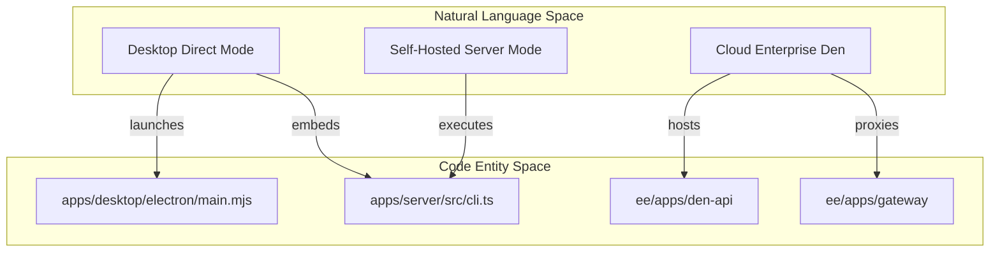
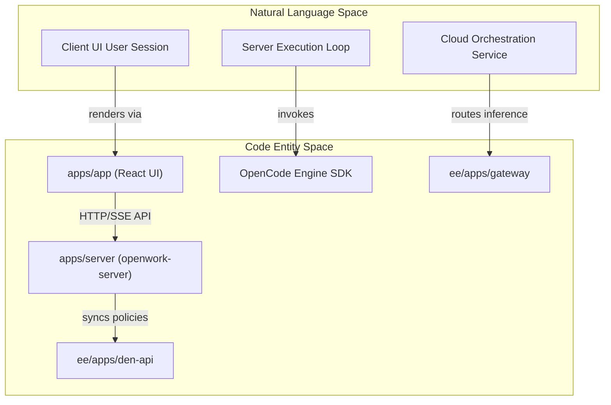

<!-- source: DeepWiki mcp.deepwiki.com · repo different-ai/openwork · page 1 Overview · fetched 2026-10-26 -->

# Overview

Relevant source files

The following files were used as context for generating this wiki page:

- [.github/workflows/ci-tests.yml](.github/workflows/ci-tests.yml)
- [.opencode/opencode.json](.opencode/opencode.json)
- [AGENTS.md](AGENTS.md)
- [README.md](README.md)
- [TRANSLATIONS.md](TRANSLATIONS.md)
- [apps/app/package.json](apps/app/package.json)
- [apps/desktop/package.json](apps/desktop/package.json)
- [apps/server/package.json](apps/server/package.json)
- [constants.json](constants.json)
- [ee/apps/den-api/src/generated/desktop-versions.ts](ee/apps/den-api/src/generated/desktop-versions.ts)
- [evals/README.md](evals/README.md)
- [package.json](package.json)
- [pnpm-lock.yaml](pnpm-lock.yaml)
- [translated_readmes/README.md](translated_readmes/README.md)
- [translated_readmes/README_JA.md](translated_readmes/README_JA.md)
- [translated_readmes/README_ZH.md](translated_readmes/README_ZH.md)
- [translated_readmes/README_ZH_hk.md](translated_readmes/README_ZH_hk.md)

OpenWork is a local-first AI agent workspace combining a desktop client (`apps/desktop`), a filesystem-backed server (`apps/server`), and the Den enterprise control plane (`ee/`) for managing **OpenCode**, an open-source AI agent platform [README.md:1-3](), [AGENTS.md:5-20](). It provides an extensible alternative to proprietary workspaces like Claude Cowork and Codex, allowing users to run agents locally on their own files or orchestrate them across cloud infrastructure [README.md:1-12]().

**Repository**: https://github.com/different-ai/openwork  
**License**: MIT (Core platform and desktop app) [README.md:96](), Source-Available (Den enterprise under `ee/`) [README.md:97]()

For detailed specifications, navigate to the child pages:
- For layout and monorepo packages, see [Repository Structure](#1.1).
- For runtime mechanics, filesystem policies, and engine orchestration, see [System Architecture](#1.2).
- For a component-to-directory index, see [Glossary of Components](#1.3).

---

## Runtime Shapes

OpenWork operates in three primary runtime configurations, bridging natural language workflows to specific entry points in the codebase:

Diagram: Runtime Deployment Shapes to Code Entites

1. **Desktop Direct**: The local-first desktop application combining an Electron shell (`apps/desktop`) and a React frontend (`apps/app`) [apps/desktop/package.json:1-12](), [apps/app/package.json:1-10](), running an embedded server sidecar that interacts directly with local files.
2. **Self-Hosted**: Running the `openwork-server` package (`apps/server`) as a standalone HTTP/CLI service on trusted remote infrastructure or local servers [apps/server/package.json:4-8]().
3. **Cloud Enterprise (Den)**: Scalable multi-tenant cloud operations utilizing the Den control plane (`ee/apps/den-api`), the dashboard (`ee/apps/den-web`), and the Inference Gateway (`ee/apps/gateway`) [AGENTS.md:12-20]().

Sources: [README.md:1-12](), [AGENTS.md:5-20](), [apps/desktop/package.json:1-12](), [apps/server/package.json:4-8]()

---

## High-Level Architecture

OpenWork separates the client user interface from the underlying execution engine and server sidecar, adhering to a **server-consumption-first** design principle [AGENTS.md:21-23]().

Diagram: High-Level Architecture Mapping

For a comprehensive breakdown of component interaction, filesystem mutation policies, and IPC bridges, see [System Architecture](#1.2).

Sources: [AGENTS.md:21-23](), [apps/desktop/package.json:11-26](), [apps/server/package.json:4-10]()

---

## Child Pages Navigation

- **[Repository Structure](#1.1)**: Detailed monorepo layout mapping `apps/`, `ee/apps/`, `packages/`, `evals/`, `worlds/`, and `infra/`.
- **[System Architecture](#1.2)**: Deep dive into the Electron shell, server sidecar, OpenCode engine integration, and filesystem security boundaries.
- **[Glossary of Components](#1.3)**: Comprehensive directory-to-role reference map for all deployable packages and applications.

Sources: [README.md:132-138]()

---

