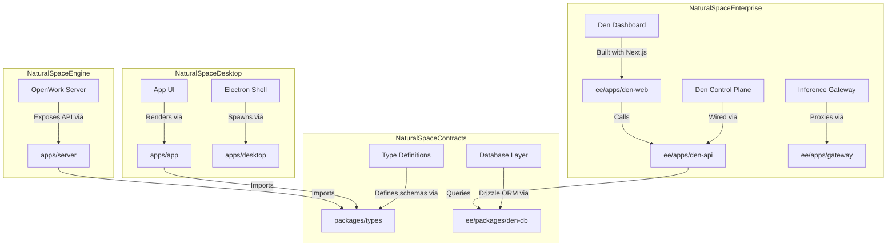
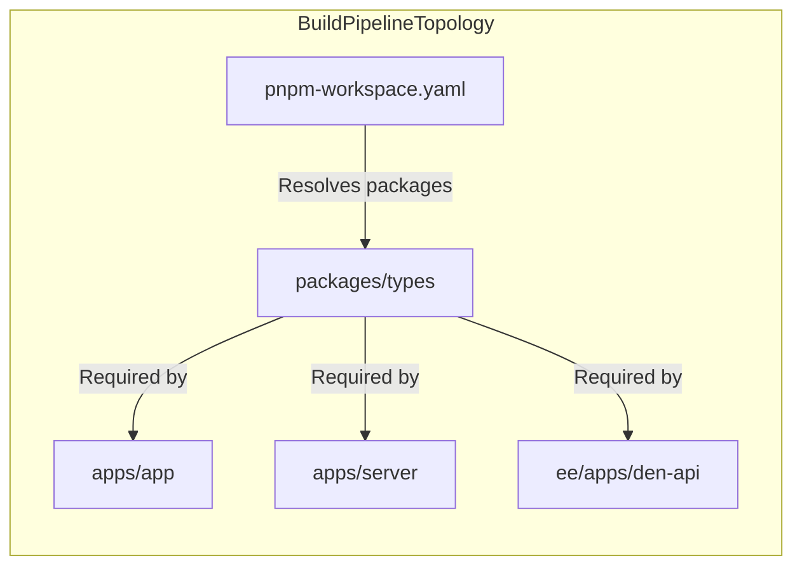

<!-- source: DeepWiki mcp.deepwiki.com · repo different-ai/openwork · page 1.1 Repository Structure · fetched 2026-10-26 -->

# Repository Structure

<details>
<summary>Relevant source files</summary>

The following files were used as context for generating this wiki page:

- [.github/workflows/ci-tests.yml](.github/workflows/ci-tests.yml)
- [.opencode/opencode.json](.opencode/opencode.json)
- [AGENTS.md](AGENTS.md)
- [README.md](README.md)
- [TRANSLATIONS.md](TRANSLATIONS.md)
- [apps/app/package.json](apps/app/package.json)
- [apps/desktop/package.json](apps/desktop/package.json)
- [apps/server/package.json](apps/server/package.json)
- [constants.json](constants.json)
- [ee/apps/den-api/src/generated/desktop-versions.ts](ee/apps/den-api/src/generated/desktop-versions.ts)
- [ee/apps/den-api/src/mcp/admin-query-limit.ts](ee/apps/den-api/src/mcp/admin-query-limit.ts)
- [ee/apps/den-api/src/mcp/admin-tools.ts](ee/apps/den-api/src/mcp/admin-tools.ts)
- [ee/apps/den-api/src/routes/org/index.ts](ee/apps/den-api/src/routes/org/index.ts)
- [ee/apps/den-api/test/admin-query-limit.test.ts](ee/apps/den-api/test/admin-query-limit.test.ts)
- [ee/packages/den-admin-mcp/README.md](ee/packages/den-admin-mcp/README.md)
- [ee/packages/den-admin-mcp/index.mjs](ee/packages/den-admin-mcp/index.mjs)
- [ee/packages/den-admin-mcp/package.json](ee/packages/den-admin-mcp/package.json)
- [ee/packages/den-admin-mcp/scripts/smoke.mjs](ee/packages/den-admin-mcp/scripts/smoke.mjs)
- [ee/packages/den-db/drizzle/meta/_journal.json](ee/packages/den-db/drizzle/meta/_journal.json)
- [ee/packages/den-db/package.json](ee/packages/den-db/package.json)
- [ee/packages/den-db/src/schema/index.ts](ee/packages/den-db/src/schema/index.ts)
- [ee/packages/den-db/tsup.config.ts](ee/packages/den-db/tsup.config.ts)
- [ee/packages/utils/src/typeid.ts](ee/packages/utils/src/typeid.ts)
- [evals/README.md](evals/README.md)
- [package.json](package.json)
- [pnpm-lock.yaml](pnpm-lock.yaml)
- [pnpm-workspace.yaml](pnpm-workspace.yaml)
- [translated_readmes/README.md](translated_readmes/README.md)
- [translated_readmes/README_JA.md](translated_readmes/README_JA.md)
- [translated_readmes/README_ZH.md](translated_readmes/README_ZH.md)
- [translated_readmes/README_ZH_hk.md](translated_readmes/README_ZH_hk.md)

</details>


## Purpose and Scope

This document describes the physical organization of the OpenWork monorepo, detailing the directory layout, package boundaries, and dependency management strategy using `pnpm` workspaces [pnpm-workspace.yaml:19-24](). OpenWork is structured as a modular monorepo containing client applications, local servers, enterprise control planes, evaluation suites, integration definitions, and shared core packages.

Sources: [pnpm-workspace.yaml:19-24]()

## Monorepo Layout

The OpenWork repository is organized as a workspace monorepo [pnpm-workspace.yaml:19-24]() divided into user-facing applications, enterprise services, shared utility packages, evaluation harness tools, operational scripts, scenarios, examples, integrations, and workspace patches.

```text
openwork/
├── apps/
│   ├── app/              # @openwork/app (React Frontend UI)
│   ├── desktop/          # @openwork/desktop (Electron native shell)
│   ├── server/           # openwork-server (Filesystem-backed API)
│   └── review/           # @openwork/review (Evidence review viewer)
├── ee/                   # Enterprise Edition components
│   ├── apps/
│   │   ├── den-api/      # Control plane API service (@openwork-ee/den-api)
│   │   ├── den-web/      # Cloud frontend dashboard (@openwork-ee/den-web)
│   │   ├── gateway/      # Inference & model routing gateway
│   │   ├── den-gateway/  # Edge gateway routing
│   │   ├── landing/      # Marketing site (openworklabs.com)
│   │   ├── headless-runner/ # Cheap headless agent sessions (@openwork-ee/headless-runner)
│   │   ├── workbot/      # Slack and chat assistant integration
│   │   └── diagnostics/  # Enterprise diagnostic bundle runner
│   └── packages/
│       ├── den-db/       # Shared database layer (@openwork-ee/den-db)
│       ├── utils/        # Shared enterprise utilities (@openwork-ee/utils)
│       └── telemetry/    # Telemetry contracts (@openwork-ee/telemetry)
├── packages/
│   ├── types/            # Unified TypeScript definitions (@openwork/types)
│   ├── sdk/              # Client SDK
│   ├── docs/             # Mintlify documentation site
│   ├── ui/               # Shared React component library (@openwork/ui)
│   ├── features/         # Feature flag registry (@openwork/features)
│   ├── free-auto/        # Free inference relay and proof-of-work
│   ├── codemode/         # Codemode tools and namespaces
│   ├── freestyle/        # Freestyle UI builders
│   ├── world/            # Scripted preview worlds
│   └── mcp-apps/         # MCP applications and dashboards
├── evals/                # End-to-end evaluation harness and test kits
├── worlds/               # Fixtures and scenario worlds
├── infra/                # Terraform modules and cloud infrastructure
├── packaging/            # Dockerfiles, Helm charts, and build packaging
├── scripts/              # Global build, check, and release automation
├── scenarios/            # Automated test scenario definitions
├── examples/             # Reference implementation templates and examples
├── integrations/         # Third-party integration modules and handlers
├── patches/              # Pnpm package patch files for upstream dependencies
├── package.json          # Root workspace configuration and scripts
└── pnpm-workspace.yaml   # Workspace path configuration
```

Sources: [pnpm-workspace.yaml:19-24](), [apps/app/package.json:2-5](), [apps/desktop/package.json:2-11](), [apps/server/package.json:2-8]()

## Component Architecture and Code Mapping

The following diagram bridges natural language system concepts to their concrete code entities within the monorepo structure.



Sources: [apps/app/package.json:34-89](), [apps/desktop/package.json:29-57](), [apps/server/package.json:55-74](), [ee/packages/den-db/package.json:1-15]()

## Detailed Directory Breakdown

### Apps (`apps/` and `ee/apps/`)
- **`apps/app/`**: The primary React frontend (`@openwork/app`), built with Vite and TailwindCSS, managing message rendering, lexical composer, and tool approvals [apps/app/package.json:2-102]().
- **`apps/desktop/`**: The Electron native shell (`@openwork/desktop`) providing window management, IPC bridges, auto-updater integration, and sidecar execution [apps/desktop/package.json:2-65]().
- **`apps/server/`**: The local filesystem-backed API (`openwork-server`) powered by Bun, wrapping the OpenCode engine and executing plugins [apps/server/package.json:2-91]().
- **`ee/apps/den-api/`**: The enterprise control plane API (`@openwork-ee/den-api`) built on Hono and Better Auth, handling orgs, RBAC, billing, and worker lifecycle [ee/apps/den-api/package.json:1-50]().
- **`ee/apps/den-web/`**: The Next.js control plane dashboard (`@openwork-ee/den-web`) for managing organization settings, billing, and MCP OAuth connections [ee/apps/den-web/package.json:1-35]().

Sources: [apps/app/package.json:2-102](), [apps/desktop/package.json:2-65](), [apps/server/package.json:2-91]()

### Shared and Enterprise Packages (`packages/` and `ee/packages/`)
- **`packages/types/`**: Unified TypeScript data contracts, desktop IPC maps, and OpenWork affordances (`@openwork/types`) [packages/types/package.json:1-50]().
- **`ee/packages/den-db/`**: Shared Drizzle ORM schema, migration journal, and encryption routines for enterprise storage [ee/packages/den-db/drizzle/meta/_journal.json:1-15]().
- **`packages/features/`**: Feature flag registry and rollout evaluation logic.
- **`packages/free-auto/`**: Anonymous inference relay, proof-of-work generation, and activation windows.

Sources: [pnpm-workspace.yaml:19-24](), [ee/packages/den-db/drizzle/meta/_journal.json:1-15]()

### Operational, Evaluation, and Support Directories
- **`evals/`**: End-to-end evaluation harness (`@openwork/evals`), test specs, and driver binaries [evals/README.md:1-25]().
- **`worlds/`**: Scenario definition fixtures used by the test runner.
- **`infra/`**: Terraform modules (e.g., AWS ECS deployment architectures).
- **`packaging/`**: Dockerfiles, Helm charts (`openwork-ee`), and installer configurations.
- **`scripts/`**: Global maintenance, release, and build automation scripts [package.json:8-71]().
- **`scenarios/`**: Automated scenario verification configurations and test cases.
- **`examples/`**: Reference code snippets and integration templates.
- **`integrations/`**: Third-party bridge implementations and connectors.
- **`patches/`**: Package patches applied during dependency installation via `pnpm` [pnpm-workspace.yaml:149-154]().

Sources: [evals/README.md:1-25](), [package.json:8-71](), [pnpm-workspace.yaml:149-154]()

## Dependency Management and Build Topology

The repository relies on `pnpm` workspace settings to enforce package isolation and dependency hoisting rules [pnpm-workspace.yaml:19-34](). 



Sources: [pnpm-workspace.yaml:19-34](), [apps/app/package.json:51](), [apps/server/package.json:62]()

## Data Flow and Communication Matrix

| Source Entity | Destination Entity | Protocol | Description |
| :--- | :--- | :--- | :--- |
| **`@openwork/app`** [apps/app/package.json:2-5]() | **`openwork-server`** [apps/server/package.json:2-5]() | HTTP / SSE | Frontend issues prompts and consumes real-time telemetry via SDK [apps/app/package.json:47]() |
| **`openwork-server`** [apps/server/package.json:2-5]() | **OpenCode Engine** | Stdin / Stdout | Server provisions and communicates with the underlying execution engine [apps/server/package.json:4-8]() |
| **`@openwork/desktop`** [apps/desktop/package.json:2-5]() | **Sidecar Binaries** | IPC / Process | Electron shell manages lifecycle of embedded server and orchestrators [apps/desktop/package.json:11-27]() |
| **`den-web`** [ee/apps/den-web/package.json:2-5]() | **`den-api`** [ee/apps/den-api/package.json:2-5]() | HTTP | Dashboard administrative app requests control plane mutations |
| **`den-api`** [ee/apps/den-api/package.json:2-5]() | **`gateway`** [ee/apps/gateway/] | HTTP | Control plane proxies model inference requests to the managed gateway |

Sources: [apps/app/package.json:47](), [apps/server/package.json:4-8](), [apps/desktop/package.json:11-27](), [ee/apps/den-api/package.json:1-10]()

---

