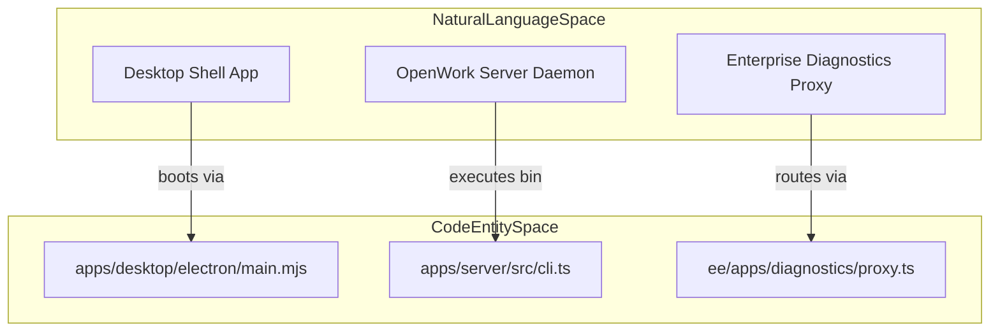
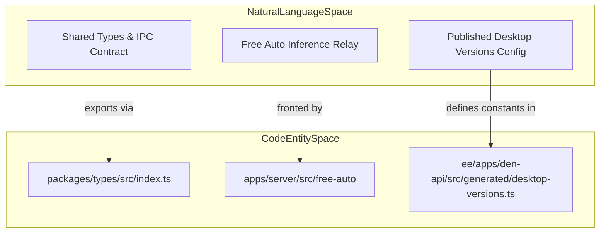

<!-- source: DeepWiki mcp.deepwiki.com · repo different-ai/openwork · page 1.3 Glossary of Components · fetched 2026-10-26 -->

# Glossary of Components

Relevant source files

The following files were used as context for generating this wiki page:

- [.opencode/opencode.json](.opencode/opencode.json)
- [apps/app/package.json](apps/app/package.json)
- [apps/desktop/package.json](apps/desktop/package.json)
- [apps/server/package.json](apps/server/package.json)
- [constants.json](constants.json)
- [ee/apps/den-api/src/generated/desktop-versions.ts](ee/apps/den-api/src/generated/desktop-versions.ts)
- [ee/apps/diagnostics/.env.example](ee/apps/diagnostics/.env.example)
- [ee/apps/diagnostics/README.md](ee/apps/diagnostics/README.md)
- [ee/apps/diagnostics/app/api/connections/identity/route.ts](ee/apps/diagnostics/app/api/connections/identity/route.ts)
- [ee/apps/diagnostics/app/api/connections/incidents/route.ts](ee/apps/diagnostics/app/api/connections/incidents/route.ts)
- [ee/apps/diagnostics/app/connections/incident-filters.tsx](ee/apps/diagnostics/app/connections/incident-filters.tsx)
- [ee/apps/diagnostics/app/connections/page.tsx](ee/apps/diagnostics/app/connections/page.tsx)
- [ee/apps/diagnostics/app/debug-proxy/[accessKey]/page.tsx](ee/apps/diagnostics/app/debug-proxy/[accessKey]/page.tsx)
- [ee/apps/diagnostics/app/page.tsx](ee/apps/diagnostics/app/page.tsx)
- [ee/apps/diagnostics/app/styles.css](ee/apps/diagnostics/app/styles.css)
- [ee/apps/diagnostics/app/via/[scenario]/[[...path]]/route.ts](ee/apps/diagnostics/app/via/[scenario]/[[...path]]/route.ts)
- [ee/apps/diagnostics/proxy.ts](ee/apps/diagnostics/proxy.ts)
- [ee/apps/diagnostics/scripts/connect-debug-proxy-smoke.mjs](ee/apps/diagnostics/scripts/connect-debug-proxy-smoke.mjs)
- [ee/apps/diagnostics/src/connect-debug-proxy-browser-route.ts](ee/apps/diagnostics/src/connect-debug-proxy-browser-route.ts)
- [ee/apps/diagnostics/src/connect-debug-proxy-config.ts](ee/apps/diagnostics/src/connect-debug-proxy-config.ts)
- [ee/apps/diagnostics/src/connect-debug-proxy-faults.ts](ee/apps/diagnostics/src/connect-debug-proxy-faults.ts)
- [ee/apps/diagnostics/src/connection-incident-query.ts](ee/apps/diagnostics/src/connection-incident-query.ts)
- [ee/apps/diagnostics/src/connection-incident-store.ts](ee/apps/diagnostics/src/connection-incident-store.ts)
- [packages/types/package.json](packages/types/package.json)
- [packages/types/src/index.ts](packages/types/src/index.ts)
- [packages/types/tsup.config.ts](packages/types/tsup.config.ts)
- [pnpm-lock.yaml](pnpm-lock.yaml)

## Purpose and Scope
The Glossary of Components establishes a definitive map of every deployable application, service, and shared package within the OpenWork monorepo (`https://github.com/different-ai/openwork`). It cross-references natural language system concepts with their physical directory locations, role definitions, and primary code entry points to streamline navigation across the wiki and codebase.

Sources: `[apps/app/package.json:1-33]()`, `[apps/desktop/package.json:1-27]()`, `[apps/server/package.json:1-26]()`

---

## Core and Enterprise Applications
OpenWork is split into client applications, server daemons, and enterprise control plane services housed under `apps/` and `ee/apps/`.

| Application Name | Directory | Primary Technical Role | Key Entry Point / Configuration |
|---|---|---|---|
| `@openwork/app` | `apps/app` | React frontend single-page application powering the chat interface, session rendering, session synchronization, and settings views. | `[apps/app/package.json:1-33]()` |
| `@openwork/desktop` | `apps/desktop` | Electron shell wrapper managing the desktop window, IPC bridge, sidecar process lifecycle, and OS integrations. | `[apps/desktop/package.json:1-27]()` |
| `openwork-server` | `apps/server` | Local/self-hosted HTTP backend service fronting the OpenCode engine, workspace management, file synchronization, and free auto inference. | `[apps/server/package.json:1-26]()` |
| `@openwork-ee/den-api` | `ee/apps/den-api` | Enterprise control plane backend API service built on Hono, Better Auth, and Drizzle ORM, managing organizations, policies, and telemetry. | `[ee/apps/den-api/src/generated/desktop-versions.ts:1-93]()` |
| `@openwork-ee/diagnostics` | `ee/apps/diagnostics` | Enterprise Vercel-native MCP compatibility and egress debugging proxy endpoint. | `[ee/apps/diagnostics/proxy.ts:1-53]()` |

Sources: `[apps/app/package.json:1-33]()`, `[apps/desktop/package.json:1-27]()`, `[apps/server/package.json:1-26]()`, `[ee/apps/diagnostics/proxy.ts:1-53]()`

---

## Shared Packages and Libraries
Cross-cutting logic, database contracts, and client SDKs are modularized under `packages/` and `ee/packages/`.

| Package Name | Directory | Primary Technical Role | Key Entry / Config |
|---|---|---|---|
| `@openwork/types` | `packages/types` | Shared TypeScript type definitions, IPC command maps, and network contract models. | `[packages/types/package.json:1-50]()` |
| `@openwork/free-auto` | `packages/free-auto` | Anonymous inference relay client, desktop free proof generator, and relay credential validation. | `[apps/server/package.json:55-74]()` |
| `@openwork/enterprise-mcp-client` | `packages/enterprise-mcp-client` | Enterprise Model Context Protocol client library and dynamic connector integration tooling. | `[apps/server/package.json:55-74]()` |

Sources: `[packages/types/package.json:1-50]()`, `[apps/server/package.json:55-74]()`

---

## Removed and Renamed Components
Historical context on deprecated or restructured system modules:
- **Unified Tauri App**: Early iterations combined the desktop shell and web UI into a monolithic binary; this has been cleanly decoupled into `apps/desktop` (Electron shell) and `apps/app` (React SPA).
- **`den-gateway`**: Edge routing logic has been refactored into dedicated gateway modules within `ee/apps/gateway` and consolidated into `@openwork-ee/den-api`.
- **Legacy Skills Engine**: Superseded by the next-gen plugin architecture supporting unified configuration objects, MCP tool discovery, and codemode scripts.

Sources: `[apps/desktop/package.json:1-27]()`, `[apps/server/package.json:1-26]()`

---

## Component System-to-Code Mapping Diagrams

The following diagrams bridge natural language system names to concrete codebase entities, file paths, and entry points.

### Application System-to-Code Mapping

Sources: `[apps/desktop/package.json:11-13]()`, `[apps/server/package.json:6-8]()`, `[ee/apps/diagnostics/proxy.ts:10-20]()`

### Shared Package System-to-Code Mapping

Sources: `[packages/types/package.json:42-49]()`, `[apps/server/package.json:55-74]()`, `[ee/apps/den-api/src/generated/desktop-versions.ts:1-5]()`

---

