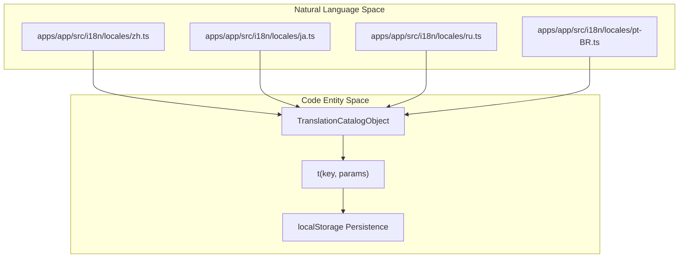
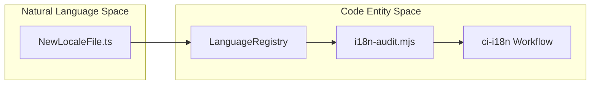

<!-- source: DeepWiki mcp.deepwiki.com · repo different-ai/openwork · page 10 Internationalization · fetched 2026-10-26 -->

# Internationalization

Relevant source files

The following files were used as context for generating this wiki page:

- [apps/app/src/i18n/locales/ca.ts](apps/app/src/i18n/locales/ca.ts)
- [apps/app/src/i18n/locales/es.ts](apps/app/src/i18n/locales/es.ts)
- [apps/app/src/i18n/locales/fr.ts](apps/app/src/i18n/locales/fr.ts)
- [apps/app/src/i18n/locales/ja.ts](apps/app/src/i18n/locales/ja.ts)
- [apps/app/src/i18n/locales/pt-BR.ts](apps/app/src/i18n/locales/pt-BR.ts)
- [apps/app/src/i18n/locales/ru.ts](apps/app/src/i18n/locales/ru.ts)
- [apps/app/src/i18n/locales/th.ts](apps/app/src/i18n/locales/th.ts)
- [apps/app/src/i18n/locales/vi.ts](apps/app/src/i18n/locales/vi.ts)
- [apps/app/src/i18n/locales/zh.ts](apps/app/src/i18n/locales/zh.ts)

This page provides a high-level overview of the internationalization (i18n) system implemented in the OpenWork frontend application (`apps/app`). The localization architecture supports runtime language switching, structured translation catalogs across multiple languages, pluralization rules, and parameter interpolation. 

As a parent page, this document summarizes core concepts and high-level workflows. Detailed technical breakdowns, loader implementations, and step-by-step instructions are maintained in the child pages:
- [Translation System](#10.1) — Covers the catalog loading mechanism, locale structure, key namespaces, and audit scripts.
- [Adding a New Language](#10.2) — Covers step-by-step instructions for contributing new language packs and managing locale files.

---

## Translation System Overview

OpenWork manages localized strings as structured TypeScript objects organized by locale codes in the translation catalog directory `apps/app/src/i18n/locales/`. The application supports multiple languages, including Simplified Chinese (`zh.ts`), Brazilian Portuguese (`pt-BR.ts`), Vietnamese (`vi.ts`), Japanese (`ja.ts`), Thai (`th.ts`), French (`fr.ts`), Catalan (`ca.ts`), Spanish (`es.ts`), and Russian (`ru.ts`). Professional domain terms (such as `Skills`, `Plugins`, `Commands`, and `OpenCode`) remain un-translated across locales to preserve technical clarity.

**Title: Natural Language to Code Entity Mapping**

For comprehensive documentation on the runtime catalog loader, translation resolution logic, key namespaces, and automated CI audit pipelines, see [Translation System](#10.1).

**Sources:** [apps/app/src/i18n/locales/zh.ts:1-155](), [apps/app/src/i18n/locales/ru.ts:1-110]()

---

## Adding a New Language

Integrating a new human language into OpenWork involves duplicating an existing baseline locale file (such as `en.ts`), translating the structured key-value pairs while maintaining technical terminology rules, registering the locale in the frontend configuration, and validating the resulting catalog using automated validation scripts.

**Title: Locale Integration Pipeline**

For step-by-step instructions on duplicating templates, registering locale options, executing the audit scripts, and updating translated documentation, see [Adding a New Language](#10.2).

**Sources:** [apps/app/src/i18n/locales/vi.ts:1-120](), [apps/app/src/i18n/locales/th.ts:1-121]()

---

# Child Pages

- [Translation System](#10.1) — Detailed guide on catalog loading, pluralization handling, namespaces, and the i18n audit script.
- [Adding a New Language](#10.2) — Step-by-step procedures for contributing new language packs and inspecting existing translation assets.

---

