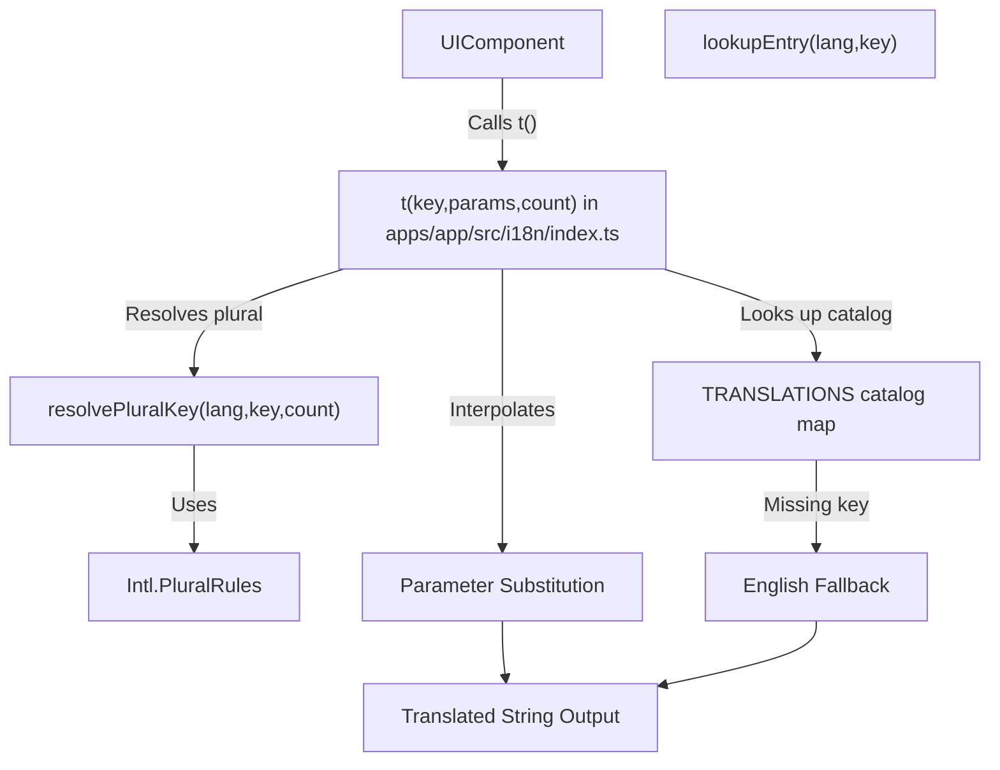
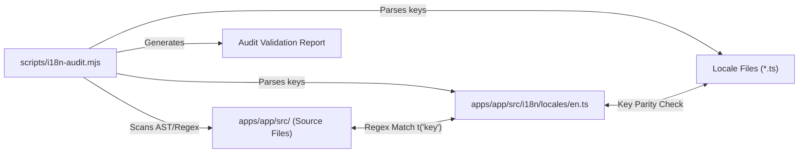

<!-- source: DeepWiki mcp.deepwiki.com · repo different-ai/openwork · page 10.1 Translation System · fetched 2026-10-26 -->

# Translation System

<details>
<summary>Relevant source files</summary>

The following files were used as context for generating this wiki page:

- [.github/workflows/api-contract.yml](.github/workflows/api-contract.yml)
- [.github/workflows/ci-enterprise-mcp-mock.yml](.github/workflows/ci-enterprise-mcp-mock.yml)
- [.github/workflows/ci-i18n.yml](.github/workflows/ci-i18n.yml)
- [.github/workflows/ci-openwork-ui-mcp.yml](.github/workflows/ci-openwork-ui-mcp.yml)
- [.github/workflows/ci-sdk.yml](.github/workflows/ci-sdk.yml)
- [.github/workflows/den-db-check.yml](.github/workflows/den-db-check.yml)
- [.github/workflows/den-db-migrate.yml](.github/workflows/den-db-migrate.yml)
- [.github/workflows/publish-ee-images.yml](.github/workflows/publish-ee-images.yml)
- [apps/app/src/i18n/locales/ca.ts](apps/app/src/i18n/locales/ca.ts)
- [apps/app/src/i18n/locales/es.ts](apps/app/src/i18n/locales/es.ts)
- [apps/app/src/i18n/locales/fr.ts](apps/app/src/i18n/locales/fr.ts)
- [apps/app/src/i18n/locales/ja.ts](apps/app/src/i18n/locales/ja.ts)
- [apps/app/src/i18n/locales/pt-BR.ts](apps/app/src/i18n/locales/pt-BR.ts)
- [apps/app/src/i18n/locales/ru.ts](apps/app/src/i18n/locales/ru.ts)
- [apps/app/src/i18n/locales/th.ts](apps/app/src/i18n/locales/th.ts)
- [apps/app/src/i18n/locales/vi.ts](apps/app/src/i18n/locales/vi.ts)
- [apps/app/src/i18n/locales/zh.ts](apps/app/src/i18n/locales/zh.ts)
- [ee/apps/den-api/scripts/migrate-skills-to-plugins.ts](ee/apps/den-api/scripts/migrate-skills-to-plugins.ts)
- [ee/packages/den-db/.env.example](ee/packages/den-db/.env.example)
- [ee/packages/den-db/README.md](ee/packages/den-db/README.md)
- [ee/packages/den-db/drizzle.config.ts](ee/packages/den-db/drizzle.config.ts)
- [ee/packages/den-db/scripts/baseline-migrations.ts](ee/packages/den-db/scripts/baseline-migrations.ts)
- [ee/packages/den-db/scripts/bootstrap.ts](ee/packages/den-db/scripts/bootstrap.ts)
- [ee/packages/den-db/scripts/build-assets.mjs](ee/packages/den-db/scripts/build-assets.mjs)
- [ee/packages/den-db/scripts/db-executor.ts](ee/packages/den-db/scripts/db-executor.ts)
- [ee/packages/den-db/scripts/migration-0097-compat.ts](ee/packages/den-db/scripts/migration-0097-compat.ts)
- [ee/packages/den-db/scripts/migration-0097-schema.ts](ee/packages/den-db/scripts/migration-0097-schema.ts)
- [packaging/helm/openwork-ee/tests/upgrade-and-migration.mjs](packaging/helm/openwork-ee/tests/upgrade-and-migration.mjs)

</details>


The OpenWork translation system implements internationalization (i18n) for the desktop and web applications (`apps/app`). It is built around a key-value mapping architecture with English (`en.ts`) as the source language and fallback. The system supports pluralization, parameter substitution, namespace organization, and audit tooling to verify translation integrity and completeness.

---

## Purpose and Scope

This page details the implementation of the OpenWork translation system focusing on:

- The central translation loader and runtime API (`apps/app/src/i18n/index.ts`).
- The structure and key namespaces of locale catalogs (`apps/app/src/i18n/locales/`).
- The audit tooling script (`scripts/i18n-audit.mjs`) for maintaining translation health.
- The Continuous Integration workflow (`.github/workflows/ci-i18n.yml`) for i18n verification.

Sources: `[apps/app/src/i18n/index.ts:1-192](), [apps/app/src/i18n/locales/en.ts:1-118]()`

---

## i18n Architecture

The translation system is implemented with these core components:

### 1. Central Translation Loader (`i18n/index.ts`)

- This module manages the active locale state and provides the primary translation function `t()`.
- Maintains `localeValue` which holds the current language tag such as `"en"`, `"zh"`, `"ja"`, etc.
- Supports loading locale catalog objects dynamically from the `locales/` folder.
- Syncs the selected language preference with `localStorage` under the key `LANGUAGE_PREF_KEY`.
- On language change, updates the HTML document's `lang` attribute accordingly.

### 2. Translation Function `t(key, params, count?)`

- Returns translated string for the key from the current locale catalog.
- If the key is missing in the locale, falls back to English.
- Supports pluralization using `Intl.PluralRules`, selecting keys like `_one`, `_other`, `_zero` based on the numeric `count` parameter.
- Supports interpolation of parameters inside translation strings using `{paramName}` syntax.
- If the key is ultimately missing, returns the key itself as a fallback.

### Diagram: Natural Language to Code Entities (Translation Resolution)



Sources: `[apps/app/src/i18n/index.ts:59-192]()`

---

## Locale Catalog Structure

The locale files live under `apps/app/src/i18n/locales/` (including `zh.ts`, `pt-BR.ts`, `vi.ts`, `ja.ts`, `th.ts`, `fr.ts`, `ca.ts`, `es.ts`, and `ru.ts`) and are TypeScript modules exporting a flat object mapping keys to strings.

| Namespace    | Description                                | Example Keys                                   |
|--------------|--------------------------------------------|-----------------------------------------------|
| `app.*`      | Application UI labels, errors, generic     | `app.error_auth_failed`, `app.reload_now`     |
| `blueprint.*`| Onboarding and templates                   | `blueprint.automation_title`, `blueprint.welcome_title` |
| `common.*`   | Generic reused labels                      | `common.add`, `common.cancel`, `common.save`  |
| `composer.*` | Chat composer labels and buttons           | `composer.agent_label`, `composer.attach_files` |
| `config.*`   | Settings, connection status, server config | `config.reload_engine`, `config.status_connected` |

### Professional Terms Policy

To ensure consistency, professional terms related to domain concepts such as **Skills**, **Plugins**, **Commands**, **Sessions**, **OpenCode**, **OpenPackage**, and **OpenWork** are NOT translated; they remain in English across locale files (`apps/app/src/i18n/locales/zh.ts`, `apps/app/src/i18n/locales/pt-BR.ts`, etc.). In localized editions like Chinese (`zh.ts`), the English term is annotated with a translated parenthetical where appropriate.

Sources: `[apps/app/src/i18n/locales/zh.ts:1-155](), [apps/app/src/i18n/locales/en.ts:1-118]()`

---

## Audit System

To maintain translation quality and alert developers of inconsistencies, the repository includes a dedicated audit script:

### Audit Script: `scripts/i18n-audit.mjs`

This CLI script performs static analysis on translation locale files and source usage:
- `--missing`: Finds keys present in English but missing in another locale catalog.
- `--orphan`: Finds keys in a locale file not present in English.
- `--unused`: Finds keys declared in English but never used in source files.
- `--dangling`: Finds translation keys referenced in code (`t('...')`) but missing in `en.ts`.
- `--placeholders`: Validates parameter placeholders match those in English.
- `--plurals`: Checks required plural forms are present per CLDR.
- `--sort`: Alphabetizes keys in all locale catalogs.

### Diagram: Natural Language to Code Entities (Audit Pipeline)



Sources: `[scripts/i18n-audit.mjs:1-180]()`

---

## Continuous Integration (CI) Workflow for i18n

The translation system integrates into CI via workflows that execute the audit script, enforce catalog sorting, and catch missing keys or placeholder mismatches on pull requests.

Sources: `[.github/workflows/ci-i18n.yml:1-25]()`

---

## Appendix: Key Constants and Types

```ts
const LANGUAGE_PREF_KEY = "openwork.locale";

type Language = "en" | "zh" | "ja" | "vi" | "pt-BR" | "th" | "fr" | "ca" | "es" | "ru";

interface Translations {
  [key: string]: string;
}
```

Sources: `[apps/app/src/i18n/index.ts:1-40]()`

---

