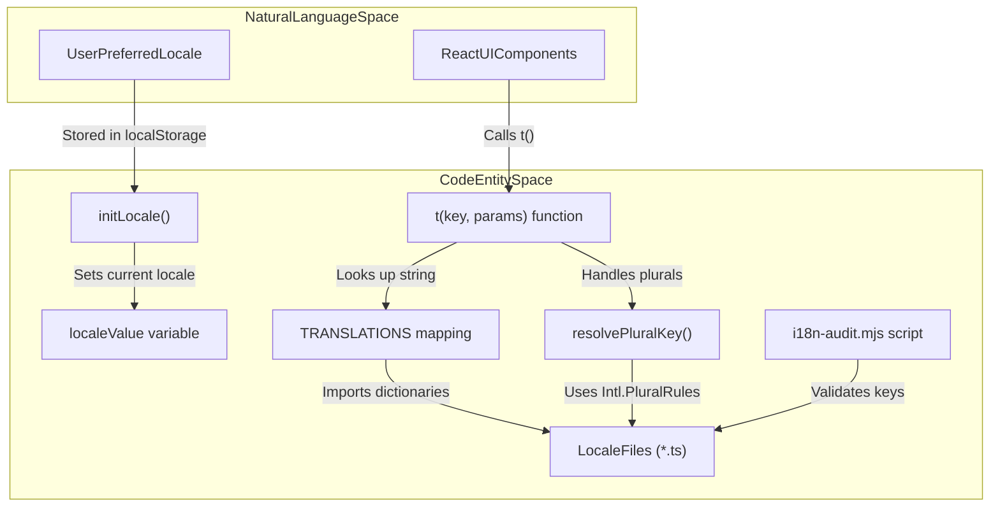
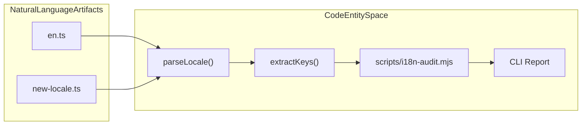

<!-- source: DeepWiki mcp.deepwiki.com · repo different-ai/openwork · page 10.2 Adding a New Language · fetched 2026-10-26 -->

# Adding a New Language

Relevant source files

The following files were used as context for generating this wiki page:

- [.github/workflows/ci-tests.yml](.github/workflows/ci-tests.yml)
- [AGENTS.md](AGENTS.md)
- [README.md](README.md)
- [TRANSLATIONS.md](TRANSLATIONS.md)
- [apps/app/src/i18n/locales/ca.ts](apps/app/src/i18n/locales/ca.ts)
- [apps/app/src/i18n/locales/es.ts](apps/app/src/i18n/locales/es.ts)
- [apps/app/src/i18n/locales/fr.ts](apps/app/src/i18n/locales/fr.ts)
- [apps/app/src/i18n/locales/ja.ts](apps/app/src/i18n/locales/ja.ts)
- [apps/app/src/i18n/locales/pt-BR.ts](apps/app/src/i18n/locales/pt-BR.ts)
- [apps/app/src/i18n/locales/ru.ts](apps/app/src/i18n/locales/ru.ts)
- [apps/app/src/i18n/locales/th.ts](apps/app/src/i18n/locales/th.ts)
- [apps/app/src/i18n/locales/vi.ts](apps/app/src/i18n/locales/vi.ts)
- [apps/app/src/i18n/locales/zh.ts](apps/app/src/i18n/locales/zh.ts)
- [evals/README.md](evals/README.md)
- [package.json](package.json)
- [translated_readmes/README.md](translated_readmes/README.md)
- [translated_readmes/README_JA.md](translated_readmes/README_JA.md)
- [translated_readmes/README_ZH.md](translated_readmes/README_ZH.md)
- [translated_readmes/README_ZH_hk.md](translated_readmes/README_ZH_hk.md)

OpenWork features a multifaceted internationalization (i18n) system designed to support multiple languages with fallback to English. This page provides a detailed technical guide on how to add a new language localization to the OpenWork codebase, focusing on the frontend locale files, their registration, and validation.

## Purpose and Scope

This document details the exact steps to:
- Duplicate and translate the English base locale file (`en.ts`),
- Properly register the new locale in the i18n loader (`index.ts`),
- Run audits to ensure translation completeness and consistency,
- Review the existing locales and translated README files.

The instructions are aimed at developers contributing to the OpenWork frontend application present inside the monorepo.

Sources: `[apps/app/src/i18n/index.ts:1-134]`, `[apps/app/src/i18n/locales/en.ts:1-7]()`

---

## Existing Locales Survey

Current locales supported under `apps/app/src/i18n/locales/` include:
- `zh.ts` (Chinese Simplified)
- `pt-BR.ts` (Portuguese - Brazil)
- `vi.ts` (Vietnamese)
- `ja.ts` (Japanese)
- `th.ts` (Thai)
- `fr.ts` (French)
- `ru.ts` (Russian)
- `ca.ts` (Catalan)
- `es.ts` (Spanish)

Each locale module exports a constant record keyed by translation keys, providing the localized string values [apps/app/src/i18n/locales/zh.ts:1-156](), [apps/app/src/i18n/locales/pt-BR.ts:1-112](), [apps/app/src/i18n/locales/vi.ts:1-120](), [apps/app/src/i18n/locales/ja.ts:1-140](), [apps/app/src/i18n/locales/th.ts:1-121](), [apps/app/src/i18n/locales/fr.ts:1-105](), [apps/app/src/i18n/locales/ru.ts:1-110](), [apps/app/src/i18n/locales/ca.ts:1-107](), [apps/app/src/i18n/locales/es.ts:1-106]().

In addition, the `translated_readmes/` directory contains localization-ready markdown files of documentation content, supporting non-English language users across multiple repositories.

Sources: `[apps/app/src/i18n/locales/zh.ts:1-156]()`, `[README.md:11-12]()`

---

## I18n Data Flow and Translation System Architecture

The frontend i18n system is constructed around plain TypeScript locale files. The principal translation function `t()` abstracts translation retrieval with a hierarchical fallback to English defaults and literal keys if necessary.

### Data Flow Diagram

This architecture ensures dynamic loading of language resources and robust handling of plurals or missing keys.

Sources: `[apps/app/src/i18n/index.ts:79-192]()`, `[apps/app/src/i18n/locales/index.ts:1-12]()`, `[scripts/i18n-audit.mjs:52-57]()`

---

## Step-by-Step: Adding a New Locale

### 1. Copy the English Locale as Template
- Duplicate the existing English base translation file located at `apps/app/src/i18n/locales/en.ts`.
- Name it with the new locale code, e.g., `fr-CA.ts` for Canadian French.
- Translate values appropriately while keeping technical terms (e.g., "Skills", "Plugins", "Commands", "Sessions", "OpenCode", "OpenPackage", and "OpenWork") in English to maintain consistency.
- For languages without plurals (e.g., Japanese, Chinese, and Thai), ensure plural suffixes are handled properly by maintaining empty plural suffix arrays internally.

Sources: `[apps/app/src/i18n/locales/en.ts:1-7]()`, `[apps/app/src/i18n/locales/ja.ts:1-6]()`

### 2. Register Your New Locale
The central locale registration occurs in `apps/app/src/i18n/index.ts`. Make changes in the following steps:
- Import the new locale file at the top.
- Add the language code to the `Language` union type.
- Add the language code to the `LANGUAGES` array.
- Add a UI option in `LANGUAGE_OPTIONS` for the language selector in settings.
- Add the locale mapping in `TRANSLATIONS`, linking the language code to the imported locale dictionary.
- Register pluralization rules in `pluralRulesByLanguage` using `Intl.PluralRules`.

Sources: `[apps/app/src/i18n/index.ts:1-134]()`

### 3. Re-export the Locale for Convenience
Update the barrel export in `apps/app/src/i18n/locales/index.ts` to re-export the new locale, maintaining consistent imports elsewhere.

Sources: `[apps/app/src/i18n/locales/index.ts:1-12]()`

### 4. Validation with the i18n Audit Tool
OpenWork provides a CLI audit tool (`scripts/i18n-audit.mjs`) to maintain translation health, detecting missing, orphaned, or unused keys, and validating pluralization.

### Audit Workflow Diagram

Audit flags include `--missing`, `--orphan`, `--unused`, `--plurals`, `--sort`, and `--prune`.

Sources: `[scripts/i18n-audit.mjs:1-164]()`

---

## Summary Table of Key Files for Adding a New Language

| Task | File Path / Lines | Description |
|---|---|---|
| Reference English locale | `apps/app/src/i18n/locales/en.ts:1-7` | Base template for keys and text |
| Locale file import | `apps/app/src/i18n/index.ts:1-10` | Import the new locale file |
| Language Type | `apps/app/src/i18n/index.ts:16` | Extend the `Language` union |
| Supported Languages | `apps/app/src/i18n/index.ts:22` | Add new language code to `LANGUAGES` array |
| UI Language Options | `apps/app/src/i18n/index.ts:27-38` | Add label/nativeName to settings selector |
| Locale Map | `apps/app/src/i18n/index.ts:58-69` | Associate language code to imported locale |
| Plural Rules | `apps/app/src/i18n/index.ts:123-134` | Register pluralization rules |
| Barrel Export | `apps/app/src/i18n/locales/index.ts:1-12` | Add re-export for convenience |
| Audit Script Locale List | `scripts/i18n-audit.mjs:30` | Add new locale code |

Sources: `[apps/app/src/i18n/index.ts:1-134]`, `[scripts/i18n-audit.mjs:1-164]()`

---

## Conclusion

Adding a new language to OpenWork consists mainly of copying and translating the English locale file, registering the language rigorously in the i18n initialization, and running audit scripts to validate translation consistency. This modular design eases community contributions and multi-language support.

Sources: `[apps/app/src/i18n/index.ts:1-192]`, `[scripts/i18n-audit.mjs:1-164]()`

---

