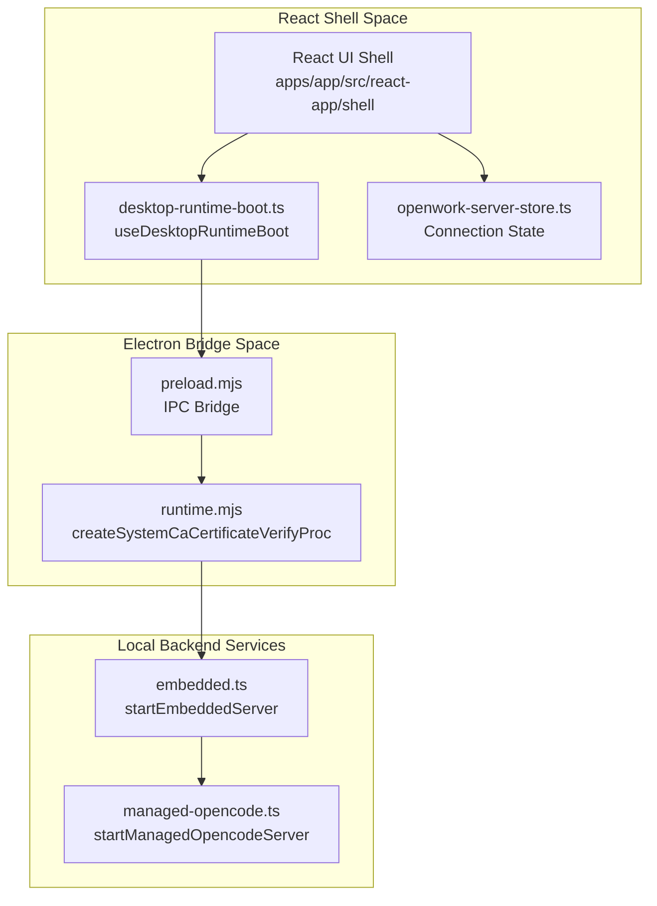

<!-- source: DeepWiki mcp.deepwiki.com · repo different-ai/openwork · page 11 Troubleshooting · fetched 2026-10-26 -->

# Troubleshooting

Relevant source files

The following files were used as context for generating this wiki page:

- [apps/app/src/app/lib/diagnostics-bundle.ts](apps/app/src/app/lib/diagnostics-bundle.ts)
- [apps/app/src/react-app/domains/connections/openwork-server-store.ts](apps/app/src/react-app/domains/connections/openwork-server-store.ts)
- [apps/app/src/react-app/shell/desktop-runtime-boot.ts](apps/app/src/react-app/shell/desktop-runtime-boot.ts)
- [apps/app/src/react-app/shell/engine-reload-escalation.ts](apps/app/src/react-app/shell/engine-reload-escalation.ts)
- [apps/desktop/electron/runtime.mjs](apps/desktop/electron/runtime.mjs)
- [apps/desktop/electron/startup-log.mjs](apps/desktop/electron/startup-log.mjs)
- [apps/desktop/electron/windows-shortcut.mjs](apps/desktop/electron/windows-shortcut.mjs)
- [apps/server/src/cli.ts](apps/server/src/cli.ts)
- [apps/server/src/embedded.ts](apps/server/src/embedded.ts)
- [apps/server/src/managed-opencode.ts](apps/server/src/managed-opencode.ts)
- [apps/server/src/openwork-extensions-plugin-path.ts](apps/server/src/openwork-extensions-plugin-path.ts)
- [apps/server/src/openwork-runtime-config.ts](apps/server/src/openwork-runtime-config.ts)
- [apps/server/src/selfhost-web.ts](apps/server/src/selfhost-web.ts)
- [apps/server/src/workspace-init.ts](apps/server/src/workspace-init.ts)
- [apps/server/test/archive-extraction.test.ts](apps/server/test/archive-extraction.test.ts)
- [apps/server/test/opencode-plugin-deps.test.ts](apps/server/test/opencode-plugin-deps.test.ts)
- [ee/apps/den-worker-runtime/Dockerfile.daytona-snapshot](ee/apps/den-worker-runtime/Dockerfile.daytona-snapshot)
- [packaging/docker/Dockerfile.microsandbox](packaging/docker/Dockerfile.microsandbox)

This page provides a high-level overview of common failure modes and troubleshooting approaches across the OpenWork codebase. OpenWork is architected as a composable system with multiple interacting components: the desktop app (`apps/desktop` and `apps/app`), the local self-hosted sidecar server (`apps/server`), the OpenCode inference engine, and the Den enterprise control plane (`ee/`).

Because OpenWork spans frontend, backend, and cloud layers, diagnostic flows often start from user-facing symptoms and proceed through IPC bridges, service lifecycles, and network/cloud connectivity. This page introduces general troubleshooting concepts by component area and links to dedicated child pages with detailed guidance.

---

## Component-Specific Troubleshooting Domains

OpenWork’s complexity makes it essential to target troubleshooting by component scope. The following specialized child pages cover detailed instructions and diagnostics:

- **Desktop and Engine Issues** — Focuses on local runtime problems such as reload triggers, engine start failures, opencode unconfigured errors, diagnostics bundle creation, debug views, recovery flows, and crash reports.  
  For details, see [Desktop and Engine Issues](#11.1)

- **Cloud, Auth and Connectivity Issues** — Addresses Den enterprise cloud problems including sign-in and handoff failures, revoked sessions, enterprise activation gating, network egress diagnostics, diagnostics UI in the Den app, and worker provisioning errors.  
  For details, see [Cloud, Auth and Connectivity Issues](#11.2)

- **MCP and Connector Issues** — Covers OAuth token refresh failures, external MCP diagnostic tools, cloud MCP health checks, connector tool-call error attribution, and mock server usage for reproducing connector errors.  
  For details, see [MCP and Connector Issues](#11.3)

These child pages provide in-depth diagnostics and recovery techniques appropriate to their runtime environments and user roles.

Sources: [apps/app/src/react-app/shell/desktop-runtime-boot.ts:67-140](), [apps/app/src/app/lib/diagnostics-bundle.ts:143-192](), [apps/desktop/electron/runtime.mjs:129-142]()

---

## System Architecture & Diagnostic Flow

Troubleshooting OpenWork problems requires understanding how user actions in the React UI translate into IPC calls handled by Electron (`apps/desktop/electron/main.mjs`), which in turn spawn and manage processes for the local server (`apps/server/src/embedded.ts`) and OpenCode inference engine (`apps/server/src/managed-opencode.ts`).

The following diagram maps from natural language components to concrete code entities involved in diagnosis and failure points:

### System Diagnostic Mapping: Natural Language to Code Entity Space

This visualization clarifies where reloads, restarts, resets, and diagnostics hooks operate. Most runtime failures will surface either in engine process termination (`managed-opencode.ts`), server initialization (`embedded.ts`), or Electron certificate verification and runtime boot (`runtime.mjs`, `desktop-runtime-boot.ts`).

Sources: [apps/desktop/electron/runtime.mjs:129-142](), [apps/server/src/embedded.ts:83-104](), [apps/server/src/managed-opencode.ts:151-192](), [apps/app/src/react-app/shell/desktop-runtime-boot.ts:67-140]()

---

## Observability & Diagnostic Tools

OpenWork provides several built-in diagnostics and observability tools that help isolate failures:

### 1. Diagnostics Bundle and Debug View

The diagnostics bundle collects in-depth application and engine runtime data for offline analysis or issue reporting [apps/app/src/app/lib/diagnostics-bundle.ts:143-192](). It includes:

- **App Build and Version Info** [apps/app/src/app/lib/diagnostics-bundle.ts:61-69]()
- **Engine Runtime State** including last stdout/stderr logs and execution snapshots [apps/app/src/app/lib/diagnostics-bundle.ts:71-102]()
- **OpenWork Server Status** with connectivity and process information [apps/app/src/app/lib/diagnostics-bundle.ts:165-173]()
- **Performance and Developer Logs** capturing recent runtime events [apps/app/src/app/lib/diagnostics-bundle.ts:182-190]()
- **Sanitized Cloud MCP Health Diagnostic** data [apps/app/src/app/lib/diagnostics-bundle.ts:174]()

The debugging UI surfaces this internally collected data in a comprehensible form to end users and operators, enabling guided investigation of reload triggers, engine status, and connectivity problems.

Sources: [apps/app/src/app/lib/diagnostics-bundle.ts:61-192]()

### 2. Reload & Reset Lifecycle

Reloads are central to recovering from configuration or runtime errors:

- The `useDesktopRuntimeBoot` hook (`apps/app/src/react-app/shell/desktop-runtime-boot.ts`) manages desktop app initialization, server health checks, and restart fallbacks [apps/app/src/react-app/shell/desktop-runtime-boot.ts:67-140]().
- Reloads can be triggered by config changes, plugin updates, or explicit user action.
- A **Reset (Nuke) Flow** allows destructive cleanup of local state and runtime folders to recover from persistent corruption.
- Reload attempts involve orderly shutdown and restart of engine and server as managed by the Electron runtime manager and embedded server handle (`apps/server/src/embedded.ts`) [apps/server/src/embedded.ts:80]().

Sources: [apps/app/src/react-app/shell/desktop-runtime-boot.ts:67-140](), [apps/server/src/embedded.ts:66-81]()

### 3. Cloud and MCP Probes

Cloud connectivity and MCP health issues are diagnosed by probing network transport (TLS certificate verification via `createSystemCaCertificateVerifyProc` in `apps/desktop/electron/runtime.mjs`), OAuth refresh states, and live MCP status endpoints. These probes contextualize failures that originate from enterprise Den cloud policies, revoked credentials, or egress network filtering.

Sources: [apps/desktop/electron/runtime.mjs:129-142]()

---

## Recommended Next Steps and Links to In-Depth Guides

This page focuses on the architectural and conceptual overview of troubleshooting OpenWork. Follow the links below for detailed component-specific treatment of problem domains:

| Area                        | Description                                                                                             | Link                      |
|-----------------------------|-----------------------------------------------------------------------------------------------------|--------------------------|
| **Desktop and Engine Issues**    | Local desktop runtime errors, engine startup and reload failures, debug UI, diagnostics bundle, and nuke recovery                                 | [Desktop and Engine Issues](#11.1)       |
| **Cloud, Auth and Connectivity Issues** | Den enterprise and cloud authentication errors, session revocation, activation gating, network egress diagnostics, and worker provisioning problems.                   | [Cloud, Auth and Connectivity Issues](#11.2) |
| **MCP and Connector Issues**        | OAuth token refresh failures, external MCP diagnostic tools, cloud MCP health checks, connector tool error diagnoses, and mock servers for repro.         | [MCP and Connector Issues](#11.3)        |

Each component area includes actionable debugging commands, log gathering procedures, and known troubleshooting patterns aligned with the component's runtime environment and deployment scenarios.

---

# References

- `apps/desktop/electron/runtime.mjs` — System CA certificate verification and runtime environment setup [129-142]()
- `apps/server/src/embedded.ts` — Embedded server lifecycle and handle definition [66-81]()
- `apps/server/src/managed-opencode.ts` — Managed OpenCode inference server spawn and close logic [151-192]()
- `apps/app/src/react-app/shell/desktop-runtime-boot.ts` — Desktop runtime boot sequence and server recovery [67-140]()
- `apps/app/src/app/lib/diagnostics-bundle.ts` — Diagnostics bundle composition and secret redaction [61-192]()

---

