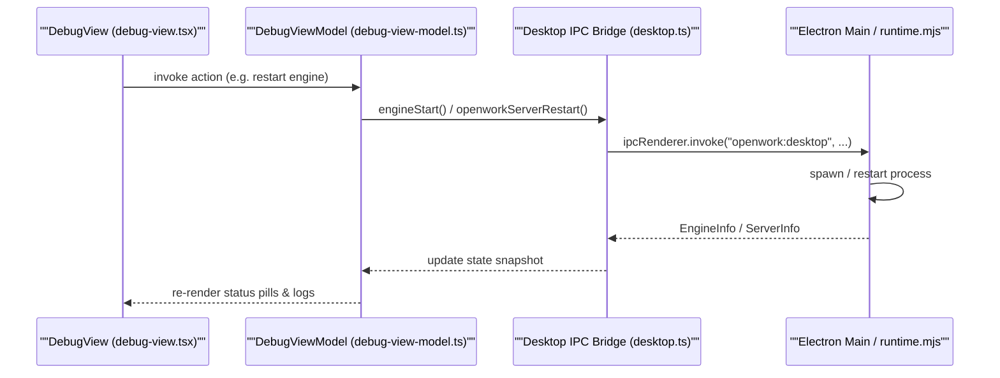

<!-- source: DeepWiki mcp.deepwiki.com · repo different-ai/openwork · page 11.1 Desktop and Engine Issues · fetched 2026-10-26 -->

# Desktop and Engine Issues

<details>
<summary>Relevant source files</summary>

The following files were used as context for generating this wiki page:

- [apps/app/src/app/lib/diagnostics-bundle.ts](apps/app/src/app/lib/diagnostics-bundle.ts)
- [apps/app/src/react-app/domains/connections/openwork-server-store.ts](apps/app/src/react-app/domains/connections/openwork-server-store.ts)
- [apps/app/src/react-app/domains/settings/pages/advanced-view-sections.tsx](apps/app/src/react-app/domains/settings/pages/advanced-view-sections.tsx)
- [apps/app/src/react-app/domains/settings/pages/advanced-view.tsx](apps/app/src/react-app/domains/settings/pages/advanced-view.tsx)
- [apps/app/src/react-app/domains/settings/pages/debug-view.tsx](apps/app/src/react-app/domains/settings/pages/debug-view.tsx)
- [apps/app/src/react-app/domains/settings/state/debug-view-model.ts](apps/app/src/react-app/domains/settings/state/debug-view-model.ts)
- [apps/app/src/react-app/shell/desktop-runtime-boot.ts](apps/app/src/react-app/shell/desktop-runtime-boot.ts)
- [apps/app/src/react-app/shell/engine-reload-escalation.ts](apps/app/src/react-app/shell/engine-reload-escalation.ts)
- [apps/desktop/electron/nuke-worker.mjs](apps/desktop/electron/nuke-worker.mjs)
- [apps/desktop/electron/nuke.mjs](apps/desktop/electron/nuke.mjs)
- [apps/desktop/electron/runtime.mjs](apps/desktop/electron/runtime.mjs)
- [apps/desktop/electron/startup-log.mjs](apps/desktop/electron/startup-log.mjs)
- [apps/desktop/electron/windows-shortcut.mjs](apps/desktop/electron/windows-shortcut.mjs)
- [apps/server/src/cli.ts](apps/server/src/cli.ts)
- [apps/server/src/embedded.ts](apps/server/src/embedded.ts)
- [apps/server/src/managed-opencode.ts](apps/server/src/managed-opencode.ts)
- [apps/server/src/openwork-extensions-plugin-path.ts](apps/server/src/openwork-extensions-plugin-path.ts)
- [apps/server/src/openwork-runtime-config.ts](apps/server/src/openwork-runtime-config.ts)
- [apps/server/src/selfhost-web.ts](apps/server/src/selfhost-web.ts)
- [apps/server/src/workspace-init.ts](apps/server/src/workspace-init.ts)
- [apps/server/test/archive-extraction.test.ts](apps/server/test/archive-extraction.test.ts)
- [apps/server/test/opencode-plugin-deps.test.ts](apps/server/test/opencode-plugin-deps.test.ts)
- [ee/apps/den-worker-runtime/Dockerfile.daytona-snapshot](ee/apps/den-worker-runtime/Dockerfile.daytona-snapshot)
- [packaging/docker/Dockerfile.microsandbox](packaging/docker/Dockerfile.microsandbox)

</details>


This page documents detailed technical aspects of common issues encountered in the OpenWork Desktop and OpenCode engine components. Topics include session and engine reload triggers, engine start failures including unconfigured OpenCode, diagnostic bundles, the Electron debug view, recovery (rollback) and nuke flows, as well as crash report handling.

---

## Purpose and Scope

OpenWork Desktop is an Electron-based client that integrates a local OpenCode engine instance (sidecar) which runs AI models and manages workspace state. Ensuring reliable startup, reload, and recovery of this desktop-engine environment is critical. This page documents:

- How configuration changes trigger engine reloads.
- Causes and diagnosis of OpenCode engine start failures.
- The `opencode_unconfigured` error state and its implications.
- Capturing and interpreting diagnostics bundles.
- The debug view for live engine and server status.
- Recovery workflows including rollback and "nuke" (fresh-start) operations.
- Electron renderer crash detection and reporting.

The goal is to empower developers and maintainers to diagnose, react to, and recover from common desktop and engine runtime problems.

Sources: `apps/desktop/electron/runtime.mjs` [1-179](), `apps/app/src/react-app/shell/desktop-runtime-boot.ts` [1-100]()

---

## Reload Triggers and Engine Lifecycle

### Overview

The OpenWork Desktop watches key configuration changes that require a reload of the OpenCode engine to apply new capabilities or fix stale state. These include:

- **Skills:** Newly installed or updated skills.
- **Plugins:** Changes to OpenCode plugins managed via `openwork-extensions-plugin-path.ts` [apps/server/src/openwork-extensions-plugin-path.ts:1-58]().
- **MCP servers:** Modifications in MCP connections synchronized through `runtime-opencode-config-store.ts`.
- **Configuration:** Changes in desktop or workspace config managed via `openwork-runtime-config.ts` [apps/server/src/openwork-runtime-config.ts:1-60]().

Each event flags a reload request which the runtime manages to avoid excessive or overlapping reloads. There is a debounce delay (`AUTO_RELOAD_DEBOUNCE_MS = 1500 ms`) to coalesce rapid bursts of changes into one reload [apps/app/src/app/lib/desktop.ts:6-54]().

### Implementation Detail

Reload requests originate from multiple modules:

- Skill/Plugin changes detected by filesystem watchers or internal reconciliations [packages/types/src/desktop-ipc.ts:234-260]().
- MCP changes handled in the agent-context MCP binding sub-system.
- Configuration changes that update bootstrap or runtime JSON files, flagging reloads to refresh engine context via `buildOpenworkRuntimeConfig()` [apps/server/src/openwork-runtime-config.ts:146-148]().

The engine reload is orchestrated via desktop IPC commands exposed through Electron's context bridge (`window.__OPENWORK_ELECTRON__.invokeDesktop`), primarily calling `engineReload` or disposal/start commands [apps/app/src/app/lib/desktop.ts:70-110](), [apps/desktop/electron/runtime.mjs:1-50]().

```mermaid
flowchart TD
  FileChange[""FileChange (openwork-runtime-config.ts)""]
  MCPUpdate[""MCPUpdate (runtime-opencode-config-store.ts)""]
  DesktopIPC[""DesktopIPC (invokeDesktop / desktop-ipc.ts)""]
  ReloadQueue[""ReloadQueue (debounce 1500ms)""]
  EngineRuntime[""EngineRuntime (runtime.mjs)""]
  ClientRenderer[""ClientRenderer (desktop-runtime-boot.ts)""]

  FileChange --> ReloadQueue
  MCPUpdate --> ReloadQueue
  ReloadQueue -.->|debounced event| DesktopIPC
  DesktopIPC --> EngineRuntime
  EngineRuntime --> ClientRenderer
```

Sources: `apps/server/src/openwork-runtime-config.ts` [1-148](), `apps/app/src/app/lib/desktop.ts` [6-54](), `packages/types/src/desktop-ipc.ts` [234-260]()

---

## OpenCode Engine Start Failures and `opencode_unconfigured`

### Engine Start Process

The OpenCode engine is managed either as a direct child process or embedded server instance (sidecar) using `startEmbeddedServer` [apps/server/src/embedded.ts:83-102]() or `startServer` in `cli.ts` [apps/server/src/cli.ts:131-136](). On desktop launch, the Electron main process invokes runtime managers to spawn and monitor the engine. The runtime manager tracks the engine's status (`running`, `pid`, `port`, etc.) and reports it through IPC.

### Common Causes of Start Failures

- **Binary resolution failure:** The engine executable is missing or the path is invalid, handled via `ensureManagedEngine` [apps/server/src/selfhost-web.ts:92-98]().
- **Port conflicts:** The engine fails to bind to a TCP port (`EADDRINUSE`), triggering retry logic in `ManagedOpencodeExitError` [apps/server/src/managed-opencode.ts:134-149]().
- **Configuration corruption:** The engine config files have invalid or missing content, checked via `ensureWorkspaceFiles` [apps/server/src/workspace-init.ts:69-93]().
- **Permissions issues:** OS-level restrictions prevent execution.

### The `opencode_unconfigured` Error

An important failure mode is `opencode_unconfigured`, an error state resulting from missing or invalid OpenCode configuration or unseeded plugin dependencies (`seedOpencodePluginDeps`) [apps/server/src/cli.ts:100-106](). When detected, the engine refuses to start serving requests, signaling the desktop UI to display an appropriate error and suggest recovery options via `debug-view-model.ts` [apps/app/src/react-app/domains/settings/state/debug-view-model.ts:1-50]().

Sources: `apps/server/src/embedded.ts` [83-102](), `apps/server/src/cli.ts` [92-107](), `apps/server/src/managed-opencode.ts` [134-149](), `apps/server/src/workspace-init.ts` [69-93]()

---

## Diagnostics Bundle and Debug View

### Diagnostics Bundle

Users and devs can capture a diagnostics bundle integrating logs, status reports, and config summaries. This bundle aggregates:

- OpenCode engine state and error logs (`lastStdout`, `lastStderr`).
- OpenWork Server status and token info (`openworkServerInfo`).
- Engine configuration files and runtime environment data (`runtime-opencode-config.json`).
- Agent context probe results.

### Debug View UI Model

The React desktop client exposes a **Debug View**, implemented via `debug-view-model.ts` and rendered in `debug-view.tsx`, which exposes:

- Engine and server connectivity status pills.
- Live logs including last stdout/stderr from the engine (`describeEngine`) [apps/app/src/react-app/domains/settings/state/debug-view-model.ts:185-202]().
- Control actions: restart engine (`engineStartCmd`), reload workspace, or run diagnostics.
- Nuke preview and execute flow (`nukeOpenworkAndOpencodeConfigPreview`) [apps/app/src/react-app/domains/settings/state/debug-view-model.ts:1-25]().



Sources: `apps/app/src/react-app/domains/settings/state/debug-view-model.ts` [1-210](), `apps/app/src/react-app/domains/settings/pages/debug-view.tsx` [1-100]()

---

## Recovery and Nuke Flows

### Recovery and Rollback

OpenWork maintains recovery points of prior desktop builds. The debug view allows users to record healthy states (`window.__OPENWORK_ELECTRON__?.recovery?.recordHealthy?.()`) [apps/app/src/react-app/shell/desktop-runtime-boot.ts:124-138]() and restore previous releases through the recovery interface.

### Nuke Operation (Fresh Start)

For severe or unexplained configuration corruption, users may invoke the **Nuke** operation. This workflow:

- Revokes any persistent Den cloud session tokens (`revokeDenSessionBeforeNuke`) within a timeout guard [apps/app/src/react-app/domains/settings/state/debug-view-model.ts:124-136]().
- Clears local OpenWork engine and workspace storage paths (`nukeOpenworkAndOpencodeConfigAndExit`).
- Relaunches or exits the application cleanly.

```mermaid
flowchart TD
  User[""User clicks Nuke Action (debug-view.tsx)""]
  DebugVM[""DebugViewModel (debug-view-model.ts)""]
  DenSignOut[""revokeDenSessionBeforeNuke()""]
  NukeExec[""nukeOpenworkAndOpencodeConfigAndExit()""]
  Worker[""Nuke Worker / State Purge (nuke-worker.mjs)""]
  Exit[""Application Exit & Restart""]

  User --> DebugVM
  DebugVM --> DenSignOut
  DenSignOut --> NukeExec
  NukeExec --> Worker
  Worker --> Exit
```

Sources: `apps/app/src/react-app/domains/settings/state/debug-view-model.ts` [124-136](), `apps/app/src/react-app/shell/desktop-runtime-boot.ts` [124-138]()

---

## Crash Reports and Renderer Recovery

### Renderer Crash Handling

The Electron main process installs crash recovery handlers that detect renderer process exits or crashes. When a fatal bootstrap failure or renderer exception occurs (`evalFatalBootstrapFailure`), the runtime boot catches the error and switches to an error state or recovery routine [apps/app/src/react-app/shell/desktop-runtime-boot.ts:82-84]().

### Error Logging and Retention

Engine stdout and stderr streams are buffered and appended via `appendOutput` and `truncateOutput` utilities in `runtime.mjs` [apps/desktop/electron/runtime.mjs:144-152](), ensuring diagnostics are preserved for troubleshooting sessions.

Sources: `apps/desktop/electron/runtime.mjs` [144-152](), `apps/app/src/react-app/shell/desktop-runtime-boot.ts` [80-95]()

---

## Summary Mermaid Diagrams

### 1. Reload Trigger Sources Linked to Code Entities

```mermaid
graph LR
  PluginWatcher[""openwork-extensions-plugin-path.ts""-Plugins]
  RuntimeConfig[""openwork-runtime-config.ts""-Config]
  StoreSync[""runtime-opencode-config-store.ts""-MCP]
  DebounceQueue[""Reload Request Debounce Queue (1500ms)""]
  DesktopIPC[""Electron IPC invokeDesktop (desktop.ts)""]
  RuntimeManager[""Engine Runtime Manager (runtime.mjs)""]

  PluginWatcher --> DebounceQueue
  RuntimeConfig --> DebounceQueue
  StoreSync --> DebounceQueue
  DebounceQueue --> DesktopIPC
  DesktopIPC --> RuntimeManager
```

Sources: `apps/server/src/openwork-runtime-config.ts` [1-60](), `apps/app/src/app/lib/desktop.ts` [6-54](), `apps/desktop/electron/runtime.mjs` [1-50]()

---

### 2. Diagnostics and Recovery Workflow

```mermaid
flowchart LR
  DebugView[""debug-view.tsx (DebugView)""]
  DebugModel[""debug-view-model.ts (DebugViewModel)""]
  EmbeddedServer[""embedded.ts (startEmbeddedServer)""]
  ManagedOpencode[""managed-opencode.ts (startManagedOpencodeServer)""]
  DiagnosticsBundle[""diagnostics-bundle.ts""]
  NukeWorker[""nuke-worker.mjs""]

  DebugView --> DebugModel
  DebugModel --> EmbeddedServer
  EmbeddedServer --> ManagedOpencode
  DebugModel --> DiagnosticsBundle
  DebugModel --> NukeWorker
```

Sources: `apps/app/src/react-app/domains/settings/pages/debug-view.tsx` [1-50](), `apps/app/src/react-app/domains/settings/state/debug-view-model.ts` [1-50](), `apps/server/src/embedded.ts` [83-102](), `apps/server/src/managed-opencode.ts` [151-160]()

---

# Detailed Section References

| Topic | Key Files / Lines |
|---|---|
| Reload Triggers & Coordination | `apps/server/src/openwork-runtime-config.ts:1-148`,<br>`apps/app/src/app/lib/desktop.ts:6-54`,<br>`packages/types/src/desktop-ipc.ts:234-260` |
| Engine Start Failures & Unconfigured | `apps/server/src/embedded.ts:83-102`,<br>`apps/server/src/cli.ts:92-107`,<br>`apps/server/src/managed-opencode.ts:134-149` |
| Diagnostics Bundle & Debug View | `apps/app/src/react-app/domains/settings/state/debug-view-model.ts:1-210`,<br>`apps/app/src/react-app/domains/settings/pages/debug-view.tsx:1-100` |
| Recovery & Nuke Flows | `apps/app/src/react-app/domains/settings/state/debug-view-model.ts:124-136`,<br>`apps/app/src/react-app/shell/desktop-runtime-boot.ts:124-138` |
| Crash Report & Renderer Recovery | `apps/desktop/electron/runtime.mjs:144-152`,<br>`apps/app/src/react-app/shell/desktop-runtime-boot.ts:80-95` |

---

# Summary

The Desktop and Engine troubleshooting system in OpenWork integrates IPC patterns, runtime configuration stores, and diagnostic frameworks. Reload triggers ensure timely engine refreshes while avoiding noisy restarts. The system surfaces typical OpenCode start errors and provides robust debugging, recovery, and nuke capabilities to maintain reliable operation across desktop and server environments.

Sources:  
`apps/desktop/electron/runtime.mjs` [1-179]()  
`apps/server/src/embedded.ts` [83-102]()  
`apps/server/src/cli.ts` [92-107]()  
`apps/server/src/openwork-runtime-config.ts` [1-148]()  
`apps/app/src/react-app/domains/settings/state/debug-view-model.ts` [1-210]()  
`apps/server/src/workspace-init.ts` [69-93]()  
`apps/app/src/react-app/shell/desktop-runtime-boot.ts` [80-138]()

---

