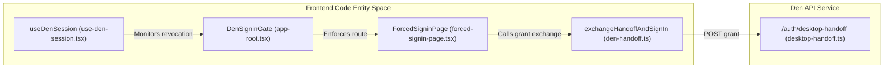
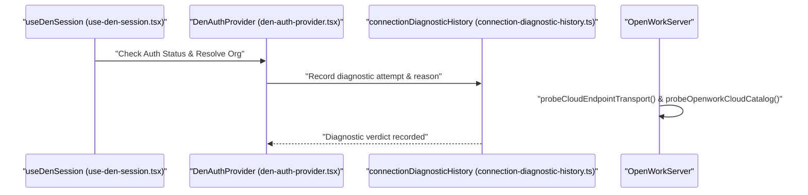

<!-- source: DeepWiki mcp.deepwiki.com · repo different-ai/openwork · page 11.2 Cloud, Auth and Connectivity Issues · fetched 2026-10-26 -->

# Cloud, Auth and Connectivity Issues

Relevant source files

The following files were used as context for generating this wiki page:

- [apps/app/src/app/lib/den-handoff.ts](apps/app/src/app/lib/den-handoff.ts)
- [apps/app/src/app/lib/den.ts](apps/app/src/app/lib/den.ts)
- [apps/app/src/react-app/domains/cloud/den-auth-provider.tsx](apps/app/src/react-app/domains/cloud/den-auth-provider.tsx)
- [apps/app/src/react-app/domains/cloud/forced-signin-page.tsx](apps/app/src/react-app/domains/cloud/forced-signin-page.tsx)
- [apps/app/src/react-app/domains/cloud/org-onboarding-page.tsx](apps/app/src/react-app/domains/cloud/org-onboarding-page.tsx)
- [apps/app/src/react-app/domains/session/sidebar/account-status-menu.tsx](apps/app/src/react-app/domains/session/sidebar/account-status-menu.tsx)
- [apps/app/src/react-app/domains/settings/cloud/use-den-session.tsx](apps/app/src/react-app/domains/settings/cloud/use-den-session.tsx)
- [apps/app/src/react-app/shell/app-root.tsx](apps/app/src/react-app/shell/app-root.tsx)
- [ee/apps/den-web/app/(den)/_components/install-screen.tsx](ee/apps/den-web/app/(den)/_components/install-screen.tsx)
- [ee/apps/den-web/app/(den)/_components/onboarding-shell.tsx](ee/apps/den-web/app/(den)/_components/onboarding-shell.tsx)
- [ee/apps/den-web/app/(den)/_lib/install-download.ts](ee/apps/den-web/app/(den)/_lib/install-download.ts)
- [ee/apps/den-web/app/(den)/_lib/install-guide.ts](ee/apps/den-web/app/(den)/_lib/install-guide.ts)
- [ee/apps/diagnostics/.env.example](ee/apps/diagnostics/.env.example)
- [ee/apps/diagnostics/README.md](ee/apps/diagnostics/README.md)
- [ee/apps/diagnostics/app/api/connections/identity/route.ts](ee/apps/diagnostics/app/api/connections/identity/route.ts)
- [ee/apps/diagnostics/app/api/connections/incidents/route.ts](ee/apps/diagnostics/app/api/connections/incidents/route.ts)
- [ee/apps/diagnostics/app/connections/incident-filters.tsx](ee/apps/diagnostics/app/connections/incident-filters.tsx)
- [ee/apps/diagnostics/app/connections/page.tsx](ee/apps/diagnostics/app/connections/page.tsx)
- [ee/apps/diagnostics/app/debug-proxy/[accessKey]/page.tsx](ee/apps/diagnostics/app/debug-proxy/[accessKey]/page.tsx)
- [ee/apps/diagnostics/app/page.tsx](ee/apps/diagnostics/app/page.tsx)
- [ee/apps/diagnostics/app/styles.css](ee/apps/diagnostics/app/styles.css)
- [ee/apps/diagnostics/app/via/[scenario]/[[...path]]/route.ts](ee/apps/diagnostics/app/via/[scenario]/[[...path]]/route.ts)
- [ee/apps/diagnostics/proxy.ts](ee/apps/diagnostics/proxy.ts)
- [ee/apps/diagnostics/scripts/connect-debug-proxy-smoke.mjs](ee/apps/diagnostics/scripts/connect-debug-proxy-smoke.mjs)
- [ee/apps/diagnostics/src/connect-debug-proxy-browser-route.ts](ee/apps/diagnostics/src/connect-debug-proxy-browser-route.ts)
- [ee/apps/diagnostics/src/connect-debug-proxy-config.ts](ee/apps/diagnostics/src/connect-debug-proxy-config.ts)
- [ee/apps/diagnostics/src/connect-debug-proxy-faults.ts](ee/apps/diagnostics/src/connect-debug-proxy-faults.ts)
- [ee/apps/diagnostics/src/connection-incident-query.ts](ee/apps/diagnostics/src/connection-incident-query.ts)
- [ee/apps/diagnostics/src/connection-incident-store.ts](ee/apps/diagnostics/src/connection-incident-store.ts)
- [packages/types/package.json](packages/types/package.json)
- [packages/types/src/index.ts](packages/types/src/index.ts)
- [packages/types/tsup.config.ts](packages/types/tsup.config.ts)
- [packages/ui/src/react/download-card.tsx](packages/ui/src/react/download-card.tsx)

This page covers detailed technical aspects of handling Den sign-in and handoff failures, revoked sessions, enterprise activation, egress diagnostics, error handling for worker provisioning, and related connectivity issues in the OpenWork ecosystem. It focuses primarily on the Den control plane (`ee/apps/den-api`), the Den Web dashboard (`ee/apps/den-web`), and their interactions with OpenWork Desktop and cloud workers.

---

## Purpose and Scope

This section provides an in-depth understanding of how authentication, connectivity, and provisioning errors are managed and diagnosed within:
- Den sign-in and desktop handoff flows (`apps/app/src/app/lib/den-handoff.ts`, `apps/app/src/react-app/domains/cloud/forced-signin-page.tsx`)
- Session revocation and re-authentication (`apps/app/src/react-app/domains/settings/cloud/use-den-session.tsx`, `apps/app/src/react-app/domains/cloud/den-auth-provider.tsx`)
- Enterprise activation gating for outbound connectivity (`ee/apps/den-web/app/(den)/_components/install-screen.tsx`)
- Diagnostic tooling in `ee/apps/diagnostics` and client-side history
- Lifecycle handling and error recovery for cloud workers (Daytona sandboxes) monitored in Den API
- Egress diagnostics for network and TLS connectivity from the cloud and desktop environments

---

## 1. Den Sign-In, Handoff, and Session Management

### 1.1 Den Sign-In Gate and Routing

Den sign-in gating is implemented on the client side to direct users through authentication before accessing enterprise or cloud resources. The `DenSigninGate` component intercepts routing and enforces authentication and onboarding flows based on bootstrap configuration flags such as `requireSignin` [apps/app/src/react-app/shell/app-root.tsx:98-165]().

The forced sign-in surface is encapsulated by `ForcedSigninPage`, which manages the local draft state (base URL, manual auth input) and delegates to the shared presentation layer when `requireSignin` is true and the session is unauthenticated [apps/app/src/react-app/domains/cloud/forced-signin-page.tsx:33-149]().

### 1.2 Desktop Handoff Grant Generation and Exchange

Desktop handoff allows the desktop application to securely receive an authorization token from Den by exchanging a one-time limited grant. The core mechanics involve:
- **Grant Creation**: Clients request a handoff token (`/auth/desktop-handoff`) optionally providing a `returnUrl` [ee/apps/den-api/src/routes/auth/desktop-handoff.ts:1-171]().
- **Grant Exchange**: `exchangeHandoffAndSignIn()` posts the grant to receive a Den auth token, performing an atomic durable bootstrap commit and session update [apps/app/src/app/lib/den-handoff.ts:137-163]().

### 1.3 Session Revocation Handling

Revoked Den sessions (expired or explicitly revoked tokens) are detected via error inspection utilities such as `isDenSessionRevokedError()` [apps/app/src/react-app/domains/settings/cloud/use-den-session.tsx:1-23](). The `useDenSession` hook catches these errors and triggers session cleanup, clearing local tokens and resetting state variables (`authError`, `sessionBusy`) [apps/app/src/react-app/domains/settings/cloud/use-den-session.tsx:76-196]().

### Diagram: Authentication and Handoff Code Entity Flow

**Sources:**
- `apps/app/src/react-app/shell/app-root.tsx:71-165`
- `apps/app/src/react-app/domains/cloud/forced-signin-page.tsx:33-149`
- `apps/app/src/app/lib/den-handoff.ts:137-163`
- `apps/app/src/react-app/domains/settings/cloud/use-den-session.tsx:76-196`
- `ee/apps/den-api/src/routes/auth/desktop-handoff.ts:1-171`

---

## 2. Enterprise Activation and Outbound Connectivity Diagnostics

### 2.1 Enterprise Activation Gate

Enterprise activation controls outbound network egress permissions on desktop installations, restricting network access unless explicitly granted by the control plane. Install configuration validation ensures that endpoints such as `apiUrl`, `webUrl`, and `requireSignin` meet strict parsing criteria before downloading or activating enterprise builds [ee/apps/den-web/app/(den)/_components/install-screen.tsx:16-154]().

### 2.2 Connection Diagnostic History and Egress Diagnostic Probes

The system maintains a diagnostic history tracking connection attempts and failure reasons [apps/app/src/react-app/domains/cloud/den-auth-provider.tsx:28-104](). Egress diagnostics use layered probing:
- Transport-layer TLS handshake checks (`probeCloudEndpointTransport`)
- Cloud MCP tool availability (`probeOpenworkCloudCatalog`)
- Differential verdict aggregation to summarize connectivity health

### Diagram: Diagnostic Probing and Error Flow

**Sources:**
- `ee/apps/den-web/app/(den)/_components/install-screen.tsx:16-154`
- `apps/app/src/react-app/domains/cloud/den-auth-provider.tsx:28-104`
- `apps/server/src/agent-context-diagnostics.ts:60-110`

---

## 3. Worker Provisioning Errors and Cloud Worker Management

### 3.1 Daytona Sandbox Provisioning and Adoption

Daytona sandboxes back cloud workers. Provisioning is handled via:
- `provisionWorkerOnDaytonaWithRuntime()` to trigger sandbox creation/upsert.
- `daytonaSandboxName()` for deterministic worker naming.
- Adoption logic handling `DaytonaConflictError` exceptions by recovering existing instances via `getSandbox()`.

### 3.2 Worker Tokens and Heartbeat Failures

Cloud workers utilize host tokens, client tokens, and activity tokens. Revocation or expiration of these tokens breaks worker heartbeats, raising errors in the Den API and dashboard monitoring interfaces.

### 3.3 Lifecycle Management and Idle Stop Handling

Den API runs background loops that stop idle workers automatically based on `last_active_at` or `updated_at` timestamps, invoking `stopCloudWorker()` when thresholds are exceeded.

**Sources:**
- `ee/apps/den-api/src/routes/cloud/index.ts:14-79`
- `ee/apps/den-api/src/workers/daytona.ts:10-87`
- `ee/apps/den-api/src/workers/cloud-lifecycle.ts:180-230`

---

## 4. Egress and Network Diagnostics (`ee/apps/diagnostics`)

The dedicated diagnostic micro-app under `ee/apps/diagnostics` provides routes and stores for tracking connectivity incidents, debugging proxy configurations, and simulating connection failures [ee/apps/diagnostics/src/connection-incident-store.ts]() and [ee/apps/diagnostics/app/api/connections/incidents/route.ts](). Administrators can inspect proxy faults and evaluate organization-level networking constraints.

**Sources:**
- `ee/apps/diagnostics/src/connection-incident-store.ts`
- `ee/apps/diagnostics/app/api/connections/incidents/route.ts`
- `ee/apps/diagnostics/app/connections/page.tsx`

---

## 5. Revoked Sessions and Reauthentication Strategy

When a session is revoked, error propagation forces users back to the sign-in screen. The client-side `useDenSession` hook handles this by wiping local tokens and invoking cleanup callbacks (`onBeforeSignedOut`) before resetting authorization states [apps/app/src/react-app/domains/settings/cloud/use-den-session.tsx:59-185]().

### Summary Table of Key Files and Responsibilities

| File Path | Purpose |
| :--- | :--- |
| `ee/apps/den-api/src/routes/auth/desktop-handoff.ts` | Desktop handoff grant generation and validation |
| `apps/app/src/react-app/shell/app-root.tsx` | Client-side Den sign-in gate and route enforcement |
| `apps/app/src/react-app/domains/settings/cloud/use-den-session.tsx` | Session revocation, cleanup, and status handling |
| `ee/apps/den-api/src/routes/cloud/index.ts` | Cloud worker provisioning and lifecycle routes |
| `ee/apps/den-api/src/workers/daytona.ts` | Daytona sandbox provisioning and adoption |
| `ee/apps/den-web/app/(den)/_components/install-screen.tsx` | Enterprise install config validation and onboarding |
| `apps/app/src/app/lib/den-handoff.ts` | Durable transactional bootstrap commit for handoffs |

**Sources:**
- `ee/apps/den-api/src/routes/auth/desktop-handoff.ts:1-171`
- `apps/app/src/react-app/shell/app-root.tsx:71-165`
- `apps/app/src/react-app/domains/settings/cloud/use-den-session.tsx:59-196`
- `ee/apps/den-api/src/routes/cloud/index.ts:14-79`
- `ee/apps/den-api/src/workers/daytona.ts:10-87`
- `ee/apps/den-web/app/(den)/_components/install-screen.tsx:16-154`
- `apps/app/src/app/lib/den-handoff.ts:137-163`

---

