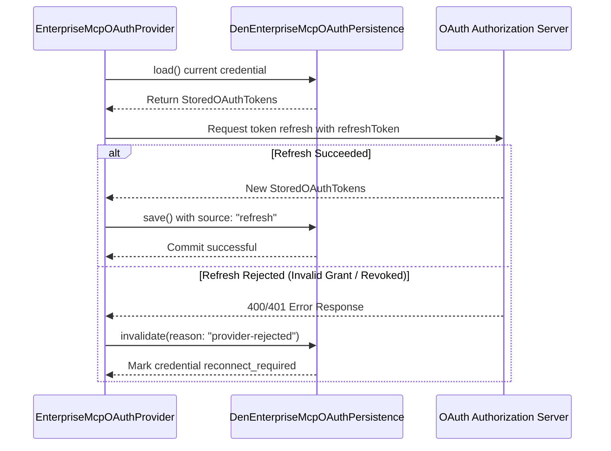
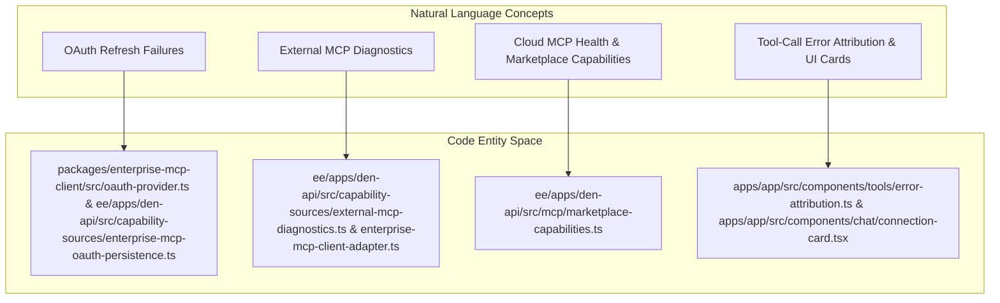

<!-- source: DeepWiki mcp.deepwiki.com · repo different-ai/openwork · page 11.3 MCP and Connector Issues · fetched 2026-10-26 -->

# MCP and Connector Issues

Relevant source files

The following files were used as context for generating this wiki page:

- [apps/app/src/components/chat/connection-card.tsx](apps/app/src/components/chat/connection-card.tsx)
- [apps/app/src/components/tools/error-attribution.ts](apps/app/src/components/tools/error-attribution.ts)
- [apps/app/src/components/tools/use-chat-tool-reconnect.ts](apps/app/src/components/tools/use-chat-tool-reconnect.ts)
- [apps/app/src/components/ui/tool.tsx](apps/app/src/components/ui/tool.tsx)
- [apps/app/src/lib/build-in-tools.ts](apps/app/src/lib/build-in-tools.ts)
- [apps/app/src/lib/latest-assistant-tool-parts.ts](apps/app/src/lib/latest-assistant-tool-parts.ts)
- [apps/app/src/lib/tool-activity.ts](apps/app/src/lib/tool-activity.ts)
- [apps/app/src/react-app/domains/session/surface/mcp-chat-reconnect.ts](apps/app/src/react-app/domains/session/surface/mcp-chat-reconnect.ts)
- [ee/apps/den-api/src/capability-sources/enterprise-mcp-client-adapter.ts](ee/apps/den-api/src/capability-sources/enterprise-mcp-client-adapter.ts)
- [ee/apps/den-api/src/capability-sources/enterprise-mcp-oauth-persistence.ts](ee/apps/den-api/src/capability-sources/enterprise-mcp-oauth-persistence.ts)
- [ee/apps/den-api/src/capability-sources/external-mcp-client-runtime.ts](ee/apps/den-api/src/capability-sources/external-mcp-client-runtime.ts)
- [ee/apps/den-api/src/capability-sources/external-mcp-client.ts](ee/apps/den-api/src/capability-sources/external-mcp-client.ts)
- [ee/apps/den-api/src/capability-sources/external-mcp-diagnostics.ts](ee/apps/den-api/src/capability-sources/external-mcp-diagnostics.ts)
- [ee/apps/den-api/src/capability-sources/url-guard.ts](ee/apps/den-api/src/capability-sources/url-guard.ts)
- [ee/apps/den-api/src/mcp-apps.ts](ee/apps/den-api/src/mcp-apps.ts)
- [ee/apps/den-api/src/mcp/external-tool-catalog-cache.ts](ee/apps/den-api/src/mcp/external-tool-catalog-cache.ts)
- [ee/apps/den-api/src/mcp/marketplace-capabilities.ts](ee/apps/den-api/src/mcp/marketplace-capabilities.ts)
- [ee/apps/den-api/test/mcp-login-discovery.test.ts](ee/apps/den-api/test/mcp-login-discovery.test.ts)
- [ee/apps/den-api/test/url-guard-redirect.test.ts](ee/apps/den-api/test/url-guard-redirect.test.ts)
- [evals/worlds/engine-connectors-parity.ts](evals/worlds/engine-connectors-parity.ts)
- [packages/enterprise-mcp-client/src/contracts.ts](packages/enterprise-mcp-client/src/contracts.ts)
- [packages/enterprise-mcp-client/src/enterprise-mcp-client.ts](packages/enterprise-mcp-client/src/enterprise-mcp-client.ts)
- [packages/enterprise-mcp-client/src/errors.ts](packages/enterprise-mcp-client/src/errors.ts)
- [packages/enterprise-mcp-client/src/oauth-login-discovery.ts](packages/enterprise-mcp-client/src/oauth-login-discovery.ts)
- [packages/enterprise-mcp-client/src/oauth-provider.ts](packages/enterprise-mcp-client/src/oauth-provider.ts)

## Purpose and Scope

This page documents common failure modes, diagnostic tooling, health monitoring, and error attribution mechanisms for Model Context Protocol (MCP) integrations and connector systems within OpenWork. It covers OAuth refresh token lifecycles, external MCP diagnostics, cloud MCP health states, connector tool-call error attribution, and reproduction workflows using enterprise client and mock modules.

---

## OAuth Refresh Failures and Handling

OAuth refresh tokens maintain continuous access to external MCP servers without re-prompting users. Failures during token refresh typically stem from revocation, expiration, token rotation mismatches, or concurrent refresh attempts.

### Implementation and Persistence Architecture

- The persistence layer for enterprise OAuth is managed by implementations conforming to the `EnterpriseMcpOAuthPersistence` contract in `packages/enterprise-mcp-client/src/contracts.ts:173-178` and instantiated via `DenEnterpriseMcpOAuthPersistence` in `ee/apps/den-api/src/capability-sources/enterprise-mcp-oauth-persistence.ts:1-50` [ee/apps/den-api/src/capability-sources/enterprise-mcp-oauth-persistence.ts:1-50](), [packages/enterprise-mcp-client/src/contracts.ts:173-178]().
- The `EnterpriseMcpOAuthCredentialPort` interface enforces atomic validation and consumption of authorizations, token persistence, and safety checks during refresh grants [packages/enterprise-mcp-client/src/contracts.ts:126-166]().
- The `refreshExclusively` optional port method serializes refresh-token grants across processes to prevent race conditions when providers rotate refresh tokens on every use [packages/enterprise-mcp-client/src/contracts.ts:161-166]().
- The `EnterpriseMcpOAuthProvider` class in `packages/enterprise-mcp-client/src/oauth-provider.ts` coordinates dynamic client registration, authorization code exchange, and token refresh via the MCP SDK `OAuthClientProvider` interface [packages/enterprise-mcp-client/src/oauth-provider.ts:69-130]().

### OAuth Refresh Lifecycle Diagram

Sources: [packages/enterprise-mcp-client/src/oauth-provider.ts:69-130](), [packages/enterprise-mcp-client/src/contracts.ts:126-166](), [ee/apps/den-api/src/capability-sources/enterprise-mcp-oauth-persistence.ts:1-50]()

---

## External MCP Diagnostic Tools

Diagnostics for external MCP connections trace failures across configuration, network transport, TLS handshakes, OAuth discovery/token acquisition, and MCP JSON-RPC protocol initialization.

### Diagnostic Phases and Tracking

- The `EXTERNAL_MCP_DIAGNOSTIC_PHASES` array defines sequential lifecycle checkpoints spanning from `CONFIGURATION` to `SHUTDOWN` [ee/apps/den-api/src/capability-sources/external-mcp-diagnostics.ts:5-28]().
- The `ExternalMcpDiagnosticTracker` and related helpers record failures, mapping error types and HTTP status codes into structured diagnostic objects (`ExternalMcpDiagnostic`) [ee/apps/den-api/src/capability-sources/external-mcp-diagnostics.ts:40-62]().
- The `diagnosticPhase` function in `ee/apps/den-api/src/capability-sources/enterprise-mcp-client-adapter.ts` maps underlying SDK diagnostic events (`EnterpriseMcpDiagnosticEvent`) to Den's canonical diagnostic phases [ee/apps/den-api/src/capability-sources/enterprise-mcp-client-adapter.ts:97-115]().

| Diagnostic Phase Category | Associated Phases | Description |
|---|---|---|
| **Configuration & Network** | `CONFIGURATION`, `NETWORK_DNS`, `NETWORK_TCP`, `NETWORK_TLS`, `HTTP_ROUTING` | Validates endpoints, DNS resolution, TCP connectivity, and TLS certificates. |
| **Authentication & Auth** | `AUTH_RESOURCE_DISCOVERY`, `AUTH_ISSUER_DISCOVERY`, `AUTH_CLIENT_REGISTRATION`, `AUTH_TOKEN_ACQUISITION` | Manages RFC 9728 discovery, DCR, and token exchange. |
| **MCP Protocol & Tools** | `MCP_TRANSPORT`, `MCP_VERSION`, `MCP_INITIALIZE`, `MCP_TOOL_DISCOVERY`, `MCP_TOOL_EXECUTION` | Negotiates protocol era, executes initialization, and inventories tools. |

Sources: [ee/apps/den-api/src/capability-sources/external-mcp-diagnostics.ts:5-28](), [ee/apps/den-api/src/capability-sources/enterprise-mcp-client-adapter.ts:97-115]()

---

## Cloud MCP Health and Capability Matching

Cloud MCP integrations and marketplace capabilities depend on coherent server specs, valid connection states, and policy authorization.

### Capability Status and Requirements

- The `MarketplaceCapabilityStatus` type specifies operational states such as `ready`, `needs_connection`, `reconnect`, `needs_admin_setup`, and `unsupported` [ee/apps/den-api/src/mcp/marketplace-capabilities.ts:130-131]().
- The `MarketplaceMcpRequirementStatus` tracks dependent MCP connections required by specific marketplace plugins or workflows [ee/apps/den-api/src/mcp/marketplace-capabilities.ts:142-156]().

Sources: [ee/apps/den-api/src/mcp/marketplace-capabilities.ts:130-156]()

---

## Connector Tool-Call Error Attribution

When connector or dynamic tool calls fail during agent execution, OpenWork analyzes the error payload to attribute the failure correctly and present actionable recovery actions.

### Attribution and Presentation Architecture

- The `parseResultRecord` and `connectionFromChatToolPart` functions in `apps/app/src/components/tools/error-attribution.ts` parse JSON results and error texts to extract structured connection action payloads (`ConnectionActionPayload`) [apps/app/src/components/tools/error-attribution.ts:59-141]().
- The `ConnectionCard` component (`apps/app/src/components/chat/connection-card.tsx`) renders inline status cards in the chat transcript when a connection requires authentication, re-authentication, or admin intervention [apps/app/src/components/chat/connection-card.tsx:57-116]().
- The `Tool` component (`apps/app/src/components/ui/tool.tsx`) handles `output-error` tool part states, rendering a `TaskRecovery` component with interactive reconnect triggers powered by `useChatToolReconnect` [apps/app/src/components/ui/tool.tsx:151-198]().

Sources: [apps/app/src/components/tools/error-attribution.ts:59-141](), [apps/app/src/components/chat/connection-card.tsx:57-116](), [apps/app/src/components/ui/tool.tsx:151-198]()

---

## Mapping Natural Language Space to Code Entity Space

The following diagram bridges conceptual system operations to their corresponding code symbols and file paths.

Sources: [packages/enterprise-mcp-client/src/oauth-provider.ts:69-130](), [ee/apps/den-api/src/capability-sources/enterprise-mcp-oauth-persistence.ts:1-50](), [ee/apps/den-api/src/capability-sources/external-mcp-diagnostics.ts:5-62](), [ee/apps/den-api/src/capability-sources/enterprise-mcp-client-adapter.ts:97-115](), [ee/apps/den-api/src/mcp/marketplace-capabilities.ts:130-156](), [apps/app/src/components/tools/error-attribution.ts:59-141](), [apps/app/src/components/chat/connection-card.tsx:57-116]()

---

## Sources

- ee/apps/den-api/src/mcp/marketplace-capabilities.ts:1-1918
- ee/apps/den-api/src/capability-sources/external-mcp-diagnostics.ts:1-2391
- packages/enterprise-mcp-client/src/enterprise-mcp-client.ts:1-812
- apps/app/src/components/ui/tool.tsx:1-291
- ee/apps/den-api/src/capability-sources/external-mcp-client.ts:1-1044
- ee/apps/den-api/src/capability-sources/enterprise-mcp-client-adapter.ts:1-516
- ee/apps/den-api/src/capability-sources/enterprise-mcp-oauth-persistence.ts:1-1062
- apps/app/src/components/tools/error-attribution.ts:1-344
- apps/app/src/components/chat/connection-card.tsx:1-172
- packages/enterprise-mcp-client/src/oauth-provider.ts:1-673
- packages/enterprise-mcp-client/src/contracts.ts:1-431
- packages/enterprise-mcp-client/src/errors.ts:1-233

---

