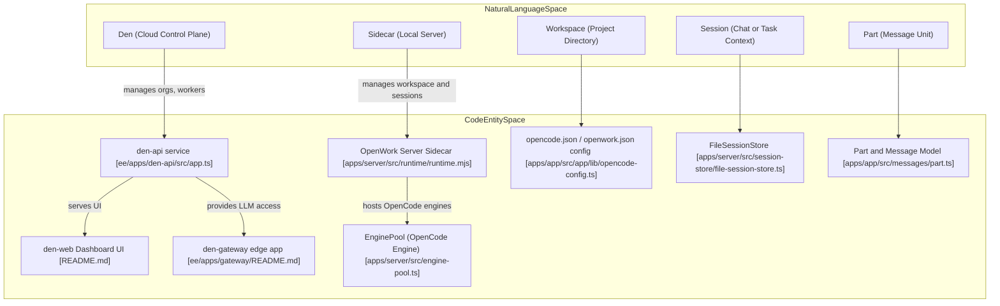
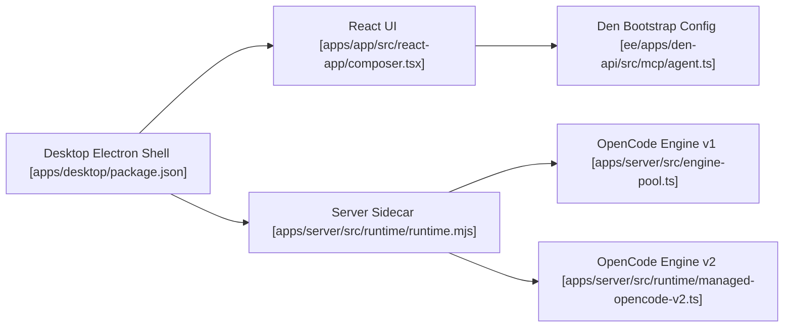

<!-- source: DeepWiki mcp.deepwiki.com · repo different-ai/openwork · page 12 Glossary · fetched 2026-10-26 -->

# Glossary

Relevant source files

The following files were used as context for generating this wiki page:

- [.github/workflows/ci-tests.yml](.github/workflows/ci-tests.yml)
- [AGENTS.md](AGENTS.md)
- [README.md](README.md)
- [TRANSLATIONS.md](TRANSLATIONS.md)
- [docs/marketplace-capabilities-architecture.md](docs/marketplace-capabilities-architecture.md)
- [ee/apps/den-api/src/mcp/README.md](ee/apps/den-api/src/mcp/README.md)
- [ee/apps/den-api/src/mcp/agent-server.ts](ee/apps/den-api/src/mcp/agent-server.ts)
- [ee/apps/den-api/src/mcp/agent.ts](ee/apps/den-api/src/mcp/agent.ts)
- [ee/apps/den-api/src/mcp/app-builder-tools.ts](ee/apps/den-api/src/mcp/app-builder-tools.ts)
- [ee/apps/den-api/src/mcp/capability-registry.ts](ee/apps/den-api/src/mcp/capability-registry.ts)
- [ee/apps/den-api/src/mcp/codemode-tools.ts](ee/apps/den-api/src/mcp/codemode-tools.ts)
- [ee/apps/den-api/src/mcp/connect-tool-view.ts](ee/apps/den-api/src/mcp/connect-tool-view.ts)
- [ee/apps/den-api/src/mcp/external-capabilities.ts](ee/apps/den-api/src/mcp/external-capabilities.ts)
- [ee/apps/den-api/src/mcp/external-connection-proxy.ts](ee/apps/den-api/src/mcp/external-connection-proxy.ts)
- [ee/apps/den-api/src/mcp/search.ts](ee/apps/den-api/src/mcp/search.ts)
- [ee/apps/den-api/test/api/connect-full-tools.api.test.ts](ee/apps/den-api/test/api/connect-full-tools.api.test.ts)
- [ee/apps/den-api/test/api/external-connection-proxy.api.test.ts](ee/apps/den-api/test/api/external-connection-proxy.api.test.ts)
- [ee/apps/den-api/test/connect-full-tools.test.ts](ee/apps/den-api/test/connect-full-tools.test.ts)
- [ee/apps/den-api/test/mcp-gateway-metadata.test.ts](ee/apps/den-api/test/mcp-gateway-metadata.test.ts)
- [ee/apps/diagnostics/.env.example](ee/apps/diagnostics/.env.example)
- [ee/apps/diagnostics/README.md](ee/apps/diagnostics/README.md)
- [ee/apps/diagnostics/app/api/connections/identity/route.ts](ee/apps/diagnostics/app/api/connections/identity/route.ts)
- [ee/apps/diagnostics/app/api/connections/incidents/route.ts](ee/apps/diagnostics/app/api/connections/incidents/route.ts)
- [ee/apps/diagnostics/app/connections/incident-filters.tsx](ee/apps/diagnostics/app/connections/incident-filters.tsx)
- [ee/apps/diagnostics/app/connections/page.tsx](ee/apps/diagnostics/app/connections/page.tsx)
- [ee/apps/diagnostics/app/debug-proxy/[accessKey]/page.tsx](ee/apps/diagnostics/app/debug-proxy/[accessKey]/page.tsx)
- [ee/apps/diagnostics/app/page.tsx](ee/apps/diagnostics/app/page.tsx)
- [ee/apps/diagnostics/app/styles.css](ee/apps/diagnostics/app/styles.css)
- [ee/apps/diagnostics/app/via/[scenario]/[[...path]]/route.ts](ee/apps/diagnostics/app/via/[scenario]/[[...path]]/route.ts)
- [ee/apps/diagnostics/proxy.ts](ee/apps/diagnostics/proxy.ts)
- [ee/apps/diagnostics/scripts/connect-debug-proxy-smoke.mjs](ee/apps/diagnostics/scripts/connect-debug-proxy-smoke.mjs)
- [ee/apps/diagnostics/src/connect-debug-proxy-browser-route.ts](ee/apps/diagnostics/src/connect-debug-proxy-browser-route.ts)
- [ee/apps/diagnostics/src/connect-debug-proxy-config.ts](ee/apps/diagnostics/src/connect-debug-proxy-config.ts)
- [ee/apps/diagnostics/src/connect-debug-proxy-faults.ts](ee/apps/diagnostics/src/connect-debug-proxy-faults.ts)
- [ee/apps/diagnostics/src/connection-incident-query.ts](ee/apps/diagnostics/src/connection-incident-query.ts)
- [ee/apps/diagnostics/src/connection-incident-store.ts](ee/apps/diagnostics/src/connection-incident-store.ts)
- [evals/README.md](evals/README.md)
- [evals/core/agent-signup-via-mcp.e2e.test.ts](evals/core/agent-signup-via-mcp.e2e.test.ts)
- [evals/worlds/thread-restart.ts](evals/worlds/thread-restart.ts)
- [package.json](package.json)
- [packages/types/package.json](packages/types/package.json)
- [packages/types/src/index.ts](packages/types/src/index.ts)
- [packages/types/tsup.config.ts](packages/types/tsup.config.ts)
- [translated_readmes/README.md](translated_readmes/README.md)
- [translated_readmes/README_JA.md](translated_readmes/README_JA.md)
- [translated_readmes/README_ZH.md](translated_readmes/README_ZH.md)
- [translated_readmes/README_ZH_hk.md](translated_readmes/README_ZH_hk.md)

This page defines the technical terms, jargon, and architectural components specific to the OpenWork codebase. It serves as a reference for engineers to understand how high-level concepts map to specific code symbols, architectural patterns, and runtime behavior.

---

## Core Components

### OpenWork
The umbrella system comprising the AI agent workspace. It includes:
- **Desktop Application**: An Electron shell running the user interface and managing local agents [apps/desktop/package.json:5-10]().
- **Server Sidecar**: A local HTTP server embedded in the desktop that manages workspaces, sessions, files, and delegates calls to the OpenCode engine [apps/server/src/runtime/runtime.mjs:50-150]().
- **Den Cloud Control Plane**: A set of services (`den-api`, `den-web`, etc.) that provide enterprise-grade management for organizations, workers, and policy enforcement [ee/apps/den-api/src/app.ts:40-90]().

### Den
The hosted control plane (cloud backend) for OpenWork. It manages:
- **Authentication and Sessions** via `den-api` (Hono-based service) [ee/apps/den-api/src/app.ts:30-100]().
- **Organization management, RBAC, and policy** [ee/apps/den-api/src/routes/org/index.ts:1-100]().
- **Dashboard and UI frontend** via `den-web` [README.md:84-95]().
- **Workers and cloud instances** hosting ephemeral OpenWork desktop backends [ee/apps/den-api/src/worker.ts:1-50]().
- **Inference Gateway** for mediating LLM provider usage and credentials [ee/apps/gateway/README.md]().

### OpenCode engine (v1 & v2)
The AI agent execution engine:
- **v1**: Original engine runtime, managing agent message turns and tool calls [apps/server/src/engine-pool.ts:50-140]().
- **v2**: The next-gen engine with improved context handling and hot reloads, integrated with server runtime [apps/server/src/runtime/managed-opencode-v2.ts:10-100]().
- Engines are managed by the server sidecar and allow different execution modes (direct, orchestrated) [apps/desktop/electron/runtime.mjs:80-130]().

### Sidecar
The server sub-process bundled with the desktop app performing local AI agent orchestration and workspace serving:
- Spawned and controlled by the desktop main process [apps/desktop/electron/sidecar.ts:20-60]().
- Bundled for supported triples during build [ee/apps/den-api/src/mcp/external-capabilities.ts:80-100]().

---

## Runtime and Workspace Concepts

### Workspace
A persistent directory containing agent code, files, and messages, identified by a local path or remote URL:
- Contains an `opencode.json` or `openwork.json` configuration file defining plugins, skills, and package dependencies [apps/app/src/app/lib/opencode-config.ts:1-50]().

### Session
A conversational or task execution context inside a workspace:
- Contains message sequences exchanged with the AI agent.
- Abstracted as `Session` objects and saved via `FileSessionStore` on disk [apps/server/src/session-store/file-session-store.ts:1-80]().

### Part
An atomic message unit that may be text, file, or tool output. Sent as subparts of messages to the client UI and to the engine [apps/app/src/messages/part.ts:1-50](). Parts compose messages and enable fine-grained UI rendering.

### Artifact
An output file generated by workflow runs, often as CSV or Markdown, managed in workspace storage and shown in the desktop's artifact panel [ee/apps/den-api/src/mcp/agent.ts:50-90]().

### Composer draft
A message-in-progress in the desktop's lexical editor supporting mentions (`@agent`, `@file`), slash commands, and tokens [apps/app/src/react-app/composer.tsx:10-90]().

---

## Extensions and Plugins

### Skill
An AI capability defined by a configuration object bundled as part of a plugin. Skills define commands and tool behavior executed by agents [ee/packages/den-db/drizzle/meta/_journal.json:40-60]().

### Plugin (new arch)
A new Den plugin system packaging config objects (skills, commands, workflows) into distributed bundles with versioning and access control [ee/packages/den-db/drizzle/meta/_journal.json:70-90]().

### Config Object
Versioned data objects like skills, workflows, or templates stored in Den and assigned to plugins [ee/apps/den-api/src/plugins/config-objects.ts:1-100]().

### Marketplace
A repository for sharing plugins, capabilities, and config objects, accessed by Den to distribute marketplace items [ee/packages/den-db/drizzle/meta/_journal.json:70-90]().

---

## MCP and Connectivity

### MCP (Model Capabilities Protocol)
The protocol and API for declaring and invoking capabilities (skills or external services) in the agent:
- **MCP App**: Client applications or UIs that connect to the MCP surface exposed by Den [ee/apps/den-api/src/mcp/agent.ts:120-135]().
- **Capability Registry**: Central service in Den managing capability definitions and registrations [ee/apps/den-api/src/mcp/capability-registry.ts:124-145]().

### Connector
An integration bridge to external systems (GitHub, Google Workspace, Microsoft 365), exposed as MCP capabilities [ee/apps/den-api/src/mcp/external-capabilities.ts:80-110]().

### Capability
A declared function or service the agent can invoke, implemented natively, via MCP calls, or as plugins/skills [ee/apps/den-api/src/mcp/capability-registry.ts:91-102]().

### Codemode
A saved scripting toolset enabling code-based automation within sessions and workflows [packages/codemode/README.md]().
- Supported by UI parts and artifact views in the desktop and Den web [ee/apps/den-api/src/mcp/agent.ts:50-80]().

---

## Security and Policy

### Relay Principal
A delegated cryptographic identity used in request authentication for relayed inference calls [apps/server/src/free-auto/service.ts:30-80]().

### BYOK (Bring Your Own Key)
A security feature where customers provide their own encryption keys for data at rest or inference workloads [ee/apps/den-api/src/security/byok.ts:1-40]().

### Desktop Policy
Organization-level policies for the desktop client that control feature enablement and security rules [ee/apps/den-api/src/desktop-policies.ts:20-60]().

### Feature Flag / Kill Switch / Operator Lock
Mechanisms to enable, disable, or lock features globally or per-organization using flags maintained in the feature registry [packages/features/src/registry.ts:1-140]().

### Audit class
Classes and infrastructure supporting detailed event logging of user and agent activity in Den [ee/apps/den-api/src/audit/mcp-service-audit.ts:20-50]().

---

## Authentication and Provisioning

### SSO (Single Sign-On)
Organization-level single sign-on configuration enabling integrated authentication providers [ee/apps/den-api/src/routes/sso.ts:1-80]().

### SCIM (System for Cross-domain Identity Management)
Provisioning API for managing user/group identity lifecycle [ee/apps/den-api/src/routes/scim.ts:1-100]().

### Handoff grant
An ephemeral authorization token allowing secure delegation of user sessions from one context (desktop) to another (Den or headless runner) [ee/apps/den-api/src/mcp/agent.ts:70-90]().

### Enterprise Activation
Licensed gating mechanism for paid-tier features in organizational deployments [packages/types/src/index.ts:16]().

---

## Runs, Workers, and Automation

### Worker
A cloud-hosted or self-hosted instance of an OpenWork desktop environment managed by Den [ee/apps/den-api/src/worker.ts:1-60]().

### Daytona snapshot
A saved state snapshot of the execution environment used for fast provisioning of cloud workers [ee/apps/den-api/src/daytona/snapshot.ts:1-40]().

### Automation
Scheduled or on-demand workflows, often running headless in the cloud, automating repetitive tasks [apps/server/src/automations/service.ts:1-100]().

### Headless Runner
A cloud service running automation workflows without a UI, managed via Den [ee/apps/headless-runner/src/app.ts:20-90]().

### Workbot
A bot conversational workspace integrated into Slack, processing tasks on behalf of users [ee/apps/workbot/README.md]().

### Slack Assistant
A lightweight Slack app that responds to mentions and commands from users in Slack channels or DMs [ee/apps/slack-assistant/README.md]().

---

## Development and Packaging

### PKGBUILD
A build script used to create Arch Linux User Repository (AUR) packages for OpenWork Desktop [packaging/aur/PKGBUILD:1-18]().

### latest.json
A metadata manifest for updater channels recording the latest release available to clients [apps/desktop/build/release.ts:30-70]().

### Helm operator lock
A Helm chart configuration feature that enforces operator-level feature flags and locks at deployment time [packaging/helm/openwork-ee/README.md:20-70]().

---

## Test and Verification

### Journey
An end-to-end automated test script representing a user or system interaction sequence [evals/README.md:1-20]().

### World
A test fixture runtime environment including in-memory databases and mock services used to run journeys [evals/README.md:85-95]().

### Spec
A typed test definition (unit or E2E) used in the OpenWork eval harness with assertions and matchers [evals/README.md:75-85]().

### Proof spec
A formal assertion about deterministic execution used for CI proofs [evals/README.md:75-85]().

### Testkit
A package providing reusable tooling, drivers, and APIs for writing OpenWork tests [evals/README.md:1-15]().

### Warden
A specialized security review system and CI gateboarding skill enforcing contributor sanity and dependency checks [.github/workflows/ci-tests.yml:1-30]().

### Diff-Warden
An extension that analyzes PR diffs for security and correctness risks [.github/workflows/ci-tests.yml:65-72]().

### Freestyle
A sandbox environment that supports live code evaluation and screenshot capture used for demos and tests [evals/README.md:37-45]().

---

# System Mapping: Natural Language to Code Entities

## Diagram 1: Natural Language Components and Their Code Entities

Sources: [apps/server/src/runtime/runtime.mjs:50-150](), [ee/apps/den-api/src/app.ts:40-90](), [apps/server/src/engine-pool.ts:50-140]()

## Diagram 2: OpenWork Desktop Runtime Architecture Components

Sources: [apps/desktop/package.json:5-10](), [apps/server/src/runtime/runtime.mjs:50-150](), [apps/server/src/engine-pool.ts:50-140]()

---

# Detailed Term Definitions with Code References

### Den
The OpenWork cloud backend that manages organizations, user sessions, feature policies, workers, and orchestration of cloud-hosted agent desktops [ee/apps/den-api/src/app.ts:40-90]().

### den-api
The Hono-based HTTP backend service that implements the Den API surface for authentication, org management, RBAC, plugins, and MCP [ee/apps/den-api/src/app.ts:30-100]().

### den-web
The React/Next.js web dashboard providing user interfaces for organization management, integrations, billing, and policy [README.md:84-95]().

### Gateway / den-gateway
The LLM inference proxy and edge application mediating model providers, usage accounting, and relayed inference requests [ee/apps/gateway/README.md]().

### OpenCode engine (v1/v2)
The embedded execution engine for AI agents. v1 is the legacy runtime; v2 supports improved context and plugin APIs [apps/server/src/engine-pool.ts:50-140](), [apps/server/src/runtime/managed-opencode-v2.ts:10-100]().

### Sidecar
The bundled local HTTP server embedded in the desktop, managing workspace APIs and engine runtimes [apps/server/src/runtime/runtime.mjs:50-150]().

### Workspace
The local or remote project directory containing configuration (`opencode.json`), session data, and plugin artifacts [apps/app/src/app/lib/opencode-config.ts:1-50]().

### Session
A persistent chat or task context within a workspace, stored on disk or in remote backends [apps/server/src/session-store/file-session-store.ts:1-80]().

### Part
An atomic message fragment, the smallest display-renderable unit within sessions, such as text or file references [apps/app/src/messages/part.ts:1-50]().

### Artifact
Files (often CSV, text, or others) generated during session runs or workflow executions and managed in workspace storage [ee/apps/den-api/src/mcp/agent.ts:50-90]().

### Composer draft
The message editor's intermediate state supporting user mentions, slash commands, skill tokens, and attachments before submission [apps/app/src/react-app/composer.tsx:10-90]().

### Mention token
A special textual token representing mentions in the composer, such as `@agent` or `@file`, handled through lexical parsing [apps/app/src/react-app/composer.tsx:10-90]().

### Skill
A reusable AI tool or command capability defined as a config object and bundled in plugins [ee/packages/den-db/drizzle/meta/_journal.json:40-60]().

### Plugin (new arch)
Den's modern plugin system, packaging config objects, commands, and skills with versioned access and import/export features [ee/packages/den-db/drizzle/meta/_journal.json:70-90]().

### Config Object
Versioned entities such as skills, workflows, or templates stored in Den and made available to agents [ee/apps/den-api/src/plugins/config-objects.ts:1-100]().

### Marketplace
A repository for distributing plugins and config objects to organizations and members via Den's catalog [ee/packages/den-db/drizzle/meta/_journal.json:70-90]().

### Connector
Integrations bridging external services (GitHub, Google, Microsoft) into the MCP ecosystem [ee/apps/den-api/src/mcp/external-capabilities.ts:80-110]().

### Capability
A logical unit of functionality agents can invoke, implemented natively, as MCP skills, or plugin commands [ee/apps/den-api/src/mcp/capability-registry.ts:91-102]().

### Codemode
A scripted automation framework for writing durable scripts that execute inside agent workflows, exposed in UI and artifact views [packages/codemode/README.md]().

### MCP and MCP App
Model Capabilities Protocol (MCP) defines how capabilities are declared and invoked by agents; MCP Apps are client UIs or dashboards that interact with MCP surfaces [ee/apps/den-api/src/mcp/agent.ts:120-135]().

### Capability Registry
Den’s central catalog service managing all registered native and external capabilities exposed to agents [ee/apps/den-api/src/mcp/capability-registry.ts:124-145]().

### Free Auto / DesktopFreeProof / Relay Principal
Free Auto is an inference access tier with proof-of-work guest sessions; DesktopFreeProof involves cryptographic proofs managing free inference relay requests; Relay Principal is the identity used for relayed inference calls [apps/server/src/free-auto/service.ts:30-80]().

### BYOK (Bring Your Own Key)
Enterprise feature allowing organizations to provide their own encryption keys to secure data at rest and inference [ee/apps/den-api/src/security/byok.ts:1-40]().

### Model Behavior
Engine execution modes controlling inference token behavior [apps/app/src/app/lib/opencode-config.ts:1-50]().

### Bootstrap config
Configuration files and objects consumed during desktop or Den startup [ee/apps/den-api/src/mcp/agent.ts:1-50]().

### Handoff grant
An ephemeral token enabling session handoff between desktop and Den or headless services [ee/apps/den-api/src/mcp/agent.ts:70-90]().

### Enterprise Activation
Mechanism gating enterprise-specific features using licenses and activation rules enforced in the desktop and Den [packages/types/src/index.ts:16]().

### Desktop Policy
Organization-controlled desktop application policies enforced at runtime to limit API usage and features [ee/apps/den-api/src/desktop-policies.ts:20-60]().

### TypeID
Type-safe unique identifiers with prefixes, used for entities like sessions, requests, orgs [ee/apps/den-api/src/mcp/external-capabilities.ts:10-15]().

### Feature Flag / Kill Switch / Operator Lock
Run-time feature controls with dimensions including deployment default, operator lock, and organization override [packages/features/src/registry.ts:1-140]().

### Audit class
Classes defining audit logging behavior capturing sensitive user and agent operations [ee/apps/den-api/src/audit/mcp-service-audit.ts:20-50]().

### SCIM
API and routes implementing System for Cross-domain Identity Management for org provisioning [ee/apps/den-api/src/routes/scim.ts:1-100]().

### SSO
Single sign-on connector config and management routes for organizations [ee/apps/den-api/src/routes/sso.ts:1-80]().

### Worker
Cloud or on-prem OpenWork desktop instances managed by Den workers [ee/apps/den-api/src/worker.ts:1-50]().

### Daytona snapshot
Serialized environment snapshot used for rapid cloud worker provisioning and restores [ee/apps/den-api/src/daytona/snapshot.ts:1-40]().

### Journey
A scripted automated test sequence simulating user interaction with the UI and agent [evals/README.md:1-20]().

### World
A full VM snapshot used in automated tests to provide deterministic environments [evals/README.md:85-95]().

### Spec
Typed test definitions with assertions, used in unit and integration tests [evals/README.md:75-85]().

### Proof spec
Formal correctness proofs asserting deterministic and correct behavior across versions [evals/README.md:75-85]().

### Testkit
Testing utilities, API drivers, and matchers used for writing and composing tests [evals/README.md:1-15]().

### Warden
Automated security and policy compliance review system integrated into CI [.github/workflows/ci-tests.yml:1-30]().

### Diff-Warden
An extension analyzing code diffs in pull requests for security risks [.github/workflows/ci-tests.yml:65-72]().

### Freestyle
A sandbox environment executing OpenWork runtime code with snapshot and manual drive for demos and tests [evals/README.md:37-45]().

### Headless Runner
A managed cloud worker running automations and agents without UI [ee/apps/headless-runner/src/app.ts:20-90]().

### Workbot
Slack-integrated conversational AI bot interacting with users on behalf of organizations [ee/apps/workbot/README.md]().

### Slack Assistant
Slack app for lightweight mention and command handling in Slack conversations [ee/apps/slack-assistant/README.md]().

### Automation
Scheduled or triggered workflows created by users or agents for task automation [apps/server/src/automations/service.ts:1-100]().

### PKGBUILD
Arch Linux packaging script for OpenWork Desktop available in packaging/aur [packaging/aur/PKGBUILD:1-18]().

### latest.json
Updater manifest format describing the latest desktop releases for all platforms [apps/desktop/build/release.ts:30-70]().

### Helm operator lock
A Helm Chart feature locking deployment configurations based on operator policy [packaging/helm/openwork-ee/README.md:20-70]().

---

**Sources:**
[apps/server/src/runtime/runtime.mjs:50-150](),
[ee/apps/den-api/src/app.ts:40-90](),
[apps/server/src/engine-pool.ts:50-140](),
[apps/app/src/app/lib/opencode-config.ts:1-50](),
[apps/server/src/session-store/file-session-store.ts:1-80](),
[apps/app/src/messages/part.ts:1-50](),
[apps/app/src/react-app/composer.tsx:10-90](),
[ee/packages/den-db/drizzle/meta/_journal.json:40-90](),
[ee/apps/den-api/src/plugins/config-objects.ts:1-100](),
[ee/apps/den-api/src/mcp/agent.ts:50-135](),
[ee/apps/den-api/src/mcp/capability-registry.ts:91-145](),
[ee/apps/den-api/src/security/byok.ts:1-40](),
[packages/features/src/registry.ts:1-140](),
[ee/apps/den-api/src/routes/scim.ts:1-100](),
[evals/README.md:1-95](),
[packaging/aur/PKGBUILD:1-18](),
[packaging/helm/openwork-ee/README.md:20-70]()