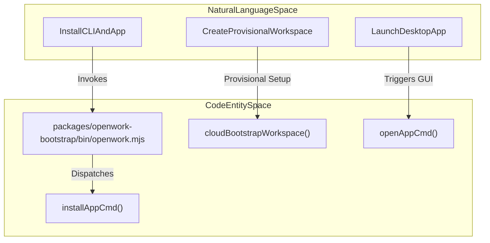
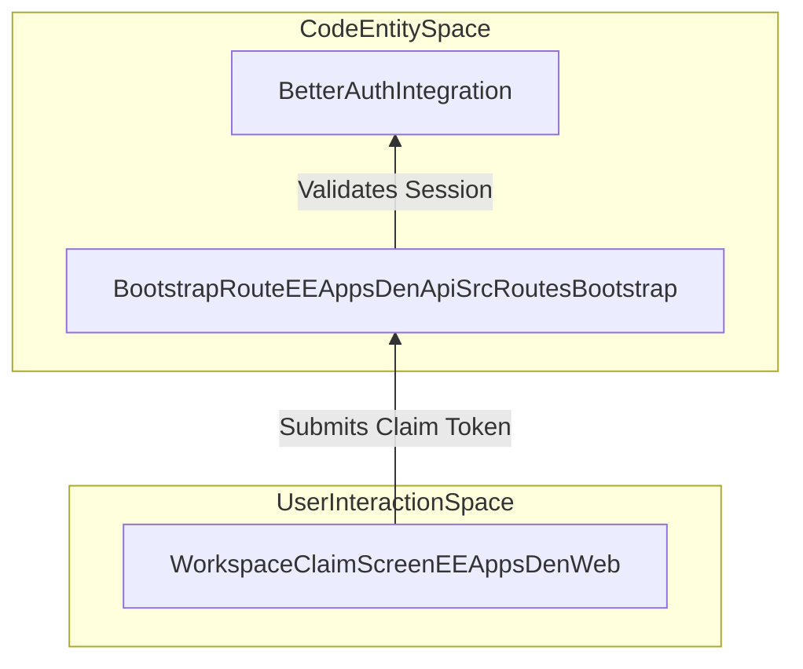

<!-- source: DeepWiki mcp.deepwiki.com · repo different-ai/openwork · page 2 Getting Started · fetched 2026-10-26 -->

# Getting Started

Relevant source files

The following files were used as context for generating this wiki page:

- [docs/enterprise/outbound-access.md](docs/enterprise/outbound-access.md)
- [docs/org-install-links.md](docs/org-install-links.md)
- [docs/support/enterprise-network-doctor.md](docs/support/enterprise-network-doctor.md)
- [ee/apps/den-api/src/routes/bootstrap/index.ts](ee/apps/den-api/src/routes/bootstrap/index.ts)
- [ee/apps/den-web/app/(den)/_components/workspace-claim-screen.tsx](ee/apps/den-web/app/(den)/_components/workspace-claim-screen.tsx)
- [ee/apps/den-web/app/(den)/_lib/runtime-config.ts](ee/apps/den-web/app/(den)/_lib/runtime-config.ts)
- [ee/apps/den-web/app/(den)/workspace-claim/page.tsx](ee/apps/den-web/app/(den)/workspace-claim/page.tsx)
- [ee/apps/den-web/app/api/runtime-config/route.ts](ee/apps/den-web/app/api/runtime-config/route.ts)
- [ee/apps/landing/.gitignore](ee/apps/landing/.gitignore)
- [ee/apps/landing/app/download/[platform]/route.ts](ee/apps/landing/app/download/[platform]/route.ts)
- [ee/apps/landing/app/install-manifest.json/route.ts](ee/apps/landing/app/install-manifest.json/route.ts)
- [ee/apps/landing/app/install.sh/route.ts](ee/apps/landing/app/install.sh/route.ts)
- [ee/apps/landing/app/openwork-bootstrap.mjs/route.ts](ee/apps/landing/app/openwork-bootstrap.mjs/route.ts)
- [ee/apps/landing/app/start.md/route.ts](ee/apps/landing/app/start.md/route.ts)
- [ee/apps/landing/lib/download-platforms.ts](ee/apps/landing/lib/download-platforms.ts)
- [ee/apps/landing/public/.well-known/agent-skills/install-openwork/SKILL.md](ee/apps/landing/public/.well-known/agent-skills/install-openwork/SKILL.md)
- [ee/apps/landing/scripts/copy-bootstrap-cli.mjs](ee/apps/landing/scripts/copy-bootstrap-cli.mjs)
- [infra/terraform/AGENTS.md](infra/terraform/AGENTS.md)
- [infra/terraform/MODULE_CONTRACT.md](infra/terraform/MODULE_CONTRACT.md)
- [packages/docs/cloud/enterprise.mdx](packages/docs/cloud/enterprise.mdx)
- [packages/docs/start-here/air-gapped-deployment.mdx](packages/docs/start-here/air-gapped-deployment.mdx)
- [packages/docs/start-here/installer-delivery.mdx](packages/docs/start-here/installer-delivery.mdx)
- [packages/docs/start-here/network-diagnostics.mdx](packages/docs/start-here/network-diagnostics.mdx)
- [packages/docs/start-here/on-prem-branding.mdx](packages/docs/start-here/on-prem-branding.mdx)
- [packages/docs/start-here/outbound-network-access.mdx](packages/docs/start-here/outbound-network-access.mdx)
- [packages/docs/start-here/private-network-deployment.mdx](packages/docs/start-here/private-network-deployment.mdx)
- [packages/docs/start-here/self-host.mdx](packages/docs/start-here/self-host.mdx)
- [packages/openwork-bootstrap/README.md](packages/openwork-bootstrap/README.md)
- [packages/openwork-bootstrap/bin/openwork.mjs](packages/openwork-bootstrap/bin/openwork.mjs)
- [packages/openwork-bootstrap/start.md](packages/openwork-bootstrap/start.md)
- [scripts/support/openwork-doctor.ps1](scripts/support/openwork-doctor.ps1)
- [scripts/support/setup-openwork-tls-repro.ps1](scripts/support/setup-openwork-tls-repro.ps1)

This page outlines the installation and first-run paths for desktop users, CLI/bootstrap users, and self-hosters. OpenWork provides multiple deployment entrypoints, ranging from direct desktop applications for macOS, Windows, and Linux to agent-first CLI bootstrap scripts (`packages/openwork-bootstrap/bin/openwork.mjs`) and self-hosted control planes (`ee/apps/den-api/src/routes/bootstrap/index.ts`) [packages/openwork-bootstrap/bin/openwork.mjs:1-10](), [ee/apps/den-api/src/routes/bootstrap/index.ts:1-25]().

For detailed platform-specific installation guides, see [Desktop Installation](#2.1). For automated agent setup and installation links, see [Bootstrap CLI and Install Links](#2.2). For your first workspace creation and interaction, see [Your First Session](#2.3).

---

## 2.1. Desktop Installation

OpenWork Desktop is distributed as a packaged Electron application supporting macOS, Linux (including AUR packages), and Windows. Users can download binaries directly from GitHub releases, through organization install links (`ee/apps/den-api/src/routes/org/install-links.ts`), or via installation manifests (`ee/apps/landing/app/install-manifest.json`). The desktop shell coordinates with an embedded `openwork-server` sidecar to manage local files, OpenCode runtimes, and local model inference via Ollama or custom API keys.

For teams deploying OpenWork across private infrastructure or managed environments, installers can also be delivered via mounted artifact directories or MDM distribution using `desktop-bootstrap.json` configuration [docs/org-install-links.md:85-108](), [packages/docs/start-here/installer-delivery.mdx:1-16]().

For detailed instructions on platform-specific packages, channels, and auto-updater flows, see [Desktop Installation](#2.1).

Sources: [docs/org-install-links.md:1-108](), [packages/docs/start-here/installer-delivery.mdx:1-16]()

---

## 2.2. Bootstrap CLI and Install Links

The `openwork-bootstrap` package (`packages/openwork-bootstrap/bin/openwork.mjs`) provides an agent-first installation path [packages/openwork-bootstrap/bin/openwork.mjs:1-22](). Instead of requiring manual downloads or shell-piping untrusted scripts, agents can execute structured bootstrap commands to install the CLI, download the app manifest, create provisional workspaces without upfront email authentication, and prepare desktop configuration stores [packages/openwork-bootstrap/bin/openwork.mjs:70-94](), [packages/openwork-bootstrap/start.md:1-12]().

Landing site routes such as `ee/apps/landing/app/start.md/route.ts` and `ee/apps/landing/app/install.sh/route.ts` provide guidance for AI assistants helping users configure OpenWork [ee/apps/landing/app/start.md/route.ts:1-22](), [ee/apps/landing/app/install.sh/route.ts:1-15]().

### Diagram: Bootstrap CLI to Desktop Initialization
This diagram maps natural language bootstrapping instructions to code entities in `packages/openwork-bootstrap`.

Sources: [packages/openwork-bootstrap/bin/openwork.mjs:70-88](), [packages/openwork-bootstrap/start.md:18-129](), [ee/apps/landing/app/start.md/route.ts:12-77]()

For deep-dive documentation on CLI flags, `install.sh` scripts, organization install links, and workspace claim screens, see [Bootstrap CLI and Install Links](#2.2).

Sources: [packages/openwork-bootstrap/bin/openwork.mjs:70-83](), [packages/openwork-bootstrap/start.md:1-12](), [ee/apps/landing/app/start.md/route.ts:1-22](), [ee/apps/landing/app/install.sh/route.ts:1-15]()

---

## 2.3. Your First Session

Once the desktop application or provisional workspace is initialized, the first-run workflow guides the user through workspace creation, welcome/onboarding routes, selecting an LLM provider (or utilizing Free Auto inference), and executing the first prompt [packages/openwork-bootstrap/start.md:71-88](). Provisional workspaces created via the CLI remain unauthenticated until the user visits the workspace claim screen (`ee/apps/den-web/app/(den)/_components/workspace-claim-screen.tsx`) and associates an identity [packages/openwork-bootstrap/start.md:55-72](), [ee/apps/den-web/app/(den)/_components/workspace-claim-screen.tsx:107-140]().

### Diagram: Workspace Claim and Authentication Bridge
This diagram connects the concept of claiming a workspace to its underlying Den web and API components, bridging natural language workspace onboarding to server-side code entities.

Sources: [ee/apps/den-web/app/(den)/_components/workspace-claim-screen.tsx:101-184](), [ee/apps/den-api/src/routes/bootstrap/index.ts:1-45]()

For a comprehensive guide on creating workspaces, navigating welcome screens, picking models, and sending initial messages, see [Your First Session](#2.3).

Sources: [packages/openwork-bootstrap/start.md:55-88](), [ee/apps/den-web/app/(den)/_components/workspace-claim-screen.tsx:101-184](), [ee/apps/den-api/src/routes/bootstrap/index.ts:1-45]()

---

