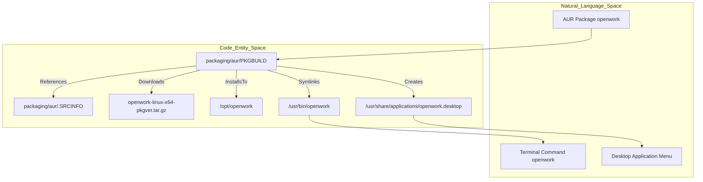
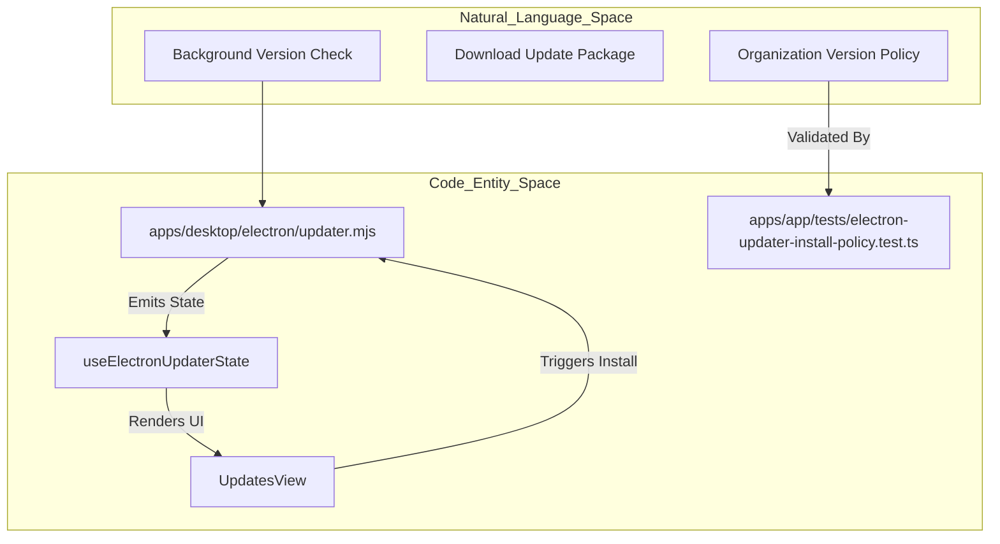

<!-- source: DeepWiki mcp.deepwiki.com · repo different-ai/openwork · page 2.1 Desktop Installation · fetched 2026-10-26 -->

# Desktop Installation

Relevant source files

The following files were used as context for generating this wiki page:

- [.github/workflows/aur-validate.yml](.github/workflows/aur-validate.yml)
- [.github/workflows/daytona-snapshot-drift.yml](.github/workflows/daytona-snapshot-drift.yml)
- [.github/workflows/dev-daytona-snapshot.yml](.github/workflows/dev-daytona-snapshot.yml)
- [.github/workflows/download-stats.yml](.github/workflows/download-stats.yml)
- [.github/workflows/opencode-agents.yml](.github/workflows/opencode-agents.yml)
- [.github/workflows/release-daytona-snapshot.yml](.github/workflows/release-daytona-snapshot.yml)
- [STATS.md](STATS.md)
- [STATS_V2.md](STATS_V2.md)
- [apps/app/src/app/lib/version-gate.ts](apps/app/src/app/lib/version-gate.ts)
- [apps/app/src/react-app/domains/settings/pages/updates-view.tsx](apps/app/src/react-app/domains/settings/pages/updates-view.tsx)
- [apps/app/src/react-app/domains/settings/state/electron-updater-state.ts](apps/app/src/react-app/domains/settings/state/electron-updater-state.ts)
- [apps/app/tests/electron-updater-check-now.test.ts](apps/app/tests/electron-updater-check-now.test.ts)
- [apps/app/tests/electron-updater-install-policy.test.ts](apps/app/tests/electron-updater-install-policy.test.ts)
- [apps/app/tests/version-gate.test.ts](apps/app/tests/version-gate.test.ts)
- [apps/desktop/electron/updater.mjs](apps/desktop/electron/updater.mjs)
- [apps/desktop/electron/updater.test.mjs](apps/desktop/electron/updater.test.mjs)
- [evals/worlds/packaged-preactivation-updater.ts](evals/worlds/packaged-preactivation-updater.ts)
- [packaging/aur/.SRCINFO](packaging/aur/.SRCINFO)
- [packaging/aur/PKGBUILD](packaging/aur/PKGBUILD)
- [packaging/aur/README.md](packaging/aur/README.md)
- [scripts/aur/publish-aur.sh](scripts/aur/publish-aur.sh)
- [scripts/aur/update-aur.sh](scripts/aur/update-aur.sh)
- [scripts/prune-daytona-dev-snapshots.mjs](scripts/prune-daytona-dev-snapshots.mjs)
- [scripts/stats.mjs](scripts/stats.mjs)
- [scripts/update-daytona-snapshot-pin.mjs](scripts/update-daytona-snapshot-pin.mjs)

OpenWork Desktop is a local-first AI coworker application designed for running agents, skills, and MCP workflows across macOS, Windows, and Linux `[README.md:1-3]`. It provides an integrated environment supporting multiple LLMs, custom API keys, and local state management `[README.md:3-7]`.

This page details the technical architecture of installing OpenWork Desktop across supported platforms, distribution channels, package maintenance (including AUR), the Electron updater subsystem (`apps/desktop/electron/updater.mjs`), and enterprise version gating.

---

## 1. Platform Support and Release Channels

OpenWork officially targets multiple operating systems and architectures. Updates are managed via the Electron updater module (`apps/desktop/electron/updater.mjs`), supporting **Stable** and **Alpha** release channels `[apps/desktop/electron/updater.mjs:46-55]`.

| Platform | Architectures | Installer Format | Default Release Channel |
|----------|--------------|------------------|-------------------------|
| **macOS** | Apple Silicon (`arm64`), Intel (`x64`) | `.dmg` | Stable / Alpha |
| **Windows** | `x64`, `arm64` | `.exe` | Stable |
| **Linux (Generic)** | `x64`, `arm64` | `.tar.gz`, `.AppImage` | Stable |
| **Linux (Arch)** | `x86_64`, `aarch64` | AUR package (`openwork`) | Stable |

The Electron updater feed configuration dynamically points to GitHub release assets or local loopback targets based on the resolved channel `[apps/desktop/electron/updater.mjs:46-108]`:
- `stable`: Maps to `https://github.com/different-ai/openwork/releases/latest/download` `[apps/desktop/electron/updater.mjs:47]`.
- `alpha`: Maps to pre-release build feeds on macOS `[apps/desktop/electron/updater.mjs:48]`.

Sources: `[packaging/aur/PKGBUILD:5]`, `[packaging/aur/.SRCINFO:6-7]`, `[apps/desktop/electron/updater.mjs:46-55]`

---

## 2. Installation Methods

### Direct Download & Landing Page
Users can install precompiled binaries via direct download. The installation pipeline resolves release assets and version metadata.

### Arch User Repository (AUR)
For Arch Linux environments, the `openwork` package definition (`packaging/aur/PKGBUILD`) extracts the tarball into `/opt/openwork`, establishes a global binary symlink at `/usr/bin/openwork`, registers desktop application menus, and configures sandbox permissions `[packaging/aur/PKGBUILD:22-64]`.

**AUR Installation Data Flow**

Sources: `[packaging/aur/PKGBUILD:1-64]`, `[packaging/aur/.SRCINFO:1-28]`

---

## 3. The Desktop Updater and Version Gating

OpenWork Desktop couples `electron-updater` with state machines located in `apps/desktop/electron/updater.mjs` and the React frontend hook `useElectronUpdaterState` (`apps/app/src/react-app/domains/settings/state/electron-updater-state.ts`).

### Updater Lifecycle and IPC Bridge
The main-process updater module registers IPC channels to evaluate updates, execute downloads, and handle restart flows (`registerUpdaterIpc`) `[apps/desktop/electron/updater.test.mjs:13-16]`. It compares stable versions semantically and permits loopback update feeds during local evaluation and testing via `evalUpdaterFeedUrl()` `[apps/desktop/electron/updater.mjs:93-114]`.

### UI State and Gating
The `useElectronUpdaterState` hook tracks update statuses (`idle`, `checking`, `available`, `blocked`, `downloading`, `ready`, `error`), feeding into `UpdatesView` (`apps/app/src/react-app/domains/settings/pages/updates-view.tsx`) to present progress indicators and execution controls `[apps/app/src/react-app/domains/settings/state/electron-updater-state.ts:20-41]`, `[apps/app/src/react-app/domains/settings/pages/updates-view.tsx:61-114]`.

**Updater and Version Gating Architecture**

Sources: `[apps/desktop/electron/updater.mjs:1-187]`, `[apps/app/src/react-app/domains/settings/state/electron-updater-state.ts:1-192]`, `[apps/app/src/react-app/domains/settings/pages/updates-view.tsx:61-114]`, `[apps/desktop/electron/updater.test.mjs:1-180]`

---

## 4. System Requirements & Dependencies

### Linux Runtime Dependencies
Linux packages rely on specific shared libraries for the Electron window host and native controls:
- `gtk3`, `nss`, `alsa-lib`, `libxss`, `libxtst`
- `xdg-utils`, `at-spi2-core`, `libdrm`, `libxkbcommon`
- `mesa`, `dbus`, `hicolor-icon-theme`

### Security Sandbox & Permissions
- **Chromium Sandbox:** The `chrome-sandbox` binary under `/opt/openwork/` requires setuid root privileges (`4755`) to maintain process isolation `[packaging/aur/PKGBUILD:63]`.
- **Version Compliance:** Enterprise policies administered through OpenWork Den can gate allowed versions. Revoked versions block staged installations until re-validated `[apps/app/src/react-app/domains/settings/state/electron-updater-state.ts:58-63]`.

Sources: `[packaging/aur/PKGBUILD:12-64]`, `[apps/app/src/react-app/domains/settings/state/electron-updater-state.ts:53-63]`

---

