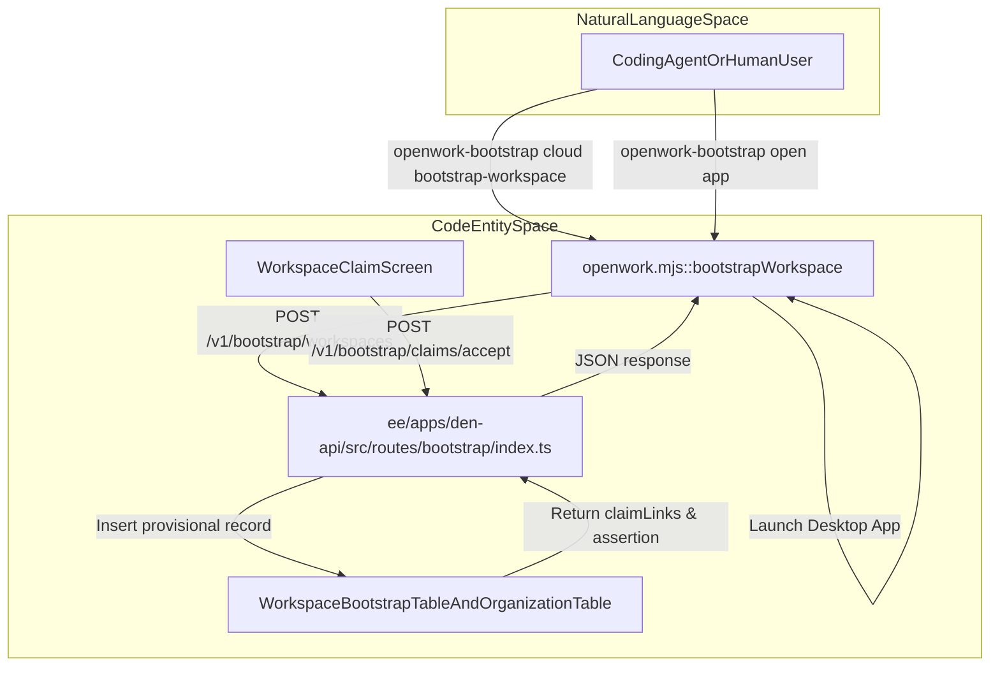
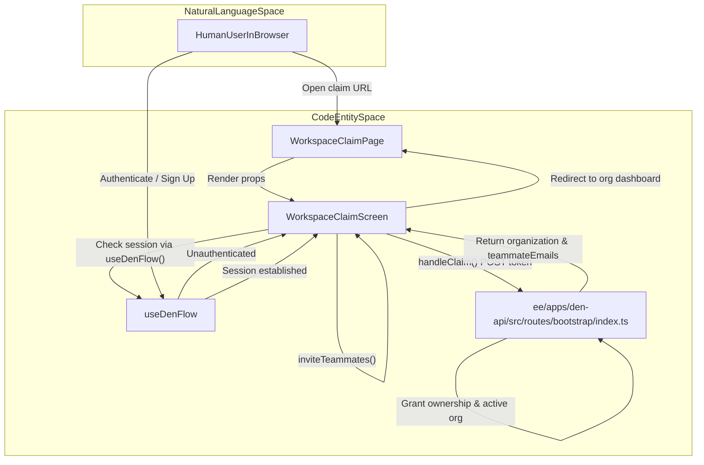

<!-- source: DeepWiki mcp.deepwiki.com · repo different-ai/openwork · page 2.2 Bootstrap CLI and Install Links · fetched 2026-10-26 -->

# Bootstrap CLI and Install Links

Relevant source files

The following files were used as context for generating this wiki page:

- [ee/apps/den-api/src/routes/bootstrap/index.ts](ee/apps/den-api/src/routes/bootstrap/index.ts)
- [ee/apps/den-api/src/routes/org/install-links.ts](ee/apps/den-api/src/routes/org/install-links.ts)
- [ee/apps/den-api/src/utils/installer-artifacts.ts](ee/apps/den-api/src/utils/installer-artifacts.ts)
- [ee/apps/den-web/app/(den)/_components/workspace-claim-screen.tsx](ee/apps/den-web/app/(den)/_components/workspace-claim-screen.tsx)
- [ee/apps/den-web/app/(den)/workspace-claim/page.tsx](ee/apps/den-web/app/(den)/workspace-claim/page.tsx)
- [ee/apps/landing/.gitignore](ee/apps/landing/.gitignore)
- [ee/apps/landing/app/download/[platform]/route.ts](ee/apps/landing/app/download/[platform]/route.ts)
- [ee/apps/landing/app/install-manifest.json/route.ts](ee/apps/landing/app/install-manifest.json/route.ts)
- [ee/apps/landing/app/install.sh/route.ts](ee/apps/landing/app/install.sh/route.ts)
- [ee/apps/landing/app/openwork-bootstrap.mjs/route.ts](ee/apps/landing/app/openwork-bootstrap.mjs/route.ts)
- [ee/apps/landing/app/start.md/route.ts](ee/apps/landing/app/start.md/route.ts)
- [ee/apps/landing/lib/download-platforms.ts](ee/apps/landing/lib/download-platforms.ts)
- [ee/apps/landing/public/.well-known/agent-skills/install-openwork/SKILL.md](ee/apps/landing/public/.well-known/agent-skills/install-openwork/SKILL.md)
- [ee/apps/landing/scripts/copy-bootstrap-cli.mjs](ee/apps/landing/scripts/copy-bootstrap-cli.mjs)
- [packages/openwork-bootstrap/README.md](packages/openwork-bootstrap/README.md)
- [packages/openwork-bootstrap/bin/openwork.mjs](packages/openwork-bootstrap/bin/openwork.mjs)
- [packages/openwork-bootstrap/start.md](packages/openwork-bootstrap/start.md)

## Purpose and Scope

This document details the architecture and implementation of the OpenWork bootstrap and installation surfaces. It covers the `packages/openwork-bootstrap` CLI (`bin/openwork.mjs`), the self-contained shell installer (`install.sh`), landing page routes (`start.md`, `openwork-bootstrap.mjs`, `install-manifest.json`), organization install links (`ee/apps/den-api/src/routes/org/install-links.ts`), and the web-based workspace claim screens (`ee/apps/den-web/app/(den)/_components/workspace-claim-screen.tsx`). These components allow users and automated coding agents to provision environments, download desktop runtimes, configure organization branding, and establish provisional cloud organizations without blocking on interactive credential entry.

Sources: `packages/openwork-bootstrap/bin/openwork.mjs:1-16`, `ee/apps/landing/app/install.sh/route.ts:1-25`, `ee/apps/den-api/src/routes/org/install-links.ts:96-107`, `ee/apps/den-web/app/(den)/_components/workspace-claim-screen.tsx:107-115`

---

## The Bootstrap CLI (`openwork-bootstrap`)

The `openwork-bootstrap` CLI is a standalone, dependency-free Node.js script located at `packages/openwork-bootstrap/bin/openwork.mjs` [packages/openwork-bootstrap/bin/openwork.mjs:1-16](). It provides subcommands for CLI installation, app deployment from manifests, authentication via one-time codes, and cloud workspace bootstrapping [packages/openwork-bootstrap/bin/openwork.mjs:75-115]().

### Runtime Version Verification and Implementation

The script enforces a strict Node.js runtime gate, requiring stable Node.js 24.x (version 24.22.1 or newer within that major) and rejecting other majors [packages/openwork-bootstrap/bin/openwork.mjs:10-19](). Arguments are parsed via `parseArgs` and routed to specific handlers [packages/openwork-bootstrap/bin/openwork.mjs:28-54]`:
- `install`: Installs the bootstrap CLI into a user-writable binary directory (e.g., `$HOME/.local/bin`) [packages/openwork-bootstrap/bin/openwork.mjs:80-80]().
- `install app`: Downloads and installs the desktop application using a remote JSON manifest [packages/openwork-bootstrap/bin/openwork.mjs:81-81]().
- `login`: Initiates a browser-based one-time code authentication flow (RFC 8628) [packages/openwork-bootstrap/bin/openwork.mjs:84-84]().
- `cloud onboard`: Provisions an organization, optional teammate invites, and starter skills for an authenticated user [packages/openwork-bootstrap/bin/openwork.mjs:86-88]().
- `cloud bootstrap-workspace`: Creates a provisional cloud workspace without prior email/password authentication [packages/openwork-bootstrap/bin/openwork.mjs:89-89]().
- `cloud claim-link`: Retrieves claim URLs saved by local desktop bootstrap flows [packages/openwork-bootstrap/bin/openwork.mjs:90-90]().

Sources: `packages/openwork-bootstrap/bin/openwork.mjs:1-128`, `packages/openwork-bootstrap/README.md:1-35`

---

## Landing Site Routes and Standalone Shell Installer (`install.sh`)

The landing site (`ee/apps/landing/`) exposes several routes to support script-driven installation and agent setup guides:
- `GET /install.sh` (`ee/apps/landing/app/install.sh/route.ts`): A shell script that checks for a supported Node.js runtime, downloads a pinned local copy of Node.js 24.22.1 if missing (checksum-verified against nodejs.org), fetches the bootstrap CLI script, and configures it on the user's PATH [ee/apps/landing/app/install.sh/route.ts:1-137]().
- `GET /openwork-bootstrap.mjs` (`ee/apps/landing/app/openwork-bootstrap.mjs/route.ts`): Serves the raw `openwork.mjs` bootstrap CLI file [ee/apps/landing/app/openwork-bootstrap.mjs/route.ts:1-17]().
- `GET /install-manifest.json` (`ee/apps/landing/app/install-manifest.json/route.ts`): Queries GitHub releases for `different-ai/openwork` and constructs a JSON manifest mapping platforms and architectures to desktop installers (`dmg`, `appimage`, `exe`, `msi`, `zip`, `tar.gz`) [ee/apps/landing/app/install-manifest.json/route.ts:1-137]().
- `GET /start.md` (`ee/apps/landing/app/start.md/route.ts`) and `packages/openwork-bootstrap/start.md`: Provide structured prompts and instructions for coding agents assisting users with OpenWork installation [ee/apps/landing/app/start.md/route.ts:1-25](), [packages/openwork-bootstrap/start.md:1-20]().

Sources: `ee/apps/landing/app/install.sh/route.ts:1-137`, `ee/apps/landing/app/openwork-bootstrap.mjs/route.ts:1-17`, `ee/apps/landing/app/install-manifest.json/route.ts:1-137`, `ee/apps/landing/app/start.md/route.ts:1-25`, `packages/openwork-bootstrap/start.md:1-20`

---

## Workspace Provisioning and Provisional Workspaces

To support agent-first initialization where users can spin up an environment before authenticating, the system implements provisional cloud workspaces via `ee/apps/den-api/src/routes/bootstrap/index.ts` [packages/openwork-bootstrap/start.md:67-72]().

### Provisional Workflow Data Flow

Sources: `packages/openwork-bootstrap/bin/openwork.mjs:79-80`, `ee/apps/den-api/src/routes/bootstrap/index.ts:65-122`, `ee/apps/den-web/app/(den)/_components/workspace-claim-screen.tsx:141-158`

---

## Install Links and Organization Configuration

Enterprise and self-hosted topologies configure desktop download links and runtime parameters dynamically via `ee/apps/den-api/src/routes/org/install-links.ts` [ee/apps/den-api/src/routes/org/install-links.ts:1-107](). 

The helper function `buildInstallConfig` reads organization metadata and returns an authenticated installation configuration (`installConfigSchema`) containing branding properties (`brandAppName`, `brandLogoUrl`, `brandIconUrl`), client names, web URLs, API public origins, and sign-in requirements [ee/apps/den-api/src/routes/org/install-links.ts:96-107](). Platform-specific installer assets are resolved using helper utilities like `enterpriseDesktopReleaseAssetName` and `cloudDesktopReleaseAssetName` [ee/apps/den-api/src/utils/installer-artifacts.ts:59-67]().

Sources: `ee/apps/den-api/src/routes/org/install-links.ts:1-107`, `ee/apps/den-api/src/utils/installer-artifacts.ts:1-90`

---

## Workspace Claim Screens and Authentication Handoff

Once a provisional workspace has been established and local state populated, users claim ownership via the web interface (`ee/apps/den-web/app/(den)/_components/workspace-claim-screen.tsx`) [packages/openwork-bootstrap/start.md:70-79]().

### Claim Screen State Transition

Sources: `ee/apps/den-web/app/(den)/_components/workspace-claim-screen.tsx:107-184`, `ee/apps/den-api/src/routes/bootstrap/index.ts:65-135`, `ee/apps/landing/app/workspace-claim/page.tsx:24-37`

---

