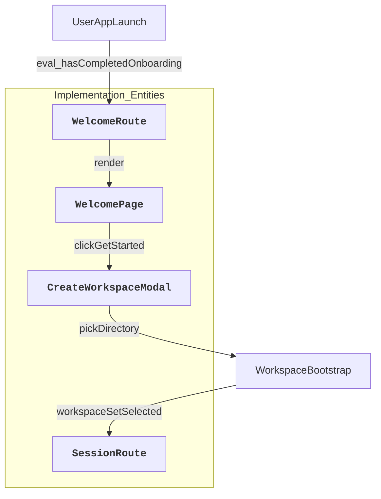
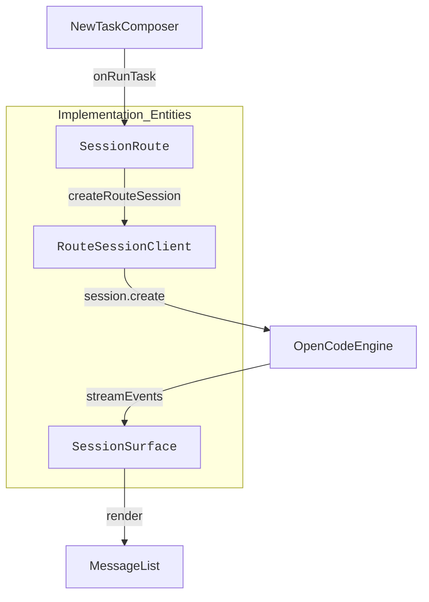

<!-- source: DeepWiki mcp.deepwiki.com · repo different-ai/openwork · page 2.3 Your First Session · fetched 2026-10-26 -->

# Your First Session

Relevant source files

The following files were used as context for generating this wiki page:

- [apps/app/src/components/page.tsx](apps/app/src/components/page.tsx)
- [apps/app/src/react-app/domains/cloud/den-signin-surface.tsx](apps/app/src/react-app/domains/cloud/den-signin-surface.tsx)
- [apps/app/src/react-app/domains/cloud/openwork-models-promo.ts](apps/app/src/react-app/domains/cloud/openwork-models-promo.ts)
- [apps/app/src/react-app/domains/cloud/signin-fallback-notice.tsx](apps/app/src/react-app/domains/cloud/signin-fallback-notice.tsx)
- [apps/app/src/react-app/domains/connections/provider-auth/provider-auth-modal.tsx](apps/app/src/react-app/domains/connections/provider-auth/provider-auth-modal.tsx)
- [apps/app/src/react-app/domains/onboarding/provider-selection-step.tsx](apps/app/src/react-app/domains/onboarding/provider-selection-step.tsx)
- [apps/app/src/react-app/domains/onboarding/welcome-page.tsx](apps/app/src/react-app/domains/onboarding/welcome-page.tsx)
- [apps/app/src/react-app/domains/session/artifacts/preview.tsx](apps/app/src/react-app/domains/session/artifacts/preview.tsx)
- [apps/app/src/react-app/domains/session/sidebar/sidebar-chrome.tsx](apps/app/src/react-app/domains/session/sidebar/sidebar-chrome.tsx)
- [apps/app/src/react-app/domains/settings/pages/ai-view.tsx](apps/app/src/react-app/domains/settings/pages/ai-view.tsx)
- [apps/app/src/react-app/domains/settings/shell/settings-shell.tsx](apps/app/src/react-app/domains/settings/shell/settings-shell.tsx)
- [apps/app/src/react-app/shell/welcome-route.tsx](apps/app/src/react-app/shell/welcome-route.tsx)
- [apps/desktop/electron/quit-sequence.mjs](apps/desktop/electron/quit-sequence.mjs)
- [evals/packages/behaviors/src/composer.ts](evals/packages/behaviors/src/composer.ts)
- [evals/packages/behaviors/src/den.ts](evals/packages/behaviors/src/den.ts)
- [evals/packages/behaviors/src/desktop-boot.ts](evals/packages/behaviors/src/desktop-boot.ts)
- [evals/packages/behaviors/src/desktop.ts](evals/packages/behaviors/src/desktop.ts)
- [evals/packages/behaviors/src/onboarding.ts](evals/packages/behaviors/src/onboarding.ts)
- [evals/packages/cdp/src/app-state.ts](evals/packages/cdp/src/app-state.ts)
- [evals/packages/cdp/src/cdp.ts](evals/packages/cdp/src/cdp.ts)
- [evals/packages/cdp/src/index.ts](evals/packages/cdp/src/index.ts)
- [evals/packages/cdp/src/input.ts](evals/packages/cdp/src/input.ts)
- [evals/packages/cdp/src/surface.ts](evals/packages/cdp/src/surface.ts)
- [evals/packages/env/src/seed.ts](evals/packages/env/src/seed.ts)
- [evals/packages/testkit/src/spec/runtime.ts](evals/packages/testkit/src/spec/runtime.ts)
- [evals/packages/testkit/src/spec/types.ts](evals/packages/testkit/src/spec/types.ts)
- [evals/worlds/first-run.ts](evals/worlds/first-run.ts)

## Purpose and Scope

This page provides technical documentation for the initial user journey in OpenWork: launching the desktop client or web application, evaluating onboarding requirements, creating the first workspace, picking an inference model, and submitting the first message. It details the runtime state machines, React components, and engine bindings that coordinate the first session.

---

## Creating Your First Workspace

When OpenWork launches, the React application mounts via `AppProviders` [apps/app/src/react-app/shell/providers.tsx:85]() and executes `useDesktopRuntimeBoot` to verify runtime health [apps/app/src/react-app/shell/desktop-runtime-boot.ts:67](). If no workspace exists or onboarding is incomplete, the router resolves the `WelcomeRoute` [apps/app/src/react-app/shell/welcome-route.tsx:123]().

### The Welcome State Machine

The `WelcomeRoute` component manages the first-run state machine through `welcomeReducer`, tracking modal visibility, workspace folder picking, and onboarding transitions [apps/app/src/react-app/shell/welcome-route.tsx:65-113](). If `local.prefs.hasCompletedOnboarding` evaluates to true, the router immediately redirects the user to `/session` [apps/app/src/react-app/shell/welcome-route.tsx:144-148]().

**Natural Language to Code Entity Space: Onboarding and Workspace Creation Flow**

Sources: [apps/app/src/react-app/shell/welcome-route.tsx:65-148](), [apps/app/src/react-app/domains/onboarding/welcome-page.tsx:29-40]()

### Workspace Provisioning and Directory Selection

Workspaces can be instantiated via two primary paths managed in the welcome workflow:
1. **Local Directories**: The user invokes `pickDirectory` to choose a local folder [apps/app/src/react-app/shell/welcome-route.tsx:7](). The path is normalized via `folderNameFromPath` [apps/app/src/react-app/shell/welcome-route.tsx:53](), and `workspaceBootstrap` initializes the local workspace state [apps/app/src/react-app/shell/welcome-route.tsx:8]().
2. **Automated Seeding**: Test and bootstrap environments execute `createAndSelectWorkspace` to provision temporary workspace files and transition through required screens programmatically [evals/packages/behaviors/src/desktop-boot.ts:129-150]().

Sources: [apps/app/src/react-app/shell/welcome-route.tsx:53-113](), [evals/packages/behaviors/src/desktop-boot.ts:129-150]()

---

## Picking a Model and Provider Setup

Once the workspace is initialized, the application presents options to configure LLM providers or select built-in models via `ProviderAuthModal` [apps/app/src/react-app/domains/connections/provider-auth/provider-auth-modal.tsx:96-114]() and `AiSettingsView` [apps/app/src/react-app/domains/settings/pages/ai-view.tsx:99-125]().

### Model Selection and Promotional Eligibility

Users can connect custom API keys, authenticate via OAuth providers, or leverage managed infrastructure. Promotional eligibility for hosted inference models is evaluated via `isOpenWorkModelsPromoEligible` [apps/app/src/react-app/domains/cloud/openwork-models-promo.ts:34-36]().

| Feature Component | Implementation Reference | Role |
| :--- | :--- | :--- |
| **Provider Auth Modal** | `ProviderAuthModal` [apps/app/src/react-app/domains/connections/provider-auth/provider-auth-modal.tsx:96]() | Manages API key submission and OAuth flows for third-party models. |
| **AI Settings View** | `AiSettingsView` [apps/app/src/react-app/domains/settings/pages/ai-view.tsx:99]() | Renders connected provider lists, gateway status, and device-local keys. |
| **Promo Hook** | `useOpenWorkModelsPromoEligibility` [apps/app/src/react-app/domains/cloud/openwork-models-promo.ts:38]() | Tracks whether cloud-managed model upsells should be displayed. |

Sources: [apps/app/src/react-app/domains/connections/provider-auth/provider-auth-modal.tsx:96-114](), [apps/app/src/react-app/domains/settings/pages/ai-view.tsx:99-125](), [apps/app/src/react-app/domains/cloud/openwork-models-promo.ts:34-48]()

---

## Starting the Conversation

The submission of the first prompt transitions the workspace into an active chat session on the underlying OpenCode engine instance.

### Interaction Flow and Engine Binding

When a user submits a prompt through the composer interface, the route obtains an active session client using either the v1 SDK or v2 adapter (`createClientV2`) depending on engine routing status [apps/app/src/react-app/shell/route-workspaces.ts:54-57]().

**Code Entity Space: First Message Execution and Streaming Flow**

Sources: [apps/app/src/react-app/shell/use-workspace-route-state.ts:142](), [apps/app/src/react-app/shell/route-workspaces.ts:88-90]()

Sources: [apps/app/src/react-app/shell/use-workspace-route-state.ts:94-142](), [apps/app/src/react-app/shell/route-workspaces.ts:54-90]()

---

