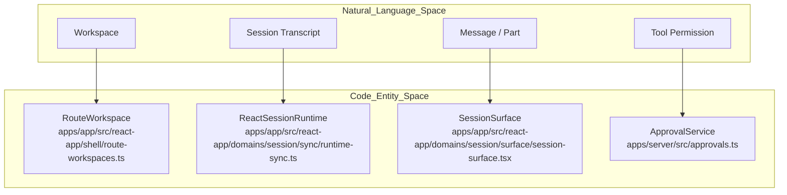
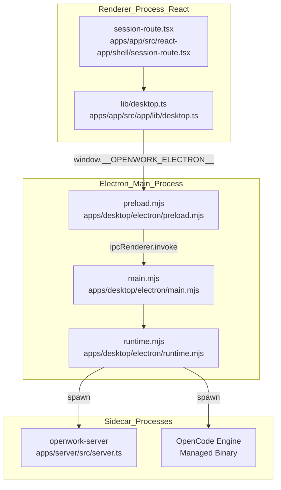

<!-- source: DeepWiki mcp.deepwiki.com · repo different-ai/openwork · page 3 OpenWork Desktop · fetched 2026-10-26 -->

# OpenWork Desktop

Relevant source files

The following files were used as context for generating this wiki page:

- [apps/app/src/app/lib/desktop-types.ts](apps/app/src/app/lib/desktop-types.ts)
- [apps/app/src/app/lib/desktop.ts](apps/app/src/app/lib/desktop.ts)
- [apps/app/src/app/lib/openwork-server.ts](apps/app/src/app/lib/openwork-server.ts)
- [apps/app/src/components/chat/message-list-provider.tsx](apps/app/src/components/chat/message-list-provider.tsx)
- [apps/app/src/components/chat/message-list.tsx](apps/app/src/components/chat/message-list.tsx)
- [apps/app/src/i18n/locales/en.ts](apps/app/src/i18n/locales/en.ts)
- [apps/app/src/react-app/domains/connections/provider-auth/store.ts](apps/app/src/react-app/domains/connections/provider-auth/store.ts)
- [apps/app/src/react-app/domains/session/chat/session-page.tsx](apps/app/src/react-app/domains/session/chat/session-page.tsx)
- [apps/app/src/react-app/domains/session/panel/agent-viewport.ts](apps/app/src/react-app/domains/session/panel/agent-viewport.ts)
- [apps/app/src/react-app/domains/session/panel/panel-tab-store.ts](apps/app/src/react-app/domains/session/panel/panel-tab-store.ts)
- [apps/app/src/react-app/domains/session/panel/side-panel.tsx](apps/app/src/react-app/domains/session/panel/side-panel.tsx)
- [apps/app/src/react-app/domains/session/sidebar/app-sidebar-provider.tsx](apps/app/src/react-app/domains/session/sidebar/app-sidebar-provider.tsx)
- [apps/app/src/react-app/domains/session/sidebar/app-sidebar.tsx](apps/app/src/react-app/domains/session/sidebar/app-sidebar.tsx)
- [apps/app/src/react-app/domains/session/sidebar/utils.ts](apps/app/src/react-app/domains/session/sidebar/utils.ts)
- [apps/app/src/react-app/domains/session/status/session-activity-store.ts](apps/app/src/react-app/domains/session/status/session-activity-store.ts)
- [apps/app/src/react-app/domains/session/status/session-attention.ts](apps/app/src/react-app/domains/session/status/session-attention.ts)
- [apps/app/src/react-app/domains/session/surface/session-render-state.ts](apps/app/src/react-app/domains/session/surface/session-render-state.ts)
- [apps/app/src/react-app/domains/session/surface/session-surface.tsx](apps/app/src/react-app/domains/session/surface/session-surface.tsx)
- [apps/app/src/react-app/domains/session/sync/message-merge.ts](apps/app/src/react-app/domains/session/sync/message-merge.ts)
- [apps/app/src/react-app/domains/session/sync/session-sync.ts](apps/app/src/react-app/domains/session/sync/session-sync.ts)
- [apps/app/src/react-app/domains/session/sync/transcript-reconcile.ts](apps/app/src/react-app/domains/session/sync/transcript-reconcile.ts)
- [apps/app/src/react-app/domains/session/sync/use-session-interactions.ts](apps/app/src/react-app/domains/session/sync/use-session-interactions.ts)
- [apps/app/src/react-app/domains/session/sync/usechat-adapter.ts](apps/app/src/react-app/domains/session/sync/usechat-adapter.ts)
- [apps/app/src/react-app/shell/session-route.tsx](apps/app/src/react-app/shell/session-route.tsx)
- [apps/app/src/react-app/shell/settings-route.tsx](apps/app/src/react-app/shell/settings-route.tsx)
- [apps/desktop/electron-builder.base.yml](apps/desktop/electron-builder.base.yml)
- [apps/desktop/electron/browser-panel.mjs](apps/desktop/electron/browser-panel.mjs)
- [apps/desktop/electron/main.mjs](apps/desktop/electron/main.mjs)
- [apps/desktop/electron/preload.mjs](apps/desktop/electron/preload.mjs)
- [apps/desktop/scripts/electron-build.mjs](apps/desktop/scripts/electron-build.mjs)
- [apps/desktop/scripts/electron-dev.mjs](apps/desktop/scripts/electron-dev.mjs)
- [apps/server/src/server.ts](apps/server/src/server.ts)
- [evals/proofs/browser-agent-viewport.proof.test.ts](evals/proofs/browser-agent-viewport.proof.test.ts)
- [packages/browser-tabs/index.d.ts](packages/browser-tabs/index.d.ts)
- [packages/browser-tabs/index.mjs](packages/browser-tabs/index.mjs)
- [packages/computer-use/browser-task-takeover.test.mjs](packages/computer-use/browser-task-takeover.test.mjs)
- [packages/computer-use/browser-task.mjs](packages/computer-use/browser-task.mjs)
- [packages/types/src/desktop-ipc.ts](packages/types/src/desktop-ipc.ts)

OpenWork Desktop is the primary user-facing client for OpenWork, combining the `apps/app` React single-page application with the `apps/desktop` Electron shell [apps/desktop/electron/main.mjs:82-93](). It provides a local-first workspace interface for interacting with AI models, executing code, managing files, running browser automations, and coordinating with the Den enterprise control plane.

This page serves as a high-level overview of the desktop client. For in-depth technical details, explore the child pages covering Core Concepts, Composer and Input, Extensions and Integrations, Desktop Features, and Desktop Architecture.

Sources: [apps/desktop/electron/main.mjs:82-93]()

---

## 3.1. Core Concepts

The mental model behind OpenWork Desktop relies on several interconnected primitives: Workspaces, Sessions, Messages/Parts, and Permissions. 

* **Workspaces and Routing**: Workspaces represent project directories on disk or remote nodes. The React client resolves workspace states, routes, and connections through [apps/app/src/react-app/shell/session-route.tsx:35-40]() and manages selection via [apps/app/src/app/lib/desktop.ts:47-51]().
* **Sessions and Synchronization**: Conversations happen inside sessions bound to a workspace. The client maintains transcripts using [apps/app/src/react-app/domains/session/sync/runtime-sync.ts]() and synchronizes state between the UI stores and the engine.
* **Messages, Parts, and Rendering**: Messages are broken down into discrete parts (text, tool calls, subagent execution lines, and code-mode operations) rendered in the session timeline [apps/app/src/react-app/domains/session/surface/session-surface.tsx:86-88]().
* **Permission System and Operational Modes**: Tool execution requires validation against operational modes and approval policies handled by [apps/server/src/approvals.ts]() and governed by runtime configs.

For detailed information on the mental model and state management, see [Core Concepts](#3.1).

Sources: [apps/app/src/react-app/shell/session-route.tsx:35-51](), [apps/app/src/react-app/domains/session/surface/session-surface.tsx:86-88]()

### Diagram: Core Runtime Concepts to Code Entities

Title: "Core Concepts to Code Entity Mapping"

Sources: [apps/app/src/react-app/shell/route-workspaces.ts](), [apps/app/src/react-app/domains/session/surface/session-surface.tsx:86-88](), [apps/server/src/approvals.ts:14-15]()

---

## 3.2. Composer and Input

The message composer (`ReactSessionComposer` in `apps/app/src/react-app/domains/session/surface/composer/composer.tsx`) is a Lexical-based text editor built to support rich multi-modal inputs. It handles:
* **Mentions**: Referencing agents (`@agent`), files (`@file`), and computer-use tools (`@computer`) via token encoding [apps/app/src/react-app/domains/session/surface/composer/mention-encoding.ts]().
* **Slash Commands**: Triggering built-in or custom workspace commands [apps/app/src/react-app/domains/session/surface/composer/slash-command.ts]().
* **Skills and Connectors**: Injecting marketplace capabilities or connector tokens into prompts [apps/app/src/react-app/domains/session/surface/composer/connect-skill-token.ts]().
* **Attachments and Drafts**: File drops, image previews, persistent draft stores, and auto-send state machines [apps/app/src/react-app/domains/session/sync/draft-store.ts]().

For detailed mechanics of prompt composition and input parsing, see [Composer and Input](#3.2).

Sources: [apps/app/src/react-app/domains/session/surface/composer/composer.tsx:18-42](), [apps/app/src/react-app/domains/session/sync/draft-store.ts:5-6]()

---

## 3.3. Extensions and Integrations

OpenWork Desktop provides a comprehensive extension surface configurable directly from Settings (`apps/app/src/react-app/domains/settings/`). The platform integrates external tools, local plugins, and enterprise capabilities:
* **Skills and Commands**: Just-in-time loading of custom skill catalogs and prompt templates [apps/server/src/skills.ts]().
* **MCP Servers and Connections**: Local and organizational Model Context Protocol server registration, OAuth flows, and connection health monitors [apps/server/src/local-managed-mcp.ts]().
* **OpenCode Plugins**: Extensions managed via `opencode.json` and adapter registries under `apps/server/src/opencode-plugins/` [apps/server/src/server.ts:41-43]().
* **MCP Apps and Dashboards**: Sandboxed web apps and widgets rendered via `mcp-app-host.js` and `mcp-app-sandbox.js` [apps/server/src/server.ts:46-62]().

For a complete breakdown of extension registries and marketplace protocols, see [Extensions and Integrations](#3.3).

Sources: [apps/server/src/server.ts:41-62](), [apps/server/src/skills.ts](), [apps/server/src/local-managed-mcp.ts:115-125]()

---

## 3.4. Desktop Features

Beyond standard chat transcripts, OpenWork Desktop features specialized surfaces designed for heavy agentic workflows:
* **Artifacts and File Editors**: Live markdown previews, text/spreadsheet editors, and project file trees managed by server-side file routes [apps/server/src/routes/files.js]().
* **Embedded Browser Panel**: Chromium `BrowserView` integration managed by `packages/browser-tabs` and `browser-panel.mjs` for web automation testing [apps/desktop/electron/browser-panel.mjs]().
* **Automations and Automation Runner**: Scheduled workflows and headless execution bridges coordinated via `automation-runner.mjs` [apps/desktop/electron/automation-runner.mjs]().
* **Command Palette and Search**: Global search dialogs, find bars, shortcut bindings, and window chrome controls [apps/app/src/react-app/domains/session/surface/find-bar.tsx]().
* **Settings and Updates**: Preferences panels, debug view models, and `electron-updater` integration for background distribution [apps/desktop/electron/updater.mjs]().

For detailed usage and component breakdowns, see [Desktop Features](#3.4).

Sources: [apps/desktop/electron/browser-panel.mjs](), [apps/desktop/electron/automation-runner.mjs](), [apps/desktop/electron/updater.mjs](), [apps/server/src/routes/files.js]()

---

## 3.5. Desktop Architecture

The desktop application is partitioned into distinct process boundaries and layering domains to ensure isolation and performance:
* **Frontend Architecture**: The React component tree (`apps/app`) structured around domains, kernels, Zustand stores, and Vite build configuration [apps/app/src/react-app/shell/session-route.tsx:1-17]().
* **Electron Main Process and IPC Bridge**: `main.mjs`, `preload.mjs`, and `DesktopCommandMap` contracts defined in `packages/types/src/desktop-ipc.ts` handle secure inter-process communication [apps/desktop/electron/main.mjs:82-105]().
* **Engine Runtimes and Server Sidecar**: `runtime.mjs` manages the lifecycle of the embedded `openwork-server` and underlying OpenCode AI engine instances [apps/desktop/electron/runtime.mjs]().
* **Desktop Policy and Security Model**: Enforcement of organization policies, token handling, and telemetry via Sentry [apps/desktop/electron/sentry.mjs]() and managed config providers.

For deep architectural schemas and security rules, see [Desktop Architecture](#3.5).

Sources: [apps/desktop/electron/main.mjs:82-105](), [apps/desktop/electron/runtime.mjs](), [packages/types/src/desktop-ipc.ts](), [apps/desktop/electron/sentry.mjs:79-82]()

### Diagram: Electron IPC and Sidecar Architecture

Title: "Desktop IPC and Runtime Architecture"

Sources: [apps/app/src/react-app/shell/session-route.tsx:35-55](), [apps/app/src/app/lib/desktop.ts:83-87](), [apps/desktop/electron/preload.mjs:61-64](), [apps/desktop/electron/main.mjs:82-93](), [apps/desktop/electron/runtime.mjs:1-25](), [apps/server/src/server.ts:100-102]()

---

