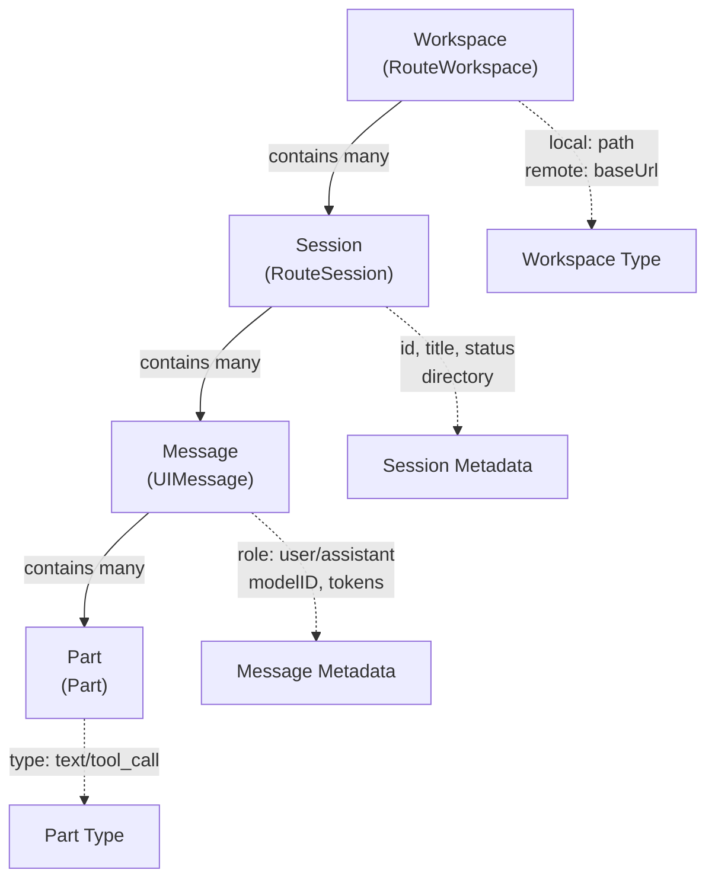
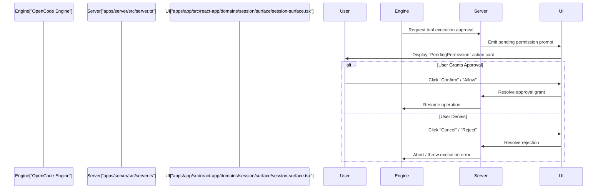

<!-- source: DeepWiki mcp.deepwiki.com · repo different-ai/openwork · page 3.1 Core Concepts · fetched 2026-10-26 -->

# Core Concepts

Relevant source files

The following files were used as context for generating this wiki page:

- [apps/app/src/app/lib/openwork-server.ts](apps/app/src/app/lib/openwork-server.ts)
- [apps/app/src/components/chat/message-list-provider.tsx](apps/app/src/components/chat/message-list-provider.tsx)
- [apps/app/src/components/chat/message-list.tsx](apps/app/src/components/chat/message-list.tsx)
- [apps/app/src/i18n/locales/en.ts](apps/app/src/i18n/locales/en.ts)
- [apps/app/src/react-app/domains/connections/provider-auth/store.ts](apps/app/src/react-app/domains/connections/provider-auth/store.ts)
- [apps/app/src/react-app/domains/session/chat/session-page.tsx](apps/app/src/react-app/domains/session/chat/session-page.tsx)
- [apps/app/src/react-app/domains/session/sidebar/app-sidebar-provider.tsx](apps/app/src/react-app/domains/session/sidebar/app-sidebar-provider.tsx)
- [apps/app/src/react-app/domains/session/sidebar/app-sidebar.tsx](apps/app/src/react-app/domains/session/sidebar/app-sidebar.tsx)
- [apps/app/src/react-app/domains/session/sidebar/utils.ts](apps/app/src/react-app/domains/session/sidebar/utils.ts)
- [apps/app/src/react-app/domains/session/status/session-activity-store.ts](apps/app/src/react-app/domains/session/status/session-activity-store.ts)
- [apps/app/src/react-app/domains/session/status/session-attention.ts](apps/app/src/react-app/domains/session/status/session-attention.ts)
- [apps/app/src/react-app/domains/session/surface/session-render-state.ts](apps/app/src/react-app/domains/session/surface/session-render-state.ts)
- [apps/app/src/react-app/domains/session/surface/session-surface.tsx](apps/app/src/react-app/domains/session/surface/session-surface.tsx)
- [apps/app/src/react-app/domains/session/sync/message-merge.ts](apps/app/src/react-app/domains/session/sync/message-merge.ts)
- [apps/app/src/react-app/domains/session/sync/session-sync.ts](apps/app/src/react-app/domains/session/sync/session-sync.ts)
- [apps/app/src/react-app/domains/session/sync/transcript-reconcile.ts](apps/app/src/react-app/domains/session/sync/transcript-reconcile.ts)
- [apps/app/src/react-app/domains/session/sync/use-session-interactions.ts](apps/app/src/react-app/domains/session/sync/use-session-interactions.ts)
- [apps/app/src/react-app/domains/session/sync/usechat-adapter.ts](apps/app/src/react-app/domains/session/sync/usechat-adapter.ts)
- [apps/app/src/react-app/shell/session-route.tsx](apps/app/src/react-app/shell/session-route.tsx)
- [apps/app/src/react-app/shell/settings-route.tsx](apps/app/src/react-app/shell/settings-route.tsx)
- [apps/server/src/server.ts](apps/server/src/server.ts)

This page explains the fundamental concepts that structure the OpenWork collaborative AI workspace system. Understanding these core entities—workspaces, sessions, messages, parts, and permissions—is essential for navigating the codebase, managing session execution, and extending system capabilities.

This is a PARENT page. For details on specific components, see:
- [Workspaces and Routing](#3.1.1) — Workspace types, route-workspaces, desktop runtime boot, and connection resolution.
- [Sessions and Synchronization](#3.1.2) — Session lifecycle, transcript reconciliation, and activity stores.
- [Messages, Parts and Rendering](#3.1.3) — Message lists, tool aggregate groups, and streaming pipelines.
- [Permission System and Operational Modes](#3.1.4) — Tool-execution approvals, operational modes, and runtime handoffs.

---

## Conceptual Hierarchy

OpenWork organizes AI interactions using a hierarchical data model. Each layer scopes execution context, maintaining state across the desktop shell, OpenWork server, and OpenCode engine.

**OpenWork Data Hierarchy**

Sources: [apps/app/src/react-app/shell/route-workspaces.ts:82-84](), [apps/app/src/react-app/shell/route-workspaces.ts:88-90]()

---

## Workspaces

A **workspace** represents a project folder and working directory context for AI sessions. Workspaces map directly to an OpenCode workdir and can be local (managed host filesystem directory) or remote (OpenWork server or cloud container connection). The UI manages these via `RouteWorkspace` and `RouteSession` definitions [apps/app/src/react-app/shell/route-workspaces.ts:82-83]().

### Workspace Types and Routing

Workspaces are categorized by their execution environment and connection posture:
- **Local Workspaces**: Hosted on the local machine runner, interfacing directly with local filesystem paths [apps/app/src/react-app/shell/route-workspaces.ts:53-54]().
- **Remote Workspaces**: Accessed via an explicit `baseUrl` pointing to a managed OpenWork server or container [apps/app/src/react-app/shell/session-route.tsx:38-41]().

For details on workspace types, route state management, and desktop initialization, see [Workspaces and Routing](#3.1.1).

Sources: [apps/app/src/react-app/shell/route-workspaces.ts:82-83](), [apps/app/src/react-app/shell/session-route.tsx:38-41]()

---

## Sessions and Synchronization

A **session** represents an individual conversation thread and task runtime. Sessions manage an ordered collection of messages, state synchronization with the underlying engine, and background shell execution tracking [apps/app/src/react-app/domains/session/sync/session-sync.ts:101-153]().

### Session State and Transcript Reconcile

Sessions are coordinated via `ReactSessionRuntime` [apps/app/src/react-app/domains/session/sync/runtime-sync.ts]() and synchronized using background event polling and Server-Sent Events (SSE) through `session-sync.ts` [apps/app/src/react-app/domains/session/sync/session-sync.ts:90-99](). Message updates are reconciled incrementally against local stores [apps/app/src/react-app/domains/session/sync/transcript-reconcile.ts]().

For a detailed walkthrough of session lifecycles, synchronization, and history paging, see [Sessions and Synchronization](#3.1.2).

Sources: [apps/app/src/react-app/domains/session/sync/session-sync.ts:90-153](), [apps/app/src/react-app/domains/session/sync/runtime-sync.ts](), [apps/app/src/react-app/domains/session/sync/transcript-reconcile.ts]()

---

## Messages, Parts and Rendering

Messages form the atomic chat structure rendered in the UI. Each message contains text, reasoning steps, tool invocations, or media parts conforming to `UIMessage` structures [apps/app/src/react-app/domains/session/surface/session-surface.tsx:4]().

### Message Components and Pipelines

The message rendering pipeline transforms raw engine parts into interactive UI widgets:
- **Tool Aggregate Groups**: Group bulk tool operations (like file reads, searches, and edits) into collapsible headers [components/chat/message-list.tsx:120]().
- **Code-Mode & Capability Lines**: Render execution traces for subagents, capability calls, and MCP tool interactions [components/chat/message-list.tsx:105-116]().
- **Streaming & Markdown**: Processes incremental text parts, code blocks, and embedded UI components.

For complete coverage of the message list architecture, tool groups, and markdown rendering pipelines, see [Messages, Parts and Rendering](#3.1.3).

Sources: [apps/app/src/react-app/domains/session/surface/session-surface.tsx:4](), [components/chat/message-list.tsx:105-120]()

---

## Permission System and Operational Modes

The permission system secures agent operations by gating tool execution (such as terminal execution, file system modifications, or browser controls) behind approval boundaries handled by `ApprovalService` [apps/server/src/server.ts:16]().

### Approval Request Flow

Sources: [apps/server/src/server.ts:16](), [apps/server/src/server.ts:14]()

For details on tool approvals, direct vs orchestrated engine runtimes, and session admission control, see [Permission System and Operational Modes](#3.1.4).

Sources: [apps/server/src/server.ts:14-16]()

---

