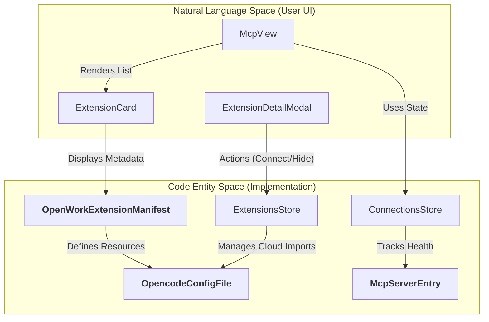
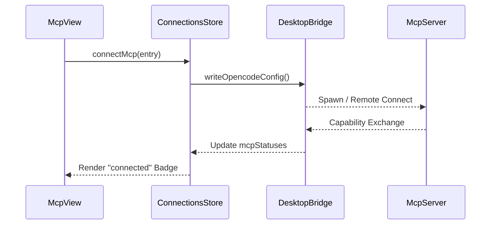

<!-- source: DeepWiki mcp.deepwiki.com · repo different-ai/openwork · page 3.3 Extensions and Integrations · fetched 2026-10-26 -->

# Extensions and Integrations

Relevant source files

The following files were used as context for generating this wiki page:

- [apps/app/src/app/constants.ts](apps/app/src/app/constants.ts)
- [apps/app/src/app/extensions.ts](apps/app/src/app/extensions.ts)
- [apps/app/src/app/mcp.ts](apps/app/src/app/mcp.ts)
- [apps/app/src/app/types.ts](apps/app/src/app/types.ts)
- [apps/app/src/react-app/design-system/extension-card.tsx](apps/app/src/react-app/design-system/extension-card.tsx)
- [apps/app/src/react-app/design-system/extension-detail-modal.tsx](apps/app/src/react-app/design-system/extension-detail-modal.tsx)
- [apps/app/src/react-app/domains/connections/cloud-inventory-cache.ts](apps/app/src/react-app/domains/connections/cloud-inventory-cache.ts)
- [apps/app/src/react-app/domains/connections/cloud-mcp-user-state.ts](apps/app/src/react-app/domains/connections/cloud-mcp-user-state.ts)
- [apps/app/src/react-app/domains/connections/mcp-auth-modal.tsx](apps/app/src/react-app/domains/connections/mcp-auth-modal.tsx)
- [apps/app/src/react-app/domains/connections/modals/add-mcp-modal.tsx](apps/app/src/react-app/domains/connections/modals/add-mcp-modal.tsx)
- [apps/app/src/react-app/domains/connections/store.ts](apps/app/src/react-app/domains/connections/store.ts)
- [apps/app/src/react-app/domains/settings/extension-registry.tsx](apps/app/src/react-app/domains/settings/extension-registry.tsx)
- [apps/app/src/react-app/domains/settings/extension-state.ts](apps/app/src/react-app/domains/settings/extension-state.ts)
- [apps/app/src/react-app/domains/settings/pages/extensions-view.tsx](apps/app/src/react-app/domains/settings/pages/extensions-view.tsx)
- [apps/app/src/react-app/domains/settings/pages/general-view.tsx](apps/app/src/react-app/domains/settings/pages/general-view.tsx)
- [apps/app/src/react-app/domains/settings/pages/mcp-view.tsx](apps/app/src/react-app/domains/settings/pages/mcp-view.tsx)
- [apps/app/src/react-app/domains/settings/settings-extension-controller.ts](apps/app/src/react-app/domains/settings/settings-extension-controller.ts)
- [apps/app/src/react-app/domains/settings/shell/settings-page.tsx](apps/app/src/react-app/domains/settings/shell/settings-page.tsx)

The OpenWork extensions surface in Settings provides a unified management plane for augmenting the AI's capabilities through skills, plugins, MCP (Model Context Protocol) servers, custom commands, and organization connectors. This parent page provides a high-level overview of the extension subsystem and links to detailed child pages for specific integration types.

For details on specific child topics, see:
- [Skills and Commands](#3.3.1)
- [MCP Servers and Connections](#3.3.2)
- [OpenCode Plugins and Extensions Preview](#3.3.3)
- [MCP Apps and Dashboards](#3.3.4)

---

## Overview of Extension Types

Extensions are categorized by their `ExtensionKind`, encompassing `mcp`, `plugin`, `skill`, `ui-control`, and `extension` [apps/app/src/app/constants.ts:27-27](). The system uses a declarative manifest-driven approach via `OpenWorkExtensionManifest` to define resources, setup requirements, platform compatibility, and lifecycle hooks [apps/app/src/app/extensions.ts:109-132]().

| Extension Category | Description | Configuration Source |
| :--- | :--- | :--- |
| **Skills** | Reusable instruction packs and workflows for agents. | `SKILL.md` / Workspace files |
| **Plugins** | Engine-level plugins extending OpenCode capabilities. | `opencode.json` / `opencode.jsonc` |
| **MCP Servers** | Standardized servers providing external tools and resources. | `opencode.jsonc` (`mcp` section) |
| **Commands & UI** | Custom composer slash commands and UI automation controls. | Manifests and local wrappers |
| **Connectors** | OAuth-backed integrations and cloud-managed MCP services. | Den API & Connections Store |

### Extension System Architecture

The following diagram bridges the user interface space (natural language and visual settings cards) with the underlying configuration storage and connection managers in code.

**Extension System Mapping**

Sources: [apps/app/src/react-app/domains/settings/pages/mcp-view.tsx:1-188](), [apps/app/src/app/extensions.ts:109-132](), [apps/app/src/react-app/domains/connections/store.ts:93-105]()

---

## Skills and Commands

Skills allow users to inject domain-specific instructions into agent sessions, while custom commands provide shortcut triggers in the composer. The settings catalog organizes these items alongside installed tools.

For full details on just-in-time skill loading, cloud skills, templates, and command structures, see [Skills and Commands](#3.3.1).

Sources: [apps/app/src/app/extensions.ts:21-35](), [apps/app/src/react-app/domains/settings/pages/mcp-view.tsx:162-185]()

---

## MCP Servers and Connections

The Model Context Protocol integration supports both quick-connect remote endpoints (such as Notion, Linear, Sentry, and Stripe) and custom local servers [apps/app/src/app/constants.ts:98-142](). The `ConnectionsStore` tracks real-time connection health across states like `connected`, `needs_auth`, and `failed` [apps/app/src/react-app/domains/connections/store.ts:93-105]().

**MCP Lifecycle Management**

Sources: [apps/app/src/react-app/domains/settings/pages/mcp-view.tsx:1-188](), [apps/app/src/react-app/domains/connections/store.ts:93-105](), [apps/app/src/app/constants.ts:88-96]()

For details on local/org registration, OAuth flows, and health reconcilers, see [MCP Servers and Connections](#3.3.2).

Sources: [apps/app/src/react-app/domains/connections/store.ts:93-105](), [apps/app/src/app/constants.ts:98-142]()

---

## OpenCode Plugins and Extensions Preview

OpenCode plugins extend the backend engine runtime with hooks, custom providers, and additional tool capabilities. They are configured via `opencode.json` and managed through the plugins review view [apps/app/src/react-app/domains/settings/pages/extensions-view.tsx:128-147]().

For details on extension previews, capabilities knowledge, steering, and adapter configuration, see [OpenCode Plugins and Extensions Preview](#3.3.3).

Sources: [apps/app/src/app/types.ts:1-12](), [apps/app/src/react-app/domains/settings/pages/extensions-view.tsx:128-147]()

---

## MCP Apps and Dashboards

OpenWork integrates interactive MCP-driven applications and dashboard tiles using sandbox frames and artifact views. These surfaces allow agents to render rich UI components directly inside workspace panels and chat streams.

For details on `mcp-app-frame`, sandboxes, sharing, and artifact previews, see [MCP Apps and Dashboards](#3.3.4).

Sources: [apps/app/src/app/types.ts:147-154]()

---

