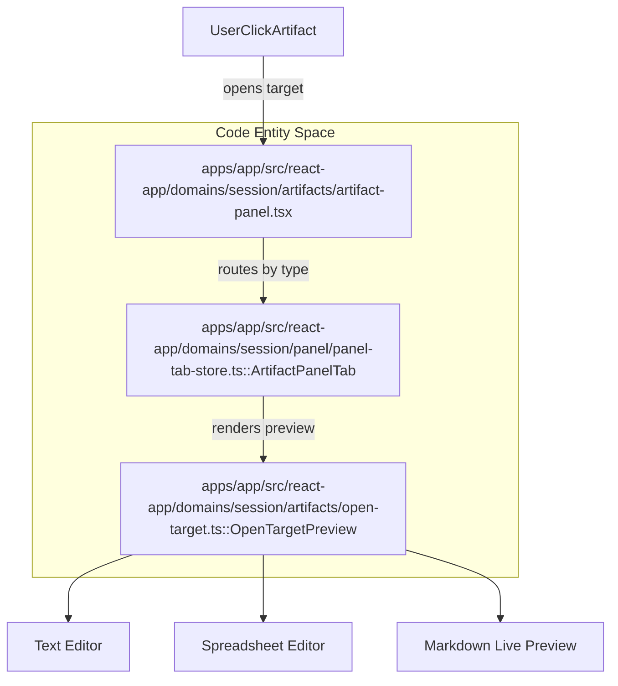
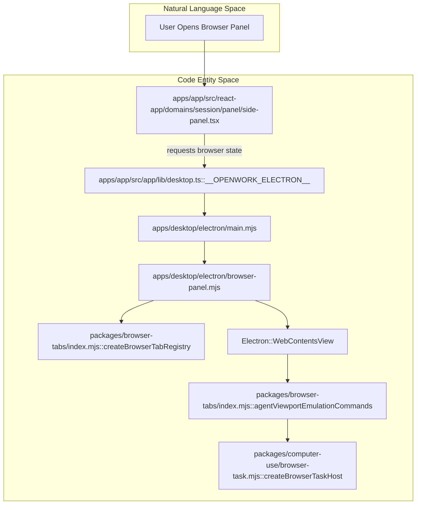
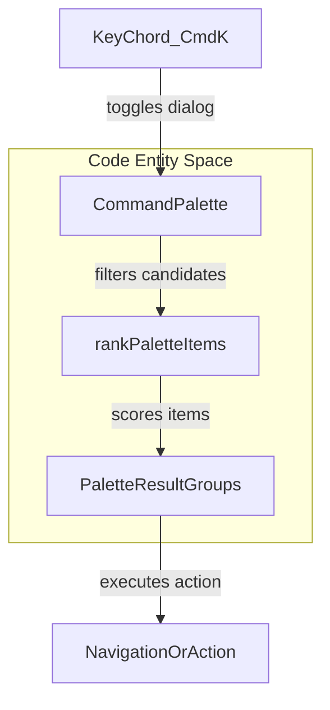
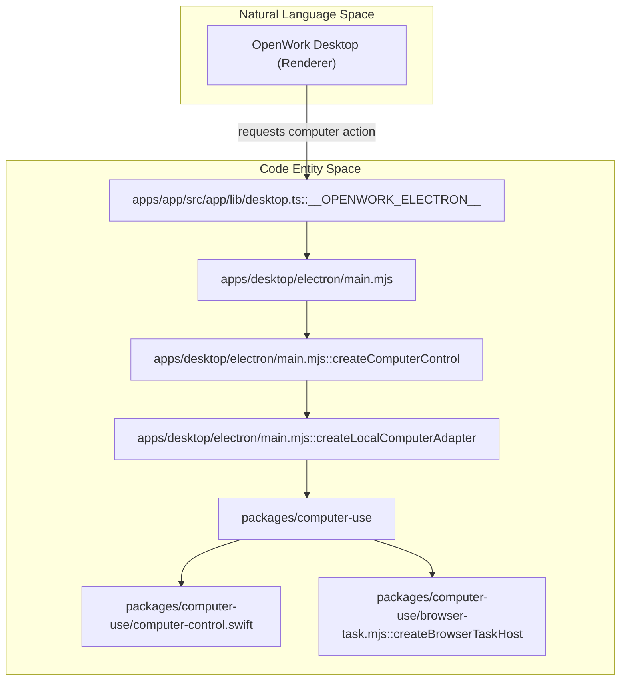

<!-- source: DeepWiki mcp.deepwiki.com · repo different-ai/openwork · page 3.4 Desktop Features · fetched 2026-10-26 -->

# Desktop Features

Relevant source files

The following files were used as context for generating this wiki page:

- [apps/app/src/app/lib/desktop-types.ts](apps/app/src/app/lib/desktop-types.ts)
- [apps/app/src/app/lib/desktop.ts](apps/app/src/app/lib/desktop.ts)
- [apps/app/src/react-app/domains/session/panel/agent-viewport.ts](apps/app/src/react-app/domains/session/panel/agent-viewport.ts)
- [apps/app/src/react-app/domains/session/panel/panel-tab-store.ts](apps/app/src/react-app/domains/session/panel/panel-tab-store.ts)
- [apps/app/src/react-app/domains/session/panel/side-panel.tsx](apps/app/src/react-app/domains/session/panel/side-panel.tsx)
- [apps/desktop/electron-builder.base.yml](apps/desktop/electron-builder.base.yml)
- [apps/desktop/electron/browser-panel.mjs](apps/desktop/electron/browser-panel.mjs)
- [apps/desktop/electron/main.mjs](apps/desktop/electron/main.mjs)
- [apps/desktop/electron/preload.mjs](apps/desktop/electron/preload.mjs)
- [apps/desktop/scripts/electron-build.mjs](apps/desktop/scripts/electron-build.mjs)
- [apps/desktop/scripts/electron-dev.mjs](apps/desktop/scripts/electron-dev.mjs)
- [evals/proofs/browser-agent-viewport.proof.test.ts](evals/proofs/browser-agent-viewport.proof.test.ts)
- [packages/browser-tabs/index.d.ts](packages/browser-tabs/index.d.ts)
- [packages/browser-tabs/index.mjs](packages/browser-tabs/index.mjs)
- [packages/computer-use/browser-task-takeover.test.mjs](packages/computer-use/browser-task-takeover.test.mjs)
- [packages/computer-use/browser-task.mjs](packages/computer-use/browser-task.mjs)
- [packages/types/src/desktop-ipc.ts](packages/types/src/desktop-ipc.ts)

## Purpose and Scope

This page provides a high-level overview of additional user-facing surfaces and administrative subsystems available in OpenWork Desktop beyond the core chat interface. These features extend the workspace with document management, embedded browsing, task automation, global search, configuration management, and system updates.

Because this is a parent page, it summarizes each subsystem and links directly to its dedicated child page for deeper architectural and implementation details.

---

## 3.4.1 Artifacts and File Editors

The Artifact panel provides an integrated workspace surface for viewing, inspecting, and editing files generated or referenced during agent sessions. It resolves open targets (`OpenTarget`) from message transcripts and workspace trees, routing them to specialized viewers and editors such as Markdown live previews, code views, and spreadsheet editors [apps/app/src/react-app/domains/session/panel/side-panel.tsx:115-131](), [apps/app/src/react-app/domains/session/panel/panel-tab-store.ts:15-21]().

For details on file route resolution, the markdown live preview engine, and workspace tree integration, see [Artifacts and File Editors](#3.4.1).

**Sources:** [apps/app/src/react-app/domains/session/panel/side-panel.tsx:115-131](), [apps/app/src/react-app/domains/session/panel/panel-tab-store.ts:15-21]()

---

## 3.4.2 Embedded Browser Panel

OpenWork Desktop includes an embedded browser panel capable of rendering web pages directly inside the desktop shell using Electron `WebContentsView` [apps/desktop/electron/browser-panel.mjs:7](). Managed via the `createBrowserTabRegistry` in `packages/browser-tabs` [packages/browser-tabs/index.mjs](), it supports bounds synchronization [apps/app/src/react-app/domains/session/panel/side-panel.tsx:53](), side-panel UI integration [apps/app/src/react-app/domains/session/panel/side-panel.tsx:1-74](), background tab emulation [packages/browser-tabs/index.mjs:123-124](), and proxy/policy enforcement [apps/desktop/electron/browser-panel.mjs:51-131](). The `BrowserPanelTab` type defines the mirrored state across the desktop IPC bridge [packages/browser-tabs/index.d.ts:21-55]().

For details on browser tab ownership, IPC bounds synchronization, and security policies, see [Embedded Browser Panel](#3.4.2).

**Sources:** [apps/desktop/electron/browser-panel.mjs:7](), [packages/browser-tabs/index.mjs](), [apps/app/src/react-app/domains/session/panel/side-panel.tsx:53](), [apps/app/src/react-app/domains/session/panel/side-panel.tsx:1-74](), [packages/browser-tabs/index.mjs:123-124](), [apps/desktop/electron/browser-panel.mjs:51-131](), [packages/browser-tabs/index.d.ts:21-55]()

---

## 3.4.3 Automations and the Automation Runner

The automations subsystem bridges desktop actions with scheduled or headless execution workflows. The desktop `automation-runner.mjs` [apps/desktop/electron/main.mjs:64]() communicates with the `den-api` automations service and repository to execute background tasks, manage cloud vs. headless executors, and trigger scheduled runs. The `AUTOMATION_RUNNER_CREDENTIAL_REJECTED_EVENT` [apps/desktop/electron/main.mjs:153]() is used for credential handling.

For details on the automation runner bridge, cloud scheduling, and repository services, see [Automations and the Automation Runner](#3.4.3).

**Sources:** [apps/desktop/electron/main.mjs:64](), [apps/desktop/electron/main.mjs:153]()

---

## 3.4.4 Command Palette, Search and Shortcuts

The command palette (`Cmd/Ctrl+K`) serves as the central launcher for actions, settings navigation, and session switching. It combines fuzzy search ranking via `rankPaletteItems` with keyboard shortcut bindings and recent item tracking.

For details on command palette modes, session search dialogs, find bars, and shortcut configurations, see [Command Palette, Search and Shortcuts](#3.4.4).

**Sources:** [apps/app/src/react-app/domains/session/panel/side-panel.tsx:1-177]() (general UI components)

---

## 3.4.5 Settings, Preferences and Developer Mode

The Settings interface manages application configurations, local AI providers, and feature flags. Developer Mode exposes internal diagnostic view-models, engine logs, and state introspection tools [apps/app/src/app/lib/desktop.ts:157-159](). It also includes recovery and "nuke" routines to reset corrupted local storage or state [apps/desktop/electron/main.mjs:41-43](). The `NukeManifestPreview` and `NukeReceipt` types are part of the desktop IPC contract [packages/types/src/desktop-ipc.ts:25-34]().

For details on the settings shell, debug view-models, and reset workflows, see [Settings, Preferences and Developer Mode](#3.4.5).

**Sources:** [apps/app/src/app/lib/desktop.ts:157-159](), [apps/desktop/electron/main.mjs:41-43](), [packages/types/src/desktop-ipc.ts:25-34]()

---

## 3.4.6 Updates and Version Gating

OpenWork Desktop integrates with `electron-updater` to manage background application updates, updater channels, and version gating checks. It handles the download progress lifecycle and provides secure restart-and-install flows for packaged distributions. The `registerUpdaterIpc` function [apps/desktop/electron/main.mjs:26]() handles the IPC communication for updates, and the `UpdaterEnvironment` type [packages/types/src/desktop-ipc.ts:30-31]() defines the update environment.

For details on update channels, version-gate logic, and packaged update install journeys, see [Updates and Version Gating](#3.4.6).

**Sources:** [apps/desktop/electron/main.mjs:26](), [packages/types/src/desktop-ipc.ts:30-31]()

---

## 3.4.7 Computer Use and Native Control

The `packages/computer-use` module provides native control capabilities for the desktop application, including a Swift helper for macOS accessibility (`MacAccessibility`, `SessionRuntime`, `PermissionCoach`). This enables features like the computer panel, store, and popout within the app, as well as `computer-permission-entry` in Electron [apps/desktop/electron/main.mjs:33-37]() and browser task takeover [packages/computer-use/browser-task.mjs:1-12]().

For details on the native Swift helper, the computer panel UI, and browser task takeover, see [Computer Use and Native Control](#3.4.7).

**Sources:** [apps/desktop/electron/main.mjs:33-37](), [packages/computer-use/browser-task.mjs:1-12]()

---

