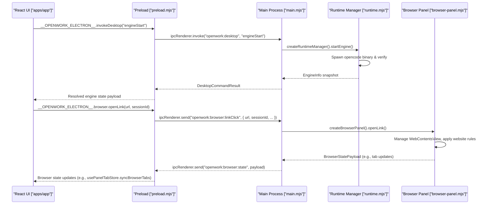

<!-- source: DeepWiki mcp.deepwiki.com · repo different-ai/openwork · page 3.5 Desktop Architecture · fetched 2026-10-26 -->

# Desktop Architecture

<details>
<summary>Relevant source files</summary>

The following files were used as context for generating this wiki page:

- [apps/app/src/app/lib/desktop-types.ts](apps/app/src/app/lib/desktop-types.ts)
- [apps/app/src/app/lib/desktop.ts](apps/app/src/app/lib/desktop.ts)
- [apps/app/src/react-app/domains/session/panel/agent-viewport.ts](apps/app/src/react-app/domains/session/panel/agent-viewport.ts)
- [apps/app/src/react-app/domains/session/panel/panel-tab-store.ts](apps/app/src/react-app/domains/session/panel/panel-tab-store.ts)
- [apps/app/src/react-app/domains/session/panel/side-panel.tsx](apps/app/src/react-app/domains/session/panel/side-panel.tsx)
- [apps/desktop/electron-builder.base.yml](apps/desktop/electron-builder.base.yml)
- [apps/desktop/electron/browser-panel.mjs](apps/desktop/electron/browser-panel.mjs)
- [apps/desktop/electron/main.mjs](apps/desktop/electron/main.mjs)
- [apps/desktop/electron/preload.mjs](apps/desktop/electron/preload.mjs)
- [apps/desktop/scripts/electron-build.mjs](apps/desktop/scripts/electron-build.mjs)
- [apps/desktop/scripts/electron-dev.mjs](apps/desktop/scripts/electron-dev.mjs)
- [evals/proofs/browser-agent-viewport.proof.test.ts](evals/proofs/browser-agent-viewport.proof.test.ts)
- [packages/browser-tabs/index.d.ts](packages/browser-tabs/index.d.ts)
- [packages/browser-tabs/index.mjs](packages/browser-tabs/index.mjs)
- [packages/computer-use/browser-task-takeover.test.mjs](packages/computer-use/browser-task-takeover.test.mjs)
- [packages/computer-use/browser-task.mjs](packages/computer-use/browser-task.mjs)
- [packages/types/src/desktop-ipc.ts](packages/types/src/desktop-ipc.ts)

</details>


This page outlines the internal layering and multi-process architecture of the OpenWork Desktop client. The application is structured into a React frontend shell, an Electron native host process, background engine runtimes, and a security policy layer.

For deep technical dives into specific subsystems, refer to the following child pages:
- [Frontend Architecture](#3.5.1) — Detailed React structure, component domains, Zustand stores, and routing.
- [Electron Main Process and IPC Bridge](#3.5.2) — Native process hosting, `main.mjs`, `preload.mjs`, and `DesktopCommandMap`.
- [Engine Runtimes and the Server Sidecar](#3.5.3) — `runtime.mjs` lifecycle, embedded server, and binary resolution.
- [Desktop Policy and Security Model](#3.5.4) — Managed policies, token handling, and enterprise configuration.

Sources: [apps/desktop/electron/main.mjs:1-32](), [apps/app/src/app/lib/desktop.ts:77-112]()

## High-Level Overview

The OpenWork Desktop client coordinates user interaction through a decoupled multi-layer model. The user interface runs inside a secure Chromium renderer (`apps/app`), communicating with native system capabilities through a strictly typed Electron preload bridge (`apps/desktop/electron/preload.mjs`). Background AI execution and state synchronization are managed locally via sidecar runtimes and an embedded server instance.

### System Entity Map
| System Component | Code Entity / Identifier | File Path |
| :--- | :--- | :--- |
| **Electron Main Entry** | `main.mjs` | [apps/desktop/electron/main.mjs:1-30]() |
| **Preload Bridge** | `__OPENWORK_ELECTRON__` | [apps/app/src/app/lib/desktop.ts:103-104]() |
| **Desktop IPC Client** | `invokeDesktop` / `DesktopCommandMap` | [apps/app/src/app/lib/desktop.ts:104-107]() |
| **Runtime Manager** | `createRuntimeManager` | [apps/desktop/electron/main.mjs:25]() |
| **Workspace Persistence** | `createWorkspaceStore` | [apps/desktop/electron/main.mjs:38]() |
| **Browser Panel** | `createBrowserPanel` | [apps/desktop/electron/main.mjs:32]() |

### Architecture Component Diagram

```mermaid
graph TB
    subgraph "Frontend Layer ["apps/app"]"
        ReactUI["React Components<br/>(apps/app/src/...)"]
        DesktopBridge["__OPENWORK_ELECTRON__<br/>(apps/app/src/app/lib/desktop.ts)"]
    end

    subgraph "Electron Shell ["apps/desktop"]"
        Preload["preload.mjs<br/>(Context Bridge)"]
        MainProc["main.mjs<br/>(Electron Main Process)"]
        WorkspaceStore["createWorkspaceStore<br/>(Workspace Management)"]
        BrowserPanel["createBrowserPanel<br/>(Embedded Browser)"]
    end

    subgraph "Runtime & Services"
        RuntimeMgr["createRuntimeManager<br/>(Runtime Manager)"]
        Sidecar["openwork-server / opencode<br/>(Embedded AI Engine)"]
    end

    ReactUI --> DesktopBridge
    DesktopBridge -->|IPC Invoke| Preload
    Preload -->|ipcRenderer| MainProc
    MainProc --> WorkspaceStore
    MainProc --> RuntimeMgr
    MainProc --> BrowserPanel
    RuntimeMgr --> Sidecar
```

Sources: [apps/desktop/electron/main.mjs:1-38](), [apps/app/src/app/lib/desktop.ts:103-107]()

## Sub-System Layers

### Frontend Architecture
The desktop frontend is a React application built with Vite that separates concerns into shell layouts, domain-specific views, and core providers. State is managed via localized Zustand stores and control action providers, routing between workspaces and session transcripts dynamically. The `apps/app/src/react-app/domains/session/panel/side-panel.tsx` file, for example, demonstrates how UI components interact with the Electron bridge for browser panel management. For details, see [Frontend Architecture](#3.5.1).

Sources: [apps/app/src/app/lib/desktop.ts:77-100](), [apps/app/src/react-app/domains/session/panel/side-panel.tsx:30-40]()

### Electron Main Process and IPC Bridge
The Electron main process (`apps/desktop/electron/main.mjs`) orchestrates native window management, context menus, terminal execution via `node-pty` [apps/desktop/electron/main.mjs:152](), and cleanup workflows. Communication between the renderer and the main process occurs through a strongly-typed IPC bridge defined by `DesktopCommandMap` [packages/types/src/desktop-ipc.ts:1-15](). The `preload.mjs` script [apps/desktop/electron/preload.mjs:158]() exposes the `__OPENWORK_ELECTRON__` object to the renderer, enabling this communication. For details, see [Electron Main Process and IPC Bridge](#3.5.2).

Sources: [apps/desktop/electron/main.mjs:80-155](), [packages/types/src/desktop-ipc.ts:1-15](), [apps/desktop/electron/preload.mjs:158]()

### Engine Runtimes and the Server Sidecar
Background execution relies on `runtime.mjs` (instantiated via `createRuntimeManager` [apps/desktop/electron/main.mjs:25]()), which manages the lifecycle of the embedded `openwork-server` and the managed `opencode` engine pool. It handles binary resolution, runtime configuration stores, and workspace initialization sequences. The `electron-dev.mjs` script [apps/desktop/scripts/electron-dev.mjs:223]() and `electron-build.mjs` script [apps/desktop/scripts/electron-build.mjs:49]() are responsible for preparing these sidecar binaries and their dependencies. For details, see [Engine Runtimes and the Server Sidecar](#3.5.3).

Sources: [apps/desktop/electron/main.mjs:25](), [apps/desktop/scripts/electron-dev.mjs:223](), [apps/desktop/scripts/electron-build.mjs:49]()

### Desktop Policy and Security Model
Enterprise deployments enforce strict compliance via the desktop config provider and managed desktop policies from Den. This layer handles credential persistence, token exchange, Sentry error telemetry (initialized by `initOpenworkSentry` [apps/desktop/electron/main.mjs:88]()), and enterprise activation gating (e.g., `desktopActivationRequired` [apps/desktop/electron/main.mjs:68]()). The `DESKTOP_POLICY_ENFORCEMENT_ENABLED` flag [apps/desktop/electron/main.mjs:2]() indicates whether these policies are active. For details, see [Desktop Policy and Security Model](#3.5.4).

Sources: [apps/desktop/electron/main.mjs:2-3](), [apps/desktop/electron/main.mjs:68](), [apps/desktop/electron/main.mjs:88](), [packages/types/src/desktop-ipc.ts:190-225]()

## IPC and Runtime Data Flow



Sources: [apps/desktop/electron/main.mjs:25](), [apps/desktop/electron/preload.mjs:87-89](), [apps/desktop/electron/preload.mjs:158](), [packages/types/src/desktop-ipc.ts:35-52](), [apps/desktop/electron/browser-panel.mjs:51](), [apps/app/src/react-app/domains/session/panel/panel-tab-store.ts:58]()

---

