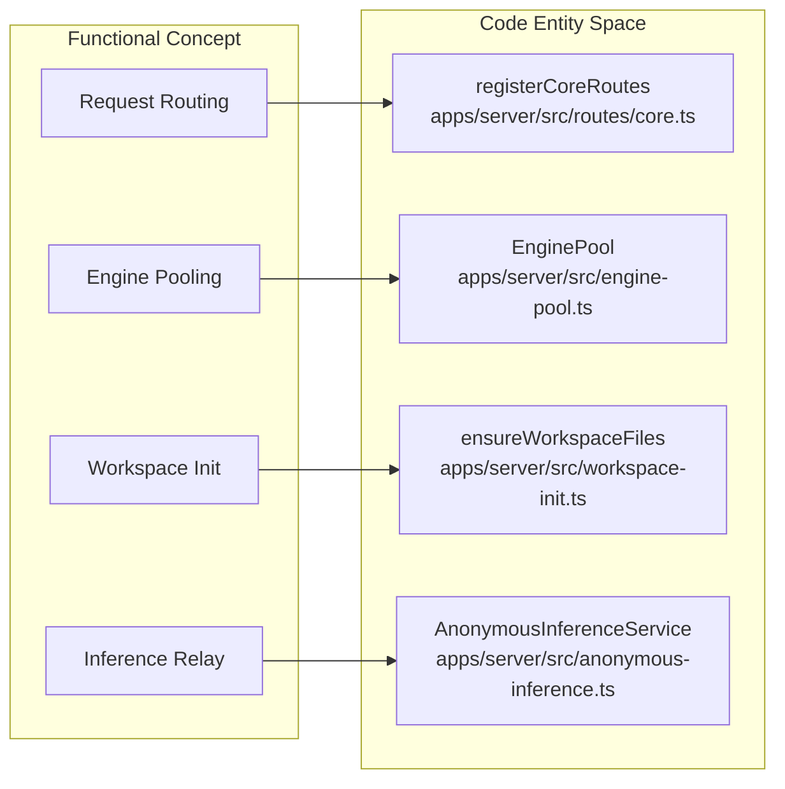

<!-- source: DeepWiki mcp.deepwiki.com · repo different-ai/openwork · page 4 OpenWork Server · fetched 2026-10-26 -->

# OpenWork Server

<details>
<summary>Relevant source files</summary>

The following files were used as context for generating this wiki page:

- [apps/app/src/app/lib/diagnostics-bundle.ts](apps/app/src/app/lib/diagnostics-bundle.ts)
- [apps/app/src/app/lib/openwork-server.ts](apps/app/src/app/lib/openwork-server.ts)
- [apps/app/src/components/chat/message-list-provider.tsx](apps/app/src/components/chat/message-list-provider.tsx)
- [apps/app/src/components/chat/message-list.tsx](apps/app/src/components/chat/message-list.tsx)
- [apps/app/src/i18n/locales/en.ts](apps/app/src/i18n/locales/en.ts)
- [apps/app/src/react-app/domains/connections/openwork-server-store.ts](apps/app/src/react-app/domains/connections/openwork-server-store.ts)
- [apps/app/src/react-app/domains/connections/provider-auth/store.ts](apps/app/src/react-app/domains/connections/provider-auth/store.ts)
- [apps/app/src/react-app/domains/session/chat/session-page.tsx](apps/app/src/react-app/domains/session/chat/session-page.tsx)
- [apps/app/src/react-app/domains/session/sidebar/app-sidebar-provider.tsx](apps/app/src/react-app/domains/session/sidebar/app-sidebar-provider.tsx)
- [apps/app/src/react-app/domains/session/sidebar/app-sidebar.tsx](apps/app/src/react-app/domains/session/sidebar/app-sidebar.tsx)
- [apps/app/src/react-app/domains/session/sidebar/utils.ts](apps/app/src/react-app/domains/session/sidebar/utils.ts)
- [apps/app/src/react-app/domains/session/status/session-activity-store.ts](apps/app/src/react-app/domains/session/status/session-activity-store.ts)
- [apps/app/src/react-app/domains/session/status/session-attention.ts](apps/app/src/react-app/domains/session/status/session-attention.ts)
- [apps/app/src/react-app/domains/session/surface/session-render-state.ts](apps/app/src/react-app/domains/session/surface/session-render-state.ts)
- [apps/app/src/react-app/domains/session/surface/session-surface.tsx](apps/app/src/react-app/domains/session/surface/session-surface.tsx)
- [apps/app/src/react-app/domains/session/sync/message-merge.ts](apps/app/src/react-app/domains/session/sync/message-merge.ts)
- [apps/app/src/react-app/domains/session/sync/session-sync.ts](apps/app/src/react-app/domains/session/sync/session-sync.ts)
- [apps/app/src/react-app/domains/session/sync/transcript-reconcile.ts](apps/app/src/react-app/domains/session/sync/transcript-reconcile.ts)
- [apps/app/src/react-app/domains/session/sync/use-session-interactions.ts](apps/app/src/react-app/domains/session/sync/use-session-interactions.ts)
- [apps/app/src/react-app/domains/session/sync/usechat-adapter.ts](apps/app/src/react-app/domains/session/sync/usechat-adapter.ts)
- [apps/app/src/react-app/shell/desktop-runtime-boot.ts](apps/app/src/react-app/shell/desktop-runtime-boot.ts)
- [apps/app/src/react-app/shell/engine-reload-escalation.ts](apps/app/src/react-app/shell/engine-reload-escalation.ts)
- [apps/app/src/react-app/shell/session-route.tsx](apps/app/src/react-app/shell/session-route.tsx)
- [apps/app/src/react-app/shell/settings-route.tsx](apps/app/src/react-app/shell/settings-route.tsx)
- [apps/desktop/electron/runtime.mjs](apps/desktop/electron/runtime.mjs)
- [apps/desktop/electron/startup-log.mjs](apps/desktop/electron/startup-log.mjs)
- [apps/desktop/electron/windows-shortcut.mjs](apps/desktop/electron/windows-shortcut.mjs)
- [apps/server/src/cli.ts](apps/server/src/cli.ts)
- [apps/server/src/embedded.ts](apps/server/src/embedded.ts)
- [apps/server/src/managed-opencode.ts](apps/server/src/managed-opencode.ts)
- [apps/server/src/openwork-extensions-plugin-path.ts](apps/server/src/openwork-extensions-plugin-path.ts)
- [apps/server/src/openwork-runtime-config.ts](apps/server/src/openwork-runtime-config.ts)
- [apps/server/src/selfhost-web.ts](apps/server/src/selfhost-web.ts)
- [apps/server/src/server.ts](apps/server/src/server.ts)
- [apps/server/src/workspace-init.ts](apps/server/src/workspace-init.ts)
- [apps/server/test/archive-extraction.test.ts](apps/server/test/archive-extraction.test.ts)
- [apps/server/test/opencode-plugin-deps.test.ts](apps/server/test/opencode-plugin-deps.test.ts)
- [ee/apps/den-worker-runtime/Dockerfile.daytona-snapshot](ee/apps/den-worker-runtime/Dockerfile.daytona-snapshot)
- [packaging/docker/Dockerfile.microsandbox](packaging/docker/Dockerfile.microsandbox)

</details>


OpenWork Server (`apps/server`) is a local and self-hosted HTTP service that fronts the OpenCode engine, manages workspaces, handles file interactions, and coordinates cloud synchronization [apps/server/package.json:4-4](), [apps/server/src/server.ts:25-25](). It acts as the core gateway between remote clients (such as OpenWork Desktop or web apps) and local filesystem operations, providing multi-user token scoping, approval flows, and engine pooling [apps/server/src/server.ts:14-36]().

## Overview and Core Architecture

The server process initializes core routers, token verification services, instance reapers, and engine pools [apps/server/src/server.ts:17-30](). By enforcing a server-consumption-first design, all modifications to workspace files or configuration pass through the server endpoints to maintain consistency across local and self-hosted deployments [apps/server/src/server.ts:103-112]().

Title: "OpenWork Server Architecture and Data Flow"
```mermaid
graph TB
    subgraph "Clients"
        Desktop["OpenWork Desktop<br/>apps/desktop"]
        Web["Web Interface<br/>apps/app"]
    end
    
    subgraph "OpenWork Server Process [apps/server/src/server.ts]"
        Router["HTTP Router & Core Routes<br/>server.ts"]
        EnginePool["EnginePool<br/>engine-pool.ts"]
        Tokens["TokenService<br/>tokens.ts"]
        Approvals["ApprovalService<br/>approvals.ts"]
    end
    
    subgraph "Backends and Storage"
        OpenCode["OpenCode Engine<br/>Sidecar / v2"]
        Filesystem["Workspace Files<br/>.opencode/ / openwork.json"]
    end
    
    Desktop -->| "HTTPS + Bearer" | Router
    Web -->| "HTTPS + Bearer" | Router
    
    Router --> Tokens
    Tokens --> Router
    Router --> Approvals
    Router --> EnginePool
    
    EnginePool -->| "Managed Spawn" | OpenCode
    Router -->| "Read/Write" | Filesystem
```
Sources: `apps/server/src/server.ts`, `apps/server/package.json`

---

## Child Pages Overview

OpenWork Server capabilities are detailed across the following child pages:

- **4.1 HTTP API and Route Registry** — Covers route registration inside `server.ts`, core routes, sessions, commands, skills, workspaces endpoints, file routes, cloud-mcp routes, and diagnostics bundles [apps/server/src/server.ts:103-113]().
- **4.2 Engine Pool and OpenCode Integration** — Details `EnginePool`, the instance reaper, spawn templates, managed opencode, engine v2 preview/migration, opencode v2 adapters, and context bridges [apps/server/src/server.ts:17-38](), [apps/app/src/app/lib/openwork-server.ts:81-126]().
- **4.3 Workspace Configuration and Initialization** — Explains `workspace-init`, `openwork-runtime-config`, runtime configuration stores, `opencode.json`/`openwork.json` handling, and export safety [apps/server/src/server.ts:77-101]().
- **4.4 Free Auto Inference Relay** — Describes `apps/server/src/free-auto`, anonymous inference services, desktop free proofs, relay credentials, and provider configurations [apps/server/src/server.ts:93-93]().
- **4.5 Self-hosted Web and npm Distribution** — Outlines `selfhost-web`, `bin/openwork-server.mjs`, publishing scripts, web smoke scripts, and standalone bun binary builds [apps/server/src/selfhost-web.ts:1-1]().

Sources: `apps/server/src/server.ts`, `apps/app/src/app/lib/openwork-server.ts`, `apps/server/src/selfhost-web.ts`

---

## Component Integration Map

To bridge natural language concepts to concrete code entities within `apps/server`, the following mapping links functional requirements to their corresponding classes and modules:

Title: "Natural Language to Code Entity Mapping"

Sources: `apps/server/src/server.ts`, `apps/server/src/routes/core.ts`, `apps/server/src/engine-pool.ts`, `apps/server/src/workspace-init.ts`, `apps/server/src/anonymous-inference.ts`

---

