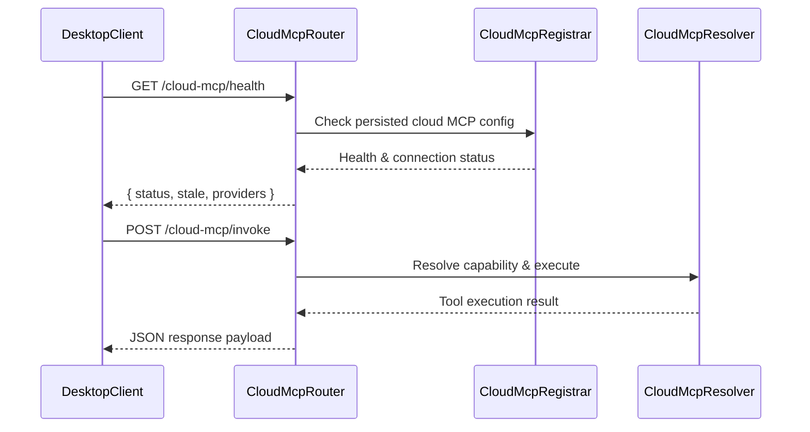

<!-- source: DeepWiki mcp.deepwiki.com · repo different-ai/openwork · page 4.1 HTTP API and Route Registry · fetched 2026-10-26 -->

# HTTP API and Route Registry

<details>
<summary>Relevant source files</summary>

The following files were used as context for generating this wiki page:

- [apps/app/src/react-app/domains/session/artifacts/artifact-panel.tsx](apps/app/src/react-app/domains/session/artifacts/artifact-panel.tsx)
- [apps/app/src/react-app/domains/session/artifacts/artifact-spreadsheet-editor.tsx](apps/app/src/react-app/domains/session/artifacts/artifact-spreadsheet-editor.tsx)
- [apps/app/src/react-app/domains/session/artifacts/artifact-spreadsheet-model.ts](apps/app/src/react-app/domains/session/artifacts/artifact-spreadsheet-model.ts)
- [apps/app/src/react-app/domains/session/artifacts/artifact-text-editor.tsx](apps/app/src/react-app/domains/session/artifacts/artifact-text-editor.tsx)
- [apps/app/src/react-app/domains/session/artifacts/markdown-live-preview.ts](apps/app/src/react-app/domains/session/artifacts/markdown-live-preview.ts)
- [apps/app/src/react-app/domains/session/artifacts/open-target.ts](apps/app/src/react-app/domains/session/artifacts/open-target.ts)
- [apps/app/src/react-app/domains/session/artifacts/resolve-open-target.ts](apps/app/src/react-app/domains/session/artifacts/resolve-open-target.ts)
- [apps/server/src/connect-mcp-transport.ts](apps/server/src/connect-mcp-transport.ts)
- [apps/server/src/connect-skill-catalog.ts](apps/server/src/connect-skill-catalog.ts)
- [apps/server/src/opencode-plugins/openwork-cloud-skills-v2.ts](apps/server/src/opencode-plugins/openwork-cloud-skills-v2.ts)
- [apps/server/src/opencode-plugins/openwork-context-v2.ts](apps/server/src/opencode-plugins/openwork-context-v2.ts)
- [apps/server/src/opencode-plugins/openwork-read-transport.ts](apps/server/src/opencode-plugins/openwork-read-transport.ts)
- [apps/server/src/opencode-plugins/openwork-session-groups.ts](apps/server/src/opencode-plugins/openwork-session-groups.ts)
- [apps/server/src/opencode-v2-context-bridge.ts](apps/server/src/opencode-v2-context-bridge.ts)
- [apps/server/src/opencode-v2-instructions.ts](apps/server/src/opencode-v2-instructions.ts)
- [apps/server/src/routes/core.ts](apps/server/src/routes/core.ts)
- [apps/server/src/routes/files.ts](apps/server/src/routes/files.ts)
- [apps/server/test/connect-skill-catalog.test.ts](apps/server/test/connect-skill-catalog.test.ts)
- [apps/server/test/openwork-cloud-skills-v2.test.ts](apps/server/test/openwork-cloud-skills-v2.test.ts)
- [apps/server/test/openwork-session-groups.test.ts](apps/server/test/openwork-session-groups.test.ts)
- [ee/apps/den-api/src/mcp/skill-index-sync.ts](ee/apps/den-api/src/mcp/skill-index-sync.ts)
- [ee/apps/den-api/test/api/skill-index-sync.api.test.ts](ee/apps/den-api/test/api/skill-index-sync.api.test.ts)
- [ee/apps/den-api/test/skill-index-sync.test.ts](ee/apps/den-api/test/skill-index-sync.test.ts)

</details>


This page covers the technical implementation of `openwork-server`'s HTTP API layer, route registry, core service endpoints, resource routers (workspaces, sessions, commands, skills), file routes, cloud MCP routes, and the diagnostics bundle generation pipeline.

---

## Architecture and Route Registration

The `openwork-server` initializes an HTTP and SSE server inside `apps/server/src/server.ts` [apps/server/src/server.ts:1-141](). Routes are defined and registered modularly using a custom route registry mechanism (`apps/server/src/routes/registry.ts`), which handles authentication modes (`none`, `token`, `owner`, `host`) and workspace-scoped request contexts.

### Natural Language to Code Entity Mapping: Server Routes

The following diagram maps high-level API domains and features to their respective route registration modules and handlers within `apps/server/src/`.

```mermaid
graph TD
    subgraph "NaturalLanguageSpace"
        [CoreSystemAndHealth]
        [WorkspaceAndSessionManagement]
        [FileOperationsAndTree]
        [CloudMCPAndConnectors]
        [DiagnosticsAndTelemetry]
    end

    subgraph "CodeEntitySpace"
        [registerCoreRoutes]
        [registerWorkspaceRoutes]
        [registerFileRoutes]
        [registerCloudMcpRoutes]
        [registerOperationRoutes]
        [RouteRegistry]
    end

    [CoreSystemAndHealth] -->|"Registers"| [registerCoreRoutes]
    [WorkspaceAndSessionManagement] -->|"Registers"| [registerWorkspaceRoutes]
    [FileOperationsAndTree] -->|"Registers"| [registerFileRoutes]
    [CloudMCPAndConnectors] -->|"Registers"| [registerCloudMcpRoutes]
    [DiagnosticsAndTelemetry] -->|"Registers"| [registerOperationRoutes]

    [registerCoreRoutes] --> [RouteRegistry]
    [registerWorkspaceRoutes] --> [RouteRegistry]
    [registerFileRoutes] --> [RouteRegistry]
    [registerCloudMcpRoutes] --> [RouteRegistry]
    [registerOperationRoutes] --> [RouteRegistry]
```
Sources: [apps/server/src/server.ts:100-111](), [apps/server/src/routes/registry.ts:1-35]()

---

## Core Routes & System Endpoints

Core system endpoints are registered via `registerCoreRoutes` [apps/server/src/routes/core.ts:1-50](). They provide health checks, configuration discovery, environment bootstrapping, and connection snapshots.

### Key Core Endpoints
- `GET /health`: Returns server status, version, and uptime without requiring authentication (`AuthMode: none`) [apps/server/src/routes/core.ts:140-147]().
- `POST /dev/log`: Appends browser console or client diagnostic logs to the local log file [apps/server/src/routes/core.ts:155-175]().
- `GET /connect/snapshot`: Exposes OpenWork Connect status, cloud health, and workspace resolution parameters [apps/server/src/routes/core.ts:87-102](), [apps/server/src/routes/core.ts:241-260]().
- `POST /managed-provider-auth/sync`: Synchronizes managed model provider credentials into the underlying OpenCode engine [apps/server/src/routes/core.ts:212-230]().

Sources: [apps/server/src/routes/core.ts:1-102](), [apps/server/src/routes/core.ts:140-260](), [apps/server/src/server.ts:103-111]()

---

## Workspace, Sessions, Commands, and Skills Endpoints

Workspace-scoped resources, including chat sessions, slash commands, skills, and default models, are managed through dedicated route handlers. Organization skills and discovery catalogs leverage the OpenWork Connect transport layer (`apps/server/src/connect-mcp-transport.ts` [apps/server/src/connect-mcp-transport.ts:1-111]()) and incremental index synchronization (`apps/server/src/connect-skill-catalog.ts` [apps/server/src/connect-skill-catalog.ts:1-125]()).

### Natural Language to Code Entity Mapping: Resource Subsystems

```mermaid
graph TD
    subgraph "NaturalLanguageSpace"
        [WorkspacesAndProjects]
        [ChatSessionsAndTasks]
        [SlashCommandsCatalog]
        [SkillsAndCapabilities]
    end

    subgraph "CodeEntitySpace"
        [registerWorkspaceRoutes]
        [registerSessionGroupRoutes]
        [registerWorkspaceDefaultModelRoutes]
        [listCommands]
        [listSkills]
        [upsertSkill]
    end

    [WorkspacesAndProjects] -->|"Managed by"| [registerWorkspaceRoutes]
    [ChatSessionsAndTasks] -->|"Managed by"| [registerSessionGroupRoutes]
    [SlashCommandsCatalog] -->|"Dispatched via"| [listCommands]
    [SkillsAndCapabilities] -->|"Handled by"| [listSkills]
    [SkillsAndCapabilities] -->|"Handled by"| [upsertSkill]
```
Sources: [apps/server/src/routes/workspaces.ts:1-30](), [apps/server/src/routes/session-groups.ts:1-25](), [apps/server/src/skills.ts:1-40](), [apps/server/src/commands.ts:1-30]()

### Session & Command Routing
- **Sessions:** Proxied and managed against the OpenCode engine runtime, tracking transcripts, participant state, and interruption handlers [apps/server/src/server.ts:1-30](). Session group changes are written through validated bridge routes [apps/server/src/opencode-v2-context-bridge.ts:16-27]().
- **Commands:** Stored under project-level directories and listed or repaired via `listCommands` and `repairCommands` [apps/server/src/commands.ts:1-40]().
- **Skills:** Managed through `upsertSkill` and `deleteSkill` against project skill directories, alongside remote skill indexing and on-demand SKILL.md fetching [apps/server/src/connect-skill-catalog.ts:121-138](), [apps/server/src/opencode-plugins/openwork-cloud-skills-v2.ts:91-97]().

Sources: [apps/server/src/commands.ts:1-40](), [apps/server/src/skills.ts:1-50](), [apps/server/src/connect-skill-catalog.ts:121-138](), [apps/server/src/opencode-plugins/openwork-cloud-skills-v2.ts:91-97]()

---

## File Routes

File operations are registered via `registerFileRoutes` [apps/server/src/routes/files.ts:37-52](). They allow clients to read, write, list, and stream workspace files safely within sandbox boundaries or direct filesystem roots.

### File Route Responsibilities
- Normalizing relative paths and workspace prefixes via `normalizeWorkspaceRelativePath` to prevent path traversal and ensure safe traversal limits [apps/server/src/routes/files.ts:62-112]().
- Validating supported workspace text file formats for editors and previews via `isSupportedWorkspaceTextFilePath` [apps/server/src/routes/files.ts:122-180]().
- Resolving inbox/outbox directories and file sessions for attachments and document processing [apps/server/src/routes/files.ts:54-60]().

Sources: [apps/server/src/routes/files.ts:37-180]()

---

## Cloud MCP Routes

Cloud Model Context Protocol (MCP) endpoints are registered via `registerCloudMcpRoutes` [apps/server/src/routes/cloud-mcp.ts:1-30](). They integrate external cloud tools, resolve MCP tool calls, and manage health checks for remote connectors using streamable HTTP transports [apps/server/src/connect-mcp-transport.ts:107-138]().

### Cloud MCP Data Flow


Sources: [apps/server/src/routes/cloud-mcp.ts:1-45](), [apps/server/src/cloud-mcp-v2.ts:1-40](), [apps/server/src/cloud-mcp-health.ts:1-50]()

---

## Diagnostics Bundle

The server provides diagnostic bundle generation tools to capture environment details, active engine snapshots, and context diagnostics.

### Implementation Details
- **Diagnostic Request Schema:** Validated using `agentContextDiagnosticsRequestSchema` [apps/server/src/agent-context-diagnostics-schema.ts:1-20]().
- **Bundle Collection:** The client requests diagnostic bundles via `buildDiagnosticsBundleJson`, compiling client state, logs, and server health into a single exportable report [apps/app/src/app/lib/diagnostics-bundle.ts:1-30]().
- **Sanitization:** String outputs are sanitized using `sanitizeDiagnosticString` to strip sensitive tokens and credentials [apps/server/src/diagnostic-sanitizer.ts:1-30]().

Sources: [apps/server/src/agent-context-diagnostics-schema.ts:1-20](), [apps/app/src/app/lib/diagnostics-bundle.ts:1-30](), [apps/server/src/diagnostic-sanitizer.ts:1-30]()

---

## Authentication and Scopes

The `openwork-server` enforces authorization at the route registry level [apps/server/src/routes/registry.ts:1-25](). Each route declares an `AuthMode`:

| AuthMode | Scope Requirement | Description |
| :--- | :--- | :--- |
| `none` | No Auth | Public unauthenticated endpoints (e.g., `/health`) [apps/server/src/routes/core.ts:140-147](). |
| `token` | `TokenScope.Collaborator` | Standard workspace access for reading and writing files and sessions [apps/server/src/routes/registry.ts:1-25](). |
| `owner` | `TokenScope.Owner` | Full administrative control, including token management and provider configuration [apps/server/src/routes/registry.ts:1-25](). |
| `host` | `TokenScope.Host` | System-level host operations across multiple workspaces [apps/server/src/routes/registry.ts:1-25](). |

Sources: [apps/server/src/routes/registry.ts:1-25](), [apps/server/src/routes/core.ts:140-147]()

---

