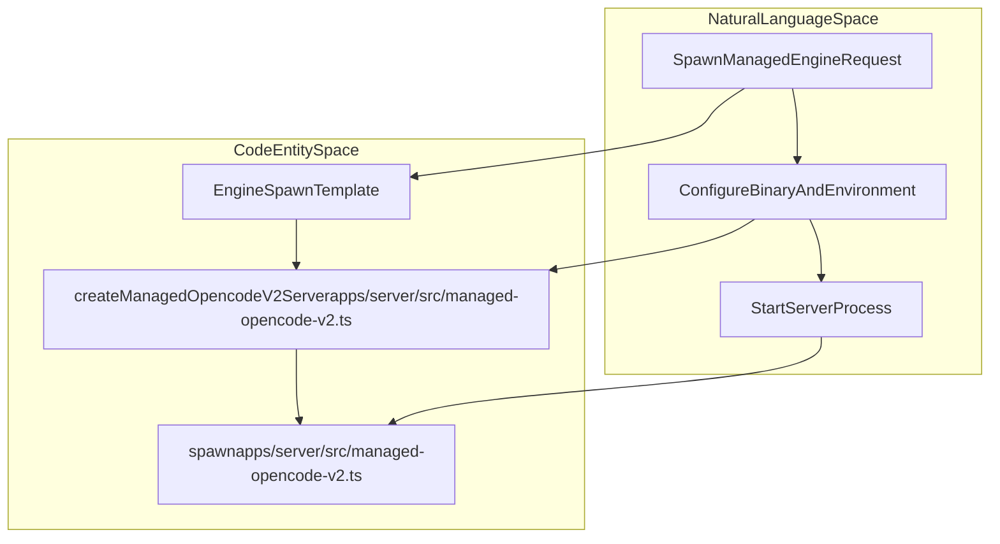
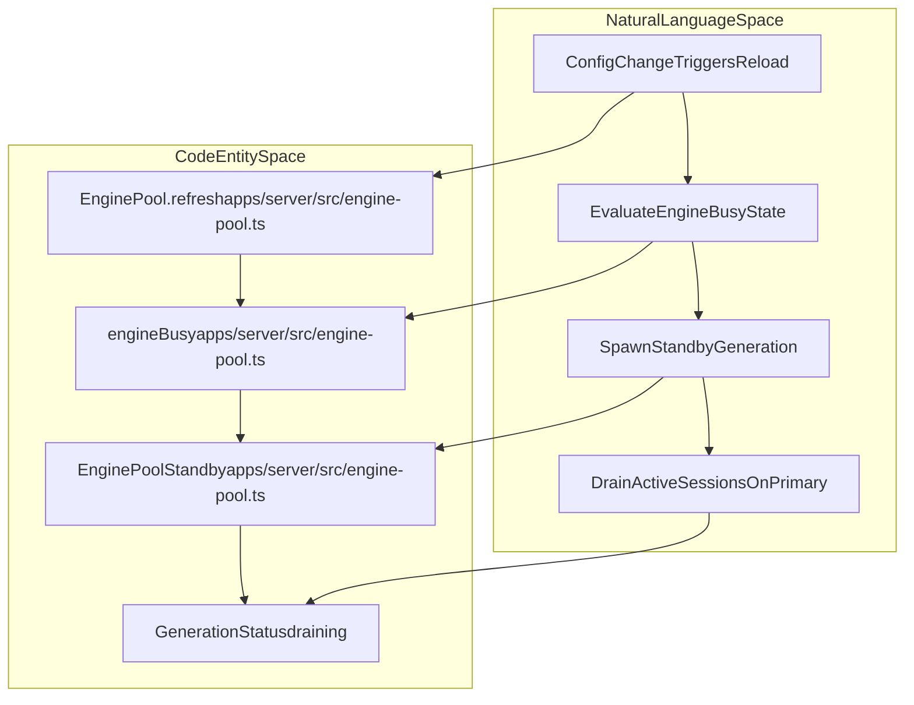
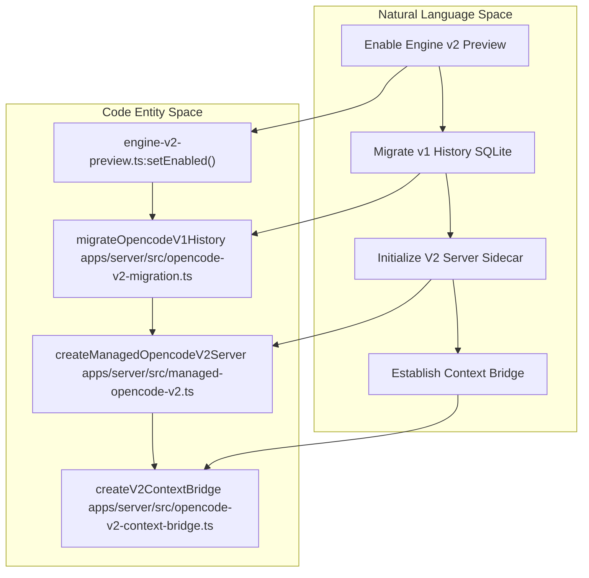

<!-- source: DeepWiki mcp.deepwiki.com · repo different-ai/openwork · page 4.2 Engine Pool and OpenCode Integration · fetched 2026-10-26 -->

# Engine Pool and OpenCode Integration

<details>
<summary>Relevant source files</summary>

The following files were used as context for generating this wiki page:

- [apps/app/src/react-app/domains/connections/provider-auth/cloud-provider-config.ts](apps/app/src/react-app/domains/connections/provider-auth/cloud-provider-config.ts)
- [apps/app/src/react-app/shell/engine-migration.tsx](apps/app/src/react-app/shell/engine-migration.tsx)
- [apps/app/tests/engine-migration.test.tsx](apps/app/tests/engine-migration.test.tsx)
- [apps/server/src/cloud-provider-sync.ts](apps/server/src/cloud-provider-sync.ts)
- [apps/server/src/engine-pool.ts](apps/server/src/engine-pool.ts)
- [apps/server/src/engine-v2-preview.ts](apps/server/src/engine-v2-preview.ts)
- [apps/server/src/managed-opencode-v2.ts](apps/server/src/managed-opencode-v2.ts)
- [apps/server/src/managed-provider-auth.ts](apps/server/src/managed-provider-auth.ts)
- [apps/server/src/opencode-v2-history-lock.ts](apps/server/src/opencode-v2-history-lock.ts)
- [apps/server/src/opencode-v2-history-store.ts](apps/server/src/opencode-v2-history-store.ts)
- [apps/server/src/opencode-v2-migration-process.ts](apps/server/src/opencode-v2-migration-process.ts)
- [apps/server/src/opencode-v2-migration.ts](apps/server/src/opencode-v2-migration.ts)
- [apps/server/test/engine-auto-upgrade-boot.test.ts](apps/server/test/engine-auto-upgrade-boot.test.ts)
- [apps/server/test/fixtures/staged-history-worker.ts](apps/server/test/fixtures/staged-history-worker.ts)
- [apps/server/test/opencode-v2-staged-history.test.ts](apps/server/test/opencode-v2-staged-history.test.ts)
- [docs/opencode-engine-migration.md](docs/opencode-engine-migration.md)
- [ee/apps/den-api/src/llm/cloud-provider-materialization.ts](ee/apps/den-api/src/llm/cloud-provider-materialization.ts)
- [ee/apps/den-api/src/llm/provider-credentials.ts](ee/apps/den-api/src/llm/provider-credentials.ts)
- [ee/apps/den-api/test/api/engine-policy.api.test.ts](ee/apps/den-api/test/api/engine-policy.api.test.ts)
- [ee/apps/den-api/test/provider-credentials.test.ts](ee/apps/den-api/test/provider-credentials.test.ts)
- [ee/packages/utils/package.json](ee/packages/utils/package.json)
- [ee/packages/utils/src/ai-sdk-env-settings.test.ts](ee/packages/utils/src/ai-sdk-env-settings.test.ts)
- [ee/packages/utils/src/ai-sdk-env-settings.ts](ee/packages/utils/src/ai-sdk-env-settings.ts)
- [ee/packages/utils/tsup.config.ts](ee/packages/utils/tsup.config.ts)
- [packages/types/src/cloud-model-fast.ts](packages/types/src/cloud-model-fast.ts)

</details>


This page documents the internal architecture of the OpenCode engine runtime managed by `apps/server`, focusing on the blue/green engine pool, process lifecycle management, instance reapers, spawn templates, managed OpenCode v1/v2 runtimes, engine v2 preview and history migration, context bridging, provider synchronization, and hot-reload mechanics.

---

## 1. Managed OpenCode Architecture and Spawn Templates

The OpenWork server fronts the underlying OpenCode engine (available in both v1 and v2 runtimes) via managed server handles. The server spawns, monitors, and controls engine instances, handling configurations, environment setup, port allocation, and health checks.

The `EngineSpawnTemplate` type defines the parameters required to spawn a replacement engine identical to an active instance [apps/server/src/engine-pool.ts:39-48]().

```typescript
export type EngineSpawnTemplate = {
  bin?: string;
  cwd: string;
  runtimeConfigPath: string;
  env: Record<string, string | undefined>;
  /** Ports a standby must avoid (the OpenWork server, and the live engine). */
  reservedPorts: () => number[];
  /** Readiness budget for a standby spawn. Defaults to the managed-engine default. */
  spawnTimeoutMs?: number;
};
```

Managed v2 servers are instantiated via `createManagedOpencodeV2Server` [apps/server/src/managed-opencode-v2.ts:15-18]() or their v1 counterparts, accepting an executable binary path, root directory, instance identifiers, environment overrides, and optional permission rules [apps/server/src/managed-opencode-v2.ts:44-73]().



Sources:
- `apps/server/src/engine-pool.ts:39-48`
- `apps/server/src/managed-opencode-v2.ts:15-73`

---

## 2. Engine Pool, Blue/Green Rollover, and Hot Reload

When configuration changes occur that require an engine rebuild (such as provider block updates, custom plugins, or agent modifications), OpenWork avoids abruptly aborting active runs by utilizing `EnginePool` [apps/server/src/engine-pool.ts:1-20]().

Instead of immediate disposal, the pool executes a blue/green rollover:
1. Spawns a standby engine using a new generation ID and configuration.
2. Directs all new incoming requests to the standby instance.
3. Keeps the old primary engine alive in a `draining` state only until its active sessions complete or its drain deadline expires.



### Rollover Outcomes

Rollover operations produce explicit `RolloverOutcome` types to track whether configurations were applied live, in-place, or via standby rollovers [apps/server/src/engine-pool.ts:97-102]().

| Action | Description |
| :--- | :--- |
| `updated_live` | Configuration updated on the active engine without process restart. |
| `reloaded_in_place` | Engine disposed and restarted in place because it was idle [apps/server/src/engine-pool.ts:59-64](). |
| `rolled_over` | Blue/green rollover triggered; standby promoted and old generation draining [apps/server/src/engine-pool.ts:102](). |
| `coalesced` | Mid-drain config change combined into a single pending rollover (latest wins). |
| `skipped` | Rollover skipped due to unchanged configuration or inactive engine state. |

Sources:
- `apps/server/src/engine-pool.ts:1-181`

---

## 3. Engine v2 Preview and History Migration

The OpenWork server supports a parallel v2 engine lane via `EngineV2Preview` [apps/server/src/engine-v2-preview.ts:106-130](). It handles history migration from v1 databases, dynamic provider injection, and workspace MCP syncing [apps/server/src/engine-v2-preview.ts:112-125]().



### Migration Mechanics
History migration reads legacy v1 conversation databases (`opencodeV1DatabasePath`) and transforms them into v2 schema compatibility layers before sidecar startup [apps/server/src/engine-v2-preview.ts:1-9](). The migration pipeline enforces disk space checks (`ensureMigrationDiskSpace`), backs up the target v2 database (`backupV2Database`), clears stale conversion markers (`clearStaleConversionMarker`), and executes batched transcript copies under history leases (`acquireHistoryCopyLock`) [apps/server/src/opencode-v2-migration.ts:70-152]().

Sources:
- `apps/server/src/engine-v2-preview.ts:1-9`
- `apps/server/src/opencode-v2-migration.ts:1-152`
- `docs/opencode-engine-migration.md:1-121`

---

## 4. Upkeep, Skills, and MCP Readiness

Background tasks and health loops run asynchronously so user chat requests are never blocked by engine warm-up phases [apps/server/src/engine-v2-preview.ts:51-77]().

### Upkeep Wait Budgets
`ENGINE_V2_UPKEEP_WAITS` establishes non-blocking tolerances for provider synchronization and MCP connection health checks [apps/server/src/engine-v2-preview.ts:72-77]():

```typescript
export const ENGINE_V2_UPKEEP_WAITS: Readonly<Record<"providerPushJoinMs" | "workspaceProviderReadyMs" | "mcpRetryMs" | "mcpHealthMs", number>> = Object.freeze({
  providerPushJoinMs: 10_000,
  workspaceProviderReadyMs: 8_000,
  mcpRetryMs: 60_000,
  mcpHealthMs: 60_000,
});
```

- **Skill Settling**: After writing workspace skills, `waitForEngineSkillChanges` waits briefly for the engine to ingest changes [apps/server/src/engine-v2-preview.ts:13]().
- **MCP Readiness**: RPC checks track server initialization against `MCP_READINESS_RPC_ID` [apps/server/src/engine-v2-preview.ts:14]().

Sources:
- `apps/server/src/engine-v2-preview.ts:1-77`

---

## 5. OpenCode v2 Adapter, Context Bridge, and Provider Integration

The OpenCode v2 integration relies on adapter bridges and server-side credential injection to align external models, cloud-managed providers, and custom tooling without exposing sensitive keys to client browsers.

- **Context Bridge**: `createV2ContextBridge` binds local workspace filesystem contexts and terminal hooks into the v2 engine execution environment [apps/server/src/engine-v2-preview.ts:5]().
- **Provider Session Bridge**: `createV2ProviderSessionBridge` establishes session-scoped capability scopes across inherited process pipes rather than relying solely on environment variables [apps/server/src/engine-v2-preview.ts:6]().
- **Managed Provider Authentication**: Server-managed credentials are delivered directly to the engine loopback via `syncManagedProviderAuth` in `apps/server/src/managed-provider-auth.ts`, ensuring standby and active engines receive valid token sets without leaking plaintext secrets into logs [apps/server/src/managed-provider-auth.ts:1-57]().

Sources:
- `apps/server/src/engine-v2-preview.ts:5-6`
- `apps/server/src/managed-provider-auth.ts:1-57`

---

