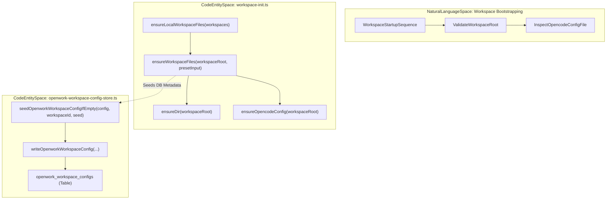
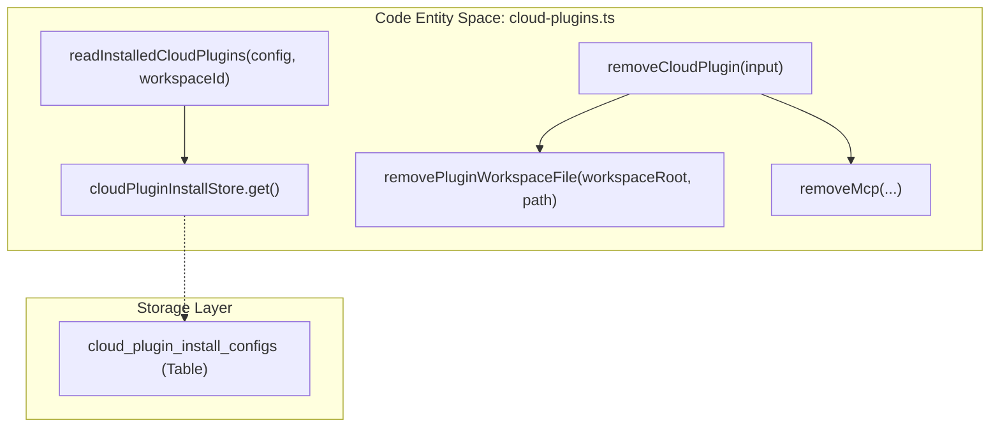

<!-- source: DeepWiki mcp.deepwiki.com · repo different-ai/openwork · page 4.3 Workspace Configuration and Initialization · fetched 2026-10-26 -->

# Workspace Configuration and Initialization

Relevant source files

The following files were used as context for generating this wiki page:

- [apps/app/src/app/lib/diagnostics-bundle.ts](apps/app/src/app/lib/diagnostics-bundle.ts)
- [apps/app/src/react-app/domains/connections/openwork-server-store.ts](apps/app/src/react-app/domains/connections/openwork-server-store.ts)
- [apps/app/src/react-app/domains/settings/state/extensions-store.ts](apps/app/src/react-app/domains/settings/state/extensions-store.ts)
- [apps/app/src/react-app/shell/desktop-runtime-boot.ts](apps/app/src/react-app/shell/desktop-runtime-boot.ts)
- [apps/app/src/react-app/shell/engine-reload-escalation.ts](apps/app/src/react-app/shell/engine-reload-escalation.ts)
- [apps/desktop/electron/runtime.mjs](apps/desktop/electron/runtime.mjs)
- [apps/desktop/electron/startup-log.mjs](apps/desktop/electron/startup-log.mjs)
- [apps/desktop/electron/windows-shortcut.mjs](apps/desktop/electron/windows-shortcut.mjs)
- [apps/server/src/cli.ts](apps/server/src/cli.ts)
- [apps/server/src/cloud-plugins.ts](apps/server/src/cloud-plugins.ts)
- [apps/server/src/embedded.ts](apps/server/src/embedded.ts)
- [apps/server/src/managed-opencode.ts](apps/server/src/managed-opencode.ts)
- [apps/server/src/openwork-extensions-plugin-path.ts](apps/server/src/openwork-extensions-plugin-path.ts)
- [apps/server/src/openwork-runtime-config.ts](apps/server/src/openwork-runtime-config.ts)
- [apps/server/src/openwork-workspace-config-store.ts](apps/server/src/openwork-workspace-config-store.ts)
- [apps/server/src/selfhost-web.ts](apps/server/src/selfhost-web.ts)
- [apps/server/src/session-groups.ts](apps/server/src/session-groups.ts)
- [apps/server/src/workspace-init.ts](apps/server/src/workspace-init.ts)
- [apps/server/test/archive-extraction.test.ts](apps/server/test/archive-extraction.test.ts)
- [apps/server/test/opencode-plugin-deps.test.ts](apps/server/test/opencode-plugin-deps.test.ts)
- [ee/apps/den-worker-runtime/Dockerfile.daytona-snapshot](ee/apps/den-worker-runtime/Dockerfile.daytona-snapshot)
- [packaging/docker/Dockerfile.microsandbox](packaging/docker/Dockerfile.microsandbox)

This page documents workspace initialization procedures, runtime configuration injection, configuration stores (`opencode.json` and `openwork.json`), export safety measures, and cloud plugin import mechanics within the OpenWork server architecture.

## Workspace Initialization

When a workspace is initialized, created, or loaded, the server executes a sequence via `ensureWorkspaceFiles` and `ensureLocalWorkspaceFiles` to guarantee that required directories and base configurations are available [apps/server/src/workspace-init.ts:69-116](). Local file provisioning runs during server startup (`cli.ts` and `embedded.ts`), gracefully skipping remote or inaccessible workspace paths [apps/server/src/cli.ts:117-121](), [apps/server/src/embedded.ts:181-185]().

### Initialization Pipeline and Data Flow
1. **Directory Validation**: `ensureWorkspaceFiles` calls `ensureDir` on the workspace root [apps/server/src/workspace-init.ts:69-75](). Inaccessible paths throw an `ApiError` with code `workspace_inaccessible` [apps/server/src/workspace-init.ts:77-83]().
2. **OpenCode Configuration**: `ensureOpencodeConfig` checks for the presence of `opencode.jsonc`, parsing and validating it via `readJsoncFile` without mutating existing user project definitions [apps/server/src/workspace-init.ts:61-67]().
3. **Metadata Seeding**: Workspace configuration metadata (name, preset, authorized roots) is stored in the runtime database using the `openwork_workspace_configs` key-value store rather than a physical file [apps/server/src/openwork-workspace-config-store.ts:16-21](). The initial shape is generated by `defaultWorkspaceOpenworkConfig` [apps/server/src/workspace-init.ts:48-59]() and persisted via `seedOpenworkWorkspaceConfigIfEmpty` [apps/server/src/openwork-workspace-config-store.ts:50-59]().

Sources: `[apps/server/src/workspace-init.ts:48-116]()`, `[apps/server/src/openwork-workspace-config-store.ts:16-59]()`

---

## Runtime Configuration Injection and Engine Config Store

OpenWork injects agent definitions, permissions, provider maps, and extensions directly into the OpenCode engine via a managed configuration file passed as `OPENCODE_CONFIG` [apps/server/src/openwork-runtime-config.ts:6-18]().

### Key Functions and Modules
* `buildOpenworkRuntimeConfigObject`: Builds the engine-visible configuration payload from the global runtime configuration row and static built-ins [apps/server/src/openwork-runtime-config.ts:49-59]().
* `buildOpenworkRuntimeConfigObjectFromSnapshot`: Assembles permissions, materialized fast providers, the default `openwork` agent prompt (`OPENWORK_AGENT_PROMPT`), and built-in extension paths [apps/server/src/openwork-runtime-config.ts:61-124]().
* `writeOpenworkRuntimeConfigFile` & `keepOpenworkRuntimeConfigFileFresh`: Serializes the configuration payload to disk inside the runtime storage directory and refreshes it on every runtime-database write [apps/server/src/openwork-runtime-config.ts:144-150](), [apps/server/src/cli.ts:143-144]().

```mermaid
graph TD
    subgraph "NaturalLanguageSpace: Runtime Config Synchronization"
        K["EngineConfigurationSync"] --> L["ReadGlobalRuntimeConfig"]
        L --> M["BuildEnginePayload"]
    end

    subgraph "CodeEntitySpace: openwork-runtime-config.ts"
        N["buildOpenworkRuntimeConfigObject(config)"] --> O["buildOpenworkRuntimeConfigObjectFromSnapshot(runtimeConfig)"]
        O --> P["writeOpenworkRuntimeConfigFile(config)"]
        P --> Q["keepOpenworkRuntimeConfigFileFresh(config)"]
    end

    subgraph "CodeEntitySpace: cli.ts and embedded.ts"
        R["startEmbeddedServer(options)"] --> S["writeOpenworkRuntimeConfigFile"]
    end

    Q -.->|"Refreshes Disk Config"| P
```

Sources: `[apps/server/src/openwork-runtime-config.ts:49-150]()`, `[apps/server/src/cli.ts:143-144]()`

---

## Configuration Formats: `opencode.json` and `openwork.json`

OpenWork utilizes two distinct configuration schemas to govern behavior at the workspace and engine levels:

1. **`opencode.json` / `opencode.jsonc`**: Stored in workspace roots, controlling low-level engine behaviors, permissions, and tool bindings. It is validated via `readRawOpencodeConfig` [apps/server/src/workspace-init.ts:118-125]() and modified through desktop configuration helpers [apps/app/src/react-app/domains/settings/state/extensions-store.ts:31-38]().
2. **`openwork.json`**: Historically stored as a file inside `.opencode/openwork.json`, this workspace configuration schema has migrated to the runtime database table `openwork_workspace_configs` managed by `openwork-workspace-config-store.ts` [apps/server/src/openwork-workspace-config-store.ts:16-21](). It tracks metadata such as workspace presets, names, creation times, and authorized roots.

Sources: `[apps/server/src/workspace-init.ts:118-125]()`, `[apps/server/src/openwork-workspace-config-store.ts:16-21]()`, `[apps/app/src/react-app/domains/settings/state/extensions-store.ts:31-38]()`

---

## Export Safety and Plugin Path Resolution

To maintain security and integrity across different runtime environments (Electron desktop bundles, self-hosted servers, and cloud workers), OpenWork enforces strict export safety and path resolution strategies.

### Plugin Path Resolution (`openwork-extensions-plugin-path.ts`)
Internal plugins (such as `openwork-extensions-preview` and `openwork-capabilities-knowledge`) resolve their filesystem locations dynamically based on execution context [apps/server/src/openwork-extensions-plugin-path.ts:17-32](). When running inside an Electron packaged environment (`app.asar`), paths resolve relative to `process.resourcesPath` [apps/server/src/openwork-extensions-plugin-path.ts:24-28](). In development or server modes, they resolve relative to the compiled module location [apps/server/src/openwork-extensions-plugin-path.ts:30-32]().

### Export Safety and Credential Isolation
When spawning managed engine child processes via `managed-opencode.ts`, the environment is scrubbed of sensitive secrets. Specifically, `OPENWORK_ENCRYPTION_KEY` is explicitly deleted from the child environment to prevent engine code from accessing root database encryption material [apps/server/src/managed-opencode.ts:170-173]().

Sources: `[apps/server/src/openwork-extensions-plugin-path.ts:17-32]()`, `[apps/server/src/managed-opencode.ts:170-173]()`

---

## Cloud Plugins and Workspace Imports

Workspaces may import organization-level capabilities, skills, and plugins from Den marketplaces. The lifecycle of these imports is managed via `cloud-plugins.ts` and backed by `cloud_plugin_install_configs` [apps/server/src/cloud-plugins.ts:114-123]().

### Import Management and Cleanup
* `readInstalledCloudPlugins`: Fetches and parses imported cloud plugins and marketplace state for a specific workspace [apps/server/src/cloud-plugins.ts:121-123]().
* `removeCloudPlugin`: Removes associated workspace files and cleans up registered MCP server entries when a user uninstalls a cloud plugin [apps/server/src/cloud-plugins.ts:165-172]().

Sources: `[apps/server/src/cloud-plugins.ts:114-172]()`

---

