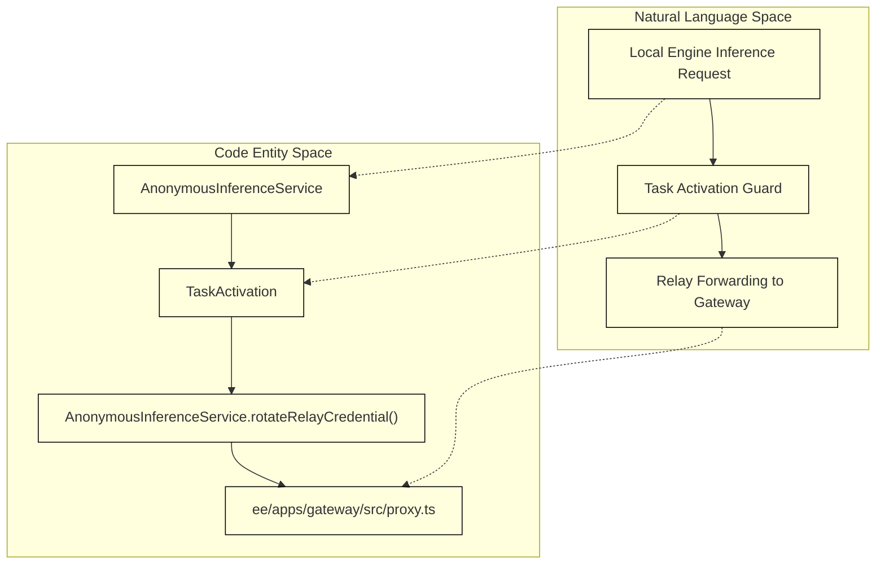
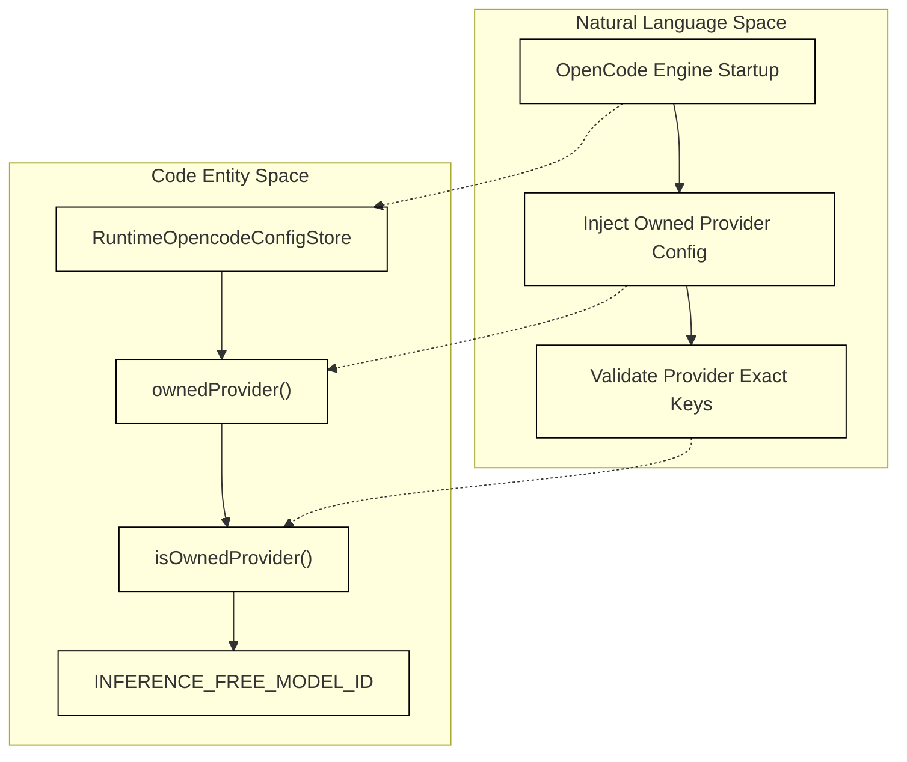

<!-- source: DeepWiki mcp.deepwiki.com · repo different-ai/openwork · page 4.4 Free Auto Inference Relay · fetched 2026-10-26 -->

# Free Auto Inference Relay

Relevant source files

The following files were used as context for generating this wiki page:

- [apps/app/src/react-app/domains/cloud/auto-access-ui.tsx](apps/app/src/react-app/domains/cloud/auto-access-ui.tsx)
- [apps/app/src/react-app/domains/cloud/gateway-usage-panel.tsx](apps/app/src/react-app/domains/cloud/gateway-usage-panel.tsx)
- [ee/apps/den-api/src/llm/inference-provider-config.ts](ee/apps/den-api/src/llm/inference-provider-config.ts)
- [ee/apps/den-web/app/(den)/dashboard/_components/inference-provider-request.ts](ee/apps/den-web/app/(den)/dashboard/_components/inference-provider-request.ts)
- [ee/apps/gateway/README.md](ee/apps/gateway/README.md)
- [ee/apps/gateway/src/early-response.ts](ee/apps/gateway/src/early-response.ts)
- [ee/apps/gateway/src/env.ts](ee/apps/gateway/src/env.ts)
- [ee/apps/gateway/src/free/shared/dispatch.ts](ee/apps/gateway/src/free/shared/dispatch.ts)
- [ee/apps/gateway/src/gateway.ts](ee/apps/gateway/src/gateway.ts)
- [ee/apps/gateway/src/http-server.ts](ee/apps/gateway/src/http-server.ts)
- [ee/apps/gateway/src/protocols.ts](ee/apps/gateway/src/protocols.ts)
- [ee/apps/gateway/src/provider-access.ts](ee/apps/gateway/src/provider-access.ts)
- [ee/apps/gateway/src/proxy.ts](ee/apps/gateway/src/proxy.ts)
- [ee/apps/gateway/src/request-log.ts](ee/apps/gateway/src/request-log.ts)
- [ee/apps/gateway/src/server.ts](ee/apps/gateway/src/server.ts)
- [ee/apps/gateway/src/shutdown.ts](ee/apps/gateway/src/shutdown.ts)
- [evals/packages/env/src/inference.ts](evals/packages/env/src/inference.ts)
- [evals/packages/labs/src/mock-inference.ts](evals/packages/labs/src/mock-inference.ts)
- [packages/types/src/den/inference.ts](packages/types/src/den/inference.ts)

The Free Auto Inference Relay handles the local-first anonymous and member free-tier inference pipeline in OpenWork. It bridges local engine requests from the OpenCode sidecar to the cloud OpenWork Gateway or OpenRouter while enforcing activation windows, local loopback tokens, and credential bindings.

---

## 1. Core Architecture and `AnonymousInferenceService`

The local server exposes an internal loopback proxy managed by `AnonymousInferenceService` (`[apps/server/src/free-auto/service.ts:41-464]()`). The service accepts local connections from the engine using a per-identity local token (`owf_local_`) (`[apps/server/src/free-auto/service.ts:45]()`) and forwards them upstream to the enterprise Gateway or public inference endpoints.

Title: Engine Request Routing Architecture

Sources:
- `[apps/server/src/free-auto/service.ts:41-464]()`

### Key Service Mechanics
- **Local Authentication**: Generates and rotates `owf_local_` bearer tokens via `freshLocalToken()` (`[apps/server/src/free-auto/service.ts:29]()`) to authenticate local requests from the OpenCode engine sidecar.
- **Session Bindings**: Tracks active cloud provider Den sessions through `setMemberSession()` (`[apps/server/src/free-auto/service.ts:79-95]()`), binding local traffic to authenticated enterprise principals (`ow_inf_`) when signed in.
- **Failure Caching**: Implements localized short-circuit caching for remote failures via the `failures` map (`[apps/server/src/free-auto/service.ts:59]()`) to prevent upstream request hammering.

Sources:
- `[apps/server/src/free-auto/service.ts:41-464]()`

---

## 2. Relay Credentials and Provider Configuration

OpenWork injects the free auto provider directly into the global OpenCode runtime configuration (`[apps/server/src/free-auto/provider-config.ts:4-46]()`). The configuration guarantees that the local engine routes requests for `openai/gpt-6-luna` (`[packages/types/src/den/inference.ts:170]()`) through the local loopback relay rather than direct public endpoints.

Title: Provider Configuration Injection

Sources:
- `[apps/server/src/free-auto/provider-config.ts:4-46]()`
- `[packages/types/src/den/inference.ts:170-182]()`

### Configuration Functions
- `ownedProvider(localAccessToken, boundPort)` (`[apps/server/src/free-auto/provider-config.ts:20-26]()`): Generates the JSON configuration block mapping `@ai-sdk/openai` to the local loopback endpoint (`http://127.0.0.1:{boundPort}/anonymous-inference/v1`) with the active local token.
- `isOwnedProvider(value)` (`[apps/server/src/free-auto/provider-config.ts:28-46]()`): Strict schema validation ensuring that user-edited provider entries remain untouched while system-owned configurations are safely updated or migrated.

Sources:
- `[apps/server/src/free-auto/provider-config.ts:4-46]()`
- `[packages/types/src/den/inference.ts:170-182]()`

---

## 3. Activation Windows and Request Routing

Free Auto usage is gated by task activation (`[apps/server/src/free-auto/activation.ts]()`). The relay forwards traffic exclusively when an active session has an ongoing user-initiated task, preventing background or unprompted token consumption.

- **`TaskActivation` class**: Manages window leases, task registration, and timeout handling for active inference streams.
- **Route Filtering**: Validates incoming chat and completion paths (`DESKTOP_FREE_CHAT_PATH`, `MEMBER_FREE_CHAT_PATH`) via `taskRoute` mapping logic (`[apps/server/src/free-auto/activation.ts]()`).

Sources:
- `[apps/server/src/free-auto/activation.ts]()`
- `[apps/server/src/free-auto/service.ts:70-71]()`

---

## 4. Desktop Free Proofs and Gateway Accounting

When operating without a direct enterprise sign-in, the desktop client utilizes proof-of-work and guest allowances enforced at the Gateway level (`[ee/apps/gateway/src/proxy.ts]()`).

- **Usage Limits and Tiers**: Defined in `[packages/types/src/den/inference.ts:21-38]()`, accounting for `tier1` and `tier2` thresholds across `five_hour`, `weekly`, and `monthly` windows.
- **Gateway Interception**: `ee/apps/gateway/src/proxy.ts` detects requests targeting `INFERENCE_FREE_MODEL_ID` (`[ee/apps/gateway/src/proxy.ts:83-94]()`) and routes them through the free member handler (`[ee/apps/gateway/src/free/member/handler.ts]()`), deducting from individual or guest quotas via `dispatchFreeCompletion` (`[ee/apps/gateway/src/free/shared/dispatch.ts:18-95]()`).

Sources:
- `[packages/types/src/den/inference.ts:21-38]()`
- `[ee/apps/gateway/src/proxy.ts:83-94]()`
- `[ee/apps/gateway/src/free/shared/dispatch.ts:18-95]()`

---

## 5. Picker UI Surfaces and Model Selection

The frontend exposes Free Auto controls via model catalogs and picker components (`[apps/app/src/react-app/domains/cloud/auto-access-ui.tsx]()` and `[apps/app/src/react-app/domains/cloud/gateway-usage-panel.tsx]()`).

- **Auto Model Identification**: `autoPickerCopy` and related helper utilities (`[apps/app/src/react-app/domains/cloud/auto-access-ui.tsx:104]()`) identify default auto routing states.
- **Usage Panels and Notices**: `GatewayUsageNotice` (`[apps/app/src/react-app/domains/cloud/gateway-usage-panel.tsx:90-134]()`) handles blocked states, rate limit notifications, and upgrade pathways.
- **Picker Recovery**: `AutoPickerRecovery` (`[apps/app/src/react-app/domains/cloud/auto-access-ui.tsx:94-121]()`) renders actions for sign-in, updates, and retries when free thresholds are reached.

Sources:
- `[apps/app/src/react-app/domains/cloud/auto-access-ui.tsx:1-121]()`
- `[apps/app/src/react-app/domains/cloud/gateway-usage-panel.tsx:90-134]()`

---

