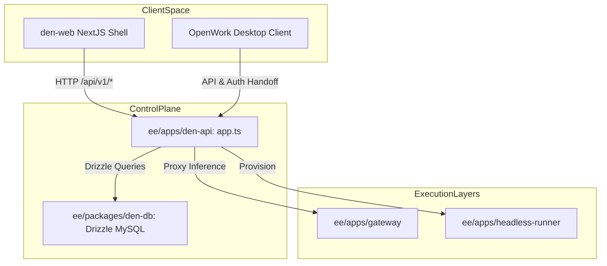

<!-- source: DeepWiki mcp.deepwiki.com · repo different-ai/openwork · page 5 Den Control Plane (Enterprise) · fetched 2026-10-26 -->

# Den Control Plane (Enterprise)

Relevant source files

The following files were used as context for generating this wiki page:

- [ee/apps/den-api/.env.example](ee/apps/den-api/.env.example)
- [ee/apps/den-api/src/app.ts](ee/apps/den-api/src/app.ts)
- [ee/apps/den-api/src/auth-protection.ts](ee/apps/den-api/src/auth-protection.ts)
- [ee/apps/den-api/src/auth.ts](ee/apps/den-api/src/auth.ts)
- [ee/apps/den-api/src/drain-state.ts](ee/apps/den-api/src/drain-state.ts)
- [ee/apps/den-api/src/env.ts](ee/apps/den-api/src/env.ts)
- [ee/apps/den-api/src/graceful-shutdown.ts](ee/apps/den-api/src/graceful-shutdown.ts)
- [ee/apps/den-api/src/orgs.ts](ee/apps/den-api/src/orgs.ts)
- [ee/apps/den-api/src/routes/admin/index.ts](ee/apps/den-api/src/routes/admin/index.ts)
- [ee/apps/den-api/src/routes/auth/index.ts](ee/apps/den-api/src/routes/auth/index.ts)
- [ee/apps/den-api/src/routes/org/core.ts](ee/apps/den-api/src/routes/org/core.ts)
- [ee/apps/den-api/src/routes/org/invitations.ts](ee/apps/den-api/src/routes/org/invitations.ts)
- [ee/apps/den-api/src/server.ts](ee/apps/den-api/src/server.ts)
- [ee/apps/den-api/test/api/ready-draining.api.test.ts](ee/apps/den-api/test/api/ready-draining.api.test.ts)
- [ee/apps/den-api/test/graceful-shutdown.test.ts](ee/apps/den-api/test/graceful-shutdown.test.ts)
- [ee/apps/den-web/app/(den)/_lib/den-org.ts](ee/apps/den-web/app/(den)/_lib/den-org.ts)
- [ee/apps/den-web/app/(den)/_providers/den-flow-provider.tsx](ee/apps/den-web/app/(den)/_providers/den-flow-provider.tsx)
- [ee/apps/den-web/app/(den)/dashboard/_components/command-palette/den-command-palette.tsx](ee/apps/den-web/app/(den)/dashboard/_components/command-palette/den-command-palette.tsx)
- [ee/apps/den-web/app/(den)/dashboard/_components/manage-members-screen.tsx](ee/apps/den-web/app/(den)/dashboard/_components/manage-members-screen.tsx)
- [ee/apps/den-web/app/(den)/dashboard/_components/org-dashboard-shell.tsx](ee/apps/den-web/app/(den)/dashboard/_components/org-dashboard-shell.tsx)
- [ee/apps/den-web/app/(den)/dashboard/_lib/dashboard-navigation.ts](ee/apps/den-web/app/(den)/dashboard/_lib/dashboard-navigation.ts)
- [ee/apps/den-web/app/(den)/dashboard/_providers/org-dashboard-provider.tsx](ee/apps/den-web/app/(den)/dashboard/_providers/org-dashboard-provider.tsx)
- [ee/apps/den-web/components/den-admin-panel.tsx](ee/apps/den-web/components/den-admin-panel.tsx)
- [ee/apps/den-web/package.json](ee/apps/den-web/package.json)
- [packaging/helm/openwork-ee/templates/configmap.yaml](packaging/helm/openwork-ee/templates/configmap.yaml)
- [turbo.json](turbo.json)

## Purpose and Scope

The Den enterprise control plane (`ee/`) provides the hosted and self-hostable multi-tenant infrastructure for OpenWork. It manages organizations, members, Role-Based Access Control (RBAC), authentication flows via Better Auth, inference routing, model registries, plugin marketplaces, and cloud worker lifecycles. 

The control plane coordinates several core packages and deployable applications:
- **`den-api`**: The primary backend control plane built with Hono, exposing REST endpoints, authentication callbacks, and agent orchestration logic [ee/apps/den-api/src/app.ts:10-564](), [ee/apps/den-api/src/env.ts:1-35]().
- **`den-web`**: The Next.js enterprise dashboard application supplying organization administration, billing, team management, and settings panels [ee/apps/den-web/package.json:1-17](), [ee/apps/den-web/app/(den)/dashboard/_components/org-dashboard-shell.tsx:3-53]().
- **`gateway`**: The AI Gateway proxy managing model providers, usage limits, and request logging [ee/apps/den-api/src/env.ts:84-85]().
- **`den-db`**: The shared Drizzle ORM schema layer and migration engine [ee/apps/den-api/src/db.js]().

---

## System Architecture

The control plane separates edge presentation (`den-web`), API routing (`den-api`), state persistence (`den-db`), and downstream execution runtimes.

**Sources:** [ee/apps/den-api/src/app.ts:10-564](), [ee/apps/den-web/app/(den)/dashboard/_components/org-dashboard-shell.tsx:3-53](), [ee/apps/den-api/src/db.js]()

---

## Control Plane Modules

The control plane functionality is organized into dedicated architectural domains. Below is a high-level summary of each area.

### 5.1 den-api Service Architecture
The `den-api` service provides the REST API backing the enterprise control plane. Built on Hono (`ee/apps/den-api/src/app.ts:10-10]`), it incorporates middleware for request tracing, CORS, Better Auth session validation, rate limiting, and structured observability logging (`ee/apps/den-api/src/observability/logger.js`). Environment configuration is strictly validated via Zod schemas (`ee/apps/den-api/src/env.ts:17-35]`).

For details, see [den-api Service Architecture](#5.1).
**Sources:** [ee/apps/den-api/src/app.ts:10-137](), [ee/apps/den-api/src/env.ts:17-35]()

### 5.2 MCP Gateway and Capabilities
The Model Context Protocol (MCP) surface (`ee/apps/den-api/src/mcp/agent.js`) exposes registries, tool discovery, and invocation pipelines. It unifies native provider connectors (such as Google Workspace and Microsoft Graph) with external enterprise MCP servers, handling OAuth authentication, consent screens, and url-guard policies.

For details, see [MCP Gateway and Capabilities](#5.2).
**Sources:** [ee/apps/den-api/src/app.ts:19-48]()

### 5.3 Plugin System and Marketplaces
The plugin architecture manages configuration objects, store routes, access grants, and GitHub app discovery (`ee/apps/den-api/src/env.ts:41-53]`). It empowers organizations to curate shared tools, publish codemode workflows, and manage library resources via the `den-web` interface.

For details, see [Plugin System and Marketplaces](#5.3).
**Sources:** [ee/apps/den-api/src/env.ts:41-53](), [ee/apps/den-web/app/(den)/_lib/den-org.ts:1-55]()

### 5.4 Inference Gateway and LLM Providers
The inference gateway proxy (`ee/apps/gateway`) handles model provider access catalogs, token pricing calculations, request auditing, and free guest allowances. The `den-api` companion modules manage per-member credentials, Bring Your Own Key (BYOK) configurations, and provider endpoint probing.

For details, see [Inference Gateway and LLM Providers](#5.4).
**Sources:** [ee/apps/den-api/src/env.ts:84-85]()

### 5.5 den-web Dashboard
The `den-web` application is a Next.js dashboard (`ee/apps/den-web/package.json:18-47]`) that supplies the organization management shell, authentication flows, admin panels, and analytics screens (`ee/apps/den-web/app/(den)/dashboard/_components/org-dashboard-shell.tsx:3-53]`). It evaluates role-based access flags (`ee/apps/den-web/app/(den)/_lib/den-org.ts:98-204]`) to dynamically adapt UI capabilities to the signed-in user's privileges.

For details, see [den-web Dashboard](#5.5).
**Sources:** [ee/apps/den-web/package.json:18-47](), [ee/apps/den-web/app/(den)/dashboard/_components/org-dashboard-shell.tsx:3-53](), [ee/apps/den-web/app/(den)/_lib/den-org.ts:98-204]()

### 5.6 Headless Runner, Workbot and Slack Assistant
Headless runners and asynchronous services (`ee/apps/den-api/src/headless-runner/routes.js`) support background agent execution, Workbot capabilities, and Slack assistant interactions (`ee/apps/den-api/src/slack-assistant/routes.js`). These components bridge remote triggers with local desktop handoffs and cloud container sandboxes.

For details, see [Headless Runner, Workbot and Slack Assistant](#5.6).
**Sources:** [ee/apps/den-api/src/app.ts:2-4]()

### 5.7 den-db Schema and Migrations
Database persistence is managed through Drizzle ORM schema modules and migration workflows. The schema coordinates multi-tenant organization boundaries, credential encryption keys (`ee/apps/den-api/src/env.ts:22-22]`), audit logging tables, and enterprise state tracking.

For details, see [den-db Schema and Migrations](#5.7).
**Sources:** [ee/apps/den-api/src/env.ts:22-22](), [ee/apps/den-api/src/db.js]()

---

