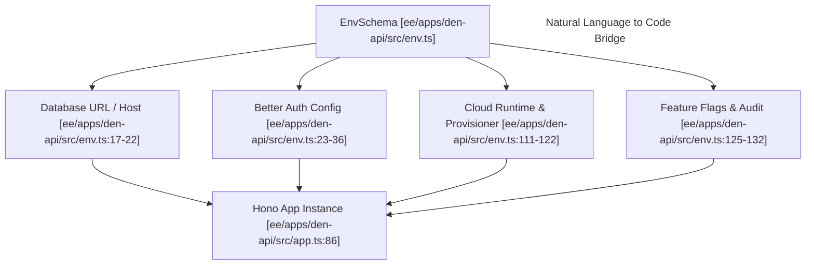
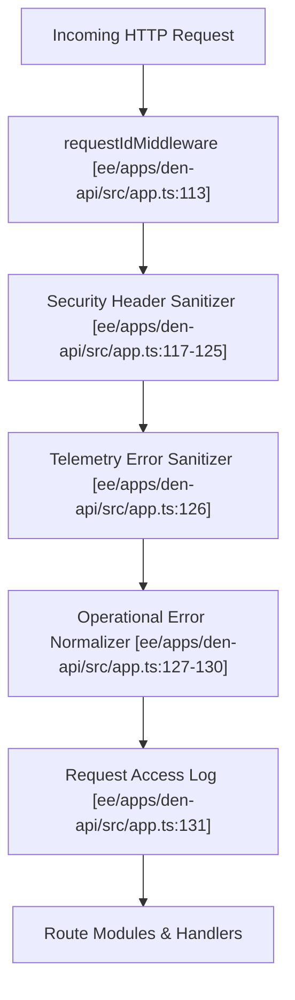
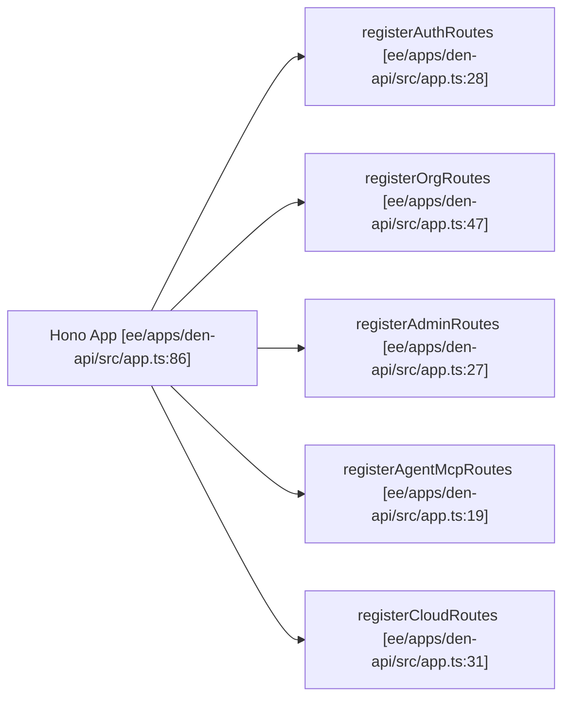

<!-- source: DeepWiki mcp.deepwiki.com · repo different-ai/openwork · page 5.1 den-api Service Architecture · fetched 2026-10-26 -->

# den-api Service Architecture

Relevant source files

The following files were used as context for generating this wiki page:

- [ee/apps/den-api/.env.example](ee/apps/den-api/.env.example)
- [ee/apps/den-api/package.json](ee/apps/den-api/package.json)
- [ee/apps/den-api/scripts/build.mjs](ee/apps/den-api/scripts/build.mjs)
- [ee/apps/den-api/scripts/check-runtime-imports.mjs](ee/apps/den-api/scripts/check-runtime-imports.mjs)
- [ee/apps/den-api/src/app.ts](ee/apps/den-api/src/app.ts)
- [ee/apps/den-api/src/cache.ts](ee/apps/den-api/src/cache.ts)
- [ee/apps/den-api/src/credential-revocation.ts](ee/apps/den-api/src/credential-revocation.ts)
- [ee/apps/den-api/src/drain-state.ts](ee/apps/den-api/src/drain-state.ts)
- [ee/apps/den-api/src/env.ts](ee/apps/den-api/src/env.ts)
- [ee/apps/den-api/src/features.ts](ee/apps/den-api/src/features.ts)
- [ee/apps/den-api/src/generation-cache.ts](ee/apps/den-api/src/generation-cache.ts)
- [ee/apps/den-api/src/graceful-shutdown.ts](ee/apps/den-api/src/graceful-shutdown.ts)
- [ee/apps/den-api/src/member-teams.ts](ee/apps/den-api/src/member-teams.ts)
- [ee/apps/den-api/src/middleware/member-permissions.ts](ee/apps/den-api/src/middleware/member-permissions.ts)
- [ee/apps/den-api/src/middleware/member-teams.ts](ee/apps/den-api/src/middleware/member-teams.ts)
- [ee/apps/den-api/src/routes/admin/member-features.ts](ee/apps/den-api/src/routes/admin/member-features.ts)
- [ee/apps/den-api/src/routes/org/google-document-editor.ts](ee/apps/den-api/src/routes/org/google-document-editor.ts)
- [ee/apps/den-api/src/server.ts](ee/apps/den-api/src/server.ts)
- [ee/apps/den-api/src/session.ts](ee/apps/den-api/src/session.ts)
- [ee/apps/den-api/src/user-deletion.ts](ee/apps/den-api/src/user-deletion.ts)
- [ee/apps/den-api/test/api/ready-draining.api.test.ts](ee/apps/den-api/test/api/ready-draining.api.test.ts)
- [ee/apps/den-api/test/auth-cache.test.ts](ee/apps/den-api/test/auth-cache.test.ts)
- [ee/apps/den-api/test/build-source-exports.test.ts](ee/apps/den-api/test/build-source-exports.test.ts)
- [ee/apps/den-api/test/feature-cache-invalidation.test.ts](ee/apps/den-api/test/feature-cache-invalidation.test.ts)
- [ee/apps/den-api/test/generation-cache.test.ts](ee/apps/den-api/test/generation-cache.test.ts)
- [ee/apps/den-api/test/graceful-shutdown.test.ts](ee/apps/den-api/test/graceful-shutdown.test.ts)
- [ee/apps/den-api/test/member-team-cache.test.ts](ee/apps/den-api/test/member-team-cache.test.ts)
- [ee/apps/den-api/test/member-team-revocation.test.ts](ee/apps/den-api/test/member-team-revocation.test.ts)
- [ee/apps/den-api/test/permission-feature-cache.test.ts](ee/apps/den-api/test/permission-feature-cache.test.ts)
- [ee/apps/den-web/README.md](ee/apps/den-web/README.md)
- [ee/apps/den-web/app/(den)/_lib/den-api-origin.ts](ee/apps/den-web/app/(den)/_lib/den-api-origin.ts)
- [ee/apps/den-web/app/(den)/_lib/den-flow.ts](ee/apps/den-web/app/(den)/_lib/den-flow.ts)
- [ee/apps/den-web/instrumentation-client.ts](ee/apps/den-web/instrumentation-client.ts)
- [ee/apps/den-web/next.config.js](ee/apps/den-web/next.config.js)
- [ee/apps/den-web/posthog-privacy.ts](ee/apps/den-web/posthog-privacy.ts)
- [ee/apps/den-web/proxy.ts](ee/apps/den-web/proxy.ts)
- [ee/packages/den-db/src/organization-features.ts](ee/packages/den-db/src/organization-features.ts)
- [packaging/docker/Dockerfile.den](packaging/docker/Dockerfile.den)
- [packaging/docker/Dockerfile.den-web](packaging/docker/Dockerfile.den-web)
- [packaging/helm/openwork-ee/templates/configmap.yaml](packaging/helm/openwork-ee/templates/configmap.yaml)
- [turbo.json](turbo.json)

## Purpose and Scope

The `den-api` service (`ee/apps/den-api/`) is the central enterprise control plane backend for OpenWork. It provides multi-tenancy, authentication, organization management, access control, billing, cloud worker lifecycle orchestration, and MCP routing. 

This page outlines the high-level architecture of `den-api`, detailing its Hono-based application wiring, global middleware stack, route module organization, configuration via `env.ts`, server bootstrap, and observability infrastructure. For deep technical implementation details, refer to the child pages:
- [Authentication and Sessions](#5.1.1)
- [Organizations, Members and RBAC](#5.1.2)
- [SSO, SCIM and Audit Logging](#5.1.3)
- [Billing and Usage](#5.1.4)
- [Cloud Workers Lifecycle](#5.1.5)

Sources: `ee/apps/den-api/package.json:1-105()`, `ee/apps/den-api/src/app.ts:1-141()`

---

## 1. Application Wiring and Configuration (`env.ts`)

The service initializes its configuration via Zod-validated environment variables defined in `ee/apps/den-api/src/env.ts`. This configuration governs database connections, encryption keys, auth secrets, and feature flags.

*Figure 1: Environment and configuration wiring into the Hono application runtime.*

Sources: `ee/apps/den-api/src/env.ts:1-132()`, `ee/apps/den-api/src/app.ts:86-88()`

---

## 2. Middleware Stack

Incoming HTTP requests pass through a robust pipeline of global middleware configured in `ee/apps/den-api/src/app.ts`. These handle request tracing, security headers, error normalization, observability telemetry, and request auditing.

*Figure 2: Global middleware execution order in the Hono application.*

Sources: `ee/apps/den-api/src/app.ts:113-137()`

---

## 3. Route Modules and OpenAPI Registration

The application aggregates multiple functional domain route modules onto the root `Hono` instance. Each module mounts domain-specific routes (e.g., authentication, organization management, administrative actions, and MCP gateways).

*Figure 3: Mapping functional modules to the central Hono router.*

Sources: `ee/apps/den-api/src/app.ts:27-52()`, `packages/docs/openapi.json:30-177()`

---

## 4. Observability and Error Handling

`den-api` integrates OpenTelemetry SDK packages and Sentry error tracking directly into the Hono application wiring. Structured logging is managed by `appLogger`, and operational errors are caught and transformed into standardized responses via `registerAppErrorHandler`.

Sources: `ee/apps/den-api/package.json:31-46()`, `ee/apps/den-api/src/app.ts:24()`, `ee/apps/den-api/src/app.ts:132-137()`

---

## 5. Child Pages Reference

For granular documentation on specific subsystems within `den-api`, see the following child wiki pages:
- [Authentication and Sessions](#5.1.1)
- [Organizations, Members and RBAC](#5.1.2)
- [SSO, SCIM and Audit Logging](#5.1.3)
- [Billing and Usage](#5.1.4)
- [Cloud Workers Lifecycle](#5.1.5)

Sources: `ee/apps/den-api/package.json:1-105()`

---

