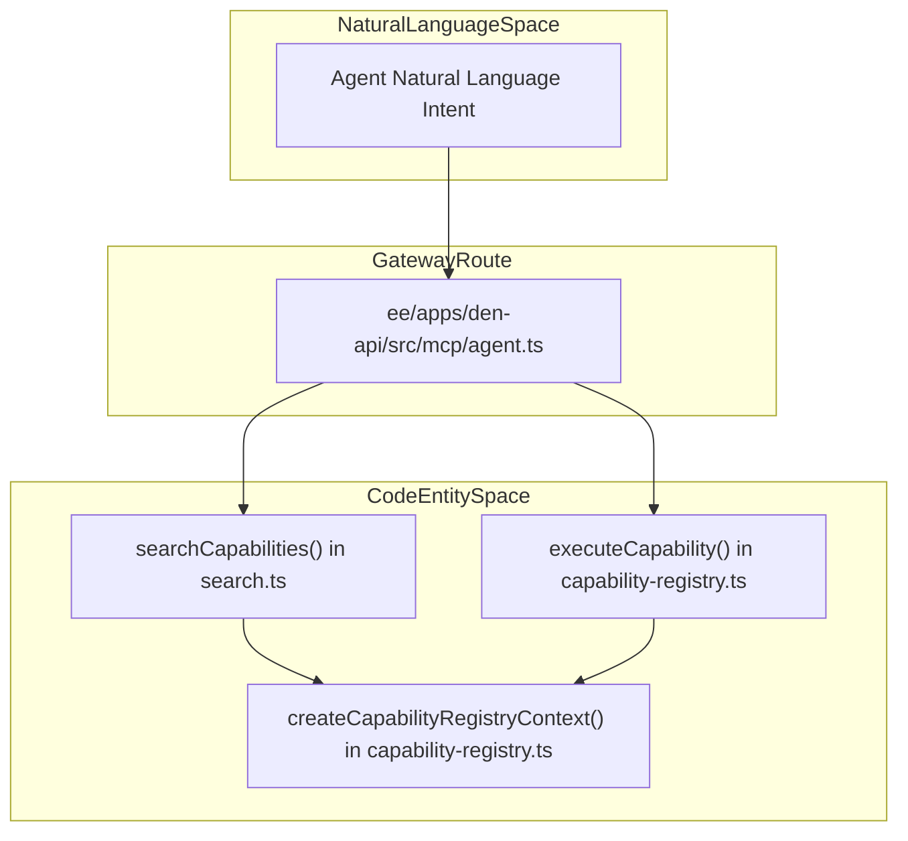
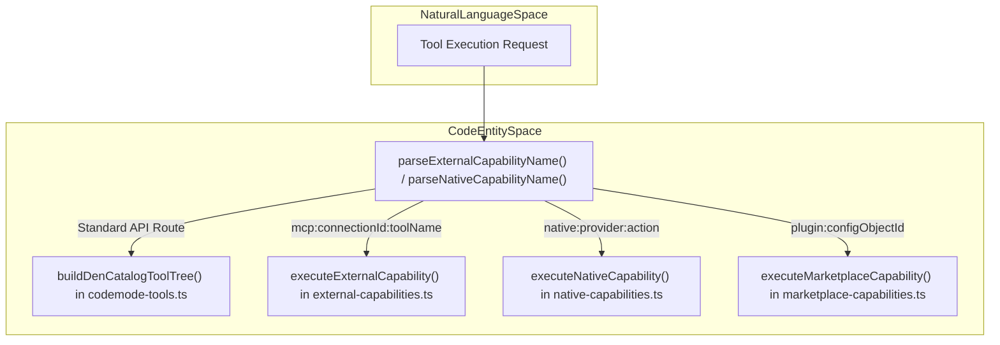

<!-- source: DeepWiki mcp.deepwiki.com · repo different-ai/openwork · page 5.2 MCP Gateway and Capabilities · fetched 2026-10-26 -->

# MCP Gateway and Capabilities

Relevant source files

The following files were used as context for generating this wiki page:

- [docs/marketplace-capabilities-architecture.md](docs/marketplace-capabilities-architecture.md)
- [ee/apps/den-api/src/mcp/README.md](ee/apps/den-api/src/mcp/README.md)
- [ee/apps/den-api/src/mcp/admin.ts](ee/apps/den-api/src/mcp/admin.ts)
- [ee/apps/den-api/src/mcp/agent-server.ts](ee/apps/den-api/src/mcp/agent-server.ts)
- [ee/apps/den-api/src/mcp/agent.ts](ee/apps/den-api/src/mcp/agent.ts)
- [ee/apps/den-api/src/mcp/app-builder-tools.ts](ee/apps/den-api/src/mcp/app-builder-tools.ts)
- [ee/apps/den-api/src/mcp/auth.ts](ee/apps/den-api/src/mcp/auth.ts)
- [ee/apps/den-api/src/mcp/capability-registry.ts](ee/apps/den-api/src/mcp/capability-registry.ts)
- [ee/apps/den-api/src/mcp/codemode-tools.ts](ee/apps/den-api/src/mcp/codemode-tools.ts)
- [ee/apps/den-api/src/mcp/connect-tool-view.ts](ee/apps/den-api/src/mcp/connect-tool-view.ts)
- [ee/apps/den-api/src/mcp/external-capabilities.ts](ee/apps/den-api/src/mcp/external-capabilities.ts)
- [ee/apps/den-api/src/mcp/external-connection-proxy.ts](ee/apps/den-api/src/mcp/external-connection-proxy.ts)
- [ee/apps/den-api/src/mcp/index.ts](ee/apps/den-api/src/mcp/index.ts)
- [ee/apps/den-api/src/mcp/scopes.ts](ee/apps/den-api/src/mcp/scopes.ts)
- [ee/apps/den-api/src/mcp/search.ts](ee/apps/den-api/src/mcp/search.ts)
- [ee/apps/den-api/src/mcp/token-lifetime.ts](ee/apps/den-api/src/mcp/token-lifetime.ts)
- [ee/apps/den-api/src/middleware/admin.ts](ee/apps/den-api/src/middleware/admin.ts)
- [ee/apps/den-api/src/routes/mcp/index.ts](ee/apps/den-api/src/routes/mcp/index.ts)
- [ee/apps/den-api/test/api/connect-full-tools.api.test.ts](ee/apps/den-api/test/api/connect-full-tools.api.test.ts)
- [ee/apps/den-api/test/api/external-connection-proxy.api.test.ts](ee/apps/den-api/test/api/external-connection-proxy.api.test.ts)
- [ee/apps/den-api/test/connect-full-tools.test.ts](ee/apps/den-api/test/connect-full-tools.test.ts)
- [ee/apps/den-api/test/mcp-gateway-metadata.test.ts](ee/apps/den-api/test/mcp-gateway-metadata.test.ts)
- [evals/core/agent-signup-via-mcp.e2e.test.ts](evals/core/agent-signup-via-mcp.e2e.test.ts)
- [evals/worlds/thread-restart.ts](evals/worlds/thread-restart.ts)

The Model Context Protocol (MCP) Gateway provides the unified enterprise agent surface (`api.openworklabs.com/mcp/agent`) exposed by `den-api`. It bridges AI agents with system operations, external tool servers, native cloud integrations, sandboxed code execution, and dynamic interactive views. 

This page serves as a high-level overview of the capability registry, search-and-invoke mechanics, native/external integration layers, codemode namespaces, and generated artifact views within `ee/apps/den-api/src/mcp/agent.ts`.

Sources: [ee/apps/den-api/src/mcp/agent.ts:1-139]()

---

## Capability Registry and Search-and-Invoke Architecture

Rather than exposing an unbounded catalog of thousands of individual API operations directly to LLMs (which would exceed context windows and degrade selection accuracy), the MCP Gateway exposes a sparse tool interface centered around two core primitives defined in `ee/apps/den-api/src/mcp/search.ts` and `ee/apps/den-api/src/mcp/capability-registry.ts`:

1. `search_capabilities`: Accepts a natural language query and token filters to query administrative, API, MCP, marketplace, and skill operations, returning a ranked list of `CapabilityMatch` structures.
2. `execute_capability`: Dispatches an exact capability name along with path, query, or body parameters to the appropriate underlying provider implementation.

### Diagram: Gateway Search and Execution Flow

Sources: [ee/apps/den-api/src/mcp/agent.ts:31-73](), [ee/apps/den-api/src/mcp/search.ts:19-53](), [ee/apps/den-api/src/mcp/capability-registry.ts:124-167]()

---

## Capability Namespaces and Tool Routing

Capabilities are partitioned into distinct namespaces to prevent identifier collisions and enforce multi-tenant authorization boundaries across organization members, teams, and external connections.

### Diagram: Capability Namespace Resolution

The gateway handles several capability sources:
- **Catalog Operations**: OpenAPI-derived routes from `ee/apps/den-api/src/mcp/catalog.ts`.
- **Native Capabilities**: Workspace integrations handled via `ee/apps/den-api/src/mcp/native-capabilities.ts`.
- **External MCP Connections**: Namespaced as `mcp:<connectionId>:<toolName>` and resolved through `ee/apps/den-api/src/mcp/external-capabilities.ts`.
- **Marketplace & Skills**: Plugin-bundled scripts and shared workflows namespaced as `plugin:` and executed via `ee/apps/den-api/src/mcp/marketplace-capabilities.ts`.

Sources: [ee/apps/den-api/src/mcp/external-capabilities.ts:80-99](), [ee/apps/den-api/src/mcp/marketplace-capabilities.ts:42-62](), [ee/apps/den-api/src/mcp/capability-registry.ts:94-101]()

---

## Codemode Tools and Namespaces

For complex multi-step workflows and scripts, OpenWork provides a Codemode integration layer (`ee/apps/den-api/src/mcp/codemode-tools.ts` and `ee/apps/den-api/src/mcp/codemode-namespaces.ts`). Tools are structured into hierarchical tool trees where connection contexts are explicitly sandboxed.

- `buildDenCatalogToolTree`: Converts OpenAPI operations into native `Tool.Definition` structures for sandboxed execution [ee/apps/den-api/src/mcp/codemode-tools.ts:147-152]().
- `resolveCodemodeConnectionNamespaceContext`: Maps organization memberships and external connections to secure execution namespaces [ee/apps/den-api/src/mcp/codemode-namespaces.ts:16-50]().

Sources: [ee/apps/den-api/src/mcp/codemode-tools.ts:42-55]()

---

## Generated Artifact Views

The gateway supports dynamic MCP Apps and generated artifact views through `ee/apps/den-api/src/mcp/generated-artifact-views.ts`. These enable workflows to return interactive, server-built React components encapsulated with Content Security Policy (CSP) headers and resource digests.

- `registerGeneratedArtifactResource`: Registers immutable UI resources conforming to the Model Context Protocol UI specification [ee/apps/den-api/src/mcp/generated-artifact-views.ts:56-87]().
- Render and preview tools dynamically fetch execution snapshots, validating expected output schema digests before passing structured payloads and metadata to clients [ee/apps/den-api/src/mcp/generated-artifact-views.ts:89-164]().

Sources: [ee/apps/den-api/src/mcp/agent.ts:87-90]()

---

## Child Pages

For granular technical documentation on specific sub-systems of the MCP Gateway and capabilities surface, refer to the following child pages:

- **[External MCP Connections and OAuth](#5.2.1)** — Covers organization `mcp-connections` routes, `external-mcp-client/diagnostics`, the enterprise MCP client package, generic OAuth providers, and credential persistence. For details, see [External MCP Connections and OAuth](#5.2.1).
- **[Native Provider Connectors](#5.2.2)** — Details Google Workspace, Gmail, Microsoft 365/Graph connectors, OAuth credentials, the provider registry, and marketplace capabilities. For details, see [Native Provider Connectors](#5.2.2).
- **[MCP Consent and Client Identity (den-web)](#5.2.3)** — Explains the den-web `/mcp` consent flow, organization selection, client trust/identity models, and OAuth client registration. For details, see [MCP Consent and Client Identity (den-web)](#5.2.3).

Sources: [ee/apps/den-api/src/mcp/agent.ts:1-139]()

---

