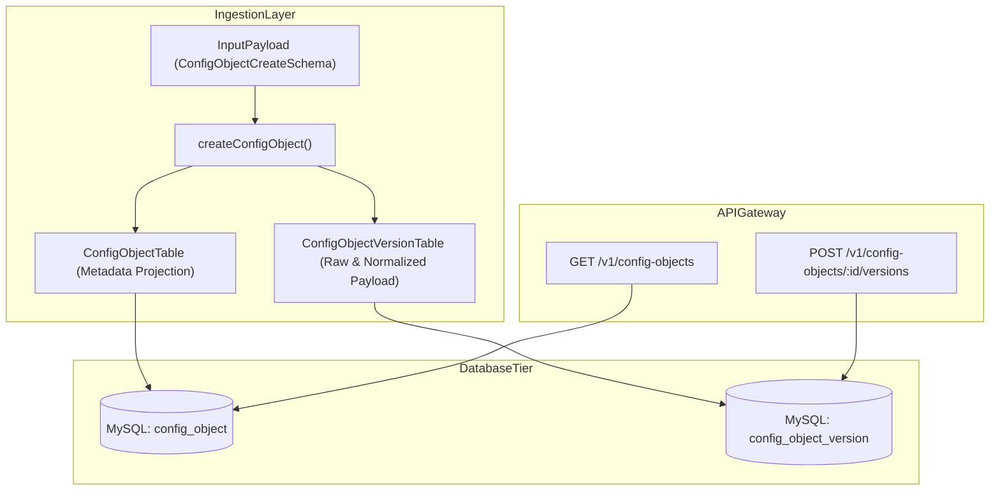
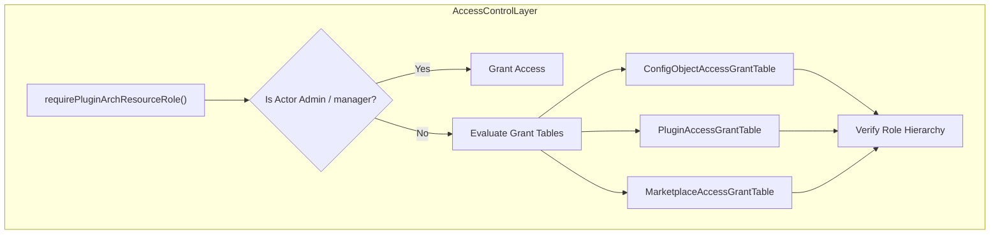
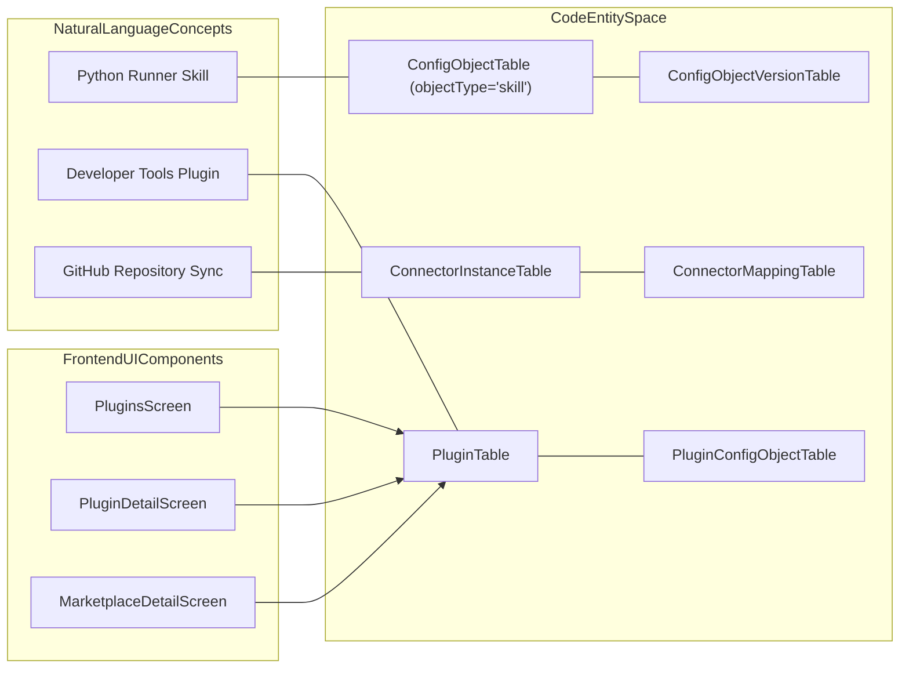

<!-- source: DeepWiki mcp.deepwiki.com · repo different-ai/openwork · page 5.3 Plugin System and Marketplaces · fetched 2026-10-26 -->

# Plugin System and Marketplaces

Relevant source files

The following files were used as context for generating this wiki page:

- [.github/workflows/features-check.yml](.github/workflows/features-check.yml)
- [.warden/skills/design-spec-review/SKILL.md](.warden/skills/design-spec-review/SKILL.md)
- [docs/quality/ui-guardrails.md](docs/quality/ui-guardrails.md)
- [ee/apps/den-api/scripts/check-audit-route-coverage.ts](ee/apps/den-api/scripts/check-audit-route-coverage.ts)
- [ee/apps/den-api/src/audit/job-outcomes.ts](ee/apps/den-api/src/audit/job-outcomes.ts)
- [ee/apps/den-api/src/audit/service-actions.ts](ee/apps/den-api/src/audit/service-actions.ts)
- [ee/apps/den-api/src/routes/org/plugin-system/access.ts](ee/apps/den-api/src/routes/org/plugin-system/access.ts)
- [ee/apps/den-api/src/routes/org/plugin-system/agent-plugin-v1.ts](ee/apps/den-api/src/routes/org/plugin-system/agent-plugin-v1.ts)
- [ee/apps/den-api/src/routes/org/plugin-system/contracts.ts](ee/apps/den-api/src/routes/org/plugin-system/contracts.ts)
- [ee/apps/den-api/src/routes/org/plugin-system/github-app.ts](ee/apps/den-api/src/routes/org/plugin-system/github-app.ts)
- [ee/apps/den-api/src/routes/org/plugin-system/github-discovery.ts](ee/apps/den-api/src/routes/org/plugin-system/github-discovery.ts)
- [ee/apps/den-api/src/routes/org/plugin-system/routes.ts](ee/apps/den-api/src/routes/org/plugin-system/routes.ts)
- [ee/apps/den-api/src/routes/org/plugin-system/schemas.ts](ee/apps/den-api/src/routes/org/plugin-system/schemas.ts)
- [ee/apps/den-api/src/routes/org/plugin-system/store.ts](ee/apps/den-api/src/routes/org/plugin-system/store.ts)
- [ee/apps/den-api/src/workers/github-sync-retry.ts](ee/apps/den-api/src/workers/github-sync-retry.ts)
- [ee/apps/den-api/src/workers/github-sync.ts](ee/apps/den-api/src/workers/github-sync.ts)
- [ee/apps/den-api/test/api/github-sync-poll.api.test.ts](ee/apps/den-api/test/api/github-sync-poll.api.test.ts)
- [ee/apps/den-web/app/(den)/dashboard/_components/brand-appearance-screen.tsx](ee/apps/den-web/app/(den)/dashboard/_components/brand-appearance-screen.tsx)
- [ee/apps/den-web/app/(den)/dashboard/_components/github-integration-screen.tsx](ee/apps/den-web/app/(den)/dashboard/_components/github-integration-screen.tsx)
- [ee/apps/den-web/app/(den)/dashboard/_components/integration-data.tsx](ee/apps/den-web/app/(den)/dashboard/_components/integration-data.tsx)
- [ee/apps/den-web/app/(den)/dashboard/_components/integrations-screen.tsx](ee/apps/den-web/app/(den)/dashboard/_components/integrations-screen.tsx)
- [ee/apps/den-web/app/(den)/dashboard/_components/marketplace-data.tsx](ee/apps/den-web/app/(den)/dashboard/_components/marketplace-data.tsx)
- [ee/apps/den-web/app/(den)/dashboard/_components/marketplace-detail-screen.tsx](ee/apps/den-web/app/(den)/dashboard/_components/marketplace-detail-screen.tsx)
- [ee/apps/den-web/app/(den)/dashboard/_components/marketplaces-screen.tsx](ee/apps/den-web/app/(den)/dashboard/_components/marketplaces-screen.tsx)
- [ee/apps/den-web/app/(den)/dashboard/_components/plugin-data.tsx](ee/apps/den-web/app/(den)/dashboard/_components/plugin-data.tsx)
- [ee/apps/den-web/app/(den)/dashboard/_components/plugin-detail-screen.tsx](ee/apps/den-web/app/(den)/dashboard/_components/plugin-detail-screen.tsx)
- [ee/apps/den-web/app/(den)/dashboard/_components/plugin-editor-screen.tsx](ee/apps/den-web/app/(den)/dashboard/_components/plugin-editor-screen.tsx)
- [ee/apps/den-web/app/(den)/dashboard/_components/plugins-screen.tsx](ee/apps/den-web/app/(den)/dashboard/_components/plugins-screen.tsx)
- [ee/packages/den-db/drizzle/0058_natural_steel_serpent.sql](ee/packages/den-db/drizzle/0058_natural_steel_serpent.sql)
- [ee/packages/den-db/drizzle/0074_superb_tiger_shark.sql](ee/packages/den-db/drizzle/0074_superb_tiger_shark.sql)
- [ee/packages/den-db/drizzle/meta/0058_snapshot.json](ee/packages/den-db/drizzle/meta/0058_snapshot.json)
- [ee/packages/den-db/drizzle/meta/0074_snapshot.json](ee/packages/den-db/drizzle/meta/0074_snapshot.json)
- [ee/packages/den-db/src/schema/sharables/plugin-arch.ts](ee/packages/den-db/src/schema/sharables/plugin-arch.ts)
- [evals/packages/labs/src/index.ts](evals/packages/labs/src/index.ts)
- [evals/packages/labs/src/mock-github.ts](evals/packages/labs/src/mock-github.ts)
- [scripts/features-sync.mjs](scripts/features-sync.mjs)

## Purpose and Scope

This page provides a high-level overview of OpenWork's next-generation plugin architecture, which manages **Config Objects** (Skills, MCP servers, Commands, Agents, Hooks), **Plugins** as logical versioned bundles, **Marketplaces**, and automated **GitHub App Sync and Discovery** capabilities [ee/apps/den-api/src/routes/org/plugin-system/store.ts:1-29](). 

As a parent page, this section outlines the architectural primitives, database models, API routing structures, and access control models. For deeper operational details, refer to the following child pages:
- **Library and Sharing Screens ([Library and Sharing Screens](#5.3.1))** — Covers the `den-web` library screen, item catalogs, connector pickers, and org sharing workflows.
- **Codemode and Saved Scripts ([Codemode and Saved Scripts](#5.3.2))** — Covers `packages/codemode`, execution routes, chat tool rendering, and automated scripts.

---

## 1. Core Architecture and Entities

The plugin system moves away from raw table exposure toward logical resource management. Every functional component in OpenWork is modeled as a versioned database entity.

| Entity | Description | TypeID Prefix | Schema Reference |
| :--- | :--- | :--- | :--- |
| **Config Object** | The base unit (Skill, MCP, Agent, Hook, etc.) supporting versioning and normalized payloads. | `cob_` | `ConfigObjectTable` [ee/packages/den-db/src/schema/sharables/plugin-arch.ts:42-71]() |
| **Plugin** | A logical bundle of Config Objects forming a deliverable extension unit. | `plg_` | `PluginTable` [ee/packages/den-db/src/schema/sharables/plugin-arch.ts:98-121]() |
| **Marketplace** | A curated collection of plugins made available to specific organization teams or users. | `mkt_` | `MarketplaceTable` [ee/packages/den-db/src/schema/sharables/plugin-arch.ts:123-140]() |
| **Connector** | Bridges external synchronization sources (e.g., GitHub repositories) to configuration objects. | `cac_` / `cin_` | `ConnectorAccountTable`, `ConnectorInstanceTable` [ee/packages/den-db/src/schema/sharables/plugin-arch.ts:255-320]() |

Sources: [ee/apps/den-api/src/routes/org/plugin-system/schemas.ts:37-54](), [ee/packages/den-db/src/schema/sharables/plugin-arch.ts:42-140]()

---

## 2. Config Objects and Versioning

A **Config Object** represents a single functional unit. Objects are categorized by `objectType` (`skill`, `agent`, `command`, `tool`, `mcp`, `hook`, `context`, `custom`, `script`, `workflow`, `app`) [ee/packages/den-db/src/schema/sharables/plugin-arch.ts:18-18]() and source modes (`cloud`, `import`, `connector`) [ee/packages/den-db/src/schema/sharables/plugin-arch.ts:19-19]().

Every modification to a config object generates an entry in `ConfigObjectVersionTable`, storing both `rawSourceText` and `normalizedPayloadJson` [ee/packages/den-db/src/schema/sharables/plugin-arch.ts:73-88]().

### Data Flow: Config Object Creation and Versioning

Sources: [ee/apps/den-api/src/routes/org/plugin-system/store.ts:1-29](), [ee/packages/den-db/src/schema/sharables/plugin-arch.ts:42-96]()

---

## 3. Marketplaces, GitHub App Sync, and Discovery

Plugins can be bundled into **Marketplaces** or imported dynamically from external code hosting providers via connectors.

### GitHub Integration & Discovery
The system connects to GitHub via `ee/apps/den-api/src/routes/org/plugin-system/github-app.ts` to manage installation tokens and repository trees [ee/apps/den-api/src/routes/org/plugin-system/github-app.ts:41-56](). 
- **Discovery Service:** `buildGithubRepoDiscovery` scans repositories for plugin manifests and structures [ee/apps/den-api/src/routes/org/plugin-system/github-discovery.ts]().
- **Sync Events:** Incoming webhooks and manual resync commands generate `ConnectorSyncEventTable` entries to update config objects automatically [ee/packages/den-db/src/schema/sharables/plugin-arch.ts:31-32]().

Sources: [ee/apps/den-api/src/routes/org/plugin-system/github-app.ts:41-56](), [ee/apps/den-api/src/routes/org/plugin-system/github-discovery.ts]()

---

## 4. Role-Based Access Control (RBAC)

All plugin system resources are protected via a granular RBAC structure evaluated through an actor context (`PluginArchActorContext`) [ee/apps/den-api/src/routes/org/plugin-system/access.ts:24-37]().

### Access Roles and Grants
- **Roles:** Resources support `viewer`, `editor`, and `manager` access roles (`accessRoleValues`) [ee/packages/den-db/src/schema/sharables/plugin-arch.ts:25-25]().
- **Grant Resolution:** Permissions are resolved via direct member grants, team grants, or organization-wide permissions, supplemented by the `sharing.manage_all` override capability [ee/apps/den-api/src/routes/org/plugin-system/access.ts:116-132]().

Sources: [ee/apps/den-api/src/routes/org/plugin-system/access.ts:24-132](), [ee/packages/den-db/src/schema/sharables/plugin-arch.ts:25-25]()

---

## 5. Library and Sharing Screens (Child Page Link)

The `den-web` control plane exposes catalog management UI components including `PluginsScreen`, `PluginDetailScreen`, and `MarketplaceDetailScreen` [ee/apps/den-web/app/(den)/dashboard/_components/plugins-screen.tsx](), [ee/apps/den-web/app/(den)/dashboard/_components/marketplace-detail-screen.tsx](). 

For comprehensive documentation on library item listings, connector pickers, and organization sharing flows, see **Library and Sharing Screens ([Library and Sharing Screens](#5.3.1))**.

Sources: [ee/apps/den-web/app/(den)/dashboard/_components/plugins-screen.tsx](), [ee/apps/den-web/app/(den)/dashboard/_components/marketplace-detail-screen.tsx]()

---

## 6. Codemode and Saved Scripts (Child Page Link)

OpenWork supports execution of custom sandboxed code scripts, package definitions under `packages/codemode`, and chat tool rendering integration. 

For technical specifications regarding codemode routes, tool rendering in sessions, and saved script automations, see **Codemode and Saved Scripts ([Codemode and Saved Scripts](#5.3.2))**.

Sources: [ee/apps/den-api/src/routes/org/plugin-system/routes.ts:1-35]()

---

## 7. Code Entity Mapping

The diagram below bridges natural language plugin concepts to their corresponding code entities and database schema implementations.

Sources: [ee/packages/den-db/src/schema/sharables/plugin-arch.ts:42-121](), [ee/apps/den-web/app/(den)/dashboard/_components/plugins-screen.tsx:1-40](), [ee/apps/den-web/app/(den)/dashboard/_components/plugin-detail-screen.tsx:34-45](), [ee/apps/den-web/app/(den)/dashboard/_components/marketplace-detail-screen.tsx:87-95]()

---

