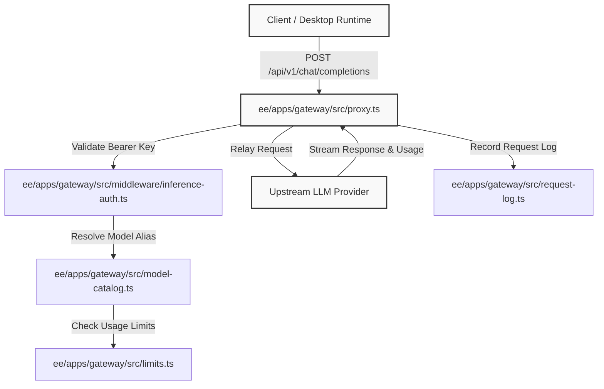
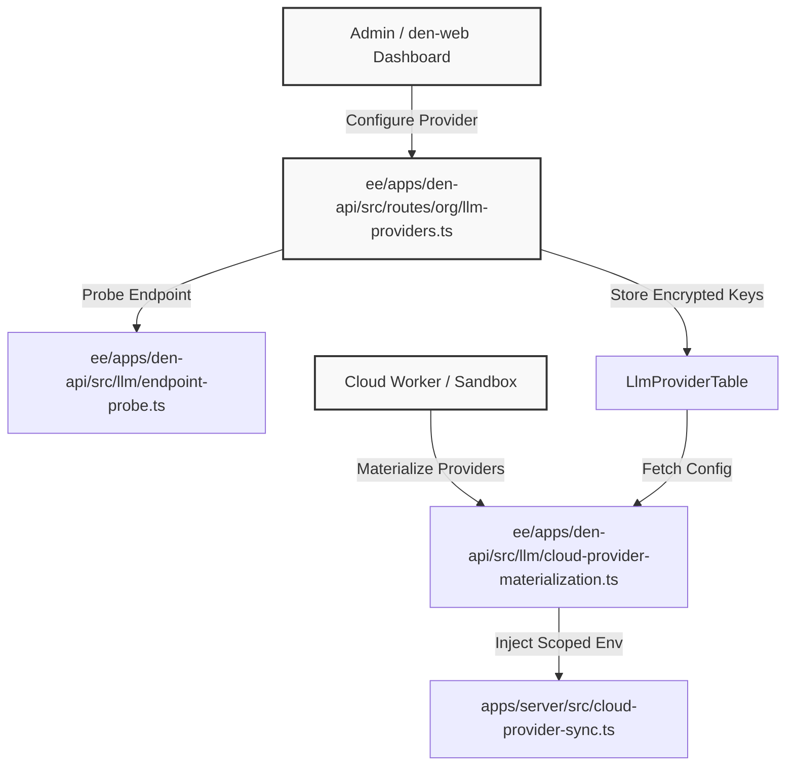

<!-- source: DeepWiki mcp.deepwiki.com · repo different-ai/openwork · page 5.4 Inference Gateway and LLM Providers · fetched 2026-10-26 -->

# Inference Gateway and LLM Providers

Relevant source files

The following files were used as context for generating this wiki page:

- [apps/app/src/react-app/domains/cloud/auto-access-ui.tsx](apps/app/src/react-app/domains/cloud/auto-access-ui.tsx)
- [apps/app/src/react-app/domains/cloud/gateway-usage-panel.tsx](apps/app/src/react-app/domains/cloud/gateway-usage-panel.tsx)
- [apps/app/src/react-app/domains/connections/provider-auth/cloud-provider-config.ts](apps/app/src/react-app/domains/connections/provider-auth/cloud-provider-config.ts)
- [apps/server/src/cloud-provider-sync.ts](apps/server/src/cloud-provider-sync.ts)
- [apps/server/src/engine-pool.ts](apps/server/src/engine-pool.ts)
- [apps/server/src/managed-provider-auth.ts](apps/server/src/managed-provider-auth.ts)
- [ee/apps/den-api/src/llm/cloud-provider-materialization.ts](ee/apps/den-api/src/llm/cloud-provider-materialization.ts)
- [ee/apps/den-api/src/llm/inference-provider-config.ts](ee/apps/den-api/src/llm/inference-provider-config.ts)
- [ee/apps/den-api/src/llm/provider-credentials.ts](ee/apps/den-api/src/llm/provider-credentials.ts)
- [ee/apps/den-api/test/provider-credentials.test.ts](ee/apps/den-api/test/provider-credentials.test.ts)
- [ee/apps/den-web/app/(den)/dashboard/_components/inference-provider-request.ts](ee/apps/den-web/app/(den)/dashboard/_components/inference-provider-request.ts)
- [ee/apps/gateway/README.md](ee/apps/gateway/README.md)
- [ee/apps/gateway/src/early-response.ts](ee/apps/gateway/src/early-response.ts)
- [ee/apps/gateway/src/env.ts](ee/apps/gateway/src/env.ts)
- [ee/apps/gateway/src/free/shared/dispatch.ts](ee/apps/gateway/src/free/shared/dispatch.ts)
- [ee/apps/gateway/src/gateway.ts](ee/apps/gateway/src/gateway.ts)
- [ee/apps/gateway/src/http-server.ts](ee/apps/gateway/src/http-server.ts)
- [ee/apps/gateway/src/protocols.ts](ee/apps/gateway/src/protocols.ts)
- [ee/apps/gateway/src/provider-access.ts](ee/apps/gateway/src/provider-access.ts)
- [ee/apps/gateway/src/proxy.ts](ee/apps/gateway/src/proxy.ts)
- [ee/apps/gateway/src/request-log.ts](ee/apps/gateway/src/request-log.ts)
- [ee/apps/gateway/src/server.ts](ee/apps/gateway/src/server.ts)
- [ee/apps/gateway/src/shutdown.ts](ee/apps/gateway/src/shutdown.ts)
- [ee/packages/utils/package.json](ee/packages/utils/package.json)
- [ee/packages/utils/src/ai-sdk-env-settings.test.ts](ee/packages/utils/src/ai-sdk-env-settings.test.ts)
- [ee/packages/utils/src/ai-sdk-env-settings.ts](ee/packages/utils/src/ai-sdk-env-settings.ts)
- [ee/packages/utils/tsup.config.ts](ee/packages/utils/tsup.config.ts)
- [evals/packages/env/src/inference.ts](evals/packages/env/src/inference.ts)
- [evals/packages/labs/src/mock-inference.ts](evals/packages/labs/src/mock-inference.ts)
- [packages/types/src/cloud-model-fast.ts](packages/types/src/cloud-model-fast.ts)
- [packages/types/src/den/inference.ts](packages/types/src/den/inference.ts)

The Inference Gateway and LLM Provider management subsystem handles secure proxying, upstream provider access, model catalogs, usage accounting, and credential materialization across the Den control plane and the gateway edge.

## Purpose and Scope

The inference architecture spans several core packages and apps:
*   `ee/apps/gateway`: Provides the proxy, provider catalog, pricing calculation, request logging, and free guest/member routing [ee/apps/gateway/src/gateway.ts:1-132](), [ee/apps/gateway/src/proxy.ts:1-75]().
*   `ee/apps/den-api/src/llm/`: Implements provider materialization, endpoint probing, credential encryption, and models.integration [ee/apps/den-api/src/llm/cloud-provider-materialization.ts:1-75](), [ee/apps/den-api/src/routes/org/llm-providers.ts:1-50]().
*   `den-gateway`: Manages edge routing and proxy delivery.

This is a parent page. Detailed technical specifications are covered in the child pages:
*   For allowance meters, proof-of-work guest sessions, and usage dashboards, see [Free Auto Accounting and Admin](#5.4.1).
*   For managed vs. BYOK credentials, per-member keys, and endpoint probing, see [Per-Member and Custom LLM Credentials](#5.4.2).

Sources: [ee/apps/gateway/src/gateway.ts:1-132](), [ee/apps/den-api/src/llm/cloud-provider-materialization.ts:1-75]()

---

## Gateway Proxy and Protocol Architecture

The gateway service (`ee/apps/gateway`) acts as a secure upstream proxy. It receives requests containing OpenWork bearer keys (`ow_gw_`), inspects organization grants, resolves aliases via `model-catalog.ts`, and forwards requests to upstream providers without mutating protocol semantics or exposing raw credentials [ee/apps/gateway/src/gateway.ts:1-50](), [ee/apps/gateway/src/proxy.ts:1-75]().

Title: Gateway Proxy Request Lifecycle

*Figure 1: Gateway request lifecycle bridging client request payloads to upstream providers.*

Sources: [ee/apps/gateway/src/proxy.ts:1-75](), [ee/apps/gateway/src/gateway.ts:1-50]()

---

## Den API LLM and Provider Materialization

The Den API control plane (`ee/apps/den-api`) coordinates organization-level LLM providers, validating custom configurations and syncing with supported model matrices [ee/apps/den-api/src/routes/org/llm-providers.ts:1-50](). When cloud workers or local clients execute tasks, `cloud-provider-materialization.ts` safely injects scoped environment variables and redacted credentials [ee/apps/den-api/src/llm/cloud-provider-materialization.ts:1-75]().

Title: Provider Materialization and Sync Architecture

*Figure 2: Provider materialization workflow from control plane administration to worker runtime environment.*

Sources: [ee/apps/den-api/src/routes/org/llm-providers.ts:1-50](), [ee/apps/den-api/src/llm/cloud-provider-materialization.ts:1-75]()

---

## Child Pages

*   **[Free Auto Accounting and Admin](#5.4.1)** — Gateway free allowance meters, configuration, proof-of-work guest sessions, inference schema tables, and the admin usage dashboard.
*   **[Per-Member and Custom LLM Credentials](#5.4.2)** — Managed vs. BYOK provider credentials, per-member keys, provider editor screens, endpoint probing, and AI SDK environment settings.

Sources: [packages/types/src/den/inference.ts:1-50](), [ee/apps/den-api/src/routes/org/llm-providers.ts:1-50]()

---

