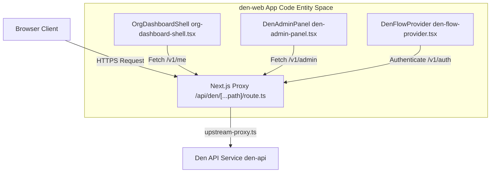
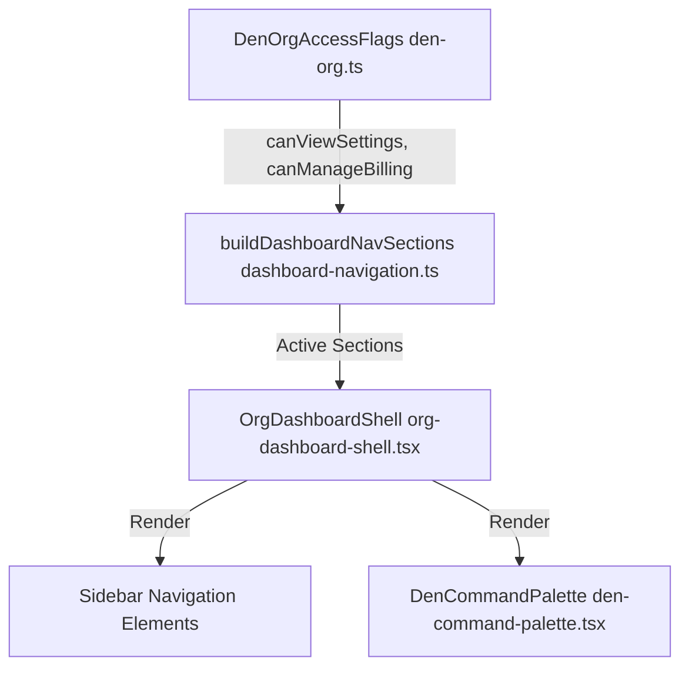
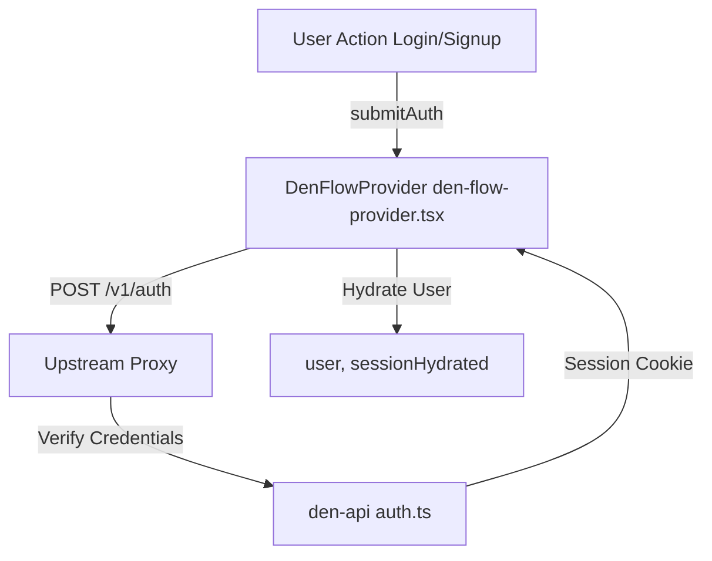
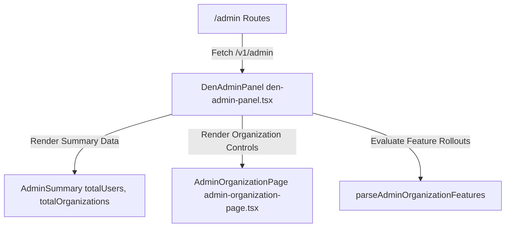
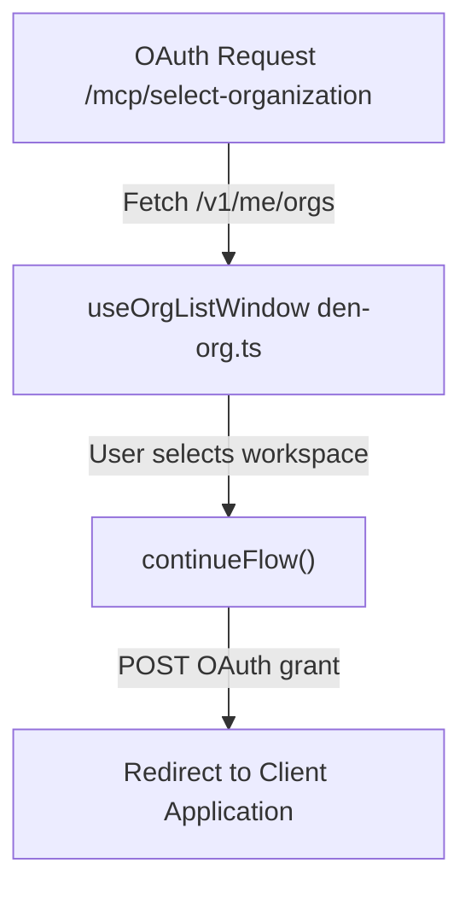

<!-- source: DeepWiki mcp.deepwiki.com · repo different-ai/openwork · page 5.5 den-web Dashboard · fetched 2026-10-26 -->

# den-web Dashboard

Relevant source files

The following files were used as context for generating this wiki page:

- [ee/apps/den-api/package.json](ee/apps/den-api/package.json)
- [ee/apps/den-api/scripts/build.mjs](ee/apps/den-api/scripts/build.mjs)
- [ee/apps/den-api/scripts/check-runtime-imports.mjs](ee/apps/den-api/scripts/check-runtime-imports.mjs)
- [ee/apps/den-api/src/auth-protection.ts](ee/apps/den-api/src/auth-protection.ts)
- [ee/apps/den-api/src/auth.ts](ee/apps/den-api/src/auth.ts)
- [ee/apps/den-api/src/orgs.ts](ee/apps/den-api/src/orgs.ts)
- [ee/apps/den-api/src/routes/admin/index.ts](ee/apps/den-api/src/routes/admin/index.ts)
- [ee/apps/den-api/src/routes/admin/organization-detail.ts](ee/apps/den-api/src/routes/admin/organization-detail.ts)
- [ee/apps/den-api/src/routes/auth/index.ts](ee/apps/den-api/src/routes/auth/index.ts)
- [ee/apps/den-api/src/routes/org/core.ts](ee/apps/den-api/src/routes/org/core.ts)
- [ee/apps/den-api/src/routes/org/gateway-usage.ts](ee/apps/den-api/src/routes/org/gateway-usage.ts)
- [ee/apps/den-api/src/routes/org/invitations.ts](ee/apps/den-api/src/routes/org/invitations.ts)
- [ee/apps/den-api/test/build-source-exports.test.ts](ee/apps/den-api/test/build-source-exports.test.ts)
- [ee/apps/den-web/README.md](ee/apps/den-web/README.md)
- [ee/apps/den-web/app/(den)/_lib/den-api-origin.ts](ee/apps/den-web/app/(den)/_lib/den-api-origin.ts)
- [ee/apps/den-web/app/(den)/_lib/den-flow.ts](ee/apps/den-web/app/(den)/_lib/den-flow.ts)
- [ee/apps/den-web/app/(den)/_lib/den-org.ts](ee/apps/den-web/app/(den)/_lib/den-org.ts)
- [ee/apps/den-web/app/(den)/_providers/den-flow-provider.tsx](ee/apps/den-web/app/(den)/_providers/den-flow-provider.tsx)
- [ee/apps/den-web/app/(den)/dashboard/_components/command-palette/den-command-palette.tsx](ee/apps/den-web/app/(den)/dashboard/_components/command-palette/den-command-palette.tsx)
- [ee/apps/den-web/app/(den)/dashboard/_components/gateway-usage-section.tsx](ee/apps/den-web/app/(den)/dashboard/_components/gateway-usage-section.tsx)
- [ee/apps/den-web/app/(den)/dashboard/_components/manage-members-screen.tsx](ee/apps/den-web/app/(den)/dashboard/_components/manage-members-screen.tsx)
- [ee/apps/den-web/app/(den)/dashboard/_components/org-dashboard-shell.tsx](ee/apps/den-web/app/(den)/dashboard/_components/org-dashboard-shell.tsx)
- [ee/apps/den-web/app/(den)/dashboard/_lib/dashboard-navigation.ts](ee/apps/den-web/app/(den)/dashboard/_lib/dashboard-navigation.ts)
- [ee/apps/den-web/app/(den)/dashboard/_providers/org-dashboard-provider.tsx](ee/apps/den-web/app/(den)/dashboard/_providers/org-dashboard-provider.tsx)
- [ee/apps/den-web/app/admin/organizations/[organizationId]/layout.tsx](ee/apps/den-web/app/admin/organizations/[organizationId]/layout.tsx)
- [ee/apps/den-web/components/admin/admin-access-screen.tsx](ee/apps/den-web/components/admin/admin-access-screen.tsx)
- [ee/apps/den-web/components/admin/admin-dashboard.tsx](ee/apps/den-web/components/admin/admin-dashboard.tsx)
- [ee/apps/den-web/components/admin/admin-data-page.tsx](ee/apps/den-web/components/admin/admin-data-page.tsx)
- [ee/apps/den-web/components/admin/admin-organization-page.tsx](ee/apps/den-web/components/admin/admin-organization-page.tsx)
- [ee/apps/den-web/components/admin/admin-recent-organizations.tsx](ee/apps/den-web/components/admin/admin-recent-organizations.tsx)
- [ee/apps/den-web/components/admin/admin-request.ts](ee/apps/den-web/components/admin/admin-request.ts)
- [ee/apps/den-web/components/admin/admin-shell.tsx](ee/apps/den-web/components/admin/admin-shell.tsx)
- [ee/apps/den-web/components/den-admin-panel.tsx](ee/apps/den-web/components/den-admin-panel.tsx)
- [ee/apps/den-web/instrumentation-client.ts](ee/apps/den-web/instrumentation-client.ts)
- [ee/apps/den-web/next.config.js](ee/apps/den-web/next.config.js)
- [ee/apps/den-web/package.json](ee/apps/den-web/package.json)
- [ee/apps/den-web/posthog-privacy.ts](ee/apps/den-web/posthog-privacy.ts)
- [ee/apps/den-web/proxy.ts](ee/apps/den-web/proxy.ts)
- [ee/packages/den-db/drizzle/0125_gateway_usage_route_indexes.sql](ee/packages/den-db/drizzle/0125_gateway_usage_route_indexes.sql)
- [ee/packages/den-db/drizzle/meta/0125_snapshot.json](ee/packages/den-db/drizzle/meta/0125_snapshot.json)
- [evals/proofs/admin-access.proof.test.ts](evals/proofs/admin-access.proof.test.ts)
- [evals/proofs/admin-organizations-list.proof.test.ts](evals/proofs/admin-organizations-list.proof.test.ts)
- [evals/worlds/admin-access.ts](evals/worlds/admin-access.ts)
- [packages/docs/ai-gateway/counting-usage.mdx](packages/docs/ai-gateway/counting-usage.mdx)
- [packages/docs/ai-gateway/token-costs.mdx](packages/docs/ai-gateway/token-costs.mdx)
- [packaging/docker/Dockerfile.den](packaging/docker/Dockerfile.den)
- [packaging/docker/Dockerfile.den-web](packaging/docker/Dockerfile.den-web)

The `den-web` dashboard (`ee/apps/den-web`) is the Next.js frontend application for `app.openworklabs.com` [ee/apps/den-web/README.md:1-3]() and functions as the web-based enterprise control plane for OpenWork. It manages organization provisioning, role-based access control, security policies, AI Gateway configurations, API keys, billing subscriptions, and Model Context Protocol (MCP) OAuth consent flows.

---

## 1. Dashboard Architecture and Proxy Routing

The application is built on Next.js with Tailwind CSS [ee/apps/den-web/package.json:1-60]() and communicates securely with the upstream `den-api` backend service. Because the user interface is deployed separately from the API, `den-web` provides a robust upstream proxy layer (`ee/apps/den-web/app/api/_lib/upstream-proxy.ts`) to handle header normalization, cookie isolation, CORS reflection, and request body sizing.

**Sources:**
- `ee/apps/den-web/package.json:1-60` [ee/apps/den-web/package.json:1-60]()
- `ee/apps/den-web/app/api/_lib/upstream-proxy.ts:1-171` [ee/apps/den-web/app/api/_lib/upstream-proxy.ts:1-171]()

---

## 2. Organization Dashboard Shell and Navigation

The primary container for authenticated workspace users is `OrgDashboardShell` (`ee/apps/den-web/app/(den)/dashboard/_components/org-dashboard-shell.tsx`). It organizes the layout hierarchy, including the organization dropdown, sidebar links, command palette, and breadcrumb trails.

Navigation categories are dynamically built by `buildDashboardNavSections` (`ee/apps/den-web/app/(den)/dashboard/_lib/dashboard-navigation.ts`) using the user's computed role permissions (`DenOrgAccessFlags`) defined in `ee/apps/den-web/app/(den)/_lib/den-org.ts`.

### Role-Based Access Control in Navigation
The sidebar determines administrative visibility through `sidebarRoleLabel` (`ee/apps/den-web/app/(den)/dashboard/_components/org-dashboard-shell.tsx:77-79`), which evaluates management flags derived from `getOrgAccessFlags` (`ee/apps/den-web/app/(den)/_lib/den-org.ts:98-202`). Administrative menus like AI Gateway, Connectors, and Desktop Policies are automatically omitted if the user lacks the necessary permission.

**Sources:**
- `ee/apps/den-web/app/(den)/dashboard/_components/org-dashboard-shell.tsx:1-119` [ee/apps/den-web/app/(den)/dashboard/_components/org-dashboard-shell.tsx:1-119]()
- `ee/apps/den-web/app/(den)/_lib/den-org.ts:1-204` [ee/apps/den-web/app/(den)/_lib/den-org.ts:1-204]()

---

## 3. DenFlow Provider and Authentication Screens

State management for authentication, session hydration, and sign-up flows is coordinated by `DenFlowProvider` (`ee/apps/den-web/app/(den)/_providers/den-flow-provider.tsx`). 

### Key Provider Capabilities:
- **Session Hydration & Revalidation**: Tracks `sessionHydrated` state and exposes `revalidateSession` to verify authentication tokens against the control plane [ee/apps/den-web/app/(den)/_providers/den-flow-provider.tsx:96-120]().
- **Verification Handling**: Manages multi-factor email verification codes via `submitVerificationCode` and `resendVerificationCode` [ee/apps/den-web/app/(den)/_providers/den-flow-provider.tsx:113-115]().
- **Social Authentication**: Integrates third-party providers via `beginSocialAuth` [ee/apps/den-web/app/(den)/_providers/den-flow-provider.tsx:116]().

**Sources:**
- `ee/apps/den-web/app/(den)/_providers/den-flow-provider.tsx:80-124` [ee/apps/den-web/app/(den)/_providers/den-flow-provider.tsx:80-124]()

---

## 4. Upstream Proxy Implementation

The core mechanism routing browser requests to the Den API backend is implemented in `ee/apps/den-web/app/api/_lib/upstream-proxy.ts`. 

### Key Proxy Safeguards:
- **Cloud Instance Reflection**: Detects Daytona or cloud preview hostnames and safely reflects headers while requiring bearer authentication.
- **Body Limit Enforcement**: Enforces a default request payload ceiling (`DEFAULT_REQUEST_BODY_MAX_BYTES`) to safely permit attachments and large configuration syncs without out-of-memory errors.
- **Header Sanitization**: Strips hop-by-hop transmission headers and forwarding strings before dispatching payloads downstream.

**Sources:**
- `ee/apps/den-web/app/api/_lib/upstream-proxy.ts:1-171` [ee/apps/den-web/app/api/_lib/upstream-proxy.ts:1-171]()

---

## 5. Admin Panel and Analytics Screens

Platform operators use `DenAdminPanel` (`ee/apps/den-web/components/den-admin-panel.tsx`) to review ecosystem metrics, organizations, user accounts, and billing states.

### Analytics & Billing Metrics:
- **Activity Metrics**: Tracks active users across 1-day, 7-day, and 30-day windows (`AdminSummary`) along with signup velocity time-series charts [ee/apps/den-web/components/den-admin-panel.tsx:86-112]().
- **Billing Status & Subscriptions**: Inspects organization entitlements (`free`, `team`, `enterprise`) and complimentary OpenWork Web access flags (`AdminOpenWorkWebAccess`) [ee/apps/den-web/components/den-admin-panel.tsx:138-164]().

**Sources:**
- `ee/apps/den-web/components/den-admin-panel.tsx:1-212` [ee/apps/den-web/components/den-admin-panel.tsx:1-212]()

---

## 6. MCP OAuth Consent and Organization Selection

When external clients or native applications request Model Context Protocol (MCP) data access, users complete an OAuth consent flow hosted at `McpSelectOrganizationPage` (`ee/apps/den-web/app/mcp/select-organization/page.tsx`).

The component retrieves user organization memberships, verifies token validity, and prompts the user to associate the client token with an active organization.

**Sources:**
- `ee/apps/den-web/app/mcp/select-organization/page.tsx:1-184` [ee/apps/den-web/app/mcp/select-organization/page.tsx:1-184]()

---

